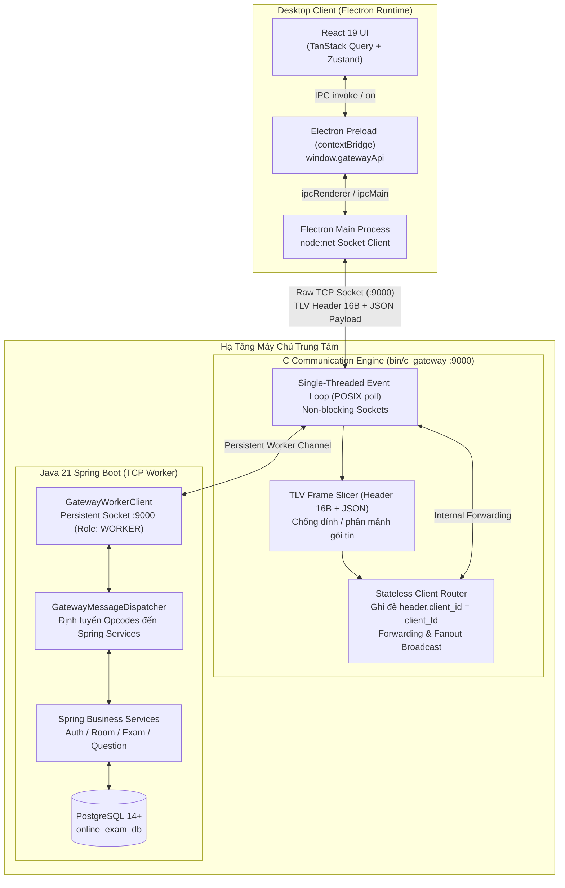

# mooc-clone — Hệ thống Thi Trắc nghiệm Trực tuyến

Hệ thống thi trắc nghiệm trực tuyến thời gian thực (Online Examination System) theo mô hình Desktop Client - Central Gateway Server, loại bỏ hoàn toàn sự phụ thuộc vào trình duyệt Web và HTTP trung gian, vận hành trên nền tảng **C Communication Engine (TCP Gateway)** kết hợp **Electron Desktop (React 19)** và **Java 21 Spring Boot Backend**.

---

## 1. Cấu trúc Dự án (Monorepo Architecture)

Dự án được tổ chức theo kiến trúc Monorepo phân tầng rõ ràng giữa Giao diện Desktop, Cổng Giao Tiếp Mạng và Tầng Nghiệp Vụ Máy Chủ:

```text
mooc-clone/
├── client/          # Ứng dụng Desktop chạy trên Electron Runtime
│   ├── src/         # Giao diện React 19, TypeScript, Tailwind CSS v4, gatewayClient
│   ├── electron/    # Tiến trình Main (node:net TCP Socket) & Preload IPC Bridge
│   ├── docs/        # 17 chuyên đề kỹ thuật chi tiết của Frontend
│   └── FRONTEND_CONVENTIONS.md  # Bộ quy chuẩn phát triển Frontend
├── server/          # Máy chủ Nghiệp Vụ Java & Worker TCP Client
│   ├── src/         # Mã nguồn Java 21 Spring Boot + Gateway Worker Client
│   ├── docs/        # Tài liệu kiến trúc chuyên sâu & AI Guides
│   └── online_exam_schema.sql   # Kịch bản khởi tạo CSDL PostgreSQL
├── server-c/        # C Communication Engine (Stateless TCP Gateway :9000)
│   ├── include/     # Header đặc tả Socket POSIX non-blocking và TLV Frame 16B
│   ├── src/         # Mã nguồn C11 thuần túy (poll event loop, zero cJSON)
│   ├── tests/       # Unit Tests (Socket, TLV Framing, Sticky/Fragmented stream)
│   └── README.md    # Sổ tay vận hành, biên dịch và kiểm thử bộ nhớ C Engine
└── README.md        # Tài liệu tổng quan kiến trúc và thang điểm
```

### Sơ Đồ Kiến Trúc Hệ Thống (Mermaid):



---

## 2. Danh sách Chức năng Chi tiết

Hệ thống cung cấp đầy đủ các tính năng phục vụ cho cả thí sinh, người tạo phòng và quản trị viên:

### 2.1 Chế độ thi (Exam Room Mode)
- **Tạo và thiết lập phòng thi:** Người dùng có thể tạo phòng thi mới, cấu hình số lượng câu hỏi, thời gian thi cho phòng thi. Chủ phòng có toàn quyền bắt đầu và kết thúc bài thi.
- **Danh sách phòng thi & Trạng thái:** Xem danh sách phòng thi kèm trạng thái thời gian thực (chưa bắt đầu, đang diễn ra, đã kết thúc).
- **Tham gia phòng thi:** Cho phép thí sinh tham gia vào phòng thi khi phòng thi chưa bắt đầu.
- **Cấp phát đề thi đồng bộ:** Khi bắt đầu thi, máy chủ gửi lại đề thi đồng loạt cho toàn bộ thí sinh trong phòng qua cơ chế Server Push Broadcast (`0x80`).
- **Làm bài linh hoạt:** Cập nhật câu trả lời linh hoạt trong suốt thời gian làm bài còn hiệu lực.
- **Nộp bài sớm & Tự động thu bài:** Nộp bài chủ động hoặc tự động chốt bài và thông báo điểm ngay khi hết giờ.
- **Xem kết quả phòng thi:** Bảng xếp hạng và kết quả chi tiết của phòng thi sau khi kết thúc.

### 2.2 Chế độ luyện tập (Practice Mode)
- Thí sinh làm các bài thi luyện tập cá nhân độc lập với số lượng câu hỏi và thời gian tùy chỉnh.
- Sau khi hoàn thành, hệ thống lập tức chấm điểm và giải thích chi tiết phương án trả lời.

### 2.3 Phân loại câu hỏi & Quản lý đề thi
- Phân loại câu hỏi theo độ khó (Dễ, Trung bình, Khó) và chủ đề.
- Sinh đề thi ngẫu nhiên theo tỷ lệ phân bổ cấu hình phòng.

### 2.4 Giao diện Desktop & Cơ chế Mạng Tinh Gọn
- **Desktop Application:** Giao diện Desktop hiện đại, mượt mà, độc lập hoàn toàn với trình duyệt Web.
- **C Communication Engine:** Tự cài đặt socket TCP non-blocking bằng C trên Linux/WSL2, bóc tách dòng byte theo chuẩn TLV 16B, triệt tiêu hiện tượng dính/cắt gói tin.

---

## 3. Bảng Điểm & Tiêu chí Đánh giá (Rubric)

Toàn bộ các tiêu chí tính điểm của hệ thống được quy định chi tiết trong bảng dưới đây:

| STT | Tiêu chí đánh giá | Điểm số | Ghi chú kỹ thuật |
| :-: | :--- | :---: | :--- |
| 1 | **Xử lý truyền dòng** | **1 điểm** | Phân đoạn khung tin nhị phân TLV 16B, xử lý buffer tích lũy và chống dính gói / cắt gói TCP |
| 2 | **Cài đặt cơ chế vào/ra socket trên server** | **2 điểm** | C Communication Engine đơn luồng (POSIX `poll()`), non-blocking I/O multiplexer |
| 3 | **Đăng ký và quản lý tài khoản** | **2 điểm** | Đăng ký tài khoản mới, mã hóa mật khẩu BCrypt, kiểm tra trùng lặp |
| 4 | **Đăng nhập và quản lý phiên** | **2 điểm** | Xác thực người dùng, cấp phát phiên qua kênh TCP Socket, kiểm tra hết hạn |
| 5 | **Kiểm soát quyền truy cập** | **1 điểm** | Phân quyền vai trò (User/Admin, chủ phòng vs thành viên tham gia) |
| 6 | **Tham gia chế độ luyện tập** | **1 điểm** | Khởi tạo attempt luyện tập cá nhân độc lập, tính điểm tức thì |
| 7 | **Tạo phòng thi** | **2 điểm** | Thiết lập cấu hình phòng, thời gian, số câu hỏi theo độ khó |
| 8 | **Xem danh sách phòng thi** | **1 điểm** | Hiển thị trạng thái phòng trực quan (chưa bắt đầu, đang diễn ra, kết thúc) |
| 9 | **Tham gia vào phòng thi** | **2 điểm** | Kiểm tra điều kiện phòng chờ, đồng bộ danh sách thành viên tham gia |
| 10 | **Bắt đầu bài thi** | **1 điểm** | Đồng bộ thời gian bắt đầu, phân phối đề thi nhất quán cho toàn bộ thí sinh |
| 11 | **Thay đổi phương án trả lời trước đó** | **1 điểm** | Cập nhật câu trả lời linh hoạt trong suốt thời gian làm bài còn hiệu lực |
| 12 | **Nộp bài và chấm điểm** | **2 điểm** | Cơ chế nộp bài chủ động, tự động thu bài khi hết giờ, chấm điểm tự động |
| 13 | **Xem kết quả thi của các phòng thi** | **1 điểm** | Bảng xếp hạng và kết quả chi tiết của phòng thi sau khi kết thúc |
| 14 | **Ghi log hoạt động** | **1 điểm** | Ghi nhận sự kiện nghiệp vụ và bảo mật (audit logs) |
| 15 | **Phân loại câu hỏi theo độ khó, chủ đề** | **1 – 3 điểm** | Phân chia ngân hàng câu hỏi, hỗ trợ lọc và sinh đề theo tỷ lệ |
| 16 | **Lưu trữ thông tin bài thi + đồ thị** | **2 điểm** | Lưu lịch sử snapshot bài thi, trực quan hóa tiến trình qua biểu đồ |
| 17 | **Giao diện đồ họa (GUI Desktop)** | **3 điểm** | Giao diện Desktop Electron hiện đại, thân thiện, tương tác phản hồi mượt mà |
| 18 | **Các chức năng nâng cao khác** | **1 – 10 điểm** | C Communication Engine độc lập, cơ chế Server Push Broadcast, tự động kết nối lại |

---

## 4. Hướng dẫn Khởi chạy (Quick Start Guide)

### 4.1 Khởi tạo Cơ sở Dữ liệu (PostgreSQL 14+)

1. Tạo một cơ sở dữ liệu trống trên PostgreSQL (ví dụ: `online_exam_db`).
2. Thực thi kịch bản tạo bảng tại [server/online_exam_schema.sql](server/online_exam_schema.sql):
   ```bash
   psql -U postgres -d online_exam_db -f server/online_exam_schema.sql
   ```

### 4.2 Bước 1: Khởi chạy C Communication Engine (TCP Gateway)

Trên môi trường Linux hoặc WSL2 Ubuntu 22.04:

```bash
cd server-c
make gateway
./build/c_gateway 9000
```

### 4.3 Bước 2: Khởi chạy Máy chủ Backend (Java Spring Boot)

Mở một cửa sổ dòng lệnh khác, di chuyển vào thư mục `server/` và khởi chạy Maven Wrapper:

```bash
# Trên Windows
cd server
.\mvnw.cmd spring-boot:run

# Trên Linux / macOS
cd server
./mvnw spring-boot:run
```

*Máy chủ sẽ tự động kết nối và đăng ký vai trò `WORKER` với C Gateway trên cổng 9000.*

### 4.4 Bước 3: Khởi chạy Ứng dụng Desktop Thí Sinh (Electron + React)

Di chuyển vào thư mục `client/`:

```bash
cd client
npm install
npm run dev
# Mở một terminal khác để khởi chạy Electron Desktop App:
npm run electron:dev
```

---

## 5. Tài liệu Kỹ thuật Liên quan

- **Tài liệu C Communication Engine (`server-c/`):** Đặc tả kiến trúc POSIX Socket, bảng mã lệnh Opcodes, khung tin TLV 16B và runbook tại [server-c/README.md](server-c/README.md).
- **Tài liệu & Kiến trúc Backend:** Phân Hệ Mạng Thời Gian Thực, Đặc Tả Giao Tiếp Opcodes/REST, và CSDL 3NF tại [server/README.md](server/README.md), [server/docs/realtime-network-subsystem.md](server/docs/realtime-network-subsystem.md), [server/docs/api-specification.md](server/docs/api-specification.md) và [server/docs/database-architecture.md](server/docs/database-architecture.md).
- **Quy chuẩn Phát triển Desktop & Frontend:** Tiêu chuẩn 19 Master Rules, Kiến Trúc Desktop Electron và Semantic Tokens tại [client/FRONTEND_CONVENTIONS.md](client/FRONTEND_CONVENTIONS.md) và [client/docs/17-mobile-and-native-architecture.md](client/docs/17-mobile-and-native-architecture.md).
