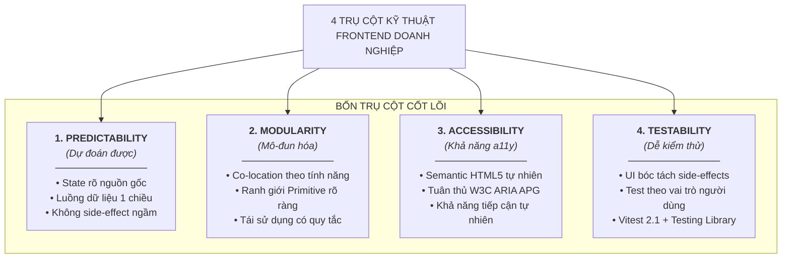
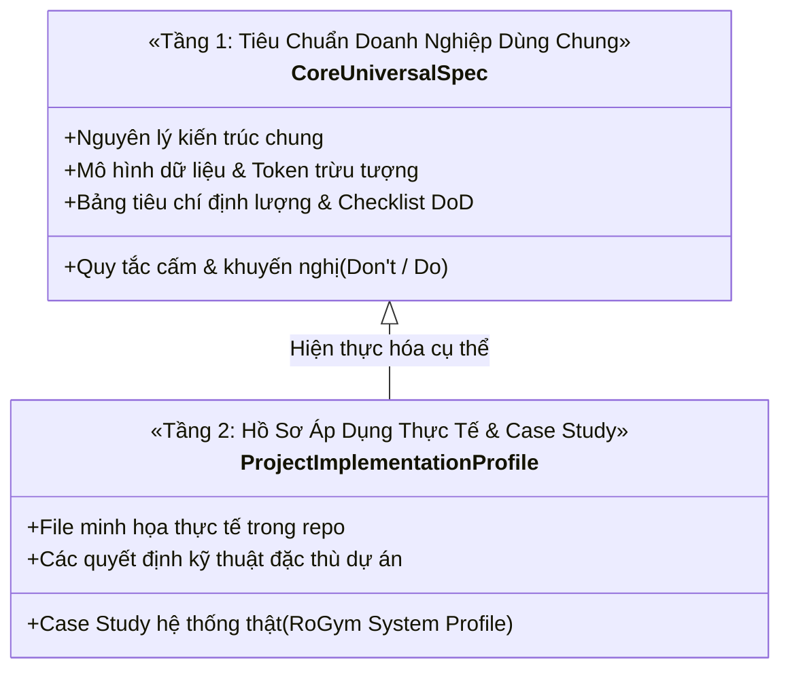
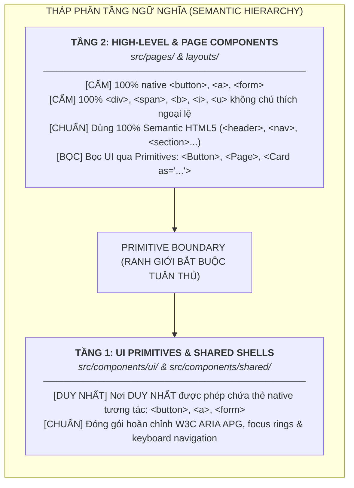

# Quy Chuẩn Lập Trình Frontend Doanh Nghiệp (Enterprise Frontend Conventions Blueprint)

> **Dự án:** Khung Tiêu Chuẩn Doanh Nghiệp & Hồ Sơ Dự Án RoGym  
> **Phạm vi kỹ thuật:** Frontend SPA (`client/`) — React 18.3 & React 19 Ready, TypeScript 5.4, Vite 5.2, Tailwind CSS 3.4, TanStack Query 5.35, Zustand 4.5, Radix UI, Vitest 2.1  
> **Cổng vào tài liệu chuyên sâu:** [Bản Đồ Tài Liệu & 4 Lộ Trình Đọc](./docs/README.md)  
> **Cơ sở tham chiếu quốc tế:** [React.dev](https://react.dev), [Bulletproof React](https://github.com/alan2207/bulletproof-react), [TkDodo's Practical React Query](https://tkdodo.eu/blog), [W3C WAI-ARIA APG](https://www.w3.org/WAI/ARIA/apg/), [OWASP](https://owasp.org), [Web.dev Core Web Vitals](https://web.dev/vitals/), [RFC 7807](https://datatracker.ietf.org/doc/html/rfc7807), [Vercel React Best Practices](https://vercel.com)  
> **Phiên bản:** 8.0 (Enterprise Quality Standard — 17 Spokes & Universal Decoupling)  
> **Trạng thái:** Bắt buộc tuân thủ 100% đối với toàn bộ kỹ sư, AI Assistant và quy trình Code Review / CI Scan

> [!TIP]
> 🚀 **Dành Cho Kỹ Sư Mới — Khởi Động Nhanh Trong 15 Phút:**  
> Không cần đọc toàn bộ hàng ngàn dòng tài liệu ngay ngày đầu! Hãy tra cứu nhanh tại **[`docs/QUICK_REFERENCE.md`](./docs/QUICK_REFERENCE.md)** để nắm ngay 12 tiêu chí nghiệm thu PR, 4 công thức viết code chuẩn và ma trận 135+ quy chuẩn cốt lõi.

---

## MỤC LỤC

0. [🚀 Quick Reference Sheet (Tra cứu nhanh 15 phút)](./docs/QUICK_REFERENCE.md)
1. [Nguyên Tắc 4 Trụ Cột Kỹ Thuật](#1-nguyên-tắc-4-trụ-cột-kỹ-thuật)
2. [Cơ Sở Tham Chiếu Chuẩn Quốc Tế (Authoritative References)](#2-cơ-sở-tham-chiếu-chuẩn-quốc-tế-authoritative-references)
3. [Chiến Lược Tách Bạch 2 Lớp (Decoupling Architecture)](#3-chiến-lược-tách-bạch-2-lớp-decoupling-architecture)
4. [Tháp Phân Tầng Ngữ Nghĩa (Semantic Hierarchy & Boundaries)](#4-tháp-phân-tầng-ngữ-nghĩa-semantic-hierarchy-boundaries)
5. [Ma Trận 19 Tiêu Chuẩn Doanh Nghiệp & Hệ Thống Rule IDs](#5-ma-trận-19-tiêu-chuẩn-doanh-nghiệp-hệ-thống-rule-ids)
6. [Hệ Thống Thực Thi 3 Tuyến Phòng Thủ (3-Tier Defense Enforcement)](#6-hệ-thống-thực-thi-3-tuyến-phòng-thủ-3-tier-defense-enforcement)
7. [Cơ Chế Ngoại Lệ Có Cấu Trúc (Structured rogym-convention-exempt)](#7-cơ-chế-ngoại-lệ-có-cấu-trúc-structured-rogym-convention-exempt)
8. [Hệ Thống Kiểm Toán Tự Động & Baseline Snapshot (Tooling Integration)](#8-hệ-thống-kiểm-toán-tự-động-baseline-snapshot-tooling-integration)
9. [Checklist 12 Tiêu Chí PR Definition of Done (DoD)](#9-checklist-12-tiêu-chí-pr-definition-of-done-dod)
10. [Bản Đồ 17 Chuyên Đề Chuyên Sâu Doanh Nghiệp](#10-bản-đồ-17-chuyên-đề-chuyên-sâu-doanh-nghiệp)
11. [Chỉ Dẫn Dành Cho AI Assistant (LLM Pair-Programming Rules)](#11-chỉ-dẫn-dành-cho-ai-assistant-llm-pair-programming-rules)

---

## 1. Nguyên Tắc 4 Trụ Cột Kỹ Thuật

Mọi dòng mã nguồn được viết trên hệ thống Frontend đều phải phụng sự và thỏa mãn 4 giá trị kỹ thuật cốt lõi:



1. **Predictability (Tính dự đoán được):** Phân định rạch ròi 4 tầng state (Server State với TanStack Query v5, Global State với Zustand, URL State với search params, và Local State với `useState`). Tuyệt đối không sao chép state phụ qua `useEffect`. Trạng thái của một component phải hoàn toàn suy luận được từ đầu vào của nó mà không bị phân kỳ ngầm.
2. **Modularity (Tính mô-đun hóa cao):** Tổ chức mã nguồn theo mô hình Feature-Driven Co-location của Bulletproof React. Code của tính năng nào nằm trọn vẹn trong thư mục tính năng đó. Giảm thiểu tối đa bán kính ảnh hưởng (blast radius) khi chỉnh sửa hoặc gỡ bỏ một module.
3. **Accessibility (Khả năng tiếp cận tự nhiên):** Áp dụng triết lý _First Rule of ARIA_: 100% sử dụng thẻ Semantic HTML chuẩn W3C trước khi can thiệp ARIA roles. Không xem khả năng tiếp cận (A11y) là tính năng bổ sung phụ trợ, mà là yêu cầu chất lượng nền tảng ngay từ dòng code đầu tiên.
4. **Testability (Tính dễ kiểm thử):** Tách biệt UI thuần túy (Presentational) khỏi logic truy vấn (Hooks/Queries). Kiểm thử Vitest 2.1 bám sát hành vi người dùng (`getByRole`, `getByLabelText`) thay vì bám vào CSS selector hay cấu trúc DOM nội bộ.

---

## 2. Cơ Sở Tham Chiếu Chuẩn Quốc Tế (Authoritative References)

Để đảm bảo tính khách quan và khoa học, toàn bộ quy chuẩn lập trình được xây dựng dựa trên các tiêu chuẩn kỹ thuật có thật được công nhận rộng rãi trên thế giới:

| Nguồn tham chiếu                                                              | Tác giả / Tổ chức                | Tài liệu / Khái niệm áp dụng vào hệ thống                                             |
| :---------------------------------------------------------------------------- | :------------------------------- | :------------------------------------------------------------------------------------ |
| **[Bulletproof React](https://github.com/alan2207/bulletproof-react)**        | Alan Eicker / Sandro Roth        | Kiến trúc Feature-Driven, Co-location, Rule of Three, ranh giới Primitive UI.         |
| **[TkDodo's Practical React Query](https://tkdodo.eu/blog)**                  | Dominik Dorfmeister (TanStack)   | Query Key Factory (`queryKeys`), Data transformation qua `select`, Caching.           |
| **[Zustand Docs](https://zustand.docs.pmnd.rs)**                              | Poimandres Team                  | Atomic Selectors (`useAuthStore(s => s.user)`), `useShallow`, tách Actions.           |
| **[W3C WAI-ARIA APG](https://www.w3.org/WAI/ARIA/apg/)**                      | W3C Web Accessibility Initiative | First Rule of ARIA, Landmark Roles, Accessible Name (`aria-labelledby`).              |
| **[React.dev Official Docs](https://react.dev)**                              | React Core Team (Meta)           | "You Might Not Need An Effect", Derived state trong render body, `useMemo` đúng lúc.  |
| **[Testing Library](https://testing-library.com)**                            | Kent C. Dodds                    | Guiding Principles: Kiểm thử phần mềm theo cách người dùng tương tác.                 |
| **[OWASP Client-Side Security](https://owasp.org)**                           | OWASP Foundation                 | Client-Side Top 10, phòng chống XSS, CSRF, Token Governance, Content Security Policy. |
| **[Google Web Vitals](https://web.dev/vitals/)**                              | Google Chrome Team               | Bộ ba chỉ số Core Web Vitals (LCP, INP, CLS), Bundle Budgets, Resource Preloading.    |
| **[RFC 7807 Problem Details](https://datatracker.ietf.org/doc/html/rfc7807)** | IETF Standards                   | Định dạng chuẩn hóa phản hồi lỗi HTTP APIs có cấu trúc nhất quán.                     |

---

## 3. Chiến Lược Tách Bạch 2 Lớp (Decoupling Architecture)

Nhằm đảm bảo bộ tài liệu vừa giải quyết hoàn hảo bài toán dự án hiện tại, vừa dùng làm chuẩn mực cho mọi dự án doanh nghiệp sau này (FinTech, E-Commerce, B2B SaaS, ERP), hệ thống quy chuẩn được phân định thành **2 Tầng độc lập**:



- **Tầng 1 — Core Universal Specification (Chuẩn Mực Chung):**
  - Sử dụng văn phong trung tính của kỹ sư trưởng doanh nghiệp.
  - Mọi định danh mang tính quy ước chuẩn (`--color-primary`, `components/ui/`, `features/auth/`, `features/billing/`).
  - Áp dụng được ngay cho mọi dự án SaaS / ERP / E-Commerce mà không phải sửa đổi nội dung nguyên lý.
- **Tầng 2 — Reference Case Study Profile (Hồ Sơ Áp Dụng Thực Tế & Case Study):**
  - Trích dẫn trực tiếp các file có thật trong repository làm minh chứng thực tế (ví dụ: màn hình lịch tập, form thanh toán, kiểm thử nút bấm). Điều này giúp tài liệu có sức thuyết phục tuyệt đối, chứng minh rằng các quy chuẩn này đã chạy thành công trong sản phẩm thật chứ không phải lý thuyết giáo điều.

---

## 4. Tháp Phân Tầng Ngữ Nghĩa (Semantic Hierarchy & Boundaries)

Để loại bỏ triệt để hiện tượng "thẻ div lộn xộn" (div soup) và đảm bảo cấu trúc trang chuẩn SEO & Khả năng tiếp cận (A11y), hệ thống thiết lập ranh giới tuyệt đối giữa 2 tầng component:



### 4.1. Ranh giới Tầng 1: UI Primitives (`src/components/ui/` & `src/components/shared/`)

- Là nơi **DUY NHẤT** trong toàn bộ dự án được phép chứa các thẻ native tương tác (`<button>`, `<a>`, `<form>`).
- Cung cấp các khối gạch nền tảng: `Button`, `ButtonLink`, `ButtonAnchor`, `SubmitButton`, `BackButton`, `Form`, `FormField`, `Input`, `Card`, `Badge`, `Page`, `Icon`.
- Mọi component tại đây bắt buộc bọc `forwardRef`, kế thừa HTML attributes tiêu chuẩn và có `displayName`.

### 4.2. Ranh giới Tầng 2: High-Level & Page Components (`src/pages/`)

- **TUYỆT ĐỐI CẤM** sử dụng trực tiếp các thẻ native tương tác:
  - Cấm `<button>` ➔ Bắt buộc dùng `<Button>`, `<SubmitButton>` hoặc `<BackButton>`.
  - Cấm `<a href="...">` ➔ Bắt buộc dùng `<ButtonLink to="...">` (nội bộ) hoặc `<ButtonAnchor href="...">` (ngoài).
  - Cấm `<form>` ➔ Bắt buộc dùng `<Form onSubmit={handleSubmit} noValidate>`.
- **TUYỆT ĐỐI CẤM** sử dụng các thẻ Non-semantic (`<div>`, `<span>`, `<b>`, `<i>`, `<u>`) một cách tùy tiện:
  - Thay thế 100% bằng thẻ HTML5 Semantic: `<header>`, `<main>`, `<nav>`, `<aside>`, `<section>`, `<article>`, `<footer>`, `<figure>`, `<p>`, `<h1-h6>`, `<ul>`, `<ol>`, `<li>`, `<strong>`, `<em>`...
  - Hoặc bọc bằng UI Primitives: `<Page>`, `<Card as="section">`, `<Card as="article">`, `<Badge>`, `<Separator>`, `<Icon>`.

### 4.3. Bảng Tóm Tắt Ánh Xạ Nhanh 1-1 Cho Lập Trình Viên

| Thẻ Bị Cấm Trên Trang              | Nhóm Phân Loại      | Thành Phần / Thẻ Bắt Buộc Dùng Thay Thế                               |
| :--------------------------------- | :------------------ | :-------------------------------------------------------------------- |
| `<button>`                         | Native Interactive  | `<Button>`, `<SubmitButton>`, `<BackButton>`                          |
| `<a href="...">` (Nội bộ)          | Native Interactive  | `<ButtonLink to="...">`, `<BreadcrumbLink to="...">`                  |
| `<a href="...">` (Ngoài)           | Native Interactive  | `<ButtonAnchor href="..." target="_blank" rel="noopener noreferrer">` |
| `<form>`                           | Native Interactive  | `<Form onSubmit={handleSubmit} noValidate>`                           |
| `<div>` (Bọc toàn trang)           | Non-semantic Layout | `<Page>`, `<PageHeader>`                                              |
| `<div>` (Khối nội dung độc lập)    | Non-semantic Layout | `<Card as="article">`, `<Card as="section">`                          |
| `<div>` (Thanh điều hướng / tabs)  | Non-semantic Layout | `<nav aria-label="...">`, `<Tabs>`                                    |
| `<span>` (Nhãn trạng thái / badge) | Non-semantic Text   | `<Badge tone="...">`, `<StatusBadge>`                                 |
| `<span>` (Đoạn văn bản phụ)        | Non-semantic Text   | `<p>`, `<small>`, `<time>`                                            |
| `<b>`, `<i>`, `<u>`                | Non-semantic Text   | `<strong>`, `<em>`, Lucide SVG Icons hoặc `<Icon>`                    |

---

## 5. Ma Trận 19 Tiêu Chuẩn Doanh Nghiệp & Hệ Thống Rule IDs

### 5.1. Ma Trận 19 Tiêu Chuẩn Lập Trình Cốt Lõi

|  STT   | Tiêu Chuẩn Lập Trình                         |  Mức Độ  | Trọng Tâm Quy Chuẩn                                                                     | Cơ Chế Kiểm Soát              |
| :----: | :------------------------------------------- | :------: | :-------------------------------------------------------------------------------------- | :---------------------------- |
| **01** | **Semantic HTML First**                      | `STRICT` | Cấm native tags trên page; cấm thẻ nonsemantic thiếu chú thích.                         | Script tĩnh + Code Review     |
| **02** | **Quản Trị Ngoại Lệ Có Cấu Trúc**            | `STRICT` | Comment bắt buộc `{/* rogym-convention-exempt: RULE_ID [Lý do] */}`.                    | Script tĩnh (Rule 2, 7)       |
| **03** | **Primitive Boundary Enforcement**           | `STRICT` | Chỉ `ui/` và `shared/` được chứa native `<button>`, `<a>`, `<form>`.                    | Script tĩnh (Rule 2)          |
| **04** | **Memoization & Performance Tỉnh Táo**       | `STRICT` | Cấm premature `useMemo`/`useCallback` cho chuỗi/boolean đơn giản.                       | Code Review + DoD             |
| **05** | **Server State qua TanStack Query v5**       | `STRICT` | Bắt buộc dùng `queryKeys` factory từ `@/lib/query-keys.ts` (10 domains).                | Code Review + Test            |
| **06** | **Global State qua Zustand Tối Giản**        | `STRICT` | Dùng Atomic Selectors; cấm lấy cả store; dùng `useShallow`.                             | Code Review                   |
| **07** | **URL State First cho Phân Trang/Lọc**       | `STRICT` | Đồng bộ 2 chiều pagination, filter, search vào `useSearchParams`.                       | Code Review + UX Test         |
| **08** | **Design Tokens & 100% CSS HEX**             | `STRICT` | 100% mã màu trong `styles/` dùng HEX (6/8-digit); cấm `rgba`, `color-mix`, `#fff`.      | Script tĩnh (Rule 1)          |
| **09** | **Tailwind Utility & Clean Code Discipline** | `STRICT` | Cấm mã màu thô (HEX/RGB) trong JSX; cấm arbitrary pixel, magic z-index, raw svg.        | Script tĩnh (Rule 6, 12, 13)  |
| **10** | **Form Architecture Tầng 1**                 | `STRICT` | Bắt buộc dùng primitive `<Form>`, `<FormField>`, `<SubmitButton>`.                      | Code Review + DoD             |
| **11** | **Type Safety & TypeScript Strict**          | `STRICT` | Cấm hoàn toàn `any` (`: any`, `as any`, `<any>`); typing tường minh.                    | TSC Build + Script (Rule 11)  |
| **12** | **Accessibility (a11y) Tự Nhiên**            | `STRICT` | Form field có label nối id; icon button có `aria-label`; alt cho ảnh.                   | Vitest RTL + APG Scan         |
| **13** | **Xử Lý Lỗi Tập Trung & Error Boundary**     | `STRICT` | Widget-level Error Boundary cho bảng biểu/widget; toast cho API error.                  | Code Review                   |
| **14** | **Clean Code & Khử Debug Artefacts**         | `STRICT` | Cấm commit `console.log`, code comment thừa; imports có cấu trúc.                       | Script tĩnh (Rule 16)         |
| **15** | **ForwardRef & DisplayName Bắt Buộc**        | `STRICT` | Mọi UI component bọc `forwardRef` bắt buộc có `displayName`.                            | Script tĩnh (Rule 5)          |
| **16** | **Test-Driven Accessibility (Vitest)**       | `STRICT` | Kiểm thử Vitest 2.1 + RTL; query theo vai trò (`getByRole`, `getByLabelText`).          | Vitest Runner CI              |
| **17** | **Giới Hạn File Size & Cấu Trúc JSX**        | `STRICT` | File .tsx <= 250 dòng vật lý; JSX depth <= 4; prop drilling <= 2; cấm `length &&`.      | Script tĩnh (Rule 17, 18, 19) |
| **18** | **Anti-Magic Values & Thang Đo Đạc**         | `STRICT` | Cấm arbitrary pixel dimensions; thang 5 tầng Z-index (`z-0` - `z-100`); duration chuẩn. | Script tĩnh (Rule 12, 17)     |
| **19** | **Pure Render & Naming Symmetry**            | `STRICT` | Render body là pure function; immutability tuyệt đối; đối xứng `on*`/`handle*`.         | Code Review + DoD             |

### 5.2. Hệ Thống Mã Quy Chuẩn Định Lượng Doanh Nghiệp (Enterprise Rule IDs)

Toàn bộ các quy tắc trong 15 chuyên đề được định danh chuẩn hóa theo cấu trúc: `[TIỀN_TỐ]-[LĨNH_VỰC]-[SỐ_THỨ_TỰ]`:

| Tiền tố Rule | Tên chuyên đề & Phạm vi quản trị                         | Số lượng Rule | Mức độ nghiêm trọng | Mục tiêu kiểm soát                                                                                     |
| :----------: | :------------------------------------------------------- | :-----------: | :-----------------: | :----------------------------------------------------------------------------------------------------- |
| **`STD-*`**  | Chuyên đề 03: Coding Standards & TypeScript Strict       |   19 Rules    |    ERROR & WARN     | Quy chuẩn viết mã, cấm `any`, Primitive Boundary, Clean Code.                                            |
| **`SEM-*`**  | Chuyên đề 08: Semantic Design System & Tokens            |   24 Rules    |    ERROR & WARN     | 100% HEX, CVA multi-axis variants, Semantic HTML hierarchy.                                            |
| **`A11Y-*`** | Chuyên đề 09: W3C Accessibility & WCAG 2.2 AA            |   12 Rules    |    ERROR & WARN     | Tương phản $\ge 4.5:1$, touch target $\ge 44\text{px}$, ARIA role hợp lệ (Duy trì Alias `SEM-A11Y-*`). |
| **`SEC-*`**  | **Chuyên đề 10: Frontend Security & Session Governance** |   10 Rules    | **ERROR** (Strict)  | Chống XSS, CSP headers, HttpOnly Cookie token, PII masking.                                            |
| **`PERF-*`** | **Chuyên đề 11: Web Performance & Core Web Vitals**      |   10 Rules    |    WARN / ERROR     | LCP $\le 2.5\text{s}$, Initial Bundle $\le 180\text{KB}$, Virtualization.                              |
| **`OBS-*`**  | **Chuyên đề 12: Observability, Telemetry & Logging**     |    8 Rules    |        WARN         | Bắt lỗi tập trung, Trace Context `traceparent`, loại bỏ PII khỏi log.                                  |
| **`API-*`**  | **Chuyên đề 13: API Contracts & Network Resilience**     |   10 Rules    |    ERROR & WARN     | Sinh code từ OpenAPI, lỗi chuẩn RFC 7807, `AbortController`.                                           |
| **`I18N-*`** | **Chuyên đề 14: Internationalization & Localization**    |    8 Rules    |    WARN / ERROR     | Cấm hardcode text, bắt buộc dùng `Intl` API, hỗ trợ RTL CSS.                                           |
| **`OPS-*`**  | **Chuyên đề 15: Release Engineering & DevOps Frontend**  |   10 Rules    | **ERROR** (Strict)  | Schema Zod cho biến môi trường, Dockerfile multi-stage, Cache-Busting.                                 |

---

## 6. Hệ Thống Thực Thi 3 Tuyến Phòng Thủ (3-Tier Defense Enforcement)

Để đảm bảo bộ quy chuẩn này trở thành tiêu chuẩn **bắt buộc tuân thủ tự động** chứ không phải lý thuyết suông, quy trình kiểm soát chất lượng được tổ chức thành 3 tuyến phòng thủ:

```mermaid
flowchart LR

    subgraph T1 ["TUYẾN 1: LOCAL DEVELOPER IDE"]
        direction TB
        E1["TypeScript Strict Mode<br/>(noUncheckedIndexedAccess)"]
        E2["ESLint v9 Flat Config<br/>(Bắt buộc Primitive Boundary)"]
        E3["Prettier Code Formatter"]
    end

    subgraph T2 ["TUYẾN 2: GIT HOOKS & LOCAL CLI"]
        direction TB
        H1["Husky Pre-commit Hook"]
        H2["lint-staged Check"]
        H3["Static Audit Tool CLI<br/>(Boy Scout Rule & Baseline)"]
    end

    subgraph T3 ["TUYẾN 3: CI/CD QUALITY GATE & PR"]
        direction TB
        C1["GitHub Actions Workflow"]
        C2["Vitest + RTL + Axe Coverage"]
        C3["Playwright E2E Suite"]
        C4["PR Definition of Done (DoD)<br/>12 Tiêu chí Lượng hóa"]
    end

    T1 --> T2 --> T3
```



1. **Tuyến 1 (Local IDE):** Phản hồi tức thì ngay khi kỹ sư gõ mã nguồn. Cảnh báo đỏ nếu dùng thẻ interactive nguyên bản (`<button>`, `<input>`) mà không thông qua Primitive.
2. **Tuyến 2 (Pre-commit CLI):** Không thể commit nếu vi phạm các quy tắc nghiêm ngặt hoặc làm tăng số lượng cảnh báo so với Baseline Snapshot (`audit:strict`).
3. **Tuyến 3 (CI/CD Quality Gate & PR DoD):** Khóa merge tự động nếu test fail, độ phủ coverage tụt dưới 80%, hoặc không thỏa mãn checklist PR DoD 12 tiêu chí.

---

## 7. Cơ Chế Ngoại Lệ Có Cấu Trúc (Structured rogym-convention-exempt)

Trong quá trình phát triển thực tế, có những tình huống bắt buộc kỹ thuật khiến việc tuân thủ quy chuẩn tuyệt đối không khả thi:

1. **Rào cản từ thư viện bên thứ ba:** Ví dụ Recharts yêu cầu container bọc ngoài phải là thẻ `<div>` có kích thước tuyệt đối (`ResponsiveContainer`), hoặc Radix UI Slot yêu cầu cấu trúc DOM cụ thể.
2. **Layout Flexbox / Grid đa trục phức tạp:** Các container phục vụ căn chỉnh vị trí thuần túy mà không mang ý nghĩa vùng nội dung.

### Quy định Cú Pháp Chú Thích Ngoại Lệ Chuẩn Doanh Nghiệp

Mọi ngoại lệ trên Tầng High-level / Page **bắt buộc phải có comment giải trình kỹ thuật** ngay phía trên hoặc cùng dòng theo đúng cú pháp có cấu trúc:

- Trong JSX/TSX:

  ```tsx
  {
    /* rogym-convention-exempt: NO_NONSEMANTIC_TAGS [Recharts ResponsiveContainer yêu cầu div wrapper có kích thước pixel cố định] */
  }
  ;<div className="h-64 w-full">
    <ResponsiveContainer width="100%" height="100%">
      {/* ... biểu đồ ... */}
    </ResponsiveContainer>
  </div>
  ```

- Trong inline JSX:

  ```tsx
  {
    /* rogym-convention-exempt: NO_NONSEMANTIC_TAGS [Radix Tooltip Trigger wrapper] */
  }
  ;<span tabIndex={0}>...</span>
  ```

- Trong TS / JS / CSS:

  ```typescript
  // rogym-convention-exempt: NO_TS_ANY [Interop với thư viện JavaScript legacy bên ngoài]
  ```

- Hỗ trợ miễn trừ nhiều rules: `{/* rogym-convention-exempt: RULE_A, RULE_B [Lý do] */}`.

> [!CAUTION]
> Script kiểm tra tĩnh `audit-conventions.mjs` và quy trình CI gatekeeper sẽ đánh fail (Exit code 1) đối với bất kỳ vi phạm nào thiếu comment có cấu trúc này. Phần lý do trong ngoặc vuông `[...]` là bắt buộc. (Các comment legacy cũ `exception-nonsemantic` vẫn được hỗ trợ tương thích ngược).

---

## 8. Hệ Thống Kiểm Toán Tự Động & Baseline Snapshot (Tooling Integration)

Để tránh việc quy chuẩn chỉ nằm trên giấy, hệ thống tích hợp công cụ kiểm toán tự động theo 3 cấp độ:

1. **Cấp độ 1: Script Kiểm Tra Nhanh & Baseline Snapshot Khi Phát Triển Local**
   - Chạy `npm run audit:summary` để xem bức tranh toàn cảnh vi phạm toàn codebase.
   - Chạy `npm run audit:strict` đối soát với `client/scripts/audit-baseline.json` theo nguyên tắc Boy Scout Rule (Per-Rule, Per-File): cấm phát sinh bất kỳ lỗi ERROR mới nào.
   - Chạy `npm run audit:baseline` để cập nhật lại snapshot sau khi refactor giảm nợ kỹ thuật.
2. **Cấp độ 2: Git Pre-commit Hook & Pre-push**
   - Chặn đứng mọi commit chứa vi phạm nghiêm trọng (thẻ `<button>` trần, `console.log`, mã màu non-HEX, lỗi strict baseline).
3. **Cấp độ 3: GitHub Actions & SonarQube Cloud Quality Gate**
   - Mọi Pull Request đều phải vượt qua bài kiểm tra: `npm run lint`, `npm run type-check`, `npm run audit:strict`, `npm run test` (Vitest), `npm run build` và Quality Gate của SonarQube.

---

## 9. Checklist 12 Tiêu Chí PR Definition of Done (DoD)

Trước khi commit mã nguồn hoặc tạo Pull Request, mọi kỹ sư bắt buộc tự kiểm tra 12 tiêu chí định lượng sau:

- [ ] **1. Tháp Ngữ Nghĩa:** Trang của tôi có chứa thẻ `<button>`, `<a>`, `<form>` native nào không? (Nếu có ➔ thay bằng `Button`, `ButtonLink`, `Form`).
- [ ] **2. Thẻ Non-semantic & Ngoại Lệ:** Có thẻ `<div>` hoặc `<span>` nào thiếu comment `{/* rogym-convention-exempt: ... */}` không?
- [ ] **3. Phân Tầng State:** Dữ liệu API có được quản lý bằng TanStack Query v5 với đúng `queryKeys` factory (10 domains) không?
- [ ] **4. Khử useEffect Thừa & Falsy Leakage:** Tôi có đang dùng `useEffect` để đồng bộ state phụ không? Conditional render có dùng `items.length > 0 ? ... : null` không?
- [ ] **5. Zustand Selector:** Khi dùng Zustand Store, tôi đã dùng atomic selector (`useStore(s => s.prop)`) chưa?
- [ ] **6. URL Params:** Trạng thái trang (trang hiện tại, bộ lọc, tab) đã được đẩy lên URL search params chưa?
- [ ] **7. Biểu Mẫu:** Biểu mẫu đã bọc bằng `<Form noValidate>` và dùng `<SubmitButton>` chưa?
- [ ] **8. Màu Sắc & Dimensions:** Toàn bộ CSS mới viết có tuân thủ 100% mã HEX không? JSX có dính mã màu thô hay arbitrary pixel `w-[...px]` không?
- [ ] **9. Khử Console & Type Any:** Code đã được dọn sạch `console.log` và không còn kiểu dữ liệu `any` chưa?
- [ ] **10. Accessibility & Test:** Icon buttons có `aria-label`, trường nhập có label, file .tsx <= 250 dòng, và toàn bộ test suites đã pass 100% không?
- [ ] **11. Bảo Mật Giao Diện (Security & Auth):** Không sử dụng `dangerouslySetInnerHTML` thô mà chưa lọc qua `DOMPurify`; không lưu trữ JWT trong localStorage; thông tin PII nhạy cảm (CCCD, tài khoản ngân hàng) được masking an toàn trên giao diện.
- [ ] **12. Hiệu Năng & DevOps (Performance & Env):** Gói build không vượt ngân sách Bundle Budget $\le 180\text{KB}$; API request liên kết `AbortController.signal`; biến môi trường mới được định nghĩa và xác thực qua schema Zod.

---

### Bảng 10 Quy Tắc Bắt Buộc Dành Cho Lập Trình Viên (10 Core Rules)

| STT | Mã Quy Tắc | Tên Quy Tắc | Nội Dung Bắt Buộc | Lỗi Thường Gặp Cần Tránh |
| :--- | :--- | :--- | :--- | :--- |
| **01** | `RULE-SEMANTIC-BOUNDARY` | Biên Giới UI Primitives | 100% trang và component cấp cao không dùng thẻ `<button>`, `<a>`, `<form>` thô. Bắt buộc dùng UI Primitives (`Button`, `ButtonLink`, `Form`). | Dùng thẻ `<button onClick={...}>` trên trang nghiệp vụ. |
| **02** | `RULE-EXEMPT-COMMENT` | Chú Thích Thẻ Không Ngữ Nghĩa | Dùng `<div>` hoặc `<span>` bắt buộc phải có comment giải thích lý do ngay phía trên: `{/* rogym-convention-exempt: NO_NONSEMANTIC_TAGS [...] */}`. | Dùng `<div>` bừa bãi để bọc layout mà không chú thích. |
| **03** | `RULE-SEMANTIC-TOKENS` | Kỷ Luật 100% Semantic Tokens | 100% màu sắc trong JSX/TSX phải dùng Semantic Tokens (`bg-card`, `text-primary`, `border-border`). Cấm class màu thô (`slate-`, `blue-`) và cấm inline style màu. | Viết `className="bg-slate-900 text-[#06c384]"`. |
| **04** | `RULE-NO-EFFECT-FETCH` | Cấm Gọi API Bằng useEffect | 100% dữ liệu từ server (Server State) phải lấy qua TanStack Query v5 (`useQuery`). Tuyệt đối cấm viết `useEffect` gọi API rồi `setUsers(res)`. | Dùng `useEffect` fetch dữ liệu gây race condition và mất cache. |
| **05** | `RULE-ZUSTAND-CLIENT-ONLY` | Zustand Chỉ Dành Cho Client State | Zustand chỉ dùng để lưu trạng thái client (Auth session, Theme, Feature Flags, Ephemeral Chat Socket). Cấm lưu dữ liệu server trong store. | Tự tạo store lưu mảng danh sách từ server và tự viết logic retry. |
| **06** | `RULE-MANDATORY-ABORT-SIGNAL` | Hỗ Trợ AbortSignal Cho Service | 100% hàm trong `services/` phải nhận tham số tùy chọn `signal?: AbortSignal` và truyền vào Axios request. | Viết hàm service không nhận signal khiến request không thể hủy khi unmount. |
| **07** | `RULE-I18N-MANDATORY` | Đa Ngôn Ngữ Bắt Buộc | 100% chuỗi văn bản hiển thị cho người dùng (kể cả trong toast và validation) phải gọi qua `const { t } = useTranslation()`. Cấm hardcode tiếng Việt. | Viết `toast.success("Thành công")` hoặc `<Input placeholder="Họ tên" />`. |
| **08** | `RULE-STRUCTURED-LOGGER` | Ghi Log Qua Logger Tiện Ích | Cấm để sót lệnh `console.log()` hoặc `debugger` trong code. Mọi thông tin theo dõi nghiệp vụ phải gọi qua `logger.info`, `logger.error` từ `@/lib/logger`. | Viết `console.log("data:", res)` trong component hoặc store. |
| **09** | `RULE-NO-BARREL-MONOLITH` | Cấm Import Monolithic Barrel | Khuyến khích import trực tiếp từ file cụ thể (`@/utils/date`, `@/utils/cn`) để tối ưu bundle size và tree-shaking của Vercel. Tránh lạm dụng file barrel `index.ts`. | Viết `import { a, b, c, d } from '@/utils'` kéo theo toàn bộ 15 modules. |
| **10** | `RULE-PURE-CALCULATORS` | Hàm Tiện Ích Phải Là Pure Function | Các hàm tiện ích tại `utils/` phải là pure functions: cùng đầu vào luôn cho cùng kết quả, không phụ thuộc mutable state, an toàn với múi giờ UTC+7. | Viết hàm format ngày tháng bằng chuỗi regex tự chế hoặc không cố định múi giờ. |

---

## 10. Bản Đồ 17 Chuyên Đề Chuyên Sâu Doanh Nghiệp

Để nghiên cứu sâu từng lĩnh vực, vui lòng truy cập trực tiếp vào 17 chuyên đề kỹ thuật phân bổ theo 4 nhóm chức năng cùng hệ thống tài liệu kiến trúc module:

### Nhóm 1: Kiến Trúc & Nền Tảng Cốt Lõi

1. **Kiến Trúc & Co-location:** [`docs/01-architecture-and-structure.md`](./docs/01-architecture-and-structure.md) | [**Hướng Dẫn Tiện Ích Thuần & Domain Calculators** (`src/utils/README.md`)](./src/utils/README.md) — Modular Monolith, Co-location, Rule of Three & Asset Pipeline.
2. **Quản Lý State 4 Lớp:** [`docs/02-state-management.md`](./docs/02-state-management.md) | [**Hướng Dẫn Custom Hooks & Server State** (`src/hooks/README.md`)](./src/hooks/README.md) | [**Hướng Dẫn Quản Lý Client State Bằng Zustand** (`src/stores/README.md`)](./src/stores/README.md) — 4 Lớp State, TanStack Query, Zustand, BroadcastChannel & Persistent Cache.
3. **19 Tiêu Chuẩn Coding Standards:** [`docs/03-coding-standards.md`](./docs/03-coding-standards.md) — TypeScript Strict, AbortController, UTC Discipline & Primitive Boundary.
4. **React Component Design Patterns:** [`docs/04-component-patterns.md`](./docs/04-component-patterns.md) | [**Kiến Trúc UI Components & Primitives** (`src/components/README.md`)](./src/components/README.md) — Compound Components, Headless UI, Portal Stacking & Error Boundary.
5. **Kiến Trúc Di Động Đa Nền Tảng & React Native:** [`docs/17-mobile-and-native-architecture.md`](./docs/17-mobile-and-native-architecture.md) — Universal Component Tree, LINE LIFF Bridge, Expo / React Native, Touch Target $\ge 44\text{px}$.

### Nhóm 2: Giao Diện, Design System & Tương Tác

6. **Biểu Mẫu Nghiệp Vụ & Form Architecture:** [`docs/05-forms-and-validation.md`](./docs/05-forms-and-validation.md) — Bộ ba Primitive, Wizard Form, Dynamic useFieldArray & Async Zod.
7. **Hệ Thống Styling & 100% CSS HEX Tokens:** [`docs/06-styling-and-design-tokens.md`](./docs/06-styling-and-design-tokens.md) | [**Hướng Dẫn Styles & Tokens** (`src/styles/README.md`)](./src/styles/README.md) — Tokens trung tính 100% HEX, Dark Mode chống FOUC, Container Queries `@container`, Bảng tra cứu Semantic Tokens 1-1.
8. **Semantic Design System & Token Architecture:** [`docs/08-semantic-design-system.md`](./docs/08-semantic-design-system.md) — Trụ cột S1-S4, CVA Multi-axis, Storybook Catalog & SEM-\* Rules.
9. **Tiêu Chuẩn Tiếp Cận (A11y) & WCAG 2.2 AA:** [`docs/09-accessibility.md`](./docs/09-accessibility.md) — W3C WAI-ARIA APG, WCAG 2.2 AA, Widget Navigation & Reduced Motion.
10. **Chuyển Cảnh View Transitions & Vi Chuyển Động:** [`docs/16-view-transitions-and-motion.md`](./docs/16-view-transitions-and-motion.md) — W3C Native View Transitions, FLIP Morphing, Quy tắc ưu tiên chuyển động 4 tầng & Reduced Motion.

### Nhóm 3: Vận Hành Hệ Thống Doanh Nghiệp (Operations & Reliability)

11. **Bảo Mật Giao Diện & Quản Trị Phiên:** [`docs/10-frontend-security-and-auth.md`](./docs/10-frontend-security-and-auth.md) — OWASP Top 10, CSP, HttpOnly Cookie, Token Rotation & PII Masking.
12. **Kỹ Thuật Hiệu Năng & Web Vitals:** [`docs/11-performance-and-web-vitals.md`](./docs/11-performance-and-web-vitals.md) — Core Web Vitals, Bundle Budget, Code-splitting & Virtualization.
13. **Hệ Thống Quan Sát, Đo Lường Từ Xa (Telemetry) & Ghi Log:** [`docs/12-observability-and-telemetry.md`](./docs/12-observability-and-telemetry.md) | [**Kiến Trúc Thư Viện Lõi & Tiện Ích Hạ Tầng** (`src/lib/README.md`)](./src/lib/README.md) — Sentry/Datadog, RUM Metrics, Trace Context & Privacy Scrubbing.
14. **Hợp Đồng API & Độ Bền Mạng:** [`docs/13-api-contracts-and-resilience.md`](./docs/13-api-contracts-and-resilience.md) | [**Hướng Dẫn Tầng Dịch Vụ API & AbortSignal** (`src/services/README.md`)](./src/services/README.md) — Contract Code-gen, RFC 7807 Errors, Exponential Backoff & MSW.
15. **Quốc Tế Hóa & Bản Địa Hóa:** [`docs/14-internationalization-and-localization.md`](./docs/14-internationalization-and-localization.md) — Zero Hardcoded String, i18next, Intl API & Logical RTL Layout.
16. **Kỹ Thuật Phát Hành & DevOps Frontend:** [`docs/15-release-engineering-and-devops.md`](./docs/15-release-engineering-and-devops.md) — Zod Env Schema, Docker Nginx SPA, Cache-Busting & Feature Flags.

### Nhóm 4: Đảm Bảo Chất Lượng & Kiểm Thử

17. **Kiểm Thử & Definition of Done:** [`docs/07-testing-and-quality-assurance.md`](./docs/07-testing-and-quality-assurance.md) — Kim tự tháp 4 tầng: Vitest, RTL, MSW, Playwright & Visual Regression.

_(Xem tổng quan sơ đồ và hướng dẫn đọc tại [`docs/README.md`](./docs/README.md))._

---

## 11. Chỉ Dẫn Dành Cho AI Assistant (LLM Pair-Programming Rules)

Toàn bộ các mô hình AI (Claude, Gemini, Copilot) khi hỗ trợ lập trình trong repository này bắt buộc phải nạp và tuân thủ các quy định sau:

1. **Tuyệt đối không sinh thẻ `<button>`, `<a>`, `<form>`** khi tạo mới hoặc sửa đổi các component trong `src/pages/`.
2. **Tuyệt đối không sinh thẻ `<div>` hoặc `<span>`** mà không có dòng comment `{/* rogym-convention-exempt: RULE_ID [Lý do kỹ thuật cụ thể] */}` liền kề.
3. **Tuyệt đối không dùng `rgba()` hay `color-mix()`** khi viết mã CSS trong `src/styles/`; bắt buộc chuyển đổi sang 8-digit HEX (`#RRGGBBAA`).
4. **Cấm mã màu thô trong JSX/TSX**; bắt buộc dùng Tailwind semantic tokens hoặc `TOKEN_COLORS` từ `@/styles/token-values`.
5. **Cấm arbitrary pixel dimensions** (`w-[327px]`, `p-[19px]`); dùng Spacing Scale 8pt hoặc layout variables.
6. **Tuân thủ Thang 5 Tầng Z-Index** (`z-0`, `z-10`, `z-20`, `z-50`, `z-100`); cấm `z-[9999]`.
7. **Không đề xuất `useEffect` để đồng bộ state phụ**; tính toán trực tiếp trong render body. Cấm conditional render `items.length &&`.
8. **Tôn trọng cấu trúc co-location & giới hạn file <= 250 dòng**: Phân tách sub-components khi file phình to.
9. **Cấm sinh code `dangerouslySetInnerHTML` thô**: Bắt buộc bọc qua `DOMPurify.sanitize(...)`.
10. **Bắt buộc truyền `signal` vào các API call**: Luôn hỗ trợ cơ chế hủy request `AbortController`.
11. **Dùng ternary `? : null` thay vì `&&`**: Tránh tuyệt đối rò rỉ `0` hoặc `NaN` ra giao diện (`STD-VCL-001`).
12. **React 19 Ref as Prop & ForwardRef**: Trong React 19, `ref` là prop trực tiếp; các component mới không cần bọc `forwardRef` trừ khi duy trì tính tương thích ngược với React 18 (`STD-REF-001`).
13. **Tuân thủ Vercel Best Practices & View Transitions**: Sử dụng `document.startViewTransition()` cho điều hướng màn hình và bọc toàn bộ animation trong `@media (prefers-reduced-motion: reduce)` (`MOTION-001..008`).

