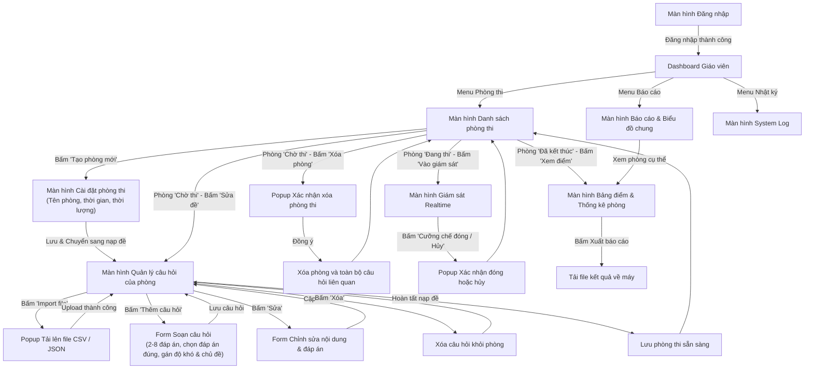
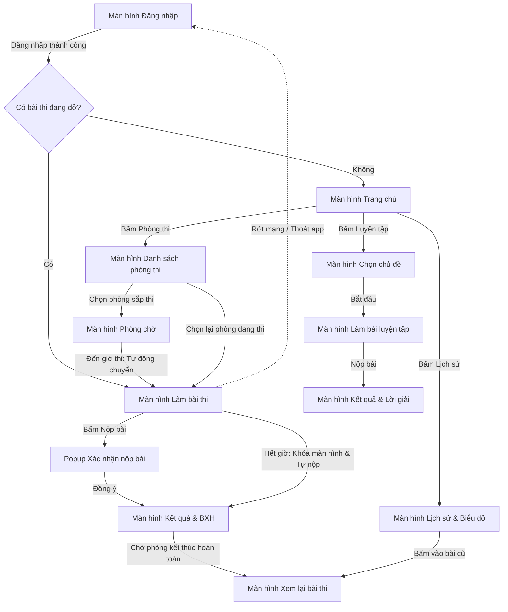

# Kiến Trúc Nghiệp Vụ & Sơ Đồ Luồng Giao Diện Client

Tài liệu đặc tả các vai trò người dùng (Giáo viên và Học viên), chi tiết danh mục tính năng và sơ đồ luồng điều hướng giao diện (User Interface Flowcharts) của phân hệ **Frontend (client)** trong hệ thống thi trắc nghiệm trực tuyến mooc-clone.

---

## 1. Vai trò Giáo viên (Teacher)

Giáo viên là người quản trị nội dung học liệu, tổ chức phòng thi, trực tiếp cấu hình câu hỏi, giám sát phòng thi trong thời gian thực và trích xuất báo cáo kết quả.

### 1.1 Danh mục Tính năng Chi tiết

#### A. Xác thực và Quản lý Tài khoản
* **Đăng nhập hệ thống:** Hỗ trợ cơ chế bảo mật nâng cao, chặn đăng nhập đồng thời trên nhiều thiết bị (Single Device Session Enforcement).
* **Đăng xuất hệ thống:** Hủy phiên làm việc an toàn, xóa token xác thực trên trình duyệt.
* **Đổi mật khẩu tài khoản:** Cho phép cập nhật mật khẩu định kỳ với yêu cầu độ phức tạp.

#### B. Quản lý Câu hỏi cho Phòng thi
* **Xem danh sách câu hỏi:** Hiển thị toàn bộ câu hỏi được gán trong một phòng thi cụ thể.
* **Thêm mới câu hỏi:** Soạn câu hỏi mới với từ 2 đến 8 phương án lựa chọn; hỗ trợ chỉ định một hoặc nhiều đáp án đúng (Single Choice / Multiple Choice).
* **Chỉnh sửa câu hỏi:** Sửa linh hoạt nội dung câu hỏi, danh sách các phương án lựa chọn và cờ đáp án đúng.
* **Xóa câu hỏi:** Loại bỏ câu hỏi không còn phù hợp khỏi cơ sở dữ liệu phòng thi.
* **Phân loại theo chủ đề:** Gắn nhãn chủ đề rõ ràng (ví dụ: *Toán học lớp 1*, *Toán nâng cao lớp 2*).
* **Phân loại theo mức độ khó:** Gán mức độ khó trực quan (*Dễ*, *Trung bình*, *Khó*).
* **Nhập hàng loạt (Batch Import):** Nạp nhanh danh sách câu hỏi từ tệp dữ liệu ngoài định dạng **CSV** hoặc **JSON**.

#### C. Quản trị Phòng thi và Giám sát Thời gian Thực
* **Danh sách phòng thi:** Theo dõi toàn bộ các phòng thi với trạng thái thời gian thực (*Chờ thi*, *Đang thi*, *Đã kết thúc*).
* **Tạo mới và chỉnh sửa phòng thi:** Cấu hình tên phòng, thời gian bắt đầu, thời lượng làm bài và bộ câu hỏi tương ứng.
* **Can thiệp phòng thi:** Quyền hủy bỏ hoặc cưỡng chế đóng ngay lập tức các phòng thi đang diễn ra khi phát hiện sự cố.
* **Nhật ký hoạt động (System Log):** Theo dõi lịch sử thao tác và sự kiện quan trọng trong toàn bộ hệ thống.

#### D. Thống kê và Báo cáo
* **Bảng điểm và Lịch sử:** Xem chi tiết bảng điểm và lịch sử làm bài của toàn bộ thí sinh trong phòng thi.
* **Xuất báo cáo:** Xuất bảng điểm thi của từng phòng ra tệp báo cáo phục vụ lưu trữ.
* **Trực quan hóa dữ liệu:** Theo dõi biểu đồ phân bố điểm số và tỷ lệ hoàn thành bài thi tổng quan.

---

### 1.2 Sơ đồ Luồng Giao diện Giáo viên (Teacher Interface Flow)

Sơ đồ thể hiện toàn bộ các luồng thao tác chính của Giáo viên từ lúc đăng nhập, điều phối phòng thi, soạn đề, giám sát tới khi xuất báo cáo:

---

## 2. Vai trò Học viên (Student)

Học viên tham gia làm bài thi luyện tập cá nhân hoặc tham gia vào các phòng thi trực tuyến có kiểm soát thời gian chặt chẽ từ máy chủ.

### 2.1 Danh mục Tính năng Chi tiết

#### A. Xác thực và Quản lý Tài khoản
* **Đăng ký tài khoản mới:** Điền thông tin đăng ký nhanh chóng, kiểm tra hợp lệ dữ liệu tức thì.
* **Đăng nhập hệ thống:** Bảo mật chặt chẽ, tự động chặn đăng nhập đồng thời trên nhiều thiết bị.
* **Đăng xuất hệ thống:** Rút khỏi phiên làm việc an toàn.
* **Đổi mật khẩu tài khoản:** Cập nhật thông tin mật khẩu bảo vệ tài khoản cá nhân.

#### B. Chế độ Luyện tập Cá nhân (Practice Mode)
* **Tùy chọn luyện tập:** Thí sinh chủ động chọn chủ đề luyện tập và bộ đề mong muốn.
* **Làm bài độc lập & Xem giải:** Làm bài theo tiến độ riêng, nộp bài và nhận ngay kết quả kèm lời giải chi tiết từng câu hỏi.

#### C. Tham gia Phòng thi Trực tuyến (Exam Room Participation)
* **Danh sách phòng thi:** Xem toàn bộ các phòng thi với trạng thái hiển thị rõ ràng (*Chờ thi*, *Đang thi*, *Đã kết thúc*).
* **Phòng chờ (Waiting Room):** Tập trung thí sinh trước giờ thi, hiển thị thông tin quy chế và tự động chuyển vào màn hình thi khi đến giờ.

#### D. Quá trình Làm bài thi Trực tuyến (Live Exam Taking)
* **Đồng bộ đề thi:** Nhận đề thi được cấp phát đồng bộ trực tiếp từ máy chủ.
* **Đồng hồ đếm ngược chuẩn:** Theo dõi thời gian đếm ngược chính xác tuyệt đối theo đồng hồ máy chủ (Server-side time sync).
* **Thao tác trả lời câu hỏi:** Chọn phương án trả lời linh hoạt cho từng câu.
* **Chỉnh sửa đáp án:** Cho phép thay đổi phương án đã chọn bất kỳ lúc nào trước khi thời gian thi kết thúc.
* **Đánh dấu câu hỏi (Flag for Review):** Gắn cờ các câu hỏi chưa chắc chắn để xem lại nhanh chóng trên thanh điều hướng câu hỏi.
* **Nộp bài sớm:** Chủ động nộp bài khi đã hoàn thành trước thời hạn.
* **Khả năng phục hồi khi ngắt kết nối (Session Recovery):** Nếu bị rớt mạng hoặc thoát ứng dụng đột ngột, khi đăng nhập lại thí sinh sẽ được hệ thống tự động đưa thẳng vào bài thi đang diễn ra để tiếp tục làm bài.
* **Tự động cưỡng chế nộp bài:** Khi hết thời gian quy định, màn hình sẽ tự động khóa và hệ thống tự động thu bài nộp về máy chủ.

#### E. Xem Kết quả và Bảng Xếp hạng
* **Kết quả tổng kết:** Hiển thị điểm số, số câu trả lời đúng và tổng thời gian hoàn thành bài thi.
* **Bảng xếp hạng (Leaderboard):** Xem bảng xếp hạng thứ hạng theo thời gian thực của toàn bộ thí sinh trong phòng thi.
* **Xem lại bài thi (Review):** Sau khi phòng thi kết thúc hoàn toàn, học viên có thể xem lại chi tiết bài làm để biết các câu đúng, câu sai và đáp án chuẩn.

#### F. Lịch sử và Thống kê Cá nhân
* **Lưu trữ lịch sử:** Lưu trữ toàn bộ lịch sử các bài thi luyện tập và phòng thi chính thức đã tham gia.
* **Đồ thị tiến độ:** Xem biểu đồ đường thể hiện sự biến thiên điểm số và năng lực qua các lần làm bài.

---

### 2.2 Sơ đồ Luồng Giao diện Học viên (Student Interface Flow)

Sơ đồ thể hiện chu trình trải nghiệm xuyên suốt của Học viên, bao gồm cơ chế rẽ nhánh khôi phục bài thi dở dang khi bị gián đoạn kết nối:

---

## 3. Điều Hướng Tài Liệu Kỹ Thuật Liên Quan

Để triển khai các màn hình và tính năng trên theo đúng quy chuẩn kiến trúc của dự án, vui lòng tham khảo các tài liệu chuyên đề:

* **Bộ Quy chuẩn Master 19 Rules:** [FRONTEND_CONVENTIONS.md](FRONTEND_CONVENTIONS.md)
* **Kiến trúc Tổng thể & Co-location:** [docs/01-architecture-and-structure.md](docs/01-architecture-and-structure.md)
* **Quản trị Trạng thái & Socket.IO Client:** [docs/02-state-management.md](docs/02-state-management.md)
* **Quy chuẩn Form & Validation:** [docs/05-forms-and-validation.md](docs/05-forms-and-validation.md)
* **Semantic Design System & Tokens:** [docs/08-semantic-design-system.md](docs/08-semantic-design-system.md)
* **Khả năng Truy cập & Phím tắt:** [docs/09-accessibility.md](docs/09-accessibility.md)
* **Bảo mật Frontend & Quản lý Phiên:** [docs/10-frontend-security-and-auth.md](docs/10-frontend-security-and-auth.md)
