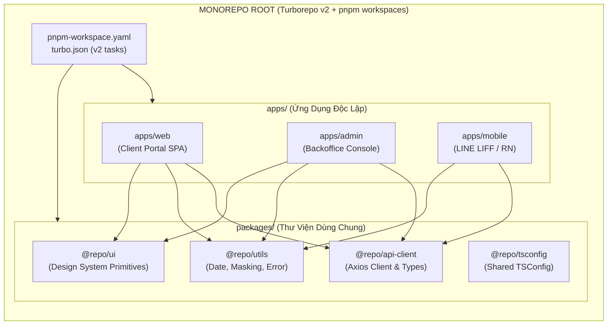
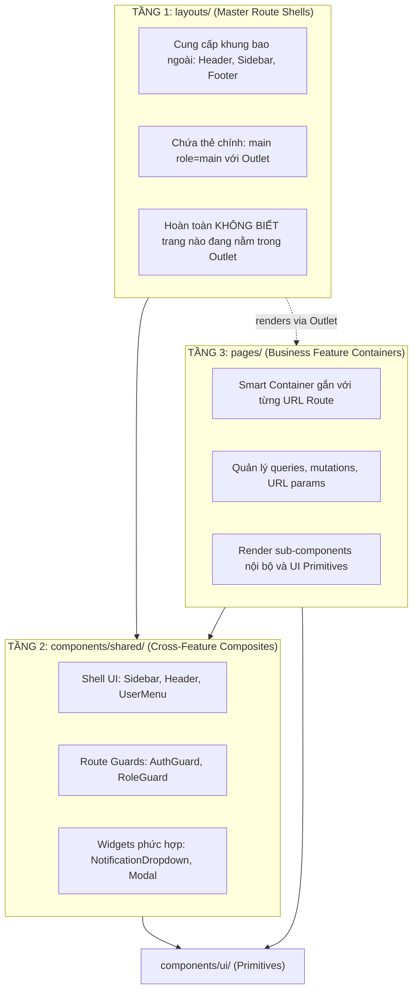
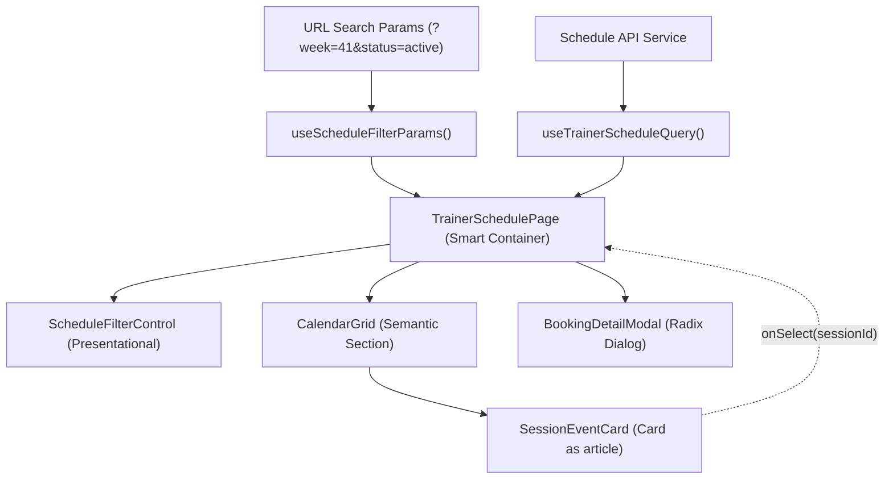
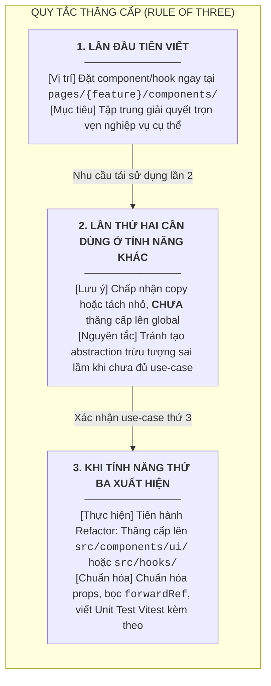
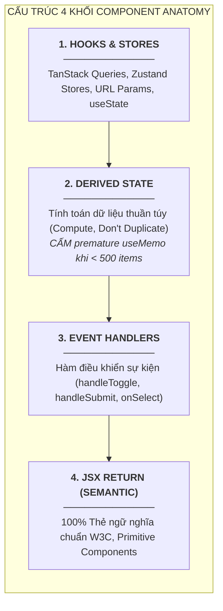
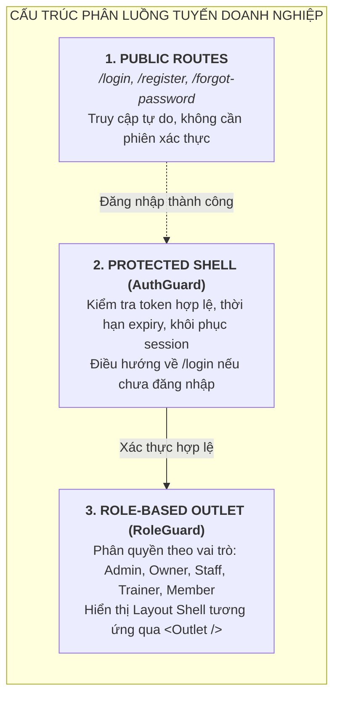

# Chuyên Đề 01: Kiến Trúc Ứng Dụng & Cấu Trúc Thư Mục (Architecture & Project Structure)

> **Dự án:** Khung Tiêu Chuẩn Doanh Nghiệp & Hồ Sơ Dự Án RoGym  
> **Cổng quy chuẩn chính:** [`FRONTEND_CONVENTIONS.md`](../FRONTEND_CONVENTIONS.md) | [Bản Đồ Tài Liệu](./README.md)  
> **Cơ sở tham chiếu quốc tế:**  
> - [Bulletproof React](https://github.com/alan2207/bulletproof-react) (Alan Eicker / Sandro Roth)  
> - [Turborepo v2 Documentation & Tasks Schema](https://turbo.build/repo/docs/core-concepts/monorepos/tasks) (Vercel)  
> - [pnpm Workspaces Specification](https://pnpm.io/workspaces) (pnpm Team)  
> - [MDN Web Docs - Image file type and format guide (WebP/AVIF)](https://developer.mozilla.org/en-US/docs/Web/Media/Formats/Image_types)  
> - [Sara Soueidan - An Overview of SVG Sprite Creation and Usage](https://sarasoueidan.com/blog/structuring-grouping-referencing-in-svg/)  
> - [React.dev - Code-Splitting with lazy](https://react.dev/reference/react/lazy)  
> **Phiên bản:** 8.0 (Enterprise Quality Standard — 15 Spokes & Universal Decoupling)  
> **Số lượng quy chuẩn cốt lõi:** 19 Coding Standards (Đồng bộ toàn diện hệ thống)  
> **Áp dụng cho:** Toàn bộ mã nguồn thư mục `src/`  
> **Trạng thái:** Bắt buộc tuân thủ 100% (Strict Mandatory Enforcement)

---

## MỤC LỤC
1. [Triết Lý Kiến Trúc & Bối Cảnh Doanh Nghiệp](#1-triết-lý-kiến-trúc-bối-cảnh-doanh-nghiệp)
2. [Cơ Sở Tham Chiếu Chuẩn Quốc Tế](#2-cơ-sở-tham-chiếu-chuẩn-quốc-tế)
3. [TẦNG 1: Core Universal Spec — Kiến Trúc Monorepo vs Modular Monolith](#3-tầng-1-core-universal-spec-kiến-trúc-monorepo-vs-modular-monolith)
   - 3.1. [Cấu hình Không gian làm việc pnpm Workspaces](#31-cấu-hình-không-gian-làm-việc-pnpm-workspaces)
   - 3.2. [Cấu hình Điều phối Tác vụ Turborepo v2 (`turbo.json`)](#32-cấu-hình-điều-phối-tác-vụ-turborepo-v2-turbojson)
   - 3.3. [Phân định ranh giới gói chia sẻ (@repo/ui, @repo/utils, @repo/tsconfig)](#33-phân-định-ranh-giới-gói-chia-sẻ-repoui-repoutils-repotsconfig)
4. [TẦNG 1: Đường Ống Quản Trị Tài Nguyên Tĩnh (Static Assets Pipeline)](#4-tầng-1-đường-ống-quản-trị-tài-nguyên-tĩnh-static-assets-pipeline)
   - 4.1. [Chiến lược SVG Sprites vs React SVG Component](#41-chiến-lược-svg-sprites-vs-react-svg-component)
   - 4.2. [Định dạng ảnh thế hệ mới (WebP / AVIF) & Accessible Picture Tag](#42-định-dạng-ảnh-thế-hệ-mới-webp-avif-accessible-picture-tag)
   - 4.3. [Chính sách Phân bổ thư mục & Caching vĩnh cửu](#43-chính-sách-phân-bổ-thư-mục-caching-vĩnh-cửu)
5. [TẦNG 1: Quy Ước Đặt Tên File Đa Nền Tảng (Cross-Platform Case-Sensitive Guard)](#5-tầng-1-quy-ước-đặt-tên-file-đa-nền-tảng-cross-platform-case-sensitive-guard)
6. [TẦNG 2: RoGym Implementation Profile — Bản Đồ Thư Mục `src/`](#6-tầng-2-rogym-implementation-profile-bản-đồ-thư-mục-src)
7. [Ranh Giới Quyền Hạn Tuyệt Đối Giữa `layouts/`, `components/shared/` và `pages/`](#7-ranh-giới-quyền-hạn-tuyệt-đối-giữa-layouts-componentsshared-và-pages)
8. [Quy Tắc Co-location Theo Chuẩn Bulletproof React](#8-quy-tắc-co-location-theo-chuẩn-bulletproof-react)
9. [Case Study Co-location Chuyên Sâu: Màn Hình Lịch Tập Phức Tạp](#9-case-study-co-location-chuyên-sâu-màn-hình-lịch-tập-phức-tạp)
10. [Quy Tắc Thăng Cấp Thành Phần (Rule of Three)](#10-quy-tắc-thăng-cấp-thành-phần-rule-of-three)
11. [Quy Ước Đặt Tên & Quy Tắc Import (Naming & Import Disciplines)](#11-quy-ước-đặt-tên-quy-tắc-import-naming-import-disciplines)
12. [Quy Chuẩn Quản Lý CSS Trong Cấu Trúc Co-location (Tailwind vs BEM)](#12-quy-chuẩn-quản-lý-css-trong-cấu-trúc-co-location-tailwind-vs-bem)
13. [Component Anatomy Chuẩn Mực 4 Khối](#13-component-anatomy-chuẩn-mực-4-khối)
14. [Phân Tích Đối Chiếu Thực Tế: Anti-Pattern vs Chuẩn Mực Doanh Nghiệp](#14-phân-tích-đối-chiếu-thực-tế-anti-pattern-vs-chuẩn-mực-doanh-nghiệp)
15. [Kiểm Soát Vòng Lặp Phụ Thuộc (Circular Dependencies Guard)](#15-kiểm-soát-vòng-lặp-phụ-thuộc-circular-dependencies-guard)
16. [Tích Hợp Router & Cơ Chế Code-Splitting Với React.lazy](#16-tích-hợp-router-cơ-chế-code-splitting-với-reactlazy)
17. [Bảng Checklist Định Lượng Tự Kiểm Tra Cấu Trúc Trước Khi Mở PR](#17-bảng-checklist-định-lượng-tự-kiểm-tra-cấu-trúc-trước-khi-mở-pr)
18. [Ánh Xạ Tooling Kiểm Toán CI & Static Rules](#18-ánh-xạ-tooling-kiểm-toán-ci-static-rules)

---

## 1. Triết Lý Kiến Trúc & Bối Cảnh Doanh Nghiệp

Trong bất kỳ hệ thống Single Page Application (SPA) doanh nghiệp nào (FinTech, B2B SaaS, ERP hay Gym Management), quy mô ứng dụng thường vượt qua mốc 30-50 màn hình nghiệp vụ với hàng trăm luồng tương tác đa dạng. Nếu cấu trúc mã nguồn chỉ phân chia theo loại file kỹ thuật thuần túy (*Technical Separation of Concerns* - gom toàn bộ components vào `components/`, toàn bộ hooks vào `hooks/`, toàn bộ types vào `types/`):
- **Bãi rác dùng chung (Shared Dumping Ground):** Thư mục dùng chung sẽ phình to không kiểm soát, nơi các kỹ sư liên tục thêm file mới nhưng không ai dám xóa vì sợ ảnh hưởng đến tính năng của người khác.
- **Bán kính thiệt hại cao (High Blast Radius):** Khi một tính năng nghiệp vụ thay đổi hoặc bị gỡ bỏ, kỹ sư phải tìm kiếm và xóa file rải rác ở hàng chục thư mục, dẫn đến nguy cơ sót dead-code hoặc vô tình làm gãy dependency của module khác.
- **Thời gian định vị mã nguồn chậm chạp:** Kỹ sư mới mất trung bình 3-5 ngày chỉ để nắm được luồng dữ liệu của một màn hình vì mã nguồn bị phân tán quá xa nhau.

Để giải quyết triệt để rào cản này, hệ thống áp dụng kiến trúc **Feature-Driven Architecture** kết hợp triết lý **Co-location** lấy cảm hứng trực tiếp từ chuẩn mực mã nguồn mở hàng đầu thế giới: **Bulletproof React**, kết hợp cùng chiến lược **Modular Monolith / Monorepo** đảm bảo khả năng mở rộng không giới hạn.

---

## 2. Cơ Sở Tham Chiếu Chuẩn Quốc Tế

Hệ thống tiêu chuẩn kiến trúc này được xây dựng vững chắc trên 6 nền tảng tham chiếu uy tín:

1. **[Bulletproof React](https://github.com/alan2207/bulletproof-react) (Alan Eicker / Sandro Roth):** Kiến trúc React theo module tính năng khép kín (features-based), đóng gói Public API nghiêm ngặt qua `index.ts`, hạn chế phụ thuộc chéo và tối đa hóa tính co-location.
2. **[Turborepo v2 Tasks Spec](https://turbo.build/repo/docs/core-concepts/monorepos/tasks) (Vercel):** Chuẩn mực điều phối luồng build, lint, test và cache vi mô cho các monorepo doanh nghiệp quy mô lớn.
3. **[pnpm Workspaces](https://pnpm.io/workspaces):** Trình quản lý gói hiệu năng cao, tiết kiệm dung lượng đĩa bằng hard-links, giải quyết triệt để rò rỉ phụ thuộc ngầm (Phantom Dependencies) nhờ cấu trúc `node_modules` biệt lập.
4. **[MDN Web Docs - Image Types & Formats](https://developer.mozilla.org/en-US/docs/Web/Media/Formats/Image_types):** Tiêu chuẩn nén ảnh hiện đại WebP/AVIF và phần tử `<picture>` chuẩn khả năng tiếp cận (Accessibility / A11y).
5. **[Sara Soueidan - SVG Sprites Architecture](https://sarasoueidan.com/blog/structuring-grouping-referencing-in-svg/):** Kỹ thuật quản trị biểu tượng vector tối ưu hiệu năng render và bộ nhớ đệm HTTP.
6. **[React.dev - Code-Splitting with lazy & Suspense](https://react.dev/reference/react/lazy):** Chiến lược phân tách gói mã nguồn theo tuyến đường (Route-based splitting) giảm dung lượng bundle tải ban đầu.

---

## 3. TẦNG 1: Core Universal Spec — Kiến Trúc Monorepo vs Modular Monolith

Mô hình kiến trúc được cấu trúc 2 tầng độc lập: Tầng 1 đặc tả nguyên lý tiêu chuẩn cho mọi hệ thống doanh nghiệp, Tầng 2 minh chứng bằng cấu trúc thực tế của dự án.

Khi ứng dụng phát triển vượt qua ranh giới của một SPA đơn lẻ (ví dụ: phát sinh thêm ứng dụng Mobile App bằng React Native, Cổng thông tin Đối tác, hoặc Admin Portal độc lập), tổ chức đứng trước 2 lựa chọn kiến trúc: **Modular Monolith** hoặc **Monorepo (Turborepo + pnpm workspaces)**.



### 3.1. Cấu hình Không gian làm việc pnpm Workspaces
Khai báo tại thư mục gốc của kho mã nguồn qua tệp `pnpm-workspace.yaml`. Cơ chế workspace của pnpm liên kết trực tiếp mã nguồn nội bộ mà không cần xuất bản (publish) lên npm registry:

```yaml
# File: pnpm-workspace.yaml
packages:
  - 'apps/*'
  - 'packages/*'
```

### 3.2. Cấu hình Điều phối Tác vụ Turborepo v2 (`turbo.json`)
Turborepo v2 chuẩn hóa thuộc tính `tasks` (thay thế cú pháp `pipeline` cũ). Mỗi tác vụ đều khai báo rõ ranh giới phụ thuộc và đầu ra bộ nhớ đệm (caching outputs):

```json
{
  "$schema": "https://turbo.build/schema.json",
  "tasks": {
    "build": {
      "dependsOn": ["^build"],
      "outputs": ["dist/**", ".next/**", "public/dist/**"]
    },
    "test": {
      "dependsOn": ["^build"],
      "outputs": ["coverage/**"]
    },
    "lint": {
      "outputs": []
    },
    "type-check": {
      "outputs": []
    },
    "dev": {
      "cache": false,
      "persistent": true
    }
  }
}
```

### 3.3. Phân định ranh giới gói chia sẻ (@repo/ui, @repo/utils, @repo/tsconfig)
Mỗi package con trong `packages/` hoạt động như một thư viện chuẩn có `package.json` riêng biệt, sử dụng giao thức `"workspace:*"` để tự động liên kết:

```json
// File: packages/ui/package.json
{
  "name": "@repo/ui",
  "version": "1.0.0",
  "private": true,
  "main": "./src/index.ts",
  "types": "./src/index.ts",
  "dependencies": {
    "@repo/utils": "workspace:*"
  },
  "peerDependencies": {
    "react": "^18.3.1",
    "react-dom": "^18.3.1"
  }
}
```

*Nguyên tắc kế thừa cho Modular Monolith:* Đối với dự án hiện tại hoạt động dưới dạng Single App (`client/`), toàn bộ cấu trúc thư mục `src/` được tổ chức theo triết lý **Modular Monolith** mô phỏng ranh giới của các packages trên (thư mục `components/ui/` tương đương `@repo/ui`, thư mục `lib/` tương đương `@repo/utils`). Khi dự án cần mở rộng sang Monorepo đa ứng dụng, quá trình tách chiết diễn ra trong vòng 1 ngày mà không cần sửa đổi kiến trúc nội bộ.

---

## 4. TẦNG 1: Đường Ống Quản Trị Tài Nguyên Tĩnh (Static Assets Pipeline)

Tài nguyên tĩnh (biểu tượng vector, hình ảnh, phông chữ) nếu không có quy chuẩn phân bổ sẽ gây phình to bundle kích thước tải ban đầu và làm suy giảm nghiêm trọng chỉ số Core Web Vitals ($LCP$).

### 4.1. Chiến lược SVG Sprites vs React SVG Component

Trong các ứng dụng React, việc biến mọi file SVG thành React Component (`import { ReactComponent as Icon } from './icon.svg'`) là một **Anti-Pattern về hiệu năng**:
- Mỗi component SVG được biên dịch thành mã JavaScript, làm phình to gói bundle chính.
- Trình duyệt phải phân tích cú pháp (parse) và khởi tạo React VDOM node cho từng đường cong vector.

Doanh nghiệp áp dụng bảng ma trận 3 phương thức quản lý vector:

| Phương thức | Tình huống áp dụng | Ưu điểm kỹ thuật | Nhược điểm & Rủi ro |
| :--- | :--- | :--- | :--- |
| **1. UI Primitive Icon Wrapper (Lucide)** | Biểu tượng điều hướng, nút bấm, thông báo chuẩn hệ thống. | Kích thước đồng đều 24px, hỗ trợ Tree-shaking 100%, dễ đổi màu qua `currentColor`. | Bị giới hạn trong thư viện có sẵn. |
| **2. SVG Sprites Sheet (`<svg><use />`)** | Bộ biểu tượng đồ họa đặc thù của doanh nghiệp, logo đối tác. | **Tối ưu nhất:** File `sprite.svg` được cache HTTP vĩnh cửu; DOM chỉ lưu 1 thẻ `<use href="/sprite.svg#id" />` siêu nhẹ; không làm tăng 1 byte JS bundle. | Cần cấu hình script sinh sprite trong build pipeline. |
| **3. Inlined SVG Component** | Đồ họa vector cần animation CSS phức tạp từng path hoặc dynamic gradient nội bộ. | Kiểm soát tuyệt đối từng thuộc tính SVG path qua React State. | Làm tăng kích thước JS bundle; tốn bộ nhớ VDOM khi render nhiều lần. |

#### Code Mẫu: SVG Sprite Component Chuẩn Doanh Nghiệp
```tsx
import { type SVGProps } from 'react'

export interface SvgIconProps extends SVGProps<SVGSVGElement> {
  name: string
  size?: number
}

export function SvgIcon({ name, size = 24, className = '', ...props }: SvgIconProps) {
  return (
    <svg
      width={size}
      height={size}
      className={`inline-block shrink-0 fill-current ${className}`}
      aria-hidden="true"
      focusable="false"
      {...props}
    >
      <use href={`/assets/icons/sprite.svg#icon-${name}`} />
    </svg>
  )
}
```

### 4.2. Định dạng ảnh thế hệ mới (WebP / AVIF) & Accessible Picture Tag

- **Quy chuẩn định dạng:** Mọi ảnh tĩnh (banners, ảnh đại diện, thiết bị) bắt buộc phải được chuyển đổi sang **AVIF** (ưu tiên 1 - nén tốt hơn JPEG 50%) và **WebP** (ưu tiên 2 - nén tốt hơn JPEG 30%), giữ lại file `.png`/`.jpg` làm fallback cho trình duyệt cũ.
- **Khai báo thẻ `<picture>` chuẩn W3C:**

```tsx
export interface ResponsiveImageProps {
  src: string
  alt: string
  width: number
  height: number
  className?: string
}

export function ResponsiveImage({ src, alt, width, height, className }: ResponsiveImageProps) {
  const basePath = src.replace(/\.[^/.]+$/, '')
  return (
    <picture>
      <source srcSet={`${basePath}.avif`} type="image/avif" />
      <source srcSet={`${basePath}.webp`} type="image/webp" />
      
    </picture>
  )
}
```

### 4.3. Chính sách Phân bổ thư mục & Caching vĩnh cửu
- Tài nguyên trong `client/public/assets/` được đóng gói với hash nội dung:
  - `Cache-Control: public, max-age=31536000, immutable` đối với hình ảnh, font chữ, sprite có băm phiên bản.
  - Phông chữ hệ thống được tải trước bằng `<link rel="preload" as="font" type="font/woff2" crossorigin>` trong `index.html`.

---

## 5. TẦNG 1: Quy Ước Đặt Tên File Đa Nền Tảng (Cross-Platform Case-Sensitive Guard)

Một lỗi kỹ thuật cực kỳ phổ biến trong các đội ngũ đa nền tảng (lập trình viên dùng Windows hoặc macOS, trong khi hệ thống CI/CD chạy Linux Container):
- Hệ điều hành Windows và macOS theo mặc định là **Case-Insensitive** (không phân biệt chữ hoa/thường): File `UserCard.tsx` và `userCard.tsx` được coi là một.
- Hệ điều hành Linux trên GitHub Actions/GitLab CI là **Case-Sensitive** (phân biệt tuyệt đối chữ hoa/thường). Khi một lập trình viên đổi tên file từ `userCard.tsx` thành `UserCard.tsx`, Git trên Windows có thể bỏ qua sự thay đổi này. Khi đẩy lên CI, pipeline lập tức gãy với lỗi `Module not found`.

### Ba Biện Pháp Phòng Vệ Kỹ Thuật Bắt Buộc

1. **Cấu hình Git Repo Chống Bỏ Sót Case:**
   Chạy lệnh cấu hình bắt buộc trên mọi máy lập trình viên hoặc cấu hình trong `.gitconfig`:
   ```bash
   git config core.ignorecase false
   ```

2. **Quy chuẩn Đặt Tên Tuyệt Đối Theo Loại Tệp:**
   - **React Components / Layouts:** 100% `PascalCase.tsx` (ví dụ: `Button.tsx`, `DashboardLayout.tsx`).
   - **Hooks:** 100% `camelCase.ts` bắt đầu bằng `use` (ví dụ: `useDebounce.ts`, `useAuth.ts`).
   - **Utilities / Services:** 100% `kebab-case.service.ts` hoặc `kebab-case.ts` (ví dụ: `package.service.ts`, `api-error.ts`).
   - **Stylesheets:** 100% `kebab-case.css` (ví dụ: `tokens.css`, `primitive.css`).

3. **Tích hợp ESLint Quy Tắc Kiểm Tra Đặt Tên:**
   Sử dụng `eslint-plugin-check-file` để tự động hóa việc bắt lỗi đặt tên sai ngay trong quá trình gõ mã nguồn:
   ```javascript
   // eslint.config.js
   import checkFile from 'eslint-plugin-check-file'

   export default [
     {
       plugins: { 'check-file': checkFile },
       rules: {
         'check-file/filename-naming-convention': [
           'error',
           {
             'src/components/**/*.tsx': 'PASCAL_CASE',
             'src/pages/**/*.tsx': 'PASCAL_CASE',
             'src/hooks/**/*.ts': 'CAMEL_CASE',
             'src/services/**/*.ts': 'KEBAB_CASE',
           },
           { ignoreMiddleExtensions: true }
         ]
       }
     }
   ]
   ```

---

## 6. TẦNG 2: RoGym Implementation Profile — Bản Đồ Thư Mục `src/`

> [!IMPORTANT]
> 🧭 **ĐIỀU HƯỚNG TÀI LIỆU CHUYÊN SÂU — DOMAINS HẠ TẦNG THƯ VIỆN & TIỆN ÍCH THUẦN TÚY:**  
> Toàn bộ đặc tả kỹ thuật, tối ưu bundle direct imports, và catalog 100% modules được duy trì tập trung tại:  
> - 👉 [**src/lib/README.md — Cẩm Nang Hạ Tầng Thư Viện Lõi (12 Modules)**](../src/lib/README.md)  
>   - [Chương 1: Kiến Trúc Hạ Tầng Thư Viện Lõi](../src/lib/README.md#chương-1-kiến-trúc-hạ-tầng-thư-viện-lõi-phân-tầng-trách-nhiệm-core-architecture)  
>   - [Chương 2: Tối Ưu Bundle Size & Quy Chuẩn Direct Imports](../src/lib/README.md#chương-2-tối-ưu-bundle-size-quy-chuẩn-direct-imports-vercel-bundle-rules)  
>   - [Chương 7: Catalog Toàn Diện 12 Infrastructure Modules Cốt Lõi](../src/lib/README.md#chương-7-catalog-toàn-diện-12-infrastructure-modules-cốt-lõi)  
> - 👉 [**src/utils/README.md — Cẩm Nang Tiện Ích Thuần Túy & Domain Calculators (15 Modules)**](../src/utils/README.md)  
>   - [Chương 1: Kiến Trúc Phân Hệ Tiện Ích & 3 Vùng Trách Nhiệm](../src/utils/README.md#chương-1-kiến-trúc-phân-hệ-tiện-ích-3-vùng-trách-nhiệm-core-architecture)  
>   - [Chương 3: Tính Thuần Túy Của Hàm & An Toàn Múi Giờ UTC+7](../src/utils/README.md#chương-3-tính-thuần-túy-của-hàm-an-toàn-múi-giờ-utc7-pure-functions-timezone-safety)  
>   - [Chương 6: Catalog Toàn Diện 100% Modules Tại `utils/` (15 Modules)](../src/utils/README.md#chương-6-catalog-toàn-diện-100-modules-tại-utils-15-modules)

Dưới đây là bản đồ chi tiết 14 thư mục chức năng hiện hữu trong `src/` được chuẩn hóa theo mô hình Modular Monolith:

```
src/
├── @types/          ← Định nghĩa TypeScript toàn cục (vite-env, global declarations)
├── assets/          ← Tài nguyên tĩnh nhúng mã nguồn (SVG logos, minh họa)
├── components/      ← Thư viện UI tái sử dụng toàn hệ thống
│   ├── ui/          ← [LEAF NODES] Primitive Components gom nhóm theo 8 danh mục chức năng
│   │   ├── layout/       ← Bố cục cơ bản (Box, Flex, Grid, Container, Separator, PageUI)
│   │   ├── actions/      ← Tương tác hành động (Button, BackButton, SubmitButton)
│   │   ├── forms/        ← Biểu mẫu nhập liệu (Input, Select, Form, Switch, Checkbox...)
│   │   ├── data-display/ ← Trình diễn dữ liệu (Card, Badge, Table, Avatar, Image...)
│   │   ├── feedback/     ← Phản hồi trạng thái (Alert, ProgressBar, Skeleton, EmptyState)
│   │   ├── overlay/      ← Lớp phủ ngữ cảnh (Modal, ConfirmDialog, Sheet, Popover, Tooltip...)
│   │   ├── navigation/   ← Điều hướng (Breadcrumb, Pagination, Stepper, Tabs...)
│   │   └── typography/   ← Kiểu chữ & biểu tượng (Heading, Text, Icon, LineIcon...)
│   ├── shared/      ← [COMPOSITES] Shared Composites & Shells (Sidebar, Header, Modal)
│   └── layouts/     ← Component layout phụ trợ (DashboardGrid, SplitPane, AnalyticsPanel)
├── config/          ← Cấu hình môi trường (env.ts), hằng số hệ thống (constants.ts)
├── hooks/           ← Generic Utilities Hooks dùng chung (useDebounce, useMediaQuery)
├── layouts/         ← Master Layout Shells (AuthLayout, DashboardLayout, MemberLayout)
├── lib/             ← Cấu hình & wrapper SDK/thư viện thứ ba (axios, queryClient, query-keys)
├── locales/         ← Tệp từ điển đa ngôn ngữ i18n (vi, en, ja)
├── pages/           ← Màn hình nghiệp vụ tổ chức theo vai trò người dùng
│   ├── admin/       ← Phân hệ Quản trị viên
│   ├── member/      ← Phân hệ Hội viên
│   ├── owner/       ← Phân hệ Chủ phòng tập
│   ├── staff/       ← Phân hệ Nhân viên lễ tân
│   └── trainer/     ← Phân hệ Huấn luyện viên
├── services/        ← Tầng giao tiếp HTTP API tách biệt (package.service, auth.service, hỗ trợ AbortSignal)
├── stores/          ← Tầng Global Client State bằng Zustand (authStore, themeStore, feature-flag.store)
├── styles/          ← CSS Tokens, Reset, Utilities & Stylesheets 100% HEX
├── test/            ← Cấu hình môi trường kiểm thử Vitest & Test Utilities
└── utils/           ← Hàm tiện ích thuần túy & tính toán nghiệp vụ (cn, date, currency, formatters, domain calculators)
```

### Bảng Ma Trận Phân Quyền & Điều Hướng Thư Mục Con (Domain README Directory Hub)

| Thư Mục Con | Quy Mô & Phạm Vi Quản Lý | Quy Tắc Import Bắt Buộc | Tài Liệu Chi Tiết Cấp Domain |
| :--- | :--- | :--- | :--- |
| `src/components/ui/` | 100% UI Primitives lá (8 categories) | Dùng Design Tokens, cấm raw HTML tag | [**Kiến Trúc UI Components**](../src/components/README.md) |
| `src/components/shared/` | Shared Composites & Shells | Chỉ import từ `ui/`, không phụ thuộc page | [**Catalog Shared Composites**](../src/components/README.md#chương-7-catalog-shared-composites-application-shells-shared) |
| `src/styles/` | 100% HEX Tokens & Stylesheets | Ranh giới 2 tầng Primitive/Semantic | [**Kiến Trúc CSS & Tokens**](../src/styles/README.md) |
| `src/hooks/` | Custom Hooks 4 tầng & Query Hooks | Cấm fetch API bằng useEffect | [**Cẩm Nang Custom Hooks**](../src/hooks/README.md) |
| `src/stores/` | 7 modules Zustand Stores | Chỉ quản lý Client State, cấm Server Cache | [**Kiến Trúc Zustand Stores**](../src/stores/README.md) |
| `src/services/` | 22 modules Dịch vụ mạng & API Client | 100% nhận AbortSignal, dumb transport | [**Cẩm Nang RESTful Services**](../src/services/README.md) |
| `src/lib/` | 12 modules Hạ tầng nền tảng & Adapters | Cấm barrel imports, direct imports 100% | [**Hạ Tầng Thư Viện Lõi**](../src/lib/README.md) |
| `src/utils/` | 15 modules Tiện ích & Domain Calculators | Hàm thuần túy, an toàn múi giờ UTC+7 | [**Tiện Ích & Calculators**](../src/utils/README.md) |

---

## 7. Ranh Giới Quyền Hạn Tuyệt Đối Giữa `layouts/`, `components/shared/` và `pages/`

Sự nhầm lẫn giữa **Layouts**, **Shared Components** và **Pages** là nguyên nhân phổ biến nhất gây ra tình trạng spaghetti code, re-render diện rộng và vi phạm tính đóng gói. Dưới đây là phân định ranh giới tuyệt đối:



### Bảng Đối Sánh 5 Tiêu Chí Phân Định

| Tiêu chí | `layouts/` | `components/shared/` | `pages/` |
| :--- | :--- | :--- | :--- |
| **1. Mục đích tồn tại** | Định hình khung sườn không gian màn hình (Outer Frame) cho một nhóm URL routes. | Cung cấp các khối UI phức hợp hoặc bảo vệ quyền truy cập dùng chung cho nhiều tính năng. | Hiện thực hóa màn hình nghiệp vụ chuyên biệt gắn liền với một URL cụ thể. |
| **2. Quyền hạn Import** | Được import `components/shared/`, `components/ui/`, `stores/`, `hooks/`. | Được import `components/ui/`, `stores/`, `services/` (shared widget), `hooks/`. | Được import `components/ui/`, `components/shared/`, `services/`, `stores/`, và file nội bộ feature. |
| **3. Trách nhiệm Render** | Render thanh điều hướng toàn cục và vùng `<Outlet />` bên trong thẻ `<main>`. | Render các widget phức hợp (Dropdown, Modal, Guard check). | Render nội dung nghiệp vụ, bảng biểu, danh sách, form nhập liệu. |
| **4. Điều CẤM ĐOÁN** | **CẤM** import logic nghiệp vụ từ `pages/`. **CẤM** query API dữ liệu riêng của một trang. | **CẤM** import bất kỳ file nào từ `pages/` hoặc `layouts/`. | **CẤM** render lại Navbar/Sidebar của Layout. **CẤM** import chéo feature khác. |
| **5. Ví dụ Điển hình** | `DashboardLayout.tsx`, `AuthLayout.tsx`, `MemberLayout.tsx`. | `Sidebar.tsx`, `AuthGuard.tsx`, `NotificationDropdown.tsx`. | `PackagesPage.tsx`, `TrainerSchedulePage.tsx`, `UsersPage.tsx`. |

---

## 8. Quy Tắc Co-location Theo Chuẩn Bulletproof React

Theo quy chuẩn Bulletproof React, thư mục `src/pages/` được chia theo vai trò người dùng và từng phân hệ tính năng cụ thể. Cấu trúc nội bộ của một thư mục tính năng tuân thủ triệt để nguyên tắc **Co-location**:

```
src/pages/member/packages/
├── components/                       ← Component chỉ dùng riêng cho trang Packages
│   ├── PackageCard.tsx               ← Đơn vị hiển thị gói tập
│   ├── PackageFilterBar.tsx          ← Thanh lọc gói tập theo thời hạn
│   └── PackageDetailModal.tsx        ← Hộp thoại chi tiết gói tập
├── hooks/                            ← Custom Hooks chỉ dùng riêng cho trang Packages
│   ├── usePackageSelection.ts        ← Logic tính toán gói đang chọn
│   └── usePackageFilterParams.ts     ← Logic đồng bộ bộ lọc vào URL
├── types/                            ← TypeScript types nội bộ của trang
│   └── package-view.types.ts
├── PackagesPage.tsx                  ← Route Component chính
└── index.ts                          ← Public API: Chỉ export PackagesPage
```

### 3 Điều Cấm Kỵ Trong Tổ Chức Co-location
1. **CẤM tạo "thư mục mồ côi" ở cấp cao:** Tuyệt đối không tạo `src/components/PackageCard.tsx` nếu component này chỉ xuất hiện duy nhất trên màn hình `PackagesPage`.
2. **CẤM import xuyên tính năng (Cross-feature Imports):** Tuyệt đối không cho phép trang `TrainerSchedulePage` import trực tiếp một component nằm trong thư mục con `pages/member/packages/components/PackageCard.tsx`.
3. **CẤM rò rỉ chi tiết cài đặt:** File `index.ts` tại thư mục gốc của trang chỉ export duy nhất Page Component chính. Các component con, hooks con phải được đóng gói riêng bên trong.

### Case Study: Tổ Chức Public API Chuẩn Mực Qua `index.ts`
```tsx
// File: src/pages/member/packages/index.ts
// ✅ DO: Chỉ export Page Component chính ra ngoài router
export { PackagesPage as default } from './PackagesPage'
export type { PackageViewFilter } from './types/package-view.types'

// ❌ DON'T: Cấm export các component con nội bộ ra ngoài
// export * from './components/PackageCard' // SAI: Rò rỉ cấu trúc nội bộ!
```

---

## 9. Case Study Co-location Chuyên Sâu: Màn Hình Lịch Tập Phức Tạp

Để minh họa khả năng áp dụng Co-location vào một màn hình có độ phức tạp cao, hãy cùng khảo sát module Lịch làm việc & Huấn luyện của Huấn luyện viên tại `src/pages/trainer/schedule/`:

```
src/pages/trainer/schedule/
├── components/                       ← Khối giao diện phân rã chuyên biệt
│   ├── CalendarGrid.tsx              ← Khung lưới lịch 7 ngày (Header & Columns)
│   ├── SessionEventCard.tsx          ← Thẻ sự kiện ca tập (Presentational)
│   ├── ScheduleFilterControl.tsx     ← Bộ lọc trạng thái (Đã xác nhận, Chờ duyệt)
│   └── BookingDetailModal.tsx        ← Modal chi tiết buổi tập
├── hooks/                            ← Custom Hooks cô lập logic nghiệp vụ
│   ├── useScheduleFilterParams.ts    ← Đồng bộ trạng thái tuần/bộ lọc vào URL
│   └── useSessionEventActions.ts     ← Xử lý xác nhận/hủy buổi tập (Mutation)
├── types/                            ← Định nghĩa kiểu hiển thị riêng cho Calendar
│   └── schedule-view.types.ts
├── TrainerSchedulePage.tsx           ← Smart Container đóng vai trò kết nối
└── index.ts                          ← Điểm export duy nhất
```

### Sơ Đồ Luồng Dữ Liệu Co-location (Data Flow Diagram)



**Lợi ích đạt được:**
- Khi có yêu cầu thay đổi cách hiển thị sự kiện trên lịch, kỹ sư chỉ làm việc trong thư mục `pages/trainer/schedule/components/SessionEventCard.tsx` mà không có bất kỳ nguy cơ nào làm ảnh hưởng đến các màn hình khác trong hệ thống.
- Toàn bộ các types và hooks hỗ trợ đều nằm gọn gàng bên trong feature, việc gỡ bỏ hoặc kiểm thử tính năng hoàn toàn độc lập và an toàn tuyệt đối.

---

## 10. Quy Tắc Thăng Cấp Thành Phần (Rule of Three)

Một trong những sai lầm phổ biến nhất của lập trình viên là **"Trừu tượng hóa quá sớm" (Premature Abstraction)**: Ngay khi vừa viết xong một component, lập tức chuyển nó vào `src/components/ui/` với giả định "sau này sẽ dùng lại". Điều này làm phình to thư mục dùng chung và tăng chi phí bảo trì.

Hệ thống áp dụng nghiêm ngặt **Quy Tắc Thăng Cấp (Rule of Three)**:



### Quy Trình 5 Bước Thăng Cấp Component Lên Tầng Dùng Chung
1. **Bước 1 - Nhận diện điểm tương đồng:** Xác định rõ ít nhất 3 màn hình nghiệp vụ đang có nhu cầu tái sử dụng UI/Logic.
2. **Bước 2 - Trừu tượng hóa Props:** Loại bỏ toàn bộ các trường dữ liệu mang tính nghiệp vụ riêng biệt (ví dụ: thay `trainerId` bằng `id`, thay `trainerName` bằng `title`).
3. **Bước 3 - Di chuyển file:** Đưa component vào `src/components/ui/` (nếu là primitive nguyên tử) hoặc `src/components/shared/` (nếu là khối phức hợp).
4. **Bước 4 - Kiểm thử toàn diện:** Bắt buộc viết bộ Unit Test Vitest `ComponentName.test.tsx` với độ bao phủ các trạng thái (loading, empty, error, disabled).
5. **Bước 5 - Import Trực Tiếp Thay Vì Barrel Files (Direct Imports over Barrel Files - `PERF-VCL-001`):** Tránh tạo các barrel files trung gian re-export hàng loạt (`export * from './...'`). Khuyến nghị import trực tiếp từ đường dẫn tệp cụ thể (ví dụ: `import { Button } from '@/components/ui/button'`) hoặc cấu hình `optimizePackageImports` (trên Next.js) / Vite path resolution để loại bỏ chi phí nạp 200–800ms và bảo toàn hiệu năng tree-shaking của bundler. Cập nhật tài liệu tham chiếu trong [`04-component-patterns.md`](./04-component-patterns.md).

---

## 11. Quy Ước Đặt Tên & Quy Tắc Import (Naming & Import Disciplines)

### 11.1. Quy ước Đặt Tên Tập Tin (File Naming)
- **React Components:** Sử dụng `PascalCase.tsx` (ví dụ: `TrainerItemCard.tsx`, `FormField.tsx`, `DashboardLayout.tsx`).
- **React Hooks:** Sử dụng `camelCase.ts` với tiền tố `use` (ví dụ: `useAuth.ts`, `useDebounce.ts`, `useTrainerSelection.ts`).
- **Zustand Stores:** Sử dụng `camelCase.ts` với hậu tố `Store` (ví dụ: `authStore.ts`, `subscriptionStore.ts`).
- **API Services:** Sử dụng `kebab-case.service.ts` (ví dụ: `package.service.ts`, `member.service.ts`).
- **Kiểm thử Unit Tests:** Đặt cùng thư mục với file được test, kèm hậu tố `.test.tsx` hoặc `.test.ts` (ví dụ: `Form.test.tsx`, `authStore.test.ts`).

### 11.2. Quy Tắc Tổ Chức Khối Import (Import Ordering)
Để giữ mã nguồn sạch sẽ và tránh lộn xộn, mọi file code trong dự án bắt buộc sắp xếp các câu lệnh `import` theo thứ tự 5 nhóm phân cách bởi một dòng trống:

```tsx
// Nhóm 1: React & Thư viện lõi
import { forwardRef, useState, type FormEvent } from 'react'

// Nhóm 2: Thư viện bên thứ ba (Third-party Packages)
import { useQuery } from '@tanstack/react-query'
import { LucideDumbbell, LucideCheck } from 'lucide-react'

// Nhóm 3: Module nội bộ dùng chung (UI Primitives, Libs, Stores)
import { Button } from '@/components/ui/actions'
import { Badge, Card } from '@/components/ui/data-display'
import { queryKeys } from '@/lib/query-keys'
import { useAuthStore } from '@/stores/authStore'

// Nhóm 4: Module nghiệp vụ tính năng (Services, Hooks cục bộ, Components cục bộ)
import packageService from '@/services/package.service'
import { usePackageFilterParams } from './hooks/usePackageFilterParams'

// Nhóm 5: TypeScript Types & Stylesheets
import type { TrainerSummary } from '@/services/member.service'
import type { PackageCardProps } from './types'
```

---

## 12. Quy Chuẩn Quản Lý CSS Trong Cấu Trúc Co-location (Tailwind vs BEM)

Trong hệ thống, giao diện được xây dựng bằng sự phối hợp nhịp nhàng giữa **Tailwind CSS Utility Classes** và **Kiến trúc BEM Stylesheet thuần 100% mã HEX**:

| Tình huống sử dụng | Phương thức Styling chuẩn | Quy tắc áp dụng |
| :--- | :--- | :--- |
| **Bố cục màn hình thông thường** | Tailwind CSS Utilities | Dùng trực tiếp các class: `flex`, `grid`, `gap-4`, `p-6`, `text-white`. Giữ danh sách class dưới 6 tiện ích. |
| **Component Primitives cấp cao** | Stylesheet chuyên biệt (`src/styles/components/*.css`) | Bắt buộc đặt tên class theo chuẩn BEM: `.{namespace}-{block}__{element}--{modifier}`. 100% sử dụng mã màu HEX hoặc biến token. |
| **Animations / Keyframes phức tạp** | CSS Stylesheet (`tokens.css` hoặc component css) | Khai báo `@keyframes` tập trung, không viết inline trong JSX. |
| **Trạng thái động từ Javascript** | BEM State Classes | Sử dụng các class trạng thái ngữ nghĩa: `.is-active`, `.is-loading`, `.is-expanded`. |

### Ví Dụ Định Danh BEM Chuẩn Mực
```css
/* Trong src/styles/components/cards.css */
.rogym-card {
  background-color: var(--rogym-surface);
  border: 1px solid #ffffff14;
  border-radius: 12px;
}

.rogym-card__header {
  display: flex;
  justify-content: space-between;
  align-items: center;
}

.rogym-card--compact {
  padding: 12px 16px;
}

.rogym-card.is-active {
  border-color: #06c384;
}
```

---

## 13. Component Anatomy Chuẩn Mực 4 Khối

Mọi React Component trong hệ thống bắt buộc phải tuân theo cấu trúc 4 khối mã tuần tự. Thứ tự này giúp bất kỳ kỹ sư nào trong nhóm cũng có thể đọc hiểu luồng hoạt động của component trong vòng 30 giây:



### Ví Dụ Minh Họa Chuẩn Mực: `TrainerItemCard.tsx`
Dưới đây là một component mẫu mực phản ánh đúng domain của RoGym, tuân thủ 100% Tháp Ngữ Nghĩa và không mắc bất kỳ anti-pattern nào:

```tsx
import { forwardRef, useState } from 'react'

import type { TrainerSummary } from '@/services/member.service'

export interface TrainerItemProps {
  trainer: TrainerSummary
  onSelect: (trainerId: string) => void
  className?: string
}

export const TrainerItemCard = forwardRef<HTMLElement, TrainerItemProps>(
  ({ trainer, onSelect, className }, ref) => {
    // -------------------------------------------------------------------------
    // 1. KHỐI HOOKS & STORES
    // -------------------------------------------------------------------------
    const [isExpanded, setIsExpanded] = useState(false)

    // -------------------------------------------------------------------------
    // 2. KHỐI DERIVED STATE (Tính toán thuần túy trong render, CẤM useMemo sớm)
    // -------------------------------------------------------------------------
    const formattedSpecialty =
      trainer.specialty || trainer.topTags?.join(' • ') || 'Huấn luyện viên thể hình'
    const isTopRated = (trainer.ratingAverage ?? 0) >= 4.8

    // -------------------------------------------------------------------------
    // 3. KHỐI EVENT HANDLERS
    // -------------------------------------------------------------------------
    const handleToggle = () => setIsExpanded((prev) => !prev)
    const handleChoose = () => onSelect(trainer.staffId)

    // -------------------------------------------------------------------------
    // 4. KHỐI JSX RETURN (100% Semantic HTML, Card as="article", KHÔNG div soup)
    // -------------------------------------------------------------------------
    return (
      <Card
        ref={ref}
        as="article"
        variant="compact"
        className={className}
        aria-labelledby={`trainer-name-${trainer.staffId}`}
      >
        <header className="flex items-center justify-between gap-3">
          <h3 id={`trainer-name-${trainer.staffId}`} className="text-base font-semibold text-white">
            {trainer.fullName}
          </h3>
          {isTopRated ? <Badge tone="accent">Top Rated</Badge> : null}
        </header>

        <p className="mt-1 text-sm text-[var(--rogym-text-secondary)]">
          {formattedSpecialty}
        </p>

        <footer className="mt-4 flex items-center gap-2">
          <Button variant="outline-white" size="compact" onClick={handleToggle}>
            {isExpanded ? 'Thu gọn' : 'Xem thêm'}
          </Button>
          <Button variant="primary" size="compact" onClick={handleChoose}>
            Chọn huấn luyện viên
          </Button>
        </footer>
      </Card>
    )
  }
)

TrainerItemCard.displayName = 'TrainerItemCard'
```

---

## 14. Phân Tích Đối Chiếu Thực Tế: Anti-Pattern vs Chuẩn Mực Doanh Nghiệp

Để thấy rõ sự khác biệt giữa phong cách lập trình lộn xộn và chuẩn mực doanh nghiệp, hãy cùng xem xét hai đoạn mã dưới đây:

### ❌ Anti-Pattern: Component Lộn Xộn, Vi Phạm Semantic & State
```tsx
// ❌ CẤM ANTI-PATTERN: Vi phạm Semantic (div soup), lạm dụng premature useMemo, thiếu thứ tự
export function BadTrainerCard({ trainer }: any) {
  // Sai: useMemo cho phép nối chuỗi cực kỳ đơn giản
  const specialty = useMemo(() => trainer.specialties.join(','), [trainer])
  
  // Sai: Handler đặt lộn xộn trước hooks
  const doClick = () => alert(trainer.id)
  
  const [open, setOpen] = useState(false)
  
  // Sai: Toàn bộ cấu trúc bọc bằng <div> trần, nút dùng thẻ <button> trần
  return (
    <div className="card">
      <div className="title">{trainer.name}</div>
      <span>{specialty}</span>
      <button onClick={doClick}>Chọn</button>
    </div>
  )
}
```

### ✅ Chuẩn Mực Doanh Nghiệp: Rõ Ràng, Tối Ưu, 100% Khả Năng Tiếp Cận (A11y)
- Cấu trúc 4 khối phân minh rõ ràng.
- Bọc bằng `Card as="article"`, thẻ tiêu đề `<h3>`, nút bấm `<Button>` chuẩn mực.
- Tính toán trực tiếp trong render body, không gây tốn bộ nhớ cache cho `useMemo` thừa.
- Khả năng tiếp cận hoàn hảo với `aria-labelledby` liên kết trực tiếp tên thực thể.

---

## 15. Kiểm Soát Vòng Lặp Phụ Thuộc (Circular Dependencies Guard)

Vòng lặp phụ thuộc (A imports B, B imports A) là nguyên nhân hàng đầu dẫn đến lỗi `undefined is not a function` hoặc `Cannot access before initialization` rất khó phát hiện khi ứng dụng chạy trên môi trường Production Vite.

### Các Quy Tắc Ngăn Chặn Vòng Lặp
1. **Luồng Phụ Thuộc Một Chiều (Unidirectional Dependency Flow):**
   ```
   layouts/ ➔ pages/ ➔ components/shared/ ➔ components/ui/ ➔ lib/ & styles/
   ```
   Các tầng phía dưới tuyệt đối không bao giờ được import ngược lên tầng phía trên.
2. **Không Dùng Barrel Export & Ưu Tiên Direct Imports (`PERF-VCL-001` [bundle-barrel-imports]):**
   Không tạo các file `index.ts` trung gian gom nhóm bừa bãi trong các thư mục con của `pages/` hoặc `components/`. Hãy import trực tiếp từ đường dẫn file cụ thể để tránh chi phí nạp module không cần thiết và tối ưu hóa thời gian khởi động (Fast HMR).
3. **Đường Dẫn Có Thể Phân Tích Tĩnh (`ARCH-VCL-001` [bundle-analyzable-paths]):**
   Sử dụng đường dẫn import tĩnh tường minh, không dùng dynamic import dạng chuỗi ghép nối biến số khó phân tích (ví dụ: `import(\`./themes/${theme}\`)`) làm phình to gói bundle.
4. **Tách Biệt Types:**
   Khi hai component cần chia sẻ kiểu dữ liệu, hãy trích xuất kiểu dữ liệu đó ra file `types.ts` riêng biệt để cả hai cùng import, thay vì component này import interface từ component kia.

---

## 16. Tích Hợp Router & Cơ Chế Code-Splitting Với React.lazy

Hệ thống phân luồng được cấu hình tập trung tại `src/App.tsx`, chia tách rõ rệt thành 3 cấp độ:



### 16.1. Chuẩn Mực Lazy Loading và Accessible Suspense Wrapper
100% các trang nghiệp vụ tại `pages/` bắt buộc được nạp động qua `React.lazy()` kết hợp `Suspense`. Thành phần fallback phải hỗ trợ W3C ARIA Live Region để người dùng khiếm thị nhận biết trạng thái đang tải:

```tsx
import { lazy, Suspense } from 'react'
import { Route, Routes } from 'react-router-dom'

// ✅ DO: Nạp động trang theo từng route để chia nhỏ chunk tải ban đầu
const PackagesPage = lazy(() => import('@/pages/member/packages'))
const TrainerSchedulePage = lazy(() => import('@/pages/trainer/schedule'))

// Accessible Loading Fallback Component
export function RouteLoadingFallback() {
  return (
    {/* rogym-convention-exempt: NO_NONSEMANTIC_TAGS [ARIA live region wrapper cho trạng thái tải tuyến đường] */}
    <div
      role="status"
      aria-live="polite"
      aria-busy="true"
      className="flex h-64 w-full items-center justify-center"
    >
      <p className="text-sm text-[var(--rogym-text-secondary)]">
        Đang tải dữ liệu trang...
      </p>
    </div>
  )
}

export function AppRoutes() {
  return (
    <Suspense fallback={<RouteLoadingFallback />}>
      <Routes>
        <Route path="/member/packages" element={<PackagesPage />} />
        <Route path="/trainer/schedule" element={<TrainerSchedulePage />} />
      </Routes>
    </Suspense>
  )
}
```

### 16.3. Lộ Trình Di Chuyển Sang Next.js App Router Monorepo (`ARCH-VCL-002`)
Theo định hướng chuẩn hóa Vercel, ứng dụng RoGym thiết lập lộ trình chuyển đổi từ Vite SPA sang Next.js App Router với các quy tắc phân định rõ rệt:
1. **Ranh giới Server vs Client Components:** Mặc định các tệp trang là Server Components để fetch dữ liệu trực tiếp và render HTML ban đầu. Chỉ thêm chỉ thị `'use client'` trên các component thực sự cần React Hooks (`useState`, `useEffect`) hoặc tương tác người dùng.
2. **Cấu trúc Thư mục `app/` Chuẩn:**
   ```
   src/app/
   ├── (auth)/login/page.tsx          ← Server Component
   ├── (dashboard)/layout.tsx         ← Server Component Layout
   ├── (dashboard)/members/page.tsx   ← Server Component (Streaming Suspense)
   └── (dashboard)/members/ClientList.tsx ← Client Component ('use client')
   ```
3. **Loại bỏ Thác Nước Nạp Dữ Liệu:** Sử dụng `<Suspense>` lồng nhau để stream nội dung từng khối thay vì chờ toàn bộ trang sẵn sàng.

---

## 17. Bảng Checklist Định Lượng Tự Kiểm Tra Cấu Trúc Trước Khi Mở PR

Trước khi tạo commit hoặc mở PR, kỹ sư và reviewer bắt buộc phải đối soát component theo bảng định lượng 10 điểm chuẩn mực:

| STT | Tiêu Chí Kiểm Tra Cấu Trúc | Mã Rule Liên Quan | Ngưỡng Định Lượng / Yêu Cầu Kỹ Thuật | Phương Thức Kiểm Tra & Mã Lệnh | Trạng Thái |
| :---: | :--- | :---: | :--- | :--- | :---: |
| **1** | **Vị trí file & Direct Imports** | `PERF-VCL-001` | Component chỉ phục vụ 1 trang nằm trong thư mục con của trang đó; ưu tiên Direct Imports thay vì lạm dụng barrel files `index.ts`. | Code Review cấu trúc thư mục & imports | Bắt buộc |
| **2** | **Ranh giới Layout/Shared/Page** | Tiêu chuẩn 03 | Layout không import Page; Shared không import Page; tuân thủ nghiêm ngặt bảng 5 tiêu chí. | Phân tích luồng import | Bắt buộc |
| **3** | **Rule of Three** | Tiêu chuẩn 03 | Component nằm tại `src/components/ui/` bắt buộc phải có từ 3 consumers thực tế sử dụng. | `grep -rn "import.*from '@/components/ui" src/` | Bắt buộc |
| **4** | **Component Anatomy** | Tiêu chuẩn 19 | Tuân thủ nghiêm ngặt 4 khối: 1. Hooks ➔ 2. Derived State ➔ 3. Handlers ➔ 4. JSX Return. | Code Review mã nguồn component | Bắt buộc |
| **5** | **Khử Premature useMemo** | Tiêu chuẩn 04 | Cấm bọc `useMemo` cho các phép tính đơn giản < 500 items; tính toán trực tiếp trong render body. | Code Review logic tính toán | Bắt buộc |
| **6** | **ForwardRef & DisplayName** | Tiêu chuẩn 15 | 100% UI Primitives bọc `forwardRef` và gán `displayName` tường minh để hỗ trợ DevTools. | Code Review UI Primitives | Bắt buộc |
| **7** | **Tháp Ngữ Nghĩa Semantic** | Tiêu chuẩn 01 | Sử dụng `Card as="article"`, `<header>`, `<footer>`; mọi `<div>`/`<span>` có comment miễn trừ chuẩn. | `node client/scripts/audit-conventions.mjs` | Bắt buộc |
| **8** | **Chống Circular Dependencies** | Tiêu chuẩn 14 | Không có chu trình phụ thuộc chéo giữa các modules (DP1 ➔ DP4); chạy kiểm tra tự động 0 vòng lặp. | `npx madge --circular client/src` | Bắt buộc |
| **9** | **Lazy Loading Tuyến Đường** | Tiêu chuẩn 14 | 100% page components được nạp động qua `React.lazy()` kết hợp Accessible Suspense Fallback. | Code Review file `App.tsx` / Router | Bắt buộc |
| **10** | **Giới Hạn Kích Thước File** | Tiêu chuẩn 17 | Tệp component `.tsx` không vượt quá ngưỡng 250 dòng vật lý; phân tách presentational sub-components. | `node client/scripts/audit-conventions.mjs` | Bắt buộc |

---

## 18. Ánh Xạ Tooling Kiểm Toán CI & Static Rules

Cấu trúc kiến trúc và tổ chức mã nguồn được giám sát tự động bởi bộ công cụ kiểm toán tĩnh CI Gatekeeper:

| Mã Rule | Tên Quy Tắc Kiểm Toán | Loại Vi Phạm | Cơ Chế Kiểm Tra | Hành Động Khắc Phục Khi Bị Báo Lỗi |
| :---: | :--- | :---: | :--- | :--- |
| **RULE-17** | `FILE_SIZE_LIMIT` | 🟡 **WARNING** | Đếm số dòng vật lý trong file `.tsx` (Ngưỡng: 250 dòng) | Tách nhỏ presentational components hoặc trích xuất custom hooks ra file riêng cùng thư mục (Co-location). |
| **RULE-18** | `NO_MAGIC_DIMENSIONS` | 🟡 **WARNING** | Phân tích AST các giá trị arbitrary pixel kích thước | Thay thế arbitrary dimension bằng thang Tailwind chuẩn (`w-full`, `max-w-md`, `h-12`) hoặc token metrics. |
| **RULE-03** | `NO_NONSEMANTIC_TAGS` | 🟡 **WARNING** | Quét thẻ `<div>` và `<span>` thiếu chú thích | Chuyển sang UI Primitives (`Card`, `Page`) hoặc bổ sung `{/* rogym-convention-exempt: NO_NONSEMANTIC_TAGS [Lý do] */}`. |

```bash
# Lệnh kiểm toán tĩnh toàn diện cấu trúc & quy chuẩn
node client/scripts/audit-conventions.mjs

# Lệnh kiểm tra vòng lặp phụ thuộc (Circular Dependencies)
npx madge --circular client/src
```


