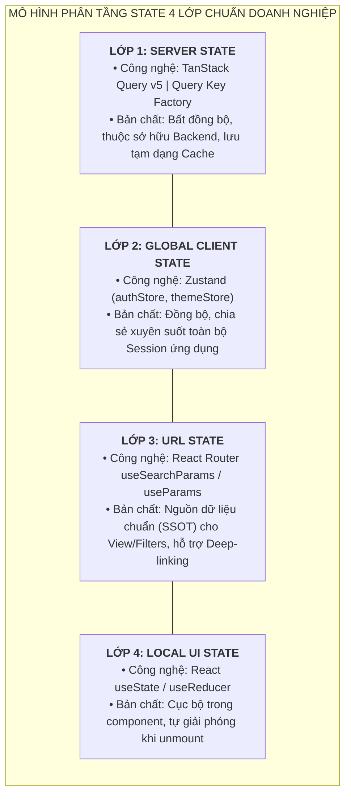
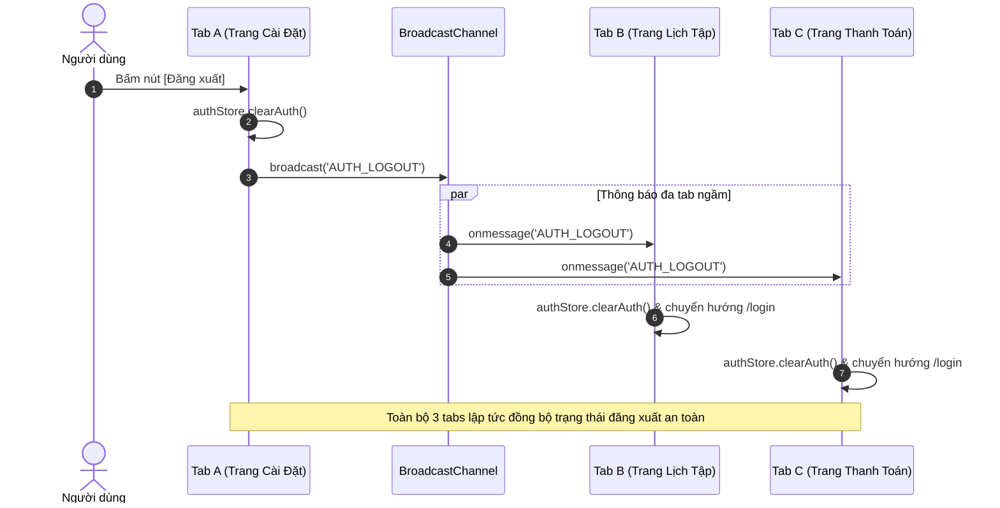
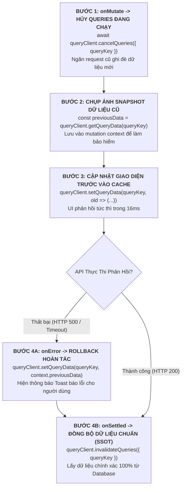
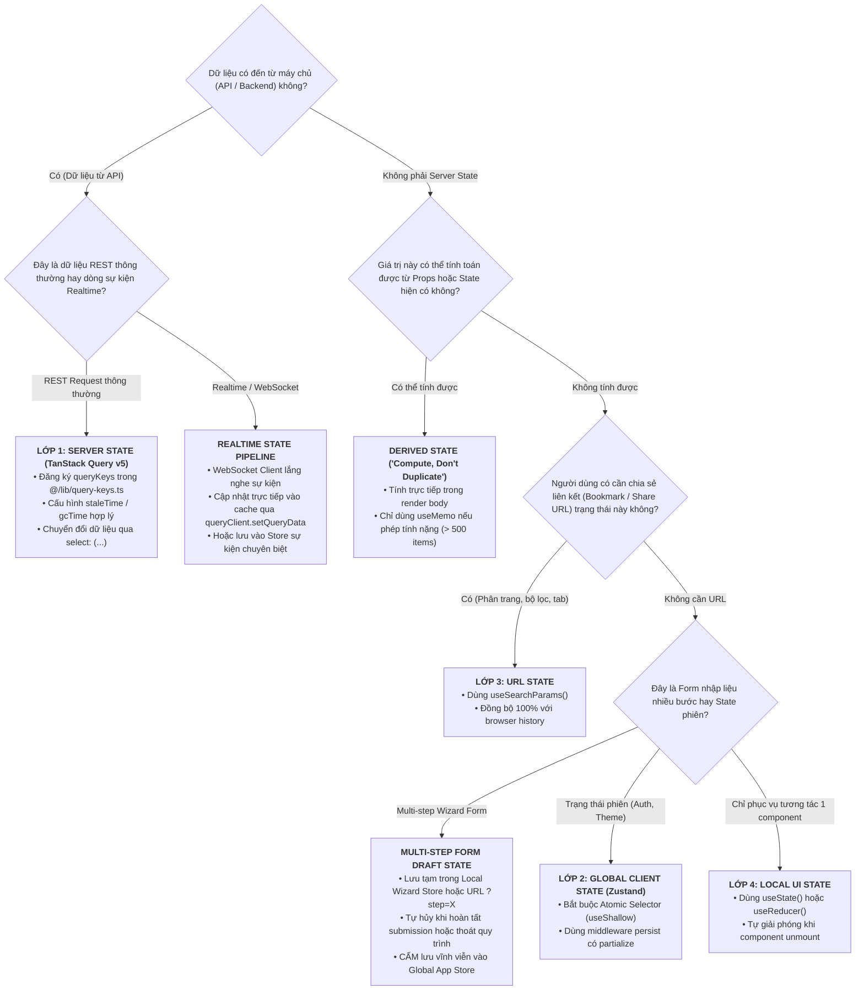

# Chuyên Đề 02: Quản Trị Trạng Thái Đa Tầng & Persistent Cache (State Management)

> **Dự án:** Khung Tiêu Chuẩn Doanh Nghiệp & Hồ Sơ Dự Án RoGym  
> **Cổng quy chuẩn chính:** [`FRONTEND_CONVENTIONS.md`](../FRONTEND_CONVENTIONS.md) | [Bản Đồ Tài Liệu](./README.md)  
> **Tài liệu liên quan:** [`docs/01-architecture-and-structure.md`](./01-architecture-and-structure.md) | [`docs/03-coding-standards.md`](./03-coding-standards.md)  
> **Cơ sở tham chiếu quốc tế:**  
> - [TkDodo's Practical React Query](https://tkdodo.eu/blog) (Dominik Dorfmeister)  
> - [TkDodo - Offline React Query](https://tkdodo.eu/blog/offline-react-query)  
> - [TkDodo - Mastering Mutations & Optimistic Updates](https://tkdodo.eu/blog/mastering-mutations-in-react-query#optimistic-updates)  
> - [TanStack Query v5 Persist Client Documentation](https://tanstack.com/query/v5/docs/framework/react/plugins/persistQueryClient)  
> - [MDN Web Docs - BroadcastChannel API](https://developer.mozilla.org/en-US/docs/Web/API/BroadcastChannel)  
> - [Jake Archibald - idb-keyval (Lightweight IndexedDB Key-Value Store)](https://github.com/jakearchibald/idb-keyval)  
> - [React.dev - You Might Not Need An Effect](https://react.dev/learn/you-might-not-need-an-effect)  
> - [React.dev - Choosing the State Structure](https://react.dev/learn/choosing-the-state-structure)  
> - [Zustand Architecture & State Sharing](https://zustand.docs.pmnd.rs) (Pmndrs)  
> **Phiên bản:** 8.0 (Enterprise Quality Standard — 15 Spokes & Universal Decoupling)  
> **Số lượng quy chuẩn cốt lõi:** 19 Coding Standards (Đồng bộ toàn diện hệ thống)  
> **Áp dụng cho:** Toàn bộ cơ chế quản lý dữ liệu và trạng thái trong thư mục `src/`  
> **Trạng thái:** Bắt buộc tuân thủ 100% (Strict Mandatory Enforcement)

---

## MỤC LỤC
1. [Triết Lý Quản Lý Trạng Thái & Bối Cảnh Doanh Nghiệp](#1-triết-lý-quản-lý-trạng-thái-bối-cảnh-doanh-nghiệp)
2. [Cơ Sở Tham Chiếu Chuẩn Quốc Tế](#2-cơ-sở-tham-chiếu-chuẩn-quốc-tế)
3. [TẦNG 1: Core Universal Spec — Mô Hình Phân Tầng State 4 Lớp](#3-tầng-1-core-universal-spec-mô-hình-phân-tầng-state-4-lớp)
   - [Bảng Ma Trận Phân Định Trách Nhiệm 4 Lớp](#bảng-ma-trận-phân-định-trách-nhiệm-4-lớp)
   - 3.1. [Đặc Tả Kỹ Thuật Từng Tầng](#31-đặc-tả-kỹ-thuật-từng-tầng)
     - [A. Lớp 1: Server State — TanStack Query v5 Cơ Chế Vận Hành](#a-lớp-1-server-state-tanstack-query-v5-cơ-chế-vận-hành)
     - [B. Lớp 2: Global Client State — Zustand Kiến Trúc Doanh Nghiệp](#b-lớp-2-global-client-state-zustand-kiến-trúc-doanh-nghiệp)
4. [TẦNG 1: Đồng Bộ Trạng Thái Đa Tab (Multi-Tab State Synchronization)](#4-tầng-1-đồng-bộ-trạng-thái-đa-tab-multi-tab-state-synchronization)
   - 4.1. [Nguyên lý BroadcastChannel API & Giới hạn của LocalStorage](#41-nguyên-lý-broadcastchannel-api-giới-hạn-của-localstorage)
   - 4.2. [CrossTabSyncManager: Lớp Quản Trị Đồng Bộ Đa Tab Toàn Cục](#42-crosstabsyncmanager-lớp-quản-trị-đồng-bộ-đa-tab-toàn-cục)
   - 4.3. [Sơ Đồ Tương Tác Đồng Bộ Đăng Xuất Đa Tab (Cross-Tab Logout Flow)](#43-sơ-đồ-tương-tác-đồng-bộ-đăng-xuất-đa-tab-cross-tab-logout-flow)
5. [TẦNG 1: Lưu Trữ Bộ Đệm Ngoại Tuyến Bền Vững Với IndexedDB (Persistent Offline Cache)](#5-tầng-1-lưu-trữ-bộ-đệm-ngoại-tuyến-bền-vững-với-indexeddb-persistent-offline-cache)
   - 5.1. [Khắc phục giới hạn 5MB và rào cản Main Thread của LocalStorage](#51-khắc-phục-giới-hạn-5mb-và-rào-cản-main-thread-của-localstorage)
   - 5.2. [Bộ Chuyển Đổi idbStorage với idb-keyval](#52-bộ-chuyển-đổi-idbstorage-với-idb-keyval)
   - 5.3. [Cấu Hình Persister, Thời Gian Sống (gcTime) & Cache Buster](#53-cấu-hình-persister-thời-gian-sống-gctime-cache-buster)
6. [TẦNG 1: Ma Trận Xử Lý Race Conditions & Cập Nhật Giao Diện Trước (Optimistic Updates)](#6-tầng-1-ma-trận-xử-lý-race-conditions-cập-nhật-giao-diện-trước-optimistic-updates)
   - 6.1. [Phân Tích Nguy Cơ Race Condition Khi Mạng Chậm hoặc Bấm Nhanh](#61-phân-tích-nguy-cơ-race-condition-khi-mạng-chậm-hoặc-bấm-nhanh)
   - 6.2. [Quy Trình 4 Bước Chuẩn TkDodo Với Snapshot Rollback](#62-quy-trình-4-bước-chuẩn-tkdodo-với-snapshot-rollback)
   - 6.3. [Code Mẫu Chuẩn: Cập Nhật Giao Diện Trước Trạng Thái Khóa Buổi Tập](#63-code-mẫu-chuẩn-cập-nhật-giao-diện-trước-trạng-thái-khóa-buổi-tập)
7. [State Decision Tree (Cây Quyết Định Định Vị State Trong 30 Giây)](#7-state-decision-tree-cây-quyết-định-định-vị-state-trong-30-giây)
   - 7.1. [Sơ đồ ra quyết định trong 30 giây](#71-sơ-đồ-ra-quyết-định-trong-30-giây)
   - 7.2. [Bộ 6 câu hỏi vàng định vị State](#72-bộ-6-câu-hỏi-vàng-định-vị-state)
8. [Nguyên Tắc Vàng: "Compute, Don't Duplicate" (Derived State)](#8-nguyên-tắc-vàng-compute-dont-duplicate-derived-state)
   - 8.1. [3 Anti-Patterns phổ biến của useEffect](#81-3-anti-patterns-phổ-biến-của-useeffect)
   - 8.2. [Quy tắc định lượng: Render trực tiếp vs useMemo](#82-quy-tắc-định-lượng-render-trực-tiếp-vs-usememo)
   - 8.3. [Kỹ thuật reset state tự nhiên bằng React Key](#83-kỹ-thuật-reset-state-tự-nhiên-bằng-react-key)
9. [TẦNG 2: RoGym Implementation Profile — Đặc Tả Triển Khai Chuyên Sâu Từng Lớp State](#9-tầng-2-rogym-implementation-profile-đặc-tả-triển-khai-chuyên-sâu-từng-lớp-state)
   - 9.1. [Lớp 1: Server State với TanStack Query v5 & Query Key Factory 10 Domains](#91-lớp-1-server-state-với-tanstack-query-v5-query-key-factory-10-domains)
   - 9.2. [Lớp 2: Global Client State với Zustand & Atomic Selectors](#92-lớp-2-global-client-state-với-zustand-atomic-selectors)
   - 9.3. [Lớp 3: URL State với useSearchParams](#93-lớp-3-url-state-với-usesearchparams)
   - 9.4. [Lớp 4: Local UI State với Primitive Boundaries](#94-lớp-4-local-ui-state-với-primitive-boundaries)
10. [Case Study Triển Khai Thực Tế: Chọn & Thanh Toán Gói Tập (Payment Flow)](#10-case-study-triển-khai-thực-tế-chọn-thanh-toán-gói-tập-payment-flow)
11. [Phân Tích Đối Sánh: Anti-Patterns vs Chuẩn Mực Doanh Nghiệp](#11-phân-tích-đối-sánh-anti-patterns-vs-chuẩn-mực-doanh-nghiệp)
12. [Bảng Checklist Định Lượng 10 Tiêu Chuẩn State Management Trước Khi Mở PR](#12-bảng-checklist-định-lượng-10-tiêu-chuẩn-state-management-trước-khi-mở-pr)
13. [Ánh Xạ Tooling Kiểm Toán CI & Static Rules](#13-ánh-xạ-tooling-kiểm-toán-ci-static-rules)

---

## 1. Triết Lý Quản Lý Trạng Thái & Bối Cảnh Doanh Nghiệp

Trong các ứng dụng React truyền thống, sai lầm phổ biến nhất của các kỹ sư là gom toàn bộ dữ liệu vào một nơi (như Redux store nguyên khối) hoặc lạm dụng `useState` cục bộ kết hợp với truyền prop xuyên qua nhiều tầng (prop drilling). Hậu quả dẫn tới:
- **Xung đột bộ nhớ đệm (Cache Invalidation Nightmare):** Dữ liệu từ máy chủ (Server State) bị sao chép vào Global State của client, khiến client không biết khi nào dữ liệu đó bị lỗi thời (stale), dẫn đến người dùng nhìn thấy thông tin cũ hoặc phải bấm F5 thủ công.
- **Hiện tượng State Ma (Ghost State / Desynchronization):** Khi cùng một mẩu thông tin (ví dụ: số dư thẻ tập, danh sách gói hội viên) tồn tại ở 2-3 nơi khác nhau trong ứng dụng, một hành động cập nhật chỉ làm mới 1 nơi, các màn hình còn lại hiển thị dữ liệu sai lệch.
- **Bùng nổ re-render không kiểm soát (Over-rendering Cascade):** Đăng ký component vào toàn bộ store thay vì dùng atomic selectors khiến mỗi thay đổi nhỏ ở header hay thông báo làm render lại toàn bộ trang bảng điều khiển.

Để khắc phục triệt để các vấn đề trên, hệ thống xác định nguyên lý bất biến: **Tách biệt tuyệt đối quyền sở hữu dữ liệu (Data Ownership Separation)**. State phải thuộc về đúng tầng phụ trách quản lý nó, với một nguồn dữ liệu chuẩn duy nhất (Single Source of Truth - SSOT).

---

## 2. Cơ Sở Tham Chiếu Chuẩn Quốc Tế

Bộ quy chuẩn quản lý trạng thái được xây dựng vững chắc trên 6 nền tảng tham chiếu chuẩn mực:

1. **[TkDodo's Practical React Query](https://tkdodo.eu/blog) (Dominik Dorfmeister):**
   - Coi Server State là một bộ nhớ đệm bất đồng bộ (Asynchronous Cache), không phải là Client State thông thường.
   - Bắt buộc chuẩn hóa Query Keys qua cấu trúc Factory pattern tập trung.
   - Khai thác tối đa khả năng biến đổi dữ liệu (data transformation) ngay tại hook thông qua thuộc tính `select`.
2. **[TkDodo - Offline React Query & Persist Client](https://tkdodo.eu/blog/offline-react-query):**
   - Chiến lược lưu trữ bộ đệm ngoại tuyến an toàn bằng `createAsyncStoragePersister` với IndexedDB.
   - Quản lý đồng bộ vòng đời dữ liệu giữa Network, RAM Cache và Disk Storage.
3. **[TkDodo - Mastering Mutations & Optimistic Updates](https://tkdodo.eu/blog/mastering-mutations-in-react-query#optimistic-updates):**
   - Quy trình 4 bước chuẩn xử lý cập nhật giao diện trước (optimistic updates), snapshot state và rollback khi có lỗi mạng.
4. **[MDN Web Docs - BroadcastChannel API](https://developer.mozilla.org/en-US/docs/Web/API/BroadcastChannel):**
   - Tiêu chuẩn giao tiếp một-nhiều (One-to-many communication) thời gian thực giữa các browsing contexts (Tabs, Windows, Iframes) cùng nguồn gốc.
5. **[React.dev - You Might Not Need An Effect](https://react.dev/learn/you-might-not-need-an-effect):**
   - Loại bỏ 100% các `useEffect` dùng để đồng bộ state phụ hoặc sao chép props vào state.
   - Mọi giá trị có thể tính toán từ props hoặc state hiện có bắt buộc phải là **Derived State** ("Compute, Don't Duplicate").
6. **[Zustand Architecture](https://zustand.docs.pmnd.rs) (Pmndrs):**
   - Sử dụng mô hình Client Store gọn nhẹ, không boilerplate, hỗ trợ reactive hooks với Atomic Selectors.
   - Ngăn chặn triệt để re-render thừa thông qua so sánh nông (`useShallow`).

---

## 3. TẦNG 1: Core Universal Spec — Mô Hình Phân Tầng State 4 Lớp

Hệ thống quản lý trạng thái được phân rã thành **4 Lớp độc lập**, mỗi lớp có ranh giới trách nhiệm, vòng đời và công nghệ chuyên trách riêng:



### Bảng Ma Trận Phân Định Trách Nhiệm 4 Lớp

| Tiêu Chí Đánh Giá | Lớp 1: Server State | Lớp 2: Global Client State | Lớp 3: URL State | Lớp 4: Local UI State |
| :--- | :--- | :--- | :--- | :--- |
| **Bản chất dữ liệu** | Dữ liệu nghiệp vụ từ Backend (Packages, Trainers, Classes, Bookings) | Trạng thái phiên làm việc của Client (Token, AuthUser, Preferences) | Tham số điều hướng, bộ lọc màn hình (Page, Search, Tab, Sort) | Trạng thái tương tác vi mô của giao diện (Modal open, Hover, Field focus) |
| **Công nghệ chuẩn** | `TanStack Query v5` (`@tanstack/react-query`) | `Zustand` (`zustand`, `zustand/middleware`) | `react-router-dom` (`useSearchParams`, `useLocation`) | `useState`, `useReducer` của React |
| **Nguồn dữ liệu chuẩn (SSOT)** | Máy chủ (Database qua API REST) | Client Memory (kết hợp `localStorage` qua middleware `persist`) | Thanh địa chỉ URL trình duyệt (Browser Address Bar) | Vòng đời Component Fiber (React Tree) |
| **Vòng đời (Lifecycle)** | Có thời gian hết hạn (`staleTime`), tự động làm mới khi stale/reconnect | Tồn tại suốt phiên làm việc, xóa sạch khi logout hoặc dọn dẹp session | Thay đổi theo lịch sử trình duyệt (History API, Back/Forward) | Tự động hủy khi component bị unmount khỏi DOM |
| **Cách truy xuất** | Custom hooks: `useActivePackagesQuery()`, `useQuery()` | Hook có selector: `useAuthStore(s => s.user)` | Hook: `useSearchParams()`, `useParams()` | Hook cục bộ: `const [open, setOpen] = useState(false)` |
| **Chiến lược xử lý lỗi** | Tự động retry (3 lần); Ném lỗi qua `throwOnError` lên Error Boundary hoặc render inline `<Alert>` | Khôi phục giá trị mặc định (`initialState`); Kích hoạt `clearAuth()` khi token hết hạn | Validate kiểu dữ liệu param; Tự động fallback về giá trị mặc định an toàn nếu URL bị sửa bậy | Inline form error message; Tự dọn sạch state khi đóng hộp thoại |
| **Điều CẤM ĐOÁN ❌** | CẤM lưu Server State vào Zustand hay useState | CẤM lưu dữ liệu danh sách nghiệp vụ vào Zustand | CẤM giấu bộ lọc tìm kiếm trong useState khi màn hình cần chia sẻ link | CẤM đưa state của modal hay dropdown lên Global Store |

---

### 3.1. Đặc Tả Kỹ Thuật Từng Tầng

#### A. Lớp 1: Server State — TanStack Query v5 Cơ Chế Vận Hành
1. **Phân biệt `staleTime` vs `gcTime` (Quy ước v5):**
   - `staleTime` (Mặc định: `0`): Khoảng thời gian dữ liệu được xem là "tươi mới" (fresh). Trong thời gian này, TanStack Query sẽ đọc ngay từ cache mà không gọi request ngầm. Đối với doanh nghiệp, các danh mục ít biến động (Gói dịch vụ, Danh sách phòng ban) được cấu hình `staleTime: 5 * 60 * 1000` (5 phút).
   - `gcTime` (Garbage Collection Time - thay thế `cacheTime` trong v4, mặc định: 5 phút): Khoảng thời gian dữ liệu không còn component nào theo dõi (inactive) được lưu giữ trong RAM trước khi bị dọn dẹp.
2. **Phân biệt `isLoading` vs `isFetching`:**
   - `isLoading` (`isPending && isFetching`): Chỉ kích hoạt ở lần tải đầu tiên khi bộ nhớ đệm hoàn toàn chưa có dữ liệu. Dùng để render Skeleton màn hình (`<PageSkeleton />`).
   - `isFetching`: Bật lên `true` mỗi khi có bất kỳ request mạng nào đang diễn ra, bao gồm cả background refetch khi người dùng chuyển tab quay lại. Dùng để render biểu tượng xoay nhẹ (spinner) ở góc hoặc giữ giao diện mượt mà không bị giật trang.
3. **Chiến Lược Invalidation Chuẩn Xác:**
   - Sau khi thực hiện Mutation (ví dụ: tạo đăng ký gói tập mới), bắt buộc dùng Query Key Factory để vô hiệu hóa cache có chủ đích:
   ```ts
   queryClient.invalidateQueries({
     queryKey: queryKeys.subscription.all,
   })
   ```
4. **Xử Lý Lỗi Tập Trung & Error Boundaries Phân Cấp:**
   - **Tầng Toàn Cục (Global QueryCache):** Cấu hình `QueryCache` trong `QueryClient` với hàm `onError` tập trung để hiển thị Toast thông báo lỗi hệ thống/mạng chung, tự động gọi `clearAuth()` nếu nhận mã lỗi HTTP 401.
   - **Tầng Phân Vùng (Route vs Widget Boundaries):**
     - Với màn hình trang chính: Kích hoạt `throwOnError: true` để ném lỗi lên `<ErrorBoundary>` cấp Route bọc bên ngoài.
     - Với widget phụ độc lập (như dropdown tìm kiếm nhanh): Sử dụng cờ cục bộ `isError` kết hợp `<Alert variant="danger">` để lỗi không làm crash toàn bộ trang (Fault Isolation).

#### B. Lớp 2: Global Client State — Zustand Kiến Trúc Doanh Nghiệp
1. **Middleware `persist` & Bộ lọc `partialize`:**
   - Chỉ lưu trữ các trường dữ liệu cần thiết cho phiên làm việc (whitelist) vào `localStorage`, tuyệt đối không lưu các biến cờ giao diện tạm thời:
   ```ts
   persist(
     (set) => ({ ... }),
     {
       name: 'app-auth',
       partialize: (state) => ({
         user: state.user,
         token: state.token,
         isAuthenticated: state.isAuthenticated,
       }),
       onRehydrateStorage: () => (state) => {
         state?.setHasHydrated(true)
       },
     }
   )
   ```
2. **Vòng đời Hydration (`hasHydrated`):**
   - Khi ứng dụng tải lại trang, việc đọc dữ liệu từ storage diễn ra bất đồng bộ nhẹ. Cờ `hasHydrated: boolean` giúp Router và Protected Routes chờ đến khi quá trình khôi phục hoàn tất, loại bỏ 100% hiện tượng "chớp giật đá ra trang login" (Flash of Unauthenticated Content - FOUC).
3. **Kiến Trúc Dọn Dẹp Độc Lập (`onLogout` Listeners):**
   - Để tránh vòng lặp phụ thuộc (Circular Dependency) giữa `authStore` và các store nghiệp vụ khác, `authStore` cung cấp cơ chế event emitter `onLogout`. Khi người dùng đăng xuất, hàm `clearAuth()` phát tín hiệu `notifyLogout()`, cho phép các store khác tự dọn sạch state mà không cần import qua lại.

---

## 4. TẦNG 1: Đồng Bộ Trạng Thái Đa Tab (Multi-Tab State Synchronization)

Trong ứng dụng doanh nghiệp có người dùng mở đồng thời nhiều tab trình duyệt (ví dụ: Tab 1 mở danh sách lịch tập, Tab 2 mở trang thanh toán), việc không đồng bộ trạng thái dẫn tới **3 rủi ro bảo mật & UX nghiêm trọng**:
1. Người dùng bấm Đăng xuất ở Tab 1, nhưng Tab 2 vẫn hiển thị dữ liệu nhạy cảm và tiếp tục cho phép thao tác cho tới khi token thực sự hết hạn.
2. Phiên làm việc được làm mới (Silent Token Refresh) ở Tab 1, nhưng Tab 2 vẫn giữ token cũ và liên tục bị 401.
3. Người dùng cập nhật trạng thái đơn hàng/giỏ hàng ở Tab 1, nhưng Tab 2 vẫn hiển thị trạng thái cũ gây ra xung đột trùng lặp giao dịch (Race Condition).

### 4.1. Nguyên lý BroadcastChannel API & Giới hạn của LocalStorage
- **`BroadcastChannel` API:** Là giải pháp chuẩn W3C chuyên dụng cho việc phát tín hiệu 1-nhiều giữa các ngữ cảnh cùng nguồn (Same-Origin contexts) với độ trễ cực thấp (< 5ms). Người gửi (sender) không nhận lại chính tin nhắn của mình.
- **Cơ chế Fallback:** Đối với môi trường trình duyệt hạn chế hoặc WebView không hỗ trợ `BroadcastChannel`, hệ thống tự động chuyển sang lắng nghe sự kiện `window.addEventListener('storage', ...)`.

### 4.2. CrossTabSyncManager: Lớp Quản Trị Đồng Bộ Đa Tab Toàn Cục

Dưới đây là bản thiết kế lớp quản trị tập trung chuẩn Enterprise:

```typescript
// File: src/lib/cross-tab-sync.ts
export type CrossTabMessageType = 
  | 'AUTH_LOGOUT'
  | 'AUTH_TOKEN_REFRESHED'
  | 'QUERY_CACHE_INVALIDATE'
  | 'NOTIFICATION_RECEIVED'

export interface CrossTabPayload<T = unknown> {
  type: CrossTabMessageType
  senderId: string
  timestamp: number
  data?: T
}

export class CrossTabSyncManager {
  private static instance: CrossTabSyncManager
  private channel: BroadcastChannel | null = null
  private tabId: string
  private handlers = new Map<CrossTabMessageType, Set<(payload: CrossTabPayload) => void>>()

  private constructor() {
    this.tabId = `tab_${Date.now()}_${Math.random().toString(36).substring(2, 9)}`
    this.initializeChannel()
  }

  public static getInstance(): CrossTabSyncManager {
    if (!CrossTabSyncManager.instance) {
      CrossTabSyncManager.instance = new CrossTabSyncManager()
    }
    return CrossTabSyncManager.instance
  }

  private initializeChannel(): void {
    if (typeof window === 'undefined') return

    if ('BroadcastChannel' in window) {
      this.channel = new BroadcastChannel('enterprise_app_sync_channel')
      this.channel.onmessage = (event: MessageEvent<CrossTabPayload>) => {
        this.dispatch(event.data)
      }
    } else {
      // Fallback cho trình duyệt cũ bằng StorageEvent
      window.addEventListener('storage', (event) => {
        if (event.key === '__cross_tab_sync_bridge__' && event.newValue) {
          try {
            const payload = JSON.parse(event.newValue) as CrossTabPayload
            if (payload.senderId !== this.tabId) {
              this.dispatch(payload)
            }
          } catch {
            // Xử lý lỗi parse JSON
          }
        }
      })
    }
  }

  public broadcast<T>(type: CrossTabMessageType, data?: T): void {
    const payload: CrossTabPayload<T> = {
      type,
      senderId: this.tabId,
      timestamp: Date.now(),
      data,
    }

    if (this.channel) {
      this.channel.postMessage(payload)
    } else if (typeof window !== 'undefined') {
      localStorage.setItem('__cross_tab_sync_bridge__', JSON.stringify(payload))
      localStorage.removeItem('__cross_tab_sync_bridge__')
    }
  }

  public subscribe(type: CrossTabMessageType, handler: (payload: CrossTabPayload) => void): () => void {
    if (!this.handlers.has(type)) {
      this.handlers.set(type, new Set())
    }
    this.handlers.get(type)!.add(handler)

    return () => {
      this.handlers.get(type)?.delete(handler)
    }
  }

  private dispatch(payload: CrossTabPayload): void {
    const typeHandlers = this.handlers.get(payload.type)
    if (typeHandlers) {
      typeHandlers.forEach((handler) => handler(payload))
    }
  }

  public destroy(): void {
    if (this.channel) {
      this.channel.close()
      this.channel = null
    }
    this.handlers.clear()
  }
}

export const crossTabSync = CrossTabSyncManager.getInstance()
```

### 4.3. Sơ Đồ Tương Tác Đồng Bộ Đăng Xuất Đa Tab (Cross-Tab Logout Flow)



---

## 5. TẦNG 1: Lưu Trữ Bộ Đệm Ngoại Tuyến Bền Vững Với IndexedDB (Persistent Offline Cache)

### 5.1. Khắc phục giới hạn 5MB và rào cản Main Thread của LocalStorage
Trong các ứng dụng quy mô lớn, việc lưu trữ bộ đệm của hàng chục API queries vào `localStorage` là một sai lầm:
1. **Giới hạn $5\text{MB}$:** Khi cache danh sách lớn (hàng nghìn hội viên, lịch tập nhiều tháng), `localStorage` lập tức ném lỗi `QuotaExceededError`.
2. **Chặn Main Thread:** `localStorage` là API đồng bộ (synchronous). Mỗi thao tác đọc/ghi dữ liệu lớn làm đơ UI trong 50–150ms.
3. **Giải pháp chuẩn quốc tế:** Sử dụng **IndexedDB** bất đồng bộ qua thư viện siêu nhẹ `idb-keyval` (< 1KB) kết hợp cùng `@tanstack/query-async-storage-persister`.

### 5.2. Bộ Chuyển Đổi idbStorage với idb-keyval

```typescript
// File: src/lib/idb-storage.ts
import { get, set, del, createStore } from 'idb-keyval'
import type { AsyncStorage } from '@tanstack/query-async-storage-persister'

// Khởi tạo Database và ObjectStore biệt lập cho Query Cache
const cacheStore = createStore('enterprise_app_cache_db', 'query_cache_store')

export const idbStorage: AsyncStorage = {
  getItem: async (key: string): Promise<string | null> => {
    try {
      const value = await get<string>(key, cacheStore)
      return value ?? null
    } catch (error) {
      console.warn('[IndexedDB] Không thể đọc cache:', error)
      return null
    }
  },
  setItem: async (key: string, value: string): Promise<void> => {
    try {
      await set(key, value, cacheStore)
    } catch (error) {
      console.warn('[IndexedDB] Không thể ghi cache:', error)
    }
  },
  removeItem: async (key: string): Promise<void> => {
    try {
      await del(key, cacheStore)
    } catch (error) {
      console.warn('[IndexedDB] Không thể xóa cache:', error)
    }
  },
}
```

### 5.3. Cấu Hình Persister, Thời Gian Sống (gcTime) & Cache Buster

```typescript
// File: src/lib/query-persister.ts
import { QueryClient } from '@tanstack/react-query'
import { createAsyncStoragePersister } from '@tanstack/query-async-storage-persister'
import { idbStorage } from './idb-storage'

// 1. Khởi tạo QueryClient với gcTime phù hợp
export const queryClient = new QueryClient({
  defaultOptions: {
    queries: {
      // gcTime phải lớn hơn hoặc bằng maxAge của Persister (24 giờ)
      gcTime: 1000 * 60 * 60 * 24,
      staleTime: 1000 * 60 * 5, // 5 phút
      networkMode: 'offlineFirst', // Ưu tiên đọc cache khi mất mạng
      retry: 2,
    },
  },
})

// 2. Khởi tạo Async Storage Persister
export const asyncStoragePersister = createAsyncStoragePersister({
  storage: idbStorage,
  key: 'ENTERPRISE_QUERY_OFFLINE_CACHE',
  throttle: 1000, // Gom nhóm ghi đĩa tối đa 1 lần/giây tránh nghẽn I/O
  maxAge: 1000 * 60 * 60 * 24, // Hết hạn sau 24 giờ
})

// Chuỗi buster: Thay đổi khi có breaking change về schema API để xóa trắng cache cũ
export const CACHE_BUSTER_VERSION = 'v1.0.0-enterprise'
```

#### Bọc Ứng Dụng với `PersistQueryClientProvider`:
```tsx
import { PersistQueryClientProvider } from '@tanstack/react-query-persist-client'
import { queryClient, asyncStoragePersister, CACHE_BUSTER_VERSION } from '@/lib/query-persister'

export function AppProviders({ children }: { children: React.ReactNode }) {
  return (
    <PersistQueryClientProvider
      client={queryClient}
      persistOptions={{
        persister: asyncStoragePersister,
        buster: CACHE_BUSTER_VERSION,
        maxAge: 1000 * 60 * 60 * 24,
      }}
    >
      {children}
    </PersistQueryClientProvider>
  )
}
```

---

## 6. TẦNG 1: Ma Trận Xử Lý Race Conditions & Cập Nhật Giao Diện Trước (Optimistic Updates)

### 6.1. Phân Tích Nguy Cơ Race Condition Khi Mạng Chậm hoặc Bấm Nhanh
Khi người dùng thực hiện thao tác nhanh (ví dụ: bấm nút "Đặt lịch" liên tiếp, hoặc vừa bấm "Thích" vừa bấm "Bỏ thích"):
- Nếu gửi liên tiếp 2 request mạng bất đồng bộ, request gửi trước có thể phản hồi sau (do độ trễ mạng chập chờn).
- Nếu không có cơ chế hủy refetch ngầm (`cancelQueries`), dữ liệu cũ từ server phản hồi về sẽ ghi đè lên thao tác mới nhất của người dùng, tạo ra lỗi hiển thị sai lệch nghiêm trọng.

### 6.2. Quy Trình 4 Bước Chuẩn TkDodo Với Snapshot Rollback



### 6.3. Code Mẫu Chuẩn: Cập Nhật Giao Diện Trước Trạng Thái Khóa Buổi Tập

```typescript
import { useMutation, useQueryClient } from '@tanstack/react-query'
import { queryKeys } from '@/lib/query-keys'
import { toast } from '@/lib/toast'
import scheduleService from '@/services/schedule.service'

interface ToggleLockParams {
  sessionId: string
  isLocked: boolean
}

export function useOptimisticToggleSessionLock() {
  const queryClient = useQueryClient()

  return useMutation({
    mutationFn: ({ sessionId, isLocked }: ToggleLockParams) =>
      scheduleService.setSessionLock(sessionId, isLocked),

    // 1. Khi bắt đầu mutation: Hủy queries ngầm & Snapshot state
    onMutate: async ({ sessionId, isLocked }) => {
      const queryKey = queryKeys.trainer.schedule(sessionId)

      // Chặn mọi background refetch đang chạy đối với buổi tập này
      await queryClient.cancelQueries({ queryKey })

      // Lưu trữ snapshot dữ liệu trước khi thay đổi
      const previousSession = queryClient.getQueryData(queryKey)

      // Cập nhật giao diện trước (optimistic) vào cache ngay lập tức
      queryClient.setQueryData(queryKey, (old: any) => {
        if (!old) return old
        return {
          ...old,
          isLocked,
        }
      })

      // Trả về context chứa previousSession làm bảo hiểm rollback
      return { previousSession, queryKey }
    },

    // 2. Nếu server trả về lỗi: Khôi phục lại trạng thái cũ từ snapshot
    onError: (err, variables, context) => {
      if (context?.previousSession) {
        queryClient.setQueryData(context.queryKey, context.previousSession)
      }
      toast.error('Không thể cập nhật trạng thái buổi tập. Đã khôi phục lại dữ liệu.')
    },

    // 3. Luôn luôn thực hiện khi hoàn tất (dù thành công hay thất bại): Làm mới từ server
    onSettled: (data, error, variables, context) => {
      if (context?.queryKey) {
        queryClient.invalidateQueries({ queryKey: context.queryKey })
      }
    },
  })
}
```

---

## 7. State Decision Tree (Cây Quyết Định Định Vị State Trong 30 Giây)

Khi bắt đầu xây dựng một tính năng mới hoặc thêm một biến trạng thái, kỹ sư **bắt buộc** phải tra cứu sơ đồ cây quyết định dưới đây để xác định chính xác tầng lưu trữ phù hợp trong vòng 30 giây:

### 7.1. Sơ đồ ra quyết định trong 30 giây



### 7.2. Bộ 6 câu hỏi vàng định vị State

1. **Câu hỏi 1 (Server hay Client):** *"Dữ liệu này có phải do máy chủ sở hữu, cần gọi API để lấy và có thể bị người dùng khác thay đổi cùng lúc không?"*  
   ➔ Nếu **CÓ**: Chọn ngay **Lớp 1 (Server State)**. Tuyệt đối không sao chép về Zustand.
2. **Câu hỏi 2 (Realtime hay REST):** *"Dữ liệu có đến từ kênh kết nối Socket liên tục (tin nhắn chat, thông báo đẩy) không?"*  
   ➔ Nếu **CÓ**: Nhận sự kiện Socket và cập nhật trực tiếp vào TanStack Query cache (`queryClient.setQueryData`) hoặc `chatStore`.
3. **Câu hỏi 3 (Gốc hay Dẫn xuất):** *"Có thể suy ra giá trị này từ mảng danh sách, prop đầu vào hoặc state khác không?"*  
   ➔ Nếu **CÓ**: Chọn ngay **Derived State**. Tuyệt đối không tạo thêm `useState` và không dùng `useEffect`.
4. **Câu hỏi 4 (Khả năng Bookmark):** *"Nếu người dùng copy đường dẫn gửi cho đồng nghiệp, người nhận có mong muốn nhìn thấy đúng trang, đúng bộ lọc và đúng từ khóa tìm kiếm đó không?"*  
   ➔ Nếu **CÓ**: Chọn ngay **Lớp 3 (URL State)** qua `useSearchParams`.
5. **Câu hỏi 5 (Form nhiều bước):** *"Dữ liệu này có phải là bản nháp đang nhập dở của quy trình tạo mới 3-4 bước không?"*  
   ➔ Nếu **CÓ**: Dùng URL parameter `?step=X` kết hợp scoped wizard state hoặc `sessionStorage`, xóa sạch khi submit thành công.
6. **Câu hỏi 6 (Trạng thái giao diện nhất thời):** *"Trạng thái này có mất đi khi người dùng chuyển trang hoặc đóng giao diện không?"*  
   ➔ Nếu **CÓ**: Chọn **Lớp 4 (Local UI State)** qua `useState`.

---

## 8. Nguyên Tắc Vàng: "Compute, Don't Duplicate" (Derived State)

Nguyên lý quan trọng nhất trong việc quản lý trạng thái của hệ thống là: **"Compute, Don't Duplicate" (Tính toán trực tiếp, Không nhân bản State)**. Bất kỳ giá trị nào có thể tính toán được từ Props hoặc State hiện có đều KHÔNG được phép lưu vào một `useState` mới và KHÔNG được phép dùng `useEffect` để đồng bộ.

### 8.1. 3 Anti-Patterns phổ biến của useEffect

#### ❌ Anti-Pattern 1: Props Mirroring (Sao chép Props vào State)
```tsx
// ❌ SAI: Sao chép props vào state và dùng effect đồng bộ
function BadItemViewer({ defaultItem }: { defaultItem: Item }) {
  const [item, setItem] = useState(defaultItem)

  useEffect(() => {
    setItem(defaultItem) // LỖI: Gây ra re-render lần 2 không cần thiết!
  }, [defaultItem])

  return <div>{item.title}</div>
}

// ✅ ĐÚNG: Sử dụng trực tiếp prop đầu vào
function GoodItemViewer({ item }: { item: Item }) {
  return <div>{item.title}</div>
}
```

#### ❌ Anti-Pattern 2: Chaining Effects (Hiệu ứng dây chuyền)
```tsx
// ❌ SAI: Dùng effect để tính toán giá trị phụ thuộc
function BadPriceCalculator({ price, discountPercent }: Props) {
  const [discountAmount, setDiscountAmount] = useState(0)
  const [finalPrice, setFinalPrice] = useState(price)

  useEffect(() => {
    setDiscountAmount((price * discountPercent) / 100)
  }, [price, discountPercent])

  useEffect(() => {
    setFinalPrice(price - discountAmount)
  }, [price, discountAmount])

  return <p>{finalPrice}</p>
}

// ✅ ĐÚNG: Derived State tính toán trực tiếp trong thân hàm
function GoodPriceCalculator({ price, discountPercent }: Props) {
  const discountAmount = (price * discountPercent) / 100
  const finalPrice = price - discountAmount

  return <p>{finalPrice}</p>
}
```

#### ❌ Anti-Pattern 3: Dùng useEffect để Reset State khi ID thay đổi
```tsx
// ❌ SAI: Dùng effect để reset form khi đổi userId
function BadUserProfile({ userId }: { userId: string }) {
  const [comment, setComment] = useState('')

  useEffect(() => {
    setComment('') // LỖI: Nhấp nháy dữ liệu cũ trước khi reset!
  }, [userId])

  return <textarea value={comment} onChange={(e) => setComment(e.target.value)} />
}

// ✅ ĐÚNG: Khai thác React Key ở component cha để reset toàn bộ Fiber tree
function ParentWrapper({ currentUserId }: { currentUserId: string }) {
  return <GoodUserProfile key={currentUserId} userId={currentUserId} />
}
```

### 8.2. Quy tắc định lượng: Render trực tiếp vs useMemo
- **Không dùng `useMemo`:** Cho các phép toán $O(1)$, format chuỗi, filter mảng $< 500$ phần tử. Chi phí kiểm tra dependencies của React tốn tài nguyên hơn chính phép tính.
- **Chỉ dùng `useMemo`:** Khi xử lý danh sách $> 500$ phần tử hoặc phép tính thuật toán phức tạp đo lường được thời gian thực thi $> 2\text{ms}$.

### 8.3. Kỹ thuật reset state tự nhiên bằng React Key
Khi một màn hình chuyển đổi giữa các thực thể khác nhau (ví dụ: chuyển từ xem Huấn luyện viên A sang Huấn luyện viên B), thay vì viết effect dọn dẹp state nội bộ, chỉ cần truyền prop `key={trainerId}` vào component. React sẽ tự động hủy instance cũ và khởi tạo instance mới với initial state sạch 100%.

---

## 9. TẦNG 2: RoGym Implementation Profile — Đặc Tả Triển Khai Chuyên Sâu Từng Lớp State

<a id="server-state"></a>
### 9.1. Lớp 1: Server State với TanStack Query v5 & Query Key Factory 10 Domains

> [!IMPORTANT]
> 🧭 **ĐIỀU HƯỚNG TÀI LIỆU CHUYÊN SÂU — DOMAIN HOOKS & SERVER STATE QUERIES:**  
> Toàn bộ kiến trúc Custom Hooks 4 tầng, chiến lược caching TanStack Query v5, cây quyết định lựa chọn hook và catalog 100% hooks & queries được duy trì tập trung tại:  
> 👉 [**src/hooks/README.md — Cẩm Nang Custom Hooks & Server State**](../src/hooks/README.md)  
>  
> **Các chương mục chi tiết cần đọc:**  
> - [Chương 1: Kiến Trúc State & Tháp Phân Tầng Hook](../src/hooks/README.md#chương-1-kiến-trúc-state-tháp-phân-tầng-hook-state-hook-hierarchy)  
> - [Chương 3: Chiến Lược Caching & TanStack Query v5 Best Practices](../src/hooks/README.md#chương-3-chiến-lược-caching-tanstack-query-v5-best-practices)  
> - [Chương 4: Cẩm Nang Tái Cấu Trúc & 5 Anti-patterns Điển Hình](../src/hooks/README.md#chương-4-cẩm-nang-tái-cấu-trúc-5-anti-patterns-điển-hình-refactoring-playbook)  
> - [Chương 6: Catalog Toàn Diện 100% Hooks (`hooks/` & `hooks/queries/`)](../src/hooks/README.md#chương-6-catalog-toàn-diện-100-hooks-hooks-hooksqueries)

Toàn bộ các API queries trong `client/src` bắt buộc gọi khóa truy vấn thông qua tệp tập trung [`src/lib/query-keys.ts`](../src/lib/query-keys.ts) bao phủ đủ 10 domains cốt lõi:

| STT | Domain Key | Phạm Vi Dữ Liệu | Thời Gian Fresh (`staleTime`) | Cơ Chế Invalidation | Link Chi Tiết Sang `src/hooks/README.md` |
| :---: | :--- | :--- | :--- | :--- | :--- |
| 1 | `auth` | Phiên làm việc & Profile người dùng | `0` (luôn fresh check) | Xóa khi đăng xuất / refresh token | [Chương 3.1: Nguồn Dữ Liệu Chuẩn](../src/hooks/README.md#31-nguồn-dữ-liệu-chuẩn-duy-nhất-single-source-of-truth-cho-query-keys-querykeys) |
| 2 | `members` | Danh sách & Chi tiết hồ sơ học viên | `3 phút` | Khi cập nhật thông tin hội viên | [Chương 6.4: Server State Query Hooks](../src/hooks/README.md#chương-6-catalog-toàn-diện-100-hooks-hooks-hooksqueries) |
| 3 | `packages` | Gói tập đang mở bán & chính sách giá | `5 phút` (dữ liệu tĩnh) | Khi quản trị viên đổi gói | [Chương 6.4: useActivePackagesQuery](../src/hooks/README.md#6-useactivepackagesquery) |
| 4 | `trainers` | Danh sách HLV, lịch dạy, học viên PT | `3 phút` | Khi đổi ca / phân công học viên | [Chương 6.4: useTrainerSessionsQuery](../src/hooks/README.md#9-usetrainersessionsquery) |
| 5 | `classes` | Lớp học nhóm, ca tập, lịch tuần | `3 phút` | Khi điểm danh / hủy lớp | [Chương 3.1: Nguồn Dữ Liệu Chuẩn](../src/hooks/README.md#31-nguồn-dữ-liệu-chuẩn-duy-nhất-single-source-of-truth-cho-query-keys-querykeys) |
| 6 | `bookings` | Lịch hẹn tập cá nhân & PT sessions | `1 phút` | Khi tạo / hủy lịch hẹn | [Chương 3.2: Quy Chuẩn Cache](../src/hooks/README.md#32-quy-chuẩn-thời-gian-sống-cache-staletime-vs-gctime) |
| 7 | `attendance` | Nhật ký điểm danh quầy & cổng vân tay | `3 phút` | Khi phát sinh lượt quẹt thẻ | [Chương 6.4: useAttendanceLogsQuery](../src/hooks/README.md#11-useattendancelogsquery) |
| 8 | `billing` / `payments` | Hóa đơn, giao dịch & thanh toán | `0` (dữ liệu tài chính) | Khi thanh toán thành công | [Chương 3.1: Nguồn Dữ Liệu Chuẩn](../src/hooks/README.md#31-nguồn-dữ-liệu-chuẩn-duy-nhất-single-source-of-truth-cho-query-keys-querykeys) |
| 9 | `equipment` | Thiết bị phòng tập & bảo trì máy | `5 phút` | Khi cập nhật bảo trì | [Chương 3.1: Nguồn Dữ Liệu Chuẩn](../src/hooks/README.md#31-nguồn-dữ-liệu-chuẩn-duy-nhất-single-source-of-truth-cho-query-keys-querykeys) |
| 10 | `reports` / `analytics` | Báo cáo doanh thu & chỉ số vận hành | `5 phút` | Khi đóng ca / chốt kỳ | [Chương 3.2: Quy Chuẩn Cache](../src/hooks/README.md#32-quy-chuẩn-thời-gian-sống-cache-staletime-vs-gctime) |

```typescript
// Cú pháp chuẩn tạo Query Hook kết hợp Query Key Factory
import { useQuery } from '@tanstack/react-query'
import { queryKeys } from '@/lib/query-keys'
import packageService from '@/services/package.service'

export function useActivePackages() {
  return useQuery({
    queryKey: queryKeys.packages.active(),
    queryFn: ({ signal }) => packageService.getActivePackages({ signal }),
    staleTime: 5 * 60 * 1000,
  })
}
```

<a id="global-client-state"></a>
### 9.2. Lớp 2: Global Client State với Zustand & Atomic Selectors

> [!IMPORTANT]
> 🧭 **ĐIỀU HƯỚNG TÀI LIỆU CHUYÊN SÂU — DOMAIN ZUSTAND STORES & CLIENT STATE:**  
> Toàn bộ kiến trúc Global Client State, cơ chế Atomic Selectors, đồng bộ đa tab, xử lý dọn dẹp logout và catalog 100% 7 store modules được quản trị tập trung tại:  
> 👉 [**src/stores/README.md — Kiến Trúc Zustand Stores & Client State**](../src/stores/README.md)  
>  
> **Các chương mục chi tiết cần đọc:**  
> - [Chương 1: Ranh Giới Bắt Buộc: Zustand = Client State ONLY](../src/stores/README.md#chương-1-kiến-trúc-quản-lý-trạng-thái-toàn-cục-ranh-giới-zustand-client-state-only-no-server-cache)  
> - [Chương 2: Atomic Selectors & Đồng Bộ Đa Tab](../src/stores/README.md#chương-2-atomic-selectors-đồng-bộ-đa-tab-qua-broadcastchannel-storage)  
> - [Chương 3: Cơ Chế Dọn Dẹp Tập Trung Với `onLogout` Listener Pattern](../src/stores/README.md#chương-3-cơ-chế-dọn-dẹp-tài-nguyên-tập-trung-với-onlogout-listener-pattern)  
> - [Chương 6: Catalog Toàn Diện 100% Stores Tại `stores/` (7 Modules Stores)](../src/stores/README.md#chương-6-catalog-toàn-diện-100-stores-tại-stores-7-modules-stores)

Bảng tổng hợp nhanh 7 modules Zustand Stores trong hệ thống:

| STT | File Store | Mục Đích Nghiệp Vụ | Cơ Chế Lưu Trữ & Persist | Quy Ước Tiêu Thụ Chuẩn | Link Chi Tiết Sang `src/stores/README.md` |
| :---: | :--- | :--- | :--- | :--- | :--- |
| 1 | [`authStore.ts`](../src/stores/authStore.ts) | Quản lý phiên xác thực, token và quyền người dùng | Persist `localStorage` (`gym-auth`), hỗ trợ `onLogout` listener | Atomic Selector: `useAuthStore(s => s.user)` | [authStore.ts Catalog](../src/stores/README.md#chương-6-catalog-toàn-diện-100-stores-tại-stores-7-modules-stores) |
| 2 | [`themeStore.ts`](../src/stores/themeStore.ts) | Quản lý giao diện sáng/tối và đồng bộ hệ điều hành | Persist `localStorage` (`theme`), đồng bộ class `html` | Atomic Selector: `useThemeStore(s => s.theme)` | [themeStore.ts Catalog](../src/stores/README.md#chương-6-catalog-toàn-diện-100-stores-tại-stores-7-modules-stores) |
| 3 | `feature-flag.store.ts` | Bật/tắt tính năng thử nghiệm nội bộ | Client Memory (In-memory flags) | Atomic Selector: `useFeatureFlagStore(s => s.flags)` | [feature-flag Catalog](../src/stores/README.md#chương-6-catalog-toàn-diện-100-stores-tại-stores-7-modules-stores) |
| 4 | `chat.store.ts` | Phiên nhắn tin Socket.IO thời gian thực & cửa sổ nổi | Client Memory, đăng ký dọn dẹp `onLogout` | Atomic Selector: `useChatStore(s => s.conversations)` | [chat.store Catalog](../src/stores/README.md#chương-6-catalog-toàn-diện-100-stores-tại-stores-7-modules-stores) |
| 5 | `workoutSessionControlStore.ts` | Bộ điều khiển đếm giờ buổi tập luyện trực tiếp | Client Memory, đăng ký dừng timer `onLogout` | Atomic Selector: `useWorkoutControl(s => s.status)` | [workoutSession Catalog](../src/stores/README.md#chương-6-catalog-toàn-diện-100-stores-tại-stores-7-modules-stores) |
| 6 | `subscriptionStore.ts` | Kiểm tra quyền truy cập hội viên theo hợp đồng | Client Memory (Đang trong kế hoạch chuyển sang TanStack Query) | Kế hoạch refactor sang `useSubscriptionCheck` | [Cẩm Nang Refactor](../src/stores/README.md#chương-4-nhận-diện-anti-patterns-cẩm-nang-tái-cấu-trúc-refactoring-playbook) |
| 7 | `staffAttendanceStore.ts` | Chấm công nhanh của nhân viên ca trực tại quầy | Client Memory (Đang trong kế hoạch tách sang query hooks) | Kế hoạch refactor sang `useStaffAttendanceLogs` | [Cẩm Nang Refactor](../src/stores/README.md#chương-4-nhận-diện-anti-patterns-cẩm-nang-tái-cấu-trúc-refactoring-playbook) |

```typescript
// Cú pháp tiêu thụ store chuẩn mực chống re-render diện rộng
import { useAuthStore } from '@/stores/authStore'
import { useShallow } from 'zustand/react/shallow'

export function UserHeaderNav() {
  // ✅ DO: Atomic Selector chỉ lắng nghe user và isAuthenticated
  const { user, isAuthenticated } = useAuthStore(
    useShallow((state) => ({
      user: state.user,
      isAuthenticated: state.isAuthenticated,
    }))
  )

  if (!isAuthenticated) return null
  return <span>Xin chào, {user?.name}</span>
}
```

<a id="url-state"></a>
### 9.3. Lớp 3: URL State với useSearchParams

```typescript
import { useSearchParams } from 'react-router-dom'

export function MemberFilterControl() {
  const [searchParams, setSearchParams] = useSearchParams()
  const currentTab = searchParams.get('tab') || 'all'
  const searchQuery = searchParams.get('q') || ''

  const handleTabChange = (newTab: string) => {
    setSearchParams((prev) => {
      const next = new URLSearchParams(prev)
      next.set('tab', newTab)
      next.set('page', '1') // Reset về trang 1 khi đổi tab
      return next
    })
  }

  return <div>{/* UI Controls */}</div>
}
```

### 9.4. Lớp 4: Local UI State với Primitive Boundaries

```tsx
import { useState } from 'react'
import { Button, SubmitButton } from '@/components/ui/actions'
import { Badge, Card } from '@/components/ui/data-display'
import { Form, FormField, Input } from '@/components/ui/forms'
import { Page } from '@/components/ui/layout'
import { Modal } from '@/components/ui/overlay'

export function QuickCheckInButton() {
  // Local state cô lập chỉ phục vụ trạng thái đóng/mở của hộp thoại
  const [isOpen, setIsOpen] = useState(false)

  return (
    <>
      <Button variant="primary" onClick={() => setIsOpen(true)}>
        Check-in Nhanh
      </Button>
      <Modal open={isOpen} onClose={() => setIsOpen(false)} title="Quét Mã Check-in">
        <p>Giao diện quét camera QR</p>
      </Modal>
```

### 9.5. Tối Ưu Hóa Re-render & Triệt Tiêu Thác Nước Bất Đồng Bộ (Vercel State & Waterfalls Optimization)

Nhằm đảm bảo trải nghiệm giao diện phản hồi tức thì và không bị nghẽn luồng xử lý, hệ thống quản trị trạng thái tích hợp các quy tắc tối ưu hóa từ **Vercel React Best Practices**:

#### 1. Trì hoãn cập nhật thứ cấp qua `startTransition` (`STATE-VCL-001` [rerender-transitions])
Khi người dùng chuyển tab, lọc danh sách hoặc đổi chế độ xem, việc cập nhật state danh sách nặng có thể làm đơ con trỏ chuột. Sử dụng `startTransition` để đánh dấu đây là cập nhật có độ ưu tiên thấp (non-urgent), cho phép trình duyệt ưu tiên xử lý các tương tác gõ phím/click của người dùng trước:

```tsx
import { useState, useTransition } from 'react'

export function MemberSearchTabs() {
  const [tab, setTab] = useState('active')
  const [isPending, startTransition] = useTransition()

  const handleTabChange = (nextTab: string) => {
    // startTransition giữ UI luôn mượt mà khi đổi tab nặng
    startTransition(() => {
      setTab(nextTab)
    })
  }

  return (
    <div>
      <TabList active={tab} onChange={handleTabChange} />
      {isPending ? <LoadingOverlay /> : <MemberList tab={tab} />}
    </div>
  )
}
```

#### 2. Giữ phản hồi Input nhạy bén với `useDeferredValue` (`STATE-VCL-002` [rerender-use-deferred-value])
Khi người dùng gõ từ khóa tìm kiếm hội viên, việc lọc danh sách hàng nghìn dòng trong cùng một frame làm input bị giật (khựng phím). Sử dụng `useDeferredValue` để trì hoãn việc lọc danh sách, giữ cho ô input phản hồi với độ trễ $0\text{ms}$:

```tsx
import { useState, useDeferredValue, useMemo } from 'react'

export function MemberInstantSearch({ members }: { members: Member[] }) {
  const [keyword, setKeyword] = useState('')
  // deferredKeyword cập nhật sau khi input đã render xong
  const deferredKeyword = useDeferredValue(keyword)

  const filteredMembers = useMemo(() => {
    if (!deferredKeyword.trim()) return members
    return members.filter((m) => m.fullName.toLowerCase().includes(deferredKeyword.toLowerCase()))
  }, [members, deferredKeyword])

  return (
    <div>
      <Input value={keyword} onChange={(e) => setKeyword(e.target.value)} placeholder="Tìm kiếm hội viên..." />
      <MemberList items={filteredMembers} isStale={keyword !== deferredKeyword} />
    </div>
  )
}
```

#### 3. Triệt tiêu Thác Nước Nạp Dữ Liệu (`API-VCL-001` [async-parallel])
Khi một màn hình cần nạp nhiều nguồn dữ liệu độc lập (ví dụ: Thông tin hội viên + Danh sách gói tập + Lịch sử điểm danh), **tuyệt đối không `await` tuần tự từng request** gây ra thác nước thời gian (Network Waterfall $T_1 + T_2 + T_3$). Bắt buộc khởi tạo các queries độc lập song song qua `useQueries` hoặc `Promise.all()`:

```tsx
// ❌ CẤM (Network Waterfall: Tổng thời gian = 300ms + 400ms = 700ms)
const member = await api.getMember(id)
const packages = await api.getPackages(member.branchId)

// ✅ CHUẨN MỰC (Parallel Fetching: Tổng thời gian = max(300ms, 400ms) = 400ms)
const [member, packages] = await Promise.all([
  api.getMember(id),
  api.getPackages(branchId),
])
```

---

## 10. Case Study Triển Khai Thực Tế: Chọn & Thanh Toán Gói Tập (Payment Flow)

Dưới đây là một màn hình nghiệp vụ hoàn chỉnh minh họa sự phối hợp nhịp nhàng giữa cả 4 tầng trạng thái, tuân thủ 100% nguyên tắc Derived State và Tháp Ngữ Nghĩa:

```tsx
import { useState, useMemo } from 'react'
import { useSearchParams } from 'react-router-dom'
import { useQuery } from '@tanstack/react-query'
import { queryKeys } from '@/lib/query-keys'
import packageService from '@/services/package.service'
import { useAuthStore } from '@/stores/authStore'

export function PackageCheckoutPage() {
  // ---------------------------------------------------------------------------
  // TẦNG 3: URL STATE (Lọc theo chu kỳ thanh toán)
  // ---------------------------------------------------------------------------
  const [searchParams, setSearchParams] = useSearchParams()
  const billingCycle = searchParams.get('cycle') || 'all'

  // ---------------------------------------------------------------------------
  // TẦNG 1: SERVER STATE (Danh sách gói tập từ TanStack Query)
  // ---------------------------------------------------------------------------
  const { data: packages = [], isLoading } = useQuery({
    queryKey: queryKeys.packages.active(),
    queryFn: () => packageService.getActivePackages(),
    staleTime: 5 * 60 * 1000,
  })

  // ---------------------------------------------------------------------------
  // TẦNG 2: GLOBAL CLIENT STATE (Thông tin hội viên từ Zustand)
  // ---------------------------------------------------------------------------
  const user = useAuthStore((s) => s.user)

  // ---------------------------------------------------------------------------
  // TẦNG 4: LOCAL UI STATE (Gói đang chọn & Mã ưu đãi)
  // ---------------------------------------------------------------------------
  const [selectedPackageId, setSelectedPackageId] = useState<string | null>(null)
  const [promoCode, setPromoCode] = useState('')
  const [isSubmitting, setIsSubmitting] = useState(false)

  // ---------------------------------------------------------------------------
  // NGUYÊN TẮC VÀNG: DERIVED STATE ("Compute, Don't Duplicate")
  // ---------------------------------------------------------------------------
  const displayedPackages = useMemo(() => {
    if (billingCycle === 'all') return packages
    return packages.filter((p) => p.billingCycle === billingCycle)
  }, [packages, billingCycle])

  const selectedPackage = useMemo(() => {
    return packages.find((p) => p.packageId === selectedPackageId) || null
  }, [packages, selectedPackageId])

  const subTotal = selectedPackage?.price ?? 0
  const vatAmount = subTotal * 0.1
  const totalAmount = subTotal + vatAmount
  const isVipEligible = totalAmount >= 10000000

  // ---------------------------------------------------------------------------
  // HANDLERS
  // ---------------------------------------------------------------------------
  const handleCycleTab = (cycle: string) => {
    setSearchParams((prev) => {
      const next = new URLSearchParams(prev)
      next.set('cycle', cycle)
      return next
    })
  }

  const handleCheckout = async (e: React.FormEvent) => {
    e.preventDefault()
    if (!selectedPackage) return
    setIsSubmitting(true)
    try {
      // Thực hiện gọi mutation checkout
    } finally {
      setIsSubmitting(false)
    }
  }

  return (
    <Page title="Đăng Ký Gói Tập" subtitle={`Hội viên: ${user?.name ?? 'Khách'}`}>
      <div className="grid grid-cols-1 lg:grid-cols-3 gap-6">
        {/* CỘT TRÁI: DANH SÁCH GÓI TẬP */}
        <Card as="section" className="lg:col-span-2">
          <header className="flex items-center justify-between pb-3 border-b border-[var(--rogym-border)]">
            <h2 className="text-lg font-bold text-white">Chọn Gói Dịch Vụ</h2>
            <div className="flex gap-2">
              <Button
                variant={billingCycle === 'all' ? 'primary' : 'outline-white'}
                size="compact"
                onClick={() => handleCycleTab('all')}
              >
                Tất cả
              </Button>
              <Button
                variant={billingCycle === 'monthly' ? 'primary' : 'outline-white'}
                size="compact"
                onClick={() => handleCycleTab('monthly')}
              >
                Theo tháng
              </Button>
            </div>
          </header>

          <ul className="mt-4 space-y-3" role="list">
            {displayedPackages.map((pkg) => {
              const isSelected = pkg.packageId === selectedPackageId
              return (
                <li key={pkg.packageId}>
                  <Card
                    as="article"
                    variant={isSelected ? 'accent' : 'compact'}
                    aria-label={`Gói ${pkg.name}`}
                  >
                    <header className="flex items-center justify-between">
                      <h3 className="text-base font-semibold text-white">{pkg.name}</h3>
                      {pkg.price >= 5000000 ? <Badge tone="accent">VIP Package</Badge> : null}
                    </header>
                    <p className="mt-2 text-sm text-[var(--rogym-text-secondary)]">
                      {pkg.durationMonths} tháng tập luyện không giới hạn
                    </p>
                    <footer className="mt-4 flex items-center justify-between">
                      <p className="text-base font-bold text-white">
                        {pkg.price.toLocaleString('vi-VN')} VNĐ
                      </p>
                      <Button
                        variant={isSelected ? 'primary' : 'outline-white'}
                        size="compact"
                        onClick={() => setSelectedPackageId(pkg.packageId)}
                      >
                        {isSelected ? 'Đang chọn' : 'Chọn gói'}
                      </Button>
                    </footer>
                  </Card>
                </li>
              )
            })}
          </ul>
        </Card>

        {/* CỘT PHẢI: BẢNG TÍNH TIỀN VÀ THANH TOÁN */}
        <Card as="aside" aria-labelledby="invoice-heading">
          <header className="pb-3 border-b border-[var(--rogym-border)]">
            <h2 id="invoice-heading" className="text-lg font-bold text-white">
              Tóm Tắt Hóa Đơn
            </h2>
          </header>

          <Form onSubmit={handleCheckout} className="mt-4 space-y-4">
            <section aria-label="Chi tiết phí">
              <dl className="space-y-2 text-sm">
                <div className="flex justify-between text-[var(--rogym-text-secondary)]">
                  <dt>Tạm tính:</dt>
                  <dd>{subTotal.toLocaleString('vi-VN')} VNĐ</dd>
                </div>
                <div className="flex justify-between text-[var(--rogym-text-secondary)]">
                  <dt>VAT (10%):</dt>
                  <dd>{vatAmount.toLocaleString('vi-VN')} VNĐ</dd>
                </div>
                <div className="flex justify-between pt-2 border-t border-[var(--rogym-border)] text-base font-bold text-white">
                  <dt>Tổng thanh toán:</dt>
                  <dd>{totalAmount.toLocaleString('vi-VN')} VNĐ</dd>
                </div>
              </dl>
              {isVipEligible ? (
                <p className="mt-2 text-xs text-emerald-400">
                  ★ Bạn được tặng 2 buổi huấn luyện cá nhân miễn phí!
                </p>
              ) : null}
            </section>

            <FormField label="Mã ưu đãi (nếu có)">
              <Input
                value={promoCode}
                onChange={(e) => setPromoCode(e.target.value)}
                placeholder="Nhập mã ưu đãi"
              />
            </FormField>

            <footer>
              <SubmitButton
                fullWidth
                loading={isSubmitting}
                disabled={!selectedPackage || isSubmitting}
              >
                Xác Nhận & Thanh Toán
              </SubmitButton>
            </footer>
          </Form>
        </Card>
      </div>
    </Page>
  )
}
```

---

## 11. Phân Tích Đối Sánh: Anti-Patterns vs Chuẩn Mực Doanh Nghiệp

Bảng ma trận tổng hợp các sai lầm kinh điển trong quản lý trạng thái, phân tích rõ hậu quả kỹ thuật và giải pháp chuẩn hóa bắt buộc áp dụng:

| STT | Vấn Đề Kỹ Thuật | ❌ Anti-Pattern Bị Cấm | ✅ Chuẩn Mực Doanh Nghiệp Bắt Buộc | Tác Động Rủi Ro Nếu Vi Phạm |
| :---: | :--- | :--- | :--- | :--- |
| **1** | **Lưu trữ Server State** | Lưu dữ liệu API vào Zustand hoặc `useState` cục bộ, tự viết cờ `loading`, `error` | Bắt buộc dùng `TanStack Query v5` kết hợp custom query hooks | Dữ liệu bị lỗi thời (stale), không có cơ chế auto-refetch khi focus tab/reconnect, code boilerplate phình to gấp 3 lần. |
| **2** | **Quản lý Query Keys** | Hardcode query keys tự do dạng chuỗi hoặc mảng: `['packages', 'active']` | Bắt buộc dùng **Query Key Factory** tại `@/lib/query-keys.ts` | Sai chính tả (typo) giữa nơi query và nơi invalidate cache khiến cache không được làm mới, vỡ tính toàn vẹn dữ liệu. |
| **3** | **Tiêu thụ Zustand Store** | Subscribe toàn bộ store: `const { user, token } = useAuthStore()` | Bắt buộc dùng **Atomic Selectors**: `const user = useAuthStore(s => s.user)` hoặc `useShallow` | Component bị re-render dây chuyền mỗi khi bất kỳ trường nào trong store thay đổi dù component hoàn toàn không sử dụng trường đó. |
| **4** | **Trạng thái phân trang & lọc** | Lưu số trang, tab đang chọn, keyword vào `useState` cục bộ | Bắt buộc dùng **URL State** qua `useSearchParams` | Người dùng reload trang (F5) hoặc copy đường dẫn gửi cho người khác bị mất trắng bộ lọc, giao diện trở về mặc định (phá vỡ UX). |
| **5** | **Đồng bộ State dẫn xuất** | Dùng `useState` phụ + `useEffect` để gán lại giá trị khi props/state gốc thay đổi | Bắt buộc dùng **Derived State** ("Compute, Don't Duplicate") tính trực tiếp trong render body | Gây hiện tượng double-render, giật lag giao diện, tiềm ẩn race condition và tạo ra luồng dữ liệu ziczac không thể debug. |
| **6** | **Tối ưu hóa ghi nhớ (Memoization)** | Bọc `useMemo` bừa bãi cho các phép tính O(1) đơn giản: `useMemo(() => rating >= 4.8, [rating])` | Tính toán trực tiếp trong render body; chỉ dùng `useMemo` khi mảng > 500 items hoặc phép tính nặng đo được > 2ms | Chi phí cấp phát bộ nhớ và so sánh dependency array của `useMemo` tốn tài nguyên hơn chính phép tính, làm suy giảm hiệu năng thực tế. |
| **7** | **Đồng bộ Đa Tab** | Không đồng bộ sự kiện đăng xuất giữa các tabs; tab cũ vẫn lưu phiên | Bắt buộc dùng `CrossTabSyncManager` qua `BroadcastChannel` | Người dùng đã đăng xuất ở Tab 1 nhưng Tab 2 vẫn mở thao tác dữ liệu nhạy cảm, vi phạm an ninh phiên. |
| **8** | **Bộ Đệm Ngoại Tuyến** | Lưu trữ toàn bộ cache queries vào `localStorage` gây tràn 5MB | Dùng `createAsyncStoragePersister` với `idb-keyval` (IndexedDB) | Gây lỗi `QuotaExceededError`, làm đơ Main Thread của trình duyệt trong 100ms khi nạp dữ liệu lớn. |

---

## 12. Bảng Checklist Định Lượng 10 Tiêu Chuẩn State Management Trước Khi Mở PR

Bảng tiêu chuẩn phục vụ Developer tự kiểm tra và Tech Lead / Reviewer đối soát trong quá trình Code Review:

| STT | Tiêu Chí Kiểm Tra State Management | Mã Rule Liên Quan | Ngưỡng Định Lượng / Yêu Cầu Kỹ Thuật | Phương Thức Kiểm Tra & Mã Lệnh | Trạng Thái |
| :---: | :--- | :---: | :--- | :--- | :---: |
| **1** | **Phân tầng chuẩn xác** | Tiêu chuẩn 02 | Dữ liệu thuộc đúng 1 trong 4 tầng (Server, Global, URL, Local UI) theo State Decision Tree. | Code Review & Kiến trúc luồng | Bắt buộc |
| **2** | **100% Server State qua React Query** | Tiêu chuẩn 05 | Không lưu bất kỳ dữ liệu API nào trong Zustand hay `useState`. | Code Review data ownership | Bắt buộc |
| **3** | **Query Key Factory tập trung** | Tiêu chuẩn 05 | 100% query keys gọi từ `@/lib/query-keys.ts` (10 domains); tuyệt đối không có key trần. | `grep -rn "queryKey:" src/pages` | Bắt buộc |
| **4** | **Stale Time có chủ đích** | Tiêu chuẩn 05 | Query danh mục ít biến động cấu hình `staleTime: 5 * 60 * 1000`; không để 0 vô lý gây spam request. | Code Review query config | Bắt buộc |
| **5** | **Invalidation chuẩn xác** | Tiêu chuẩn 05 | Sau mutation, gọi `invalidateQueries` đúng namespace của query key factory. | Code Review mutation hooks | Bắt buộc |
| **6** | **Zustand Atomic Selectors** | Tiêu chuẩn 06 | 100% lệnh đọc store dùng `useStore(s => s.field)` hoặc `useShallow`; cấm destructure root store. | `grep -rn "useAuthStore()" client/src` | Bắt buộc |
| **7** | **Khử useEffect thừa (Derived State)** | Tiêu chuẩn 04 | Không có `useEffect` đồng bộ state phụ; 100% logic phụ thuộc là Derived State thuần túy. | Code Review effect hooks | Bắt buộc |
| **8** | **Reset state tự nhiên qua Key** | Tiêu chuẩn 19 | Reset form khi đổi ID thông qua prop `key={id}` ở component cha; không viết effect reset thủ công. | Code Review component tree | Bắt buộc |
| **9** | **URL State First** | Tiêu chuẩn 07 | Phân trang, tab, search query, filter được đồng bộ 2 chiều vào `useSearchParams`. | Code Review URL params | Bắt buộc |
| **10** | **Đồng bộ Đa Tab & Xử lý Race** | Tiêu chuẩn 02 | Đồng bộ đăng xuất qua `BroadcastChannel`; Mutation cập nhật nhanh có snapshot rollback. | Code Review synchronization | Bắt buộc |

---

## 13. Ánh Xạ Tooling Kiểm Toán CI & Static Rules

Quy chuẩn quản lý trạng thái được bảo đảm tự động qua hệ thống kiểm toán CI Gatekeeper:

| Mã Rule | Tên Quy Tắc Kiểm Toán | Loại Vi Phạm | Cơ Chế Kiểm Tra | Hành Động Khắc Phục Khi Bị Báo Lỗi |
| :---: | :--- | :---: | :--- | :--- |
| **RULE-14** | `NO_HARDCODED_API_URL` | 🔴 **ERROR** | Script quét chuỗi URL cứng trên page (`/api/v1/...`) | Cấm gọi fetch/axios trực tiếp với URL cứng trong component $\rightarrow$ Chuyển vào `services/*.service.ts` và bọc trong TanStack Query hook. |
| **RULE-19** | `PURE_RENDER_IMMUTABILITY` | 🟡 **WARNING** | Phân tích AST / Code Review | Cấm làm biến đổi (mutate) props hoặc state trực tiếp trong render body; cấm side-effects trong hàm thuần túy. |
| **RULE-04** | `SENSIBLE_MEMOIZATION` | 🟡 **WARNING** | Code Review Gate | Cấm bọc `useMemo` cho chuỗi đơn giản $\rightarrow$ Tính toán trực tiếp trong thân hàm component. |

```bash
# Lệnh kiểm toán tĩnh hệ thống state & API calls
node client/scripts/audit-conventions.mjs

# Lệnh kiểm tra unit test cho store và custom hooks
npm --prefix client test -- src/stores/ --run
npm --prefix client test -- src/hooks/queries/ --run
```


