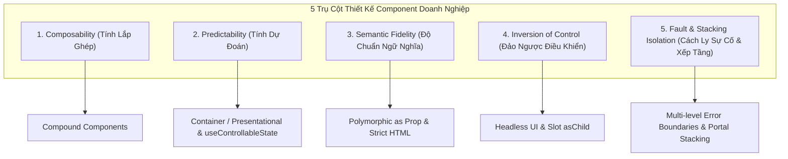
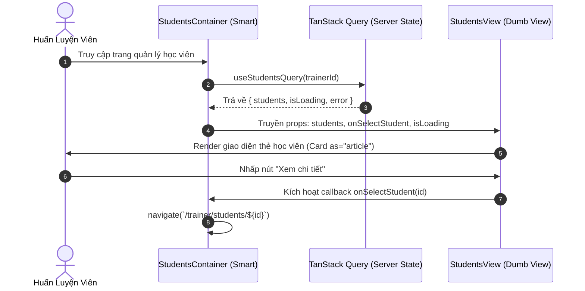
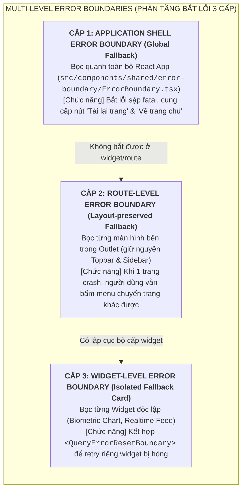
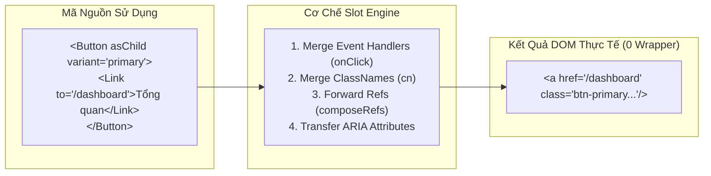
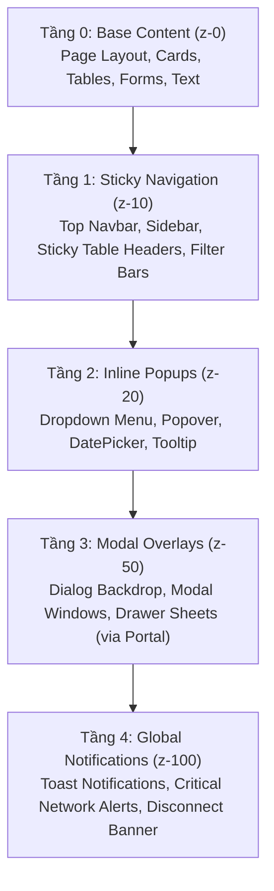

# Chuyên Đề 04: React Component Design Patterns Nâng Cao (Enterprise Component Architecture & Headless Patterns)

> **Dự án:** Khung Tiêu Chuẩn Doanh Nghiệp & RoGym Management System Profile  
> **Cổng quy chuẩn chính:** [`FRONTEND_CONVENTIONS.md`](../FRONTEND_CONVENTIONS.md) | [Bản Đồ Tài Liệu](./README.md)  
> **Tài liệu liên quan:** [`docs/01-architecture-and-structure.md`](./01-architecture-and-structure.md) | [`docs/03-coding-standards.md`](./03-coding-standards.md) | [`docs/08-semantic-design-system.md`](./08-semantic-design-system.md) | [`docs/09-accessibility.md`](./09-accessibility.md)  
> **Cơ sở tham chiếu quốc tế:**  
> - [W3C WAI-ARIA Authoring Practices Guide (APG) - Patterns](https://www.w3.org/WAI/ARIA/apg/patterns/)  
> - [Radix UI Primitives - Composition & Slot Pattern (asChild)](https://www.radix-ui.com/primitives/docs/guides/composition)  
> - [Floating UI - Positioning & Stacking Context](https://floating-ui.com/)  
> - [MDN Web Docs - The Stacking Context](https://developer.mozilla.org/en-US/docs/Web/CSS/CSS_positioned_layout/Understanding_z-index/Stacking_context)  
> - [React.dev - Reusing Logic with Custom Hooks](https://react.dev/learn/reusing-logic-with-custom-hooks)  
> **Phiên bản:** 8.0 (Enterprise Quality Standard — 15 Spokes & Universal Decoupling)  
> **Áp dụng cho:** Toàn bộ UI Primitives (`src/components/ui/`), Shared Shells (`src/components/shared/`), và High-level Page Views (`src/pages/`)  
> **Trạng thái:** Bắt buộc tuân thủ 100% (Strict Mandatory Enforcement)

---

## MỤC LỤC
1. [Triết Lý Kiến Trúc Component Doanh Nghiệp](#1-triết-lý-kiến-trúc-component-doanh-nghiệp)
2. [Pattern 1: Compound Components (Thành Phần Phức Hợp)](#2-pattern-1-compound-components-thành-phần-phức-hợp)
3. [Pattern 2: Container / Presentational Pattern (Phân Tách Điều Phối & Hiển Thị)](#3-pattern-2-container-presentational-pattern-phân-tách-điều-phối-hiển-thị)
4. [Pattern 3: Multi-level Error Boundaries (Phân Tầng Bắt Lỗi 3 Cấp)](#4-pattern-3-multi-level-error-boundaries-phân-tầng-bắt-lỗi-3-cấp)
5. [Pattern 4: Polymorphic Component Pattern (Thành Phần Đa Hình với `as` Prop)](#5-pattern-4-polymorphic-component-pattern-thành-phần-đa-hình-với-as-prop)
6. [Pattern 5: Headless UI Primitives & Composable Slot Pattern (`asChild`)](#6-pattern-5-headless-ui-primitives-composable-slot-pattern-aschild)
7. [Pattern 6: Nâng Cấp Đồng Bộ Controlled vs Uncontrolled State (`useControllableState`)](#7-pattern-6-nâng-cấp-đồng-bộ-controlled-vs-uncontrolled-state-usecontrollablestate)
8. [Tích Hợp CVA Vào Presentational Components](#8-tích-hợp-cva-vào-presentational-components)
9. [Pattern 7: Quản Trị Ngữ Cảnh Xếp Chồng (Stacking Context, Portal, Focus Trap & Thang 5 Tầng Z-Index)](#9-pattern-7-quản-trị-ngữ-cảnh-xếp-chồng-stacking-context-portal-focus-trap-thang-5-tầng-z-index)
10. [Bảng Tổng Hợp So Sánh Anti-Patterns vs Chuẩn Mực Doanh Nghiệp](#10-bảng-tổng-hợp-so-sánh-anti-patterns-vs-chuẩn-mực-doanh-nghiệp)
11. [Bảng Checklist Định Lượng Đánh Giá Component Pattern Trước Khi Mở PR](#11-bảng-checklist-định-lượng-đánh-giá-component-pattern-trước-khi-mở-pr)
12. [Ánh Xạ Tooling Kiểm Toán CI & Static Rules](#12-ánh-xạ-tooling-kiểm-toán-ci-static-rules)

---

## 1. Triết Lý Kiến Trúc Component Doanh Nghiệp

> [!IMPORTANT]
> 🧭 **ĐIỀU HƯỚNG TÀI LIỆU CHUYÊN SÂU — DOMAIN UI COMPONENTS & PRIMITIVES:**  
> Toàn bộ 10 cây quyết định lựa chọn component trong 15 giây, catalog toàn diện 100% UI Primitives (`ui/`), và Shared Composites (`shared/`) được duy trì tập trung tại:  
> 👉 [**src/components/README.md — Kiến Trúc UI Components**](../src/components/README.md)  
>  
> **Các chương mục chi tiết cần đọc:**  
> - [Chương 1: Kiến Trúc Thư Viện Component & Mô Hình Tái Sử Dụng 3 Cấp](../src/components/README.md#chương-1-kiến-trúc-thư-viện-component-mô-hình-tái-sử-dụng-nội-bộ-3-cấp)  
> - [Chương 5: Cây Quyết Định Chọn Component (10 Decision Trees)](../src/components/README.md#chương-5-cây-quyết-định-chọn-component-10-decision-trees)  
> - [Chương 6: Catalog Toàn Diện 100% UI Primitives (ui/)](../src/components/README.md#chương-6-catalog-toàn-diện-100-ui-primitives-ui)  
> - [Chương 7: Catalog Shared Composites & Application Shells (shared/)](../src/components/README.md#chương-7-catalog-shared-composites-application-shells-shared)

Giao diện Single Page Application (SPA) doanh nghiệp được xây dựng dựa trên 5 nguyên tắc cốt lõi:



1. **Composability (Tính Lắp Ghép)**: Ưu tiên thiết kế các khối giao diện nhỏ, độc lập và có khả năng ghép nối linh hoạt thay vì xây dựng các component "toàn năng" (God Components) phụ thuộc vào hàng chục cờ boolean props.
2. **Predictability (Tính Dự Đoán)**: Component chỉ nhận dữ liệu và phát sinh hành vi thông qua hợp đồng props rõ ràng, không ẩn giấu side-effects hoặc ép buộc consumers phải tuân theo cấu trúc DOM cứng nhắc.
3. **Semantic Fidelity (Độ Chuẩn Ngữ Nghĩa)**: 100% component cấp cao phải tuân thủ Tháp Ngữ Nghĩa (Semantic Hierarchy) quy định tại [`FRONTEND_CONVENTIONS.md`](../FRONTEND_CONVENTIONS.md); cấm triệt để việc lạm dụng thẻ native tương tác (`<button>`, `<form>`) hoặc các thẻ nonsemantic (`<div>`, `<span>`) thiếu chú thích ngoại lệ.
4. **Inversion of Control (Đảo Ngược Điều Khiển)**: Tách rời hoàn toàn trạng thái và hành vi khả năng tiếp cận (Accessibility APG) khỏi giao diện thị giác thông qua Headless UI và Slot Pattern (`asChild`).
5. **Fault & Stacking Isolation (Cách Ly Sự Cố & Xếp Tầng)**: Lỗi runtime của một widget phụ tuyệt đối không được làm sập ứng dụng; đồng thời các thành phần overlay (Modal, Popover, Toast) bắt buộc phải thoát khỏi hạn chế Stacking Context của cha qua Portal.

---

## 2. Pattern 1: Compound Components (Thành Phần Phức Hợp)

### 2.1. Bản chất & Khi nào nên sử dụng
Compound Components là mẫu thiết kế trong đó một nhóm component phối hợp mật thiết với nhau để hoàn thành một nhiệm vụ giao diện duy nhất, chia sẻ trạng thái ngầm (implicit state) thông qua React Context mà không bắt buộc lập trình viên phải truyền props thủ công qua từng tầng (anti-pattern Prop Drilling).

**Sử dụng khi:**
- Cần xây dựng các thành phần UI có cấu trúc phân cấp linh hoạt: `Card`, `Tabs`, `Accordion`, `DropdownMenu`, `Modal`.
- Thứ tự hoặc sự hiện diện của các khối con (Header, Content, Footer) có thể thay đổi tùy theo từng màn hình nghiệp vụ.

### 2.2. Case Study 1: Hệ thống Compound `Card` Chuẩn Mực

Trong RoGym, `Card` là khối giao diện nền tảng xuất hiện trên hầu hết màn hình (Gói tập, Huấn luyện viên, Đơn hàng, Lịch tập):

```tsx
// ✅ DO: Triển khai Compound Card Component hỗ trợ Context và Semantic Tags
import { createContext, useContext, forwardRef, type HTMLAttributes, type ReactNode } from 'react'
import { cn } from '@/utils/cn'

interface CardContextValue {
  variant: 'default' | 'compact' | 'glass'
}

const CardContext = createContext<CardContextValue | null>(null)

function useCardContext() {
  const context = useContext(CardContext)
  if (!context) {
    throw new Error('Các sub-component của Card (CardHeader, CardContent...) bắt buộc phải nằm bên trong <Card />')
  }
  return context
}

export interface CardProps extends HTMLAttributes<HTMLElement> {
  variant?: 'default' | 'compact' | 'glass'
  as?: 'article' | 'section' | 'div'
  children: ReactNode
}

export const Card = forwardRef<HTMLElement, CardProps>(
  ({ variant = 'default', as: Component = 'article', className, children, ...props }, ref) => {
    return (
      <CardContext.Provider value={{ variant }}>
        <Component
          ref={ref as React.ForwardedRef<HTMLElement>}
          className={cn(
            'rounded-2xl border transition-all duration-200',
            variant === 'default' && 'bg-[var(--rogym-bg-card)] border-[var(--rogym-border-subtle)] p-6 shadow-lg',
            variant === 'compact' && 'bg-[var(--rogym-bg-card)] border-[var(--rogym-border-subtle)] p-4',
            variant === 'glass' && 'bg-[var(--rogym-bg-glass)] border-[var(--rogym-border-subtle)] backdrop-blur-md p-6 shadow-[var(--rogym-shadow-glass)]',
            className
          )}
          {...props}
        >
          {children}
        </Component>
      </CardContext.Provider>
    )
  }
)
Card.displayName = 'Card'

export const CardHeader = forwardRef<HTMLElement, HTMLAttributes<HTMLElement>>(
  ({ className, children, ...props }, ref) => {
    return (
      <header ref={ref} className={cn('flex items-center justify-between gap-3 pb-3', className)} {...props}>
        {children}
      </header>
    )
  }
)
CardHeader.displayName = 'CardHeader'

export const CardTitle = forwardRef<HTMLHeadingElement, HTMLAttributes<HTMLHeadingElement>>(
  ({ className, children, ...props }, ref) => {
    return (
      <h3 ref={ref} className={cn('text-lg font-bold text-white', className)} {...props}>
        {children}
      </h3>
    )
  }
)
CardTitle.displayName = 'CardTitle'

export const CardContent = forwardRef<HTMLElement, HTMLAttributes<HTMLElement>>(
  ({ className, children, ...props }, ref) => {
    const { variant } = useCardContext()
    return (
      <section
        ref={ref}
        className={cn('text-sm text-[var(--rogym-text-secondary)]', variant === 'compact' ? 'py-1' : 'py-2', className)}
        {...props}
      >
        {children}
      </section>
    )
  }
)
CardContent.displayName = 'CardContent'

export const CardFooter = forwardRef<HTMLElement, HTMLAttributes<HTMLElement>>(
  ({ className, children, ...props }, ref) => {
    return (
      <footer ref={ref} className={cn('mt-4 flex items-center justify-end gap-2 pt-3 border-t border-[var(--rogym-border-subtle)]', className)} {...props}>
        {children}
      </footer>
    )
  }
)
CardFooter.displayName = 'CardFooter'
```

### 2.3. Cách sử dụng trên Trang Nghiệp Vụ
```tsx
// ✅ DO: Ghép nối Compound Components trên Page chuẩn ngữ nghĩa W3C
import { Button } from '@/components/ui/actions'
import { Badge, Card, CardContent, CardFooter, CardHeader, CardTitle } from '@/components/ui/data-display'
import { Skeleton } from '@/components/ui/feedback'

export function MembershipPackageCard({ title, price, features, onSelect }: {
  title: string
  price: string
  features: string[]
  onSelect: () => void
}) {
  return (
    <Card as="article" variant="glass" aria-labelledby="pkg-title">
      <CardHeader>
        <CardTitle id="pkg-title">{title}</CardTitle>
        <Badge tone="accent">Phổ biến</Badge>
      </CardHeader>

      <CardContent>
        <p className="text-2xl font-black text-[var(--rogym-teal)] mb-3">{price}</p>
        <ul className="space-y-2">
          {features.map((item) => (
            <li key={item} className="flex items-center gap-2 text-sm">
              <strong className="text-[var(--rogym-teal)] font-bold">✓</strong>
              {item}
            </li>
          ))}
        </ul>
      </CardContent>

      <CardFooter>
        <Button variant="primary" fullWidth onClick={onSelect}>
          Đăng ký gói tập ngay
        </Button>
      </CardFooter>
    </Card>
  )
}
```

### 2.4. Đối Chiếu Do / Don't

| ❌ ANTI-PATTERN (CẤM) | ✅ RO-GYM CONVENTION (CHUẨN MỰC) |
| :--- | :--- |
| **Mega Props Pattern**: Tạo một `Card` duy nhất nhận 15 props: `title`, `subtitle`, `badgeText`, `showFooter`, `footerButtonText`, `onFooterClick`, `iconLeft`... khiến component phình to, cực kỳ khó bảo trì. | **Compound Components**: Tách thành `<CardHeader>`, `<CardTitle>`, `<CardContent>`, `<CardFooter>`. Consumer tự do bố trí thứ tự, thêm icon, đổi variant mà không cần sửa core code. |
| **Prop Drilling**: Truyền `variant="compact"` qua 4 cấp component con từ cha xuống tận text. | **Context Injection**: Chia sẻ `variant` ngầm qua `CardContext`. |
| **Silent Failures**: Sub-component render rỗng hoặc crash âm thầm khi dùng ngoài Parent. | **Strict Context Guard**: Hook `useCardContext()` ném lỗi `throw new Error(...)` ngay lập tức để lập trình viên nhận biết. |

### 2.5. Chuẩn Hóa Context Interface 3 Phần `{ state, actions, meta }` (`COMP-VCL-004` [state-context-interface])
Nhằm đảo bảo tính module hóa và dễ dàng kiểm thử độc lập (Dependency Injection), mọi React Context chia sẻ trạng thái trong Compound Components bắt buộc phân tách thành 3 nhóm thuộc tính rõ ràng:
1. `state`: Toàn bộ giá trị dữ liệu hiện thời (`value`, `isOpen`, `activeTabId`, `selectionMode`).
2. `actions`: Các hàm phát sinh hành vi thay đổi dữ liệu (`setValue`, `toggle`, `selectTab`, `reset`).
3. `meta`: Thông tin bổ trợ phục vụ giao diện hoặc khả năng tiếp cận (`isLoading`, `isDisabled`, `totalCount`, `error`).

```typescript
// ✅ CHUẨN MỰC CONTEXT INTERFACE
export interface AccordionContextValue {
  state: {
    activeIds: string[]
    allowMultiple: boolean
  }
  actions: {
    toggleItem: (id: string) => void
    expandAll: () => void
    collapseAll: () => void
  }
  meta: {
    totalItems: number
    disabled: boolean
  }
}
```

### 2.6. Chống Lạm Dụng Cờ Boolean Props (`COMP-VCL-001` [architecture-avoid-boolean-props])
* **Nguyên tắc:** Tuyệt đối không thêm các cờ boolean props (`isCompact`, `isDanger`, `isGhost`, `withBorder`, `hasHeader`) để tùy biến giao diện hoặc hành vi component. Việc thêm boolean props làm số lượng tổ hợp trạng thái tăng theo cấp số nhân ($2^N$), khiến component nhanh chóng trở thành "God Component" không thể bảo trì.
* **Giải pháp:** Sử dụng **Explicit Variants** (`COMP-VCL-006` [patterns-explicit-variants]) qua CVA hoặc tách thành các Sub-components ghép nối:
```tsx
// ❌ CẤM: Lạm dụng boolean props
<Card isCompact isDanger withHeader withFooter isElevated />

// ✅ CHUẨN MỰC: Ghép nối Compound Components hoặc dùng variant tường minh
<Card variant="danger" size="compact">
  <CardHeader />
  <CardContent />
  <CardFooter />
</Card>
```

### 2.7. Ưu Tiên `children` Thay Vì Render Props (`COMP-VCL-007` [patterns-children-over-render-props])
* **Nguyên tắc:** Sử dụng prop `children` để ghép nối giao diện linh hoạt thay vì ép buộc consumers phải truyền các props dạng hàm vẽ `renderHeader={() => <div />}`, `renderFooter={() => <div />}`. Prop `children` giúp mã nguồn JSX giữ được tính tự nhiên, dễ đọc, dễ viết test và tương thích tối đa với cả React Server Components.

---

## 3. Pattern 2: Container / Presentational Pattern (Phân Tách Điều Phối & Hiển Thị)

### 3.1. Bản chất & Trách nhiệm
Mẫu Container / Presentational phân định rõ ràng giữa hai nhóm component:
1. **Container Component (Smart / Controller)**:
   - Trách nhiệm: Gọi TanStack Query hooks, lấy state từ Zustand stores, xử lý routing, điều phối các hàm mutation handlers.
   - Không chứa CSS layout phức tạp, không trực tiếp render các thẻ markup giao diện chi tiết.
2. **Presentational Component (Dumb / View)**:
   - Trách nhiệm: Nhận dữ liệu và callbacks qua `props`, tập trung 100% vào việc render UI chuẩn semantic HTML, áp dụng design tokens và CSS styles.
   - Hoàn toàn stateless (hoặc chỉ chứa UI local state thuần túy như toggle dropdown/tooltip), có khả năng tái sử dụng cao và cực kỳ dễ viết Unit Test với Vitest.

### 3.2. Case Study: Module Danh Sách Học Viên Huấn Luyện Viên (`TrainerStudents`)



#### Mã Nguồn Presentational Component (Dumb View):
```tsx
// ✅ DO: Dumb View chỉ nhận props, không phụ thuộc vào Query hooks hay Stores
import { forwardRef } from 'react'

import type { TrainerStudentSummary } from '@/services/member.service'

export interface StudentsViewProps {
  students: TrainerStudentSummary[]
  isLoading: boolean
  onSelectStudent: (memberId: string) => void
  onRefresh: () => void
  className?: string
}

export const StudentsView = forwardRef<HTMLElement, StudentsViewProps>(
  ({ students, isLoading, onSelectStudent, onRefresh, className }, ref) => {
    if (isLoading) {
      return (
        <section ref={ref} className="space-y-4" aria-busy="true" aria-label="Đang tải danh sách học viên">
          <Skeleton className="h-10 w-48 rounded-xl" />
          {/* rogym-convention-exempt: NO_NONSEMANTIC_TAGS [Multi-column grid skeleton container] */}
          <div className="grid grid-cols-1 md:grid-cols-2 gap-4">
            <Skeleton className="h-40 rounded-2xl" />
            <Skeleton className="h-40 rounded-2xl" />
          </div>
        </section>
      )
    }

    return (
      <section ref={ref} className={className} aria-labelledby="students-heading">
        <header className="flex items-center justify-between pb-6">
          <h2 id="students-heading" className="text-xl font-bold text-white">
            Danh sách học viên ({students.length})
          </h2>
          <Button variant="outline-white" size="compact" onClick={onRefresh}>
            Làm mới
          </Button>
        </header>

        {students.length === 0 ? (
          <p className="text-sm text-[var(--rogym-text-secondary)] py-8 text-center">
            Chưa có học viên nào được phân công.
          </p>
        ) : (
          <ul className="grid grid-cols-1 md:grid-cols-2 gap-4 list-none p-0">
            {students.map((student) => (
              <li key={student.memberId}>
                <Card as="article" variant="compact" aria-labelledby={`st-name-${student.memberId}`}>
                  <header className="flex items-center justify-between">
                    <h3 id={`st-name-${student.memberId}`} className="font-semibold text-white">
                      {student.fullName}
                    </h3>
                    <Badge tone={student.status === 'active' ? 'accent' : 'neutral'}>
                      {student.status === 'active' ? 'Đang tập' : 'Tạm dừng'}
                    </Badge>
                  </header>
                  <p className="mt-1 text-xs text-[var(--rogym-text-secondary)]">
                    Gói tập: {student.activeSubscription?.packageName ?? 'Chưa đăng ký'} • Hạn: {student.activeSubscription?.endDate ?? 'Chưa có'}
                  </p>
                  <footer className="mt-4 flex justify-end">
                    <Button variant="primary" size="compact" onClick={() => onSelectStudent(student.memberId)}>
                      Xem hồ sơ
                    </Button>
                  </footer>
                </Card>
              </li>
            ))}
          </ul>
        )}
      </section>
    )
  }
)
StudentsView.displayName = 'StudentsView'
```

#### Mã Nguồn Container Component (Smart Controller):
```tsx
// ✅ DO: Smart Container quản lý Data Fetching, Router navigation và Handlers
import { useNavigate } from 'react-router-dom'
import { useQuery } from '@tanstack/react-query'
import { useAuthStore } from '@/stores/authStore'
import { memberService } from '@/services/member.service'
import { StudentsView } from './StudentsView'

export function StudentsContainer() {
  const navigate = useNavigate()
  const user = useAuthStore((state) => state.user)
  const staffId = user?.staffId ?? ''

  const { data: students = [], isLoading, refetch } = useQuery({
    queryKey: ['members', 'trainer-students', staffId],
    queryFn: async () => {
      const res = await memberService.list({ page: 1, pageSize: 50 })
      return res.data
    },
    enabled: Boolean(staffId),
    staleTime: 5 * 60 * 1000,
  })

  const handleSelectStudent = (memberId: string) => {
    navigate(`/trainer/students/${memberId}`)
  }

  const handleRefresh = () => {
    refetch()
  }

  return (
    <StudentsView
      students={students}
      isLoading={isLoading}
      onSelectStudent={handleSelectStudent}
      onRefresh={handleRefresh}
    />
  )
}
```

---

## 4. Pattern 3: Multi-level Error Boundaries (Phân Tầng Bắt Lỗi 3 Cấp)

Trong một ứng dụng phức tạp, lỗi runtime có thể xảy ra ở nhiều mức độ: lỗi render biểu đồ do dữ liệu null, lỗi phân giải token người dùng, hoặc lỗi sập server API. RoGym thiết lập mô hình bắt lỗi 3 cấp để đảm bảo tính sẵn sàng tối đa:



### 4.1. Cấp 3: Triển khai Widget-level Error Boundary Cách Ly
Một widget hỏng (ví dụ biểu đồ đo chỉ số InBody) không được phép làm hỏng trang Dashboard:

```tsx
// ✅ DO: WidgetErrorBoundary cô lập lỗi cục bộ và kết hợp TanStack Query Reset
import { Component, type ReactNode } from 'react'
import { QueryErrorResetBoundary } from '@tanstack/react-query'

interface WidgetErrorBoundaryProps {
  widgetName: string
  children: ReactNode
}

interface WidgetErrorBoundaryState {
  hasError: boolean
}

export class WidgetErrorBoundary extends Component<WidgetErrorBoundaryProps, WidgetErrorBoundaryState> {
  public state: WidgetErrorBoundaryState = { hasError: false }

  public static getDerivedStateFromError(): WidgetErrorBoundaryState {
    return { hasError: true }
  }

  public componentDidCatch(error: Error) {
    console.error(`[Widget Error] ${this.props.widgetName}:`, error)
  }

  public reset = () => {
    this.setState({ hasError: false })
  }

  public render() {
    if (this.state.hasError) {
      return (
        <Card as="section" variant="compact" className="border-red-500/20 bg-red-950/10 p-4">
          <header className="flex items-center justify-between">
            <h4 className="text-sm font-semibold text-red-400">
              Không thể tải {this.props.widgetName}
            </h4>
            <Button variant="outline-white" size="compact" onClick={this.reset}>
              Thử lại
            </Button>
          </header>
          <p className="mt-2 text-xs text-[var(--rogym-text-secondary)]">
            Đã có sự cố xảy ra khi xử lý dữ liệu của thành phần này. Các chức năng khác vẫn hoạt động bình thường.
          </p>
        </Card>
      )
    }

    return this.props.children
  }
}

// ✅ DO: Tích hợp cùng QueryErrorResetBoundary
export function SafeBiometricChartWidget() {
  return (
    <QueryErrorResetBoundary>
      {({ reset }) => (
        <WidgetErrorBoundary widgetName="Biểu đồ chỉ số InBody">
          <BiometricChartContent onResetQuery={reset} />
        </WidgetErrorBoundary>
      )}
    </QueryErrorResetBoundary>
  )
}
```

---

## 5. Pattern 4: Polymorphic Component Pattern (Thành Phần Đa Hình với `as` Prop)

### 5.1. Vấn đề giải quyết
Trong quá trình xây dựng UI theo Tháp Ngữ Nghĩa, một UI primitive (ví dụ `Card` hoặc `Button`) cần có khả năng render ra các thẻ HTML ngữ nghĩa khác nhau tùy vào ngữ cảnh sử dụng:
- Thẻ học viên trên danh sách ➔ Render ra thẻ `<article>`.
- Khối tổng quan số liệu thống kê ➔ Render ra thẻ `<section>`.
- Nút bấm mở modal ➔ Render ra `<Button type="button">`.
- Nút bấm điều hướng sang trang ngoài ➔ Render ra `<ButtonAnchor href="..." target="_blank">`.

Nếu không áp dụng kiểu generic TypeScript chuẩn mực, lập trình viên thường sa vào anti-pattern gán `as: any`, gây mất hoàn toàn tính năng kiểm tra lỗi và auto-complete của IDE.

### 5.2. Chuẩn Type Definition Đa Hình Type-Safe

```tsx
// ✅ DO: Khai báo Generic Helper cho Polymorphic Component không dùng any
import type { ElementType, ComponentPropsWithRef, ReactElement } from 'react'

export type AsProp<E extends ElementType> = {
  as?: E
}

export type PropsToOmit<E extends ElementType, P> = keyof (AsProp<E> & P)

export type PolymorphicComponentProps<
  E extends ElementType,
  P = Record<string, unknown>
> = P & AsProp<E> & Omit<ComponentPropsWithRef<E>, PropsToOmit<E, P>>

export type PolymorphicRef<E extends ElementType> = ComponentPropsWithRef<E>['ref']
```

### 5.3. Áp dụng vào Component Thực Tế
```tsx
// ✅ DO: Xây dựng Box/Section đa hình gợi ý props chính xác theo thẻ đích
import { forwardRef, type ElementType, type ReactNode } from 'react'
import { cn } from '@/utils/cn'

export interface SectionBaseProps {
  title?: string
  className?: string
  children: ReactNode
}

export type SectionProps<E extends ElementType = 'section'> = PolymorphicComponentProps<E, SectionBaseProps>

export const PolymorphicSection = forwardRef(
  <E extends ElementType = 'section'>(
    { as, title, className, children, ...props }: SectionProps<E>,
    ref: PolymorphicRef<E>
  ): ReactElement => {
    const Component = as || 'section'

    return (
      <Component
        ref={ref}
        className={cn('rounded-2xl border border-[var(--rogym-border-subtle)] bg-[var(--rogym-bg-card)] p-6', className)}
        {...props}
      >
        {title ? (
          <header className="mb-4">
            <h2 className="text-lg font-bold text-white">{title}</h2>
          </header>
        ) : null}
        {children}
      </Component>
    )
  }
)
PolymorphicSection.displayName = 'PolymorphicSection'

### 5.4. Ranh Giới Phân Định: Khi Nào Dùng `as` Prop vs Khi Nào Dùng `asChild` (Dual Strategy)

Trong kiến trúc Component Doanh Nghiệp, chúng ta áp dụng **Chiến Lược Song Hành (Dual Strategy)** rõ ràng:

| Tiêu Chí | Polymorphic `as` Prop | Composable Slot Pattern (`asChild`) |
| :--- | :--- | :--- |
| **Phạm vi áp dụng** | **Cấu trúc & Bố cục ngữ nghĩa:** `Box`, `Card as="section"`, `Text as="h2"`, `Heading as="h1"`. | **Hành vi & Tương tác phức tạp:** `Button asChild`, `ModalTrigger asChild`, `DropdownItem asChild`. |
| **DOM Tree** | Render trực tiếp thẻ HTML chỉ định bởi prop `as`. | **Không sinh thẻ bao bọc (0 wrapper)**: Ghép trực tiếp props và hành vi vào con trực tiếp. |
| **Tích hợp Router** | Yêu cầu ép kiểu phức tạp khi kết hợp với `<Link to="...">` từ React Router. | Hoàn hảo: `<Button asChild><Link to="/dashboard">Tổng quan</Link></Button>`. |
| **Độ phức tạp TypeScript** | Yêu cầu Generic Types phức tạp (`PolymorphicComponentProps`). | Tinh gọn: Chỉ cần nhận `asChild?: boolean` và chuyển tiếp cho `Slot`. |
```

---

## 6. Pattern 5: Headless UI Primitives & Composable Slot Pattern (`asChild`)

### 6.1. Bản Chất Đảo Ngược Quyền Điều Khiển (Inversion of Control - IoC)
Khi xây dựng thư viện UI doanh nghiệp mở rộng, một sai lầm phổ biến là ép buộc component phải sở hữu cả logic tương tác lẫn thẻ DOM kết xuất thị giác. Ví dụ, component `<Button>` luôn render ra thẻ `<button>`, khiến cho việc tích hợp với thư viện điều hướng (như `Link` của React Router) dẫn đến hai tình huống sai lầm:
1. Render lồng thẻ: `<button><Link to="...">Điều hướng</Link></button>` $\rightarrow$ Vi phạm nghiêm trọng chuẩn W3C HTML (thẻ interactive lồng thẻ interactive).
2. Tạo ra biến thể component phân mảnh: `<ButtonLink>`, `<ButtonAnchor>`, `<ButtonNav>` $\rightarrow$ Bùng nổ mã nguồn và khó bảo trì đồng bộ.

**Giải pháp:** Áp dụng nguyên lý **Inversion of Control (IoC)** thông qua kiến trúc **Composable Slot Pattern (`asChild`)**: Component cấp cao cung cấp toàn bộ styles, biến thể CVA, hành vi sự kiện, trạng thái tương tác và thuộc tính khả năng tiếp cận (ARIA attributes), nhưng nhường quyền quyết định thẻ DOM kết xuất cho phần tử con trực tiếp.



### 6.2. Cơ Chế Hoạt Động Của Slot & Slottable
Cơ chế Slot thực hiện các nhiệm vụ hòa trộn (merging) tự động:
1. **ClassName Merging:** Kết hợp `className` của cha và con thông qua hàm tiện ích `cn()` (Tailwind Merge + clsx).
2. **Event Handler Chaining:** Nếu cả cha và con đều có handler (ví dụ `onClick`), handler của con sẽ chạy trước; nếu con không gọi `event.defaultPrevented`, handler của cha sẽ chạy tiếp.
3. **Ref Composition:** Kết hợp `ref` được chuyển tiếp từ ngoài vào component cha với `ref` gắn sẵn trên component con thông qua helper `composeRefs`.
4. **Zero-DOM Wrapper:** Hoàn toàn không tạo thêm bất kỳ thẻ `<div>` hay `<span>` nào bao bọc bên ngoài.

### 6.3. Code Blueprint: Triển Khai Slot Primitive Type-Safe Không Dùng any

```tsx
// src/components/ui/Slot/Slot.tsx
import * as React from 'react'
import { cn } from '@/utils/cn'

export type AsChildProps<DefaultElementProps> =
  | ({ asChild?: false } & DefaultElementProps)
  | { asChild: true; children: React.ReactNode }

/**
 * Kết hợp nhiều ref thành một callback ref duy nhất
 */
export function composeRefs<T>(...refs: (React.Ref<T> | undefined)[]) {
  return (node: T) => {
    refs.forEach((ref) => {
      if (typeof ref === 'function') {
        ref(node)
      } else if (ref !== null && ref !== undefined) {
        ;(ref as React.MutableRefObject<T>).current = node
      }
    })
  }
}

/**
 * Kết hợp hai event handlers sao cho handler của con chạy trước
 */
export function composeEventHandlers<E extends React.SyntheticEvent>(
  originalHandler?: (event: E) => void,
  ourHandler?: (event: E) => void,
  { checkForDefaultPrevented = true } = {}
) {
  return function handleEvent(event: E) {
    originalHandler?.(event)
    if (!checkForDefaultPrevented || !event.defaultPrevented) {
      return ourHandler?.(event)
    }
  }
}

export interface SlotProps extends React.HTMLAttributes<HTMLElement> {
  children?: React.ReactNode
}

export const Slot = React.forwardRef<HTMLElement, SlotProps>((props, forwardedRef) => {
  const { children, ...slotProps } = props

  if (!React.isValidElement(children)) {
    return null
  }

  const childProps = children.props as Record<string, unknown>
  const childRef = (children as unknown as { ref?: React.Ref<HTMLElement> }).ref

  // Hòa trộn các thuộc tính và sự kiện
  const mergedProps: Record<string, unknown> = {
    ...slotProps,
    ...childProps,
    className: cn(slotProps.className, childProps.className as string | undefined),
  }

  // Hòa trộn onClick nếu cả hai cùng định nghĩa
  if (slotProps.onClick || childProps.onClick) {
    mergedProps.onClick = composeEventHandlers(
      childProps.onClick as React.MouseEventHandler<HTMLElement> | undefined,
      slotProps.onClick as React.MouseEventHandler<HTMLElement> | undefined
    )
  }

  return React.cloneElement(children, {
    ...mergedProps,
    ref: forwardedRef ? composeRefs(forwardedRef, childRef) : childRef,
  } as React.Attributes & Record<string, unknown>)
})
Slot.displayName = 'Slot'
```

### 6.4. Áp Dụng Slot Pattern Vào Component `<Button>` Chuẩn Mực

```tsx
// src/components/ui/Button/Button.tsx
import * as React from 'react'
import { cva, type VariantProps } from 'class-variance-authority'
import { Slot } from './Slot'
import { cn } from '@/utils/cn'

export const buttonVariants = cva(
  'inline-flex items-center justify-center font-medium transition-colors focus-visible:outline-none focus-visible:ring-2 focus-visible:ring-[var(--rogym-teal)] disabled:pointer-events-none disabled:opacity-50 select-none cursor-pointer',
  {
    variants: {
      variant: {
        primary: 'bg-[var(--rogym-teal)] text-black hover:bg-[var(--rogym-teal-hover)]',
        secondary: 'bg-[var(--rogym-bg-elevated)] text-white hover:bg-[var(--rogym-border-subtle)]',
        outline: 'border border-[var(--rogym-border-teal-dim)] text-white hover:border-[var(--rogym-teal)]',
        ghost: 'text-white hover:bg-white/5',
      },
      size: {
        sm: 'h-8 px-3 rounded-lg text-xs gap-1.5',
        md: 'h-10 px-4 rounded-xl text-sm gap-2',
        lg: 'h-12 px-6 rounded-xl text-base gap-2.5',
        icon: 'h-10 w-10 rounded-xl p-0',
      },
    },
    defaultVariants: {
      variant: 'primary',
      size: 'md',
    },
  }
)

export interface ButtonBaseProps extends VariantProps<typeof buttonVariants> {
  asChild?: boolean
  loading?: boolean
}

export type ButtonProps = React.ButtonHTMLAttributes<HTMLButtonElement> & ButtonBaseProps

export const Button = React.forwardRef<HTMLButtonElement, ButtonProps>(
  ({ className, variant, size, asChild = false, loading = false, disabled, children, ...props }, ref) => {
    const Component = asChild ? Slot : 'button'
    const isActuallyDisabled = disabled || loading

    return (
      <Component
        ref={ref}
        type={asChild ? undefined : 'button'}
        disabled={asChild ? undefined : isActuallyDisabled}
        aria-disabled={isActuallyDisabled ? true : undefined}
        className={cn(buttonVariants({ variant, size }), className)}
        {...props}
      >
        {children}
      </Component>
    )
  }
)
Button.displayName = 'Button'
```

---

## 7. Pattern 6: Nâng Cấp Đồng Bộ Controlled vs Uncontrolled State (`useControllableState`)

### 7.1. Hợp Đồng Hai Chế Độ & Vấn Nạn Split-Brain State
Trong React, một UI Primitive chất lượng doanh nghiệp (`Tabs`, `Accordion`, `Input`, `Dialog`, `ToggleSwitch`) cần phục vụ hai nhóm đối tượng:
1. **Uncontrolled Consumer:** Cần tính tiện dụng cao ("Drop-in and works"), chỉ định trạng thái ban đầu qua `defaultValue` hoặc `defaultOpen` và để component tự quản lý state nội bộ.
2. **Controlled Consumer:** Cần kiểm soát chặt chẽ trạng thái từ bên ngoài (đồng bộ vào URL Query Params qua `useSearchParams`, quản lý bởi React Hook Form hoặc Global Zustand Store) thông qua cặp props `value` và `onChange` (hoặc `open` và `onOpenChange`).

**Vấn nạn Split-Brain State:** Nếu lập trình viên sao chép prop vào state cục bộ bằng `useState(props.value)` mà không có cơ chế đồng bộ, khi prop bên ngoài thay đổi, state nội bộ sẽ không phản ánh đúng, dẫn tới hiện tượng phân rã trạng thái (split-brain).

### 7.2. Fallback Cơ Bản `value ?? ''` Cho Form Inputs
Đối với các trường nhập liệu văn bản (`<input>`, `<textarea>`), lỗi phổ biến là khởi đầu với `value = undefined` khi dữ liệu API chưa tải xong, sau đó gán chuỗi khi API phản hồi. React sẽ ném cảnh báo nghiêm trọng: *"A component is changing an uncontrolled input to be controlled"*.

```tsx
// ✅ DO: Duy trì hợp đồng Controlled nhất quán bằng toán tử Nullish Coalescing
const isControlled = value !== undefined
const resolvedValue = isControlled ? (value ?? '') : undefined
```

### 7.3. Hook Mẫu Doanh Nghiệp `useControllableState`
Đối với các primitives phức hợp có trạng thái phức tạp (như vị trí active tab, danh sách item đang mở trong accordion, trạng thái mở đóng modal), chúng ta chuẩn hóa hook `useControllableState`:

```tsx
// src/hooks/useControllableState.ts
import { useCallback, useRef, useState, useEffect } from 'react'

export interface UseControllableStateParams<T> {
  value?: T
  defaultValue?: T | (() => T)
  onChange?: (value: T) => void
}

/**
 * Quản trị trạng thái kép: Tự động phân giải giữa Controlled và Uncontrolled mode
 * Đảm bảo 0 split-brain và hiệu năng render tối ưu.
 */
export function useControllableState<T>({
  value: valueProp,
  defaultValue,
  onChange = () => {},
}: UseControllableStateParams<T>): [T, (nextValue: T | ((prev: T) => T)) => void] {
  const isControlled = valueProp !== undefined
  const [internalState, setInternalState] = useState<T>(defaultValue as T)

  // Lưu trữ callback onChange trong ref để tránh re-render không cần thiết
  const onChangeRef = useRef(onChange)
  useEffect(() => {
    onChangeRef.current = onChange
  }, [onChange])

  // Giá trị hiện hành được ưu tiên từ controlled prop
  const currentVal = isControlled ? (valueProp as T) : internalState

  const setValue = useCallback(
    (nextValue: T | ((prev: T) => T)) => {
      const resolvedNextValue =
        typeof nextValue === 'function'
          ? (nextValue as (prev: T) => T)(currentVal)
          : nextValue

      if (!isControlled) {
        setInternalState(resolvedNextValue)
      }

      if (resolvedNextValue !== currentVal) {
        onChangeRef.current?.(resolvedNextValue)
      }
    },
    [isControlled, currentVal]
  )

  return [currentVal, setValue]
}
```

### 7.4. Case Study: Hệ Thống `Tabs` Hỗ Trợ Hoàn Hảo Cả Hai Chế Độ

```tsx
// src/components/ui/Tabs/Tabs.tsx
import * as React from 'react'
import { useControllableState } from '@/hooks/useControllableState'

interface TabsContextValue {
  selectedTab: string
  onSelectTab: (value: string) => void
}

const TabsContext = React.createContext<TabsContextValue | null>(null)

export interface TabsProps {
  value?: string
  defaultValue?: string
  onValueChange?: (value: string) => void
  children: React.ReactNode
  className?: string
}

export function Tabs({
  value,
  defaultValue = '',
  onValueChange,
  children,
  className,
}: TabsProps) {
  const [selectedTab, setSelectedTab] = useControllableState({
    value,
    defaultValue,
    onChange: onValueChange,
  })

  return (
    <TabsContext.Provider value={{ selectedTab, onSelectTab: setSelectedTab }}>
      <div className={className}>{children}</div>
    </TabsContext.Provider>
  )
}
```

---

## 8. Tích Hợp CVA Vào Presentational Components

> [!NOTE]
> **Nguồn Dữ Liệu Chuẩn Duy Nhất (SSOT):** Toàn bộ kiến trúc và quy chuẩn về hợp đồng CVA Multi-Axis (`variant`, `tone`, `emphasis`, `size`), định nghĩa kiểu dữ liệu trong `src/lib/variants.ts`, và các quy tắc `SEM-PROPS-001..013` được quy định chính thức tại **[Chuyên Đề 08: Hệ Thống Thiết Kế Ngữ Nghĩa §4](./08-semantic-design-system.md#4-s3-semantic-component-props-cva-patterns)**.

### 8.1. Nguyên Tắc Tích Hợp CVA Trong Component Doanh Nghiệp
Khi xây dựng UI Primitives và Presentational Components, việc phân định rõ các trục biến thể là chìa khóa để ngăn chặn bùng nổ tổ hợp classes:
1. **Tách biệt hình thái và ý nghĩa:** Trục `variant` (hình thái cấu trúc: `solid`, `subtle`, `outline`, `ghost`) hoàn toàn tách biệt khỏi trục `tone` (ngữ nghĩa nghiệp vụ: `neutral`, `primary`, `danger`, `success`, `warning`, `accent`) và trục `size` (kích thước: `sm`, `md`, `lg`).
2. **Cấm nhận prop màu sắc tự do:** Component không được nhận các prop `color`, `bgColor`, `textColor` tùy tiện (`SEM-PROPS-002`). Mọi màu sắc đều phải bắt nguồn từ Design Tokens hoặc `tone` ngữ nghĩa.

### 8.2. Ví Dụ Triển Khai Chuẩn Mực Với CVA

```tsx
import * as React from 'react'
import { cva, type VariantProps } from 'class-variance-authority'
import { cn } from '@/utils/cn'

export const badgeVariants = cva(
  'inline-flex items-center gap-1.5 rounded-full font-medium transition-colors focus:outline-none focus-visible:ring-2',
  {
    variants: {
      tone: {
        neutral: 'bg-status-neutral-bg text-status-neutral-fg border-status-neutral-border',
        primary: 'bg-action-primary-soft text-action-primary border-action-primary-soft-border',
        danger: 'bg-status-danger-bg text-status-danger-fg border-status-danger-border',
        success: 'bg-status-success-bg text-status-success-fg border-status-success-border',
        warning: 'bg-status-warning-bg text-status-warning-fg border-status-warning-border',
        accent: 'bg-action-primary-soft text-action-primary border-action-primary-soft-border',
      },
      emphasis: {
        solid: 'border-transparent font-semibold shadow-sm',
        subtle: 'border',
        outline: 'bg-transparent border',
      },
      size: {
        sm: 'px-2 py-0.5 text-xs min-h-[24px]',
        md: 'px-2.5 py-1 text-sm min-h-[28px]',
        lg: 'px-3 py-1.5 text-base min-h-[32px]',
      },
    },
    defaultVariants: {
      tone: 'neutral',
      emphasis: 'subtle',
      size: 'md',
    },
  }
)

export interface BadgeProps
  extends React.HTMLAttributes<HTMLSpanElement>,
    VariantProps<typeof badgeVariants> {}

export const Badge = React.forwardRef<HTMLSpanElement, BadgeProps>(
  ({ className, tone, emphasis, size, children, ...props }, ref) => {
    return (
      <span
        ref={ref}
        className={cn(badgeVariants({ tone, emphasis, size }), className)}
        {...props}
      >
        {children}
      </span>
    )
  }
)
Badge.displayName = 'Badge'
```

```tsx
// ❌ Không nên (Anti-pattern): Gộp màu sắc vào variant hoặc nhận mã màu tùy ý
<Badge variant="red-outline" color="#ef4444" />

// ✅ Nên làm (Best practice): Tách bạch tone ngữ nghĩa và emphasis trực quan
<Badge tone="danger" emphasis="outline" size="sm">Hết hạn</Badge>
<Badge tone="success" emphasis="solid" size="md">Hoạt động</Badge>
```

---

## 9. Pattern 7: Quản Trị Ngữ Cảnh Xếp Chồng (Stacking Context, Portal, Focus Trap & Thang 5 Tầng Z-Index)

> [!NOTE]
> **Chuẩn Mực Định Nghĩa Biến CSS Z-Index:** Toàn bộ thang biến CSS `--z-*` (`--z-base`, `--z-sticky`, `--z-dropdown`, `--z-modal`, `--z-toast`) được định nghĩa chính thức tại **[Chuyên Đề 06: Styling & Design Tokens §4.4](./06-styling-and-design-tokens.md)**.

### 9.1. Bản Chất Stacking Context & Hiện Tượng Overlays Bị Cắt Khuất
Một trong những lỗi hiển thị giao diện dai dẳng nhất là hiện tượng các thành phần overlay (Modal, Dialog, Dropdown, Tooltip, Drawer) bị che khuất hoặc bị cắt xén (clipping) bởi các phần tử cha.

**Nguyên nhân kỹ thuật:** Theo đặc tả CSS, một phần tử sẽ tạo ra một **Stacking Context độc lập** nếu nó sở hữu một trong các thuộc tính sau:
- `position: fixed` hoặc `position: sticky`.
- `opacity` nhỏ hơn 1.
- `transform`, `filter`, `perspective`, hoặc `clip-path` khác `none`.
- `contain: paint` hoặc `contain: layout`.

Khi một Stacking Context con được hình thành bên trong một khối cha có `overflow: hidden`, toàn bộ các phần tử bên trong khối con đó — cho dù được gán `z-index: 9999` hay `position: fixed` — đều **bị giới hạn trong không gian tọa độ và kích thước của khối cha**, không thể nổi lên trên toàn bộ trang màn hình.

### 9.2. Chuẩn Hóa Portal Kết Xuất Vào `#portal-root`
Để cách ly hoàn toàn khỏi Stacking Context cục bộ của các component cha, 100% overlay và dialog bắt buộc phải được kết xuất qua `createPortal` vào một container độc lập nằm trực tiếp dưới thẻ `<body>`:

```tsx
// src/components/ui/Portal/Portal.tsx
import * as React from 'react'
import { createPortal } from 'react-dom'

export interface PortalProps {
  children: React.ReactNode
  containerId?: string
}

export function Portal({ children, containerId = 'portal-root' }: PortalProps) {
  const [mounted, setMounted] = React.useState(false)
  const containerRef = React.useRef<HTMLElement | null>(null)

  React.useEffect(() => {
    setMounted(true)
    let container = document.getElementById(containerId)
    if (!container) {
      container = document.createElement('div')
      container.id = containerId
      document.body.appendChild(container)
    }
    containerRef.current = container

    return () => {
      // Cleanup nếu container rỗng sau khi unmount
      if (container && container.childNodes.length === 0 && container.parentNode) {
        container.parentNode.removeChild(container)
      }
    }
  }, [containerId])

  if (!mounted || !containerRef.current) {
    return null
  }

  return createPortal(children, containerRef.current)
}
```

### 9.3. Kiến Trúc Focus Trap, Phím Escape & Body Scroll Lock
Theo chuẩn tiếp cận quốc tế W3C WAI-ARIA APG cho Modal Dialog, mọi cửa sổ phương thức bắt buộc phải thỏa mãn 4 tiêu chí tương tác bàn phím:
1. **Focus Trap tuần hoàn:** Khi người dùng nhấn phím `Tab`, tiêu điểm chỉ di chuyển tuần hoàn bên trong Modal giữa các phần tử tương tác (`<button>`, `<input>`, `<a>`). Khi đến phần tử cuối cùng, nhấn `Tab` sẽ quay lại phần tử đầu tiên; nhấn `Shift + Tab` tại phần tử đầu tiên sẽ nhảy về phần tử cuối cùng.
2. **Đóng bằng phím Escape:** Nhấn phím `Escape` sẽ đóng ngay lập tức Modal và hủy bỏ tác vụ.
3. **Hoàn trả tiêu điểm (Focus Return):** Khi Modal đóng, tiêu điểm bàn phím phải tự động quay trở về nút kích hoạt ban đầu (trigger element), giúp người dùng khiếm thị hoặc điều hướng bằng bàn phím không bị mất dấu vị trí trên trang.
4. **Khóa cuộn trang nền (Body Scroll Lock):** Khi Modal hiển thị, thẻ `document.body` được gán `overflow: hidden` để ngăn ngừa thanh cuộn trang chính bị cuộn ngầm khi người dùng lăn chuột.

```tsx
// src/hooks/useFocusTrap.ts
import { useEffect, useRef } from 'react'

export function useFocusTrap(active: boolean, onClose?: () => void) {
  const containerRef = useRef<HTMLDivElement>(null)
  const previousActiveElement = useRef<HTMLElement | null>(null)

  useEffect(() => {
    if (!active) return

    // Lưu lại phần tử đang giữ focus trước khi mở modal
    previousActiveElement.current = document.activeElement as HTMLElement
    const originalOverflow = document.body.style.overflow
    document.body.style.overflow = 'hidden'

    const container = containerRef.current
    if (!container) return

    // Tìm tất cả các phần tử có khả năng nhận focus
    const focusableElements = container.querySelectorAll<HTMLElement>(
      'button:not([disabled]), [href], input:not([disabled]), select:not([disabled]), textarea:not([disabled]), [tabindex]:not([tabindex="-1"])'
    )

    if (focusableElements.length > 0) {
      focusableElements[0].focus()
    }

    const handleKeyDown = (e: KeyboardEvent) => {
      if (e.key === 'Escape' && onClose) {
        e.preventDefault()
        onClose()
        return
      }

      if (e.key !== 'Tab' || focusableElements.length === 0) return

      const firstElement = focusableElements[0]
      const lastElement = focusableElements[focusableElements.length - 1]

      if (e.shiftKey) {
        if (document.activeElement === firstElement) {
          e.preventDefault()
          lastElement.focus()
        }
      } else {
        if (document.activeElement === lastElement) {
          e.preventDefault()
          firstElement.focus()
        }
      }
    }

    document.addEventListener('keydown', handleKeyDown)

    return () => {
      document.removeEventListener('keydown', handleKeyDown)
      document.body.style.overflow = originalOverflow
      // Hoàn trả focus về phần tử kích hoạt ban đầu
      previousActiveElement.current?.focus()
    }
  }, [active, onClose])

  return containerRef
}
```

### 9.4. Sơ Đồ Kiến Trúc Stacking Context & Thang 5 Tầng Z-Index



### 9.5. Ma Trận Thang 5 Tầng Z-Index Chuẩn Doanh Nghiệp

Nhằm loại bỏ hoàn toàn cuộc chiến `z-index` (Z-Index War) với các giá trị ma thuật tùy tiện (`z-[9999]`, `z-[100]`), toàn bộ codebase tuân thủ nghiêm ngặt **Thang 5 Tầng Định Lượng**:

| Tầng Z-Index | Class Tailwind | Giá Trị CSS | Thành Phần UI Được Phép Sử Dụng | Hành Vi Xếp Chồng |
| :---: | :---: | :---: | :--- | :--- |
| **Tầng 0** | `z-0` | `0` | Nội dung trang bình thường, Card, Table, Grid, Form fields. | Luồng render mặc định của DOM. |
| **Tầng 1** | `z-10` | `10` | Sticky Top Header, Sidebar navigation, Floating action button, Sticky table columns. | Nổi trên nội dung cuộn của trang. |
| **Tầng 2** | `z-20` | `20` | Dropdown Menu, Combobox popover, Date/Time picker picker, Tooltip. | Nổi trên header/sidebar khi mở ra. |
| **Tầng 3** | `z-50` | `50` | Modal Dialog, Drawer / Sheet, Confirm Dialog, Backdrop overlay. | **Bắt buộc dùng Portal**; che phủ toàn màn hình, khóa tiêu điểm. |
| **Tầng 4** | `z-100` | `100` | Toast notifications (Sonner/Hot-toast), Global offline banner, Loading overlay toàn trang. | Luôn nổi trên cùng, hiển thị ngay cả khi Modal đang mở. |

> [!CAUTION]
> **Quy tắc chặn nghiêm ngặt (RULE: `NO_MAGIC_Z_INDEX`):** Cấm tuyệt đối việc sử dụng các class giá trị tùy tiện như `z-[9999]`, `z-[1000]`, `z-[80]`, `z-[999]`. Mọi vi phạm sẽ bị phát hiện tự động bởi công cụ kiểm toán tĩnh `audit-conventions.mjs`.

---

## 10. Bảng Tổng Hợp So Sánh Anti-Patterns vs Chuẩn Mực Doanh Nghiệp

| Tiêu Chí Kỹ Thuật | ❌ ANTI-PATTERN (CẤM HOÀN TOÀN) | ✅ RO-GYM CONVENTION (CHUẨN DOANH NGHIỆP) |
| :--- | :--- | :--- |
| **Cấu trúc Component** | Nhồi nhét toàn bộ UI, logic fetch API và 20 props cờ hiệu vào 1 file duy nhất (`GodComponent.tsx`). | Áp dụng Container / Presentational và Compound Components (`Card`, `Tabs`). |
| **Lồng Ghép Interactive** | Lồng thẻ interactive vào nhau: `<button><Link to="...">Xem</Link></button>`. | Dùng Slot Pattern: `<Button asChild><Link to="...">Xem</Link></Button>`. |
| **Chia sẻ Trạng thái** | Truyền props qua 4-5 tầng component trung gian (Prop Drilling). | Sử dụng React Context nội bộ có kiểm tra `useContext()` an toàn. |
| **Đồng Bộ State Kép** | Gán `useState(props.value)` gây chia rẽ trạng thái (split-brain). | Dùng hook `useControllableState({ value, defaultValue, onChange })`. |
| **Xử lý Sự Cố Runtime** | Chỉ có 1 Error Boundary ngoài cùng; 1 widget lỗi làm trắng toàn bộ màn hình. | Multi-level Error Boundaries: App Shell ➔ Route-level ➔ Widget-level kèm `<QueryErrorResetBoundary>`. |
| **Thẻ Ngữ Nghĩa HTML** | Ép buộc render thẻ `<div>` cố định trong UI component hoặc dùng `as: any`. | Triển khai Polymorphic Pattern với `as` prop type-safe qua generics cho containers. |
| **Quản lý Form Input** | Đổi trạng thái từ uncontrolled (`value={undefined}`) sang controlled giữa chừng. | Đảm bảo `value ?? ''` để giữ vững hợp đồng Controlled nhất quán. |
| **Phân Tách Biến Thể UI** | Gộp màu sắc vào `variant="green-btn"` hoặc truyền `color="#22c55e"` tự do. | Dùng CVA tách 4 trục: `variant`, `tone`, `emphasis`, `size` với Semantic Tokens. |
| **Kết Xuất Overlays** | Đặt Modal/Popover trực tiếp trong cây DOM cha có `overflow: hidden`. | Kết xuất qua `<Portal>` vào `#portal-root` (fallback `document.body`). |
| **Kiểm Soát Xếp Chồng** | Đua thứ hạng z-index bằng các giá trị ma thuật `z-[9999]`, `z-[100]`. | Tuân thủ tuyệt đối Thang 5 Tầng Z-Index: `z-0` ➔ `z-10` ➔ `z-20` ➔ `z-50` ➔ `z-100`. |

---

## 11. Bảng Checklist Định Lượng Đánh Giá Component Pattern Trước Khi Mở PR

Mọi Pull Request bổ sung hoặc tái cấu trúc component bắt buộc phải đối soát định lượng theo 12 tiêu chí kiểm tra:

| STT | Tiêu Chí Đánh Giá Pattern | Mã Rule Liên Quan | Ngưỡng Định Lượng / Yêu Cầu Kỹ Thuật | Phương Thức Kiểm Tra & Mã Lệnh | Mức Độ |
| :---: | :--- | :---: | :--- | :--- | :---: |
| **1** | **Tách Biệt Container / Presentational** | Tiêu chuẩn 19 | Container chịu trách nhiệm server state & routing; Presentational nhận 100% dữ liệu qua props. | Code Review kiến trúc | `STRICT` |
| **2** | **Tháp Ngữ Nghĩa Semantic** | Tiêu chuẩn 01 | Toàn bộ view cấp cao dùng thẻ ngữ nghĩa (`<article>`, `<section>`, `<header>`, `<footer>`). | `node client/scripts/audit-conventions.mjs` | `STRICT` |
| **3** | **Cấm Thẻ Native Tương Tác Trần** | Tiêu chuẩn 02 | Tuyệt đối không dùng `<button>`, `<form>` native ngoài UI Primitives. | `node client/scripts/audit-conventions.mjs` | `STRICT` |
| **4** | **Slot Pattern Cho Interactive Elements**| Tiêu chuẩn 02 | Nút liên kết hoặc trigger tùy biến dùng `<Button asChild>` kết hợp Router `<Link>`. | Code Review DOM inspect | `STRICT` |
| **5** | **Đồng Bộ useControllableState** | Tiêu chuẩn 10 | Primitives có trạng thái (Tabs, Accordion, Modal) hỗ trợ cả controlled & uncontrolled mode. | Unit Test cả 2 chế độ | `STRICT` |
| **6** | **Controlled Input Guard** | Tiêu chuẩn 10 | Bắt buộc gán fallback `value ?? ''` cho text inputs ngăn chặn cảnh báo uncontrolled sang controlled. | Component test suites | `STRICT` |
| **7** | **Cách Ly Bắt Lỗi 3 Cấp** | Tiêu chuẩn 13 | Mọi widget độc lập (chart, floating chat, calendar) bọc trong `WidgetErrorBoundary`. | Code Review fault isolation | `STRICT` |
| **8** | **Type-Safe Polymorphic (`as` Prop)** | Tiêu chuẩn 11 | Định nghĩa polymorphic type an toàn qua generics; tuyệt đối không dùng `: any` hay `as any`. | `npm run type-check` | `STRICT` |
| **9** | **ForwardRef & DisplayName** | Tiêu chuẩn 15 | 100% UI primitives dùng `React.forwardRef` và gán `displayName` phục vụ React DevTools. | Code Review UI Primitives | `STRICT` |
| **10**| **CVA Semantic Separation** | `SEM-PROPS-001..003` | Biến thể triển khai qua CVA với hợp đồng `tone`, `emphasis`, `size`; không nhận prop màu tự do. | `npm run type-check` | `STRICT` |
| **11**| **Portal & Focus Trap Cho Overlays** | Tiêu chuẩn 12 | 100% Modal/Dialog kết xuất qua Portal, hỗ trợ bẫy phím Tab, phím Escape, focus return & scroll lock. | Vitest RTL a11y tests | `STRICT` |
| **12**| **Tuân Thủ Thang 5 Tầng Z-Index** | `NO_MAGIC_Z_INDEX` | 100% z-index thuộc tập `{z-0, z-10, z-20, z-50, z-100}`; cấm tùy tiện `z-[9999]`. | `node client/scripts/audit-conventions.mjs` | `WARNING` |

---

## 12. Ánh Xạ Tooling Kiểm Toán CI & Static Rules

Hệ thống CI Gatekeeper kiểm soát việc tuân thủ các pattern thông qua script kiểm toán tĩnh:

| Mã Rule | Tên Quy Tắc Kiểm Toán | Mức Độ | Cơ Chế Kiểm Tra | Hành Động Khắc Phục Khi Bị Báo Lỗi |
| :---: | :--- | :---: | :--- | :--- |
| **RULE-02** | `NO_RAW_BUTTON_IN_PAGES` | 🔴 **ERROR** | Quét thẻ `<button>` trần trên các trang nghiệp vụ | Thay bằng UI Primitive `<Button>`, `<SubmitButton>` hoặc `<Button asChild>`. |
| **RULE-03** | `NO_NONSEMANTIC_TAGS` | 🟡 **WARNING** | Quét thẻ `<div>` và `<span>` thiếu chú thích | Chuyển sang UI Primitives (`Card`, `Page`) hoặc bổ sung `{/* rogym-convention-exempt: NO_NONSEMANTIC_TAGS [Lý do] */}`. |
| **RULE-15** | `FORWARD_REF_REQUIRED` | 🟡 **WARNING** | Kiểm tra export UI Primitives thiếu `forwardRef` | Bọc component bằng `React.forwardRef` và khai báo `Component.displayName`. |
| **RULE-11** | `NO_EXPLICIT_ANY` | 🔴 **ERROR** | Quét kiểu dữ liệu `: any` hoặc `as any` | Thay thế bằng Generic Types hoặc Union Types chặt chẽ. |
| **RULE-18** | `NO_MAGIC_Z_INDEX` | 🟡 **WARNING** | Quét class magic z-index `z-[9999]`, `z-[1000]`, `z-[80]` | Thay bằng Thang 5 Tầng Z-Index chuẩn (`z-0`, `z-10`, `z-20`, `z-50`, `z-100`). |
| **RULE-17** | `NO_MAGIC_DIMENSIONS` | 🟡 **WARNING** | Quét arbitrary dimensions pixel `w-[320px]`, `h-[45px]` | Dùng Spacing Scale chuẩn của Tailwind hoặc Layout Tokens. |
| **SEM-P-02** | `PROPS_NO_COLOR_PROP` | 🟡 **WARNING** | Quét props nhận mã màu tự do (`color`, `bgColor`) | Chuyển sang prop `tone` hoặc `emphasis` kết hợp Semantic Tokens. |

```bash
# Lệnh kiểm toán tĩnh toàn diện các pattern và quy chuẩn
node client/scripts/audit-conventions.mjs

# Lệnh kiểm tra type safety cho toàn bộ component
npm run type-check

# Lệnh kiểm tra tính toàn vẹn liên kết và từ khóa tài liệu
node client/scripts/verify-docs-integrity.mjs
```


