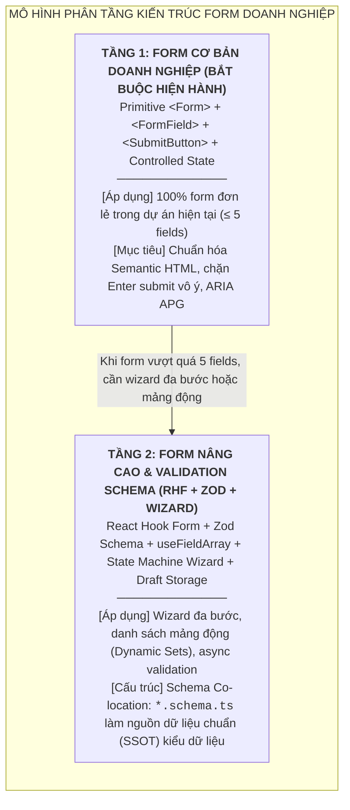
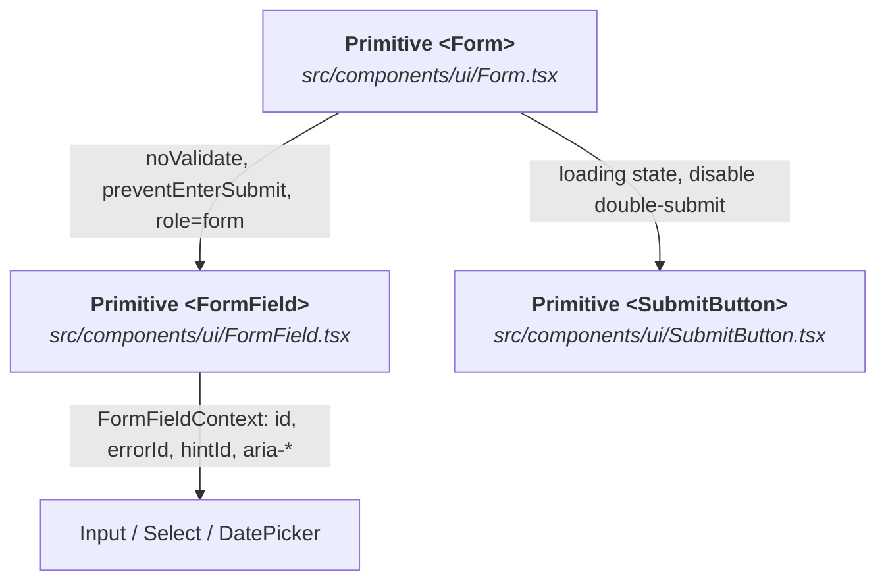
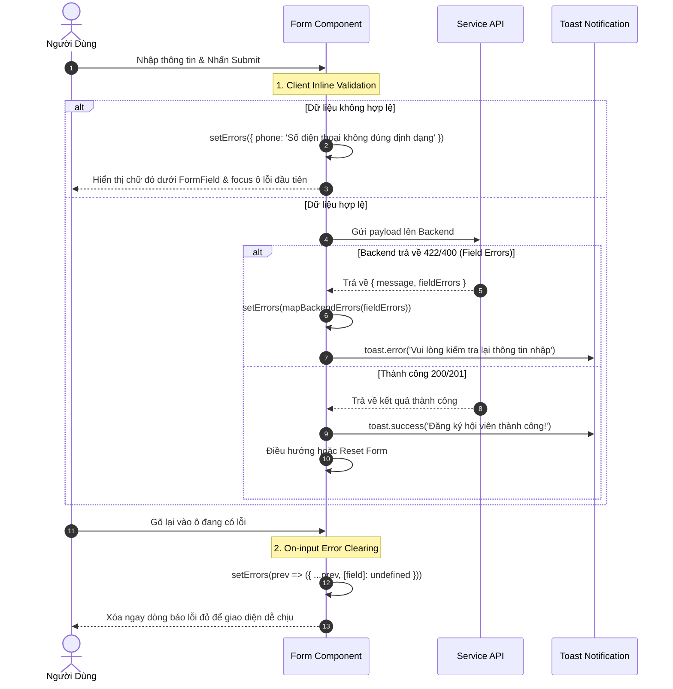
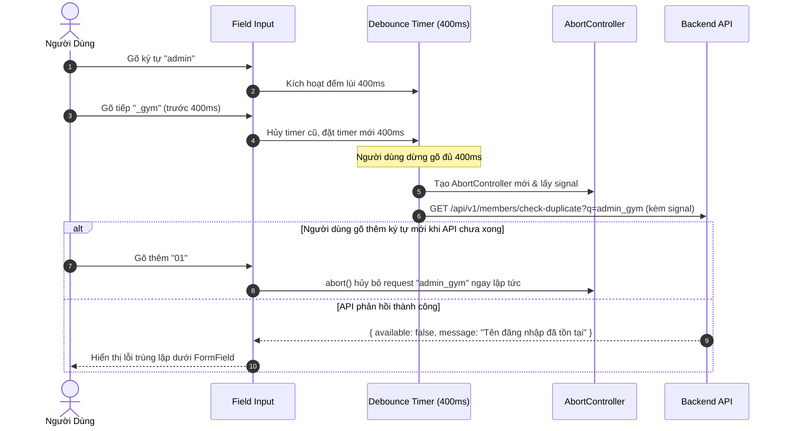
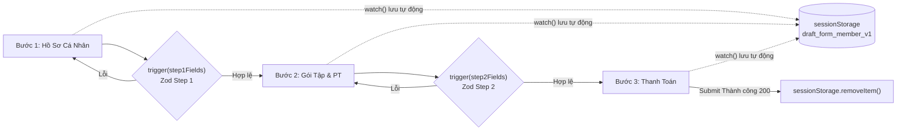

# Chuyên Đề 05: Kiến Trúc Biểu Mẫu & Xác Thực Dữ Liệu Doanh Nghiệp (Enterprise Forms, Wizard State & Zod Validation)

> **Dự án:** Khung Tiêu Chuẩn Doanh Nghiệp & RoGym Management System Profile  
> **Cổng quy chuẩn chính:** [`FRONTEND_CONVENTIONS.md`](../FRONTEND_CONVENTIONS.md) | [Bản Đồ Tài Liệu](./README.md)  
> **Tài liệu liên quan:** [`docs/01-architecture-and-structure.md`](./01-architecture-and-structure.md) | [`docs/03-coding-standards.md`](./03-coding-standards.md) | [`docs/04-component-patterns.md`](./04-component-patterns.md) | [`docs/09-accessibility.md`](./09-accessibility.md)  
> **Cơ sở tham chiếu quốc tế:**  
> - [W3C WAI-ARIA Authoring Practices Guide (APG) - Form Validation](https://www.w3.org/WAI/ARIA/apg/patterns/)  
> - [React Hook Form v7 - Documentation & Performance Architecture](https://react-hook-form.com/)  
> - [Zod v3 - TypeScript-first Schema Validation with Static Type Inference](https://zod.dev/)  
> - [RFC 9457 - Problem Details for HTTP APIs (Field-level Validation Errors)](https://datatracker.ietf.org/doc/html/rfc9457)  
> **Phiên bản:** 8.0 (Enterprise Quality Standard — 15 Spokes & Universal Decoupling)  
> **Áp dụng cho:** Toàn bộ biểu mẫu nhập liệu và bộ điều khiển form trong `src/`  
> **Trạng thái:** Bắt buộc tuân thủ 100% (Strict Mandatory Enforcement)

---

## MỤC LỤC
1. [Nguyên Tắc & Mô Hình Phân Tầng Kiến Trúc Form Doanh Nghiệp](#1-nguyên-tắc-mô-hình-phân-tầng-kiến-trúc-form-doanh-nghiệp)
2. [Nền Tảng Form Tầng 1: Bộ Ba Primitives Bắt Buộc](#2-nền-tảng-form-tầng-1-bộ-ba-primitives-bắt-buộc)
3. [Danh Mục Input Controls Trong Hệ Sinh Thái Doanh Nghiệp](#3-danh-mục-input-controls-trong-hệ-sinh-thái-doanh-nghiệp)
4. [Quy Chuẩn Semantic Layout & Khả Năng Tiếp Cận W3C Trong Form](#4-quy-chuẩn-semantic-layout-khả-năng-tiếp-cận-w3c-trong-form)
5. [Chiến Lược Validation & Error UX Phân Tầng](#5-chiến-lược-validation-error-ux-phân-tầng)
   - [5.1. Mô Hình Báo Lỗi 2 Tuyến](#51-mô-hình-báo-lỗi-2-tuyến)
   - [5.2. Quy Tắc On-input Error Clearing](#52-quy-tắc-on-input-error-clearing)
   - [5.3. Xác Thực Bất Đồng Bộ Có Debounce & AbortController](#53-xác-thực-bất-đồng-bộ-có-debounce-abortcontroller-async-debounced-validation)
6. [Hai Case Studies Triển Khai Thực Tế (Production-Ready)](#6-hai-case-studies-triển-khai-thực-tế-production-ready)
7. [Kiến Trúc Form Tầng 2 Doanh Nghiệp (React Hook Form & Zod)](#7-kiến-trúc-form-tầng-2-doanh-nghiệp-react-hook-form-zod)
   - [7.1. Ma Trận Quyết Định Nâng Cấp Lên Tầng 2](#71-ma-trận-quyết-định-khi-nào-nên-chuyển-đổi-lên-tầng-2)
   - [7.2. Nguyên Tắc Tổ Chức File: Co-location Zod Schema](#72-nguyên-tắc-tổ-chức-file-co-location-zod-schema)
   - [7.3. Hướng Tiếp Cận Tích Hợp Hybrid Primitives](#73-hướng-tiếp-cận-tích-hợp-hybrid-primitives)
   - [7.4. Biểu Mẫu Wizard Nhiều Bước Có Tự Động Lưu Nháp (Multi-Step Form & Draft Persistence)](#74-biểu-mẫu-wizard-nhiều-bước-có-tự-động-lưu-nháp-multi-step-form-draft-persistence)
   - [7.5. Quản Trị Mảng Trường Động Lồng Nhau (useFieldArray Workout Builder)](#75-quản-trị-mảng-trường-động-lồng-nhau-usefieldarray)
8. [Bảng Đối Chiếu Anti-Patterns vs Chuẩn Mực Doanh Nghiệp](#8-bảng-đối-chiếu-anti-patterns-vs-chuẩn-mực-doanh-nghiệp)
9. [Bảng Checklist Định Lượng 14 Tiêu Chí Review Form Trước Khi Mở PR](#9-bảng-checklist-định-lượng-14-tiêu-chí-review-form-trước-khi-mở-pr)
10. [Ánh Xạ Tooling Kiểm Toán CI & Static Rules](#10-ánh-xạ-tooling-kiểm-toán-ci-static-rules)

---

## 1. Nguyên Tắc & Mô Hình Phân Tầng Kiến Trúc Form Doanh Nghiệp

Hệ thống quản lý doanh nghiệp và phòng gym RoGym có tần suất tương tác form biểu mẫu rất cao: từ đăng ký hội viên, tạo hợp đồng gói tập, chấm công điểm danh cho tới đặt lịch huấn luyện viên cá nhân (PT) và thiết kế lịch tập đa hiệp. 

Để đảm bảo trải nghiệm người dùng mượt mà, ngăn chặn việc submit trùng lặp (double-submit) và bảo vệ khả năng tiếp cận (Accessibility), hệ thống phân định rõ mô hình kiến trúc form 2 tầng:



> [!IMPORTANT]
> **Quy định ranh giới Primitive Boundary đối với Thẻ Form**:  
> Thẻ `<form>` native **BỊ CẤM TUYỆT ĐỐI** trên toàn bộ các file tại `src/pages/` và các component cấp cao ngoài `src/components/ui/`. Bắt buộc 100% phải sử dụng primitive component [`Form.tsx`](../src/components/ui/forms/Form.tsx) import từ `@/components/ui`.

---

<a id="form-primitives"></a>
## 2. Nền Tảng Form Tầng 1: Bộ Ba Primitives Bắt Buộc

Mọi form trong RoGym bắt buộc phải được xây dựng dựa trên sự kết hợp chặt chẽ của 3 primitives:



### 2.1. Primitive `Form.tsx` (Wrapper Thẻ Form Chuẩn Mực)
Nằm tại [`src/components/ui/Form.tsx`](../src/components/ui/forms/Form.tsx), component này đóng gói các hành vi an toàn cốt lõi:

1. **`noValidate={true}` (Mặc định)**: Ngăn chặn tooltip bong bóng xấu xí và không nhất quán giữa các trình duyệt web, nhường toàn quyền hiển thị thông báo lỗi cho giao diện RoGym Design System.
2. **`preventEnterSubmit?: boolean`**:
   - *Vấn đề thực tế*: Người dùng gõ tên hoặc số điện thoại, vô tình bấm phím `Enter` khiến form bị submit ngay lập tức khi chưa điền xong các trường khác.
   - *Cơ chế giải quyết*: Khi `preventEnterSubmit={true}`, component chặn sự kiện `Enter` trên các ô input văn bản đơn lẻ; nhưng **vẫn cho phép Enter hoạt động bình thường** trên `<textarea>` (xuống dòng) hoặc khi con trỏ focus trực tiếp trên nút Submit.
3. **W3C ARIA APG Compliance**: Tự động gán thuộc tính `role="form"` nếu form có tên tiếp cận (`aria-label` hoặc `aria-labelledby`).
4. **`forwardRef<HTMLFormElement, FormProps>`**: Chuyển tiếp ref hoàn chỉnh để các hook bên ngoài có thể reset hoặc đo kích thước DOM form khi cần.

### 2.2. Primitive `FormField.tsx` (Context-Driven Field Wrapper)
Nằm tại [`src/components/ui/FormField.tsx`](../src/components/ui/forms/FormField.tsx), component này chịu trách nhiệm đóng gói toàn diện quy chuẩn tiếp cận biểu mẫu (`SEM-A11Y-003`):

1. **Tự động liên kết khả năng tiếp cận (A11y) qua `FormFieldContext` (`SEM-A11Y-003`)**:
   - Sử dụng `useId()` sinh định danh duy nhất (hoặc nhận `customId`/`htmlFor`).
   - Tự động sinh `errorId = `${id}-error`` và `hintId = `${id}-hint``.
   - Tự động truyền xuống control con các thuộc tính: `id={id}`, `aria-describedby={error ? errorId : hint ? hintId : undefined}`, và `aria-invalid={Boolean(error)}`.
2. **Accessible Labeling**:
   - Render thẻ `<label htmlFor={id}>` chuẩn HTML5, tự động đính kèm dấu hoa thị đỏ `*` có `aria-hidden="true"` khi `required={true}`.
3. **Hiển thị lỗi bằng Semantic Status Tokens (`SEM-TOKEN-008`, `SEM-A11Y-003`)**:
   - Render thông báo lỗi với `role="alert"` và `id={errorId}`.
   - Text lỗi và viền control khi có lỗi bắt buộc sử dụng Semantic Tokens:
     - Màu chữ lỗi: `text-[var(--color-status-danger-text)]`
     - Viền ô nhập lỗi: `border-[var(--color-status-danger-border)]`
     - Nền badge/callout lỗi: `bg-[var(--color-status-danger-subtle)]`
   - Tuyệt đối cấm dùng class màu cứng như `text-red-500` hay `border-red-600`.
4. **Accessible Error & Hint**:
   - Render thông báo lỗi với `role="alert"` và hiệu ứng chuyển cảnh mượt mà `animate-in fade-in`.

### 2.3. Primitive `SubmitButton.tsx` (Nút Submit Chống Double-Click)
Nằm tại [`src/components/ui/SubmitButton.tsx`](../src/components/ui/actions/SubmitButton.tsx):
- Tự động kích hoạt hiệu ứng xoay (loading spinner) khi prop `loading={true}`.
- Tự động gán `disabled={disabled || loading}` để vô hiệu hóa hoàn toàn tương tác click của người dùng trong lúc API đang xử lý, triệt tiêu 100% rủi ro tạo bản ghi trùng lặp (duplicate transactions).
- Áp dụng token trạng thái semantic focus-ring và min touch target $44 \times 44\text{px}$ (`SEM-A11Y-009`).

---

<a id="input-controls"></a>
## 3. Danh Mục Input Controls Trong Hệ Sinh Thái Doanh Nghiệp

Tất cả các Input primitives trong RoGym đều tự động tương thích và nạp context từ `<FormField>`:

| Input Primitive | Thư Mục / File | Mục Đích Sử Dụng Điển Hình | Tự Động Gắn Context |
| :--- | :--- | :--- | :---: |
| `<Input>` | `src/components/ui/Input.tsx` | Nhập văn bản đơn dòng (Họ tên, Email, Mã thẻ) | `id`, `aria-describedby`, `aria-invalid` |
| `<Select>` | `src/components/ui/Select.tsx` | Chọn 1 giá trị trong danh sách cố định (Giới tính, Chi nhánh) | `id`, `aria-describedby` |
| `<Textarea>` | `src/components/ui/Textarea.tsx` | Nhập văn bản nhiều dòng (Ghi chú bệnh lý, Lý do hủy) | `id`, `aria-describedby` |
| `<DatePickerInput>` | `src/components/ui/DatePickerInput.tsx` | Chọn ngày tháng (Ngày sinh, Ngày bắt đầu hợp đồng) | `id`, `aria-describedby` |
| `<TimeSlotPicker>` | `src/components/ui/TimeSlotPicker.tsx` | Chọn khung giờ tập với PT (08:00 - 09:00, 14:00 - 15:00) | `id`, `aria-describedby` |
| `<Combobox>` | `src/components/ui/Combobox.tsx` | Tìm kiếm và chọn từ danh sách lớn (Chọn học viên, Huấn luyện viên) | `id`, `aria-describedby` |
| `<Switch>` | `src/components/ui/Switch.tsx` | Bật/tắt cờ logic nhị phân (Kích hoạt hội viên, Gửi thông báo Zalo/LINE) | `id` |
| `<Checkbox>` | `src/components/ui/Checkbox.tsx` | Đánh dấu chọn (Đồng ý điều khoản sử dụng) | `id` |
| `<RadioGroup>` | `src/components/ui/RadioGroup.tsx` | Lựa chọn phương thức thanh toán (Tiền mặt, VNPay, QR Code) | `id`, `role="radiogroup"` |

---

## 4. Quy Chuẩn Semantic Layout & Khả Năng Tiếp Cận W3C Trong Form

### 4.1. Phân Vùng Nhóm Trường Bằng `<fieldset>` và `<legend>`
Khi một form chứa nhiều nhóm thông tin (ví dụ: Thông tin cá nhân, Thông tin liên hệ, Tài khoản đăng nhập), lập trình viên **bắt buộc** phải sử dụng thẻ ngữ nghĩa `<fieldset>` và `<legend>`:

```tsx
// ✅ DO: Phân nhóm ngữ nghĩa bằng fieldset và legend
<fieldset className="rounded-xl border border-[var(--rogym-border-subtle)] p-4 space-y-4">
  <legend className="px-2 text-sm font-bold text-[var(--rogym-teal)] uppercase tracking-wider">
    Thông tin liên hệ
  </legend>
  {/* rogym-convention-exempt: NO_NONSEMANTIC_TAGS [Multi-column grid layout for form inputs] */}
  <div className="grid grid-cols-1 md:grid-cols-2 gap-4">
    <FormField label="Số điện thoại" required error={errors.phone}>
      <Input
        value={values.phone}
        onChange={(e) => handleFieldChange('phone', e.target.value)}
        placeholder="0912345678"
      />
    </FormField>
    <FormField label="Email" required error={errors.email}>
      <Input
        type="email"
        value={values.email}
        onChange={(e) => handleFieldChange('email', e.target.value)}
        placeholder="hoi-vien@rogym.vn"
      />
    </FormField>
  </div>
</fieldset>
```

### 4.2. Khối Chứa Form & Action Buttons
- Toàn bộ form nên được bọc trong `<Card as="section">` với tiêu đề rõ ràng.
- Các nút hành động (Submit, Hủy, Quay lại) phải đặt bên trong thẻ semantic `<footer className="mt-6 flex items-center justify-end gap-3">`.

---

## 5. Chiến Lược Validation & Error UX Phân Tầng

### 5.1. Mô Hình Báo Lỗi 2 Tuyến

Để mang lại trải nghiệm nhập liệu tốt nhất, RoGym quy chuẩn mô hình xử lý lỗi 3 bước:



### 5.2. Quy Tắc On-input Error Clearing
Khi người dùng đang nhìn thấy dòng báo lỗi đỏ và bắt đầu sửa lại trường đó, giao diện phải **tự động xóa bỏ lỗi ngay lập tức** thay vì giữ nguyên lỗi cho đến lần submit tiếp theo:

```tsx
// ✅ DO: Xóa lỗi trường tương ứng ngay khi người dùng nhập ký tự mới
const handleFieldChange = (field: keyof FormValues, value: string) => {
  setValues((prev) => ({ ...prev, [field]: value }))
  if (errors[field]) {
    setErrors((prev) => ({ ...prev, [field]: undefined }))
  }
}
```

### 5.3. Xác Thực Bất Đồng Bộ Có Debounce & AbortController (Async Debounced Validation)

Đối với các trường dữ liệu cần kiểm tra tính duy nhất với máy chủ (như mã hội viên, địa chỉ email, số điện thoại, hoặc tên đăng nhập), nếu gửi yêu cầu kiểm tra tại mỗi phím gõ (*keystroke*) sẽ gây quá tải hệ thống API và phát sinh race conditions nghiêm trọng.

**Quy chuẩn kỹ thuật:**
1. **Tách biệt 2 tầng validation:** Kiểm tra format đồng bộ bằng regex / Zod trước; chỉ khi định dạng hợp lệ mới kích hoạt kiểm tra bất đồng bộ qua API.
2. **Quy tắc Debounce 400ms:** Chờ người dùng ngừng gõ phím ít nhất 400ms mới phát lệnh HTTP request.
3. **Quy tắc Hủy yêu cầu (AbortController):** Nếu người dùng tiếp tục gõ ký tự mới trong khi yêu cầu trước đó đang chờ phản hồi, tín hiệu `AbortController.abort()` lập tức hủy bỏ request cũ.
4. **Phản hồi thị giác trực quan:** Hiển thị icon trạng thái (Loading spinner khi đang kiểm tra $\rightarrow$ Checkmark xanh khi hợp lệ $\rightarrow$ Chữ đỏ khi bị trùng) ngay trong `<FormField>`.



```tsx
// ✅ DO: Hook kiểm tra trùng lặp bất đồng bộ có debounce và AbortController
import { useState, useEffect, useRef } from 'react'

export interface AsyncValidationResult {
  isValidating: boolean
  asyncError: string | null
  isAvailable: boolean | null
}

export function useAsyncFieldCheck(
  value: string,
  isSyncValid: boolean,
  checkFn: (val: string, signal: AbortSignal) => Promise<boolean>,
  debounceMs = 400
): AsyncValidationResult {
  const [isValidating, setIsValidating] = useState(false)
  const [asyncError, setAsyncError] = useState<string | null>(null)
  const [isAvailable, setIsAvailable] = useState<boolean | null>(null)
  const abortControllerRef = useRef<AbortController | null>(null)

  useEffect(() => {
    // Nếu giá trị rỗng hoặc định dạng đồng bộ chưa hợp lệ -> Reset
    if (!value.trim() || !isSyncValid) {
      setIsValidating(false)
      setAsyncError(null)
      setIsAvailable(null)
      abortControllerRef.current?.abort()
      return
    }

    setIsValidating(true)
    setAsyncError(null)
    setIsAvailable(null)

    // Hủy bỏ request đang bay trước đó
    abortControllerRef.current?.abort()
    const abortController = new AbortController()
    abortControllerRef.current = abortController

    const timer = setTimeout(async () => {
      try {
        const available = await checkFn(value.trim(), abortController.signal)
        setIsAvailable(available)
        if (!available) {
          setAsyncError(t('validation.valueAlreadyInUse'))
        }
      } catch (err: unknown) {
        if ((err as Error).name !== 'AbortError' && (err as Error).name !== 'CanceledError') {
          setAsyncError(t('validation.cannotCheckAvailability'))
        }
      } finally {
        if (!abortController.signal.aborted) {
          setIsValidating(false)
        }
      }
    }, debounceMs)

    return () => {
      clearTimeout(timer)
      abortController.abort()
    }
  }, [value, isSyncValid, checkFn, debounceMs])

  return { isValidating, asyncError, isAvailable }
}
```

---

## 6. Hai Case Studies Triển Khai Thực Tế (Production-Ready)

### 6.1. Case Study 1: `MemberRegisterForm` (Form Đăng Ký Hội Viên Đầy Đủ)

```tsx
// ✅ DO: Form đăng ký hội viên tuân thủ 100% Primitive Form và Semantic Hierarchy
import { useState, type FormEvent } from 'react'
import { Button, SubmitButton } from '@/components/ui/actions'
import { Card, CardContent, CardHeader, CardTitle } from '@/components/ui/data-display'
import { DatePickerInput, Form, FormField, Input, Select, Textarea, TimeSlotPicker } from '@/components/ui/forms'
import { toast } from '@/lib/toast'
import { memberService } from '@/services/member.service'

export interface MemberRegisterValues {
  fullName: string
  phone: string
  email: string
  gender: string
  address: string
}

const INITIAL_VALUES: MemberRegisterValues = {
  fullName: '',
  phone: '',
  email: '',
  gender: 'male',
  address: '',
}

export function MemberRegisterForm({ onSuccess, onCancel }: {
  onSuccess: () => void
  onCancel: () => void
}) {
  const [values, setValues] = useState<MemberRegisterValues>(INITIAL_VALUES)
  const [errors, setErrors] = useState<Partial<Record<keyof MemberRegisterValues, string>>>({})
  const [isSubmitting, setIsSubmitting] = useState(false)

  const handleFieldChange = (field: keyof MemberRegisterValues, value: string) => {
    setValues((prev) => ({ ...prev, [field]: value }))
    if (errors[field]) {
      setErrors((prev) => ({ ...prev, [field]: undefined }))
    }
  }

  const validate = (): boolean => {
    const nextErrors: Partial<Record<keyof MemberRegisterValues, string>> = {}
    const phoneRegex = /(84|0[3|5|7|8|9])+([0-9]{8})\b/
    const emailRegex = /^[^\s@]+@[^\s@]+\.[^\s@]+$/

    if (!values.fullName.trim()) {
      nextErrors.fullName = 'Họ và tên không được để trống'
    } else if (values.fullName.trim().length < 2) {
      nextErrors.fullName = 'Họ và tên phải có tối thiểu 2 ký tự'
    }

    if (!values.phone.trim()) {
      nextErrors.phone = 'Vui lòng nhập số điện thoại'
    } else if (!phoneRegex.test(values.phone.trim())) {
      nextErrors.phone = 'Số điện thoại không đúng định dạng Việt Nam'
    }

    if (values.email.trim() && !emailRegex.test(values.email.trim())) {
      nextErrors.email = 'Địa chỉ email không hợp lệ'
    }

    setErrors(nextErrors)
    return Object.keys(nextErrors).length === 0
  }

  const handleSubmit = async (e: FormEvent<HTMLFormElement>) => {
    e.preventDefault()
    if (!validate()) {
      toast.error('Vui lòng kiểm tra và sửa các thông tin chưa chính xác')
      return
    }

    setIsSubmitting(true)
    try {
      await memberService.createMember({
        fullName: values.fullName.trim(),
        email: values.email.trim() || `${values.phone.trim()}@rogym.vn`,
        password: 'TemporaryPassword123!',
        dateOfBirth: '2000-01-01',
        phone: values.phone.trim(),
        address: values.address.trim() || undefined,
        packageId: 1,
        paymentMethod: 'cash',
      })
      toast.success('Đăng ký hội viên mới thành công!')
      onSuccess()
    } catch (err: unknown) {
      const apiMessage = err instanceof Error ? err.message : 'Đã có sự cố khi tạo hồ sơ hội viên'
      toast.error(apiMessage)
    } finally {
      setIsSubmitting(false)
    }
  }

  return (
    <Card as="section" variant="glass" aria-labelledby="register-member-title">
      <CardHeader>
        <CardTitle id="register-member-title">Hồ Sơ Đăng Ký Hội Viên Mới</CardTitle>
      </CardHeader>

      <CardContent>
        <Form
          onSubmit={handleSubmit}
          preventEnterSubmit={true}
          noValidate={true}
          aria-label="Form đăng ký hội viên"
          className="space-y-6"
        >
          <fieldset className="rounded-xl border border-[var(--rogym-border-subtle)] p-5 space-y-4">
            <legend className="px-2 text-xs font-bold text-[var(--rogym-teal)] uppercase tracking-wider">
              1. Thông Tin Nhận Diện
            </legend>

            {/* rogym-convention-exempt: NO_NONSEMANTIC_TAGS [Two-column grid container for name and gender] */}
            <div className="grid grid-cols-1 md:grid-cols-3 gap-4">
              <FormField
                label="Họ và tên"
                required
                error={errors.fullName}
                className="md:col-span-2"
              >
                <Input
                  value={values.fullName}
                  onChange={(e) => handleFieldChange('fullName', e.target.value)}
                  placeholder="Ví dụ: Trần Văn Nam"
                />
              </FormField>

              <FormField label="Giới tính" required>
                <Select
                  value={values.gender}
                  onChange={(val) => handleFieldChange('gender', val)}
                  options={[
                    { label: 'Nam', value: 'male' },
                    { label: 'Nữ', value: 'female' },
                    { label: 'Khác', value: 'other' },
                  ]}
                />
              </FormField>
            </div>
          </fieldset>

          <fieldset className="rounded-xl border border-[var(--rogym-border-subtle)] p-5 space-y-4">
            <legend className="px-2 text-xs font-bold text-[var(--rogym-teal)] uppercase tracking-wider">
              2. Kênh Liên Lạc & Địa Chỉ
            </legend>

            {/* rogym-convention-exempt: NO_NONSEMANTIC_TAGS [Two-column grid container for contact info] */}
            <div className="grid grid-cols-1 md:grid-cols-2 gap-4">
              <FormField label="Số điện thoại" required error={errors.phone}>
                <Input
                  type="tel"
                  value={values.phone}
                  onChange={(e) => handleFieldChange('phone', e.target.value)}
                  placeholder="0912345678"
                />
              </FormField>

              <FormField label="Email" error={errors.email} hint="Không bắt buộc, dùng để nhận hóa đơn điện tử">
                <Input
                  type="email"
                  value={values.email}
                  onChange={(e) => handleFieldChange('email', e.target.value)}
                  placeholder="nam.tran@gmail.com"
                />
              </FormField>
            </div>

            <FormField label="Địa chỉ cư trú" className="pt-2">
              <Input
                value={values.address}
                onChange={(e) => handleFieldChange('address', e.target.value)}
                placeholder="Số nhà, tên đường, phường/xã..."
              />
            </FormField>
          </fieldset>

          <footer className="flex items-center justify-end gap-3 pt-4 border-t border-[var(--rogym-border-subtle)]">
            <Button
              type="button"
              variant="outline-white"
              onClick={onCancel}
              disabled={isSubmitting}
            >
              Hủy bỏ
            </Button>
            <SubmitButton loading={isSubmitting}>
              Hoàn tất đăng ký
            </SubmitButton>
          </footer>
        </Form>
      </CardContent>
    </Card>
  )
}
```

---

### 6.2. Case Study 2: `WorkoutBookingForm` (Form Đặt Lịch Huấn Luyện Viên PT)

```tsx
// ✅ DO: Form đặt lịch PT tích hợp DatePickerInput và TimeSlotPicker
import { useState, type FormEvent } from 'react'

import { toast } from '@/lib/toast'
import { trainingSessionService } from '@/services/training-session.service'

export interface WorkoutBookingValues {
  trainerName: string
  assignmentId: string
  planDayId: string
  bookingDate: Date | null
  timeSlot: string
  notes: string
}

export function WorkoutBookingForm({
  trainerName,
  assignmentId,
  planDayId,
  onSuccess,
  onCancel,
}: {
  trainerName: string
  assignmentId: string
  planDayId: string
  onSuccess: () => void
  onCancel: () => void
}) {
  const [bookingDate, setBookingDate] = useState<Date | null>(new Date())
  const [timeSlot, setTimeSlot] = useState<string>('')
  const [notes, setNotes] = useState<string>('')
  const [slotError, setSlotError] = useState<string | null>(null)
  const [isBooking, setIsBooking] = useState(false)

  const handleSubmit = async (e: FormEvent<HTMLFormElement>) => {
    e.preventDefault()
    if (!bookingDate) {
      toast.error('Vui lòng chọn ngày tập luyện')
      return
    }
    if (!timeSlot) {
      setSlotError('Vui lòng chọn một khung giờ tập luyện')
      return
    }

    setIsBooking(true)
    try {
      const dateStr = bookingDate.toISOString().split('T')[0]
      const [startHour, endHour] = timeSlot.split('-').map((s) => s.trim())
      await trainingSessionService.bookSession({
        startTime: `${dateStr}T${startHour}:00Z`,
        endTime: `${dateStr}T${endHour}:00Z`,
        assignmentId,
        planDayId,
      })
      toast.success(`Đặt lịch tập với HLV ${trainerName} thành công!`)
      onSuccess()
    } catch (err: unknown) {
      const msg = err instanceof Error ? err.message : 'Khung giờ này đã kín lịch. Vui lòng chọn giờ khác.'
      toast.error(msg)
    } finally {
      setIsBooking(false)
    }
  }

  return (
    <Card as="section" variant="default" aria-labelledby="booking-pt-title">
      <CardHeader>
        <CardTitle id="booking-pt-title">Đặt Lịch Buổi Tập với HLV {trainerName}</CardTitle>
      </CardHeader>

      <CardContent>
        <Form
          onSubmit={handleSubmit}
          preventEnterSubmit={true}
          noValidate={true}
          aria-label={`Đặt lịch buổi tập với huấn luyện viên ${trainerName}`}
          className="space-y-5"
        >
          <FormField label="Ngày tập luyện" required>
            <DatePickerInput
              value={bookingDate}
              onChange={(date) => {
                setBookingDate(date)
                setTimeSlot('')
                setSlotError(null)
              }}
              minDate={new Date()}
            />
          </FormField>

          <FormField
            label="Khung giờ tập (1 tiếng/buổi)"
            required
            error={slotError}
          >
            <TimeSlotPicker
              value={timeSlot}
              onChange={(slot) => {
                setTimeSlot(slot)
                setSlotError(null)
              }}
            />
          </FormField>

          <FormField label="Mục tiêu buổi tập / Ghi chú cho HLV">
            <Textarea
              value={notes}
              onChange={(e) => setNotes(e.target.value)}
              placeholder="Ví dụ: Tập trung vào kỹ thuật Squat, thể lực đang hồi phục sau chấn thương..."
              rows={3}
            />
          </FormField>

          <footer className="flex items-center justify-end gap-3 pt-4 border-t border-[var(--rogym-border-subtle)]">
            <Button
              type="button"
              variant="outline-white"
              onClick={onCancel}
              disabled={isBooking}
            >
              Hủy
            </Button>
            <SubmitButton loading={isBooking}>
              Xác nhận đặt lịch
            </SubmitButton>
          </footer>
        </Form>
      </CardContent>
    </Card>
  )
}
```

---

## 7. Kiến Trúc Form Tầng 2 Doanh Nghiệp (React Hook Form & Zod)

> [!NOTE]
> **Trạng Thái Kỹ Thuật (Architecture Status)**:  
> Form Tầng 2 là **Quy Chuẩn Chính Thức (Official Production Architecture)** được kích hoạt khi form vượt quá 5 trường dữ liệu, có mảng trường động, logic phụ thuộc chéo hoặc quy trình nhập liệu Wizard đa bước.

### 7.1. Ma Trận Quyết Định: Khi Nào Nên Chuyển Đổi Lên Tầng 2?

| Tiêu Chí Đánh Giá | Giữ Nguyên Form Tầng 1 (Controlled State) | Nâng Cấp Lên Form Tầng 2 (RHF + Zod) |
| :--- | :--- | :--- |
| **Quy mô số lượng fields** | Đơn giản, ngắn gọn ($\le 5$ fields). | Phức tạp, nhiều trường dữ liệu ($> 6$ fields). |
| **Cấu trúc trường dữ liệu** | Danh sách trường cố định, tĩnh. | Có mảng trường động (`useFieldArray`: Thêm/Xóa bài tập, Hiệp tập). |
| **Logic phụ thuộc chéo** | Độc lập hoặc điều kiện đơn giản. | Phụ thuộc chéo phức tạp (Xác nhận mật khẩu `refine`, Khoảng ngày bắt đầu/kết thúc). |
| **Tiến trình nhập liệu** | 1 bước duy nhất (Modal, Dialog, Card). | Wizard đa bước (Multi-step Form) cần lưu nháp tự động qua `sessionStorage`. |

### 7.2. Nguyên Tắc Tổ Chức File: Co-location Zod Schema
File schema Zod bắt buộc phải được đặt cùng thư mục với trang/feature tương ứng (`*.schema.ts`). TypeScript type cho toàn bộ form phải được suy diễn trực tiếp thông qua `z.infer<typeof schema>` để đảm bảo **Nguồn Dữ Liệu Chuẩn Duy Nhất (Single Source of Truth - SSOT)**:

```ts
// src/pages/staff/members/member-register.schema.ts
import { z } from 'zod'

export const memberRegisterSchema = z.object({
  fullName: z
    .string()
    .min(2, 'Họ và tên phải có tối thiểu 2 ký tự')
    .max(100, 'Họ và tên không được vượt quá 100 ký tự'),
  phone: z
    .string()
    .regex(/(84|0[3|5|7|8|9])+([0-9]{8})\b/, 'Số điện thoại không đúng định dạng Việt Nam'),
  email: z
    .string()
    .email('Địa chỉ email không hợp lệ')
    .optional()
    .or(z.literal('')),
  gender: z.enum(['male', 'female', 'other']),
  packageId: z.number().positive('Vui lòng chọn gói tập'),
})

export type MemberRegisterSchemaValues = z.infer<typeof memberRegisterSchema>
```

### 7.3. Hướng Tiếp Cận Tích Hợp Hybrid Primitives
Không xây dựng các wrapper component rườm rà. RoGym áp dụng mô hình Hybrid tái sử dụng 100% UI primitives hiện có:
- **Input đơn giản (`Input`, `Textarea`)**: Sử dụng trực tiếp `register()` của React Hook Form.
- **Custom Primitives (`DatePickerInput`, `TimeSlotPicker`, `Select`, `Switch`)**: Bọc qua `<Controller />` của React Hook Form:

```tsx
// ✅ DO: Minh họa tích hợp Hybrid trong Form Tầng 2
import { useForm, Controller } from 'react-hook-form'
import { zodResolver } from '@hookform/resolvers/zod'

import { memberRegisterSchema, type MemberRegisterSchemaValues } from './member-register.schema'

export function MemberRegisterFormRHF() {
  const {
    register,
    control,
    handleSubmit,
    formState: { errors, isSubmitting },
  } = useForm<MemberRegisterSchemaValues>({
    resolver: zodResolver(memberRegisterSchema),
    defaultValues: {
      fullName: '',
      phone: '',
      gender: 'male',
    },
  })

  const onSubmit = async (data: MemberRegisterSchemaValues) => {
    toast.success(`Cập nhật thông tin hội viên ${data.fullName} thành công!`)
  }

  return (
    <Form onSubmit={handleSubmit(onSubmit)} preventEnterSubmit={true}>
      <FormField label="Họ và tên" required error={errors.fullName?.message}>
        <Input {...register('fullName')} placeholder="Nguyễn Văn A" />
      </FormField>

      <FormField label="Ngày sinh">
        <Controller
          name="birthDate"
          control={control}
          render={({ field }) => (
            <DatePickerInput
              value={field.value}
              onChange={field.onChange}
            />
          )}
        />
      </FormField>

      <SubmitButton loading={isSubmitting}>
        Lưu thông tin
      </SubmitButton>
    </Form>
  )
}
```

### 7.4. Biểu Mẫu Wizard Nhiều Bước Có Tự Động Lưu Nháp (Multi-Step Form & Draft Persistence)

Đối với các quy trình kinh doanh kéo dài (ví dụ: Tạo hồ sơ hội viên $\rightarrow$ Đăng ký gói tập & dịch vụ $\rightarrow$ Thiết lập thanh toán), việc gom toàn bộ vào một màn hình gây quá tải nhận thức. Chúng ta chuẩn hóa mô hình **State Machine Wizard** kết hợp **Draft Persistence vào `sessionStorage`**:

#### 7.4.1. Quy Chuẩn State Machine Điều Hướng 3 Bước
- **Bước 1 (Profile):** Họ tên, số điện thoại, email, ngày sinh, giới tính.
- **Bước 2 (Package):** Chọn gói tập, ngày kích hoạt, huấn luyện viên cá nhân (PT).
- **Bước 3 (Review & Payment):** Tóm tắt chi phí, phương thức thanh toán, điều khoản hợp đồng.

#### 7.4.2. Quy Tắc Step-level Validation với Sub-schemas Zod
- Phân tách Zod schema thành các sub-schemas: `step1Schema`, `step2Schema`, `step3Schema`.
- Trước khi cho phép chuyển từ Bước $N$ sang Bước $N+1$, bắt buộc gọi `const isValid = await trigger(stepFields)`. Nếu không đạt, focus ngay vào trường lỗi đầu tiên và chặn chuyển bước.

#### 7.4.3. Cơ Chế Draft Persistence Tự Động Lưu & Dọn Dẹp SessionStorage
- Tự động lưu giá trị form vào `sessionStorage` (key: `draft_form_member_registration_v1`) mỗi khi form thay đổi (`watch()`).
- Gắn thuộc tính thời gian hết hạn (TTL: 24 giờ) và Schema Version. Nếu người dùng vô tình reload trang, dữ liệu được tự động khôi phục 100%.
- **Tự động dọn dẹp:** Xóa nháp ngay khi hoàn tất submit thành công (`sessionStorage.removeItem(...)`).



```tsx
// ✅ DO: Triển khai Code Blueprint hoàn chỉnh cho Multi-step Form có lưu nháp
import React, { useEffect, useState } from 'react'
import { useForm, type SubmitHandler } from 'react-hook-form'
import { useTranslation } from 'react-i18next'
import { zodResolver } from '@hookform/resolvers/zod'
import { z } from 'zod'

import { toast } from '@/lib/toast'
import { Form } from '@/components/ui/forms/Form'
import { FormField } from '@/components/ui/forms/FormField'
import { Input } from '@/components/ui/forms/Input'
import { Select, SelectOption } from '@/components/ui/forms/Select'
import { Checkbox } from '@/components/ui/forms/Checkbox'
import { Button } from '@/components/ui/actions/Button'
import { SubmitButton } from '@/components/ui/actions/SubmitButton'
import { Card, CardHeader, CardTitle, CardContent } from '@/components/ui/data-display/Card'

const STORAGE_KEY = 'rogym_draft_member_wizard_v1'

export const step1Schema = z.object({
  fullName: z.string().min(2, 'Họ và tên tối thiểu 2 ký tự'),
  phone: z.string().regex(/(84|0[3|5|7|8|9])+([0-9]{8})\b/, 'Số điện thoại không hợp lệ'),
  email: z.string().email('Email không đúng định dạng'),
})

export const step2Schema = z.object({
  packageType: z.enum(['standard', 'premium', 'vip'], { required_error: 'Vui lòng chọn gói tập' }),
  durationMonths: z.coerce.number().min(1, 'Thời hạn tối thiểu 1 tháng'),
})

export const step3Schema = z.object({
  paymentMethod: z.enum(['cash', 'credit_card', 'bank_transfer']),
  agreedToTerms: z.literal(true, { errorMap: () => ({ message: 'Bạn phải đồng ý với điều khoản hợp đồng' }) }),
})

export const wizardSchema = step1Schema.merge(step2Schema).merge(step3Schema)
export type WizardFormValues = z.infer<typeof wizardSchema>

const STEP_FIELDS: Record<number, (keyof WizardFormValues)[]> = {
  1: ['fullName', 'phone', 'email'],
  2: ['packageType', 'durationMonths'],
  3: ['paymentMethod', 'agreedToTerms'],
}

export function MemberRegistrationWizard() {
  const { t } = useTranslation()
  const [currentStep, setCurrentStep] = useState<number>(1)

  // Khôi phục nháp từ sessionStorage nếu có
  const getSavedDraft = (): Partial<WizardFormValues> => {
    try {
      const saved = sessionStorage.getItem(STORAGE_KEY)
      return saved ? JSON.parse(saved) : {}
    } catch {
      return {}
    }
  }

  const {
    register,
    handleSubmit,
    trigger,
    watch,
    formState: { errors, isSubmitting },
  } = useForm<WizardFormValues>({
    resolver: zodResolver(wizardSchema),
    defaultValues: {
      fullName: '',
      phone: '',
      email: '',
      durationMonths: 1,
      paymentMethod: 'cash',
      ...getSavedDraft(),
    },
    mode: 'onTouched',
  })

  // Tự động lưu nháp khi form thay đổi
  useEffect(() => {
    const subscription = watch((values) => {
      sessionStorage.setItem(STORAGE_KEY, JSON.stringify(values))
    })
    return () => subscription.unsubscribe()
  }, [watch])

  const nextStep = async () => {
    const fieldsToValidate = STEP_FIELDS[currentStep]
    const isStepValid = await trigger(fieldsToValidate)
    if (isStepValid) {
      setCurrentStep((prev) => Math.min(prev + 1, 3))
    }
  }

  const prevStep = () => {
    setCurrentStep((prev) => Math.max(prev - 1, 1))
  }

  const onSubmit: SubmitHandler<WizardFormValues> = async (data) => {
    try {
      // Gửi dữ liệu tạo hồ sơ và hợp đồng
      await new Promise((res) => setTimeout(res, 1000))
      sessionStorage.removeItem(STORAGE_KEY)
      toast.success(t('member.registerSuccess'))
    } catch (err: unknown) {
      toast.error(t('member.registerError'))
    }
  }

  return (
    <Card as="section" variant="default" className="max-w-2xl mx-auto">
      <CardHeader>
        <CardTitle>{t('member.wizardTitle', { step: currentStep, total: 3 })}</CardTitle>
      </CardHeader>

      <CardContent>
        <Form onSubmit={handleSubmit(onSubmit)} preventEnterSubmit={true} noValidate={true}>
          {currentStep === 1 ? (
            <fieldset className="space-y-4">
              <legend className="text-sm font-semibold text-primary mb-3">
                1. {t('member.personalInfo')}
              </legend>
              <FormField label={t('member.fullName')} required error={errors.fullName?.message}>
                <Input {...register('fullName')} placeholder="Nguyễn Văn A" />
              </FormField>
              <FormField label={t('member.phone')} required error={errors.phone?.message}>
                <Input {...register('phone')} placeholder="0901234567" />
              </FormField>
              <FormField label={t('member.email')} required error={errors.email?.message}>
                <Input {...register('email')} type="email" placeholder="example@rogym.vn" />
              </FormField>
            </fieldset>
          ) : null}

          {currentStep === 2 ? (
            <fieldset className="space-y-4">
              <legend className="text-sm font-semibold text-primary mb-3">
                2. {t('member.packageAndDuration')}
              </legend>
              <FormField label={t('member.membershipPackage')} required error={errors.packageType?.message}>
                <Select {...register('packageType')}>
                  <SelectOption value="standard">Standard Membership</SelectOption>
                  <SelectOption value="premium">Premium Pro (Bao gồm Sauna & Locker)</SelectOption>
                  <SelectOption value="vip">VIP Platinum (Full Access 24/7 + PT 1:1)</SelectOption>
                </Select>
              </FormField>
              <FormField label={t('member.durationMonths')} required error={errors.durationMonths?.message}>
                <Input {...register('durationMonths')} type="number" min={1} max={36} />
              </FormField>
            </fieldset>
          ) : null}

          {currentStep === 3 ? (
            <fieldset className="space-y-4">
              <legend className="text-sm font-semibold text-primary mb-3">
                3. {t('member.paymentAndConfirm')}
              </legend>
              <FormField label={t('member.paymentMethod')} required error={errors.paymentMethod?.message}>
                <Select {...register('paymentMethod')}>
                  <SelectOption value="cash">{t('member.paymentCash')}</SelectOption>
                  <SelectOption value="bank_transfer">{t('member.paymentTransfer')}</SelectOption>
                  <SelectOption value="credit_card">{t('member.paymentPos')}</SelectOption>
                </Select>
              </FormField>
              <FormField error={errors.agreedToTerms?.message}>
                <label htmlFor="agreedToTerms" className="flex items-center gap-2 cursor-pointer text-sm text-foreground">
                  <Checkbox id="agreedToTerms" {...register('agreedToTerms')} />
                  <span>{t('member.termsAgreement')}</span>
                </label>
              </FormField>
            </fieldset>
          ) : null}

          <footer className="flex items-center justify-between pt-6 border-t border-border mt-6">
            {currentStep > 1 ? (
              <Button type="button" variant="outline" onClick={prevStep}>
                {t('common.back')}
              </Button>
            ) : <div />}

            {currentStep < 3 ? (
              <Button type="button" tone="primary" onClick={nextStep}>
                {t('common.continue')}
              </Button>
            ) : (
              <SubmitButton loading={isSubmitting}>
                {t('member.completeActivation')}
              </SubmitButton>
            )}
          </footer>
        </Form>
      </CardContent>
  )
}
```

### 7.5. Quản Trị Mảng Trường Động Lồng Nhau (`useFieldArray`)

Trong các tính năng như **Thiết kế Giáo án Thể hình (Workout Routine Builder)**, một bài tập có thể chứa nhiều hiệp tập (Sets), mỗi hiệp có số lần lặp (Reps), mức tạ (Weight kg), và chỉ số cảm nhận nỗ lực (RPE):

#### 7.5.1. Quy Chuẩn Key Identity (key={field.id}) & Tối Ưu Hiệu Năng Render
Bắt buộc truyền `key={field.id}` sinh tự động bởi React Hook Form. Tuyệt đối không dùng `key={index}` vì khi xóa một hàng ở giữa danh sách, React sẽ tái sử dụng nhầm DOM state của hàng bên dưới.

#### 7.5.2. Schema Validation Mảng Lồng Nhau Cho Giáo Án Thể Hình
Xác thực tối thiểu 1 phần tử qua `.min(1, '...')`, kiểm tra số nguyên dương cho reps và số thập phân hợp lệ cho mức tạ. Cung cấp các hàm thao tác danh sách linh hoạt: `append()`, `remove(index)`, `move(from, to)`.

```tsx
// ✅ DO: Workout Routine Builder với useFieldArray lồng nhau chuẩn mực
import React from 'react'
import { useForm, useFieldArray, type SubmitHandler } from 'react-hook-form'
import { zodResolver } from '@hookform/resolvers/zod'
import { z } from 'zod'

import { Trash2, Plus } from 'lucide-react'
import { toast } from '@/lib/toast'

export const exerciseSetSchema = z.object({
  setNumber: z.number().int().positive(),
  reps: z.coerce.number().int().min(1, 'Số reps tối thiểu là 1'),
  weightKg: z.coerce.number().min(0, 'Mức tạ không được âm'),
  targetRpe: z.coerce.number().min(1).max(10, 'RPE từ 1 đến 10'),
})

export const workoutPlanSchema = z.object({
  routineName: z.string().min(3, 'Tên giáo án tối thiểu 3 ký tự'),
  targetMuscleGroup: z.string().min(2, 'Nhóm cơ mục tiêu bắt buộc'),
  sets: z.array(exerciseSetSchema).min(1, 'Giáo án phải có ít nhất 1 hiệp tập'),
})

export type WorkoutPlanValues = z.infer<typeof workoutPlanSchema>

export function WorkoutRoutineBuilderForm() {
  const {
    register,
    control,
    handleSubmit,
    formState: { errors, isSubmitting },
  } = useForm<WorkoutPlanValues>({
    resolver: zodResolver(workoutPlanSchema),
    defaultValues: {
      routineName: '',
      targetMuscleGroup: '',
      sets: [{ setNumber: 1, reps: 10, weightKg: 20, targetRpe: 7 }],
    },
  })

  const { fields, append, remove } = useFieldArray({
    control,
    name: 'sets',
  })

  const onSubmit: SubmitHandler<WorkoutPlanValues> = async (data) => {
    toast.success(`Lưu giáo án "${data.routineName}" (${data.sets.length} hiệp) thành công!`)
  }

  return (
    <Card as="section" variant="default" className="max-w-3xl mx-auto">
      <CardHeader>
        <CardTitle>Thiết Kế Giáo Án Tập Luyện Chi Tiết</CardTitle>
      </CardHeader>

      <CardContent>
        <Form onSubmit={handleSubmit(onSubmit)} preventEnterSubmit={true} noValidate={true} className="space-y-6">
          <div className="grid grid-cols-1 sm:grid-cols-2 gap-4">
            <FormField label="Tên bài tập / Giáo án" required error={errors.routineName?.message}>
              <Input {...register('routineName')} placeholder="Ví dụ: Barbell Back Squat" />
            </FormField>

            <FormField label="Nhóm cơ mục tiêu" required error={errors.targetMuscleGroup?.message}>
              <Input {...register('targetMuscleGroup')} placeholder="Ví dụ: Đùi trước (Quadriceps)" />
            </FormField>
          </div>

          <fieldset className="rounded-xl border border-[var(--rogym-border-subtle)] p-4 space-y-3">
            <legend className="px-2 text-xs font-bold text-[var(--rogym-teal)] uppercase tracking-wider">
              Danh Sách Hiệp Tập (Sets Configuration)
            </legend>

            {errors.sets?.message ? (
              <p className="text-xs text-[var(--rogym-error)] font-medium">{errors.sets.message}</p>
            ) : null}

            <div className="space-y-3">
              {fields.map((field, index) => (
                <div
                  key={field.id}
                  className="flex items-center gap-3 bg-[var(--rogym-bg-elevated)] p-3 rounded-lg border border-white/5"
                >
                  <span className="text-xs font-bold text-[var(--rogym-teal)] w-14 shrink-0">
                    Set #{index + 1}
                  </span>

                  <div className="flex-1 grid grid-cols-3 gap-2">
                    <FormField error={errors.sets?.[index]?.reps?.message}>
                      <Input
                        type="number"
                        placeholder="Reps"
                        {...register(`sets.${index}.reps` as const)}
                      />
                    </FormField>

                    <FormField error={errors.sets?.[index]?.weightKg?.message}>
                      <Input
                        type="number"
                        step="0.5"
                        placeholder="Tạ (kg)"
                        {...register(`sets.${index}.weightKg` as const)}
                      />
                    </FormField>

                    <FormField error={errors.sets?.[index]?.targetRpe?.message}>
                      <Input
                        type="number"
                        step="0.5"
                        placeholder="RPE (1-10)"
                        {...register(`sets.${index}.targetRpe` as const)}
                      />
                    </FormField>
                  </div>

                  <Button
                    type="button"
                    variant="outline-white"
                    size="sm"
                    onClick={() => remove(index)}
                    disabled={fields.length <= 1}
                    aria-label={`Xóa hiệp tập ${index + 1}`}
                  >
                    <Trash2 className="h-4 w-4 text-red-400" />
                  </Button>
                </div>
              ))}
            </div>

            <Button
              type="button"
              variant="outline-white"
              size="sm"
              onClick={() => append({ setNumber: fields.length + 1, reps: 10, weightKg: 20, targetRpe: 7 })}
              className="mt-2"
            >
              <Plus className="h-4 w-4 mr-1 text-[var(--rogym-teal)]" />
              Thêm Hiệp Tập Mới
            </Button>
          </fieldset>

          <footer className="flex items-center justify-end gap-3 pt-4 border-t border-[var(--rogym-border-subtle)]">
            <SubmitButton loading={isSubmitting}>
              Lưu Giáo Án
            </SubmitButton>
          </footer>
        </Form>
      </CardContent>
    </Card>
  )
}
```

---

## 8. Bảng Đối Chiếu Anti-Patterns vs Chuẩn Mực Doanh Nghiệp

| Tiêu Chí | ❌ ANTI-PATTERN (CẤM HOÀN TOÀN) | ✅ RO-GYM CONVENTION (CHUẨN DOANH NGHIỆP) |
| :--- | :--- | :--- |
| **Thẻ Bọc Form** | Dùng thẻ native `<form>` trần tại `src/pages/` không có `preventEnterSubmit` hay ARIA name. | Bắt buộc 100% dùng primitive `<Form>` (`@/components/ui`), tự động gán `role="form"` và `noValidate={true}`. |
| **Cấu Trúc Input** | Render thẻ `<input>` rời rạc và tự viết các thẻ `<p className="text-red-500">` thủ công không có `role="alert"`. | Sử dụng `<FormField label="..." required error="...">` với `FormFieldContext` tự động liên kết `htmlFor` và `aria-describedby`. |
| **Bấm Phím Enter** | Người dùng bấm Enter ở input đầu làm submit form ngay lập tức gây thiếu dữ liệu. | `preventEnterSubmit={true}` trong `Form.tsx` chặn Enter vô ý, chỉ cho phép Enter trên `<textarea>` và nút Submit. |
| **Nút Submit** | Dùng thẻ `<button>` thường, không có loading spinner, người dùng click 3 lần tạo 3 đơn hàng trùng nhau. | Sử dụng `<SubmitButton loading={isSubmitting}>`, tự động vô hiệu hóa và hiển thị spinner chống double-submit. |
| **Layout Nhóm Trường** | Dùng toàn thẻ `<div>` để phân chia các khối thông tin cá nhân/hợp đồng. | Sử dụng `<fieldset>` và `<legend>` chuẩn ngữ nghĩa W3C. Nếu dùng grid đa cột thì có comment exception. |
| **UX Xóa Lỗi** | Giữ nguyên chữ báo lỗi đỏ khi người dùng đã bắt đầu gõ sửa lại ký tự mới. | Triển khai On-input Error Clearing: Tự động xóa lỗi của field ngay khi người dùng nhập dữ liệu mới. |
| **Xác Thực Async** | Gọi API kiểm tra trùng lặp trên từng phím gõ không có debounce hoặc không hủy request cũ. | Tách biệt kiểm tra format; Debounce 400ms và gắn `AbortController` tự động hủy request cũ khi gõ tiếp. |
| **Form Wizard Đa Bước**| Dùng 1 form dài dằng dặc hoặc gom chung state không kiểm tra validation theo từng bước. | State Machine phân tầng; xác thực độc lập từng bước qua `trigger(stepFields)` và sub-schemas Zod. |
| **Lưu Nháp Form** | Người dùng vô tình reload trang là mất trắng toàn bộ dữ liệu form đã nhập 15 phút. | Cơ chế Draft Persistence lưu tự động vào `sessionStorage` có schema version & TTL; tự dọn dẹp khi submit thành công. |
| **Mảng Trường Động** | Dùng `key={index}` trong danh sách động gây tráo đổi giá trị input khi xóa hàng ở giữa. | Sử dụng `useFieldArray` với `key={field.id}` đảm bảo tính toàn vẹn DOM và hiệu năng render tối ưu. |

---

## 9. Bảng Checklist Định Lượng 14 Tiêu Chí Review Form Trước Khi Mở PR

Trước khi tạo Pull Request chứa bất kỳ component biểu mẫu nào, lập trình viên và reviewer bắt buộc phải kiểm tra định lượng theo bảng 14 tiêu chuẩn sau:

| STT | Tiêu Chí Kiểm Tra Biểu Mẫu | Mã Rule Liên Quan | Ngưỡng Định Lượng / Yêu Cầu Kỹ Thuật | Phương Thức Kiểm Tra & Mã Lệnh | Mức Độ |
| :---: | :--- | :---: | :--- | :--- | :---: |
| **1** | **Primitive Form Boundary** | Tiêu chuẩn 10 | Bắt buộc 100% dùng primitive `<Form>` (`@/components/ui`), cấm thẻ native `<form>` trần trên pages. | `node client/scripts/audit-conventions.mjs` | `STRICT` |
| **2** | **Thẻ FormField Chuẩn Mực** | Tiêu chuẩn 10 | 100% input controls bọc trong `<FormField>` với `label`, `required` và `error` rõ ràng. | Code Review JSX Structure | `STRICT` |
| **3** | **SubmitButton Chống Double-Click** | Tiêu chuẩn 10 | Nút hành động chính bắt buộc dùng `<SubmitButton loading={...}>`, tự vô hiệu hóa khi submit. | Code Review Form Actions | `STRICT` |
| **4** | **Ngăn Chặn Enter Submit** | Tiêu chuẩn 10 | Bật `preventEnterSubmit={true}` cho các form có nhiều trường nhập liệu để tránh submit vô ý. | Code Review props `<Form>` | `STRICT` |
| **5** | **Semantic Fieldset & Legend** | Tiêu chuẩn 01 | Các nhóm trường logic được phân tách bằng `<fieldset>` và `<legend>` chuẩn W3C a11y. | Code Review HTML semantics | `STRICT` |
| **6** | **Cú Pháp Miễn Trừ Nonsemantic** | Tiêu chuẩn 02 | 100% thẻ `<div>` grid chia cột trong form có chú thích `{/* rogym-convention-exempt: NO_NONSEMANTIC_TAGS [...] */}`. | `node client/scripts/audit-conventions.mjs` | `STRICT` |
| **7** | **On-input Error Clearing** | Tiêu chuẩn 10 | Lỗi validation tự động biến mất ngay khi người dùng gõ ký tự mới vào trường đó. | Manual/Unit Test Form UX | `STRICT` |
| **8** | **Toast Notifications** | Tiêu chuẩn 13 | Tích hợp Sonner Toast (`toast.success`, `toast.error`) phản hồi kết quả thao tác API. | Code Review submission logic | `STRICT` |
| **9** | **Khả Năng Tiếp Cận ARIA** | Tiêu chuẩn 12 | Form có accessible name qua `aria-label` hoặc `aria-labelledby`; input liên kết `id/htmlFor`. | Testing Library `getByRole('form')` | `STRICT` |
| **10** | **Zod Schema Co-location (Tầng 2)** | Tiêu chuẩn 10 | Nếu dùng Tầng 2, file schema đặt tại `*.schema.ts` cùng feature và suy diễn type qua `z.infer`. | Code Review file structure | `STRICT` |
| **11** | **Wizard Step-level Validation** | Tiêu chuẩn 10 | Wizard đa bước kiểm tra hợp lệ từng bước bằng sub-schema Zod và `trigger()` trước khi bấm Next. | Unit Test chuyển bước | `STRICT` |
| **12** | **Draft Persistence SessionStorage**| Tiêu chuẩn 10 | Form dài hoặc Wizard tự động lưu nháp vào `sessionStorage` và tự dọn dẹp khi submit thành công. | Kiểm tra Storage DevTools | `STRICT` |
| **13** | **Dynamic Field Array Key Safety** | Tiêu chuẩn 19 | Danh sách trường động dùng `useFieldArray` bắt buộc gán `key={field.id}`; cấm dùng `key={index}`. | Code Review React keys | `STRICT` |
| **14** | **Async Validation AbortController**| Tiêu chuẩn 20 | Kiểm tra trùng lặp qua API có debounce 400ms và tự động hủy request cũ bằng `AbortController`. | Network tab request abort | `STRICT` |

---

## 10. Ánh Xạ Tooling Kiểm Toán CI & Static Rules

Hệ thống CI Gatekeeper kiểm soát việc tuân thủ các quy chuẩn biểu mẫu thông qua script kiểm toán tĩnh:

| Mã Rule | Tên Quy Tắc Kiểm Toán | Loại Vi Phạm | Cơ Chế Kiểm Tra | Hành Động Khắc Phục Khi Bị Báo Lỗi |
| :---: | :--- | :---: | :--- | :--- |
| **RULE-02** | `NO_RAW_BUTTON_IN_PAGES` | 🔴 **ERROR** | Quét thẻ `<button>` trần trên các trang nghiệp vụ | Thay bằng UI Primitive `<SubmitButton>` hoặc `<Button>`. |
| **RULE-10** | `FORM_ARCHITECTURE` | 🔴 **ERROR** | Quét thẻ native `<form>` trần trên các trang nghiệp vụ | Thay bằng UI Primitive `<Form>` (`@/components/ui`). |
| **RULE-03** | `NO_NONSEMANTIC_TAGS` | 🟡 **WARNING** | Quét thẻ `<div>` chia cột layout trong form thiếu chú thích | Bổ sung comment `{/* rogym-convention-exempt: NO_NONSEMANTIC_TAGS [Lý do] */}`. |
| **SEM-A-03** | `FORM_A11Y_WIRING` | 🔴 **ERROR** | Kiểm tra liên kết `id`, `aria-describedby`, `aria-invalid` | Bọc input trong `<FormField>` hoặc truyền đầy đủ props a11y. |
| **SEM-A-07** | `FORMS_LABEL_ASSOC` | 🟡 **WARNING** | Quét input độc lập ngoài `FormField` thiếu nhãn tiếp cận | Bổ sung `aria-label` hoặc `aria-labelledby`. |

```bash
# Lệnh kiểm toán tĩnh toàn diện biểu mẫu & quy chuẩn
node client/scripts/audit-conventions.mjs

# Lệnh kiểm tra unit test cho form components
npm --prefix client test -- src/components/ui/FormField.test.tsx src/components/ui/SubmitButton.test.tsx --run
```


