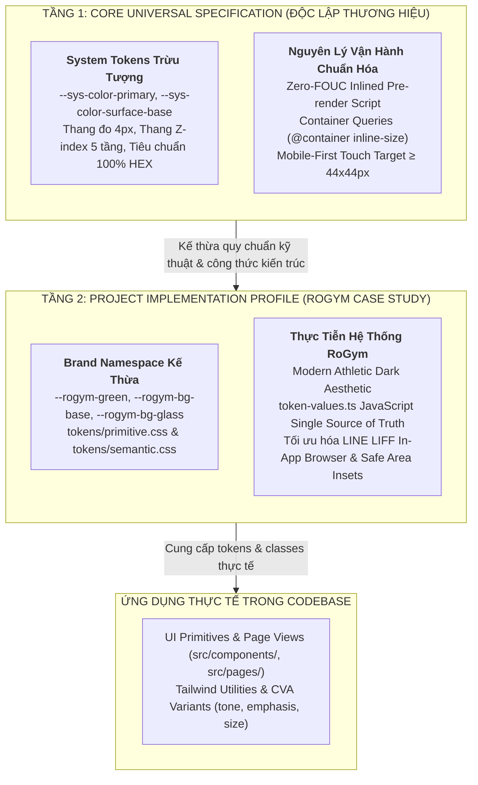
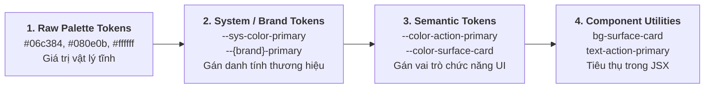
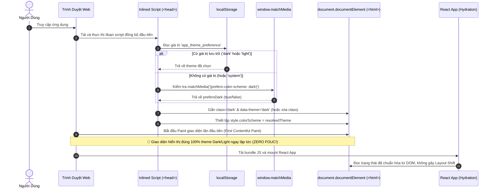

# Chuyên Đề 06: Styling, Design Tokens 100% HEX, Brand Namespacing & Theming Kiến Trúc Doanh Nghiệp

> **Dự án:** Khung Tiêu Chuẩn Doanh Nghiệp & RoGym Management System Profile  
> **Cổng quy chuẩn chính:** [`FRONTEND_CONVENTIONS.md`](../FRONTEND_CONVENTIONS.md) | [Bản Đồ Tài Liệu](./README.md) | [**Bản Đồ Styles & Tokens** (`src/styles/README.md`)](../src/styles/README.md)  
> **Tài liệu liên quan:** [`docs/01-architecture-and-structure.md`](./01-architecture-and-structure.md) | [`docs/03-coding-standards.md`](./03-coding-standards.md) | [`docs/04-component-patterns.md`](./04-component-patterns.md) | [`docs/08-semantic-design-system.md`](./08-semantic-design-system.md)  
> **Cơ sở tham chiếu quốc tế:**  
> - [W3C CSS Containment Module Level 3 (Container Queries)](https://www.w3.org/TR/css-contain-3/)  
> - [MDN CSS Container Queries & Container Type Specification](https://developer.mozilla.org/en-US/docs/Web/CSS/CSS_containment/Container_queries)  
> - [Josh W. Comeau - The Quest for the Perfect Dark Mode (Zero-FOUC Pattern)](https://www.joshwcomeau.com/react/dark-mode/)  
> - [W3C Design Tokens Community Group (DTCG Specification)](https://design-tokens.github.io/community-group/format/)  
> - [Open Props Design Tokens Architecture](https://open-props.style/)  
> **Phiên bản:** 8.0 (Enterprise Quality Standard — 15 Spokes & Universal Decoupling)  
> **Mô hình phối hợp (Hub-and-Spoke):** Chuyên đề này tập trung chuyên sâu vào **Kiến trúc Brand Namespacing 2 Tầng, Quy chuẩn 100% HEX Tokens, Cơ chế Theming Không Chớp Trắng (Zero-FOUC), Thiết kế Đáp Ứng Theo Khối (@container), Thang Z-index & Spacing, và Công cụ Tiện Ích Tailwind-First**. Đối với toàn bộ kiến trúc ngữ nghĩa 4 trụ cột (Semantic HTML, Semantic Tokens, CVA Props, Accessibility), xem tại **[Chuyên Đề 08: Hệ Thống Thiết Kế Ngữ Nghĩa](./08-semantic-design-system.md)** (Nguồn chuẩn mực cao nhất).  
> **Áp dụng cho:** Toàn bộ CSS Stylesheets (`src/styles/`), UI Primitives (`src/components/ui/`), Shared Shells (`src/components/shared/`), và High-level Page Views (`src/pages/`)  
> **Trạng thái:** Bắt buộc tuân thủ 100% (Strict Mandatory Enforcement)

---

## MỤC LỤC
1. [Triết Lý Styling & Mô Hình Phân Tách 2 Tầng (2-Tier Decoupled Architecture)](#1-triết-lý-styling-mô-hình-phân-tách-2-tầng-2-tier-decoupled-architecture)
2. [Kiến Trúc Brand Namespacing & Hệ Thống Design Tokens 2 Tầng](#2-kiến-trúc-brand-namespacing-hệ-thống-design-tokens-2-tầng)
   - [2.1. Tầng 1: Universal Core Design Token Specification (Độc Lập Thương Hiệu)](#21-tầng-1-universal-core-design-token-specification-độc-lập-thương-hiệu)
   - [2.2. Tầng 2: RoGym Implementation Profile (`--rogym-*`)](#22-tầng-2-rogym-implementation-profile---rogym)
   - [2.3. Quy Chuẩn Đổi Tên Thương Hiệu (White-Labeling & Rebranding Recipe)](#23-quy-chuẩn-đổi-tên-thương-hiệu-white-labeling-rebranding-recipe)
3. [Quy Chuẩn Tuyệt Đối 100% HEX Tokens Trong CSS Primitives (`SEM-TOKEN-001`)](#3-quy-chuẩn-tuyệt-đối-100-hex-tokens-trong-css-primitives-sem-token-001)
   - [3.1. Quy Tắc Màu Sắc Bắt Buộc](#31-quy-tắc-màu-sắc-bắt-buộc)
   - [3.2. Bảng Tra Cứu Toàn Diện 19 Mức Độ Alpha Sang 2 Ký Tự Hex](#32-bảng-tra-cứu-toàn-diện-19-mức-độ-alpha-sang-2-ký-tự-hex)
   - [3.3. Công Thức Chuyển Đổi Alpha Toán Học](#33-công-thức-chuyển-đổi-alpha-toán-học)
4. [Từ Điển Hệ Thống Tokens & Đồng Bộ Hóa JS](#4-từ-điển-hệ-thống-tokens-đồng-bộ-hóa-js)
   - [4.1. Bảng Tóm Tắt 7 Phân Nhóm Tokens Hệ Thống](#41-bảng-tóm-tắt-7-phân-nhóm-tokens-hệ-thống)
   - [4.2. Đồng Bộ Giá Trị Token Cho JavaScript Consumers (`token-values.ts`) & Chống Lệch Màu Tự Động](#42-đồng-bộ-giá-trị-token-cho-javascript-consumers-token-valuests-chống-lệch-màu-tự-động)
5. [Kiến Trúc Theming Không Chớp Trắng (Zero-FOUC Multi-Theme Architecture)](#5-kiến-trúc-theming-không-chớp-trắng-zero-fouc-multi-theme-architecture)
   - [5.1. Cơ Chế Phát Sinh Lỗi FOUC & Tác Hại Đến Trải Nghiệm Người Dùng](#51-cơ-chế-phát-sinh-lỗi-fouc-tác-hại-đến-trải-nghiệm-người-dùng)
   - [5.2. Giải Pháp Inlined Pre-render Script Trong `<head>` (Josh W. Comeau Pattern)](#52-giải-pháp-inlined-pre-render-script-trong-josh-w-comeau-pattern)
   - [5.3. Đồng Bộ Trạng Thái 3 Chế Độ (system / dark / light) Với `window.matchMedia`](#53-đồng-bộ-trạng-thái-3-chế-độ-system-dark-light-với-windowmatchmedia)
   - [5.4. Hook `useTheme` Chuẩn Enterprise & High-Contrast Mode](#54-hook-usetheme-chuẩn-enterprise-high-contrast-mode)
6. [Thiết Kế Linh Kiện Vi Mô Đáp Ứng Với Container Queries (`@container`)](#6-thiết-kế-linh-kiện-vi-mô-đáp-ứng-với-container-queries-container)
   - [6.1. Hạn Chế Của Media Queries vs Sức Mạnh Của Container Queries](#61-hạn-chế-của-media-queries-vs-sức-mạnh-của-container-queries)
   - [6.2. Cấu Trúc Khai Báo Container: Unnamed vs Named Containers](#62-cấu-trúc-khai-báo-container-unnamed-vs-named-containers)
   - [6.3. Tích Hợp Tiện Ích Tailwind CSS Container Queries (`@container`, `@md:`)](#63-tích-hợp-tiện-ích-tailwind-css-container-queries-container-md)
   - [6.4. Kỹ Thuật Fallback Graceful Degradation Với `@supports`](#64-kỹ-thuật-fallback-graceful-degradation-với-supports)
7. [Kiến Trúc Styling Tailwind-First & Biến Thể CVA Primitives](#7-kiến-trúc-styling-tailwind-first-biến-thể-cva-primitives)
   - [7.1. Nguyên Tắc Tailwind-First Trong JSX](#71-nguyên-tắc-tailwind-first-trong-jsx)
   - [7.2. Đóng Gói Biến Thể Bằng CVA (Class Variance Authority)](#72-đóng-gói-biến-thể-bằng-cva-class-variance-authority)
   - [7.3. Tiêu Trừ Stylesheet Cục Bộ BEM Sang Utilities](#73-tiêu-trừ-stylesheet-cục-bộ-bem-sang-utilities)
8. [Hệ Thống Tiện Ích Tailwind & Chuẩn Bị Tailwind v4](#8-hệ-thống-tiện-ích-tailwind-chuẩn-bị-tailwind-v4)
   - [8.1. Nguyên Tắc Ánh Xạ Semantic Utilities](#81-nguyên-tắc-ánh-xạ-semantic-utilities)
   - [8.2. Cấm Tuyệt Đối Hardcode Mã Màu Thô Trong JSX (`SEM-TOKEN-002`)](#82-cấm-tuyệt-đối-hardcode-mã-màu-thô-trong-jsx-sem-token-002)
   - [8.3. Chuẩn Hóa Thang 5 Tầng Z-Index Hệ Thống (`SEM-TOKEN-010`)](#83-chuẩn-hóa-thang-5-tầng-z-index-hệ-thống-sem-token-010)
   - [8.4. Quy Chuẩn Spacing & Kích Thước Bội Số 4px (`SEM-TOKEN-011`)](#84-quy-chuẩn-spacing-kích-thước-bội-số-4px-sem-token-011)
   - [8.5. Đóng Gói UI Primitive `<Icon>` Chuẩn Doanh Nghiệp & Tích Hợp Lucide](#85-đóng-gói-ui-primitive-chuẩn-doanh-nghiệp-tích-hợp-lucide)
   - [8.6. Chuẩn Hóa Transitions & Elevation Shadows Hệ Thống](#86-chuẩn-hóa-transitions-elevation-shadows-hệ-thống)
9. [Phương Pháp Luận Mobile-First & Tối Ưu Cho LINE LIFF](#9-phương-pháp-luận-mobile-first-tối-ưu-cho-line-liff)
   - [9.1. Hệ Thống Breakpoints & Tư Duy Mobile-First](#91-hệ-thống-breakpoints-tư-duy-mobile-first)
   - [9.2. Tiêu Chuẩn Touch Target Tối Thiểu 44x44px](#92-tiêu-chuẩn-touch-target-tối-thiểu-44x44px)
   - [9.3. Tối Ưu Trải Nghiệm LINE In-App Browser (Safe Area Insets)](#93-tối-ưu-trải-nghiệm-line-in-app-browser-safe-area-insets)
   - [9.4. Công Thức Dark Glassmorphism Chuẩn RoGym](#94-công-thức-dark-glassmorphism-chuẩn-rogym)
10. [Bảng Đối Chiếu Anti-Patterns vs Chuẩn Mực Doanh Nghiệp](#10-bảng-đối-chiếu-anti-patterns-vs-chuẩn-mực-doanh-nghiệp)
11. [Bảng Checklist Định Lượng 10 Điểm Review Styling Trước Khi Mở PR](#11-bảng-checklist-định-lượng-10-điểm-review-styling-trước-khi-mở-pr)
12. [Ánh Xạ Tooling Kiểm Toán CI & Static Rules](#12-ánh-xạ-tooling-kiểm-toán-ci-static-rules)

---

## 1. Triết Lý Styling & Mô Hình Phân Tách 2 Tầng (2-Tier Decoupled Architecture)

Hệ thống giao diện người dùng của RoGym được định hình bởi phong cách **Modern Athletic Dark Aesthetic** — kết hợp giữa sắc đen sâu thẳm (`#080e0b`), sắc xanh lá thương hiệu giàu năng lượng (`#06c384`, `#42e09e`) và hiệu ứng **Dark Glassmorphism** cao cấp.

Tuy nhiên, để trở thành một bộ quy chuẩn doanh nghiệp chuẩn mực có thể áp dụng cho mọi dự án phần mềm cao cấp (SaaS, FinTech, ERP, E-Commerce), toàn bộ hệ thống styling và design tokens được tái cấu trúc theo **Mô hình 2 Tầng (2-Tier Decoupled Architecture)**:



1. **Tầng 1 — Core Universal Specification (Chuẩn Mực Chung)**:
   - Đặc tả kiến trúc độc lập thương hiệu (Brand-Agnostic).
   - Quy chuẩn cú pháp Design Tokens hệ thống trung tính (`--sys-color-*`, `--color-surface-*`, `--color-action-*`).
   - Định nghĩa các thuật toán chuyển đổi màu sắc, thang đo Spacing bội số 4px, quy chuẩn Z-index 5 tầng, cơ chế Zero-FOUC Theming và Container Queries chuẩn W3C.
2. **Tầng 2 — Project Implementation Profile (RoGym Case Study)**:
   - Minh chứng hiện thực hóa cụ thể bằng mã nguồn đang hoạt động trong `src/styles/`.
   - Áp dụng namespace thương hiệu `--rogym-*` bảo toàn 100% tài nguyên CSS hiện hữu mà không gây xáo trộn mã nguồn.
   - Cung cấp cơ chế chống lệch màu tự động giữa CSS và TypeScript qua `token-values.ts`.

---

## 2. Kiến Trúc Brand Namespacing & Hệ Thống Design Tokens 2 Tầng

### 2.1. Tầng 1: Universal Core Design Token Specification (Độc Lập Thương Hiệu)

Trong thiết kế hệ thống cấp doanh nghiệp chuẩn quốc tế, Design Tokens không được gắn chết với tên của một công ty hoặc sản phẩm cụ thể ở tầng trừu tượng cao nhất. Thay vào đó, kiến trúc phân tách thành 3 bậc phân cấp:



| Cấp Độ Token | Định Dạng Cú Pháp Chuẩn Tầng 1 | Mục Đích Kỹ Thuật | Ví Dụ Doanh Nghiệp Chuẩn Hóa |
| :--- | :--- | :--- | :--- |
| **Cấp 1: Raw Value** | Giá trị HEX 6/8-digit | Xác định bước sóng màu sắc cụ thể | `#06c384`, `#080e0b`, `#ffffff12` |
| **Cấp 2: System / Brand** | `--sys-color-<role>` hoặc `--{brand}-*` | Gắn giá trị thô vào danh tính hệ thống | `--sys-color-primary: #06c384;` |
| **Cấp 3: Semantic Role** | `--color-<category>-<role>` | Xác định ngữ cảnh sử dụng (Themeable) | `--color-action-primary: var(--sys-color-primary);` |
| **Cấp 4: Component / Utility** | Lớp Tailwind hoặc CVA Prop | Tiêu thụ trực tiếp trong markup JSX | `className="bg-surface-card text-surface-card-fg"` |

<a id="rogym-tokens-profile"></a>
<a id="22-tầng-2-rogym-implementation-profile---rogym"></a>
### 2.2. Tầng 2: RoGym Implementation Profile (`--rogym-*`)

Tại dự án RoGym, kiến trúc trên được triển khai thông qua việc ánh xạ trực tiếp namespace `--rogym-*` đóng vai trò là Lớp System / Brand Tokens:

```css
/* Trích xuất từ src/styles/tokens/primitive.css */
:root {
  /* Brand System Tokens */
  --rogym-green: #06c384;
  --rogym-green-hover: #08d891;
  --rogym-teal: #42e09e;
  --rogym-green-dark: #00492f;
  
  /* Surfaces System Tokens */
  --rogym-bg-base: #080e0b;
  --rogym-bg-card: #0f1c16;
  --rogym-bg-glass: #0c1611d1;
}
```

Và tại `src/styles/tokens/semantic.css`, các biến ngữ nghĩa liên kết trực tiếp tới namespace `--rogym-*`:

```css
/* Trích xuất từ src/styles/tokens/semantic.css */
:root {
  /* Dark Theme Mặc Định */
  --color-action-primary: var(--rogym-green);
  --color-action-primary-hover: var(--rogym-green-hover);
  --color-surface-base: var(--rogym-bg-base);
  --color-surface-card: var(--rogym-bg-card);
  --color-surface-glass: var(--rogym-bg-glass);
}

[data-theme="light"] {
  /* Light Theme Đối Xứng */
  --color-surface-base: #f8fafc;
  --color-surface-card: #ffffff;
  --color-action-primary: #059669;
}
```

> [!NOTE]
> **Tính Bảo Toàn Toàn Vẹn Của Case Study:** Việc trừu tượng hóa Tầng 1 không làm thay đổi bất kỳ dòng code stylesheet hiện hữu nào trong `src/styles/`. Hệ thống RoGym vẫn sử dụng 100% các biến `--rogym-*` và các tiện ích Tailwind tương thích ngược, đảm bảo không có bất kỳ rủi ro hồi quy (zero regression) nào cho hệ thống đang chạy.

### 2.3. Quy Chuẩn Đổi Tên Thương Hiệu (White-Labeling & Rebranding Recipe)

Khi chuyển giao bộ mã nguồn hoặc tái sử dụng kiến trúc frontend cho một thương hiệu đối tác mới (ví dụ dự án chuỗi phòng khám MediCare hoặc trung tâm Yoga), kỹ sư chỉ cần thực hiện đúng **3 bước quy chuẩn**:

1. **Bước 1 — Khởi tạo tệp Primitive Brand mới:** Tạo tệp `src/styles/tokens/brand-{name}.css` với các giá trị màu HEX đặc trưng của thương hiệu mới (ví dụ `--medicare-blue: #0284c7`).
2. **Bước 2 — Ánh xạ lại Semantic Layer:** Trong `tokens/semantic.css`, trỏ biến ngữ nghĩa `--color-action-primary` vào biến thương hiệu mới:
   ```css
   :root {
     --color-action-primary: var(--medicare-blue);
   }
   ```
3. **Bước 3 — Cập nhật Single Source of Truth:** Cập nhật bảng màu trong `token-values.ts` và chạy test tự động:
   ```bash
   npm --prefix client test -- src/styles/__tests__/token-values.test.ts --run
   ```
Toàn bộ hàng trăm component, bảng biểu, modal và form sẽ tự động khoác lên màu áo thương hiệu mới mà **hoàn toàn không cần sửa đổi bất kỳ file JSX/TSX nào**.

---

## 3. Quy Chuẩn Tuyệt Đối 100% HEX Tokens Trong CSS Primitives (`SEM-TOKEN-001`)

### 3.1. Quy Tắc Màu Sắc Bắt Buộc

Trong toàn bộ hệ thống file `.css` tại thư mục `src/styles/`, quy chuẩn kỹ thuật bắt buộc áp dụng:

> [!IMPORTANT]
> **Quy định tuyệt đối về mã màu trong CSS (`SEM-TOKEN-001`):**  
> - **Lớp Primitive Tokens (`tokens/primitive.css` & `tokens.css`)**:
>   - Bắt buộc **100% mã màu HEX 6-digit** (`#RRGGBB`, ví dụ `#06c384`) cho toàn bộ màu sắc đặc (solid colors).
>   - Bắt buộc **100% mã màu HEX 8-digit** (`#RRGGBBAA`, ví dụ `#0c1611d1`, `#ffffff12`) cho toàn bộ màu có độ trong suốt (alpha channel).
>   - Cho phép 2 từ khóa đặc biệt theo chuẩn CSS: `transparent` và `currentColor`.
> - **Lớp Semantic Tokens (`tokens/semantic.css`)**:
>   - Cho phép sử dụng `var(--rogym-*)` trỏ về primitive và hàm `color-mix(in srgb, ...)` để tạo các biến thể sắc độ mềm (soft tint) an toàn.
> - **CẤM TUYỆT ĐỐI**:
>   - Cấm `rgb(...)`, `rgba(...)`, `hsl(...)`, `hsla(...)` trên toàn bộ hệ thống stylesheets.
>   - Cấm mã HEX viết tắt 3 ký tự (`#fff`, `#000`) vì gây mất nhất quán khi phân tích tự động.
>   - Cấm hardcode mã màu HEX trực tiếp trong các stylesheet nghiệp vụ ngoài `tokens/primitive.css`.

### 3.2. Bảng Tra Cứu Toàn Diện 19 Mức Độ Alpha Sang 2 Ký Tự Hex

Hệ màu 8-digit HEX sử dụng 2 ký tự cuối (`AA`) từ `00` (hoàn toàn trong suốt - 0%) đến `ff` (hoàn toàn đặc - 100%). Bảng tra cứu dưới đây là quy chuẩn bắt buộc dùng trong toàn bộ dự án RoGym:

| Alpha Thập Phân | Phần Trăm (%) | Ký Tự Hex Alpha | Ví Dụ Màu Trắng (`#ffffff`) | Ví Dụ Brand Green (`#06c384`) | Mục Đích Sử Dụng Kỹ Thuật Điển Hình |
| :---: | :---: | :---: | :---: | :---: | :--- |
| `0.04` | 4% | `0a` | `#ffffff0a` | `#06c3840a` | Đường viền section siêu mờ (`--rogym-border-section`) |
| `0.05` | 5% | `0d` | `#ffffff0d` | `#06c3840d` | Inset border highlight của Glass Card |
| `0.07` | 7% | `12` | `#ffffff12` | `#06c38412` | Border phân cách mặc định (`--rogym-border-subtle`) |
| `0.08` | 8% | `14` | `#ffffff14` | `#06c38414` | Nền hover cho subtle buttons và icon wrappers |
| `0.10` | 10% | `1a` | `#ffffff1a` | `#06c3841a` | Viền input mờ, surface badge nhạt |
| `0.12` | 12% | `1f` | `#ffffff1f` | `#06c3841f` | State selected của navigation item trên sidebar |
| `0.15` | 15% | `26` | `#ffffff26` | `#06c38426` | Glow nhẹ quanh interactive element khi focus |
| `0.18` | 18% | `2e` | `#ffffff2e` | `#06c3842e` | Viền active của input control khi đang nhập |
| `0.20` | 20% | `33` | `#ffffff33` | `#06c38433` | Shadow tán xạ của primary card (`--rogym-shadow-card`) |
| `0.25` | 25% | `40` | `#ffffff40` | `#06c38440` | Văn bản mờ cấp thấp (`--rogym-text-faint`) |
| `0.30` | 30% | `4d` | `#ffffff4d` | `#06c3844d` | Primary glow shadow (`--rogym-shadow-primary`) |
| `0.35` | 35% | `59` | `#ffffff59` | `#06c38459` | Shadow tone nhỏ (`--rogym-shadow-tone-sm`) |
| `0.40` | 40% | `66` | `#ffffff66` | `#06c38466` | Border focus viền teal, Shadow tone trung bình |
| `0.45` | 45% | `73` | `#ffffff73` | `#06c38473` | Văn bản phụ (`--rogym-text-dim`), Viền button trắng |
| `0.50` | 50% | `80` | `#ffffff80` | `#06c38480` | Overlay nền phụ, Text muted trên nền sáng |
| `0.55` | 55% | `8c` | `#ffffff8c` | `#06c3848c` | Backdrop tán xạ trung bình |
| `0.60` | 60% | `99` | `#ffffff99` | `#06c38499` | Backdrop modal chuẩn khi mở dialog |
| `0.82` | 82% | `d1` | `#ffffffd1` | `#0c1611d1` | **Nền Glassmorphism đặc thù RoGym** (`--rogym-bg-glass`) |
| `0.97` | 97% | `f7` | `#fffffff7` | `#080e0bf7` | Bề mặt gần như đặc tuyệt đối, che phủ nền dưới |

### 3.3. Công Thức Chuyển Đổi Alpha Toán Học

Khi cần xác định 2 ký tự hex của một mức alpha bất kỳ, công thức tính toán chuẩn:

$$\text{hex\_alpha} = \text{Math.round}(\text{alpha} \times 255).\text{toString}(16).\text{padStart}(2, '0')$$

Ví dụ minh họa:
- Alpha $0.82 \rightarrow \text{Math.round}(0.82 \times 255) = 209 \rightarrow 209_{10} = \text{d1}_{16}$.  
  Do đó màu đen xanh có alpha 0.82 chuyển đổi từ `rgba(12, 22, 17, 0.82)` sang `#0c1611d1`.
- Alpha $0.45 \rightarrow \text{Math.round}(0.45 \times 255) = 115 \rightarrow 115_{10} = \text{73}_{16}$.  
  Do đó màu trắng alpha 0.45 chuyển đổi từ `rgba(255, 255, 255, 0.45)` sang `#ffffff73`.

---

## 4. Từ Điển Hệ Thống Tokens & Đồng Bộ Hóa JS

Hệ thống Design Tokens của RoGym được chuẩn hóa theo mô hình 2 tầng (Primitive và Semantic), trong đó toàn bộ 42 biến CSS `--rogym-*` cũ đóng vai trò là Lớp Tương Thích Ngược (Compatibility Layer) được định nghĩa tại `src/styles/tokens/compat.css`.

> [!IMPORTANT]
> 🧭 **ĐIỀU HƯỚNG TÀI LIỆU CHUYÊN SÂU — DOMAIN STYLES & DESIGN TOKENS:**  
> Toàn bộ từ điển tra cứu 100% tokens, bảng mã màu HEX chi tiết, bảng chuyển đổi 19 mức alpha sang hex, và bảng ánh xạ 42 biến `--rogym-*` cũ sang Semantic Tokens mới được quản trị tập trung tại:  
> 👉 [**src/styles/README.md — Kiến Trúc CSS & Design Tokens**](../src/styles/README.md)  
>  
> **Các chương mục chi tiết cần đọc:**  
> - [Chương 1: Tổng quan Kiến trúc Design Tokens 2 Tầng](../src/styles/README.md#1-tổng-quan-kiến-trúc-design-tokens-2-tầng-2-layer-token-architecture)  
> - [Chương 3: Bảng Tra Cứu Toàn Diện Semantic Tokens (Dual-Theme Cheat Sheet)](../src/styles/README.md#3-bảng-tra-cứu-toàn-diện-semantic-tokens-dual-theme-cheat-sheet)  
> - [Chương 3.7: Bảng Tra Cứu 19 Mức Độ Alpha Sang 2 Ký Tự Hex & Công Thức](../src/styles/README.md#37-bảng-tra-cứu-toàn-diện-19-mức-độ-alpha-sang-2-ký-tự-hex-công-thức-chuyển-đổi-toán-học)  
> - [Chương 3.8: Từ Điển Ánh Xạ Tương Thích Ngược 42 Biến --rogym-* Cũ](../src/styles/README.md#38-từ-điển-ánh-xạ-tương-thích-ngược-42-biến---rogym--cũ-sang-semantic-tokens-mới)  
> - [Chương 4: Non-Color Tokens (Kích Thước, Bo Góc, Z-Index, Bóng Đổ & Chuyển Động)](../src/styles/README.md#4-non-color-tokens-kích-thước-bo-góc-z-index-bóng-đổ-chuyển-động)

### 4.1. Bảng Tóm Tắt 7 Phân Nhóm Tokens Hệ Thống

| Nhóm Token | Số Lượng Biến | Phạm Vi Ứng Dụng | File Nguồn Khai Báo |
| :--- | :--- | :--- | :--- |
| **Nhóm 1: Brand Color Palette** | 5 biến | Màu thương hiệu xanh chính (`#06c384`), hover, teal | `tokens/primitive.css` |
| **Nhóm 2: Backgrounds & Surfaces** | 10 biến | Nền base (`#080e0b`), card, sunken, elevated, glassmorphism | `tokens/semantic.css` |
| **Nhóm 3: Typography & Text Colors** | 8 biến | Chữ chính (`#ffffff`), secondary, muted, dim, error | `tokens/semantic.css` |
| **Nhóm 4: Borders & Outlines** | 8 biến | Viền thẻ (`#ffffff12`), viền input nghỉ, hover, focus | `tokens/semantic.css` |
| **Nhóm 5: Shadows & Glow Effects** | 5 biến | Bóng phát sáng xanh, bóng thẻ, bóng kính glassmorphism | `tokens/non-color.css` |
| **Nhóm 6: Fonts, Motion & Layout** | 9 biến | Phông chữ Be Vietnam Pro/Anton, easing, padding container | `tokens/non-color.css` |
| **Nhóm 7: Radix & Shadcn Bridge** | 12 biến | Ánh xạ chuẩn Radix UI (`--primary`, `--card`, `--radius`) | `tokens/shadcn.css` |

*(Xem danh mục giá trị cụ thể của từng biến trong từng nhóm tại [src/styles/README.md#38-từ-điển-ánh-xạ-tương-thích-ngược-42-biến---rogym--cũ-sang-semantic-tokens-mới](../src/styles/README.md#38-từ-điển-ánh-xạ-tương-thích-ngược-42-biến---rogym--cũ-sang-semantic-tokens-mới)).*

### 4.2. Đồng Bộ Giá Trị Token Cho JavaScript Consumers (`token-values.ts`) & Chống Lệch Màu Tự Động

Khi vẽ biểu đồ (Recharts, Canvas 2D) hoặc xử lý tính toán trong JS, không thể truy cập trực tiếp CSS variables nếu canvas render off-screen. Tệp [`src/styles/token-values.ts`](../src/styles/token-values.ts) đóng vai trò là **Nguồn Dữ Liệu Chuẩn Duy Nhất (Single Source of Truth - SSOT)** cung cấp đối tượng hằng số `TOKEN_COLORS` đồng bộ 100% với CSS variables từ [`src/styles/tokens.css`](../src/styles/tokens.css):

```typescript
// Trích xuất từ src/styles/token-values.ts
export const TOKEN_COLORS = {
  // Brand
  green: '#06c384',           // --rogym-green
  greenHover: '#08d891',      // --rogym-green-hover
  teal: '#42e09e',            // --rogym-teal
  greenDark: '#00492f',       // --rogym-green-dark
  greenDeeper: '#003d28',     // --rogym-green-deeper

  // Backgrounds
  bgBase: '#080e0b',          // --rogym-bg-base
  bgDeep: '#030907',          // --rogym-bg-deep
  bgDeepAlt: '#040d08',       // --rogym-bg-deep-alt
  bgCard: '#0f1c16',          // --rogym-bg-card
  bgCardHover: '#132218',     // --rogym-bg-card-hover
  bgCardDarker: '#0b1610',    // --rogym-bg-card-darker
  bgElevated: '#1a2520',      // --rogym-bg-elevated
  bgElevatedGreen: '#1a3326', // --rogym-bg-elevated-green
  bgLight: '#ffffff',         // --rogym-bg-light
  bgGlass: '#0c1611d1',       // --rogym-bg-glass

  // Text
  textPrimary: '#ffffff',     // --rogym-text-primary
  textSecondary: '#bbcabf',   // --rogym-text-secondary
  textMuted: '#8ab89c',       // --rogym-text-muted
  textDim: '#ffffff73',       // --rogym-text-dim
  textFaint: '#ffffff40',     // --rogym-text-faint
  textOnLight: '#0a0f0e',     // --rogym-text-on-light
  textOnLightMuted: '#00000080', // --rogym-text-on-light-muted
  error: '#ff6b6b',           // --rogym-error

  // Borders
  borderSubtle: '#ffffff12',  // --rogym-border-subtle
  borderSection: '#ffffff0a', // --rogym-border-section
  borderWhiteDim: '#ffffff1a',// --rogym-border-white-dim
  borderWhiteButton: '#ffffff73', // --rogym-border-white-button
  borderWhiteHover: '#ffffff',// --rogym-border-white-hover
  borderTealDim: '#42e09e1a', // --rogym-border-teal-dim
  borderTealHover: '#42e09e66'// --rogym-border-teal-hover
} as const

export const ROGYM_THEME_TOKENS = TOKEN_COLORS
export type TokenColorKey = keyof typeof TOKEN_COLORS

export function getTokenColor(key: TokenColorKey): string {
  return TOKEN_COLORS[key]
}
```

#### Cơ Chế Chống Lệch Màu Tự Động (Automated Drift Prevention Test)
Để loại bỏ hoàn toàn nguy cơ phân kỳ giá trị màu giữa tệp định kiểu CSS và mã JavaScript, dự án trang bị unit test tự động tại [`src/styles/__tests__/token-values.test.ts`](../src/styles/__tests__/token-values.test.ts):
- Test suite tự động đọc nội dung vật lý của `src/styles/tokens.css` bằng `fs.readFileSync`.
- Trích xuất toàn bộ biến `--rogym-*` và ánh xạ đối chiếu 1:1 với từng thuộc tính tương ứng trong `TOKEN_COLORS`.
- Bất kỳ sự sai khác nào về mã HEX (dù chỉ 1 ký tự) sẽ làm thất bại test suite ngay lập tức trong CI/CD, bảo vệ tính nhất quán tuyệt đối của hệ màu.

---

## 5. Kiến Trúc Theming Không Chớp Trắng (Zero-FOUC Multi-Theme Architecture)

### 5.1. Cơ Chế Phát Sinh Lỗi FOUC & Tác Hại Đến Trải Nghiệm Người Dùng

**FOUC (Flash of Unstyled Content)** là một lỗi trải nghiệm thị giác nghiêm trọng xảy ra khi người dùng tải trang web có hỗ trợ Dark Mode. 

Nguyên nhân kỹ thuật:
1. Trình duyệt tải về tệp HTML và bắt đầu quá trình phân tích DOM ban đầu.
2. Nếu trạng thái theme được quản lý thông qua React component hoặc hook (`useEffect`, `useState`, Zustand store), mã JavaScript chỉ được thực thi sau khi toàn bộ JS bundle được tải, parse và thực thi (thường mất từ 100ms đến 800ms tùy theo tốc độ mạng và thiết bị).
3. Trong khoảng thời gian chờ đó, trình duyệt kết xuất trang theo màu mặc định (thường là màu trắng sáng của thẻ `<body>`).
4. Khi React khởi chạy xong, class `.dark` mới được thêm vào thẻ `<html>`, khiến màn hình đột ngột đổi từ trắng sang đen. Hiện tượng nhấp nháy sáng chói mắt này gây ức chế thị giác nặng nề cho người dùng.

### 5.2. Giải Pháp Inlined Pre-render Script Trong `<head>` (Josh W. Comeau Pattern)

Theo chuẩn mực quốc tế của kỹ sư Josh W. Comeau, giải pháp triệt để duy nhất để loại bỏ 100% FOUC là **chèn một đoạn mã Vanilla JavaScript siêu nhẹ chạy đồng bộ (Synchronous Inlined Script) ngay trong thẻ `<head>`** trước khi trình duyệt hiển thị bất kỳ pixel nào của phần tử tử `<body`:



Đoạn mã script chuẩn nhúng trực tiếp vào `index.html`:

```html
<!-- Zero-FOUC Pre-render Script (Inlined in <head> before any body elements) -->
<script>
  (function () {
    try {
      const STORAGE_KEY = 'rogym_theme_preference';
      const stored = localStorage.getItem(STORAGE_KEY);
      const systemQuery = window.matchMedia('(prefers-color-scheme: dark)');
      
      let resolvedTheme = 'dark'; // Mặc định thương hiệu RoGym
      
      if (stored === 'light' || stored === 'dark') {
        resolvedTheme = stored;
      } else {
        // Chế độ 'system' hoặc chưa từng thiết lập
        resolvedTheme = systemQuery.matches ? 'dark' : 'light';
      }

      const root = document.documentElement;
      if (resolvedTheme === 'dark') {
        root.classList.add('dark');
        root.setAttribute('data-theme', 'dark');
      } else {
        root.classList.remove('dark');
        root.setAttribute('data-theme', 'light');
      }
      root.style.colorScheme = resolvedTheme;
    } catch (e) {
      // Bảo vệ chống lỗi khi localStorage bị chặn bởi iframe sandbox hoặc private browsing
      document.documentElement.classList.add('dark');
    }
  })();
</script>
```

### 5.3. Đồng Bộ Trạng Thái 3 Chế Độ (system / dark / light) Với `window.matchMedia`

Hệ thống theme doanh nghiệp chuẩn mực hỗ trợ 3 tùy chọn:
- `system`: Tự động đồng bộ theo chế độ sáng/tối của hệ điều hành (macOS, Windows, iOS, Android).
- `dark`: Cố định chế độ tối (Modern Athletic Dark Aesthetic).
- `light`: Cố định chế độ sáng.

Khi người dùng chọn `system`, hệ thống phải đăng ký listener để cập nhật giao diện ngay lập tức khi người dùng thay đổi theme trên hệ điều hành mà không cần reload trang:

```typescript
const mediaQuery = window.matchMedia('(prefers-color-scheme: dark)');
const handleOSThemeChange = (e: MediaQueryListEvent) => {
  if (currentThemePreference === 'system') {
    applyResolvedTheme(e.matches ? 'dark' : 'light');
  }
};
mediaQuery.addEventListener('change', handleOSThemeChange);
```

### 5.4. Hook `useTheme` Chuẩn Enterprise & High-Contrast Mode

Đóng gói logic theme thành custom hook tái sử dụng cao trong `src/hooks/useTheme.ts`:

```typescript
import { useState, useEffect, useCallback } from 'react';

export type ThemePreference = 'system' | 'dark' | 'light';
export type ResolvedTheme = 'dark' | 'light';

const STORAGE_KEY = 'rogym_theme_preference';

export interface UseThemeReturn {
  theme: ThemePreference;
  resolvedTheme: ResolvedTheme;
  setTheme: (theme: ThemePreference) => void;
  toggleTheme: () => void;
  isHighContrast: boolean;
}

export function useTheme(): UseThemeReturn {
  const [theme, setThemeState] = useState<ThemePreference>(() => {
    if (typeof window === 'undefined') return 'dark';
    try {
      return (localStorage.getItem(STORAGE_KEY) as ThemePreference) || 'dark';
    } catch {
      return 'dark';
    }
  });

  const [resolvedTheme, setResolvedTheme] = useState<ResolvedTheme>('dark');
  const [isHighContrast, setIsHighContrast] = useState(false);

  const applyTheme = useCallback((targetPref: ThemePreference) => {
    const root = document.documentElement;
    const systemDark = window.matchMedia('(prefers-color-scheme: dark)').matches;
    const active = targetPref === 'system' ? (systemDark ? 'dark' : 'light') : targetPref;

    setResolvedTheme(active);
    root.style.colorScheme = active;

    if (active === 'dark') {
      root.classList.add('dark');
      root.setAttribute('data-theme', 'dark');
    } else {
      root.classList.remove('dark');
      root.setAttribute('data-theme', 'light');
    }

    try {
      localStorage.setItem(STORAGE_KEY, targetPref);
    } catch {
      // Phòng hộ lỗi quota hoặc storage bị disable
    }
  }, []);

  const setTheme = useCallback((newTheme: ThemePreference) => {
    setThemeState(newTheme);
    applyTheme(newTheme);
  }, [applyTheme]);

  const toggleTheme = useCallback(() => {
    setTheme(resolvedTheme === 'dark' ? 'light' : 'dark');
  }, [resolvedTheme, setTheme]);

  // Lắng nghe sự kiện đổi theme hệ điều hành và High-Contrast
  useEffect(() => {
    const colorSchemeQuery = window.matchMedia('(prefers-color-scheme: dark)');
    const contrastQuery = window.matchMedia('(prefers-contrast: more)');

    setIsHighContrast(contrastQuery.matches);

    const onSchemeChange = () => {
      if (theme === 'system') applyTheme('system');
    };
    const onContrastChange = (e: MediaQueryListEvent) => {
      setIsHighContrast(e.matches);
    };

    colorSchemeQuery.addEventListener('change', onSchemeChange);
    contrastQuery.addEventListener('change', onContrastChange);

    return () => {
      colorSchemeQuery.removeEventListener('change', onSchemeChange);
      contrastQuery.removeEventListener('change', onContrastChange);
    };
  }, [theme, applyTheme]);

  return { theme, resolvedTheme, setTheme, toggleTheme, isHighContrast };
}
```

> [!TIP]
> **Quy chuẩn High-Contrast Mode (WCAG AAA):** Khi phát hiện `isHighContrast` hoặc qua CSS media `@media (prefers-contrast: more)`, hệ thống tự động tăng độ dày đường viền các nút bấm và ô nhập liệu từ `1px` lên `2px solid currentColor`, đảm bảo người dùng suy giảm thị lực nặng vẫn nhận biết rõ ràng ranh giới tương tác.

---

## 6. Thiết Kế Linh Kiện Vi Mô Đáp Ứng Với Container Queries (`@container`)

### 6.1. Hạn Chế Của Media Queries vs Sức Mạnh Của Container Queries

Theo truyền thống, thiết kế đáp ứng (Responsive Design) hoàn toàn dựa vào **Viewport Media Queries** (`@media (min-width: 768px)`). Tuy nhiên, trong kiến trúc hướng thành phần hiện đại (Component-Based Architecture), media queries bộc lộ khiếm khuyết lớn:

- Một component thẻ hội viên (`MemberCard`) hoặc biểu đồ chỉ số (`MetricWidget`) có thể được đặt ở nhiều vị trí khác nhau trong ứng dụng:
  - Vị trí A: Cột Sidebar bên phải có độ rộng chỉ $320\text{px}$.
  - Vị trí B: Khu vực nội dung trung tâm (Main Content) có độ rộng $960\text{px}$.
- Nếu sử dụng `@media (min-width: 1024px)`, trên màn hình Desktop $1440\text{px}$, component ở cả hai vị trí đều bị ép hiển thị ở chế độ "Desktop View". Kết quả là chiếc thẻ nằm trong Sidebar $320\text{px}$ bị vỡ nát layout do không đủ không gian!

**Container Queries (W3C CSS Containment Module Level 3)** giải quyết triệt để vấn đề này bằng cách cho phép linh kiện tự đo đạc và phản ứng theo **kích thước của phần tử cha chứa nó**, thay vì kích thước toàn màn hình.

### 6.2. Cấu Trúc Khai Báo Container: Unnamed vs Named Containers

#### 1. Unnamed Container (Container Ẩn Danh)
Áp dụng cho các widget độc lập, tự co giãn theo khoang chứa trực tiếp:
```css
/* Khai báo phần tử cha làm container theo chiều ngang */
.widget-wrapper {
  container-type: inline-size;
}

/* Định dạng linh kiện bên trong dựa theo kích thước container cha */
@container (min-width: 400px) {
  .member-card {
    display: flex;
    flex-direction: row;
    align-items: center;
  }
  .member-card__avatar {
    width: 64px;
    height: 64px;
  }
}
```

#### 2. Named Container (Container Đặt Tên)
Áp dụng khi component nằm trong các layout lồng nhau phức tạp (ví dụ: một Card nằm trong Grid, Grid lại nằm trong Drawer). Việc đặt tên container giúp component truy vấn chính xác ranh giới mà nó muốn phụ thuộc:

```css
/* Khai báo named container */
.analytics-panel {
  container: panel / inline-size;
}

/* Truy vấn trực tiếp vào container có tên 'panel' */
@container panel (min-width: 640px) {
  .analytics-metric-grid {
    grid-template-columns: repeat(3, minmax(0, 1fr));
  }
}
```

### 6.3. Tích Hợp Tiện Ích Tailwind CSS Container Queries (`@container`, `@md:`)

Dự án tích hợp plugin chính thức `@tailwindcss/container-queries`. Lập trình viên có thể áp dụng trực tiếp trong JSX bằng các class tiện ích:

```tsx
// ✅ DO: Xây dựng UI Widget tự co giãn linh hoạt bằng Container Queries
import { Button } from '@/components/ui/actions'
import { Badge, Card } from '@/components/ui/data-display'
import { Icon } from '@/components/ui/typography'
import { Dumbbell, Calendar, Trophy } from 'lucide-react'

export function MemberWorkoutWidget() {
  return (
    // Khai báo container context
    <div className="@container w-full">
      <Card className="p-4 flex flex-col @sm:flex-row @sm:items-center @sm:justify-between @md:p-6 gap-4">
        <div className="flex items-center gap-3">
          <div className="p-2.5 rounded-lg bg-surface-elevated text-action-primary @md:p-3.5">
            <Icon icon={Dumbbell} size="md" />
          </div>
          <div>
            <div className="flex items-center gap-2">
              <h4 className="text-sm font-semibold text-surface-card-fg @md:text-base">
                Lịch Tập Thể Lực Cường Độ Cao
              </h4>
              <Badge tone="accent" className="hidden @xs:inline-flex">VIP</Badge>
            </div>
            <p className="text-xs text-surface-card-muted @md:text-sm">
              HLV: Nguyễn Văn A • 18:30 Hôm Nay
            </p>
          </div>
        </div>

        {/* Các số liệu phụ chỉ mở rộng khi container cha đủ rộng */}
        <div className="hidden @md:flex items-center gap-6 border-t @md:border-t-0 @md:border-l border-surface-subtle pt-3 @md:pt-0 @md:pl-6">
          <div className="text-center">
            <span className="text-xs text-surface-card-muted block">Đã Đốt</span>
            <strong className="text-sm font-bold text-action-primary">540 kcal</strong>
          </div>
          <div className="text-center">
            <span className="text-xs text-surface-card-muted block">Thời Lượng</span>
            <strong className="text-sm font-bold text-surface-card-fg">60 phút</strong>
          </div>
        </div>
      </Card>
    </div>
  )
}
```

### 6.4. Kỹ Thuật Fallback Graceful Degradation Với `@supports`

Đối với các trình duyệt Webview cũ trên điện thoại chưa hỗ trợ Container Queries, áp dụng quy tắc phòng vệ thông qua `@supports`:

```css
/* Fallback bố cục dạng dọc truyền thống cho trình duyệt không hỗ trợ */
.member-card-responsive {
  display: flex;
  flex-direction: column;
}

/* Kích hoạt Container Queries khi trình duyệt hỗ trợ đầy đủ */
@supports (container-type: inline-size) {
  .member-card-container {
    container-type: inline-size;
  }
  @container (min-width: 480px) {
    .member-card-responsive {
      flex-direction: row;
    }
  }
}
```

---

## 7. Kiến Trúc Styling Tailwind-First & Biến Thể CVA Primitives

### 7.1. Nguyên Tắc Tailwind-First Trong JSX

Theo Quyết định Kiến trúc D5, RoGym loại bỏ hoàn toàn việc viết thêm các stylesheet BEM cục bộ. 100% component và trang giao diện được định dạng trực tiếp thông qua:
1. **Tailwind Utilities Chuẩn**: Sử dụng thang màu Semantic Tokens (`bg-surface-card`, `text-surface-card-fg`, `border-surface-subtle`), thang spacing bội số 4px (`p-4`, `gap-4`), và layout flexbox/grid tiêu chuẩn.
2. **CVA (Class Variance Authority)**: Đóng gói các biến thể giao diện (`variants`) và trạng thái nghiệp vụ (`tone`, `emphasis`, `size`) bên trong từng UI Primitive (`Badge`, `Button`, `Alert`, `Card`).

#### Kiến Trúc Toolchain Tailwind CSS v4 (Active Standard)
Hệ thống chính thức vận hành trên **Tailwind CSS v4** với engine Lightning CSS thông qua plugin `@tailwindcss/vite`:
- **Loại bỏ PostCSS**: Không còn duy trì `postcss.config.js`, `autoprefixer` và `tailwind.config.js`. Toàn bộ cấu hình theme được chuyển đổi sang tệp nguồn CSS thuần túy.
- **Khai báo `@theme inline` (`src/styles/theme.css`)**: 19 màu thương hiệu (`--color-rogym-*`) và 4 phông chữ chuẩn (`--font-*`) được phơi cho compiler thông qua directive `@theme inline`, bảo đảm các class tiện ích trỏ trực tiếp vào biến CSS runtime mà không bị resolve tĩnh. Hỗ trợ runtime theme switching qua `@custom-variant dark (&:where(.dark, [data-theme="dark"], .dark *));`.
- **CSS Cascading Layers (W3C Level 5)**:
  - `@layer base`: Chứa các biến gốc (`tokens.css`) và luật reset (`reset.css`, bảo tồn viền mặc định `border-color: var(--border)`).
  - `@layer components`: Chứa typography và 13 component stylesheets (bao gồm `date-picker.css` đã được bọc trọn vẹn trong `@layer components` để tránh đè utility classes).
  - `@layer utilities`: Chứa các utility tùy biến (`utilities.css`, `generated.css`).
- **Quy Chuẩn Breaking Utilities v4**:
  - `outline-hidden`: Thay thế cho `outline-none` để bảo toàn khả năng hiển thị viền focus trong Windows High Contrast Mode.
  - `shadow-xs`: Thay thế cho `shadow-sm` v3 để bảo toàn chính xác giá trị đổ bóng nhẹ (`0 1px 2px 0 rgb(0 0 0 / 0.05)`).
  - `shadow-sm`: Thay thế cho `shadow` trần v3.
  - `rounded-sm`: Thay thế cho `rounded` trần v3 để bảo lưu chính xác bán kính 4px (0.25rem).
  - `ring-3`: Thay thế cho `ring` trần v3 để bảo lưu độ dày 3px.

### 7.2. Đóng Gói Biến Thể Bằng CVA (Class Variance Authority)
Thay vì dùng modifier class BEM (`.rogym-card--glass`, `.rogym-button--danger`), mọi biến thể giao diện được định nghĩa tập trung qua CVA:

```typescript
import { cva, type VariantProps } from 'class-variance-authority'

export const cardVariants = cva(
  'rounded-xl transition-all duration-200 border',
  {
    variants: {
      variant: {
        default: 'bg-surface-card border-surface-subtle text-surface-card-fg',
        elevated: 'bg-surface-elevated border-surface-subtle shadow-lg',
        glass: 'bg-surface-glass border-surface-subtle backdrop-blur-md shadow-glass',
      },
      padding: {
        none: 'p-0',
        sm: 'p-3',
        md: 'p-5',
        lg: 'p-8',
      },
    },
    defaultVariants: {
      variant: 'default',
      padding: 'md',
    },
  }
)
```

### 7.3. Tiêu Trừ Stylesheet Cục Bộ BEM Sang Utilities
Toàn bộ 13 stylesheet BEM tại `src/styles/components/*.css` và class hardcode tại `generated.css` đang được tiêu trừ tuần tự theo lộ trình Phase 5:
- Các animation phức tạp (sweep gradient, pulse) được chuyển thành Tailwind custom keyframes trong theme configuration.
- Các style giao diện được chuyển sang CVA UI Primitives tương ứng.
- Tuyệt đối cấm tạo thêm bất kỳ stylesheet `.css` mới nào trong `components/`.

---

## 8. Hệ Thống Tiện Ích Tailwind & Chuẩn Bị Tailwind v4

### 8.1. Nguyên Tắc Ánh Xạ Semantic Utilities
Trong mã nguồn JSX/TSX của các trang và component, lập trình viên bắt buộc phải sử dụng các tiện ích ngữ nghĩa đã được liên kết với hệ thống tokens:

```tsx
// ✅ DO: Sử dụng Semantic Utilities đã được ánh xạ tự động với tokens.css

export function PricingHeader() {
  return (
    <Card as="header" variant="default" padding="lg">
      <Badge tone="accent">Gói Tập Hội Viên</Badge>
      <h1 className="text-2xl font-bold text-surface-card-fg mt-2">
        Đăng Ký Tập Luyện RoGym
      </h1>
      <p className="text-sm text-surface-card-muted mt-1">
        Lựa chọn gói tập phù hợp với mục tiêu thể lực của bạn.
      </p>
    </Card>
  )
}
```

### 8.2. Cấm Tuyệt Đối Hardcode Mã Màu Thô Trong JSX (`SEM-TOKEN-002`)

> [!CAUTION]
> **Quy định nghiêm ngặt về màu sắc trong JSX/TSX (`SEM-TOKEN-002`):**  
> Tuyệt đối **CẤM** việc tự ý hardcode các mã màu thô (HEX, RGB, RGBA, HSL) vào trong className, inline style hoặc props của React component:  
> - ❌ `className="bg-[#0f1c16]"` $\rightarrow$ Phải thay bằng `className="bg-surface-card"`.  
> - ❌ `className="text-[#06c384]"` hoặc `text-[rgb(6,195,132)]` $\rightarrow$ Phải thay bằng `className="text-action-primary"`.  
> - ❌ `className="border-[#ffffff12]"` hoặc `border-[rgba(255,255,255,0.07)]` $\rightarrow$ Phải thay bằng `className="border-surface-subtle"`.  
> - ❌ `style={{ color: '#06c384' }}` $\rightarrow$ Phải dùng class ngữ nghĩa hoặc CSS variable tone hợp lệ.  
> - ❌ `fill="#06c384"` hoặc `stroke="#ffffff"` (trên SVG / Recharts) $\rightarrow$ Phải import từ `TOKEN_COLORS` (`src/styles/token-values.ts`).

> [!IMPORTANT]
> **Quy Chuẩn Tái Sử Dụng Mã Màu Sẵn Có (REUSE_EXISTING_COLOR_TOKENS):**  
> Tuyệt đối **CẤM** tạo thêm các class CSS hoặc token mới chỉ để lưu các mã màu đã có sẵn trong hệ thống (`tokens.css`, `token-values.ts`, hoặc các biến toàn cục).  
> - Bắt buộc tái sử dụng các semantic tokens hiện hữu: `primary`, `accent`, `card`, `border`, `success`, `warning`, `destructive`.  
> - Không tạo các utility classes màu cục bộ khi đã có sẵn semantic tokens hoặc biến màu thương hiệu toàn cục, nhằm tránh làm phình to CSS bundle và gây cảnh báo vi phạm tương phản (WCAG AA Contrast).

#### Quy Chuẩn Màu Cho Thư Viện Biểu Đồ & Đồ Họa (Recharts / Canvas)
Khi truyền props màu cho các thư viện thứ ba không nhận CSS class (ví dụ Recharts `<Line stroke={...} />`, `<Bar fill={...} />`), **BẮT BUỘC** import trực tiếp từ file hằng số màu tập trung:
```tsx
import { TOKEN_COLORS } from '@/styles/token-values'

<Line type="monotone" dataKey="revenue" stroke={TOKEN_COLORS.green} />
<Bar dataKey="sessions" fill={TOKEN_COLORS.teal} />
```

### 8.3. Chuẩn Hóa Thang 5 Tầng Z-Index Hệ Thống (`SEM-TOKEN-010`)

Để ngăn chặn triệt để tình trạng "Z-Index War" (các component tự ý tranh chấp layer bằng `z-[9999]` hoặc `z-[1000]`), RoGym quy chuẩn hóa nghiêm ngặt **5 Tầng Z-Index Hệ Thống** được giám sát bởi Rule `NO_MAGIC_Z_INDEX`:

| Tầng Z-Index | Tailwind Class | Giá trị CSS | Phạm Vi Áp Dụng Giao Diện (UI Scope) |
| :--- | :--- | :---: | :--- |
| **Tầng 0 (Base)** | `z-0` | `0` | Nội dung văn bản, thẻ card, danh sách, bố cục nền tảng cơ bản của trang. |
| **Tầng 1 (Sticky)** | `z-10` | `10` | Sticky navigation bar, Floating Action Buttons (FAB), sub-headers, sticky filters. |
| **Tầng 2 (Dropdown)** | `z-20` | `20` | Menu dropdown, popovers, autocomplete overlays, datepicker popups. |
| **Tầng 3 (Modal)** | `z-50` | `50` | Modals, dialogs, drawers, bottom sheets, full-screen backdrops. |
| **Tầng 4 (Notification)**| `z-100` | `100` | Global toasts (Sonner), top-level system tooltips, alert banners cảnh báo hệ thống. |

> ❌ **CẤM TUYỆT ĐỐI:** Sử dụng các giá trị arbitrary như `z-[999]`, `z-[1000]`, `z-[9999]`. Bất kỳ xung đột layer nào đều phải được giải quyết bằng cách đưa component về đúng tầng trong 5 mức độ trên.

### 8.4. Quy Chuẩn Spacing & Kích Thước Bội Số 4px (`SEM-TOKEN-011`)
Theo Quyết định Kiến trúc D16, toàn bộ layout và padding/margin trong RoGym phải tuân thủ nghiêm ngặt thang đo chuẩn của Tailwind dựa trên **bội số 4px**:
- **Padding & Margin**: `p-1` (4px), `p-2` (8px), `p-3` (12px), `p-4` (16px), `p-5` (20px), `p-6` (24px), `p-8` (32px), `p-12` (48px).
- **Gap & Grid**: `gap-1`, `gap-2`, `gap-3`, `gap-4`, `gap-6`.
- **Cấm Tuyệt Đối Arbitrary Dimensions**: Cấm dùng `w-[320px]`, `h-[45px]`, `p-[15px]`. Được kiểm soát bởi rule `NO_MAGIC_DIMENSIONS`.

### 8.5. Đóng Gói UI Primitive `<Icon>` Chuẩn Doanh Nghiệp & Tích Hợp Lucide

Hệ thống cung cấp UI primitive chuẩn mực tại [`src/components/ui/Icon.tsx`](../src/components/ui/typography/Icon.tsx) phục vụ nhu cầu render icon đồ họa:

#### 1. Kiến Trúc Type-Safe & Tree-Shakeable
Component `<Icon>` nhận trực tiếp Lucide component làm prop `icon`, cho phép Vite và Rollup bundler loại bỏ mã thừa (tree-shaking) tối đa:

```tsx
import React from 'react'
import type { LucideIcon, LucideProps } from 'lucide-react'

export type IconSize = 'xs' | 'sm' | 'md' | 'lg' | 'xl'
export type IconTone = 'primary' | 'muted' | 'dim' | 'teal' | 'error' | 'inherit'

export interface IconProps extends Omit<LucideProps, 'size'> {
  icon: LucideIcon
  size?: IconSize | number
  tone?: IconTone
  label?: string
}
```

- **Thang kích thước chuẩn (IconSize):**
  - `xs`: 14px
  - `sm`: 16px
  - `md`: 20px (mặc định)
  - `lg`: 24px
  - `xl`: 32px
- **Hệ thống Tone màu chuẩn (IconTone):**
  - `primary`: `text-primary` (`#ffffff`)
  - `muted`: `text-muted-foreground` (`#bbcabf`)
  - `dim`: `text-dim` (`#ffffff73`)
  - `teal`: `text-accent` (`#42e09e`)
  - `error`: `text-destructive` (`#ff6b6b`)
  - `inherit`: Kế thừa màu của phần tử cha

#### 2. Khả Năng Tiếp Cận Tự Động (ARIA Accessibility / A11y)
- Mặc định khi không truyền `label`, component tự động gán `aria-hidden="true"` để ẩn khỏi thiết bị đọc màn hình (Screen Reader), bảo vệ người khiếm thị khỏi các thông báo icon rác.
- Khi truyền `label="Mô tả"`, component tự động gán `aria-label={label}` và bỏ `aria-hidden`.

#### 3. Quy Chuẩn Sử Dụng Trên Pages
- **Cho phép 2 cách dùng chuẩn:**
  1. Dùng UI primitive `<Icon>`:
     ```tsx
     
     import { CheckCircle2 } from 'lucide-react'

     <Icon icon={CheckCircle2} size="md" tone="teal" label="Đã hoàn thành" />
     ```
  2. Import trực tiếp Lucide icon:
     ```tsx
     import { CheckCircle2 } from 'lucide-react'

     <CheckCircle2 className="w-5 h-5 text-accent" aria-hidden="true" />
     ```
- ❌ **CẤM TUYỆT ĐỐI:** Nhúng thẻ `<svg>` HTML trần trực tiếp trên các trang ngoài thư mục `ui/` và `shared/` (được giám sát bởi Rule `NO_RAW_SVG_IN_JSX`).

### 8.6. Chuẩn Hóa Transitions & Elevation Shadows Hệ Thống

Để đảm bảo chuyển động mượt mà và bóng đổ tinh tế:
1. **Thang Motion Timing Chuẩn:**
   - Cấm arbitrary `duration-[350ms]`.
   - Bắt buộc dùng:
     - `duration-150`: Micro-interactions (hover, active tap, button click).
     - `duration-200`: Standard UI transitions (dropdown toggle, card hover, tab switch).
     - `duration-300`: Complex overlays (modal open/close, navigation drawer, sheet transition).
2. **Thang Elevation Shadows Chuẩn:**
   - Cấm arbitrary shadows `shadow-[0_4px_20px_#000]`.
   - Sử dụng các lớp utility chuẩn của RoGym:
     - `shadow-sm`, `shadow-md`, `shadow-lg`
     - `shadow-primary` (ánh sáng xanh thương hiệu)
     - `shadow-card` (độ sâu thẻ card nền tối)
     - `shadow-glass` (hiệu ứng kính mờ glassmorphism)

---

## 9. Phương Pháp Luận Mobile-First & Tối Ưu Cho LINE LIFF

### 9.1. Hệ Thống Breakpoints & Tư Duy Mobile-First

Phân hệ dành cho Hội viên (`/member/*`, `/liff/*`) của RoGym phục vụ chủ yếu thông qua ứng dụng di động LINE LIFF (LINE Front-end Framework). Do đó, toàn bộ quy trình thiết kế giao diện phải tuân thủ nghiêm ngặt tư duy **Mobile-First**:

1. **Khởi đầu từ màn hình di động nhỏ nhất**: Viết CSS/Tailwind mặc định (không có tiền tố breakpoint) cho màn hình **375px** (tiêu chuẩn iPhone SE / màn hình tiêu chuẩn trong LINE in-app browser).
2. **Mở rộng tăng dần (Progressive Enhancement)**: Chỉ sử dụng các tiền tố `sm:`, `md:`, `lg:`, `xl:` khi màn hình mở rộng lên tablet và desktop:
   - `Mobile (< 640px)`: Mặc định không có prefix (Bố cục 1 cột, full-width, thanh điều hướng dưới đáy).
   - `sm: (>= 640px)`: Tablet nhỏ / Màn hình ngang di động.
   - `md: (>= 768px)`: Tablet chuẩn (iPad dọc), bắt đầu mở rộng sang 2 cột.
   - `lg: (>= 1024px)`: Laptop & Desktop nhỏ, xuất hiện Sidebar cố định.
   - `xl: (>= 1280px)`: Desktop chuẩn 1280px (`--rogym-container-width`).

### 9.2. Tiêu Chuẩn Touch Target Tối Thiểu 44x44px

Theo tiêu chuẩn Khả năng tiếp cận của W3C WCAG 2.1 AA và Apple Human Interface Guidelines:
- Mọi nút bấm (`Button`, `BackButton`, `SubmitButton`), icon tương tác, checkbox, radio item hoặc tab trigger trên giao diện di động bắt buộc phải có kích thước vùng chạm (Touch Target) **tối thiểu $44 \times 44\text{px}$**.
- Trường hợp icon hiển thị nhỏ ($20\text{px}$ hoặc $24\text{px}$), bắt buộc phải có vùng đệm vô hình (padding) để tổng diện tích nhận cảm ứng đạt tối thiểu $44\text{px}$:

```tsx
// ✅ DO: Đảm bảo Touch Target tối thiểu 44x44px cho nút bấm di động

import { ArrowLeft } from 'lucide-react'

export function MobileBackButton({ onBack }: { onBack: () => void }) {
  return (
    <Button
      variant="outline-white"
      size="compact"
      onClick={onBack}
      className="min-h-[44px] min-w-[44px] p-2.5 inline-flex items-center justify-center"
      aria-label="Quay lại trang trước"
    >
      <ArrowLeft className="w-5 h-5 text-white" aria-hidden="true" />
    </Button>
  )
}
```

### 9.3. Tối Ưu Trải Nghiệm LINE In-App Browser (Safe Area Insets)

Trình duyệt nội bộ của LINE trên iOS và Android thường chứa thanh tiêu đề (Header bar) và thanh điều hướng cảm ứng phía dưới (Home indicator bar). Nếu không tính toán khoảng đệm an toàn, các nút bấm thao tác ở chân trang sẽ bị che khuất hoặc khó chạm vào.

Quy định bắt buộc trong [`globals.css`](../src/styles/globals.css) và các trang hội viên:

```css
/* Tối ưu hóa Safe Area Insets cho LINE LIFF */
.rogym-safe-bottom {
  padding-bottom: max(1rem, env(safe-area-inset-bottom));
}

.rogym-safe-top {
  padding-top: max(1rem, env(safe-area-inset-top));
}
```

Đồng thời, đối với các trường nhập liệu trên di động, bắt buộc cấu hình font-size tối thiểu $16\text{px}$ (`text-base`) để ngăn chặn trình duyệt Safari / LINE in-app browser tự động phóng to màn hình (auto-zoom) khi người dùng chạm vào ô nhập dữ liệu.

### 9.4. Công Thức Dark Glassmorphism Chuẩn RoGym

Hiệu ứng Dark Glassmorphism là điểm nhấn thị giác quan trọng nhất của RoGym, tạo chiều sâu thể thao hiện đại mà không gây chói mắt. Mọi thành phần kính mờ trong ứng dụng bắt buộc phải tuân theo công thức 4 thành phần dưới đây:

```css
/* ✅ DO: Công thức Dark Glassmorphism 4 thành phần chuẩn mực của RoGym */
.rogym-glass-surface {
  /* 1. Nền tối ánh xanh có độ trong suốt 82% */
  background-color: #0c1611d1;

  /* 2. Làm mờ nội dung phía sau từ 12px đến 16px */
  backdrop-filter: blur(12px);
  -webkit-backdrop-filter: blur(12px);

  /* 3. Đường viền siêu mỏng màu trắng có alpha 7% */
  border: 1px solid #ffffff12;

  /* 4. Bóng đổ chiều sâu đa tầng kết hợp inset viền sáng trên đỉnh */
  box-shadow:
    0 24px 64px #0000008c,
```

### 9.5. Kỹ Thuật Chuyển Cảnh View Transitions & Hoạt Ảnh GPU-Accelerated (`MOTION-008`, `MOB-003`)

1. **Quy Chuẩn Hoạt Ảnh GPU-Accelerated (`MOB-003` [animation-gpu-properties]):**
   - 100% hiệu ứng chuyển động và hoạt ảnh trong stylesheet bắt buộc chỉ tác động lên hai thuộc tính phần cứng: `transform` và `opacity`.
   - Tuyệt đối cấm animate các thuộc tính hình học (`width`, `height`, `top`, `left`, `margin`, `padding`) vì làm kích hoạt Layout/Reflow tốn kém tài nguyên trên thiết bị di động.

2. **Quy Chuẩn An Toàn Chuyển Động (`MOTION-008` [vt-reduced-motion]):**
   - Bắt buộc khai báo media query `@media (prefers-reduced-motion: reduce)` trong tệp CSS toàn cục để vô hiệu hóa toàn bộ animations đối với người dùng bật chế độ hỗ trợ tiếp cận:
   ```css
   @media (prefers-reduced-motion: reduce) {
     *, ::before, ::after {
       animation-duration: 0.01ms !important;
       animation-iteration-count: 1 !important;
       transition-duration: 0.01ms !important;
       scroll-behavior: auto !important;
     }
     ::view-transition-group(*),
     ::view-transition-old(*),
     ::view-transition-new(*) {
       animation: none !important;
     }
   }
   ```
   Đọc chi tiết tại [`16-view-transitions-and-motion.md`](./16-view-transitions-and-motion.md).

---

## 10. Bảng Đối Chiếu Anti-Patterns vs Chuẩn Mực Doanh Nghiệp

| Tiêu Chí | ❌ Anti-Pattern Bị Cấm (Don't) | ✅ Chuẩn Mực Doanh Nghiệp (Do) | Lý Do Kỹ Thuật & Tác Động |
| :--- | :--- | :--- | :--- |
| **Kiến Trúc Token** | Hardcode mã màu hoặc chỉ dùng 1 namespace thương hiệu đơn độc | Mô hình 2 Tầng: Tầng 1 Core Spec trung tính + Tầng 2 Brand Profile (`--rogym-*`) | Cho phép đóng gói white-label và tái sử dụng toàn bộ design tokens cho nhiều dự án khác nhau. |
| **Theming (Zero-FOUC)** | Đọc `localStorage` và đổi theme trong React `useEffect` | Nhúng đoạn Vanilla JS siêu nhẹ trong `<head>` trước khi DOM render | Triệt tiêu 100% hiện tượng chớp nháy trắng (FOUC), mang lại trải nghiệm mở trang mượt mà. |
| **Responsive Widget** | Dùng `@media` cố định độ rộng màn hình cho widget nằm trong sidebar | Dùng Container Queries (`@container`, `@sm:`, `@md:`) trên phần tử cha | Cho phép widget tự co giãn chính xác theo không gian vùng chứa, không phụ thuộc màn hình. |
| **Mã màu trong CSS** | `background: rgba(12, 22, 17, 0.82);`<br>`border: color-mix(in srgb, #fff 10%, transparent);` | `background: #0c1611d1;`<br>`border: 1px solid #ffffff1a;` | Đảm bảo 100% mã màu HEX nhất quán, triệt tiêu sai lệch render màu giữa các engine CSS cũ và Canvas JS. |
| **Mã màu trong JSX** | `<div className="bg-[#0f1c16] text-[#06c384]">` | `<Card className="bg-card text-primary">` | Tránh phân mảnh màu sắc hardcode tự do, đảm bảo theme đồng bộ qua tokens. |
| **Style Inline** | `<span style={{ color: '#06c384', fontSize: 14 }}>` | `<strong className="text-primary text-sm font-semibold">` | Inline style bypass toàn bộ tối ưu hóa của Tailwind, gây khó bảo trì và vi phạm CSP. |
| **Thang Z-Index** | Dùng arbitrary z-index `z-[999]`, `z-[1000]`, `z-[9999]` | Sử dụng Thang 5 Tầng Z-index: `z-0`, `z-10`, `z-20`, `z-50`, `z-100` | Ngăn chặn hiện tượng xung đột thứ tự xếp chồng (Z-Index War) giữa Modal, Toasts và Dropdown. |
| **Touch Target** | `<button className="w-6 h-6 p-0">` | `<Button size="compact" className="min-w-[44px] min-h-[44px]">` | Đảm bảo tiêu chuẩn tiếp cận WCAG 2.1 AA, không gây khó khăn khi bấm trên màn hình điện thoại. |
| **Responsive** | Thiết kế desktop trước, dùng `max-md:...` để ghi đè co cụm | Bắt đầu từ 375px, dùng `md:...` và `lg:...` mở rộng dần | Tư duy Mobile-First giảm tối đa dung lượng CSS tải ban đầu trên thiết bị di động. |
| **Safe Area LIFF** | Đặt nút submit cố định ở `bottom-0` mà không có padding an toàn | Sử dụng `bottom-0 pb-[max(1rem,env(safe-area-inset-bottom))]` | Tránh việc nút bấm bị thanh điều hướng Home bar của iOS che mất trên LINE LIFF. |

---

## 11. Bảng Checklist Định Lượng 10 Điểm Review Styling Trước Khi Mở PR

Trước khi tạo Pull Request liên quan đến giao diện người dùng, lập trình viên và người đánh giá bắt buộc phải kiểm tra đối soát đủ 10 tiêu chí định lượng sau:

| STT | Tiêu Chí Kiểm Tra (Checklist Item) | Quy Chuẩn Tham Chiếu | Ngưỡng Định Lượng / Yêu Cầu Kỹ Thuật | Phương Thức Kiểm Tra & Mã Lệnh | Trạng Thái |
| :---: | :--- | :--- | :--- | :--- | :---: |
| **1** | **Quy Chuẩn 100% HEX Trong CSS** | Rule 01: `NO_NON_HEX_CSS` | 100% thuộc tính màu sắc dùng HEX 6 hoặc 8 ký tự; 0 `rgba`, `hsla`, `color-mix`. | `node client/scripts/audit-conventions.mjs` | Bắt buộc |
| **2** | **Tra Cứu Đúng Biến `--rogym-*`** | [`tokens.css`](../src/styles/tokens.css) | 100% màu sắc, bán kính viền, font chữ đều dùng biến CSS token chuẩn. | Code review & VS Code CSS intellisense | Bắt buộc |
| **3** | **Cấm Hardcode HEX Trong JSX** | Rule 06: `NO_RAW_HEX_IN_JSX` | Tuyệt đối 0 class dạng `bg-[#...]` hay `text-[#...]` hardcode tùy ý trong `.tsx`. | `node client/scripts/audit-conventions.mjs` | Bắt buộc |
| **4** | **Tuân Thủ Tháp Ngữ Nghĩa Semantic** | Rule 03: `NO_NONSEMANTIC_TAGS` | Dùng UI Primitives (`Card`, `Page`) hoặc thẻ HTML5. Mọi `<div>`/`<span>` có comment `{/* rogym-convention-exempt: NO_NONSEMANTIC_TAGS [Lý do] */}`. | `node client/scripts/audit-conventions.mjs` | Bắt buộc |
| **5** | **Zero-FOUC Theming Injection** | Josh W. Comeau Pattern | Inlined script hiện diện trong `<head>`, hỗ trợ 3 mode `system/dark/light` chống chớp. | DevTools Network throttling test | Bắt buộc |
| **6** | **Container Queries Cho Widget** | W3C Container Queries Level 3 | Mọi widget đa vị trí khai báo `@container` và class đáp ứng `@sm:`, `@md:`. | Resize parent container inspection | Bắt buộc |
| **7** | **Thang 5 Tầng Z-Index Hệ Thống** | Rule 12: `NO_MAGIC_Z_INDEX` | 100% lớp z-index tuân thủ `z-0`, `z-10`, `z-20`, `z-50`, `z-100`; 0 arbitrary. | `node client/scripts/audit-conventions.mjs` | Bắt buộc |
| **8** | **Touch Target Đạt Chuẩn $\ge 44\text{px}$** | WCAG 2.1 AA Touch Target | Mọi nút bấm, icon bấm được trên di động có kích thước tối thiểu $44 \times 44\text{px}$. | Chrome DevTools Device Mode inspect | Bắt buộc |
| **9** | **Chuẩn Mobile-First Cho LINE LIFF** | Mobile-First Breakpoints | Hiển thị hoàn hảo ở viewport 375px không tràn ngang; có `safe-area-inset-bottom`. | DevTools responsive testing 375px | Bắt buộc |
| **10** | **Đồng Bộ Hóa TypeScript** | [`token-values.ts`](../src/styles/token-values.ts) | Màu cho Recharts / Canvas 2D bắt buộc import từ `TOKEN_COLORS`; test chống lệch màu pass. | `npm --prefix client test -- token-values.test.ts --run` | Bắt buộc |

---

## 12. Ánh Xạ Tooling Kiểm Toán CI & Static Rules

Hệ thống CI tự động kiểm soát chất lượng styling và token thông qua `node client/scripts/audit-conventions.mjs`:

| Mã Rule Kiểm Toán | Mức Độ | Tên Quy Tắc | Mô Tả & Điều Kiện Bắt Lỗi | Giải Pháp Khắc Phục Chuẩn |
| :--- | :---: | :--- | :--- | :--- |
| `NO_NON_HEX_CSS` | 🔴 **ERROR** | Rule 01: 100% Mã Màu HEX Trong CSS | Bắt lỗi bất kỳ file `.css` nào chứa `rgb()`, `rgba()`, `hsl()`, `hsla()`, hoặc `color-mix()`. | Chuyển đổi sang mã HEX 6 ký tự hoặc 8 ký tự theo bảng tra cứu alpha tại Mục 3. |
| `NO_RAW_HEX_IN_JSX` | 🟡 **WARNING** | Rule 06: Cấm Hardcode HEX Trong JSX | Bắt lỗi các class Tailwind có chứa mã màu hardcode tự ý như `bg-[#...]`, `text-[#...]`, `border-[#...]`. | Thay bằng semantic utility class (`bg-card`, `text-primary`, `border-border`) hoặc biến token. |
| `NO_MAGIC_Z_INDEX` | 🟡 **WARNING** | Rule 12: Thang Z-Index Hệ Thống | Bắt lỗi các class Z-index tùy ý như `z-[999]`, `z-[1000]`, `z-[9999]`. | Đưa về thang 5 tầng chuẩn: `z-0`, `z-10`, `z-20`, `z-50`, `z-100` (Mục 8.3). |
| `NO_RAW_SVG_IN_JSX` | 🟡 **WARNING** | Rule 13: Cấm Raw `<svg>` Trên Pages | Bắt lỗi việc nhúng thẻ `<svg>` trực tiếp trong các component thuộc `src/pages/`. | Sử dụng UI Primitive `<Icon>` hoặc Lucide component có `aria-hidden="true"` (Mục 8.5). |
| `NO_NONSEMANTIC_TAGS` | 🟡 **WARNING** | Rule 03: Kiểm Soát Nonsemantic Tags | Bắt lỗi thẻ `<div>` hoặc `<span>` không có comment miễn trừ chuẩn. | Dùng Primitives hoặc bổ sung `{/* rogym-convention-exempt: NO_NONSEMANTIC_TAGS [Lý do] */}`. |

```bash
# Lệnh kiểm toán tĩnh hệ thống styling & token
node client/scripts/audit-conventions.mjs

# Lệnh kiểm tra tính nhất quán giữa tokens.css và token-values.ts
npm --prefix client test -- src/styles/__tests__/token-values.test.ts --run

# Lệnh kiểm tra tính toàn vẹn tài liệu và link Markdown
node client/scripts/verify-docs-integrity.mjs
```


