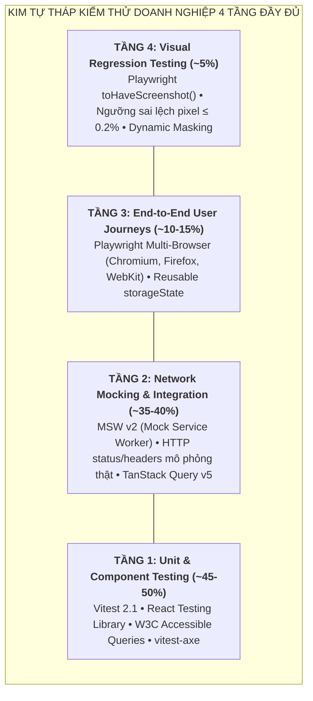
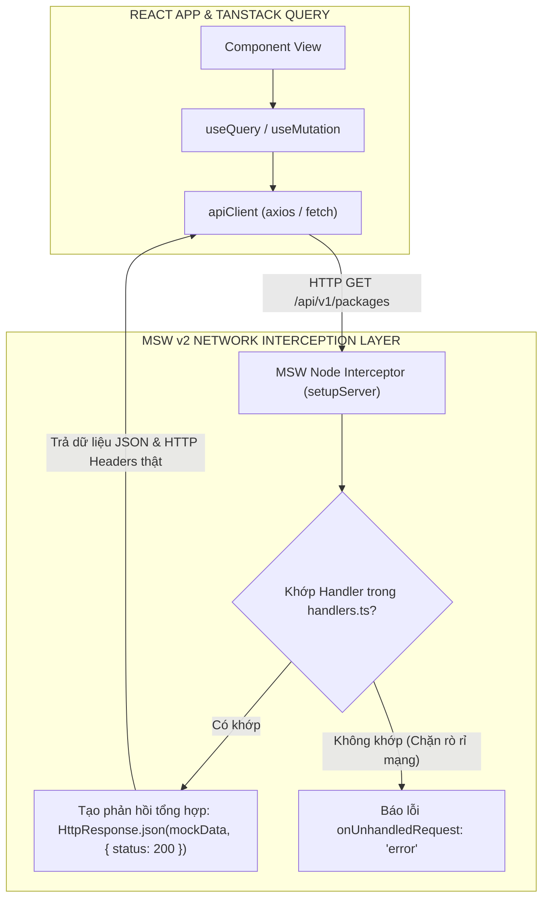
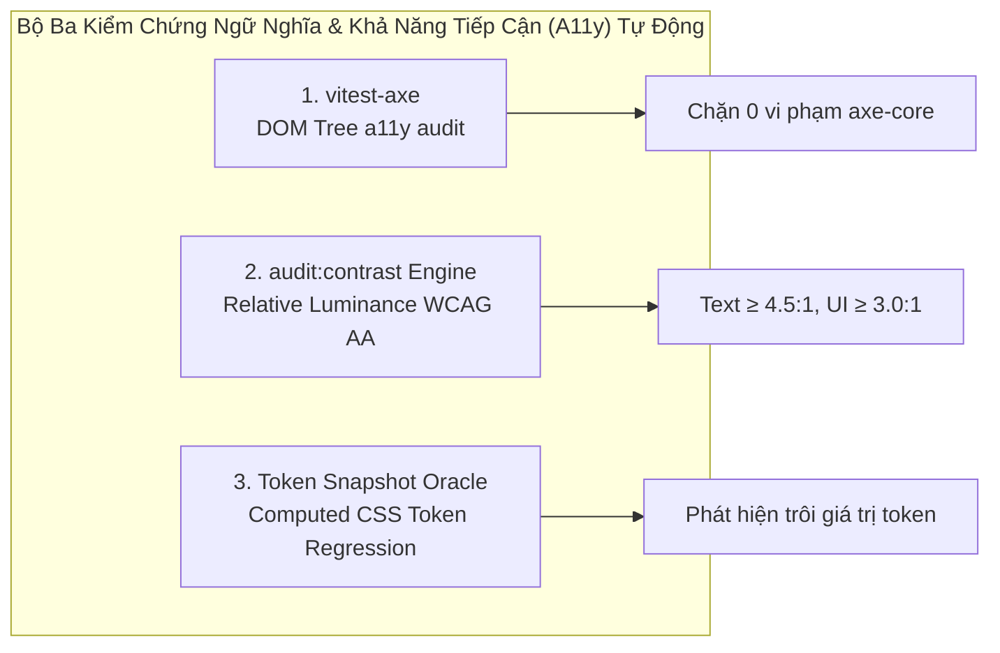

# Chuyên Đề 07: Chiến Lược Kiểm Thử 4 Tầng & Đảm Bảo Chất Lượng Doanh Nghiệp (Enterprise Testing & QA)

> **Dự án:** Khung Tiêu Chuẩn Doanh Nghiệp & RoGym Management System Profile  
> **Cổng quy chuẩn chính:** [`FRONTEND_CONVENTIONS.md`](../FRONTEND_CONVENTIONS.md) | [Bản Đồ Tài Liệu](./README.md)  
> **Tài liệu liên quan:** [`docs/01-architecture-and-structure.md`](./01-architecture-and-structure.md) | [`docs/03-coding-standards.md`](./03-coding-standards.md) | [`docs/04-component-patterns.md`](./04-component-patterns.md) | [`docs/08-semantic-design-system.md`](./08-semantic-design-system.md) | [`docs/09-accessibility.md`](./09-accessibility.md)  
> **Cơ sở tham chiếu quốc tế:**  
> - [Martin Fowler - The Practical Test Pyramid](https://martinfowler.com/articles/practical-test-pyramid.html)  
> - [Mock Service Worker (MSW) v2 Documentation & Network Interception](https://mswjs.io/docs/)  
> - [Vitest 2.x Documentation & V8 Coverage Engine](https://vitest.dev/guide/)  
> - [Playwright Multi-Browser E2E & Visual Comparisons Specification](https://playwright.dev/docs/test-snapshots)  
> - [Google Chrome Web.dev - Performance Budgets with bundlesize](https://web.dev/use-bundlesize-with-github-actions/)  
> **Phiên bản:** 8.0 (Enterprise Quality Standard — 15 Spokes & Universal Decoupling)  
> **Mô hình phối hợp (Hub-and-Spoke):** Chuyên đề này tập trung chuyên sâu vào **Kim Tự Tháp Kiểm Thử 4 Tầng (Unit/Integration, MSW v2 Network Interception, Playwright E2E, Visual Regression), Ngân Sách Kích Thước Bundle (bundlesize), Quy Chuẩn Accessible Queries W3C, Kiểm Thử Tiếp Cận Tự Động vitest-axe, và 12 Tiêu Chí PR Definition of Done**.  
> **Áp dụng cho:** Toàn bộ test suites (`*.test.ts`, `*.test.tsx`, `*.spec.ts`) trên UI Primitives (`src/components/ui/`), Shared Shells (`src/components/shared/`), Pages (`src/pages/`), Hooks, Stores và Services  
> **Trạng thái:** Bắt buộc tuân thủ 100% (Strict Mandatory Enforcement)

---

## MỤC LỤC
1. [Triết Lý Kiểm Thử Doanh Nghiệp & Mô Hình 2 Tầng](#1-triết-lý-kiểm-thử-doanh-nghiệp-mô-hình-2-tầng)
2. [Mở Rộng Kim Tự Tháp Kiểm Thử Doanh Nghiệp 4 Tầng Đầy Đủ](#2-mở-rộng-kim-tự-tháp-kiểm-thử-doanh-nghiệp-4-tầng-đầy-đủ)
   - [2.1. Tầng 1: Unit & Component Testing (Vitest 2.1 + RTL + Accessible Queries)](#21-tầng-1-unit-component-testing-vitest-21-rtl-accessible-queries)
   - [2.2. Tầng 2: Network Interception & Contract Testing (Mock Service Worker - MSW v2)](#22-tầng-2-network-interception-contract-testing-mock-service-worker---msw-v2)
   - [2.3. Tầng 3: End-to-End User Journeys (Playwright Multi-Browser & Auth State Reusability)](#23-tầng-3-end-to-end-user-journeys-playwright-multi-browser-auth-state-reusability)
   - [2.4. Tầng 4: Kiểm Thử Hồi Quy Trực Quan (Playwright Visual Regression Testing & Dynamic Masking)](#24-tầng-4-kiểm-thử-hồi-quy-trực-quan-playwright-visual-regression-testing-dynamic-masking)
   - [2.5. Cấu Hình Chuẩn Playwright Multi-Project (`playwright.config.ts`)](#25-cấu-hình-chuẩn-playwright-multi-project-playwrightconfigts)
3. [Cấu Hình Runner Vitest 2.1 & Setup Môi Trường Kiểm Thử](#3-cấu-hình-runner-vitest-21-setup-môi-trường-kiểm-thử)
4. [Thứ Tự Ưu Tiên Accessible Queries (W3C APG Standard)](#4-thứ-tự-ưu-tiên-accessible-queries-w3c-apg-standard)
   - [4.1. Bảng Ma Trận 5 Bậc Ưu Tiên Truy Vấn RTL](#41-bảng-ma-trận-5-bậc-ưu-tiên-truy-vấn-rtl)
   - [4.2. Quy Định Nghiêm Ngặt Về `getByTestId`](#42-quy-định-nghiêm-ngặt-về-getbytestid)
5. [Chiến Lược Network Mocking Chuẩn Quốc Tế Với MSW v2 & Mocking Boundaries](#5-chiến-lược-network-mocking-chuẩn-quốc-tế-với-msw-v2-mocking-boundaries)
   - [5.1. Thiết Lập MSW v2 Server & Shared Handlers (`handlers.ts`, `server.ts`, `browser.ts`)](#51-thiết-lập-msw-v2-server-shared-handlers-handlersts-serverts-browserts)
   - [5.2. Kỹ Thuật Ghi Đè Handler Cục Bộ Theo Từng Test Case (`server.use(...)`)](#52-kỹ-thuật-ghi-đè-handler-cục-bộ-theo-từng-test-case-serveruse)
   - [5.3. Chiến Lược Hybrid: Khi Nào Dùng MSW v2 vs Khi Nào Dùng `vi.spyOn`](#53-chiến-lược-hybrid-khi-nào-dùng-msw-v2-vs-khi-nào-dùng-vispyon)
   - [5.4. Global Client State — Zustand Store Reset Protocol](#54-global-client-state-zustand-store-reset-protocol)
   - [5.5. Client Navigation — MemoryRouter](#55-client-navigation-memoryrouter)
   - [5.6. External SDKs & Browser Environments (LINE LIFF, Socket.IO)](#56-external-sdks-browser-environments-line-liff-socketio)
6. [Tiêu Chuẩn Xử Lý Bất Đồng Bộ (Async Assertions) & Chống Anti-Patterns](#6-tiêu-chuẩn-xử-lý-bất-đồng-bộ-async-assertions-chống-anti-patterns)
   - [6.1. Nguyên Tắc Vàng: `findBy*` vs `waitFor`](#61-nguyên-tắc-vàng-findby-vs-waitfor)
   - [6.2. Nghiêm Cấm Gọi `act()` Thủ Công](#62-nghiêm-cấm-gọi-act-thủ-công)
   - [6.3. Ưu Tiên Tuyệt Đối `userEvent` Thay Cho `fireEvent`](#63-ưu-tiên-tuyệt-đối-userevent-thay-cho-fireevent)
   - [6.4. Quy Trình Loại Bỏ Flaky Tests (Flaky Test Quarantine Protocol & Auto-retry Rules)](#64-quy-trình-loại-bỏ-flaky-tests-flaky-test-quarantine-protocol-auto-retry-rules)
7. [Cấu Trúc Chuẩn Cho Một File Test & Pattern AAA (Case Studies)](#7-cấu-trúc-chuẩn-cho-một-file-test-pattern-aaa-case-studies)
   - [7.1. Quy Ước Định Danh Mã Test Case: `TC-[MODULE]-[INDEX]`](#71-quy-ước-định-danh-mã-test-case-tc-module-index)
   - [7.2. Case Study 1: Component & UI Primitive Test (`SubmitButton.test.tsx`)](#72-case-study-1-component-ui-primitive-test-submitbuttontesttsx)
   - [7.3. Case Study 2: Integration & Server State Test Với MSW v2 (`ActivePackagesView.test.tsx`)](#73-case-study-2-integration-server-state-test-với-msw-v2-activepackagesviewtesttsx)
   - [7.4. Case Study 3: Playwright E2E & Visual Regression Test (`checkout-flow.spec.ts`)](#74-case-study-3-playwright-e2e-visual-regression-test-checkout-flowspects)
8. [Kiểm Thử Tiếp Cận (Accessibility `vitest-axe`), Ma Trận Tương Phản & Token Snapshot Oracle](#8-kiểm-thử-tiếp-cận-accessibility-vitest-axe-ma-trận-tương-phản-token-snapshot-oracle)
   - [8.1. Kiểm thử Tự Động Tiếp Cận với `vitest-axe` (`SEM-A11Y-001..012`)](#81-kiểm-thử-tự-động-tiếp-cận-với-vitest-axe-sem-a11y-001012)
   - [8.2. Kiểm Tra Tương Phản Tự Động `audit:contrast` (`SEM-A11Y-010`)](#82-kiểm-tra-tương-phản-tự-động-auditcontrast-sem-a11y-010)
   - [8.3. Kiểm Thử Token Snapshot Oracle (`SEM-TOKEN-008`)](#83-kiểm-thử-token-snapshot-oracle-sem-token-008)
9. [Kiểm Toán Kích Thước Bundle Trong Pipeline CI (`bundlesize`)](#9-kiểm-toán-kích-thước-bundle-trong-pipeline-ci-bundlesize)
   - [9.1. Ma Trận Ngân Sách Bundle Size Chi Tiết](#91-ma-trận-ngân-sách-bundle-size-chi-tiết)
   - [9.2. Cấu Hình `bundlesize` / `size-limit` Chặn Cứng (Hard Gate) PR](#92-cấu-hình-bundlesize-size-limit-chặn-cứng-hard-gate-pr)
   - [9.3. Tích Hợp Workflow GitHub Actions Chặn Merge Khi Vượt Ngân Sách](#93-tích-hợp-workflow-github-actions-chặn-merge-khi-vượt-ngân-sách)
   - [9.4. Báo Cáo Phân Tích Chunk Visualizer Trong Pull Request](#94-báo-cáo-phân-tích-chunk-visualizer-trong-pull-request)
10. [Đo Lường Độ Phủ (Coverage) & PR Definition of Done (DoD 12 Tiêu Chí)](#10-đo-lường-độ-phủ-coverage-pr-definition-of-done-dod-12-tiêu-chí)
   - [10.1. Ngưỡng Coverage V8 Bắt Buộc & Bẫy Độ Phủ Nhánh](#101-ngưỡng-coverage-v8-bắt-buộc-bẫy-độ-phủ-nhánh)
   - [10.2. Bảng 12 Tiêu Chí Definition of Done Bắt Buộc Trước Khi Mở PR](#102-bảng-12-tiêu-chí-definition-of-done-bắt-buộc-trước-khi-mở-pr)
11. [Bảng Checklist Định Lượng 12 Điểm Tự Đánh Giá Test Suite Trước Khi Mở PR](#11-bảng-checklist-định-lượng-12-điểm-tự-đánh-giá-test-suite-trước-khi-mở-pr)
12. [Ánh Xạ Tooling Kiểm Toán CI & Static Rules](#12-ánh-xạ-tooling-kiểm-toán-ci-static-rules)

---

## 1. Triết Lý Kiểm Thử Doanh Nghiệp & Mô Hình 2 Tầng

Trong các hệ sinh thái phần mềm doanh nghiệp quy mô lớn, kiểm thử tự động không nhằm mục đích tích lũy số lượng test case hình thức hay chạy theo độ phủ phần trăm ảo. Triết lý kiểm thử cốt lõi được xây dựng trên định hướng của Kent C. Dodds & Martin Fowler:

> *"The more your tests resemble the way your software is used, the more confidence they can give you."*  
> *(Các bài kiểm thử càng mô phỏng sát cách người dùng thực tế sử dụng phần mềm, chúng càng mang lại sự tin cậy vững chắc.)*

Toàn bộ tài liệu được chuẩn hóa theo **Mô Hình 2 Tầng (2-Tier Decoupled Architecture)**:
- **Tầng 1 (Core Universal Specification):** Đặc tả kim tự tháp kiểm thử 4 tầng độc lập, giao thức mock mạng chuẩn quốc tế MSW v2, chiến lược kiểm thử E2E và Visual Regression bằng Playwright, cùng ngân sách hiệu năng tải trang `bundlesize`.
- **Tầng 2 (Project Implementation Profile - RoGym Case Study):** Trích dẫn minh chứng thực tế bằng cấu hình Vitest 2.1, mock LINE LIFF SDK, bộ đệm TanStack Query v5, Zustand stores và test suites đang hoạt động trong `src/`.

---

<a id="testing-pyramid"></a>
## 2. Mở Rộng Kim Tự Tháp Kiểm Thử Doanh Nghiệp 4 Tầng Đầy Đủ

Mô hình kiểm thử mở rộng từ mô hình 3 tầng truyền thống lên **Kim Tự Tháp 4 Tầng Toàn Diện Chuẩn Doanh Nghiệp (The 4-Tier Enterprise Testing Pyramid)**:



### 2.1. Tầng 1: Unit & Component Testing (Vitest 2.1 + RTL + Accessible Queries)
- **Tỷ trọng:** $\sim 45-50\%$ tổng số test cases.
- **Trọng tâm kỹ thuật:** Kiểm thử các hàm tiện ích thuần túy (`lib/date.ts`, `lib/subscription.ts`), Zustand reducer logic, và toàn bộ thư viện UI Primitives (`Button`, `FormField`, `Modal`, `Card`).
- **Thời gian thực thi:** Chạy trên môi trường `jsdom` siêu tốc (vài mili-giây mỗi test case).

### 2.2. Tầng 2: Network Interception & Contract Testing (Mock Service Worker - MSW v2)
- **Tỷ trọng:** $\sim 35-40\%$ tổng số test cases.
- **Trọng tâm kỹ thuật:** Chặn bắt yêu cầu HTTP ở cấp độ Network Socket hoặc Service Worker. Mô phỏng đúng các kịch bản thực tế: HTTP 200, 401 Unauthorized, 422 Unprocessable Entity, 500 Internal Error, và độ trễ mạng (latency injection).
- **Lợi ích vượt trội:** Dùng chung mock handlers duy nhất cho cả Vitest, Storybook và môi trường phát triển cục bộ (Local Dev).

### 2.3. Tầng 3: End-to-End User Journeys (Playwright Multi-Browser & Auth State Reusability)
- **Tỷ trọng:** $\sim 10-15\%$ tổng số test cases.
- **Trọng tâm kỹ thuật:** Khởi chạy trình duyệt thật (Real Browser) để kiểm thử toàn bộ hành trình người dùng xuyên suốt: Đăng nhập hội viên $\rightarrow$ Xem lịch tập $\rightarrow$ Chọn huấn luyện viên $\rightarrow$ Thanh toán VNPAY/MoMo thành công.
- **Chạy đa nền tảng:** Bắt buộc chạy song song trên 3 trình duyệt hàng đầu: Chromium, Firefox và WebKit (Safari engine).
- **Tái sử dụng phiên:** Sử dụng `storageState` lưu trữ JWT và cookies vào `.auth/user.json` để loại bỏ việc lặp lại màn hình đăng nhập ở mỗi kịch bản test.

### 2.4. Tầng 4: Kiểm Thử Hồi Quy Trực Quan (Playwright Visual Regression Testing & Dynamic Masking)
- **Tỷ trọng:** $\sim 5\%$ các màn hình giao diện then chốt.
- **Trọng tâm kỹ thuật:** Chụp ảnh màn hình tự động và so sánh từng pixel với ảnh chuẩn (Golden Snapshot) qua lệnh `expect(page).toHaveScreenshot()`.
- **Ngưỡng dung sai:** Thiết lập `maxDiffPixelRatio: 0.002` (chấp nhận sai lệch tối đa 0.2% pixel do khác biệt GPU font anti-aliasing).
- **Kỹ thuật Dynamic Data Masking:** Bắt buộc che mờ (mask) các vùng dữ liệu thay đổi theo thời gian thực (đồng hồ, avatar người dùng, animated loading spinners) để loại bỏ hoàn toàn flaky test.

### 2.5. Cấu Hình Chuẩn Playwright Multi-Project (`playwright.config.ts`)

File cấu hình Playwright chuẩn doanh nghiệp hỗ trợ kiểm thử đa trình duyệt và visual regression:

```typescript
// playwright.config.ts
import { defineConfig, devices } from '@playwright/test'

export default defineConfig({
  testDir: './e2e',
  fullyParallel: true,
  forbidOnly: !!process.env.CI,
  retries: process.env.CI ? 2 : 0,
  workers: process.env.CI ? 2 : undefined,
  reporter: [
    ['html', { outputFolder: 'playwright-report' }],
    ['list'],
    ['json', { outputFile: 'playwright-results.json' }],
  ],
  use: {
    baseURL: process.env.PLAYWRIGHT_BASE_URL || 'http://localhost:5173',
    trace: 'on-first-retry',
    screenshot: 'only-on-failure',
    video: 'retain-on-failure',
  },
  projects: [
    // 1. Setup Project tạo Authentication State
    {
      name: 'setup-auth',
      testMatch: /.*\.setup\.ts/,
    },

    // 2. Desktop Chromium
    {
      name: 'chromium',
      use: { ...devices['Desktop Chrome'] },
      dependencies: ['setup-auth'],
    },

    // 3. Desktop Firefox
    {
      name: 'firefox',
      use: { ...devices['Desktop Firefox'] },
      dependencies: ['setup-auth'],
    },

    // 4. Desktop WebKit (Safari)
    {
      name: 'webkit',
      use: { ...devices['Desktop Safari'] },
      dependencies: ['setup-auth'],
    },

    // 5. Mobile Viewport (LINE LIFF standard 375px)
    {
      name: 'mobile-iphone-se',
      use: { ...devices['iPhone SE'] },
      dependencies: ['setup-auth'],
    },
  ],
})
```

---

## 3. Cấu Hình Runner Vitest 2.1 & Setup Môi Trường Kiểm Thử

Dự án RoGym sử dụng runner **Vitest 2.1** tích hợp sẵn bộ giả lập trình duyệt `jsdom 25.0` và plugin `@vitejs/plugin-react`. Cấu hình được tập trung tại [`client/vitest.config.ts`](../vitest.config.ts):

```typescript
// Trích xuất cấu hình chuẩn từ client/vitest.config.ts
import { defineConfig } from 'vitest/config'
import react from '@vitejs/plugin-react'
import path from 'node:path'

export default defineConfig({
  plugins: [react()],
  resolve: {
    alias: {
      '@': path.resolve(__dirname, './src'),
    },
  },
  test: {
    environment: 'jsdom',
    setupFiles: ['./src/test/setup.ts'],
    coverage: {
      provider: 'v8',
      reporter: ['text', 'json-summary', 'lcov'],
      reportsDirectory: './coverage',
      thresholds: {
        statements: 90,
        branches: 85,
        functions: 90,
        lines: 90,
      },
    },
  },
})
```

### Setup Toàn Cục Tại [`src/test/setup.ts`](../src/test/setup.ts)
Tệp setup chạy tự động trước mỗi test suite, đảm bảo môi trường kiểm thử luôn sạch sẽ và sẵn sàng matchers:

```typescript
// Trích xuất từ src/test/setup.ts
import '@testing-library/jest-dom/vitest'
import { cleanup } from '@testing-library/react'
import { afterEach } from 'vitest'
import '@/lib/i18n'

afterEach(() => {
  cleanup() // Tự động unmount DOM tree sau mỗi test case
})
```

---

## 4. Thứ Tự Ưu Tiên Accessible Queries (W3C APG Standard)

### 4.1. Bảng Ma Trận 5 Bậc Ưu Tiên Truy Vấn RTL

Để kiểm thử sát với người dùng thực tế và hỗ trợ tốt cho Screen Readers, React Testing Library định nghĩa thứ tự ưu tiên truy vấn phần tử (Query Priority). Lập trình viên bắt buộc tuân thủ thứ tự sau:

| Bậc Ưu Tiên | Phương Thức Truy Vấn | Ý Nghĩa Khả Năng Tiếp Cận & Khuyến Nghị | Ví Dụ Minh Họa Chuẩn Mực |
| :---: | :--- | :--- | :--- |
| **BẬC 1 (Ưu tiên cao nhất)** | `getByRole`<br>`findByRole` | **Luôn là lựa chọn số 1**. Tìm phần tử qua vai trò ngữ nghĩa (ARIA role) trong Accessibility Tree kết hợp với Accessible Name (`name: /.../i`). | `screen.getByRole('button', { name: /đăng ký/i })`<br>`screen.getByRole('heading', { level: 2, name: /danh sách/i })`<br>`screen.getByRole('alert')` (thông báo lỗi) |
| **BẬC 2** | `getByLabelText`<br>`findByLabelText` | **Bắt buộc cho Form controls**. Đảm bảo trường nhập liệu (`Input`, `Select`, `Textarea`) được liên kết chặt chẽ với `<label htmlFor="...">`. | `screen.getByLabelText(/họ và tên/i)`<br>`screen.getByLabelText(/số điện thoại/i)` |
| **BẬC 3** | `getByPlaceholderText` | Chỉ sử dụng khi input không có nhãn hiển thị trực tiếp (search bar đơn giản) hoặc để kiểm tra text gợi ý. | `screen.getByPlaceholderText(/nhập từ khóa tìm kiếm/i)` |
| **BẬC 4** | `getByText`<br>`findByText` | Sử dụng cho nội dung văn bản tĩnh không có role tương tác (đoạn mô tả `<p>`, nội dung thông báo thành công). | `screen.getByText(/giao dịch đã được ghi nhận/i)` |
| **BẬC 5** | `getByDisplayValue` | Kiểm tra giá trị hiện tại của ô nhập liệu sau khi người dùng gõ phím. | `screen.getByDisplayValue('0912345678')` |

### 4.2. Quy Định Nghiêm Ngặt Về `getByTestId`

> [!CAUTION]
> **Cấm lạm dụng `getByTestId`:**  
> - **Nguyên tắc**: Người dùng không nhìn thấy `data-testid`, họ chỉ nhìn thấy nhãn, nút bấm và nội dung văn bản. Việc lạm dụng `data-testid` sẽ tạo ra các bài kiểm thử "mù quáng" trước các lỗi về khả năng tiếp cận (Accessibility Bugs).  
> - **Ngoại lệ duy nhất (99% cấm)**: Chỉ được phép dùng `getByTestId` cho các phần tử đồ họa đặc thù không có vai trò ngữ nghĩa tự nhiên trong Accessibility Tree, bao gồm:
>   - Đồ thị Recharts container (`<ResponsiveContainer data-testid="attendance-chart" />`).
>   - Phần tử HTML5 `<canvas>` vẽ biểu đồ thể lực.
>   - Khung quét camera QR Code của thư viện `@zxing/browser`.  
> - **Bắt buộc có chú thích ngoại lệ**: Nếu buộc phải dùng `getByTestId`, lập trình viên phải ghi chú rõ ràng lý do trong test code:  
>   `// exception: Recharts SVG container không hỗ trợ native ARIA role`  
>   `expect(screen.getByTestId('attendance-chart')).toBeInTheDocument()`

---

## 5. Chiến Lược Network Mocking Chuẩn Quốc Tế Với MSW v2 & Mocking Boundaries

Mô hình can thiệp mạng của **Mock Service Worker v2 (MSW v2)** tạo ra một lớp mạng ảo chặn các request HTTP/HTTPS ngay tại ranh giới kết nối của trình duyệt/Node.js, giúp React Query hoạt động đúng 100% như trên môi trường thật:



### 5.1. Thiết Lập MSW v2 Server & Shared Handlers (`handlers.ts`, `server.ts`, `browser.ts`)

Khởi tạo service worker trong thư mục `public/`:
```bash
npx msw init public/ --save
```

#### 1. Định nghĩa các handlers dùng chung trong `src/test/mocks/handlers.ts`:
```typescript
import { http, HttpResponse } from 'msw'

export const handlers = [
  // Mock API danh sách gói tập
  http.get('*/api/v1/packages', () => {
    return HttpResponse.json({
      data: [
        {
          packageId: 'pkg-1',
          packageCode: 'VIP1M',
          name: 'Gói VIP 1 Tháng',
          price: '600000',
          durationDays: 30,
          status: 'active',
        },
      ],
      meta: { page: 1, pageSize: 10, total: 1 },
    })
  }),

  // Mock API thông tin hội viên
  http.get('*/api/v1/members/me', () => {
    return HttpResponse.json({
      memberId: 'mem-101',
      fullName: 'Lê Thành An',
      tier: 'Gold',
      status: 'active',
    })
  }),
]
```

#### 2. Khởi tạo server Node.js cho Vitest trong `src/test/mocks/server.ts`:
```typescript
import { setupServer } from 'msw/node'
import { handlers } from './handlers'

export const server = setupServer(...handlers)
```

#### 3. Khởi tạo Service Worker phía Client cho Storybook & Local Dev trong `src/test/mocks/browser.ts`:
```typescript
import { setupWorker } from 'msw/browser'
import { handlers } from './handlers'

export const worker = setupWorker(...handlers)
```

#### 4. Tích hợp server vào vòng đời kiểm thử tại `src/test/setup.ts`:
```typescript
import { beforeAll, afterEach, afterAll } from 'vitest'
import { server } from './mocks/server'

// 1. Khởi động server MSW trước khi chạy toàn bộ suites
beforeAll(() => server.listen({ onUnhandledRequest: 'error' }))

// 2. Reset toàn bộ handler overrides sau mỗi test case
afterEach(() => server.resetHandlers())

// 3. Đóng server khi kết thúc test suites
afterAll(() => server.close())
```

### 5.2. Kỹ Thuật Ghi Đè Handler Cục Bộ Theo Từng Test Case (`server.use(...)`)

Khi một test case cần kiểm tra kịch bản lỗi mạng hoặc trạng thái biên đặc thù (HTTP 404, 500, Token hết hạn), sử dụng `server.use(...)` để ghi đè tạm thời:

```typescript
it('TC-PKG-03: hiển thị thông báo lỗi 500 khi server gặp sự cố', async () => {
  // Ghi đè handler chỉ cho riêng bài test này
  server.use(
    http.get('*/api/v1/packages', () => {
      return new HttpResponse(null, { status: 500, statusText: 'Internal Server Error' })
    })
  )

  const queryClient = createTestQueryClient()
  renderWithQueryClient(<ActivePackagesView />, { queryClient })

  const errorAlert = await screen.findByRole('alert')
  expect(errorAlert).toHaveTextContent(/không thể tải danh sách/i)
})
```

### 5.3. Chiến Lược Hybrid: Khi Nào Dùng MSW v2 vs Khi Nào Dùng `vi.spyOn`

| Tiêu Chí So Sánh | Mock Service Worker v2 (MSW v2) | `vi.spyOn(service, 'method')` |
| :--- | :--- | :--- |
| **Vị trí can thiệp** | Tầng Network Socket / Service Worker | Tầng JavaScript Method call |
| **Phạm vi tái sử dụng** | Dùng chung cho Vitest, Storybook và Local Dev | Chỉ dùng trong test file cục bộ của Vitest |
| **Độ chân thực mạng** | Rất cao (mô phỏng đúng HTTP status, headers, stream) | Trung bình (chỉ trả về resolved Promise) |
| **Trường hợp khuyên dùng** | **Integration tests, luồng TanStack Query, E2E** | **Unit tests nhỏ lẻ trên component UI đơn lập** |

### 5.4. Global Client State — Zustand Store Reset Protocol
Tuyệt đối **KHÔNG** mock module `zustand`. Sử dụng store thật và reset trạng thái trong hook `beforeEach` để chống rò rỉ dữ liệu (state leak) giữa các bài test:

```typescript
// ✅ DO: Reset Zustand store thật trong beforeEach
import { beforeEach, vi } from 'vitest'
import { useAuthStore } from '@/stores/authStore'
import { useSubscriptionStore } from '@/stores/subscriptionStore'

beforeEach(() => {
  useAuthStore.getState().clearAuth()
  useSubscriptionStore.getState().clearSubscription()
  vi.clearAllMocks()
})
```

### 5.5. Client Navigation — MemoryRouter
Khi component chứa liên kết nội bộ (`ButtonLink`, `BreadcrumbLink`, `useNavigate`), bọc component bằng `<MemoryRouter>` để kiểm soát lịch sử duyệt web:

```tsx
// ✅ DO: Bọc component với MemoryRouter
import { MemoryRouter } from 'react-router-dom'
import { render } from '@testing-library/react'
import { Topbar } from '@/components/shared/topbar/Topbar'

render(
  <MemoryRouter initialEntries={['/member/dashboard']}>
    <Topbar />
  </MemoryRouter>
)
```

### 5.6. External SDKs & Browser Environments (LINE LIFF, Socket.IO)
- **LINE LIFF SDK**: Sử dụng `@line/liff-mock` hoặc mock các phương thức cốt lõi:
  ```typescript
  vi.mock('@line/liff', () => ({
    default: {
      init: vi.fn().mockResolvedValue(undefined),
      isLoggedIn: vi.fn().mockReturnValue(true),
      getProfile: vi.fn().mockResolvedValue({ userId: 'line-usr-1', displayName: 'Hội Viên' }),
    },
  }))
  ```
- **Socket.IO Realtime**: Mock `socket.io-client` để tránh kết nối WebSocket thật khi chạy unit test.

### 5.7. Giả Lập View Transitions & Kiểm Thử Cảm Ứng Di Động
- **Mock View Transition API trong Vitest (`src/test/setup.ts`):** Môi trường `jsdom` mặc định chưa có `document.startViewTransition`. Thiết lập mock an toàn để các bài test component không bị crash:
  ```typescript
  if (typeof document !== 'undefined') {
    document.startViewTransition = vi.fn().mockImplementation((cb: () => void | Promise<void>) => {
      const promise = Promise.resolve(cb())
      return {
        finished: promise,
        ready: promise,
        updateCallbackDone: promise,
        skipTransition: vi.fn(),
      }
    })
  }
  ```
- **Kiểm thử tự động Touch Target ($\ge 44\text{px}$) & a11y với `vitest-axe`:**
  ```tsx
  it('nút tương tác di động đạt chuẩn công thái học ngón cái >= 44px', () => {
    render(<Button size="compact">Xác Nhận</Button>)
    const button = screen.getByRole('button', { name: /xác nhận/i })
    expect(button).toHaveClass('min-h-[44px]')
  })
  ```

---

## 6. Tiêu Chuẩn Xử Lý Bất Đồng Bộ (Async Assertions) & Chống Anti-Patterns

### 6.1. Nguyên Tắc Vàng: `findBy*` vs `waitFor`

1. **Ưu tiên tuyệt đối `await screen.findByRole(...)`**:
   - Tích hợp sẵn cơ chế retry ngầm định (mặc định thử lại trong 1000ms).
   - Ngắn gọn, tường minh và báo lỗi rõ ràng nếu phần tử không xuất hiện kịp thời.
2. **Chỉ sử dụng `waitFor()` khi thực sự cần thiết**:
   - Khi cần kiểm tra hành vi không gắn liền với phần tử DOM (ví dụ: xác nhận spy method đã được gọi, hoặc xác nhận router đã redirect).
   - **CẤM**: Cấm viết callback rỗng trong `waitFor(() => {})` hoặc lồng `waitFor` bên trong một `waitFor` khác.

```tsx
// ❌ DON'T: Dùng waitFor bọc getByRole một cách dài dòng và dễ lỗi
await waitFor(() => {
  expect(screen.getByRole('heading', { name: /danh sách gói tập/i })).toBeInTheDocument()
})

// ✅ DO: Sử dụng trực tiếp findByRole chuẩn mực
const heading = await screen.findByRole('heading', { name: /danh sách gói tập/i })
expect(heading).toBeInTheDocument()
```

### 6.2. Nghiêm Cấm Gọi `act()` Thủ Công

> [!IMPORTANT]
> **Quy định về React `act()`:**  
> - Trong phiên bản React 18 và React Testing Library hiện đại, các thao tác của `@testing-library/user-event` và các truy vấn `findBy*` **đã tự động được bọc bên trong `act()`**.  
> - **CẤM TUYỆT ĐỐI** việc gọi thủ công `act(() => { ... })` trong mã nguồn kiểm thử. Nếu gặp cảnh báo *"An update to Component inside a test was not wrapped in act(...)"*, nguyên nhân 100% là do test case kết thúc trước khi Promise bất đồng bộ của component giải quyết xong.  
> - **Cách khắc phục chuẩn**: Chờ đợi kết quả bất đồng bộ bằng `await screen.findBy*` hoặc `await waitFor(...)` thay vì bọc `act()` thủ công để che giấu cảnh báo.

### 6.3. Ưu Tiên Tuyệt Đối `userEvent` Thay Cho `fireEvent`
- `fireEvent.click()` chỉ kích hoạt sự kiện DOM giả lập, bỏ qua chuỗi sự kiện thực tế (`pointerdown`, `focus`, `click`).
- `@testing-library/user-event` mô phỏng 100% hành vi người dùng thật, tự động kích hoạt đầy đủ chuỗi sự kiện và kiểm tra trạng thái disabled:

```typescript
// ❌ DON'T: Dùng fireEvent cũ kỹ
fireEvent.change(input, { target: { value: 'Nguyễn Văn A' } })
fireEvent.click(button)

// ✅ DO: Dùng userEvent setup chuẩn mực
const user = userEvent.setup()
await user.type(input, 'Nguyễn Văn A')
await user.click(button)
```

### 6.4. Quy Trình Loại Bỏ Flaky Tests (Flaky Test Quarantine Protocol & Auto-retry Rules)

Flaky tests (các bài kiểm thử lúc đỗ lúc trượt mà không thay đổi code) là "kẻ hủy diệt" niềm tin lớn nhất đối với hệ thống CI/CD. Đội ngũ kỹ sư bắt buộc tuân thủ quy chuẩn phòng chống:

#### 1. Bốn Nguyên Nhân Gốc Rễ Của Flaky Tests:
- **Chênh lệch thời gian (Timing & Clocks):** Sử dụng `setTimeout` cứng thay vì `findByRole` hoặc vi.useFakeTimers.
- **Rò rỉ trạng thái (State Pollution):** Không reset Zustand stores hoặc QueryClient cache giữa các bài test.
- **Dữ liệu ngẫu nhiên (Non-deterministic IDs):** Sinh `Math.random()` hoặc `Date.now()` trong mock data mà không cố định seed.
- **Animation Transitions:** Kiểm thử chụp ảnh visual khi hiệu ứng CSS fade-in chưa kết thúc.

#### 2. Quy Trình Cách Ly Flaky Test (Quarantine Protocol):
- Khi một test case bị phát hiện flaky trên CI quá 2 lần trong 1 tuần:
  1. Gắn thẻ `.skip` hoặc đổi tên tag `@quarantine` để không làm chặn pipeline chính.
  2. Tạo ngay một Issue Jira/GitHub P1 yêu cầu điều tra nguyên nhân gốc rễ.
  3. Thời hạn xử lý dứt điểm (SLA) tối đa **48 giờ**; không được phép để test case nằm trong diện cách ly quá 5 ngày làm việc.

---

## 7. Cấu Trúc Chuẩn Cho Một File Test & Pattern AAA (Case Studies)

### 7.1. Quy Ước Định Danh Mã Test Case: `TC-[MODULE]-[INDEX]`
Mọi bài test phải có mã định danh duy nhất để dễ theo dõi trong báo cáo CI/CD và tài liệu QA:
- `TC-BTN-01`: Test case cho component Button.
- `TC-FORM-02`: Test case cho component Form.
- `TC-AUTH-03`: Test case cho authStore.
- `TC-PKG-VIEW-01`: Test case cho ActivePackagesView.

### 7.2. Case Study 1: Component & UI Primitive Test (`SubmitButton.test.tsx`)

```tsx
// src/components/ui/SubmitButton.test.tsx
import { describe, expect, it, vi } from 'vitest'
import { render, screen } from '@testing-library/react'
import userEvent from '@testing-library/user-event'
import { SubmitButton } from './SubmitButton'

describe('SubmitButton Primitive Component', () => {
  it('TC-SUBMIT-BTN-01: renders default button with accessible submit name', () => {
    // 1. Arrange & Render
    render(<SubmitButton>Lưu Thay Đổi</SubmitButton>)

    // 2. Assert bằng Accessible Query
    const button = screen.getByRole('button', { name: /lưu thay đổi/i })
    expect(button).toBeInTheDocument()
    expect(button).toHaveAttribute('type', 'submit')
    expect(button).not.toBeDisabled()
  })

  it('TC-SUBMIT-BTN-02: disables button and displays loading spinner when loading is true', () => {
    // 1. Arrange & Render
    render(<SubmitButton loading={true}>Đang Xử Lý...</SubmitButton>)

    // 2. Assert
    const button = screen.getByRole('button', { name: /đang xử lý/i })
    expect(button).toBeDisabled()
    expect(button).toHaveAttribute('aria-busy', 'true')
  })

  it('TC-SUBMIT-BTN-03: prevents onClick execution when button is in loading state', async () => {
    // 1. Arrange
    const user = userEvent.setup()
    const handleClick = vi.fn()
    render(
      <SubmitButton loading={true} onClick={handleClick}>
        Xác Nhận
      </SubmitButton>
    )

    // 2. Act
    const button = screen.getByRole('button', { name: /xác nhận/i })
    await user.click(button)

    // 3. Assert
    expect(handleClick).not.toHaveBeenCalled()
  })
})
```

### 7.3. Case Study 2: Integration & Server State Test Với MSW v2 (`ActivePackagesView.test.tsx`)

```tsx
// src/pages/member/subscription/ActivePackagesView.test.tsx
import { describe, expect, it, vi } from 'vitest'
import { screen } from '@testing-library/react'
import userEvent from '@testing-library/user-event'
import { renderWithQueryClient, createTestQueryClient } from '@/test/query-test-utils'
import { ActivePackagesView } from './ActivePackagesView'
import { server } from '@/test/mocks/server'
import { http, HttpResponse } from 'msw'

describe('ActivePackagesView Integration Flow with MSW v2', () => {
  it('TC-PKG-VIEW-01: tải và hiển thị danh sách gói tập từ MSW v2', async () => {
    const handleSelect = vi.fn()
    const queryClient = createTestQueryClient()

    renderWithQueryClient(<ActivePackagesView onSelect={handleSelect} />, { queryClient })

    // Kiểm tra trạng thái tải
    expect(screen.getByRole('status')).toHaveTextContent(/đang tải danh sách/i)

    // Chờ MSW v2 trả kết quả qua accessible heading
    const heading = await screen.findByRole('heading', { level: 2, name: /gói tập đang hoạt động/i })
    expect(heading).toBeInTheDocument()

    // Kiểm tra tương tác người dùng
    const user = userEvent.setup()
    const chooseButton = screen.getByRole('button', { name: /chọn gói vip/i })
    await user.click(chooseButton)

    expect(handleSelect).toHaveBeenCalledWith('pkg-1')
  })

  it('TC-PKG-VIEW-02: hiển thị thông báo lỗi khi API trả mã lỗi 500', async () => {
    server.use(
      http.get('*/api/v1/packages', () => {
        return new HttpResponse(null, { status: 500 })
      })
    )

    const queryClient = createTestQueryClient()
    renderWithQueryClient(<ActivePackagesView onSelect={vi.fn()} />, { queryClient })

    const errorAlert = await screen.findByRole('alert')
    expect(errorAlert).toHaveTextContent(/không thể tải danh sách/i)
  })
})
```

### 7.4. Case Study 3: Playwright E2E & Visual Regression Test (`checkout-flow.spec.ts`)

```typescript
// e2e/checkout-flow.spec.ts
import { test, expect } from '@playwright/test'

test.describe('E2E & Visual Regression: Hội Viên Đăng Ký Gói Tập', () => {
  // Tái sử dụng trạng thái đăng nhập đã lưu trong .auth/user.json
  test.use({ storageState: 'playwright/.auth/user.json' })

  test('TC-E2E-CHECKOUT-01: hoàn thành luồng chọn gói và kiểm tra Visual Regression', async ({ page }) => {
    // 1. Điều hướng tới trang đăng ký gói tập
    await page.goto('/member/subscription')
    await expect(page.getByRole('heading', { level: 1, name: /đăng ký gói tập/i })).toBeVisible()

    // 2. Kiểm thử hồi quy trực quan màn hình bảng giá (Visual Regression Testing)
    await expect(page).toHaveScreenshot('subscription-pricing-grid.png', {
      maxDiffPixelRatio: 0.002, // Ngưỡng sai lệch pixel tối đa 0.2%
      mask: [page.locator('[data-testid="live-timer"]'), page.locator('.avatar-image')], // Che mờ dữ liệu động
      animations: 'disabled',
    })

    // 3. Thao tác người dùng
    await page.getByRole('button', { name: /chọn gói vip 1 tháng/i }).click()

    // 4. Kiểm tra modal xác nhận thanh toán xuất hiện
    const modal = page.getByRole('dialog', { name: /xác nhận thanh toán/i })
    await expect(modal).toBeVisible()

    // Chụp snapshot visual của riêng modal thanh toán
    await expect(modal).toHaveScreenshot('checkout-confirmation-modal.png', {
      maxDiffPixelRatio: 0.002,
    })

    // 5. Xác nhận thanh toán
    await modal.getByRole('button', { name: /thanh toán ngay/i }).click()

    // 6. Kiểm chứng màn hình thành công
    await expect(page.getByRole('heading', { name: /giao dịch thành công/i })).toBeVisible()
  })
})
```

---

## 8. Kiểm Thử Tiếp Cận (Accessibility `vitest-axe`), Ma Trận Tương Phản & Token Snapshot Oracle

Để đảm bảo các quy chuẩn Semantic Design System và Khả năng tiếp cận WCAG 2.1 AA được kiểm chứng tự động liên tục, RoGym tích hợp 3 cơ chế kiểm thử chuyên biệt:



### 8.1. Kiểm thử Tự Động Tiếp Cận với `vitest-axe` (`SEM-A11Y-001..012`)
Mọi UI Primitive và Page Layout cốt lõi bắt buộc phải có test case chạy qua `vitest-axe` để khẳng định cây DOM không vi phạm bất kỳ tiêu chuẩn WCAG nào:

```tsx
// src/components/ui/FormField.test.tsx
import { render } from '@testing-library/react'
import { axe } from 'vitest-axe'
import * as matchers from 'vitest-axe/matchers'
import { FormField } from './FormField'
import { Input } from './Input'

expect.extend(matchers)

describe('FormField Accessibility', () => {
  it('TC-A11Y-FORM-01: renders without axe accessibility violations', async () => {
    const { container } = render(
      <FormField label="Email hội viên" required error="Email không hợp lệ">
        <Input type="email" placeholder="member@rogym.vn" />
      </FormField>
    )

    const results = await axe(container)
    expect(results).toHaveNoViolations()
  })
})
```

### 8.2. Kiểm Tra Tương Phản Tự Động `audit:contrast` (`SEM-A11Y-010`)
Độ tương phản màu sắc không phụ thuộc vào cảm tính. Hệ thống sử dụng engine tính toán Relative Luminance theo công thức chuẩn W3C để kiểm tra tự động ma trận các cặp màu văn bản và nền (`contrast-pairs.json`):

- **Text thường (< 18pt hoặc < 14pt bold)**: Tỷ lệ tương phản tối thiểu $\ge 4.5:1$.
- **Text lớn (≥ 18pt hoặc ≥ 14pt bold) & UI Primitives**: Tỷ lệ tương phản tối thiểu $\ge 3.0:1$.
- **Kiểm tra song song cả hai theme**: Bắt buộc đạt chuẩn trên cả Dark Mode (`:root`) và Light Mode (`[data-theme=light]`).

```bash
# Lệnh kiểm tra tương phản tự động toàn bộ ma trận tokens
npm run audit:contrast
```

### 8.3. Kiểm Thử Token Snapshot Oracle (`SEM-TOKEN-008`)
Để ngăn chặn việc vô tình thay đổi giá trị biến CSS, phá vỡ fallback hoặc làm trôi computed value trong quá trình tái cấu trúc, bộ kiểm thử snapshot computed style (`token-computed-snapshot.test.ts`) đóng vai trò là "Thầy Bói Tiên Tri" (Oracle) ghi nhận chính xác 100% computed values:

```bash
# Lệnh chạy kiểm thử snapshot oracle cho token hệ thống
npm test -- src/styles/__tests__/token-computed-snapshot.test.ts --run
```

---

## 9. Kiểm Toán Kích Thước Bundle Trong Pipeline CI (`bundlesize`)

### 9.1. Ma Trận Ngân Sách Bundle Size Chi Tiết

Hiệu năng tải trang ban đầu (First Load Performance) liên quan trực tiếp đến Core Web Vitals (LCP, FID/INP). Hệ thống thiết lập ma trận ngân sách kích thước file (gzipped) bắt buộc:

| Loại Bundle / Chunk | Giới Hạn Tối Đa (Gzip) | Thành Phần Bao Gồm | Biện Pháp Tối Ưu Hóa Khi Vượt Ngưỡng |
| :--- | :---: | :--- | :--- |
| **Initial Vendor Chunk** | $\le 120\text{KB}$ | React, React DOM, TanStack Query, Zustand | Áp dụng tree-shaking, loại bỏ thư viện tính ngày cồng kềnh (Moment.js $\rightarrow$ date-fns/native Intl). |
| **Initial App Shell** | $\le 60\text{KB}$ | Shell navigation, CSS reset, layout container, font styles | Tách code dynamic imports qua `React.lazy`, xóa bỏ unused CSS. |
| **Tổng Initial Bundle** | $\le 180\text{KB}$ | Vendor + App Shell tải về tại màn hình đầu tiên | Ngưỡng chặn cứng (Hard Gate) tại CI pipeline. |
| **Dynamic Page Route** | $\le 45\text{KB}$ | Mã nguồn mỗi trang sau khi code-splitting | Tách các modal lớn hoặc thư viện biểu đồ Recharts ra khỏi page chunk. |
| **Thư Viện Biểu Đồ (Recharts)** | $\le 80\text{KB}$ | Trì hoãn tải (Deferred load) chỉ khi vào trang Báo Cáo | Đóng gói thành async chunk riêng biệt: `const Analytics = lazy(...)`. |

### 9.2. Cấu Hình `bundlesize` / `size-limit` Chặn Cứng (Hard Gate) PR

Cấu hình trong `package.json` hoặc `.bundlesizerc.json`:

```json
{
  "files": [
    {
      "path": "./dist/assets/vendor-*.js",
      "maxSize": "120 kB",
      "compression": "gzip"
    },
    {
      "path": "./dist/assets/index-*.js",
      "maxSize": "60 kB",
      "compression": "gzip"
    },
    {
      "path": "./dist/assets/index-*.css",
      "maxSize": "25 kB",
      "compression": "gzip"
    },
    {
      "path": "./dist/assets/page-*.js",
      "maxSize": "45 kB",
      "compression": "gzip"
    }
  ]
}
```

### 9.3. Tích Hợp Workflow GitHub Actions Chặn Merge Khi Vượt Ngân Sách

Tích hợp tự động vào quy trình kiểm thử liên tục trong `.github/workflows/ci.yml`:

```yaml
name: CI Quality Gatekeeper

on:
  pull_request:
    branches: [main, develop]

jobs:
  bundle-budget:
    name: Bundle Size Performance Gate
    runs-on: ubuntu-latest
    steps:
      - uses: actions/checkout@v4
      - uses: actions/setup-node@v4
        with:
          node-version: 20
          cache: 'npm'

      - name: Install Dependencies
        run: npm --prefix client ci

      - name: Build Production Assets
        run: npm --prefix client run build

      - name: Verify Bundle Size Limits
        run: npx bundlesize
```

Nếu một PR thêm một dependency nặng làm kích thước vendor vượt quá $120\text{KB}$, bước `bundlesize` sẽ thất bại với Exit Code 1 và chặn ngay lập tức quyền merge PR.

### 9.4. Báo Cáo Phân Tích Chunk Visualizer Trong Pull Request
Tích hợp `@rollup/plugin-visualizer` trong `vite.config.ts`:

```typescript
// vite.config.ts
import { visualizer } from 'rollup-plugin-visualizer'

export default defineConfig({
  plugins: [
    visualizer({
      filename: 'dist/stats.html',
      gzipSize: true,
      brotliSize: true,
      open: false,
    }),
  ],
})
```

Tệp `dist/stats.html` giúp kỹ sư trưởng soi rõ cây phụ thuộc kích thước module để kịp thời phát hiện các thư viện bị import trùng lặp hoặc chưa tree-shake.

---

## 10. Đo Lường Độ Phủ (Coverage) & PR Definition of Done (DoD 12 Tiêu Chí)

### 10.1. Ngưỡng Coverage V8 Bắt Buộc & Bẫy Độ Phủ Nhánh

Trong [`client/vitest.config.ts`](../vitest.config.ts), quy chuẩn bắt buộc đo lường kiểm thử qua V8 Coverage Engine với các ngưỡng tối thiểu sau đối với mã nguồn nghiệp vụ cốt lõi:

- **Statements (Độ phủ câu lệnh)**: $\ge 90\%$
- **Branches (Độ phủ nhánh điều kiện rẽ nhánh `if/else`, switch, ternary, nullish coalescing `??`, optional chaining `?.`)**: $\ge 85\%$
- **Functions (Độ phủ hàm và closures)**: $\ge 90\%$
- **Lines (Độ phủ dòng code)**: $\ge 90\%$

> [!WARNING]
> **Cạm Bẫy Độ Phủ Nhánh (Branch Coverage Pitfall):** V8 Coverage Engine tính toán mỗi toán tử `?.` hoặc `??` là một nhánh rẽ độc lập. Nếu viết `user?.profile?.avatar` mà không kiểm thử trường hợp `user = undefined` hoặc `profile = undefined`, chỉ số Branches sẽ tụt xuống dưới 85% và làm fail CI pipeline. Kỹ sư cần viết test suite bao phủ cả kịch bản dữ liệu khuyết thiếu.

### 10.2. Bảng 12 Tiêu Chí Definition of Done Bắt Buộc Trước Khi Mở PR

Trước khi một Pull Request được phép merge vào nhánh chính (`develop` hoặc `main`), lập trình viên bắt buộc phải đáp ứng đủ **12 tiêu chí Definition of Done (DoD)**:

| STT | Tiêu Chí Definition of Done | Lệnh / Công Cụ Xác Minh | Yêu Cầu Chấp Thuận Tuyệt Đối |
| :---: | :--- | :--- | :--- |
| **1** | **Unit & Component Tests Pass** | `npm test` | 100% test suites đạt PASS (0 lỗi, 0 test bị skip không có lý do). |
| **2** | **TypeScript Zero Errors** | `npm run type-check` | `tsc --noEmit` hoàn thành với 0 lỗi; cấm dùng kiểu `any` (`: any`, `as any`). |
| **3** | **Tháp Ngữ Nghĩa Semantic** | `audit-conventions.mjs` | Không có thẻ `<button>` hoặc `<form>` raw ngoài `src/components/ui/` và `shared/`. |
| **4** | **Chú Thích Ngoại Lệ Nonsemantic** | `audit-conventions.mjs` | 100% thẻ `<div>` và `<span>` ngoài UI Primitives bắt buộc có comment `{/* rogym-convention-exempt: NO_NONSEMANTIC_TAGS [Lý do] */}`. |
| **5** | **Quy Chuẩn 100% CSS HEX** | `verify-batch-1.mjs` | 0 mã màu `rgba`, `rgb`, `hsl`, `hsla`, `color-mix` trong toàn bộ file CSS. |
| **6** | **Accessibility (W3C APG)** | Vitest RTL queries | Mọi control tương tác đều có accessible name; form field liên kết chặt chẽ `label/id`. |
| **7** | **A11y Automated Checks (`vitest-axe`)** | `vitest-axe` | 0 vi phạm khả năng tiếp cận WCAG trên các UI primitives cốt lõi (`SEM-A11Y-001..012`). |
| **8** | **Độ Tương Phản WCAG AA** | `npm run audit:contrast` | 100% cặp màu đạt $\ge 4.5:1$ (text) và $\ge 3.0:1$ (UI) trên cả Dark và Light mode. |
| **9** | **Token Computed Snapshot Oracle** | `token-computed-snapshot.test.ts` | 100% snapshot trùng khớp, không có hồi quy computed styles ngoài ý muốn. |
| **10** | **Network Mocking Với MSW v2** | `src/test/mocks/server.ts` | Các integration tests kiểm thử dữ liệu API sử dụng MSW v2 handlers chuẩn. |
| **11** | **Ngân Sách Bundle Size (`bundlesize`)** | `npx bundlesize` | Initial JS $\le 180\text{KB}$ (gzip), vendor $\le 120\text{KB}$; không vượt ngưỡng ngân sách. |
| **12** | **Peer Review Phê Duyệt** | GitHub Code Review | Đạt ít nhất 1 phê duyệt (Approval) từ Senior Developer / Tech Lead. |

---

## 11. Bảng Checklist Định Lượng 12 Điểm Tự Đánh Giá Test Suite Trước Khi Mở PR

Trước khi gửi Pull Request liên quan đến kiểm thử hoặc tính năng mới, lập trình viên bắt buộc phải tự đối soát bộ kiểm thử theo bảng định lượng 12 điểm sau:

| STT | Tiêu Chí Kiểm Tra (Checklist Item) | Quy Chuẩn Tham Chiếu | Ngưỡng Định Lượng / Yêu Cầu Kỹ Thuật | Phương Thức Kiểm Tra & Mã Lệnh | Trạng Thái |
| :---: | :--- | :--- | :--- | :--- | :--- :---: |
| **1** | **Cô Lập Kiểm Thử** | Test Isolation Protocol | Có `beforeEach` dọn dẹp state và mocks (`vi.clearAllMocks()`, store resets); 100% test độc lập. | Code review & test runner | Bắt buộc |
| **2** | **Không Mock `useQuery`** | Mocking Boundaries | Dùng `renderWithQueryClient` kết hợp MSW v2 thay vì mock `@tanstack/react-query`. | `grep -rn "vi.mock('@tanstack" src/` (kết quả 0) | Bắt buộc |
| **3** | **W3C Accessible Role** | Query Priority Matrix | Sử dụng `getByRole` / `findByRole` kèm tùy chọn `name` làm phương thức tìm kiếm chính (Bậc 1). | Code review RTL queries | Bắt buộc |
| **4** | **Hạn Chế Tuyệt Đối `data-testid`** | Non-semantic Test Ban | Không dùng `getByTestId` cho nút, input, heading; chỉ dùng cho Recharts SVG/Canvas kèm comment ngoại lệ. | Code review RTL queries | Bắt buộc |
| **5** | **Thao Tác Người Dùng Chuẩn** | User Interaction Fidelity | 100% tương tác click/gõ phím dùng `userEvent.setup()` thay cho `fireEvent`. | `grep -rn "fireEvent" src/` (kết quả 0) | Bắt buộc |
| **6** | **Async Assertions Tường Minh** | Async Timing Rule | Chờ đợi phần tử API bằng `await screen.findByRole(...)`; không dùng callback rỗng `waitFor(() => {})`. | Code review async logic | Bắt buộc |
| **7** | **Cấm `act()` Thủ Công** | React 18 Concurrency Rule | Tuyệt đối 0 lệnh gọi thủ công `act(() => { ... })` trong file test. | `grep -rn "act(" src/**/*.test.tsx` (kết quả 0) | Bắt buộc |
| **8** | **Đầy Đủ Luồng Lỗi (Error UX)** | Full State Coverage | Tối thiểu 1 test case cho trạng thái tải (`isLoading`) và 1 test case cho lỗi mạng (`isError` / `role="alert"`). | Test suite inspection | Bắt buộc |
| **9** | **Định Danh Test Case Chuẩn** | TC Naming Symmetry | 100% câu lệnh `it(...)` tuân thủ định dạng chuẩn `it('TC-[MODULE]-[INDEX]: description', ...)`. | Test report regex review | Bắt buộc |
| **10** | **Tốc Độ Chạy & Coverage** | V8 Quality Thresholds | Suite chạy dưới 2 giây trên local; đạt ngưỡng Statements $\ge 90\%$, Branches $\ge 85\%$. | `npm run test:coverage` | Bắt buộc |
| **11** | **Playwright Visual Masking** | Anti-Flaky Snapshot | Mọi visual test dùng `toHaveScreenshot()` bắt buộc cấu hình `mask` cho các vùng dữ liệu động. | Playwright spec inspection | Bắt buộc |
| **12** | **Ngân Sách Bundle Size** | Performance Budget Gate | Initial JS Bundle $\le 180\text{KB}$ (gzip); Vendor chunk $\le 120\text{KB}$. | `npx bundlesize` | Bắt buộc |

---

## 12. Ánh Xạ Tooling Kiểm Toán CI & Static Rules

Hệ thống CI Gatekeeper kiểm soát việc thực thi kiểm thử và quy chuẩn chất lượng thông qua:

| Mã Kiểm Toán | Loại Kiểm Tra | Ngưỡng Bắt Buộc | Lệnh Thực Thi Trong Pipeline CI | Hành Động Khi Thất Bại |
| :---: | :--- | :--- | :--- | :--- |
| **TEST_RUNNER** | Unit & Integration Tests | 100% PASS (0 thất bại) | `npm test` | Chặn merge PR; kiểm tra logs và sửa lỗi test case thất bại. |
| **MSW_NETWORK** | Network Interception | 0 Unhandled requests | `npm test` (kết hợp `server.listen({ onUnhandledRequest: 'error' })`) | Bổ sung handler vào `handlers.ts` cho endpoint chưa được mock. |
| **COVERAGE_GATE** | Độ phủ V8 Engine | Statements $\ge 90\%$, Branches $\ge 85\%$ | `npm run test:coverage` | Bổ sung test cases cho các nhánh điều kiện `if/else` còn thiếu. |
| **CONVENTIONS_GATE**| Kiểm toán tĩnh 19 Rules | 0 Errors trên toàn dự án | `node client/scripts/audit-conventions.mjs` | Khắc phục vi phạm quy chuẩn theo mã lỗi trước khi commit. |
| **TYPE_CHECK** | TypeScript Type Safety | 0 Errors, 0 `any` | `npm run type-check` | Khai báo kiểu tường minh cho toàn bộ props, return values và state. |
| **CONTRAST_CHECK** | Độ tương phản WCAG AA | 0 Vi phạm contrast | `npm run audit:contrast` | Điều chỉnh token màu trong `tokens/semantic.css`. |
| **TOKEN_ORACLE** | Snapshot Computed Tokens | Snapshot khớp 100% | `npm test -- token-computed-snapshot.test.ts` | Điều tra nguyên nhân thay đổi computed token hoặc cập nhật snapshot có chủ đích. |
| **BUNDLE_GATE** | Kích thước Bundle | Initial JS $\le 180\text{KB}$ (gzip) | `npx bundlesize` | Phân tích tệp bundle visualizer, áp dụng code-splitting hoặc gỡ bỏ dependencies thừa. |
| **E2E_PLAYWRIGHT** | End-to-End & Visual Regression | 100% kịch bản đạt PASS; diff pixel $\le 0.2\%$ | `npx playwright test` | Kiểm tra video/trace artifacts trong Playwright Report, sửa lỗi luồng nghiệp vụ hoặc cập nhật snapshot. |


