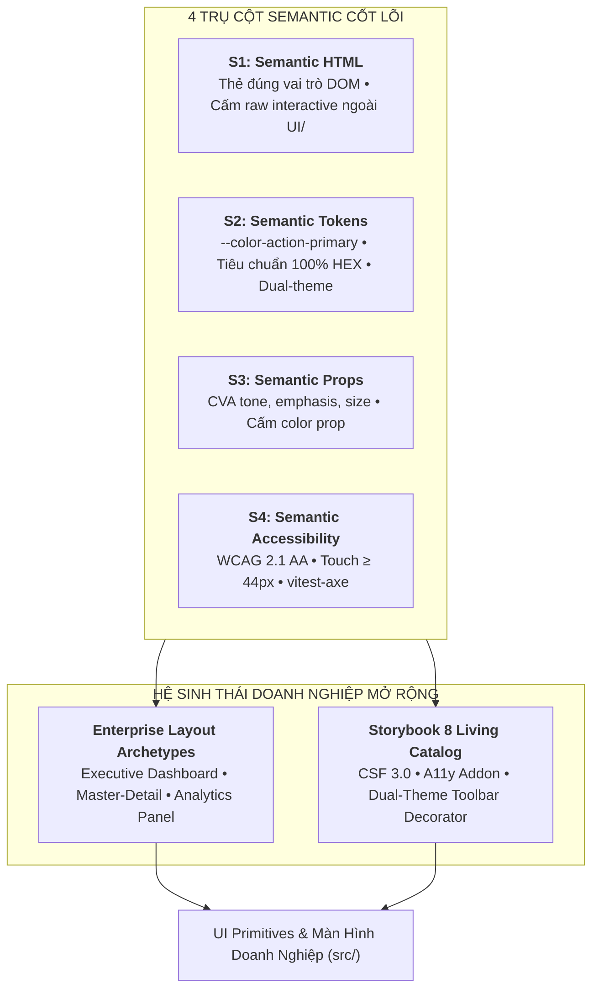
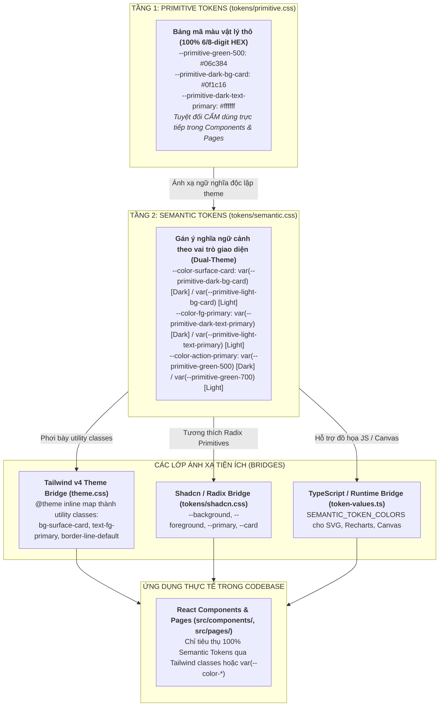
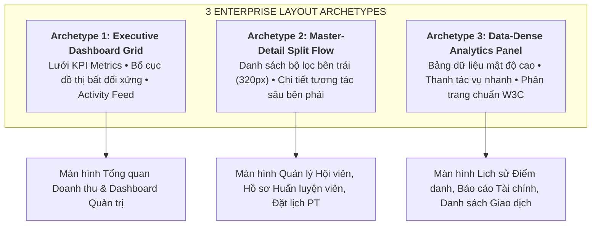
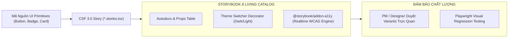

# Chuyên Đề 08: Hệ Thống Thiết Kế Ngữ Nghĩa (Semantic Design System & Storybook Living Catalog)

> **Dự án:** Khung Tiêu Chuẩn Doanh Nghiệp & RoGym Management System Profile  
> **Cổng quy chuẩn chính:** [`FRONTEND_CONVENTIONS.md`](../FRONTEND_CONVENTIONS.md) | [Bản Đồ Tài Liệu](./README.md)  
> **Tài liệu liên quan:** [`docs/01-architecture-and-structure.md`](./01-architecture-and-structure.md) | [`docs/03-coding-standards.md`](./03-coding-standards.md) | [`docs/04-component-patterns.md`](./04-component-patterns.md) | [`docs/06-styling-and-design-tokens.md`](./06-styling-and-design-tokens.md) | [`docs/07-testing-and-quality-assurance.md`](./07-testing-and-quality-assurance.md) | [`docs/09-accessibility.md`](./09-accessibility.md)  
> **Cơ sở tham chiếu quốc tế:**  
> - [Storybook 8 Component Story Format (CSF 3.0 Specification)](https://storybook.js.org/docs/api/csf)  
> - [W3C HTML Living Standard - Semantic Landmarks & Document Structure](https://html.spec.whatwg.org/multipage/sections.html)  
> - [Class Variance Authority (CVA) Multi-Axis Variants Architecture](https://cva.style/docs)  
> - [Brad Frost - Atomic Design Methodology & Living Design Systems](https://atomicdesign.bradfrost.com/)  
> - [Open Props & W3C Design Tokens Community Group (DTCG)](https://design-tokens.github.io/community-group/format/)  
> **Phiên bản:** 8.0 (Enterprise Quality Standard — 15 Spokes & Universal Decoupling)  
> **Trạng thái:** Bắt buộc tuân thủ 100% (Strict Mandatory Enforcement)  
> **Vị trí tài liệu:** Nguồn Dữ Liệu Chuẩn Cao Nhất (Single Source of Truth - SSOT) cho toàn bộ kiến trúc Semantic Design của Frontend, bao quát trọn vẹn 4 trụ cột: **Trụ cột S1** (Semantic HTML), **Trụ cột S2** (Semantic Design Tokens), **Trụ cột S3** (Semantic Component Props), và **Trụ cột S4** (Semantic Accessibility), cùng hệ thống **Archetypes Bố Cục Doanh Nghiệp Mẫu** và **Living Catalog Storybook 8**.  
> **Mô hình phối hợp:** Đóng vai trò là **Hub trung tâm** trong mô hình Hub-and-Spoke. Các chuyên đề kỹ thuật khác (`03-coding-standards.md`, `04-component-patterns.md`, `05-forms-and-validation.md`, `06-styling-and-design-tokens.md`, `07-testing-and-quality-assurance.md`, `09-accessibility.md`) đều dẫn chiếu về tài liệu này.

---

## MỤC LỤC
1. [Triết Lý Cốt Lõi & Mô Hình 2 Tầng Semantic Design System](#1-triết-lý-cốt-lõi-mô-hình-2-tầng-semantic-design-system)
   - [1.1. Presentational Design vs. Semantic-Driven Design](#11-presentational-design-vs-semantic-driven-design)
   - [1.2. Bốn Trụ Cột Semantic Cốt Lõi (S1 - S4)](#12-bốn-trụ-cột-semantic-cốt-lõi-s1---s4)
2. [S1 – Semantic HTML & Primitives Boundary](#2-s1-semantic-html-primitives-boundary)
   - [2.1. Nguyên Tắc Ranh Giới Thẻ Thô (Primitive Boundary)](#21-nguyên-tắc-ranh-giới-thẻ-thô-primitive-boundary)
   - [2.2. Danh Mục Quy Chuẩn S1 (`SEM-HTML-001..003`)](#22-danh-mục-quy-chuẩn-s1-sem-html-001003)
   - [2.3. Bảng Ma Trận Ánh Xạ Toàn Diện 1-1: Native sang Primitives & Semantic Tags](#23-bảng-ma-trận-ánh-xạ-toàn-diện-1-1-native-sang-primitives-semantic-tags)
   - [2.4. Cú Pháp Chú Thích Ngoại Lệ Chuẩn Doanh Nghiệp (rogym-convention-exempt)](#24-cú-pháp-chú-thích-ngoại-lệ-chuẩn-doanh-nghiệp-rogym-convention-exempt)
3. [S2 – Semantic Design Tokens & Theme Management](#3-s2-semantic-design-tokens-theme-management)
   - [3.1. Kiến Trúc Token 2 Tầng Cốt Lõi (+ Lớp Tương Thích)](#31-kiến-trúc-token-2-tầng-cốt-lõi-lớp-tương-thích)
   - [3.2. Quy Ước Đặt Tên Token Semantic](#32-quy-ước-đặt-tên-token-semantic)
   - [3.3. Bảng Ma Trận Tóm Tắt Quy Chuẩn S2 (`SEM-TOKEN-001..011`)](#33-bảng-ma-trận-tóm-tắt-quy-chuẩn-s2-sem-token-001011)
4. [S3 – Semantic Component Props & CVA Patterns](#4-s3-semantic-component-props-cva-patterns)
   - [4.1. Hợp Đồng Enum Chung (`lib/variants.ts`)](#41-hợp-đồng-enum-chung-libvariantsts)
   - [4.2. Khuôn Mẫu CVA (`class-variance-authority`) Cho UI Primitives](#42-khuôn-mẫu-cva-class-variance-authority-cho-ui-primitives)
   - [4.3. Danh Mục Quy Chuẩn S3 (`SEM-PROPS-001..013`)](#43-danh-mục-quy-chuẩn-s3-sem-props-001013)
5. [S4 – Semantic Accessibility (WCAG 2.1 AA)](#5-s4-semantic-accessibility-wcag-21-aa)
   - [5.1. Tóm Tắt 13 Tiêu Chuẩn Tiếp Cận (A11y) S4 (`SEM-A11Y-001..013`)](#51-tóm-tắt-13-tiêu-chuẩn-tiếp-cận-a11y-s4-sem-a11y-001013)
6. [Trừu Tượng Hóa Các Archetype Giao Diện Doanh Nghiệp Mẫu (Enterprise Layout Archetypes)](#6-trừu-tượng-hóa-các-archetype-giao-diện-doanh-nghiệp-mẫu-enterprise-layout-archetypes)
   - [6.1. Archetype 1: Executive Dashboard Grid (Bố Cục Bảng Điều Khiển Tổng Quan)](#61-archetype-1-executive-dashboard-grid-bố-cục-bảng-điều-khiển-tổng-quan)
   - [6.2. Archetype 2: Master-Detail Split Flow (Bố Cục Tách 2 Vùng Danh Sách & Chi Tiết)](#62-archetype-2-master-detail-split-flow-bố-cục-tách-2-vùng-danh-sách-chi-tiết)
   - [6.3. Archetype 3: Data-Dense Analytics Panel (Bố Cục Bảng Dữ Liệu Mật Độ Cao)](#63-archetype-3-data-dense-analytics-panel-bố-cục-bảng-dữ-liệu-mật-độ-cao)
7. [Quy Chuẩn Xuất Bản Storybook 8 Làm Living Design System Catalog](#7-quy-chuẩn-xuất-bản-storybook-8-làm-living-design-system-catalog)
   - [7.1. Cấu Trúc Thư Mục `.storybook/` & Cấu Hình Type-Safe](#71-cấu-trúc-thư-mục-storybook-cấu-hình-type-safe)
   - [7.2. Chuẩn Viết Story CSF 3.0 (`*.stories.tsx`)](#72-chuẩn-viết-story-csf-30-storiestsx)
   - [7.3. Tích Hợp Addon Kiểm Tra Khả Năng Tiếp Cận Tự Động (`@storybook/addon-a11y`)](#73-tích-hợp-addon-kiểm-tra-khả-năng-tiếp-cận-tự-động-storybookaddon-a11y)
   - [7.4. Theme Switcher Decorator Đồng Bộ Hai Tầng Tokens](#74-theme-switcher-decorator-đồng-bộ-hai-tầng-tokens)
8. [S5 – Quản Trị & Vòng Đời Quy Tắc (Governance)](#8-s5-quản-trị-vòng-đời-quy-tắc-governance)
   - [8.1. Vòng Đời Quy Tắc (State Machine)](#81-vòng-đời-quy-tắc-state-machine)
   - [8.2. Danh Mục Quy Chuẩn S5 (`SEM-GOV-001..003`)](#82-danh-mục-quy-chuẩn-s5-sem-gov-001003)
9. [Bảng Tổng Hợp Ma Trận Tra Cứu Toàn Diện Quy Chuẩn (`SEM-*`)](#9-bảng-tổng-hợp-ma-trận-tra-cứu-toàn-diện-quy-chuẩn-sem-)
10. [Bảng Đối Chiếu Anti-Patterns vs Chuẩn Mực Doanh Nghiệp](#10-bảng-đối-chiếu-anti-patterns-vs-chuẩn-mực-doanh-nghiệp)
11. [Ánh Xạ Tooling Kiểm Toán CI & Static Rules](#11-ánh-xạ-tooling-kiểm-toán-ci-static-rules)

---

## 1. Triết Lý Cốt Lõi & Mô Hình 2 Tầng Semantic Design System

### 1.1. Presentational Design vs. Semantic-Driven Design

Trong kiến trúc giao diện truyền thống (*Presentational Design*), giao diện được xây dựng dựa trên hình thức và màu sắc cụ thể: class tiện ích mô tả trực tiếp pixel (`bg-red-500`, `text-[#06c384]`, `p-[15px]`), component nhận các props biểu đạt hình thức (`color="green"`, `bgColor="#000"`). Cách tiếp cận này dẫn tới:
- Khó khăn khi hỗ trợ đa chủ đề (Dark / Light Theme).
- Trôi dạt thẩm mỹ và phân mảnh màu sắc (codebase xuất hiện hàng chục sắc thái xanh, đỏ khác nhau).
- Rào cản lớn đối với khả năng tiếp cận (Accessibility - a11y) vì màu sắc không gắn liền với vai trò ngữ nghĩa.

Ngược lại, **Semantic-Driven Design** ưu tiên *ý nghĩa, vai trò, và mục đích*:
- Phần tử DOM thể hiện đúng vai trò ngữ nghĩa (`button`, `nav`, `main`, `h1..h6`).
- Màu sắc được trừu tượng hóa theo vai trò (`surface-card`, `status-danger-fg`, `action-primary`).
- Props component mô tả ý định nghiệp vụ (`tone="danger"`, `emphasis="solid"`, `size="md"`).
- Khả năng tiếp cận (Accessibility / A11y) được tích hợp tự nhiên thông qua vai trò và độ tương phản định lượng (WCAG 2.1 AA).

### 1.2. Bốn Trụ Cột Semantic Cốt Lõi (S1 - S4)



- **Mô hình 2 Tầng (2-Tier Decoupling):**
  - **Tầng 1 (Core Universal Specification):** Chuẩn hóa kiến trúc 4 trụ cột S1-S4 trung tính, 3 Archetypes layout chuẩn hóa cho ứng dụng SaaS/ERP, và quy chuẩn Storybook 8 Living Catalog áp dụng được cho mọi doanh nghiệp.
  - **Tầng 2 (Project Implementation Profile - RoGym Case Study):** Hiện thực hóa bằng thư viện UI Primitives (`Button`, `Card`, `Badge`, `Modal`), CSS stylesheets (`tokens/primitive.css`, `tokens/semantic.css`) và 43 mã quy chuẩn `SEM-*` đang vận hành trong dự án RoGym.

---

## 2. S1 – Semantic HTML & Primitives Boundary

> [!IMPORTANT]
> 🧭 **ĐIỀU HƯỚNG TÀI LIỆU CHUYÊN SÂU — DOMAIN UI COMPONENTS & PRIMITIVES:**  
> Chi tiết toàn diện 100% UI Primitives, 10 cây quyết định lựa chọn component và ma trận ánh xạ native sang primitives được quản trị tập trung tại:  
> 👉 [**src/components/README.md — Kiến Trúc UI Components**](../src/components/README.md)  
>  
> **Các chương mục chi tiết cần đọc:**  
> - [Chương 1: Kiến Trúc Thư Viện Component & Mô Hình Tái Sử Dụng 3 Cấp](../src/components/README.md#chương-1-kiến-trúc-thư-viện-component-mô-hình-tái-sử-dụng-nội-bộ-3-cấp)  
> - [Chương 1.3: Bảng Ma Trận Ánh Xạ Toàn Diện 1-1: Native sang Primitives](../src/components/README.md#13-bảng-ma-trận-ánh-xạ-toàn-diện-1-1-native-sang-primitives-semantic-tags)  
> - [Chương 5: Cây Quyết Định Chọn Component (10 Decision Trees)](../src/components/README.md#chương-5-cây-quyết-định-chọn-component-10-decision-trees)  
> - [Chương 6: Catalog Toàn Diện 100% UI Primitives (ui/)](../src/components/README.md#chương-6-catalog-toàn-diện-100-ui-primitives-ui)

### 2.1. Nguyên Tắc Ranh Giới Thẻ Thô (Primitive Boundary)
Toàn bộ các thẻ HTML tương tác (`<button>`, `<a>`, `<form>`, `<input>`, `<select>`, `<textarea>`) và các thẻ container thô (`<div>`, `<span>`) phải tuân theo ranh giới phân tầng:
1. **Thẻ tương tác**: Cấm xuất hiện trần (raw) trên các trang nghiệp vụ (`src/pages/*`) và business components; bắt buộc sử dụng UI Primitives chuẩn hóa (`<Button>`, `<ButtonLink>`, `<Form>`, `<FormField>`, `<Input>`).
2. **Thẻ phi ngữ nghĩa**: Khi bắt buộc dùng `<div>` hoặc `<span>` để phục vụ căn chỉnh flex/grid layout, phải có ghi chú ngữ cảnh hoặc sử dụng các thẻ HTML5 ngữ nghĩa thay thế (`<header>`, `<nav>`, `<main>`, `<article>`, `<section>`, `<aside>`, `<footer>`).

### 2.2. Danh Mục Quy Chuẩn S1 (`SEM-HTML-001..003`)

<a id="sem-html-001"></a>
#### `SEM-HTML-001` Cấm Thẻ Tương Tác Thô Ngoài Thư Mục UI & Shared
- **Trạng thái:** `Enforced`
- **Mức độ kiểm toán:** `ERROR` (`NO_RAW_INTERACTIVE_ELEMENTS`)
- **Mô tả:** Cấm sử dụng trực tiếp `<button>`, `<a>`, `<form>` ngoài thư mục `components/ui/` và `components/shared/`.
- **Lý do:** Đảm bảo toàn bộ tương tác đều có đầy đủ focus-visible, keyboard access, ripple effect, loading state và bảo đảm tính nhất quán giao diện.
- **Ví dụ:**
  - ❌ *Vi phạm:* `<button className="p-2" onClick={handleSave}>Lưu</button>`
  - ✅ *Chuẩn:* `<Button tone="success" onClick={handleSave}>Lưu</Button>`

<a id="sem-html-002"></a>
#### `SEM-HTML-002` Hạn Chế Thẻ Phi Ngữ Nghĩa Thiếu Giải Trình
- **Trạng thái:** `Audited` (Phase 2) → `Enforced` (Phase 8)
- **Mức độ kiểm toán:** `WARNING` (`NO_NONSEMANTIC_TAGS`)
- **Mô tả:** Hạn chế các thẻ `<div>`, `<span>` lồng nhau vô nghĩa khi có thể thay thế bằng semantic tags.
- **Lý do:** Cải thiện cấu trúc cây DOM cho screen readers và tối ưu SEO.
- **Ví dụ:**
  - ❌ *Vi phạm:* `<div className="flex justify-between items-center"><div className="text-xl">Tiêu đề</div></div>`
  - ✅ *Chuẩn:* `<header className="flex justify-between items-center"><h2 className="text-xl">Tiêu đề</h2></header>`

<a id="sem-html-003"></a>
#### `SEM-HTML-003` Gắn Role ARIA Khi Thẻ Non-Interactive Nhận onClick
- **Trạng thái:** `Audited` (Phase 2) → `Enforced` (Phase 8)
- **Mức độ kiểm toán:** `WARNING` (`SEMANTIC_CLICK`)
- **Mô tả:** Khi một thẻ non-interactive (`<div>`, `<span>`, `<li>`) có thuộc tính `onClick`, bắt buộc phải có thuộc tính `role="button"` (hoặc role phù hợp) và hỗ trợ phím `onKeyDown`.
- **Lý do:** Người dùng bàn phím hoặc công nghệ hỗ trợ (Assistive Technologies) không thể kích hoạt click trên thẻ thường nếu không có role tương ứng.
- **Ví dụ:**
  - ❌ *Vi phạm:* `<div onClick={toggleOpen}>Mở rộng</div>`
  - ✅ *Chuẩn:* `<div role="button" tabIndex={0} onClick={toggleOpen} onKeyDown={handleKeyDown}>Mở rộng</div>` (Khuyến nghị tốt nhất: dùng primitive `<Button variant="ghost">`).

### 2.3. Bảng Ma Trận Ánh Xạ Toàn Diện 1-1: Native sang Primitives & Semantic Tags

Nhằm loại bỏ tính mơ hồ khi phát triển giao diện, bảng quy chuẩn dưới đây là **nguyên tắc bắt buộc** cho toàn bộ lập trình viên khi phát triển mã nguồn tại các trang giao diện (`src/pages/`) và các components ngoài thư mục `ui/`/`shared/`:

| STT | Thẻ Bị Cấm trên Page / High-Level | Nhóm Phân Loại | Thành Phần / Thẻ Bắt Buộc Dùng Thay Thế | Hướng Dẫn & Cách Dùng Chuẩn |
| :---: | :--- | :--- | :--- | :--- |
| **01** | `<button>` | Native Interactive | `<Button>`, `<SubmitButton>`, `<BackButton>` | Import từ `@/components/ui`. Chọn đúng `tone` (`primary`, `neutral`, `danger`...) và `variant` (`solid`, `outline`, `ghost`). |
| **02** | `<a href="...">` (Nội bộ) | Native Interactive | `<ButtonLink to="...">`, `<BreadcrumbLink to="...">` | Dùng cho liên kết nội bộ `react-router-dom`. Đồng bộ giao diện Button. |
| **03** | `<a href="...">` (Ngoài) | Native Interactive | `<ButtonAnchor href="..." target="_blank" rel="noopener noreferrer">` | Dùng cho liên kết ngoài. Tự động kiểm soát an toàn `rel="noopener noreferrer"`. |
| **04** | `<form>` | Native Interactive | `<Form onSubmit={handleSubmit} noValidate>` | Import từ `@/components/ui`. Bọc toàn bộ form nghiệp vụ. |
| **05** | `<div>` (Container chính của Page) | Nonsemantic Layout | `<Page>`, `<PageHeader>` | Import từ `@/components/ui`. Chuẩn hóa layout container. |
| **06** | `<div>` (Khối nội dung độc lập) | Nonsemantic Layout | `<Card as="article">`, `<Card as="section">` | Import từ `@/components/ui`. Chọn variant (`default`, `compact`, `glass`...). |
| **07** | `<div>` (Section phân vùng nội dung) | Nonsemantic Layout | `<section aria-labelledby="...">` | Thẻ HTML5 Semantic bắt buộc có heading liên kết nhận diện. |
| **08** | `<div>` (Khối bài viết / item danh sách) | Nonsemantic Layout | `<article>` hoặc `<Card as="article">` | Đại diện cho một đơn vị dữ liệu hoàn chỉnh. |
| **09** | `<div>` (Header / Footer của card/vùng) | Nonsemantic Layout | `<header>`, `<footer>` hoặc `<CardHeader>`, `<CardFooter>` | Cấu trúc phân cấp ngữ nghĩa chuẩn W3C. |
| **10** | `<div>` (Thanh điều hướng / tabs bar) | Nonsemantic Layout | `<nav aria-label="...">` hoặc `<Tabs>`, `<Breadcrumb>` | Đảm bảo khả năng điều hướng bằng phím và screen reader. |
| **11** | `<div>` (Sidebar / Cột thông tin phụ) | Nonsemantic Layout | `<aside>` hoặc `<Sidebar>` | Phân tách nội dung phụ trợ khỏi luồng chính. |
| **12** | `<div>` (Đường kẻ phân cách) | Nonsemantic Layout | `<Separator>` hoặc `<hr>` | Import từ `@/components/ui`. Hỗ trợ label chữ ở giữa. |
| **13** | `<div>` (Chỉ để flexbox/grid layout) | Nonsemantic Layout | Bọc trực tiếp bằng thẻ ngữ nghĩa (`<section>`, `<fieldset>`, `<ul/ol>`) | **Nếu bắt buộc dùng div**: Dùng chú thích ngoại lệ `{/* rogym-convention-exempt: NO_NONSEMANTIC_TAGS [Lý do kỹ thuật] */}`. |
| **14** | `<span>` (Nhãn trạng thái / tag) | Nonsemantic Text | `<Badge>`, `<StatusBadge>`, `<Chip>` | Import từ `@/components/ui`. Chuẩn hóa tone màu semantic. |
| **15** | `<span>` (Đoạn văn / text mô tả) | Nonsemantic Text | `<p>`, `<small>`, `<time>`, `<data>` | Dùng đúng thẻ ngữ nghĩa văn bản theo chuẩn HTML5. |
| **16** | `<span>` (Nhãn tiêu đề trường nhập) | Nonsemantic Text | `<FormField label="...">` hoặc `<label htmlFor="...">` | Đảm bảo liên kết trực tiếp với id của input field. |
| **17** | `<span>` (Chỉ để đổi màu/font inline) | Nonsemantic Text | `<strong className="...">`, `<em className="...">` | **Nếu bắt buộc dùng span**: Thêm chú thích ngoại lệ có cấu trúc. |
| **18** | `<b>` | Nonsemantic Formatting | `<strong>` | Nhấn mạnh tầm quan trọng của nội dung văn bản. |
| **19** | `<i>` | Nonsemantic Formatting | `<em>` (nhấn mạnh ngữ nghĩa) hoặc SVG icons từ `lucide-react` | Cấm dùng `<i>` làm icon class hoặc text in nghiêng thuần túy. |

---

### 2.4. Cú Pháp Chú Thích Ngoại Lệ Chuẩn Doanh Nghiệp (`rogym-convention-exempt`)

Khi bắt buộc phải sử dụng thẻ phi ngữ nghĩa (`<div>`, `<span>`) để phục vụ các thư viện bên thứ ba (như biểu đồ Recharts, bản đồ) hoặc căn chỉnh layout vi mô phức tạp mà không có thẻ HTML5 thay thế, lập trình viên **bắt buộc phải có comment giải trình kỹ thuật** ngay phía trên hoặc cùng dòng theo cú pháp chuẩn:

- **Trong JSX/TSX:**
  ```tsx
  {/* rogym-convention-exempt: NO_NONSEMANTIC_TAGS [Recharts ResponsiveContainer yêu cầu div wrapper kích thước cố định] */}
  <div className="h-64 w-full">
    <ResponsiveContainer width="100%" height="100%">
      {/* biểu đồ */}
    </ResponsiveContainer>
  </div>
  ```
- **Trong file TS/JS/CSS:**
  ```typescript
  // rogym-convention-exempt: RULE_ID [Lý do kỹ thuật cụ thể]
  ```

Kịch bản kiểm toán `audit-conventions.mjs` và CI Quality Gate sẽ tự động phân tích comment này để bỏ qua cảnh báo nếu lý do hợp lệ.

---

## 3. S2 – Semantic Design Tokens & Theme Management

### 3.1. Kiến Trúc Token 2 Tầng Cốt Lõi (+ Lớp Tương Thích)

Hệ thống token của RoGym được thiết kế theo mô hình **2-layer token architecture** hiện đại, tách biệt hoàn toàn giữa giá trị vật lý thô (Primitive) và ngữ cảnh sử dụng (Semantic):



> [!IMPORTANT]
> 🧭 **ĐIỀU HƯỚNG TÀI LIỆU CHUYÊN SÂU — DOMAIN STYLES & SEMANTIC DESIGN TOKENS:**  
> Toàn bộ đặc tả kỹ thuật 100% tokens ngữ nghĩa, bảng tra cứu Dark/Light HEX, bảng chuyển đổi alpha, và mã nguồn CSS stylesheets được chuẩn hóa và duy trì tập trung tại:  
> 👉 [**src/styles/README.md — Kiến Trúc CSS & Design Tokens**](../src/styles/README.md)  
>  
> **Các chương mục chi tiết cần đọc:**  
> - [Chương 1: Tổng quan Kiến trúc Design Tokens 2 Tầng](../src/styles/README.md#1-tổng-quan-kiến-trúc-design-tokens-2-tầng-2-layer-token-architecture)  
> - [Chương 2: Bản Đồ Cấu Trúc Thư Mục src/styles/](../src/styles/README.md#2-bản-đồ-cấu-trúc-thư-mục-srcstyles)  
> - [Chương 3: Bảng Tra Cứu Toàn Diện Semantic Tokens (Dual-Theme Cheat Sheet)](../src/styles/README.md#3-bảng-tra-cứu-toàn-diện-semantic-tokens-dual-theme-cheat-sheet)  
> - [Chương 3.7: Bảng Tra Cứu 19 Mức Độ Alpha Sang 2 Ký Tự Hex & Công Thức](../src/styles/README.md#37-bảng-tra-cứu-toàn-diện-19-mức-độ-alpha-sang-2-ký-tự-hex-công-thức-chuyển-đổi-toán-học)  
> - [Chương 3.8: Từ Điển Ánh Xạ Tương Thích Ngược 42 Biến --rogym-* Cũ](../src/styles/README.md#38-từ-điển-ánh-xạ-tương-thích-ngược-42-biến---rogym--cũ-sang-semantic-tokens-mới)  
> - [Chương 4: Non-Color Tokens (Kích Thước, Bo Góc, Z-Index, Bóng Đổ & Chuyển Động)](../src/styles/README.md#4-non-color-tokens-kích-thước-bo-góc-z-index-bóng-đổ-chuyển-động)  
> - [Chương 10: Bộ Kiểm Thử Tự Động & Lệnh Kiểm Toán Thường Dùng](../src/styles/README.md#10-bộ-kiểm-thử-tự-động-lệnh-kiểm-toán-thường-dùng)

### 3.2. Quy Ước Đặt Tên Token Semantic
Mọi token ngữ nghĩa tuân theo định dạng chuẩn:  
`--color-<category>-<role>[-<state>]`

- **Category**: `surface` (nền/bề mặt), `text` / `fg` (chữ), `border` / `line` (đường viền), `action` (tương tác/nút), `status` (trạng thái nghiệp vụ), `focus` (tiêu điểm), `overlay` (lớp phủ).
- **Status Roles**: `-fg` (màu chữ/icon trên nền mềm), `-bg` (nền mềm nhẹ alpha/tint), `-border` (đường viền phân cách), `-solid` (nền khối đặc của badge/thông báo), `-on-solid` (chữ/icon trên nền khối đặc), `-surface` (bề mặt chuyên biệt cho card trạng thái).

### 3.3. Bảng Ma Trận Tóm Tắt Quy Chuẩn S2 (`SEM-TOKEN-001..011`)

<a id="sem-token-001"></a><a id="sem-token-002"></a><a id="sem-token-003"></a><a id="sem-token-004"></a><a id="sem-token-005"></a><a id="sem-token-006"></a><a id="sem-token-007"></a><a id="sem-token-008"></a><a id="sem-token-009"></a><a id="sem-token-010"></a><a id="sem-token-011"></a>

| Mã Quy Chuẩn | Tên Tiêu Chuẩn Kỹ Thuật | Mức Độ Kiểm Toán CI | Tóm Tắt Yêu Cầu Kỹ Thuật | Link Chi Tiết Sang `src/styles/README.md` |
| :--- | :--- | :--- | :--- | :--- |
| `SEM-TOKEN-001` | 100% HEX Cho Lớp Primitive | `ERROR` (`HEX_COLOR_ONLY_IN_CSS`) | Mọi giá trị màu trong `tokens/primitive.css` bắt buộc là HEX 6/8 ký tự. Cấm `rgb()`, `hsl()`, `color-mix()` (hàm `color-mix()` chỉ được phép sử dụng tại semantic tokens). | [src/styles/README.md#ba-nguyên-tắc-cốt-lõi-bất-di-bất-dịch](../src/styles/README.md#ba-nguyên-tắc-cốt-lõi-bất-di-bất-dịch) |
| `SEM-TOKEN-002` | Cấm Hardcode Màu Thô Trong JSX/TSX | `ERROR` (`NO_RAW_COLORS_IN_JSX`) | Cấm chuỗi HEX, RGB, HSL trong TSX. Dùng `TOKEN_COLORS` hoặc class Tailwind ngữ nghĩa. | [src/styles/README.md#3-bảng-tra-cứu-toàn-diện-semantic-tokens-dual-theme-cheat-sheet](../src/styles/README.md#3-bảng-tra-cứu-toàn-diện-semantic-tokens-dual-theme-cheat-sheet) |
| `SEM-TOKEN-003` | Cấm Inline Style Trong JSX/TSX | `WARNING` (`NO_INLINE_STYLE`) | Cấm `style={{...}}` trong TSX, ngoại trừ biến động `--rogym-tone` có comment giải trình. | [src/styles/README.md#7-bảy-điều-cấm-kỵ-tối-cao-seven-deadly-sins](../src/styles/README.md#7-bảy-điều-cấm-kỵ-tối-cao-seven-deadly-sins) |
| `SEM-TOKEN-004` | Cấm Khai Báo Token Chứa Màu Cục Bộ | `WARNING` (`NO_COMPONENT_COLOR_TOKEN`) | Cấm khai báo biến màu cục bộ dạng `--rogym-*: #HEX` trong `styles/components/*.css`. | [src/styles/README.md#2-bản-đồ-cấu-trúc-thư-mục-srcstyles](../src/styles/README.md#2-bản-đồ-cấu-trúc-thư-mục-srcstyles) |
| `SEM-TOKEN-005` | Cấm Dùng Primitive Token Trong Component | `WARNING` (`NO_PRIMITIVE_IN_COMPONENT`) | Cấm `var(--rogym-*)` hoặc class primitive trong component UI; bắt buộc dùng Semantic Tokens. | [src/styles/README.md#ba-nguyên-tắc-cốt-lõi-bất-di-bất-dịch](../src/styles/README.md#ba-nguyên-tắc-cốt-lõi-bất-di-bất-dịch) |
| `SEM-TOKEN-006` | Cấm Bảng Màu Thô Tailwind Trong TSX | `WARNING` (`NO_RAW_TAILWIND_PALETTE`) | Cấm `bg-red-500`, `text-green-600`, `bg-white` trong TSX; thay thế 100% bằng semantic utilities. | [src/styles/README.md#3-bảng-tra-cứu-toàn-diện-semantic-tokens-dual-theme-cheat-sheet](../src/styles/README.md#3-bảng-tra-cứu-toàn-diện-semantic-tokens-dual-theme-cheat-sheet) |
| `SEM-TOKEN-007` | Cấm Opacity Modifier Trên Primitive | `WARNING` (`NO_OPACITY_MODIFIER_ON_PRIMITIVE`) | Cấm slash modifier (như `bg-rogym-green/20`) trên các biến CSS primitive. | [src/styles/README.md#7-bảy-điều-cấm-kỵ-tối-cao-seven-deadly-sins](../src/styles/README.md#7-bảy-điều-cấm-kỵ-tối-cao-seven-deadly-sins) |
| `SEM-TOKEN-008` | Đối Xứng Dual-Theme Bắt Buộc | Test Suite `semantic-tokens.test.ts` | Token khai báo tại `:root` (dark) bắt buộc có khai báo đối xứng tại `[data-theme=light]`. | [src/styles/README.md#10-bộ-kiểm-thử-tự-động-lệnh-kiểm-toán-thường-dùng](../src/styles/README.md#10-bộ-kiểm-thử-tự-động-lệnh-kiểm-toán-thường-dùng) |
| `SEM-TOKEN-009` | Cấm Dùng Biến Thể `dark:` Thủ Công Cho Màu | `WARNING` (`NO_DARK_VARIANT_COLOR`) | Cấm gắn tiền tố `dark:` để đảo màu thủ công trong TSX (vd: `text-black dark:text-white`). | [src/styles/README.md#ba-nguyên-tắc-cốt-lõi-bất-di-bất-dịch](../src/styles/README.md#ba-nguyên-tắc-cốt-lõi-bất-di-bất-dịch) |
| `SEM-TOKEN-010` | Thang Z-Index 5 Tầng Chuẩn | `WARNING` (`NO_MAGIC_Z_INDEX`) | Sử dụng đúng thang: `z-0` (Base), `z-10` (Sticky), `z-20` (Dropdown), `z-50` (Modal), `z-100` (Toast). | [src/styles/README.md#41-thang-z-index-chuẩn-5-tầng-sem-token-010](../src/styles/README.md#41-thang-z-index-chuẩn-5-tầng-sem-token-010) |
| `SEM-TOKEN-011` | Thang Spacing Bội Số 4px | `WARNING` (`NO_MAGIC_DIMENSIONS`) | Cấm pixel dimensions tuỳ tiện (`w-[320px]`). Dùng thang chuẩn của Tailwind (`p-1`, `gap-4`). | [src/styles/README.md#4-non-color-tokens-kích-thước-bo-góc-z-index-bóng-đổ-chuyển-động](../src/styles/README.md#4-non-color-tokens-kích-thước-bo-góc-z-index-bóng-đổ-chuyển-động) |

---

## 4. S3 – Semantic Component Props & CVA Patterns

### 4.1. Hợp Đồng Enum Chung (`lib/variants.ts`)

Mọi component UI primitives và business components tuân theo bộ hợp đồng kiểu dữ liệu thống nhất:

```typescript
// src/lib/variants.ts
export type Tone = 'success' | 'warning' | 'danger' | 'info' | 'neutral' | 'accent'
export type Emphasis = 'solid' | 'subtle' | 'outline'
export type Size = 'xs' | 'sm' | 'md' | 'lg' | 'xl'
```

### 4.2. Khuôn Mẫu CVA (`class-variance-authority`) Cho UI Primitives

```typescript
import { cva, type VariantProps } from 'class-variance-authority'

export const badgeVariants = cva(
  'inline-flex items-center gap-1.5 font-medium rounded-full transition-colors',
  {
    variants: {
      tone: {
        success: 'bg-status-success-bg text-status-success-fg border-status-success-border',
        warning: 'bg-status-warning-bg text-status-warning-fg border-status-warning-border',
        danger: 'bg-status-danger-bg text-status-danger-fg border-status-danger-border',
        info: 'bg-status-info-bg text-status-info-fg border-status-info-border',
        neutral: 'bg-status-neutral-bg text-status-neutral-fg border-status-neutral-border',
        accent: 'bg-action-primary-soft text-action-primary border-action-primary-soft-border',
      },
      emphasis: {
        solid: 'border-transparent font-semibold shadow-sm',
        subtle: 'border',
        outline: 'bg-transparent border',
      },
      size: {
        sm: 'text-xs px-2 py-0.5',
        md: 'text-sm px-2.5 py-1',
        lg: 'text-base px-3 py-1.5',
      },
    },
    defaultVariants: {
      tone: 'neutral',
      emphasis: 'subtle',
      size: 'md',
    },
  }
)
```

### 4.3. Danh Mục Quy Chuẩn S3 (`SEM-PROPS-001..013`)

| Mã Quy Chuẩn | Tên Tiêu Chuẩn | Trạng Thái | Mô Tả Tóm Tắt |
| :--- | :--- | :---: | :--- |
| <a id="sem-props-001"></a>`SEM-PROPS-001` | Hợp đồng Enum chung | Planned | Tái sử dụng `Tone`, `Emphasis`, `Size` từ `src/lib/variants.ts`. |
| <a id="sem-props-002"></a>`SEM-PROPS-002` | Cấm prop color thô | Planned | Cấm nhận các prop `color`, `bgColor`, `textColor` tự do. |
| <a id="sem-props-003"></a>`SEM-PROPS-003` | Chuẩn hóa enum tone | Planned | `tone` bắt buộc thuộc `{success, warning, danger, info, neutral, accent}`. |
| <a id="sem-props-004"></a>`SEM-PROPS-004` | Component theo vai trò | Planned | Đóng gói ánh xạ trạng thái sang `tone`, cấm phụ thuộc class màu từ cha. |
| <a id="sem-props-010"></a>`SEM-PROPS-010` | DisplayName cho forwardRef | **Enforced** | Bắt buộc gán `Component.displayName` khi dùng `React.forwardRef` (hoặc dùng `ref as prop` trên React 19). |
| <a id="sem-props-011"></a>`SEM-PROPS-011` | Cấm key={index} | Audited | Cấm dùng index mảng làm `key` khi render danh sách trong JSX. |
| <a id="sem-props-012"></a>`SEM-PROPS-012` | Cấm rò rỉ ký tự số 0 | **Enforced** | Cấm `items.length && <List />`; dùng `items.length > 0 ? <List /> : null` (`STD-VCL-001` [rendering-conditional-render]). |
| <a id="sem-props-013"></a>`SEM-PROPS-013` | Cấm raw `<svg>` trong trang | Audited | Cấm nhúng `<svg>` trần trên pages; dùng primitive `<Icon>` hoặc Lucide. |

---

## 5. S4 – Semantic Accessibility (WCAG 2.1 AA)

### 5.1. Tóm Tắt 13 Tiêu Chuẩn Tiếp Cận (A11y) S4 (`SEM-A11Y-001..013`)

| Mã Quy Chuẩn | Tên Tiêu Chuẩn | Yêu Cầu Kỹ Thuật Định Lượng |
| :--- | :--- | :--- |
| `SEM-A11Y-001` | Cấu Trúc Landmark & Skip-link | Duy nhất 1 thẻ `<main id="main-content">` và liên kết ẩn `skip-link` đầu trang. |
| `SEM-A11Y-002` | Thứ Tự Cấp Bậc Heading | Duy nhất 1 thẻ `<h1>` trên trang, các heading tăng tuần tự không nhảy cóc (`h1` $\rightarrow$ `h2` $\rightarrow$ `h3`). |
| `SEM-A11Y-003` | Liên Kết Tiếp Cận (A11y) Biểu Mẫu | Mọi input phải nối với label, hint và error qua `FormField` (`aria-describedby`, `aria-invalid`). |
| `SEM-A11Y-004` | Nhãn Nút Bấm Icon-Only | Nút chỉ chứa icon bắt buộc có `aria-label` hoặc thẻ ẩn tiếp cận `sr-only`. |
| `SEM-A11Y-005` | Thuộc Tính Alt Cho Thẻ Ảnh | Mọi thẻ `` bắt buộc có `alt` mô tả (hoặc `alt=""` nếu trang trí). |
| `SEM-A11Y-006` | Bảo Toàn Tiêu Điểm Visible | Cấm xóa viền focus bằng `outline-none` mà không có trạng thái `focus-visible:` thay thế. |
| `SEM-A11Y-007` | Nhãn Bắt Buộc Cho Control Độc Lập | Input/Select độc lập ngoài FormField bắt buộc có `aria-label` hoặc `aria-labelledby`. |
| `SEM-A11Y-008` | Hỗ Trợ Prefers Reduced Motion | Toàn bộ animation phải tôn trọng thiết lập giảm chuyển động của hệ điều hành. |
| `SEM-A11Y-009` | Kích Thước Vùng Chạm $\ge 44\text{px}$ | Nút bấm, tab, icon tương tác trên Mobile và LINE LIFF có kích thước tối thiểu $44 \times 44\text{px}$. |
| `SEM-A11Y-010` | Quy Chuẩn Tương Phản WCAG AA | Tương phản màu chữ/nền $\ge 4.5:1$ (chữ thường) và $\ge 3.0:1$ (chữ lớn/UI) trên cả Dark & Light. |
| `SEM-A11Y-011` | Chỉ Báo Không Dựa Duy Nhất Vào Màu | Trạng thái luôn đi kèm icon hoặc chữ diễn giải rõ ràng, hỗ trợ người mù màu. |
| `SEM-A11Y-012` | Bẫy Tiêu Điểm Hộp Thoại (Modal/Sheet) | Focus bị bẫy trong modal, bấm `Escape` đóng ngay, trả lại focus sau khi đóng. |
| `SEM-A11Y-013` | Thuộc Tính Ngôn Ngữ `<html lang>` | Thẻ `<html>` đồng bộ chính xác theo ngôn ngữ lựa chọn của i18n (`vi` hoặc `en`). |

---

## 6. Trừu Tượng Hóa Các Archetype Giao Diện Doanh Nghiệp Mẫu (Enterprise Layout Archetypes)

Nhằm đảm bảo tính tái sử dụng cao và sự đồng bộ trải nghiệm trên toàn bộ các phân hệ (Admin, Huấn Luyện Viên, Hội Viên), hệ thống trừu tượng hóa **3 Archetype Giao Diện Doanh Nghiệp Mẫu**:



### 6.1. Archetype 1: Executive Dashboard Grid (Bố Cục Bảng Điều Khiển Tổng Quan)

Bố cục chuyên dụng cho màn hình tổng quan chỉ số kinh doanh và vận hành phòng gym:
- **Cấu trúc ngữ nghĩa:** `<main id="main-content">` $\rightarrow$ Header Landmark $\rightarrow$ KPI Metric Grid (`<section>`) $\rightarrow$ Analytics Asymmetric Grid (`<section>`) $\rightarrow$ Recent Activity Stream (`<aside>`).

```tsx
// Archetype 1: Executive Dashboard Layout Shell Component
import React from 'react'
import { Card } from '@/components/ui/data-display'

export function ExecutiveDashboardShell({
  header,
  metrics,
  charts,
  activityFeed,
}: {
  header: React.ReactNode
  metrics: React.ReactNode
  charts: React.ReactNode
  activityFeed: React.ReactNode
}) {
  return (
    <main id="main-content" className="flex-1 p-4 md:p-6 lg:p-8 space-y-6 max-w-7xl mx-auto w-full">
      {/* 1. Header Landmark */}
      <header className="flex flex-col sm:flex-row sm:items-center sm:justify-between gap-4">
        {header}
      </header>

      {/* 2. Lưới thẻ chỉ số KPI co giãn 4 cột */}
      <section aria-labelledby="kpi-metrics-heading" className="grid grid-cols-1 sm:grid-cols-2 lg:grid-cols-4 gap-4">
        <h2 id="kpi-metrics-heading" className="sr-only">Chỉ Số Vận Hành Cốt Lõi</h2>
        {metrics}
      </section>

      {/* 3. Bố cục đồ thị bất đối xứng (2/3 Biểu đồ - 1/3 Dòng hoạt động gần đây) */}
      <div className="grid grid-cols-1 lg:grid-cols-3 gap-6">
        <section aria-labelledby="analytics-charts-heading" className="lg:col-span-2 space-y-6">
          <h2 id="analytics-charts-heading" className="sr-only">Biểu Đồ Tăng Trưởng & Xu Hướng</h2>
          {charts}
        </section>

        <aside aria-labelledby="activity-feed-heading" className="lg:col-span-1">
          <h2 id="activity-feed-heading" className="text-lg font-bold text-surface-card-fg mb-4">
            Hoạt Động Gần Đây
          </h2>
          {activityFeed}
        </aside>
      </div>
    </main>
  )
}
```

### 6.2. Archetype 2: Master-Detail Split Flow (Bố Cục Tách 2 Vùng Danh Sách & Chi Tiết)

Bố cục chuyên dụng cho các tác vụ quản trị thông tin chi tiết (Quản lý Hội viên, Hồ sơ Hợp đồng, Lịch tập):
- **Cấu trúc:** Vùng Master bên trái (cố định $320\text{px}$ hoặc $380\text{px}$ trên Desktop) chứa danh sách và bộ lọc; Vùng Detail bên phải mở rộng chứa chi tiết hồ sơ, form chỉnh sửa và tabs nghiệp vụ.
- **Đồng bộ URL:** Khi bấm chọn item ở Master, URL tự động cập nhật `?id=...` mà không làm tải lại trang.

```tsx
// Archetype 2: Master-Detail Split Layout Shell Component
import React from 'react'

export function MasterDetailShell({
  listPane,
  detailPane,
}: {
  listPane: React.ReactNode
  detailPane: React.ReactNode
}) {
  return (
    <main id="main-content" className="flex-1 flex flex-col md:flex-row h-[calc(100vh-4rem)] overflow-hidden">
      {/* Vùng Master: Danh sách & Bộ lọc bên trái */}
      <nav
        aria-label="Danh sách đối tượng quản lý"
        className="w-full md:w-80 lg:w-96 border-b md:border-b-0 md:border-r border-surface-subtle overflow-y-auto bg-surface-base p-4 flex flex-col"
      >
        {listPane}
      </nav>

      {/* Vùng Detail: Chi tiết tương tác sâu bên phải */}
      <section
        aria-label="Chi tiết đối tượng được chọn"
        className="flex-1 overflow-y-auto bg-surface-card p-4 md:p-6 lg:p-8"
      >
        {detailPane}
      </section>
    </main>
  )
}
```

### 6.3. Archetype 3: Data-Dense Analytics Panel (Bố Cục Bảng Dữ Liệu Mật Độ Cao)

Bố cục phục vụ việc tra cứu dữ liệu kế toán, lịch sử quét mã điểm danh và danh sách hội viên:
- **Cấu trúc:** Header $\rightarrow$ Quick Action Toolbar (tìm kiếm tức thì, lọc ngày, xuất CSV) $\rightarrow$ Dense Data Table với Sticky Header (`z-10`) $\rightarrow$ Semantic Pagination Controls.

```tsx
// Archetype 3: Data-Dense Analytics Panel Shell Component
import React from 'react'

export function DataDenseAnalyticsShell({
  title,
  toolbar,
  table,
  pagination,
}: {
  title: string
  toolbar: React.ReactNode
  table: React.ReactNode
  pagination: React.ReactNode
}) {
  return (
    <main id="main-content" className="flex-1 p-4 md:p-6 max-w-full mx-auto w-full space-y-4">
      <header className="flex flex-col sm:flex-row sm:items-center sm:justify-between gap-4">
        <h1 className="text-xl md:text-2xl font-bold text-surface-card-fg">{title}</h1>
        <div className="flex items-center gap-2">{toolbar}</div>
      </header>

      {/* Thẻ chứa bảng dữ liệu mật độ cao */}
      <Card className="overflow-hidden border border-surface-subtle bg-surface-card shadow-sm">
        <div className="overflow-x-auto max-h-[650px] relative">
          {table}
        </div>
        <footer className="p-3 border-t border-surface-subtle flex items-center justify-between">
          {pagination}
        </footer>
      </Card>
    </main>
  )
}
```

---

## 7. Quy Chuẩn Xuất Bản Storybook 8 Làm Living Design System Catalog

Storybook 8 đóng vai trò là **Living Design System Catalog** — tài liệu trực quan sống động kết nối chặt chẽ giữa Kỹ sư Frontend, Product Manager và UI/UX Designer.



### 7.1. Cấu Trúc Thư Mục `.storybook/` & Cấu Hình Type-Safe

Cấu hình tập trung tại `.storybook/main.ts` và `.storybook/preview.ts`:

```typescript
// .storybook/main.ts
import type { StorybookConfig } from '@storybook/react-vite'

const config: StorybookConfig = {
  stories: ['../src/**/*.stories.@(js|jsx|ts|tsx)'],
  addons: [
    '@storybook/addon-links',
    '@storybook/addon-essentials',
    '@storybook/addon-interactions',
    '@storybook/addon-a11y', // Bắt buộc: Kiểm tra khả năng tiếp cận W3C tự động
  ],
  framework: {
    name: '@storybook/react-vite',
    options: {},
  },
}
export default config
```

### 7.2. Chuẩn Viết Story CSF 3.0 (`*.stories.tsx`)

Mọi UI Primitive bắt buộc phải có tệp `.stories.tsx` viết theo chuẩn **Component Story Format 3.0 (CSF 3.0)** với type-safety tuyệt đối từ `@storybook/react`:

```tsx
// src/components/ui/Button.stories.tsx
import type { Meta, StoryObj } from '@storybook/react'
import { Button } from './Button'
import { CheckCircle2, ArrowRight } from 'lucide-react'

const meta: Meta<typeof Button> = {
  title: 'Primitives/Button',
  component: Button,
  tags: ['autodocs'],
  argTypes: {
    variant: {
      control: 'select',
      options: ['primary', 'outline-white', 'outline-teal', 'ghost', 'danger'],
    },
    size: {
      control: 'radio',
      options: ['compact', 'default', 'large'],
    },
    loading: { control: 'boolean' },
    disabled: { control: 'boolean' },
  },
}
export default meta

type Story = StoryObj<typeof Button>

export const Primary: Story = {
  args: {
    variant: 'primary',
    children: 'Bắt Đầu Tập Luyện',
  },
}

export const WithIcon: Story = {
  args: {
    variant: 'primary',
    children: (
      <>
        <span>Đăng Ký Gói Tập</span>
        <ArrowRight className="w-4 h-4 ml-2" aria-hidden="true" />
      </>
    ),
  },
}

export const LoadingState: Story = {
  args: {
    variant: 'primary',
    loading: true,
    children: 'Đang Xử Lý Giao Dịch...',
  },
}
```

### 7.3. Tích Hợp Addon Kiểm Tra Khả Năng Tiếp Cận Tự Động (`@storybook/addon-a11y`)

Khi hiển thị component trong Storybook, tab **Accessibility** sẽ tự động kích hoạt engine axe-core để kiểm tra:
- Tỷ lệ tương phản màu sắc chữ và nền theo WCAG AA.
- Kiểm tra vai trò ARIA Role và Accessible Name.
- Báo cáo lỗi vi phạm bằng highlight đỏ trực tiếp trên canvas giúp lập trình viên khắc phục ngay trước khi mở PR.

### 7.4. Theme Switcher Decorator Đồng Bộ Hai Tầng Tokens

Cấu hình Decorator toàn cục trong `.storybook/preview.tsx` để người dùng có thể đổi qua lại giữa Dark Theme (`:root`) và Light Theme (`[data-theme=light]`):

```tsx
// .storybook/preview.tsx
import type { Preview } from '@storybook/react'
import '@/styles/globals.css'

const preview: Preview = {
  globalTypes: {
    theme: {
      name: 'Theme',
      description: 'Chuyển đổi giao diện Dark / Light',
      defaultValue: 'dark',
      toolbar: {
        icon: 'circlehollow',
        items: [
          { value: 'dark', title: 'Dark Mode (Modern Athletic)', icon: 'moon' },
          { value: 'light', title: 'Light Mode (Clean White)', icon: 'sun' },
        ],
      },
    },
  },
  decorators: [
    (Story, context) => {
      const theme = context.globals.theme || 'dark'
      return (
        <div data-theme={theme} className={theme === 'dark' ? 'dark' : ''} style={{ padding: '2rem' }}>
          <Story />
        </div>
      )
    },
  ],
}
export default preview
```

---

## 8. S5 – Quản Trị & Vòng Đời Quy Tắc (Governance)

### 8.1. Vòng Đời Quy Tắc (State Machine)
Mọi quy chuẩn trong tài liệu đều trải qua 4 giai đoạn tiến hóa:
1. **`Planned`**: Đã được định nghĩa trong tài liệu, chờ triển khai mã kiểm toán hoặc mã nguồn tương ứng.
2. **`Audited`**: Đã có mã rule kiểm toán trong `client/scripts/audit/rules/`. Hoạt động ở mức `WARNING`, ghi nhận vi phạm vào baseline snapshot.
3. **`Ratchet`**: Cơ chế van một chiều. Số vi phạm chỉ được phép giảm dần, không được tăng thêm.
4. **`Enforced`**: Toàn bộ vi phạm đã về 0; baseline snapshot rỗng; rule chuyển sang mức `ERROR`, chặn cứng trong CI.

### 8.2. Danh Mục Quy Chuẩn S5 (`SEM-GOV-001..003`)

<a id="sem-gov-001"></a>
#### `SEM-GOV-001` Quản Trị Ngoại Lệ & Hạn Sử Dụng (`until`)
- **Trạng thái:** `Audited` (Phase 2) → `Enforced` (Phase 8)
- **Mức độ kiểm toán:** `WARNING` (`EXEMPTION_EXPIRED`)
- **Mô tả:** Mọi comment ngoại lệ bắt buộc phải có lý do kỹ thuật và ngày hẹn hết hạn:
  `{/* rogym-convention-exempt: RULE_ID [Lý do kỹ thuật cụ thể | until: YYYY-MM-DD] */}`
  Nếu ngày hiện tại vượt quá ngày hẹn, script kiểm tra sẽ lập tức báo lỗi và chặn build.

<a id="sem-gov-002"></a>
#### `SEM-GOV-002` Tính Toàn Vẹn Của Hệ Thống Tài Liệu
- **Trạng thái:** `Enforced`
- **Mức độ kiểm toán:** Script `client/scripts/verify-docs-integrity.mjs`
- **Mô tả:** 100% ID `SEM-*` trong tài liệu phải là duy nhất. Mọi liên kết nội bộ phải hợp lệ và sơ đồ Mermaid phải có cú pháp chuẩn.

<a id="sem-gov-003"></a>
#### `SEM-GOV-003` Quy Tắc Không Hồi Quy Baseline (No Regression)
- **Trạng thái:** `Enforced`
- **Mức độ kiểm toán:** `npm run audit:strict`
- **Mô tả:** Mọi lần chạy kiểm toán không được phép vượt quá số lượng vi phạm đã ghi nhận trong baseline snapshot của phase đó.

---

<a id="sem-matrix"></a>
## 9. Bảng Tổng Hợp Ma Trận Tra Cứu Toàn Diện Quy Chuẩn (`SEM-*`)

| Mã Quy Chuẩn | Tên Tiêu Chuẩn | Trụ Cột | Rule Code Audit | Trạng Thái Hiện Tại | Phase Thực Thi |
| :--- | :--- | :---: | :--- | :---: | :---: |
| `SEM-HTML-001` | Cấm thẻ tương tác thô ngoài UI/ | S1 | `NO_RAW_INTERACTIVE_ELEMENTS` | **Enforced** | Phase 0 |
| `SEM-HTML-002` | Hạn chế thẻ phi ngữ nghĩa | S1 | `NO_NONSEMANTIC_TAGS` | Audited | Phase 2 |
| `SEM-HTML-003` | Role ARIA cho onClick thẻ thô | S1 | `SEMANTIC_CLICK` | Audited | Phase 2 |
| `SEM-TOKEN-001` | 100% HEX ở Primitive | S2 | `HEX_COLOR_ONLY_IN_CSS` | **Enforced** | Phase 0 |
| `SEM-TOKEN-002` | Cấm HEX trong JSX | S2 | `NO_RAW_COLORS_IN_JSX` | **Enforced** | Phase 0 |
| `SEM-TOKEN-003` | Cấm inline styles | S2 | `NO_INLINE_STYLE` | Audited | Phase 2 |
| `SEM-TOKEN-004` | Cấm component tokens | S2 | `NO_COMPONENT_COLOR_TOKEN` | Planned | Phase 2 |
| `SEM-TOKEN-005` | Cấm primitive trong component | S2 | `NO_PRIMITIVE_IN_COMPONENT` | Planned | Phase 2 |
| `SEM-TOKEN-006` | Cấm class palette thô | S2 | `NO_RAW_TAILWIND_PALETTE` | Planned | Phase 2 |
| `SEM-TOKEN-007` | Cấm slash opacity modifier | S2 | `NO_OPACITY_MODIFIER_ON_PRIMITIVE` | Planned | Phase 2 |
| `SEM-TOKEN-008` | Đối xứng dual-theme | S2 | Test `semantic-tokens.test.ts` | Audited | Phase 4 |
| `SEM-TOKEN-009` | Cấm `dark:` thủ công | S2 | `NO_DARK_VARIANT_COLOR` | Planned | Phase 2 |
| `SEM-TOKEN-010` | Thang Z-index 5 tầng | S2 | `NO_MAGIC_Z_INDEX` | Audited | Phase 2 |
| `SEM-TOKEN-011` | Thang spacing bội số 4px | S2 | `NO_MAGIC_DIMENSIONS` | Audited | Phase 2 |
| <a id="sem-props-001"></a>`SEM-PROPS-001` | Enum chung từ variants.ts | S3 | Type check & tests | **Enforced** | Phase 6 |
| <a id="sem-props-002"></a>`SEM-PROPS-002` | Cấm props color/bgColor | S3 | `PROPS_NO_COLOR_PROP` | **Enforced** | Phase 6 |
| <a id="sem-props-003"></a>`SEM-PROPS-003` | Chuẩn hóa enum `tone` | S3 | `PROPS_TONE_ENUM` | **Enforced** | Phase 6 |
| <a id="sem-props-004"></a>`SEM-PROPS-004` | Component nghiệp vụ theo role | S3 | Snapshot tests | **Enforced** | Phase 6 |
| <a id="sem-props-010"></a>`SEM-PROPS-010` | DisplayName cho forwardRef | S3 | `FORWARD_REF_NAME` | **Enforced** | Phase 0 |
| <a id="sem-props-011"></a>`SEM-PROPS-011` | Cấm key={index} | S3 | `NO_UNSTABLE_KEY` | Audited | Phase 2 |
| <a id="sem-props-012"></a>`SEM-PROPS-012` | Cấm rò rỉ số 0 qua && | S3 | `NO_FALSY_LEAKAGE` | **Enforced** | Phase 0 |
| <a id="sem-props-013"></a>`SEM-PROPS-013` | Cấm raw SVG trong trang | S3 | `NO_RAW_SVG_IN_JSX` | Audited | Phase 2 |
| `SEM-A11Y-001` | Landmark & skip-link (Alias [`A11Y-003`](./09-accessibility.md#a11y-003)) | S4 | `vitest-axe` | Planned | Phase 7 |
| `SEM-A11Y-002` | Thứ tự cấp bậc Heading (Alias [`A11Y-004`](./09-accessibility.md#a11y-004)) | S4 | `A11Y_HEADING_ORDER` | Planned | Phase 2 |
| `SEM-A11Y-003` | Nối dây form accessibility (Alias [`A11Y-006`](./09-accessibility.md#a11y-006)) | S4 | `vitest-axe` | Planned | Phase 7 |
| `SEM-A11Y-004` | Aria-label cho icon button (Alias [`A11Y-008`](./09-accessibility.md#a11y-008)) | S4 | `A11Y_ICON_BUTTON_LABEL` | Planned | Phase 2 |
| `SEM-A11Y-005` | Alt cho thẻ ảnh (Alias [`A11Y-005`](./09-accessibility.md#a11y-005)) | S4 | `A11Y_IMG_ALT` | Planned | Phase 2 |
| `SEM-A11Y-006` | Cấm outline-none thiếu focus (Alias [`A11Y-007`](./09-accessibility.md#a11y-007)) | S4 | `A11Y_OUTLINE_NONE` | Planned | Phase 2 |
| `SEM-A11Y-007` | Aria-label cho input độc lập (Alias [`A11Y-006`](./09-accessibility.md#a11y-006)) | S4 | `FORMS_LABEL_ASSOC` | Planned | Phase 2 |
| `SEM-A11Y-008` | Prefers-reduced-motion (Alias [`A11Y-010`](./09-accessibility.md#a11y-010)) | S4 | `A11Y_REDUCED_MOTION` | Planned | Phase 2 |
| `SEM-A11Y-009` | Touch target $\ge 44\text{px}$ (Alias [`A11Y-002`](./09-accessibility.md#a11y-002)) | S4 | Mobile Playbook | Planned | Phase 7 |
| `SEM-A11Y-010` | Tương phản WCAG AA (Alias [`A11Y-001`](./09-accessibility.md#a11y-001)) | S4 | `npm run audit:contrast` | Planned | Phase 2 |
| `SEM-A11Y-011` | Non-color indicator (Alias [`A11Y-011`](./09-accessibility.md#a11y-011)) | S4 | Component tests | Planned | Phase 7 |
| `SEM-A11Y-012` | Dialog focus trap & Escape (Alias [`A11Y-008`](./09-accessibility.md#a11y-008)) | S4 | `vitest-axe` | Planned | Phase 7 |
| `SEM-A11Y-013` | Đồng bộ `<html lang>` (Khả năng tiếp cận quốc tế hóa) | S4 | i18n tests | Planned | Phase 7 |
| <a id="sem-gov-001"></a>`SEM-GOV-001` | Ngoại lệ có hạn `until` | S5 | `EXEMPTION_EXPIRED` | Planned | Phase 2 |
| <a id="sem-gov-002"></a>`SEM-GOV-002` | Toàn vẹn hệ tài liệu | S5 | `verify-docs-integrity.mjs` | **Enforced** | Phase 1 |
| <a id="sem-gov-003"></a>`SEM-GOV-003` | Ratchet baseline không tăng | S5 | `audit:strict` | **Enforced** | Phase 0 |
| `SEM-ARCH-001` | Giới hạn file .tsx <= 250 dòng (SSOT: [`STD-SIZE-001`](./03-coding-standards.md#std-size-001)) | S5 | `FILE_SIZE_LIMIT` | Audited | Phase 2 |
| `SEM-ARCH-002` | Cấm console.log sót lại (SSOT: [`STD-CLEAN-001`](./03-coding-standards.md#std-clean-001)) | S5 | `NO_CONSOLE_LOG` | Audited | Phase 2 |
| `SEM-ARCH-003` | Cấm TypeScript any (SSOT: [`STD-TS-001`](./03-coding-standards.md#std-ts-001)) | S5 | `NO_TS_ANY` | Audited | Phase 2 |
| `SEM-SEC-001` | Cấm dangerouslySetInnerHTML (SSOT: [`SEC-001`](./10-frontend-security-and-auth.md#sec-001)) | S5 | `NO_DANGEROUS_HTML` | **Enforced** | Phase 0 |
| `SEM-SEC-002` | rel="noopener noreferrer" cho _blank (SSOT: [`SEC-007`](./10-frontend-security-and-auth.md#sec-007)) | S5 | `NO_UNSAFE_TARGET_BLANK` | **Enforced** | Phase 0 |
| `SEM-SEC-003` | Cấm hardcode API URL trong JSX (SSOT: [`02-state-management.md §13`](./02-state-management.md#13-ánh-xạ-tooling-kiểm-toán-ci-static-rules)) | S5 | `NO_HARDCODED_API_URL` | Audited | Phase 2 |
| `SEM-STATE-001` | Cấm gọi API trong useEffect (SSOT: [`02-state-management.md §8.1`](./02-state-management.md#81-3-anti-patterns-phổ-biến-của-useeffect)) | S5 | `NO_EFFECT_FETCH` | Audited | Phase 2 |

---

## 10. Bảng Đối Chiếu Anti-Patterns vs Chuẩn Mực Doanh Nghiệp

| Ngữ Cảnh Kỹ Thuật | ❌ Mã Vi Phạm (Anti-Pattern) | ✅ Mã Chuẩn Mực (Semantic Standard) | Lý Do Kỹ Thuật & Tác Động |
| :--- | :--- | :--- | :--- |
| **Nút Bấm Chính (CTA)** | `<button className="bg-[#06c384] text-[#00492f] p-[12px] rounded-[10px]">Đăng Ký</button>` | `<Button tone="accent" emphasis="solid" size="md">Đăng Ký</Button>` | Bảo đảm đầy đủ trạng thái focus-visible, keyboard access và token hóa. |
| **Badge Trạng Thái** | `<span className="bg-red-500 text-white rounded px-2">Hết hạn</span>` | `<Badge tone="danger" emphasis="subtle">Hết hạn</Badge>` | Tách biệt hoàn toàn mã màu thô, hỗ trợ tự động đổi theme Dark/Light. |
| **Thẻ Card Bề Mặt** | `<div className="bg-[#0f1c16] border border-white/10 p-[20px] rounded-xl">...</div>` | `<Card variant="default" padding="md">...</Card>` | Loại bỏ class hardcode, sử dụng UI primitive với padding bội số 4px. |
| **Nút Icon Tiếp Cận (A11y)** | `<button onClick={handleClose}><XIcon /></button>` | `<Button variant="ghost" size="compact" aria-label="Đóng hộp thoại" onClick={handleClose}><Icon icon={X} /></Button>` | Bảo vệ người khiếm thị dùng Screen Reader không bị đọc nút rác không tên. |
| **Đổi Màu Sáng/Tối** | `<div className="bg-black text-white dark:bg-white dark:text-black">...</div>` | `<div className="bg-surface-base text-surface-card-fg">...</div>` | Màu sắc tự động chuyển đổi qua CSS variables, cấm lạm dụng `dark:`. |
| **Biểu Mẫu Nhập Liệu** | `<input placeholder="Họ tên" className="border-none outline-none" />` | `<FormField label="Họ tên" error={errors.name}><Input id="name" aria-invalid={!!errors.name} /></FormField>` | Đảm bảo liên kết nhãn tiếp cận `htmlFor` và thông báo lỗi qua ARIA. |
| **Render Danh Sách** | `{items.length && items.map((item, idx) => <div key={idx}>{item.name}</div>)}` | `{items.length > 0 ? items.map((item) => <div key={item.id}>{item.name}</div>) : null}` | Ngăn chặn rò rỉ ký tự số "0" lên UI và đảm bảo reconciliation hiệu năng cao. |
| **Bố Cục Bảng Điều Khiển** | Tự viết các thẻ `<div>` lồng nhau không có landmark | Sử dụng `ExecutiveDashboardShell` chuẩn ngữ nghĩa HTML5 (`<main>`, `<header>`, `<section>`, `<aside>`) | Giúp trình duyệt và thiết bị hỗ trợ (Assistive Technologies) định hướng cấu trúc trang trực quan. |
| **Tài Liệu UI Component** | Chụp ảnh tĩnh gửi qua Slack/Figma hoặc viết README rời rạc | Xuất bản Storybook 8 Living Catalog CSF 3.0 với Autodocs và Addon a11y | PM và Designer có thể kiểm tra trực tiếp tương tác thực tế và độ tương phản. |

---

## 11. Ánh Xạ Tooling Kiểm Toán CI & Static Rules

Hệ thống CI Gatekeeper kiểm soát việc thực thi quy chuẩn Semantic Design thông qua:

```bash
# 1. Kiểm toán tĩnh toàn diện 19 Rules Conventions trong src/
node client/scripts/audit-conventions.mjs

# 2. Kiểm toán chế độ nghiêm ngặt đối chiếu baseline snapshot
node client/scripts/audit-conventions.mjs --strict

# 3. Kiểm tra tính toàn vẹn 43 mã quy chuẩn SEM-* và liên kết tài liệu
node client/scripts/verify-docs-integrity.mjs

# 4. Kiểm tra độ tương phản WCAG 2.1 AA tự động của ma trận Semantic Tokens
npm run audit:contrast

# 5. Khởi chạy Storybook 8 Living Catalog kiểm thử giao diện cục bộ
npm --prefix client run storybook
```


