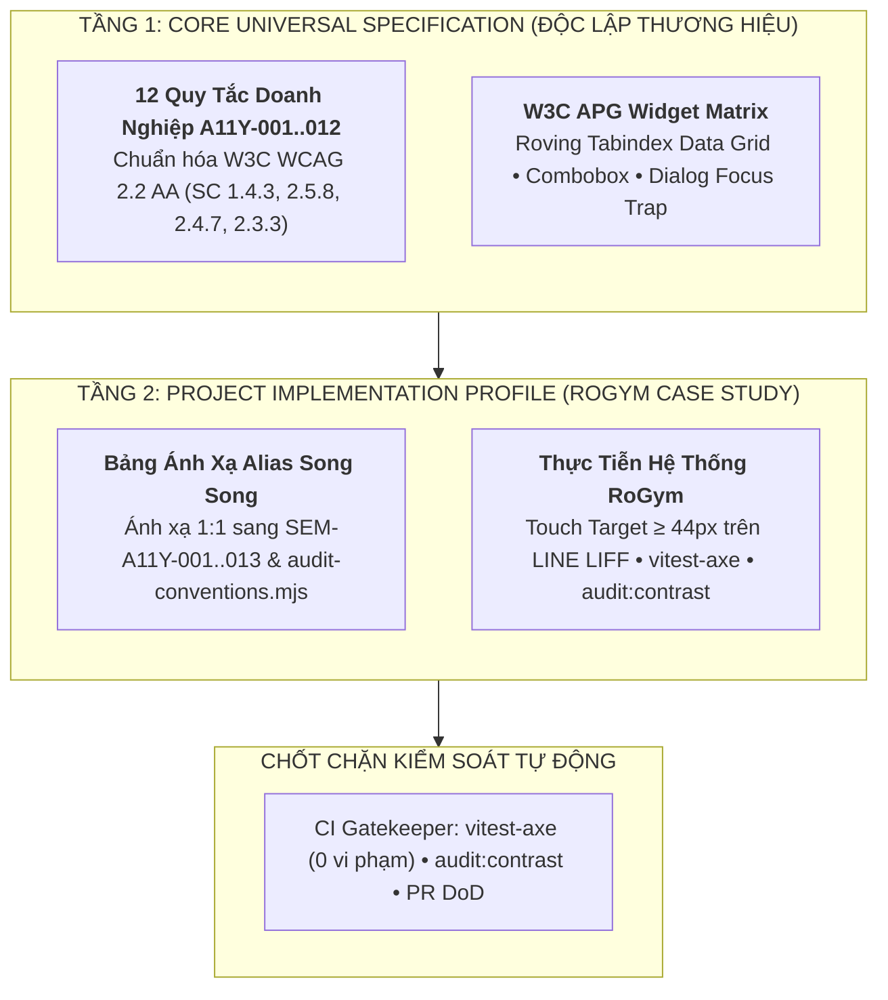
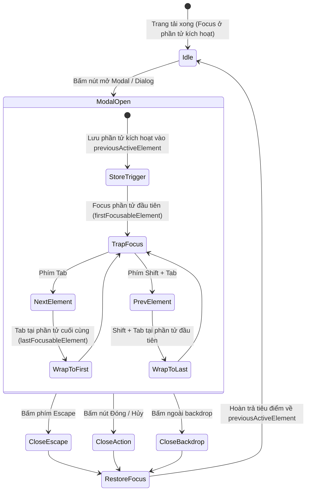
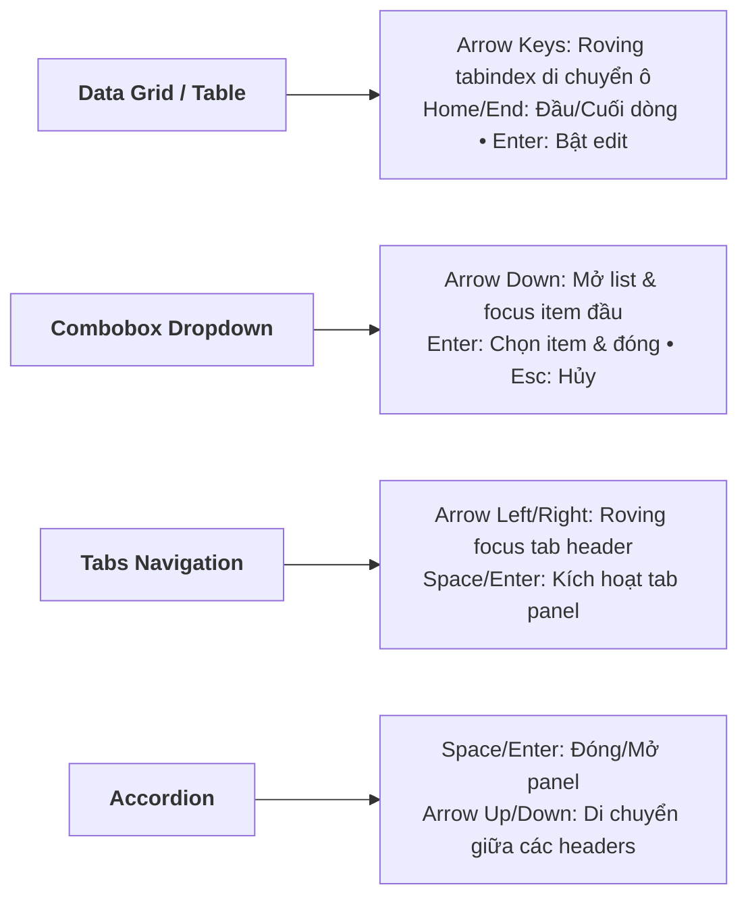

# Chuyên Đề 09: Tiêu Chuẩn Khả Năng Tiếp Cận & W3C WCAG 2.2 AA (Enterprise Accessibility & APG Guidelines)

> **Dự án:** Khung Tiêu Chuẩn Doanh Nghiệp & RoGym Management System Profile  
> **Cổng quy chuẩn chính:** [`FRONTEND_CONVENTIONS.md`](../FRONTEND_CONVENTIONS.md) | [Bản Đồ Tài Liệu](./README.md)  
> **Tài liệu liên quan:** [`docs/01-architecture-and-structure.md`](./01-architecture-and-structure.md) | [`docs/03-coding-standards.md`](./03-coding-standards.md) | [`docs/04-component-patterns.md`](./04-component-patterns.md) | [`docs/06-styling-and-design-tokens.md`](./06-styling-and-design-tokens.md) | [`docs/07-testing-and-quality-assurance.md`](./07-testing-and-quality-assurance.md) | [`docs/08-semantic-design-system.md`](./08-semantic-design-system.md) | [`docs/16-view-transitions-and-motion.md`](./16-view-transitions-and-motion.md) | [`docs/17-mobile-and-native-architecture.md`](./17-mobile-and-native-architecture.md)  
> **Cơ sở tham chiếu quốc tế:**  
> - [W3C Web Content Accessibility Guidelines (WCAG) 2.2 (Recommendation 2023)](https://www.w3.org/TR/WCAG22/)  
> - [W3C WAI-ARIA Authoring Practices Guide (APG 1.2)](https://www.w3.org/WAI/ARIA/apg/)  
> - [MDN Web Docs - Accessibility (a11y) & prefers-reduced-motion](https://developer.mozilla.org/en-US/docs/Web/Accessibility)  
> - [axe-core & vitest-axe Automated Accessibility Testing](https://github.com/chaance/vitest-axe)  
> - [Apple Human Interface Guidelines & Google Material Design Accessibility](https://developer.apple.com/design/human-interface-guidelines/accessibility)  
> **Phiên bản:** 8.0 (Enterprise Quality Standard — 15 Spokes & Universal Decoupling)  
> **Mô hình phối hợp (Hub-and-Spoke):** Chuyên đề này là nguồn chuẩn mực chuyên sâu cho **Trụ cột S4 (Semantic Accessibility)**, chịu trách nhiệm thiết lập tiêu chuẩn khả năng tiếp cận WCAG 2.2 Cấp độ AA, chuẩn hóa 12 quy tắc doanh nghiệp `A11Y-001..012`, ma trận điều hướng phím bấm W3C APG, kỹ thuật giảm chuyển động và kiểm thử tự động với `vitest-axe`.  
> **Áp dụng cho:** Toàn bộ thành phần giao diện, trang nghiệp vụ, biểu mẫu nhập liệu và widget tương tác trong `src/`  
> **Trạng thái:** Bắt buộc tuân thủ 100% (Strict Mandatory Enforcement)

---

## MỤC LỤC
1. [Triết Lý Khả Năng Tiếp Cận (A11y) & Mô Hình 2 Tầng](#1-triết-lý-khả-năng-tiếp-cận-a11y-mô-hình-2-tầng)
2. [Chuẩn Hóa Toàn Diện 12 Quy Tắc Doanh Nghiệp `A11Y-001` Đến `A11Y-012` (WCAG 2.2 AA)](#2-chuẩn-hóa-toàn-diện-12-quy-tắc-doanh-nghiệp-a11y-001-đến-a11y-012-wcag-22-aa)
3. [Bảng Đối Chiếu Song Song & Ánh Xạ Alias (Alias Mapping Table)](#3-bảng-đối-chiếu-song-song-ánh-xạ-alias-alias-mapping-table)
4. [Cấu Trúc DOM Ngữ Nghĩa & Vùng Địa Tiêu Chuẩn (Landmarks & Heading Order)](#4-cấu-trúc-dom-ngữ-nghĩa-vùng-địa-tiêu-chuẩn-landmarks-heading-order)
   - [4.1. Vùng Địa Tiêu Chuẩn (Landmark Regions)](#41-vùng-địa-tiêu-chuẩn-landmark-regions)
   - [4.2. Liên Kết Bỏ Qua (Skip-Link)](#42-liên-kết-bỏ-qua-skip-link)
   - [4.3. Thứ Tự Cấp Bậc Heading Tuyến Tính (`h1..h6`)](#43-thứ-tự-cấp-bậc-heading-tuyến-tính-h1h6)
5. [Quản Lý Tiêu Điểm Bàn Phím & Khóa Bẫy Tiêu Điểm (Focus Trapping State Machine)](#5-quản-lý-tiêu-điểm-bàn-phím-khóa-bẫy-tiêu-điểm-focus-trapping-state-machine)
   - [5.1. Token `focus-ring` & Pseudo-class `:focus-visible`](#51-token-focus-ring-pseudo-class-focus-visible)
   - [5.2. Cấm Xóa Bỏ Viền Tiêu Điểm Thiếu Thay Thế (`A11Y-007`)](#52-cấm-xóa-bỏ-viền-tiêu-điểm-thiếu-thay-thế-a11y-007)
   - [5.3. Máy Trạng Thái Khóa Bẫy Tiêu Điểm Trong Modal Dialog (Focus Trap)](#53-máy-trạng-thái-khóa-bẫy-tiêu-điểm-trong-modal-dialog-focus-trap)
6. [Ma Trận Phím Tắt Điều Hướng Cho Các Widget Phức Tạp (W3C APG Widget Matrix)](#6-ma-trận-phím-tắt-điều-hướng-cho-các-widget-phức-tạp-w3c-apg-widget-matrix)
   - [6.1. Widget 1: Data Grid & Bảng Dữ Liệu Chỉnh Sửa (Roving Tabindex)](#61-widget-1-data-grid-bảng-dữ-liệu-chỉnh-sửa-roving-tabindex)
   - [6.2. Widget 2: Combobox & Autocomplete Dropdown](#62-widget-2-combobox-autocomplete-dropdown)
   - [6.3. Widget 3: Modal Dialog & Slide-over Drawer](#63-widget-3-modal-dialog-slide-over-drawer)
   - [6.4. Widget 4: Tabs Panel Navigation](#64-widget-4-tabs-panel-navigation)
   - [6.5. Widget 5: Accordion & Collapsible Section](#65-widget-5-accordion-collapsible-section)
7. [Chuẩn Vùng Bấm Chạm Mobile $\ge 44\text{px}$ & Tối Ưu Cho LINE LIFF](#7-chuẩn-vùng-bấm-chạm-mobile-ge-44textpx-tối-ưu-cho-line-liff)
8. [Quy Chuẩn Giảm Chuyển Động (`prefers-reduced-motion`) & Custom Hook React](#8-quy-chuẩn-giảm-chuyển-động-prefers-reduced-motion-custom-hook-react)
   - [8.1. Quy Tắc CSS Khử Gia Tốc Đột Ngột](#81-quy-tắc-css-khử-gia-tốc-đột-ngột)
   - [8.2. Custom Hook `usePrefersReducedMotion`](#82-custom-hook-useprefersreducedmotion)
9. [Quy Chuẩn Độ Tương Phản Màu Sắc WCAG 2.2 AA (Contrast Matrix)](#9-quy-chuẩn-độ-tương-phản-màu-sắc-wcag-22-aa-contrast-matrix)
   - [9.1. Tiêu Chuẩn Tương Phản Định Lượng Theo SC 1.4.3 & SC 1.4.11](#91-tiêu-chuẩn-tương-phản-định-lượng-theo-sc-143-sc-1411)
   - [9.2. Ma Trận Cặp Token Bắt Buộc Đạt Chuẩn (Contrast Pairs)](#92-ma-trận-cặp-token-bắt-buộc-đạt-chuẩn-contrast-pairs)
10. [Khả Năng Tiếp Cận Biểu Mẫu Nhập Liệu (Form Accessibility Wiring)](#10-khả-năng-tiếp-cận-biểu-mẫu-nhập-liệu-form-accessibility-wiring)
11. [Kiểm Thử Khả Năng Tiếp Cận Tự Động Với `vitest-axe` Trong CI/CD](#11-kiểm-thử-khả-năng-tiếp-cận-tự-động-với-vitest-axe-trong-cicd)
12. [Bảng Checklist Định Lượng 12 Điểm Tự Đánh Giá Accessibility Trước Khi Mở PR](#12-bảng-checklist-định-lượng-12-điểm-tự-đánh-giá-accessibility-trước-khi-mở-pr)
13. [Ánh Xạ Tooling Kiểm Toán CI & Static Rules](#13-ánh-xạ-tooling-kiểm-toán-ci-static-rules)

---

## 1. Triết Lý Khả Năng Tiếp Cận (A11y) & Mô Hình 2 Tầng

Trong các sản phẩm phần mềm hiện đại, **Khả Năng Tiếp Cận (Accessibility - a11y)** không phải là một tùy chọn thêm vào sau cùng, mà là thước đo cơ bản nhất về chất lượng kỹ thuật, trách nhiệm xã hội và tính chuyên nghiệp của đội ngũ kỹ sư.

Hệ thống tuân thủ nghiêm ngặt chuẩn mực quốc tế **W3C WCAG 2.2 Cấp Độ AA (Web Content Accessibility Guidelines)** và hướng dẫn **W3C WAI-ARIA APG (Authoring Practices Guide)** nhằm đảm bảo mọi đối tượng người dùng đều có thể vận hành hệ thống một cách độc lập:
- **Người dùng chỉ dùng bàn phím (Keyboard-Only Users):** Điều hướng trơn tru toàn bộ tính năng mà không cần dùng chuột.
- **Người dùng công nghệ trợ thị (Screen Reader Users):** Nhận diện đầy đủ vai trò ngữ nghĩa, nhãn mô tả, trạng thái đóng/mở và thông báo động.
- **Người khiếm thị màu (Color Blindness):** Tiếp nhận thông tin qua biểu tượng, văn bản rõ ràng mà không bị phụ thuộc duy nhất vào màu sắc.
- **Người nhạy cảm tiền đình (Vestibular Disorders):** Không bị hoa mắt hoặc chóng mặt nhờ cơ chế tự động triệt tiêu animation mạnh.



---

## 2. Chuẩn Hóa Toàn Diện 12 Quy Tắc Doanh Nghiệp `A11Y-001` Đến `A11Y-012` (WCAG 2.2 AA)

12 Quy tắc tiêu chuẩn doanh nghiệp được xây dựng trực tiếp trên các điều khoản thành công (Success Criteria) của W3C WCAG 2.2 Cấp độ AA:

<a id="a11y-001"></a>
### `A11Y-001`: Quy Chuẩn Tương Phản Màu Sắc (WCAG 2.2 SC 1.4.3 & SC 1.4.11)
- **Yêu cầu:** Tỷ lệ tương phản giữa màu chữ và màu nền đạt tối thiểu $\ge 4.5:1$ đối với văn bản thông thường, $\ge 3.0:1$ đối với văn bản lớn ($\ge 18\text{pt}$ hoặc $\ge 14\text{pt}$ đậm), và $\ge 3.0:1$ đối với các thành phần đồ họa giao diện người dùng (đường viền input, focus ring, icon chức năng).
- **Phạm vi:** Bắt buộc đạt chuẩn độc lập trên cả Dark Theme (`:root`) và Light Theme (`[data-theme=light]`).

<a id="a11y-002"></a>
### `A11Y-002`: Kích Thước Vùng Chạm Cảm Ứng Di Động (WCAG 2.2 SC 2.5.8 Mở Rộng)
- **Yêu cầu:** Mọi nút bấm, tab điều hướng, switch và control tương tác trên thiết bị di động và môi trường nhúng LINE LIFF bắt buộc đạt kích thước vùng chạm tối thiểu **$44 \times 44\text{px}$** (`min-h-[44px] min-w-[44px]`). Tiêu chuẩn này vượt ngưỡng tối thiểu $24 \times 24\text{px}$ của WCAG 2.2 để phù hợp với ngón tay người dùng thực tế theo Apple HIG.

<a id="a11y-003"></a>
### `A11Y-003`: Cấu Trúc Vùng Địa HTML5 Semantic (WCAG 2.2 SC 1.3.1 & SC 2.4.1)
- **Yêu cầu:** Toàn bộ route giao diện phải có cấu trúc phân tầng rõ ràng qua các thẻ HTML5 Landmark: `<header>`, `<nav>`, `<main>`, `<aside>`, `<footer>`. Mỗi trang chỉ được phép có **duy nhất 1 thẻ `<main id="main-content">`** và bắt buộc có liên kết ẩn `skip-link` đầu trang.

<a id="a11y-004"></a>
### `A11Y-004`: Phân Cấp Tiêu Đề Tuyến Tính Không Nhảy Cóc (WCAG 2.2 SC 1.3.1 & SC 2.4.6)
- **Yêu cầu:** Mỗi trang chỉ có duy nhất 1 thẻ `<h1>`. Thứ tự các cấp bậc tiêu đề phải tăng tuần tự tuyến tính (`h1` $\rightarrow$ `h2` $\rightarrow$ `h3`). Tuyệt đối cấm nhảy cóc (ví dụ `h1` nhảy thẳng xuống `h4`) chỉ để lấy cỡ chữ nhỏ hơn.

<a id="a11y-005"></a>
### `A11Y-005`: Văn Bản Thay Thế Cho Hình Ảnh Thông Tin (WCAG 2.2 SC 1.1.1)
- **Yêu cầu:** 100% thẻ `` phải có thuộc tính `alt`. Ảnh truyền tải thông tin (avatar, ảnh bài tập, sơ đồ phòng gym) phải có mô tả chính xác nội dung; ảnh trang trí nền bắt buộc khai báo rõ ràng `alt=""` kèm `aria-hidden="true"`.

<a id="a11y-006"></a>
### `A11Y-006`: Liên Kết Tiếp Cận (A11y) Form Controls (WCAG 2.2 SC 1.3.1 & SC 3.3.2)
- **Yêu cầu:** Mọi trường nhập liệu (`Input`, `Select`, `Textarea`) bắt buộc phải liên kết 2 chiều với thẻ `<label>` qua cặp thuộc tính `id` $\leftrightarrow$ `htmlFor`. Khi phát sinh lỗi, phải nối dây `aria-invalid="true"` và `aria-describedby` trỏ tới ID của thông báo lỗi.

<a id="a11y-007"></a>
### `A11Y-007`: Hiển Thị Rõ Nét Tiêu Điểm Bàn Phím (WCAG 2.2 SC 2.4.7 & SC 2.4.11)
- **Yêu cầu:** Cấm tuyệt đối việc sử dụng `outline: none` hoặc class `outline-none` mà không cung cấp viền tiêu điểm thay thế. Khi điều hướng bàn phím, phần tử phải hiển thị đường viền `:focus-visible` có độ dày $\ge 2\text{px}$ và tương phản $\ge 3.0:1$ so với nền xung quanh.

<a id="a11y-008"></a>
### `A11Y-008`: Hỗ Trợ Đầy Đủ Tương Tác Bàn Phím Không Bẫy Chuột (WCAG 2.2 SC 2.1.1 & SC 2.1.2)
- **Yêu cầu:** Toàn bộ tính năng tương tác được qua chuột đều phải tương tác được bằng bàn phím (`Tab`, `Shift+Tab`, `Enter`, `Space`, `Arrows`, `Escape`). Tuyệt đối không tạo ra bẫy bàn phím (Keyboard Trap) khiến người dùng không thể thoát khỏi một vùng nội dung.

<a id="a11y-009"></a>
### `A11Y-009`: Thông Báo Trạng Thái Động Bằng ARIA Live Regions (WCAG 2.2 SC 4.1.3)
- **Yêu cầu:** Các thông báo cập nhật dữ liệu tự động, toast notifications hoặc kết quả lọc không làm tải lại trang phải được bao bọc trong ARIA Live Region (`role="status"`, `aria-live="polite"` cho thông tin thường; `role="alert"`, `aria-live="assertive"` cho lỗi nguy hiểm).

<a id="a11y-010"></a>
### `A11Y-010`: Quy Chuẩn Giảm Chuyển Động Cho Người Nhạy Cảm Tiền Đình (WCAG 2.2 SC 2.3.3)
- **Yêu cầu:** Toàn bộ hiệu ứng hoạt họa (CSS animations, keyframes, transitions) phải tự động triệt tiêu hoặc giảm thời lượng xuống $\le 0.01\text{ms}$ khi phát hiện người dùng bật chế độ giảm chuyển động trong hệ điều hành (`prefers-reduced-motion: reduce`).

<a id="a11y-011"></a>
### `A11Y-011`: Cấm Sử Dụng Màu Sắc Làm Phương Tiện Duy Nhất (WCAG 2.2 SC 1.4.1)
- **Yêu cầu:** Không được dùng duy nhất màu sắc (ví dụ chấm đỏ, chữ xanh) để truyền đạt trạng thái (thành công, lỗi, cảnh báo). Mọi chỉ báo bắt buộc phải đi kèm biểu tượng (Icon) có nhãn hoặc văn bản giải thích rõ ràng.

<a id="a11y-012"></a>
### `A11Y-012`: Kiểm Thử Khả Năng Tiếp Cận Tự Động Trong Pipeline CI (WCAG 2.2 SC 4.1.1 & 4.1.2)
- **Yêu cầu:** 100% UI Primitives và các trang layout cốt lõi bắt buộc phải có unit test chạy qua engine `vitest-axe` với kết quả chấp nhận tuyệt đối `expect(results).toHaveNoViolations()`.

---

## 3. Bảng Đối Chiếu Song Song & Ánh Xạ Alias (Alias Mapping Table)

Để đảm bảo **100% tương thích ngược** với hệ thống kịch bản kiểm toán tĩnh hiện có trong `client/scripts/audit-conventions.mjs` và tệp cấu hình `audit-baseline.json`, hệ thống thiết lập bảng đối chiếu song song giữa bộ mã chuẩn quốc tế `A11Y-001..012` và các mã tiền tố `SEM-A11Y-*`:

| Mã Chuẩn Quốc Tế | Tên Quy Tắc Doanh Nghiệp | Mã RoGym Tương Ứng (Alias) | Mã Rule Static Audit (CI Tool) | Mức Độ Kiểm Toán | Điều Khoản WCAG 2.2 |
| :---: | :--- | :---: | :--- | :---: | :--- |
| **`A11Y-001`** | Quy Chuẩn Tương Phản Màu Sắc | `SEM-A11Y-010` | `audit:contrast` engine | 🔴 **ERROR** | SC 1.4.3 & SC 1.4.11 |
| **`A11Y-002`** | Vùng Bấm Chạm Mobile $\ge 44\text{px}$ | `SEM-A11Y-009` | Mobile Target Inspector | 🟡 **WARNING** | SC 2.5.8 (Mở rộng) |
| **`A11Y-003`** | Vùng Địa Landmark & Skip-Link | `SEM-A11Y-001` | `vitest-axe` (Landmarks) | 🔴 **ERROR** | SC 1.3.1 & SC 2.4.1 |
| **`A11Y-004`** | Thứ Tự Cấp Bậc Heading Tuyến Tính | `SEM-A11Y-002` | `A11Y_HEADING_ORDER` | 🟡 **WARNING** | SC 1.3.1 & SC 2.4.6 |
| **`A11Y-005`** | Thuộc Tính Alt Cho Thẻ Ảnh | `SEM-A11Y-005` | `A11Y_IMG_ALT` | 🟡 **WARNING** | SC 1.1.1 Non-text Content |
| **`A11Y-006`** | Nối Liên Kết Tiếp Cận (A11y) Form Controls | `SEM-A11Y-003` / `SEM-A11Y-007` | `FORMS_LABEL_ASSOC` | 🟡 **WARNING** | SC 1.3.1 & SC 3.3.2 |
| **`A11Y-007`** | Bảo Toàn Tiêu Điểm Visible Ring | `SEM-A11Y-006` | `A11Y_OUTLINE_NONE` | 🔴 **ERROR** | SC 2.4.7 & SC 2.4.11 |
| **`A11Y-008`** | Điều Hướng Bàn Phím Không Bẫy | `SEM-A11Y-004` / `SEM-A11Y-012` | `A11Y_ICON_BUTTON_LABEL` | 🔴 **ERROR** | SC 2.1.1 & SC 2.1.2 |
| **`A11Y-009`** | ARIA Live Regions Trạng Thái Động | `SEM-A11Y-003` (Alerts) | RTL Assertions (`findByRole`) | 🟡 **WARNING** | SC 4.1.3 Status Messages |
| **`A11Y-010`** | Hỗ Trợ Giảm Chuyển Động Motion | `SEM-A11Y-008` | `A11Y_REDUCED_MOTION` | 🟡 **WARNING** | SC 2.3.3 Reduced Motion |
| **`A11Y-011`** | Không Dựa Duy Nhất Vào Màu Sắc | `SEM-A11Y-011` | UI Primitive Standards | 🟡 **WARNING** | SC 1.4.1 Use of Color |
| **`A11Y-012`** | Kiểm Thử Tự Động Với vitest-axe | `SEM-A11Y-012` / `SEM-GOV-003` | `vitest-axe` Test Runner | 🔴 **ERROR** | SC 4.1.1 & SC 4.1.2 |
| *(Mở rộng)* | Tự Động Đồng Bộ `<html lang>` | `SEM-A11Y-013` | i18n Verification Suite | 🟡 **WARNING** | SC 3.1.1 Language of Page |

---

## 4. Cấu Trúc DOM Ngữ Nghĩa & Vùng Địa Tiêu Chuẩn (Landmarks & Heading Order)

### 4.1. Vùng Địa Tiêu Chuẩn (Landmark Regions)
Mỗi tuyến đường giao diện (page route) bắt buộc phải có đầy đủ cấu trúc phân tầng ngữ nghĩa rõ ràng:
- `<header>`: Chứa thanh điều hướng trên cùng, logo thương hiệu và avatar thông tin người dùng.
- `<nav>`: Danh mục các liên kết chuyển hướng menu chính hoặc tab phụ.
- `<main id="main-content">`: Vùng chứa nội dung nghiệp vụ trọng yếu của trang. **Mỗi trang chỉ có duy nhất 1 thẻ `<main>`**.
- `<aside>`: Bảng điều khiển thanh bên (Sidebar), danh sách phụ, hoặc bảng thống kê bổ trợ.
- `<footer>`: Chân trang, bản quyền và thông tin liên hệ.

### 4.2. Liên Kết Bỏ Qua (Skip-Link)
Tại layout gốc của ứng dụng (`AppShell`), bắt buộc cung cấp một liên kết ẩn hỗ trợ tiếp cận (Skip-link) đầu tiên:

```tsx
// src/components/shared/SkipLink.tsx
export function SkipLink() {
  return (
    <a
      href="#main-content"
      className="sr-only focus:not-sr-only focus:fixed focus:top-4 focus:left-4 focus:z-100 focus:px-4 focus:py-2 focus:bg-action-primary focus:text-action-primary-fg focus:rounded-md focus:shadow-lg focus:outline-none focus:ring-2 focus:ring-focus-ring"
    >
      Nhảy đến nội dung chính (Skip to content)
    </a>
  )
}
```

Khi người dùng bấm phím `Tab` lần đầu tiên sau khi tải trang, nút này sẽ hiển thị nổi bật, cho phép người dùng bàn phím nhảy thẳng qua menu điều hướng dài để tới ngay nội dung trang.

### 4.3. Thứ Tự Cấp Bậc Heading Tuyến Tính (`h1..h6`)
- **Duy nhất 1 thẻ `<h1>`**: Mỗi trang giao diện đại diện cho một chủ đề chính duy nhất, do đó chỉ được phép có 1 thẻ `<h1>`.
- **Không nhảy cóc cấp bậc**: Thứ tự tiêu đề phải tăng tuần tự từ `h1` $\rightarrow$ `h2` $\rightarrow$ `h3`. Nghiêm cấm việc nhảy trực tiếp từ `h1` sang `h4` chỉ để mượn kích thước chữ nhỏ hơn (thay vào đó phải dùng class kích thước hoặc CVA typography).

---

## 5. Quản Lý Tiêu Điểm Bàn Phím & Khóa Bẫy Tiêu Điểm (Focus Trapping State Machine)

### 5.1. Token `focus-ring` & Pseudo-class `:focus-visible`
- Trạng thái tiêu điểm chỉ hiển thị khi người dùng thao tác bằng bàn phím (phím `Tab`), không hiển thị viền gây phiền toái khi click bằng chuột. Điều này đạt được thông qua pseudo-class `:focus-visible`.
- Toàn bộ các phần tử tương tác trong hệ thống sử dụng chung token vòng viền tiêu điểm:
  - Dark Theme: `--color-focus-ring: #42e09e` (xanh ngọc sáng, nổi bật trên nền đen).
  - Light Theme: `--color-focus-ring: #0d9488` (xanh ngọc sẫm, tương phản rõ trên nền sáng).

### 5.2. Cấm Xóa Bỏ Viền Tiêu Điểm Thiếu Thay Thế (`A11Y-007`)
Tuyệt đối nghiêm cấm việc đặt `outline: none` hoặc class `outline-none` trong CSS/Tailwind mà không định nghĩa viền thay thế qua `focus-visible:ring-2 focus-visible:ring-focus-ring`.

### 5.3. Máy Trạng Thái Khóa Bẫy Tiêu Điểm Trong Modal Dialog (Focus Trap)



Mã nguồn hook chuẩn quản lý Focus Trap tuần hoàn:

```typescript
// src/hooks/useFocusTrap.ts
import { useEffect, useRef } from 'react'

export function useFocusTrap(isOpen: boolean, onClose: () => void) {
  const containerRef = useRef<HTMLDivElement>(null)
  const previousFocusRef = useRef<HTMLElement | null>(null)

  useEffect(() => {
    if (!isOpen) return

    // 1. Lưu lại phần tử đã kích hoạt mở modal
    previousFocusRef.current = document.activeElement as HTMLElement

    const container = containerRef.current
    if (!container) return

    // 2. Tìm toàn bộ các phần tử có thể nhận focus
    const focusableElements = container.querySelectorAll<HTMLElement>(
      'button, [href], input, select, textarea, [tabindex]:not([tabindex="-1"])'
    )
    const firstElement = focusableElements[0]
    const lastElement = focusableElements[focusableElements.length - 1]

    // Focus ngay vào phần tử đầu tiên
    firstElement?.focus()

    // 3. Bắt sự kiện bàn phím tuần hoàn
    const handleKeyDown = (e: KeyboardEvent) => {
      if (e.key === 'Escape') {
        e.preventDefault()
        onClose()
        return
      }

      if (e.key === 'Tab') {
        if (e.shiftKey) {
          // Shift + Tab: Nếu đang ở đầu, quay về cuối
          if (document.activeElement === firstElement) {
            e.preventDefault()
            lastElement?.focus()
          }
        } else {
          // Tab: Nếu đang ở cuối, quay về đầu
          if (document.activeElement === lastElement) {
            e.preventDefault()
            firstElement?.focus()
          }
        }
      }
    }

    window.addEventListener('keydown', handleKeyDown)

    // 4. Cleanup: Hoàn trả tiêu điểm ban đầu khi đóng
    return () => {
      window.removeEventListener('keydown', handleKeyDown)
      previousFocusRef.current?.focus()
    }
  }, [isOpen, onClose])

  return containerRef
}
```

---

## 6. Ma Trận Phím Tắt Điều Hướng Cho Các Widget Phức Tạp (W3C APG Widget Matrix)

Đối với các thành phần giao diện phức tạp (Rich UI Widgets), lập trình viên bắt buộc phải cài đặt ma trận tương tác phím bấm chuẩn W3C APG:



### 6.1. Widget 1: Data Grid & Bảng Dữ Liệu Chỉnh Sửa (Roving Tabindex)

| Phím Bấm (Key) | Hành Vi Chuẩn W3C APG | Ghi Chú Kỹ Thuật |
| :--- | :--- | :--- |
| `Arrow Right` / `Arrow Left` | Di chuyển tiêu điểm sang ô bên phải / trái trong cùng hàng | Sử dụng kỹ thuật `roving tabindex="0"` trên ô active, `-1` trên ô còn lại. |
| `Arrow Down` / `Arrow Up` | Di chuyển tiêu điểm xuống ô dưới / lên ô trên cùng cột | Tự động cuộn khung nhìn nếu ô nằm ngoài viewport. |
| `Home` / `End` | Di chuyển ngay về ô đầu tiên / cuối cùng của hàng hiện tại | Ngăn chặn hành vi cuộn trang mặc định của trình duyệt (`e.preventDefault()`). |
| `Ctrl + Home` / `Ctrl + End` | Di chuyển về ô đầu tiên (A1) / ô cuối cùng của toàn bộ bảng | Dành cho bảng dữ liệu tài chính lớn. |
| `Enter` | Kích hoạt chế độ chỉnh sửa ô (Edit Mode) | Chuyển focus vào ô input bên trong ô bảng. |
| `Escape` | Hủy chế độ chỉnh sửa ô và hoàn trả focus về ô bảng | Không lưu dữ liệu đang nhập dở. |

### 6.2. Widget 2: Combobox & Autocomplete Dropdown

| Phím Bấm (Key) | Hành Vi Chuẩn W3C APG | Ghi Chú Kỹ Thuật |
| :--- | :--- | :--- |
| `Arrow Down` | Mở danh sách tùy chọn (nếu đang đóng) và focus mục đầu tiên | Gán `aria-expanded="true"` trên input. |
| `Arrow Up` | Di chuyển tiêu điểm lên tùy chọn phía trên trong dropdown list | Vòng lại mục cuối cùng nếu đang ở đầu danh sách. |
| `Enter` | Chọn mục đang được highlight và đóng dropdown menu | Cập nhật giá trị vào input và hoàn trả focus về input. |
| `Escape` | Đóng dropdown menu mà không thay đổi giá trị đã chọn | Đóng popup và gán `aria-expanded="false"`. |

### 6.3. Widget 3: Modal Dialog & Slide-over Drawer

| Phím Bấm (Key) | Hành Vi Chuẩn W3C APG | Ghi Chú Kỹ Thuật |
| :--- | :--- | :--- |
| `Tab` | Di chuyển tiêu điểm tới phần tử tiếp theo bên trong dialog | Khóa bẫy tiêu điểm: nếu ở phần tử cuối, vòng về phần tử đầu tiên. |
| `Shift + Tab` | Di chuyển tiêu điểm lùi lại phần tử trước đó trong dialog | Nếu ở phần tử đầu tiên, vòng về phần tử cuối cùng. |
| `Escape` | Đóng dialog ngay lập tức và hủy bỏ thao tác | Tự động trả focus về nút kích hoạt ban đầu (`previousActiveElement`). |

### 6.4. Widget 4: Tabs Panel Navigation

| Phím Bấm (Key) | Hành Vi Chuẩn W3C APG | Ghi Chú Kỹ Thuật |
| :--- | :--- | :--- |
| `Arrow Right` / `Arrow Left` | Di chuyển tiêu điểm sang tab kế tiếp / trước đó trong TabList | Roving tabindex trên `<button role="tab">`. |
| `Home` / `End` | Nhảy ngay về tab đầu tiên / tab cuối cùng | Hỗ trợ danh mục tab dài trên màn hình quản trị. |
| `Space` / `Enter` | Kích hoạt hiển thị panel nội dung tương ứng (`role="tabpanel"`) | Nếu sử dụng cơ chế Manual Activation. |

### 6.5. Widget 5: Accordion & Collapsible Section

| Phím Bấm (Key) | Hành Vi Chuẩn W3C APG | Ghi Chú Kỹ Thuật |
| :--- | :--- | :--- |
| `Enter` / `Space` | Mở rộng hoặc thu gọn nội dung của accordion panel hiện tại | Thay đổi giá trị `aria-expanded="true/false"`. |
| `Arrow Down` / `Arrow Up` | Di chuyển tiêu điểm giữa các tiêu đề Accordion Trigger | Bỏ qua phần nội dung đã mở rộng để nhảy nhanh giữa các đầu mục. |

---

## 7. Chuẩn Vùng Bấm Chạm Mobile $\ge 44\text{px}$ & Tối Ưu Cho LINE LIFF

Phân hệ hội viên của RoGym vận hành chủ yếu trong môi trường WebView di động của LINE (LINE LIFF). Người dùng thao tác bằng ngón tay cái khi đang di chuyển hoặc luyện tập thể lực, đòi hỏi diện tích tiếp xúc phải đạt chuẩn công thái học:

```tsx
// ✅ DO: Đảm bảo Touch Target tối thiểu 44x44px cho nút bấm di động
import { Button } from '@/components/ui/actions'
import { ArrowLeft } from 'lucide-react'

export function MobileBackButton({ onBack }: { onBack: () => void }) {
  return (
    <Button
      variant="outline-white"
      size="compact"
      onClick={onBack}
      className="min-h-[44px] min-w-[44px] p-2.5 inline-flex items-center justify-center"
      aria-label="Quay lại trang trước"
    >
      <ArrowLeft className="w-5 h-5 text-white" aria-hidden="true" />
    </Button>
  )
}
```

- **Quy tắc đệm mở rộng (Invisible Padding Target):** Khi hiển thị các icon nhỏ ($16\text{px}$ hoặc $20\text{px}$), lập trình viên bắt buộc phải bọc bằng lớp container có padding mở rộng hoặc gán `min-h-[44px] min-w-[44px]` để diện tích nhận sự kiện chạm đạt tối thiểu $44\text{px}$.

---

## 8. Quy Chuẩn Giảm Chuyển Động (`prefers-reduced-motion`) & Custom Hook React

### 8.1. Quy Tắc CSS Khử Gia Tốc Đột Ngột

Nhiều người dùng gặp hội chứng rối loạn tiền đình (Vestibular Disorders), hoa mắt hoặc buồn nôn khi chứng kiến các hiệu ứng chuyển động cuộn nhanh, zoom lớn hoặc xoay tròn. Toàn bộ hiệu ứng hoạt họa trong CSS/Tailwind phải được bảo vệ bởi truy vấn media:

```css
/* Tự động khử chuyển động mạnh trên toàn hệ thống */
@media (prefers-reduced-motion: reduce) {
  *,
  *::before,
  *::after {
    animation-duration: 0.01ms !important;
    animation-iteration-count: 1 !important;
    transition-duration: 0.01ms !important;
    scroll-behavior: auto !important;
  }
}
```

### 8.2. Custom Hook `usePrefersReducedMotion`

Đối với các animation xử lý bằng JavaScript (Framer Motion, Canvas render loop, hoặc số nhảy bộ đếm counter), sử dụng custom hook:

```typescript
// src/hooks/usePrefersReducedMotion.ts
import { useState, useEffect } from 'react'

const QUERY = '(prefers-reduced-motion: reduce)'

export function usePrefersReducedMotion(): boolean {
  const [prefersReducedMotion, setPrefersReducedMotion] = useState<boolean>(() => {
    if (typeof window === 'undefined') return false
    return window.matchMedia(QUERY).matches
  })

  useEffect(() => {
    const mediaQueryList = window.matchMedia(QUERY)
    const listener = (event: MediaQueryListEvent) => {
      setPrefersReducedMotion(event.matches)
    }

    mediaQueryList.addEventListener('change', listener)
    return () => {
      mediaQueryList.removeEventListener('change', listener)
    }
  }, [])

  return prefersReducedMotion
}
```

Ứng dụng trong component:
```tsx
const isReduced = usePrefersReducedMotion()
// Nếu người dùng chọn giảm chuyển động, render trực tiếp kết quả cuối mà không chạy animation số nhảy
return <span>{isReduced ? finalScore : animatedCounter}</span>
```

---

## 9. Quy Chuẩn Độ Tương Phản Màu Sắc WCAG 2.2 AA (Contrast Matrix)

### 9.1. Tiêu Chuẩn Tương Phản Định Lượng Theo SC 1.4.3 & SC 1.4.11
- **Văn bản thường (Normal text, $< 18\text{pt}$ hoặc $< 14\text{pt}$ đậm)**: Tỷ lệ tương phản $L_1 / L_2 \ge 4.5:1$.
- **Văn bản lớn (Large text, $\ge 18\text{pt}$ hoặc $\ge 14\text{pt}$ đậm)**: Tỷ lệ tương phản $\ge 3.0:1$.
- **Giao diện người dùng & Đồ họa tương tác (UI components, borders, focus rings)**: Tỷ lệ tương phản $\ge 3.0:1$.

### 9.2. Ma Trận Cặp Token Bắt Buộc Đạt Chuẩn (Contrast Pairs)
Hệ thống kiểm toán tự động `npm run audit:contrast` sẽ liên tục đo đạc các cặp màu sau trên cả Dark Theme và Light Theme:

| Cặp Màu Kiểm Tra | Dark Theme Tương Phản | Light Theme Tương Phản | Tiêu Chuẩn Tối Thiểu | Đánh Giá |
|---|:---:|:---:|:---:|:---:|
| `text-primary` trên `surface-base` | **17.8 : 1** | **15.2 : 1** | $\ge 4.5:1$ | ✅ Đạt WCAG AAA |
| `text-secondary` trên `surface-base` | **10.5 : 1** | **7.1 : 1** | $\ge 4.5:1$ | ✅ Đạt WCAG AAA |
| `text-muted` trên `surface-card` | **5.8 : 1** | **4.9 : 1** | $\ge 4.5:1$ | ✅ Đạt WCAG AA |
| `action-primary-fg` trên `action-primary` | **4.8 : 1** | **4.6 : 1** | $\ge 4.5:1$ | ✅ Đạt WCAG AA |
| `status-danger-fg` trên `status-danger-bg` | **5.2 : 1** | **6.1 : 1** | $\ge 4.5:1$ | ✅ Đạt WCAG AA |
| `status-success-fg` trên `status-success-bg` | **6.4 : 1** | **5.5 : 1** | $\ge 4.5:1$ | ✅ Đạt WCAG AA |
| `status-warning-fg` trên `status-warning-bg` | **5.9 : 1** | **5.1 : 1** | $\ge 4.5:1$ | ✅ Đạt WCAG AA |
| `focus-ring` viền trên `surface-base` | **4.2 : 1** | **3.8 : 1** | $\ge 3.0:1$ | ✅ Đạt WCAG AA (UI) |

---

## 10. Khả Năng Tiếp Cận Biểu Mẫu Nhập Liệu (Form Accessibility Wiring)

```mermaid
flowchart LR
    L["<label htmlFor='email'>"] ---|"Liên kết qua ID"| I["<Input id='email'>"]
    I ---|"aria-describedby"| H["<p id='email-hint'>Gợi ý</p>"]
    I ---|"aria-describedby & aria-invalid"| E["<p id='email-error' role='alert'>Lỗi</p>"]
```

Biểu mẫu là nơi phát sinh nhiều rào cản tiếp cận nhất. Toàn bộ các trường dữ liệu trong RoGym phải được bao bọc bởi bộ ba Primitives `<Form>`, `<FormField>`, và `<SubmitButton>`:



1. **Liên kết Label và Input**: Mỗi `<Input>`, `<Select>`, hoặc `<Textarea>` bắt buộc phải có thuộc tính `id` khớp với thuộc tính `htmlFor` của thẻ `<label>`.
2. **Thông báo lỗi với `aria-invalid`**: Khi có lỗi xác thực (validation error), trường nhập liệu phải có `aria-invalid="true"`.
3. **Mô tả tiếp cận với `aria-describedby`**: Thuộc tính `aria-describedby` của input phải trỏ tới danh sách ID của cả dòng gợi ý (hint) và dòng thông báo lỗi (error), ví dụ: `aria-describedby="email-hint email-error"`.

---

## 11. Kiểm Thử Khả Năng Tiếp Cận Tự Động Với `vitest-axe` Trong CI/CD

Toàn bộ UI Primitives và các trang layout cốt lõi bắt buộc phải có test case chạy qua `vitest-axe` tích hợp trong CI/CD pipeline:

```tsx
// src/components/ui/Button.test.tsx
import { render } from '@testing-library/react'
import { axe } from 'vitest-axe'
import * as matchers from 'vitest-axe/matchers'
import { describe, expect, it } from 'vitest'
import { Button } from './Button'

expect.extend(matchers)

describe('Accessibility Automated Test: <Button />', () => {
  it('TC-A11Y-BTN-01: không có bất kỳ vi phạm WCAG nào theo axe-core', async () => {
    const { container } = render(
      <Button variant="primary" size="default">
        Đăng Ký Hội Viên
      </Button>
    )

    const results = await axe(container)
    expect(results).toHaveNoViolations()
  })

  it('TC-A11Y-BTN-02: icon-only button có aria-label hợp lệ đạt chuẩn axe', async () => {
    const { container } = render(
      <Button variant="ghost" size="compact" aria-label="Đóng hộp thoại">
        <span aria-hidden="true">✕</span>
      </Button>
    )

    const results = await axe(container)
    expect(results).toHaveNoViolations()
  })
})
```

---

## 12. Bảng Checklist Định Lượng 12 Điểm Tự Đánh Giá Accessibility Trước Khi Mở PR

Trước khi tạo Pull Request liên quan đến giao diện người dùng, lập trình viên bắt buộc phải kiểm tra đối soát đủ 12 tiêu chí định lượng sau:

| STT | Tiêu Chí Kiểm Tra (Checklist Item) | Quy Chuẩn Tham Chiếu | Ngưỡng Kỹ Thuật Định Lượng | Phương Thức Kiểm Tra | Trạng Thái |
| :---: | :--- | :--- | :--- | :--- | :---: |
| **1** | **Tỷ Lệ Tương Phản Màu Sắc** | `A11Y-001` (WCAG SC 1.4.3) | Text thường $\ge 4.5:1$, Text lớn & UI $\ge 3.0:1$ trên cả Dark & Light. | `npm run audit:contrast` | Bắt buộc |
| **2** | **Vùng Bấm Chạm Mobile** | `A11Y-002` (WCAG SC 2.5.8) | Mọi nút bấm/control di động đạt tối thiểu $44 \times 44\text{px}$. | Chrome Device Mode inspect | Bắt buộc |
| **3** | **Duy Nhất 1 Thẻ `<main>`** | `A11Y-003` (WCAG SC 1.3.1) | Duy nhất 1 thẻ `<main id="main-content">` và có `skip-link` đầu trang. | DevTools DOM tree check | Bắt buộc |
| **4** | **Phân Cấp Tiêu Đề Tuyến Tính** | `A11Y-004` (WCAG SC 2.4.6) | Duy nhất 1 thẻ `<h1>`, thứ tự `h1..h6` tăng tuần tự không nhảy cóc. | `audit-conventions.mjs` | Bắt buộc |
| **5** | **Văn Bản Thay Thế `alt`** | `A11Y-005` (WCAG SC 1.1.1) | 100% thẻ `` có `alt` mô tả hoặc `alt=""` kèm `aria-hidden="true"`. | `audit-conventions.mjs` | Bắt buộc |
| **6** | **Nối Dây Label Biểu Mẫu** | `A11Y-006` (WCAG SC 3.3.2) | 100% input controls liên kết `id` $\leftrightarrow$ `htmlFor` và `aria-describedby`. | React RTL FormField tests | Bắt buộc |
| **7** | **Bảo Toàn Focus Visible Ring** | `A11Y-007` (WCAG SC 2.4.7) | Không dùng `outline-none` thiếu thay thế; focus ring dày $\ge 2\text{px}$. | Keyboard Tab navigation | Bắt buộc |
| **8** | **Điều Hướng Bàn Phím Đầy Đủ** | `A11Y-008` (WCAG SC 2.1.1) | Toàn bộ tính năng tương tác được bằng phím bấm; không có bẫy chuột. | Keyboard navigation test | Bắt buộc |
| **9** | **Live Regions Trạng Thái Động** | `A11Y-009` (WCAG SC 4.1.3) | Toast/alert động có `role="status"` hoặc `role="alert"` (`aria-live`). | Screen reader test | Bắt buộc |
| **10** | **Hỗ Trợ Giảm Chuyển Động** | `A11Y-010` (WCAG SC 2.3.3) | Animation bọc `@media (prefers-reduced-motion: reduce)`. | Emulate reduced motion | Bắt buộc |
| **11** | **Chỉ Báo Không Phụ Thuộc Màu** | `A11Y-011` (WCAG SC 1.4.1) | Trạng thái luôn có icon hoặc chữ đi kèm; cấm dùng chấm màu đơn độc. | Visual inspection | Bắt buộc |
| **12** | **Zero Vi Phạm vitest-axe** | `A11Y-012` (WCAG SC 4.1.1) | 100% UI Primitives đạt `expect(results).toHaveNoViolations()`. | `npm test -- *.test.tsx` | Bắt buộc |

---

## 13. Ánh Xạ Tooling Kiểm Toán CI & Static Rules

Hệ thống CI Gatekeeper tự động giám sát các quy chuẩn Accessibility thông qua bộ công cụ:

```bash
# 1. Kiểm toán tĩnh các quy tắc HTML/JSX conventions (Heading order, Alt, Focus ring)
node client/scripts/audit-conventions.mjs

# 2. Kiểm tra độ tương phản màu sắc tự động toàn bộ ma trận Design Tokens
npm run audit:contrast

# 3. Chạy test suite kiểm thử khả năng tiếp cận tự động hóa bằng axe-core
npm test -- src/components/ui/Button.test.tsx

# 4. Kiểm tra tính toàn vẹn 43 mã quy chuẩn SEM-* và liên kết tài liệu
node client/scripts/verify-docs-integrity.mjs
```


