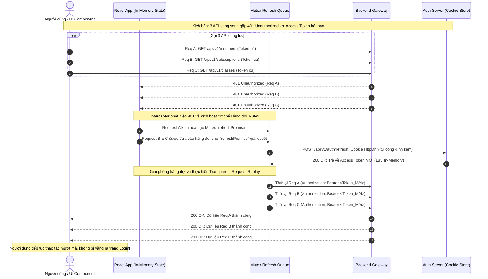

# Chuyên Đề 10: Bảo Mật Giao Diện & Quản Trị Phiên (Frontend Security & Session Governance)

> **Dự án:** Khung Tiêu Chuẩn Doanh Nghiệp & RoGym Management System Profile  
> **Phạm vi kỹ thuật:** Kiến trúc bảo mật Client-Side, Chính sách CSP, Quản trị Vòng đời Phiên & Token, Phòng chống OWASP Client-Side Top 10, Bảo vệ PII  
> **Cổng quy chuẩn chính:** [`FRONTEND_CONVENTIONS.md`](../FRONTEND_CONVENTIONS.md) | [Bản Đồ Tài Liệu](./README.md)  
> **Cơ sở tham chiếu quốc tế:** [OWASP Client-Side Top 10](https://owasp.org), [RFC 6749 / 6750 OAuth 2.0](https://datatracker.ietf.org/doc/html/rfc6749), [RFC 7519 JSON Web Token (JWT)](https://datatracker.ietf.org/doc/html/rfc7519), [MDN Content Security Policy (CSP)](https://developer.mozilla.org/en-US/docs/Web/HTTP/CSP), [DOMPurify](https://github.com/cure53/DOMPurify), [W3C WebAppSec Guidelines](https://www.w3.org/TR/webappsec-intro/)  
> **Phiên bản:** 8.0 (Enterprise Quality Standard — 15 Spokes & Universal Decoupling)  
> **Trạng thái:** Bắt buộc tuân thủ 100% (Strict Mandatory Enforcement)

---

## MỤC LỤC
1. [Bối Cảnh, Tầm Quan Trọng & Cơ Sở Tham Chiếu Quốc Tế](#1-bối-cảnh-tầm-quan-trọng-cơ-sở-tham-chiếu-quốc-tế)
2. [Triết Lý Kiến Trúc & Sơ Đồ Tư Duy (Visual Mental Model)](#2-triết-lý-kiến-trúc-sơ-đồ-tư-duy-visual-mental-model)
3. [Đặc Tả Kỹ Thuật Chi Tiết (Bộ Quy Chuẩn SEC-001 đến SEC-010)](#3-đặc-tả-kỹ-thuật-chi-tiết-bộ-quy-chuẩn-sec-001-đến-sec-010)
4. [Thực Hành Thực Tế: Do's & Don'ts & Case Studies (Mô Hình 2 Tầng)](#4-thực-hành-thực-tế-dos-donts-case-studies-mô-hình-2-tầng)
   - 4.1. [Bảng Đối Chiếu Anti-Patterns vs Chuẩn Mực Doanh Nghiệp](#41-bảng-đối-chiếu-anti-patterns-vs-chuẩn-mực-doanh-nghiệp)
   - 4.2. [Tầng 1: Enterprise Reference Implementations (Mã Nguồn Mẫu Chuẩn)](#42-tầng-1-enterprise-reference-implementations-mã-nguồn-mẫu-chuẩn)
   - 4.3. [Tầng 2: RoGym Implementation Profile & Gap Analysis (Hồ Sơ Thực Tế)](#43-tầng-2-rogym-implementation-profile-gap-analysis-hồ-sơ-thực-tế)
5. [Ánh Xạ Tooling Kiểm Toán CI (Automation Integration)](#5-ánh-xạ-tooling-kiểm-toán-ci-automation-integration)
6. [Bảng Checklist Định Lượng Trước Khi Mở PR (Security PR Review Gate)](#6-bảng-checklist-định-lượng-trước-khi-mở-pr-security-pr-review-gate)

---

## 1. Bối Cảnh, Tầm Quan Trọng & Cơ Sở Tham Chiếu Quốc Tế

Trong môi trường Single Page Application (SPA) doanh nghiệp hiện đại, trình duyệt web không còn đơn thuần là công cụ hiển thị tĩnh mà đã trở thành một hệ điều hành thu nhỏ xử lý nhiều logic nghiệp vụ, dữ liệu nhạy cảm và điều phối các phiên làm việc kéo dài. Do đó, client-side luôn là mục tiêu hàng đầu của các cuộc tấn công mạng:
- **Tấn công mã độc XSS (Cross-Site Scripting):** Kẻ tấn công lợi dụng việc chèn mã HTML/JS không qua kiểm duyệt để đánh cắp token xác thực hoặc giả mạo hành vi của người dùng.
- **Chiếm quyền điều khiển phiên (Session Hijacking):** Do lưu trữ JWT không đúng cách (lưu vào `localStorage` hoặc `sessionStorage`), bất kỳ lỗ hổng XSS nào từ một thư viện bên thứ ba cũng có thể dẫn đến việc toàn bộ phiên làm việc của người dùng bị khai thác.
- **Rò rỉ dữ liệu nhạy cảm (PII - Personally Identifiable Information):** Hiển thị số CCCD, tài khoản ngân hàng, số điện thoại nguyên bản trên UI hoặc vô tình ghi ra `console.log` khiến dữ liệu cá nhân bị phơi nhiễm.

Hệ thống tiêu chuẩn bảo mật này được xây dựng trên 5 trụ cột tham chiếu chuẩn quốc tế uy tín:
1. **OWASP Client-Side Top 10:** Hướng dẫn tiêu chuẩn quốc tế về phòng chống 10 lỗ hổng bảo mật nghiêm trọng nhất phía trình duyệt (XSS, Prototype Pollution, Broken Access Control, DOM Clobbering...).
2. **RFC 6749 / RFC 6750 (OAuth 2.0 Authorization Framework & Bearer Token):** Chuẩn hóa việc phân định ranh giới giữa Access Token ngắn hạn và Refresh Token bảo mật.
3. **RFC 7519 (JSON Web Token - JWT):** Quy chuẩn định dạng, ký số và kiểm tra tính toàn vẹn của token xác thực.
4. **MDN Content Security Policy (CSP):** Cơ chế phòng thủ chiều sâu (Defense-in-Depth) hạn chế tài nguyên và mã độc có thể được thực thi trong trang web.
5. **DOMPurify Standard:** Thư viện chuẩn mực làm sạch mã HTML chống Stored và Reflected XSS với hiệu năng cao và không tạo lỗ hổng bypass.

---

## 2. Triết Lý Kiến Trúc & Sơ Đồ Tư Duy (Visual Mental Model)

Triết lý nền tảng: **"Zero-Trust Client Environment — Không bao giờ tin tưởng môi trường trình duyệt và không bao giờ lưu trữ bí mật dài hạn tại vùng lưu trữ cục bộ không thể kiểm soát"**.

Hệ thống phân định rạch ròi cơ chế bảo vệ phiên 2 tầng:
1. **Access Token ngắn hạn (5 – 15 phút):** Chỉ được lưu trữ trong **Bộ nhớ tạm thời (In-Memory State)** của ứng dụng (Zustand không persist hoặc biến module khép kín). Khi người dùng tắt tab hoặc refresh trang, Access Token biến mất.
2. **Refresh Token dài hạn (7 – 30 ngày):** Được lưu trữ tuyệt đối trong **HTTP-Only, Secure, SameSite Cookie** do máy chủ quản lý. Mã JavaScript client hoàn toàn không thể đọc, trích xuất hay chỉnh sửa cookie này (`document.cookie` không thể truy cập).
3. **Cơ chế Silent Refresh có Mutex Queue:** Khi Access Token hết hạn, hệ thống tự động phát lệnh refresh ngầm. Nếu có nhiều request đồng thời gặp lỗi 401, hệ thống chỉ phát duy nhất 1 request `/auth/refresh` và đưa các request còn lại vào hàng đợi giải quyết tuần tự, ngăn chặn hoàn toàn hiện tượng Race Condition.



---

## 3. Đặc Tả Kỹ Thuật Chi Tiết (Bộ Quy Chuẩn SEC-001 đến SEC-010)

Bảng tổng hợp đặc tả 10 quy chuẩn bảo mật bắt buộc trong toàn bộ hệ sinh thái:

| Mã Rule | Tên Quy Chuẩn & Phạm Vi | Mức Độ | Tiêu Chí Pass / Fail Kỹ Thuật | Anti-Pattern (Don't) | Best Practice (Do) | Tệp RoGym Đối Chiếu |
| :---: | :--- | :---: | :--- | :--- | :--- | :--- |
| `SEC-001` | Cấm Render HTML Thô Không Sanitize | `ERROR` | **Pass:** 100% `dangerouslySetInnerHTML` phải bọc qua `DOMPurify.sanitize()`.<br/>**Fail:** Dùng `dangerouslySetInnerHTML` với chuỗi dữ liệu thô chưa lọc. | `<div dangerouslySetInnerHTML={{ __html: bio }} />` | `<div dangerouslySetInnerHTML={{ __html: DOMPurify.sanitize(bio) }} />` | [`src/components/ui/`](../src/components/ui/) |
| `SEC-002` | Cấu Hình Content Security Policy (CSP) | `ERROR` | **Pass:** Thiết lập CSP header nghiêm ngặt: `default-src 'self'`. Chặn nạp script từ domain lạ.<br/>**Fail:** Sử dụng `'unsafe-inline'` hoặc `'unsafe-eval'` thiếu kiểm soát. | Cấu hình CSP lỏng lẻo, nạp script từ CDN không xác thực. | CSP qua Meta tag hoặc Nginx header với danh sách domain tin cậy. | [`client/index.html`](../index.html) |
| `SEC-003` | Quản Trị Token (In-Memory + HttpOnly) | `ERROR` | **Pass:** Access Token ngắn hạn lưu in-memory; Refresh Token lưu trong HttpOnly Cookie.<br/>**Fail:** Lưu trữ JWT trong `localStorage` hoặc `sessionStorage`. | `localStorage.setItem('token', jwt);` | Access Token trong state module; Refresh Token trong Cookie `HttpOnly; Secure; SameSite=Strict`. | [`src/stores/authStore.ts`](../src/stores/authStore.ts) |
| `SEC-004` | Che Giấu Dữ Liệu Định Danh Cá Nhân (PII) | `ERROR` | **Pass:** Số CCCD, số thẻ ngân hàng, số điện thoại phải được che giấu trên UI (`•••• 5678`). Cấm log PII.<br/>**Fail:** Hiển thị toàn bộ số CCCD hoặc log đối tượng người dùng chứa CCCD ra console. | `<span>CCCD: {member.idCard}</span>` | `<span>CCCD: {maskPII(member.idCard, 'cccd')}</span>` | [`src/lib/owner-constants.ts`](../src/lib/owner-constants.ts) |
| `SEC-005` | Phòng Chống Tấn Công Clickjacking | `ERROR` | **Pass:** Web server trả về `X-Frame-Options: DENY` hoặc CSP `frame-ancestors 'none'`.<br/>**Fail:** Ứng dụng có thể bị lồng vào iframe độc hại từ domain ngoài. | Không thiết lập header chống iframe. | Khai báo `X-Frame-Options: DENY` (ngoại trừ whitelist endpoint LIFF). | [`client/vite.config.ts`](../vite.config.ts) |
| `SEC-006` | Chống DOM Clobbering & Prototype Pollution | `WARN` | **Pass:** Sử dụng `Map` hoặc `Object.create(null)` cho dynamic dictionary; validate schema trước khi merge.<br/>**Fail:** Thực hiện merge object đệ quy cho phép can thiệp `__proto__`. | `Object.assign(target, JSON.parse(userInput))` | Dùng schema parser (Zod) trước khi gán thuộc tính động. | [`src/utils/utils.ts`](../src/utils/utils.ts) |
| `SEC-007` | Bảo Mật Liên Kết Mở Tab Mới | `ERROR` | **Pass:** 100% liên kết ngoài mở tab mới (`target="_blank"`) phải có `rel="noopener noreferrer"`.<br/>**Fail:** Mở tab mới thiếu `rel="noopener noreferrer"` gây nguy cơ `window.opener` hijacking. | `<a href={url} target="_blank">Link</a>` | `<ButtonAnchor href={url} target="_blank" rel="noopener noreferrer">Link</ButtonAnchor>` | [`src/components/ui/Button.tsx`](../src/components/ui/actions/Button.tsx) |
| `SEC-008` | Hàng Đợi Token Refresh Chống Race Condition | `ERROR` | **Pass:** Sử dụng Mutex Queue trong Axios Interceptor; phát duy nhất 1 request refresh khi có nhiều 401.<br/>**Fail:** Nhiều request 401 cùng kích hoạt nhiều request refresh đồng thời. | Mỗi request 401 tự gọi refresh riêng làm rách phiên. | Sử dụng hàng đợi `refreshPromise` và resolve đồng loạt cho các request đang chờ. | [`src/services/api.ts`](../src/services/api.ts) |
| `SEC-009` | Kiểm Soát CORS & Headers Bảo Mật | `ERROR` | **Pass:** Khai báo cấu hình `withCredentials: true`, kiểm tra nghiêm ngặt Origin, trả đủ HSTS và nosniff.<br/>**Fail:** Phối hợp `Access-Control-Allow-Origin: *` với `withCredentials: true`. | Thiết lập wildcard CORS cho API có xác thực phiên. | Khai báo whitelist origin cụ thể và cấu hình HSTS đầy đủ. | [`src/services/api.ts`](../src/services/api.ts) |
| `SEC-010` | Quy Trình Hủy Phiên Sạch Sẽ Khi Logout | `ERROR` | **Pass:** Khi đăng xuất: xóa sạch memory state, xóa toàn bộ query cache, gọi API hủy cookie Refresh Token.<br/>**Fail:** Chỉ xóa state frontend nhưng cookie vẫn còn hiệu lực hoặc cache dữ liệu cũ còn tồn đọng. | Chỉ set `user = null` trên store cục bộ. | Kích hoạt `clearAuth()`, gọi `onLogout` listeners, `queryClient.clear()` và gọi API logout. | [`src/stores/authStore.ts`](../src/stores/authStore.ts) |
| `SEC-011` / `SEC-VCL-001` | Xác Thực Quyền Phía Server Cho Mọi Mutation `[server-auth-actions]` | `ERROR` | **Pass:** 100% mutation / action phải giải mã và kiểm tra quyền hạn (Role/Tenant) từ session/token phía server; không bao giờ tin cậy `userId` hay `role` do client tự gửi trong request body.<br/>**Fail:** Tin cậy `userId` hoặc `gymId` gửi từ client payload dẫn đến lỗ hổng IDOR hoặc leo thang đặc quyền. | `api.post('/members/delete', { memberId, requesterRole: 'admin' })` | Server tự trích xuất `requesterId` & `role` từ JWT/Session Cookie đã xác thực. | [`src/services/api.ts`](../src/services/api.ts) |

---

### Chi Tiết Từng Quy Chuẩn

### 3.1. Ma Trận So Sánh Các Cơ Chế Lưu Trữ Phiên Trong Trình Duyệt

| Tiêu Chí Đánh Giá | `localStorage` | `sessionStorage` | In-Memory (Zustand/Closure) | HttpOnly Secure Cookie | Đánh Giá Khuyến Nghị Doanh Nghiệp |
| :--- | :---: | :---: | :---: | :---: | :--- |
| **Miễn nhiễm trước XSS** | ❌ Hoàn toàn KHÔNG (Bị đánh cắp bằng 1 dòng script) | ❌ Hoàn toàn KHÔNG | ✅ CÓ (Không thể đọc trích xuất trực tiếp qua DOM API) | ✅ TUYỆT ĐỐI (JavaScript `document.cookie` không thể chạm tới) | **HttpOnly Cookie** là nơi duy nhất an toàn để lưu Refresh Token dài hạn. |
| **Nguy cơ tấn công CSRF** | ✅ Không bị ảnh hưởng CSRF tự động | ✅ Không bị ảnh hưởng CSRF tự động | ✅ Không bị ảnh hưởng CSRF tự động | ⚠️ Cần cấu hình `SameSite=Strict/Lax` + Anti-CSRF Token | **Phòng vệ kép:** Dùng SameSite Cookie kết hợp header Bearer Authorization. |
| **Đồng bộ qua các Browser Tabs** | ✅ Có (`storage` event) | ❌ Không (Mỗi tab là phiên riêng) | ⚠️ Cần `BroadcastChannel` | ✅ Tự động chia sẻ qua cookie domain | In-Memory + HttpOnly Cookie cho phép mở nhiều tab mà không bị logout. |
| **Thời hạn sống (Persistence)** | Vĩnh viễn cho đến khi bị xóa | Mất khi đóng tab | Mất khi reload trang | Có thời hạn hết hạn xác định (`Max-Age`) | Phối hợp Access Token ngắn hạn (In-Memory) và Refresh Token (Cookie). |
| **Phù hợp Render SSR** | ❌ Không thể đọc phía server | ❌ Không thể đọc phía server | ❌ Không thể đọc phía server | ✅ Tự động gửi kèm request HTTP đầu tiên | HttpOnly Cookie hỗ trợ xác thực SSR/Edge Middleware liền mạch. |

---

### 3.2. Đặc Tả Chi Tiết Từng Quy Chuẩn Kỹ Thuật

<a id="sec-001"></a>
#### `SEC-001`: Cấm Render HTML Thô Không Sanitize
- **Mục tiêu:** Ngăn chặn tuyệt đối lỗ hổng Stored XSS và Reflected XSS khi render nội dung mô tả, ghi chú hoặc bài viết do người dùng hoặc bên thứ ba cung cấp.
- **Quy tắc thực thi:** Cấm sử dụng trực tiếp thuộc tính `dangerouslySetInnerHTML` nếu giá trị đầu vào chưa được đưa qua hàm `DOMPurify.sanitize()`. Khuyến khích tạo một component bọc duy nhất `<SanitizedHTML dirty={html} />` để quản lý tập trung thay vì bọc thủ công rải rác.

<a id="sec-002"></a>
#### `SEC-002`: Cấu Hình Content Security Policy (CSP) Chặt Chẽ
- **Mục tiêu:** Hạn chế các nguồn tài nguyên script, style, image và frame có thể thực thi trong ứng dụng, giảm thiểu rủi ro khi có lỗ hổng XSS xảy ra.
- **Quy tắc thực thi:** Cấu hình CSP thông qua thẻ `<meta http-equiv="Content-Security-Policy">` hoặc HTTP Response Header từ web server:
  ```http
  default-src 'self';
  script-src 'self';
  style-src 'self' 'unsafe-inline';
  img-src 'self' data: https:;
  font-src 'self' data:;
  connect-src 'self' https://api.rogym.com https://*.sentry.io;
  frame-ancestors 'none';
  object-src 'none';
  base-uri 'self';
  ```

<a id="sec-003"></a>
#### `SEC-003`: Quản Trị Token An Toàn (In-Memory Access Token + HttpOnly Refresh Cookie)
- **Mục tiêu:** Triệt tiêu hoàn toàn khả năng tin tặc sử dụng mã XSS để đọc trích xuất Refresh Token dài hạn.
- **Quy tắc thực thi:**
  - Tuyệt đối không lưu Access Token hoặc Refresh Token vào `localStorage` hoặc `sessionStorage`.
  - Access Token chỉ được nắm giữ trong bộ nhớ (Zustand non-persisted store hoặc biến closure trong module API).
  - Refresh Token được gửi về từ Backend dưới dạng cookie có cờ `HttpOnly; Secure; SameSite=Strict` (hoặc `SameSite=Lax` nếu có tích hợp điều hướng OAuth SSO ngoài).

<a id="sec-004"></a>
#### `SEC-004`: Bảo Vệ Dữ Liệu Định Danh Cá Nhân (PII Masking)
- **Mục tiêu:** Đảm bảo tuân thủ các quy định bảo vệ dữ liệu cá nhân (GDPR, Nghị định 13/2023/NĐ-CP tại Việt Nam), ngăn chặn việc nhân viên hoặc người quan sát chụp màn hình thấy toàn bộ thông tin nhạy cảm.
- **Quy tắc thực thi:**
  - Số CCCD/CMND (12 chữ số): Chỉ hiển thị 4 số cuối, ví dụ: `•••••••• 5678`.
  - Số tài khoản ngân hàng / thẻ tín dụng: Chỉ hiển thị 4 số cuối, ví dụ: `•••• •••• •••• 1234`.
  - Số điện thoại: Ẩn 3 chữ số ở giữa, ví dụ: `090 ••• 1234`.
  - Cấm log các trường PII này ra `console.log` hoặc đính kèm vào telemetry payloads.
- **Code mẫu UI Component hỗ trợ bật/tắt hiển thị có kiểm soát quyền:**
  ```tsx
  import { useState } from 'react'
  import { useTranslation } from 'react-i18next'
  import { maskPII, type PIIType } from '@/utils/pii-masker'
  import { Button } from '@/components/ui/actions/Button'
  import { Text } from '@/components/ui/typography/Text'

  export function MaskedField({ value, type }: { value: string; type: PIIType }) {
    const { t } = useTranslation()
    const [revealed, setRevealed] = useState(false)

    return (
      <Text as="span" className="inline-flex items-center gap-2 font-mono text-sm">
        <span>{revealed ? value : maskPII(value, type)}</span>
        <Button
          type="button"
          variant="ghost"
          size="compact"
          onClick={() => setRevealed(prev => !prev)}
          className="text-xs text-muted-foreground hover:text-foreground underline"
        >
          {revealed ? t('common.hide') : t('common.show')}
        </Button>
      </Text>
    )
  }
  ```

<a id="sec-005"></a>
#### `SEC-005`: Phòng Chống Tấn Công Clickjacking
- **Mục tiêu:** Ngăn chặn kẻ tấn công nhúng website của tổ chức vào một khung `<iframe>` trong suốt trên trang web lừa đảo để dụ dỗ người dùng click ngoài ý muốn.
- **Quy tắc thực thi:** Web server bắt buộc cấu hình header `X-Frame-Options: DENY` hoặc CSP `frame-ancestors 'none'`. Nếu ứng dụng có trang nhúng bắt buộc (như LINE LIFF Webview hoặc Widget nhúng đối tác), chỉ cho phép frame-ancestors đối với các domain trong whitelist xác thực cụ thể (`frame-ancestors 'self' https://access.line.me`).

<a id="sec-006"></a>
#### `SEC-006`: Phòng Chống DOM Clobbering & Prototype Pollution
- **Mục tiêu:** Ngăn chặn kẻ tấn công tiêm các phần tử HTML có `id` hoặc `name` trùng với các biến toàn cục của trình duyệt, hoặc can thiệp thuộc tính `__proto__` của Object prototype.
- **Quy tắc thực thi:**
  - Khi cần tạo từ điển tra cứu linh hoạt (Lookup dictionary), ưu tiên dùng `new Map()` hoặc `Object.create(null)`.
  - Không sử dụng các hàm merge đối tượng đệ quy tự viết mà không có bộ lọc thuộc tính `__proto__`, `constructor`, `prototype`.
- **Code mẫu hàm Deep Merge an toàn tuyệt đối:**
  ```typescript
  export function safeDeepMerge<T extends Record<string, unknown>>(target: T, source: Record<string, unknown>): T {
    const output = { ...target }
    const BLOCKED_KEYS = new Set(['__proto__', 'constructor', 'prototype'])

    for (const key of Object.keys(source)) {
      if (BLOCKED_KEYS.has(key)) continue
      const val = source[key]
      if (val && typeof val === 'object' && !Array.isArray(val)) {
        output[key as keyof T] = safeDeepMerge(
          (output[key as keyof T] as Record<string, unknown>) || {},
          val as Record<string, unknown>
        ) as T[keyof T]
      } else {
        output[key as keyof T] = val as T[keyof T]
      }
    }
    return output
  }
  ```

<a id="sec-007"></a>
#### `SEC-007`: Bảo Mật Liên Kết Mở Tab Mới (`rel="noopener noreferrer"`)
- **Mục tiêu:** Ngăn chặn trang đích mở trong tab mới chiếm quyền điều khiển trang gốc thông qua đối tượng `window.opener.location`.
- **Quy tắc thực thi:** 100% thẻ link có `target="_blank"` bắt buộc phải có thuộc tính `rel="noopener noreferrer"`. Trong hệ thống RoGym, luôn sử dụng component UI Primitive chuẩn [`<ButtonAnchor>`](../src/components/ui/actions/Button.tsx) để tự động hóa việc đính kèm các thuộc tính này.

<a id="sec-008"></a>
#### `SEC-008`: Cơ Chế Token Refresh Tự Động Chống Race Condition (Mutex Queue)
- **Mục tiêu:** Ngăn chặn hiện tượng gián đoạn phiên khi một màn hình gửi 5-10 request API song song và Access Token đồng thời hết hạn.
- **Quy tắc thực thi:** Trong interceptor xử lý mã lỗi 401:
  - Khởi tạo một biến Mutex Promise đại diện cho tác vụ refresh đang chạy (`refreshPromise`).
  - Request đầu tiên nhận lỗi 401 sẽ khởi tạo `refreshPromise`.
  - Toàn bộ các request 401 tiếp theo sẽ đăng ký callback vào hàng đợi để chờ `refreshPromise` hoàn thành thay vì tự ý gọi thêm request `/auth/refresh`.
  - Khi refresh thành công, toàn bộ các request trong hàng đợi được thử lại (replay) với token mới.

<a id="sec-009"></a>
#### `SEC-009`: Kiểm Soát CORS & Headers Bảo Mật Chuẩn Doanh Nghiệp
- **Mục tiêu:** Đảm bảo trình duyệt chỉ chấp nhận giao tiếp API từ các nguồn được ủy quyền và kích hoạt toàn bộ cơ chế tự vệ của trình duyệt.
- **Quy tắc thực thi:**
  - Thiết lập Axios instance với `withCredentials: true` để truyền cookie an toàn.
  - Phía máy chủ không được phép trả về header `Access-Control-Allow-Origin: *` khi client gửi request có credentials.
  - Phải cấu hình các headers phòng vệ: `Strict-Transport-Security: max-age=31536000; includeSubDomains; preload` và `X-Content-Type-Options: nosniff`.

<a id="sec-010"></a>
#### `SEC-010`: Quy Trình Hủy Phiên Sạch Sẽ (Session Purge) Khi Đăng Xuất
- **Mục tiêu:** Đảm bảo khi người dùng bấm Đăng xuất, không còn bất kỳ dấu vết dữ liệu bảo mật nào sót lại trong bộ nhớ trình duyệt có thể bị người dùng tiếp theo trên cùng máy tính khai thác.
- **Quy tắc thực thi:** Quy trình đăng xuất phải thực hiện đầy đủ 4 bước tuần tự:
  ```typescript
  import { queryClient } from '@/lib/query-client'
  import { useAuthStore, notifyLogout } from '@/stores/authStore'
  import api from '@/services/api'

  export async function executeSecureLogout(): Promise<void> {
    try {
      // 1. Gọi API phía máy chủ để thu hồi Refresh Token cookie
      await api.post('/auth/logout', {}, { suppressAuthRedirect: true })
    } catch (err) {
      console.warn('Lỗi thu hồi phiên server:', err)
    } finally {
      // 2. Xóa sạch Access Token trong in-memory store
      useAuthStore.getState().clearAuth()

      // 3. Thông báo cho toàn bộ các store đăng ký lắng nghe giải phóng bộ nhớ
      notifyLogout()

      // 4. Xóa toàn bộ dữ liệu truy vấn trong React Query cache
      queryClient.clear()

      // 5. Điều hướng an toàn về trang đăng nhập
      window.location.href = '/login'
    }
  }
  ```

<a id="sec-011"></a>
#### `SEC-011` / `SEC-VCL-001`: Xác Thực Quyền Hạn Phía Server Cho Mọi Mutation (`[server-auth-actions]`)
- **Mục tiêu:** Ngăn chặn tuyệt đối các lỗ hổng Insecure Direct Object References (IDOR), leo thang đặc quyền (Privilege Escalation), và CSRF khi thực hiện các hành động ghi/sửa/xóa dữ liệu.
- **Quy tắc thực thi:**
  - Không bao giờ truyền `role`, `isAdmin`, hoặc `tenantId` / `gymId` từ form input client để máy chủ quyết định quyền. Server hoặc Server Actions bắt buộc phải đọc session/cookie đã xác thực và tự trích xuất danh tính người dùng (`req.user.id`, `session.user.role`).
  - Trong kiến trúc Server Actions (Next.js / Full-Stack): Luôn kiểm tra session bên trong thân hàm server action trước khi thao tác DB:
    ```typescript
    'use server'
    import { auth } from '@/auth'
    import { db } from '@/server/db'

    export async function deleteGymMember(memberId: string) {
      const session = await auth()
      if (!session?.user?.id || session.user.role !== 'OWNER') {
        throw new Error('403 Forbidden: Yêu cầu quyền chủ phòng tập')
      }
      return db.member.delete({ where: { id: memberId, gymId: session.user.gymId } })
    }
    ```
  - Trong client SPA (RoGym Vite): Client UI chỉ dùng role để ẩn/hiện nút (UX Guard); 100% bảo vệ dữ liệu thực thụ phải do Backend NestJS Guards (`@UseGuards(JwtAuthGuard, RolesGuard)`) đảm nhiệm.

---

## 4. Thực Hành Thực Tế: Do's & Don'ts & Case Studies (Mô Hình 2 Tầng)

### 4.1. Bảng Đối Chiếu Anti-Patterns vs Chuẩn Mực Doanh Nghiệp

| Lĩnh vực | ❌ Anti-Pattern (Don't) | ✅ Chuẩn Mực Doanh Nghiệp (Do) | Nguyên Nhân Kỹ Thuật |
| :--- | :--- | :--- | :--- |
| **Xử lý Render HTML** | `<div dangerouslySetInnerHTML={{ __html: bio }} />` | `<SanitizedHTML dirty={bio} />` sử dụng `DOMPurify.sanitize()`. | Chuỗi HTML không lọc có thể chứa thẻ `` thực thi mã XSS đánh cắp phiên. |
| **Lưu Trữ Token** | `localStorage.setItem('token', jwt);` | Lưu Access Token trong In-Memory State; Refresh Token trong HttpOnly Cookie. | `localStorage` hoàn toàn không có cơ chế bảo vệ trước mã độc JavaScript chạy trên trang. |
| **Hiển Thị Dữ Liệu PII** | Hiển thị CCCD đầy đủ: `<span>{user.idCard}</span>` | `<span>{maskPII(user.idCard, 'cccd')}</span>` | Tránh phơi nhiễm thông tin nhạy cảm của khách hàng khi bị nhìn trộm hoặc chụp màn hình. |
| **Xử Lý Lỗi 401 Nhiều API** | Mỗi request 401 tự gọi `/auth/refresh` riêng biệt. | Sử dụng Mutex Promise `refreshPromise` điều phối hàng đợi retry. | Gọi refresh đồng loạt gây Race Condition và vô hiệu hóa cơ chế xoay vòng Refresh Token phía backend. |
| **Điều Hướng Liên Kết Ngoài** | `<a href={url} target="_blank">Tài liệu</a>` | `<ButtonAnchor href={url} target="_blank" rel="noopener noreferrer">Tài liệu</ButtonAnchor>` | Tab mới có thể can thiệp trang hiện tại qua `window.opener.location = 'phishing-url'`. |

---

### 4.2. Tầng 1: Enterprise Reference Implementations (Mã Nguồn Mẫu Chuẩn)

Dưới đây là 3 khối mã nguồn mẫu độc lập đạt chuẩn doanh nghiệp cao nhất, có thể kế thừa cho bất kỳ dự án React Enterprise nào:

#### 1. Blueprint: Module Điều Phối Axios Interceptor Với Mutex Queue (`auth-interceptor.ts`)
```typescript
import axios, { AxiosError, AxiosHeaders, type AxiosInstance, type InternalAxiosRequestConfig } from 'axios'

interface CustomRequestConfig extends InternalAxiosRequestConfig {
  _retry?: boolean
}

interface AuthTokens {
  accessToken: string
}

type TokenProvider = () => string | null
type RefreshHandler = () => Promise<string>
type LogoutHandler = () => void

export function setupAuthInterceptor(
  apiInstance: AxiosInstance,
  getToken: TokenProvider,
  onRefreshToken: RefreshHandler,
  onLogout: LogoutHandler
): void {
  let refreshPromise: Promise<string> | null = null

  // Request Interceptor: Gắn Access Token từ In-Memory Store
  apiInstance.interceptors.request.use((config) => {
    const token = getToken()
    const headers = AxiosHeaders.from(config.headers)
    if (token && !headers.has('Authorization')) {
      headers.set('Authorization', `Bearer ${token}`)
    }
    config.headers = headers
    return config
  })

  // Response Interceptor: Xử lý 401 với Mutex Refresh Queue
  apiInstance.interceptors.response.use(
    (response) => response,
    async (error: AxiosError) => {
      const originalConfig = error.config as CustomRequestConfig | undefined

      if (!originalConfig || error.response?.status !== 401 || originalConfig._retry) {
        return Promise.reject(error)
      }

      // Đánh dấu request này đã retry để tránh lặp vô hạn
      originalConfig._retry = true

      try {
        // Áp dụng Mutex: Nếu đang có request refresh chạy thì tái sử dụng promise đó
        refreshPromise ??= onRefreshToken().finally(() => {
          refreshPromise = null
        })

        const newAccessToken = await refreshPromise

        // Cập nhật header với token mới và thử lại request ban đầu
        const headers = AxiosHeaders.from(originalConfig.headers)
        headers.set('Authorization', `Bearer ${newAccessToken}`)
        originalConfig.headers = headers

        return apiInstance.request(originalConfig)
      } catch (refreshError) {
        onLogout()
        return Promise.reject(refreshError)
      }
    }
  )
}
```

#### 2. Blueprint: Helper Che Giấu Dữ Liệu Nhạy Cảm (`pii-masker.ts`)
```typescript
/**
 * Tiện ích che giấu thông tin định danh cá nhân (PII Masking) chuẩn Enterprise
 */
export type PIIType = 'cccd' | 'bankCard' | 'phone' | 'email'

export function maskPII(value: string | null | undefined, type: PIIType): string {
  if (!value) return ''
  const trimmed = value.trim()

  switch (type) {
    case 'cccd': {
      // Giữ lại 4 số cuối của CCCD (12 chữ số)
      const clean = trimmed.replace(/\D/g, '')
      if (clean.length < 4) return '••••'
      return `•••••••• ${clean.slice(-4)}`
    }
    case 'bankCard': {
      // Giữ lại 4 số cuối của thẻ ngân hàng (16 chữ số)
      const clean = trimmed.replace(/\D/g, '')
      if (clean.length < 4) return '•••• •••• •••• ••••'
      return `•••• •••• •••• ${clean.slice(-4)}`
    }
    case 'phone': {
      // Giữ 3 số đầu và 3 số cuối của số điện thoại: 090 ••• 1234
      const clean = trimmed.replace(/\D/g, '')
      if (clean.length < 7) return clean
      return `${clean.slice(0, 3)} ••• ${clean.slice(-4)}`
    }
    case 'email': {
      // user@domain.com -> u***r@domain.com
      const parts = trimmed.split('@')
      if (parts.length !== 2) return '••••@••••'
      const name = parts[0]
      const domain = parts[1]
      if (name.length <= 2) return `${name[0]}*@${domain}`
      return `${name[0]}${'*'.repeat(Math.max(1, name.length - 2))}${name.slice(-1)}@${domain}`
    }
    default:
      return '••••'
  }
}
```

#### 3. Blueprint: Thành Phần Bọc HTML An Toàn Chống XSS (`SanitizedHTML.tsx`)
```tsx
import { memo, useMemo } from 'react'
import DOMPurify from 'dompurify'

export interface SanitizedHTMLProps {
  dirty: string | null | undefined
  className?: string
  as?: 'div' | 'span' | 'article' | 'section'
}

/**
 * Component chuẩn mực để render nội dung HTML phong phú đã qua lọc DOMPurify
 */
export const SanitizedHTML = memo(function SanitizedHTML({
  dirty,
  className,
  as: Component = 'div',
}: SanitizedHTMLProps) {
  const cleanHtml = useMemo(() => {
    if (!dirty) return ''
    return DOMPurify.sanitize(dirty, {
      ALLOWED_TAGS: ['b', 'i', 'em', 'strong', 'a', 'p', 'br', 'ul', 'ol', 'li', 'span'],
      ALLOWED_ATTR: ['href', 'target', 'rel', 'class'],
      FORBID_TAGS: ['script', 'style', 'iframe', 'object', 'embed'],
      FORBID_ATTR: ['onerror', 'onload', 'onclick', 'onmouseover'],
    })
  }, [dirty])

  if (!cleanHtml) return null

  return (
    <Component
      className={className}
      dangerouslySetInnerHTML={{ __html: cleanHtml }}
    />
  )
})
```

#### 4. Blueprint: Bộ Kiểm Thử Đơn Vị Vitest Cho Helper Che Giấu PII (`pii-masker.test.ts`)
```typescript
import { describe, it, expect } from 'vitest'
import { maskPII } from './pii-masker'

describe('Unit Test: maskPII Helper', () => {
  it('che giấu chính xác 8 số đầu của CCCD 12 chữ số', () => {
    expect(maskPII('012345678901', 'cccd')).toBe('•••••••• 8901')
    expect(maskPII('012-345-678-901', 'cccd')).toBe('•••••••• 8901')
  })

  it('che giấu chính xác số thẻ ngân hàng và giữ 4 số cuối', () => {
    expect(maskPII('9704123456789999', 'bankCard')).toBe('•••• •••• •••• 9999')
  })

  it('ẩn chính xác 3 số ở giữa số điện thoại di động', () => {
    expect(maskPII('0901234567', 'phone')).toBe('090 ••• 4567')
  })

  it('ẩn ký tự tên email nhưng giữ chữ đầu và chữ cuối', () => {
    expect(maskPII('alexander@example.com', 'email')).toBe('a*******r@example.com')
    expect(maskPII('bo@example.com', 'email')).toBe('b*@example.com')
  })

  it('xử lý an toàn khi giá trị null hoặc undefined', () => {
    expect(maskPII(null, 'cccd')).toBe('')
    expect(maskPII(undefined, 'phone')).toBe('')
  })
})
```

#### 5. Blueprint: Cấu Hình Nginx Web Server An Toàn Đầy Đủ Headers (`security-headers.conf`)
```nginx
# Nginx Security Headers Configuration (Enterprise Standard)
add_header X-Frame-Options "DENY" always;
add_header X-Content-Type-Options "nosniff" always;
add_header X-XSS-Protection "1; mode=block" always;
add_header Referrer-Policy "strict-origin-when-cross-origin" always;
add_header Permissions-Policy "camera=(), microphone=(), geolocation=(), payment=()" always;

# HSTS: Buộc trình duyệt sử dụng HTTPS trong 1 năm kèm Subdomains và Preload
add_header Strict-Transport-Security "max-age=31536000; includeSubDomains; preload" always;

# Content Security Policy (CSP) chặt chẽ
add_header Content-Security-Policy "default-src 'self'; script-src 'self'; style-src 'self' 'unsafe-inline'; img-src 'self' data: https:; font-src 'self' data:; connect-src 'self' https://api.rogym.com https://*.sentry.io; frame-ancestors 'none'; object-src 'none'; base-uri 'self';" always;
```

---

### 4.3. Tầng 2: RoGym Implementation Profile & Gap Analysis (Hồ Sơ Thực Tế)

#### 1. Đánh Giá Hiện Trạng [`src/services/api.ts`](../src/services/api.ts)
- **Điểm sáng xuất sắc đã đạt:**
  - Tệp đã triển khai cơ chế Mutex `refreshPromise` chống race condition rất bài bản cho phiên LINE LIFF (`executeSilentLineRefresh()`), ngăn chặn việc nhiều request 401 cùng kích hoạt nhiều lời gọi refresh ([`api.ts`](../src/services/api.ts)).
  - Có cấu hình `withCredentials: true` tại instance Axios ([`api.ts`](../src/services/api.ts)).
- **Khoảng cách kỹ thuật (Gap Analysis) cần nâng cấp:**
  - *Khoảng cách 1:* Đối với phiên đăng nhập thông thường (không phải LINE), mã nguồn hiện tại lập tức xóa auth và điều hướng cưỡng bức về `/login` (`api.ts`) mà chưa hỗ trợ Silent Refresh Token qua HttpOnly cookie.
  - *Lộ trình chuẩn hóa:* Cần áp dụng cơ chế `refreshPromise` thống nhất cho cả 2 loại phiên (Credential Auth và LINE OAuth) như mô hình kiến trúc của `EnterpriseAuthInterceptor`.

#### 2. Đánh Giá Hiện Trạng [`src/stores/authStore.ts`](../src/stores/authStore.ts)
- **Điểm sáng xuất sắc đã đạt:**
  - Có cơ chế pub-sub giải phóng tài nguyên thông qua `onLogout` và `notifyLogout` ([`authStore.ts`](../src/stores/authStore.ts)), giúp các store khác dọn dẹp bộ nhớ khi người dùng thoát.
- **Khoảng cách kỹ thuật (Gap Analysis) cần nâng cấp:**
  - *Khoảng cách 2 (Quy chuẩn `SEC-003`):* Store hiện đang sử dụng middleware `persist` của Zustand để lưu trữ `token` trực tiếp vào `localStorage` dưới khóa `gym-auth` ([`authStore.ts`](../src/stores/authStore.ts)). Điều này tạo nguy cơ lộ token nếu ứng dụng phát sinh lỗ hổng XSS từ thư viện bên ngoài.
  - *Lộ trình chuẩn hóa:* Tách biệt cấu trúc lưu trữ: Chỉ persist thông tin phi bảo mật của người dùng (tùy chọn giao diện, `hasHydrated`), loại bỏ trường `token` ra khỏi hàm `partialize` của persist store, chuyển `token` sang vùng nhớ in-memory.

---

## 5. Ánh Xạ Tooling Kiểm Toán CI (Automation Integration)

Hệ thống bảo mật được kiểm soát và tự động hóa thông qua các công cụ phân tích tĩnh:

### 5.1. Bảng Ánh Xạ Quy Chuẩn Bảo Mật Sang Công Cụ Phân Tích Tự Động

| Mã Quy Chuẩn | Công Cụ Kiểm Soát Tự Động | Cấu Hình / Lệnh Thực Thi | Mức Độ Chặn Trong CI |
| :---: | :--- | :--- | :---: |
| `SEC-001` | ESLint (`react/no-danger`) | `"react/no-danger": "error"` | **Chặn Build (Exit 1)** |
| `SEC-001` | ESLint (`no-unsanitized`) | `"no-unsanitized/method": "error"` | **Chặn Build (Exit 1)** |
| `SEC-003` | Custom AST Audit / Regex | `grep -rnE "(localStorage\|sessionStorage)\.(setItem)\(.*token.*\)" src/` | **Chặn Pre-commit (Exit 1)** |
| `SEC-004` | SonarQube / Secret Lint | Quét các chuỗi regex khớp định dạng thẻ tín dụng hoặc CCCD không che giấu | Cảnh báo PR Review |
| `SEC-005` | Nginx Linter / CI Curl Test | `curl -I https://app.rogym.com \| grep -i "X-Frame-Options: DENY"` | **Chặn Deployment** |
| `SEC-007` | ESLint (`react/jsx-no-target-blank`) | `"react/jsx-no-target-blank": ["error", { "enforceDynamicLinks": "always" }]` | **Chặn Build (Exit 1)** |
| `SEC-009` | Security Headers Analyzer | `curl -I https://app.rogym.com \| grep -i "Strict-Transport-Security"` | **Chặn Deployment** |
| `SEC-*` | NPM Audit Security Scanner | `npm audit --audit-level=high` | **Chặn CI Pipeline (Exit 1)** |

### 5.2. Hướng Dẫn Cấu Hình Chi Tiết Các Bộ Lọc

1. **ESLint Static Rules:**
   - Cấu hình rule `react/no-danger: "error"` để phát hiện toàn bộ việc sử dụng `dangerouslySetInnerHTML`.
   - Cấu hình plugin `eslint-plugin-no-unsanitized` kiểm tra phương thức chèn HTML.
2. **Kịch Bản Regex Audit Kiểm Tra Lưu Trữ Token:**
   - Tích hợp kiểm tra tự động trong công cụ kiểm toán tĩnh nhằm phát hiện các mẫu vi phạm:
     ```bash
     grep -rnE "(localStorage|sessionStorage)\.(setItem|getItem)\(.*token.*\)" src/
     ```
3. **CI Dependency Vulnerability Audit:**
   - Thiết lập câu lệnh quét lỗ hổng thư viện trong pipeline CI GitHub Actions:
     ```bash
     npm audit --audit-level=high
     ```

---

## 6. Bảng Checklist Định Lượng Trước Khi Mở PR (Security PR Review Gate)

Nhằm đảm bảo tính thực tiễn và không làm ách tắc luồng phát hành tính năng hàng ngày của dự án RoGym, bảng nghiệm thu PR được phân định thành 2 cấp độ tuân thủ theo [Mục 9 Master Plan](../FRONTEND_CONVENTIONS.md):
- **Tầng DoD 9.2A (Target Enterprise DoD):** Áp dụng bắt buộc 100% đối với các dự án mới khởi tạo từ Starter Template hoặc khi viết mới hoàn toàn module Auth doanh nghiệp.
- **Tầng DoD 9.2B (RoGym Transition DoD):** Áp dụng cho các Pull Request hiện hành trên RoGym theo nguyên tắc **Boy Scout Rule** (không đưa thêm vi phạm mới, cải tiến dần các file được chỉnh sửa, không chặn merge nếu lỗi tồn đọng từ trước thuộc về kiến trúc cũ).

### Checklist 10 Tiêu Chí Nghiệm Thu Bảo Mật:


- [ ] **1. `SEC-001` (HTML Sanitization):** 100% việc chèn mã HTML phong phú đều được bọc qua component `<SanitizedHTML>` hoặc đã gọi qua `DOMPurify.sanitize()`.
- [ ] **2. `SEC-002` (CSP Compliant):** Không tự ý nhúng các thẻ `<script>` dẫn từ CDN bên ngoài ngoài whitelist đã khai báo trong chính sách CSP.
- [ ] **3. `SEC-003` (Token Storage):** Không viết thêm bất kỳ dòng code nào lưu Access Token hoặc Refresh Token vào `localStorage` / `sessionStorage`.
- [ ] **4. `SEC-004` (PII Masking):** Toàn bộ các trường dữ liệu định danh nhạy cảm (CCCD, số thẻ ngân hàng, số điện thoại) đều được bọc qua hàm `maskPII()`.
- [ ] **5. `SEC-005` (Clickjacking):** Không gỡ bỏ các cấu hình bảo vệ frame hoặc để hở trang cho phép nhúng iframe từ domain lạ.
- [ ] **6. `SEC-006` (Prototype Safe):** Các thao tác với dictionary động sử dụng `Map` hoặc đã validate qua Zod schema, không thực hiện merge đệ quy thô.
- [ ] **7. `SEC-007` (External Links):** Mọi liên kết ngoài mở tab mới đều sử dụng component `<ButtonAnchor>` hoặc có đủ `target="_blank" rel="noopener noreferrer"`.
- [ ] **8. `SEC-008` (Refresh Mutex):** Không viết các lời gọi refresh token độc lập trong service mới; mọi request đều phải đi qua interceptor điều phối chung.
- [ ] **9. `SEC-009` (CORS Discipline):** Không cấu hình headers CORS wildcard kết hợp credentials trong các dịch vụ API mới.
- [ ] **10. `SEC-010` (Session Purge):** Logic đăng xuất đã kích hoạt đầy đủ việc xóa memory state, dọn dẹp React Query cache và gọi API thu hồi cookie phía máy chủ.


