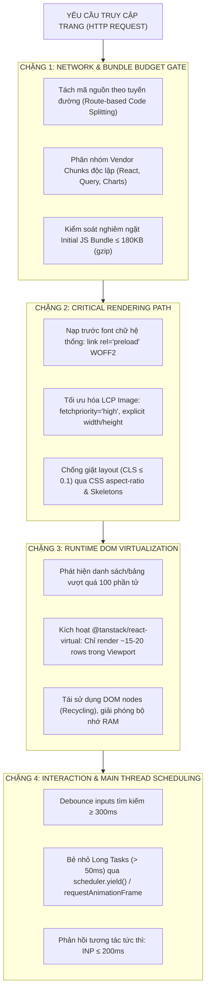

# Chuyên Đề 11: Kỹ Thuật Hiệu Năng & Web Vitals (Web Performance & Core Web Vitals)

> **Dự án:** Khung Tiêu Chuẩn Doanh Nghiệp & RoGym Management System Profile  
> **Phạm vi kỹ thuật:** Tối ưu hóa hiệu năng Runtime & Build-time, Đo lường Core Web Vitals ($LCP, INP, CLS$), Ngân sách Bundle Budget, Ảo hóa Danh sách Lớn (Virtualization), Tối ưu hóa Vòng đời Render  
> **Cổng quy chuẩn chính:** [`FRONTEND_CONVENTIONS.md`](../FRONTEND_CONVENTIONS.md) | [Bản Đồ Tài Liệu](./README.md)  
> **Cơ sở tham chiếu quốc tế:** [Google Web Vitals](https://web.dev/vitals/), [Web.dev Fast Load Times](https://web.dev/fast/), [TanStack Virtual](https://tanstack.com/virtual), [W3C Navigation Timing & Resource Timing](https://www.w3.org/TR/navigation-timing-2/), [Vite Production Build Optimization](https://vitejs.dev/guide/build.html)  
> **Phiên bản:** 8.0 (Enterprise Quality Standard — 15 Spokes & Universal Decoupling)  
> **Trạng thái:** Bắt buộc tuân thủ 100% (Strict Mandatory Enforcement)

---

## MỤC LỤC
1. [Bối Cảnh, Tầm Quan Trọng & Cơ Sở Tham Chiếu Quốc Tế](#1-bối-cảnh-tầm-quan-trọng-cơ-sở-tham-chiếu-quốc-tế)
2. [Triết Lý Kiến Trúc & Sơ Đồ Tư Duy (Visual Mental Model)](#2-triết-lý-kiến-trúc-sơ-đồ-tư-duy-visual-mental-model)
3. [Đặc Tả Kỹ Thuật Chi Tiết (Bộ Quy Chuẩn PERF-001 đến PERF-010)](#3-đặc-tả-kỹ-thuật-chi-tiết-bộ-quy-chuẩn-perf-001-đến-perf-010)
   - 3.1. [Bảng Tổng Hợp 10 Quy Chuẩn Hiệu Năng Doanh Nghiệp](#31-bảng-tổng-hợp-10-quy-chuẩn-hiệu-năng-doanh-nghiệp)
   - 3.2. [Bảng Định Lượng Ngưỡng Chi Tiết Bộ Ba Chỉ Số Core Web Vitals (Google Standard)](#32-bảng-định-lượng-ngưỡng-chi-tiết-bộ-ba-chỉ-số-core-web-vitals-google-standard)
   - 3.3. [Đặc Tả Chi Tiết Từng Quy Chuẩn Kỹ Thuật](#33-đặc-tả-chi-tiết-từng-quy-chuẩn-kỹ-thuật)
4. [Thực Hành Thực Tế: Do's & Don'ts & Case Studies (Mô Hình 2 Tầng)](#4-thực-hành-thực-tế-dos-donts-case-studies-mô-hình-2-tầng)
   - 4.1. [Bảng Đối Chiếu Anti-Patterns vs Chuẩn Mực Doanh Nghiệp](#41-bảng-đối-chiếu-anti-patterns-vs-chuẩn-mực-doanh-nghiệp)
   - 4.2. [Tầng 1: Enterprise Reference Implementations (Mã Nguồn Mẫu Chuẩn)](#42-tầng-1-enterprise-reference-implementations-mã-nguồn-mẫu-chuẩn)
   - 4.3. [Tầng 2: RoGym Implementation Profile & Gap Analysis (Hồ Sơ Thực Tế)](#43-tầng-2-rogym-implementation-profile-gap-analysis-hồ-sơ-thực-tế)
5. [Ánh Xạ Tooling Kiểm Toán CI (Automation Integration)](#5-ánh-xạ-tooling-kiểm-toán-ci-automation-integration)
6. [Bảng Checklist Định Lượng Trước Khi Mở PR (Performance PR Review Gate)](#6-bảng-checklist-định-lượng-trước-khi-mở-pr-performance-pr-review-gate)

---

## 1. Bối Cảnh, Tầm Quan Trọng & Cơ Sở Tham Chiếu Quốc Tế

Trong môi trường doanh nghiệp hiện đại (B2B SaaS, ERP, Quản lý Vận hành), hiệu năng giao diện không đơn thuần là "cảm giác mượt mà" mà là một **tính năng nghiệp vụ sống còn**:
- **Trực tiếp ảnh hưởng năng suất lao động:** Mỗi giây trễ trong thao tác tra cứu hội viên, điểm danh hoặc xuất báo cáo tài chính sẽ nhân lên hàng nghìn lần mỗi ngày, gây lãng phí thời gian và làm giảm độ hài lòng của nhân viên.
- **Rủi ro cạn kiệt tài nguyên (Browser Freezing):** Khi render danh sách hàng nghìn dòng dữ liệu (nhật ký ra vào, lịch sử giao dịch) mà không ảo hóa DOM, trình duyệt sẽ bị nghẽn luồng xử lý chính (Main Thread), dẫn đến hiện tượng treo cứng giao diện hoặc crash tab.
- **Rào cản mạng di động (Field Reality):** Nhân viên hoặc hội viên thường sử dụng mạng di động (4G/3G chập chờn) tại quầy lễ tân hoặc phòng tập; gói tải (Bundle Size) quá nặng sẽ khiến trang tải chậm trên 5 giây.

Hệ thống tiêu chuẩn hiệu năng này dựa trên các cơ sở tham chiếu quốc tế uy tín và phổ biến hàng đầu thế giới:
1. **Google Web Vitals Specification:** Khung đo lường chuẩn mực toàn cầu với bộ ba chỉ số $LCP$ (Largest Contentful Paint), $INP$ (Interaction to Next Paint — thay thế cho FID từ 2024), và $CLS$ (Cumulative Layout Shift).
2. **Web.dev Fast Load Times & Critical Rendering Path:** Hướng dẫn tối ưu hóa quy trình từ lúc nhận byte HTML đầu tiên đến khi hoàn thành Render Tree.
3. **TanStack Virtual Architecture:** Chuẩn mực quốc tế về kỹ thuật ảo hóa DOM không phụ thuộc framework (Headless Virtualization), bảo toàn số lượng phần tử DOM luôn ở mức tối thiểu bất kể kích thước mảng dữ liệu.
4. **Vite Production Build & Rollup Optimization Guide:** Các nguyên lý chia tách gói tải (Code Splitting), phân nhóm Vendor Chunks và Tree-shaking.

---

## 2. Triết Lý Kiến Trúc & Sơ Đồ Tư Duy (Visual Mental Model)

Triết lý cốt lõi: **"Render on Demand & Budget First — Chỉ tải những gì cần thiết cho màn hình hiện tại và chỉ render những gì thực sự nằm trong tầm nhìn của người dùng (Viewport)"**.

Đồng thời tuân thủ **Nguyên Tắc Đo Lường Của Vercel Optimize (Metrics-First Optimization Doctrine)**:
> *"Premature optimization is the root of all evil. Always profile first before optimizing, measure real user performance (RUM), and eliminate the largest waterfalls and layout costs based on empirical data rather than gut feeling."*  
> Tuyệt đối không phỏng đoán điểm nghẽn (bottlenecks). Trước khi áp dụng kỹ thuật tối ưu, bắt buộc ghi lại baseline với DevTools Performance Panel / React DevTools Profiler, tập trung xử lý các tác vụ có thời lượng lớn nhất (Long Tasks $> 50\text{ms}$, Layout Shifts).

Quy trình tối ưu hóa hiệu năng được cấu trúc thành **Đường Ống 4 Chặng (4-Phase Optimization Pipeline)**:



---

## 3. Đặc Tả Kỹ Thuật Chi Tiết (Bộ Quy Chuẩn PERF-001 đến PERF-010)

### 3.1. Bảng Tổng Hợp 10 Quy Chuẩn Hiệu Năng Doanh Nghiệp

| Mã Rule | Tên Quy Chuẩn & Phạm Vi | Mức Độ | Tiêu Chí Pass / Fail Kỹ Thuật | Anti-Pattern (Don't) | Best Practice (Do) | Tệp RoGym Đối Chiếu |
| :---: | :--- | :---: | :--- | :--- | :--- | :--- |
| `PERF-001` | Ngưỡng Chuẩn Mực Core Web Vitals | `ERROR` | **Pass:** Đạt $LCP \le 2.5s$, $INP \le 200ms$, $CLS \le 0.1$ trên 75% lượt truy cập thực tế.<br/>**Fail:** Bất kỳ chỉ số nào rơi vào vùng Poor theo chuẩn Google Web.dev. | Để ảnh hero tải muộn đẩy LCP $> 4s$, script chặn main thread gây đơ gõ phím. | Ưu tiên fetch priority cho LCP image, bẻ nhỏ tác vụ dài để bảo vệ tương tác INP. | [`client/index.html`](../index.html) |
| `PERF-002` | Ngân Sách Bundle Budget Ban Đầu | `ERROR` | **Pass:** Kích thước Initial JS Bundle sau nén gzip $\le 180\text{KB}$; per-route chunk $\le 50\text{KB}$.<br/>**Fail:** Initial bundle vượt quá $250\text{KB}$ nén gzip. | Nạp toàn bộ các trang admin, biểu đồ nặng vào bundle khởi động ban đầu. | Phân chia manualChunks trong Vite; theo dõi kích thước qua Rollup Visualizer. | [`client/vite.config.ts`](../vite.config.ts) |
| `PERF-003` | Phân Tách Mã Tuyến Đường (Code-Splitting) | `ERROR` | **Pass:** 100% trang View cấp cao (`src/pages/*`) phải nạp qua `lazyWithRetry()` và bọc trong `<Suspense>`.<br/>**Fail:** Import tĩnh toàn bộ page components trực tiếp vào file router chính. | `import AdminPage from './pages/AdminPage'` | `const AdminPage = lazyWithRetry(() => import('./pages/AdminPage'))` | [`src/App.tsx`](../src/App.tsx) |
| `PERF-004` | Ảo Hóa Danh Sách Lớn (List Virtualization) | `ERROR` | **Pass:** Bắt buộc sử dụng `@tanstack/react-virtual` khi render danh sách/bảng vượt quá 100 phần tử.<br/>**Fail:** Dùng `.map()` render toàn bộ 1,000 dòng dữ liệu vào DOM gây tràn bộ nhớ. | `{items.map(item => <Row key={item.id} />)}` | Sử dụng `useVirtualizer` để chỉ render các phần tử nằm trong viewport nhìn thấy. | [`src/pages/`](../src/pages/) (Hội viên, Điểm danh) |
| `PERF-005` | Tối Ưu Hóa Hình Ảnh & Đa Phương Tiện | `WARN` | **Pass:** Dùng định dạng WebP/AVIF, bật `loading="lazy"`, `decoding="async"` cho ảnh ngoài màn hình đầu (below the fold), khai báo rõ `width`/`height`.<br/>**Fail:** Nhúng ảnh PNG/JPEG thô $> 500\text{KB}$ không cố định kích thước gây vỡ layout. | `` | `` | [`src/assets/`](../src/assets/) |
| `PERF-006` | Quy Chuẩn Sử Dụng `useMemo` & `useCallback` | `WARN` | **Pass:** Chỉ dùng `useMemo` khi phép toán phức tạp ($O(N \log N)$ hoặc $>1000$ vòng lặp) hoặc giữ referential identity cho memoized child.<br/>**Fail:** Bọc `useMemo` bừa bãi cho các phép toán nguyên thủy đơn giản. | `const total = useMemo(() => a + b, [a, b])` | Tính toán trực tiếp trong render body: `const total = a + b`. | [`src/hooks/`](../src/hooks/) |
| `PERF-007` | Nạp Trước Font Chữ Hệ Thống (Font Preloading) | `WARN` | **Pass:** Preload font WOFF2 chính qua `<link rel="preload">`, áp dụng `font-display: swap` chống chớp văn bản vô hình (FOIT).<br/>**Fail:** Nhúng Google Font qua `@import` trong CSS gây chặn Render Tree. | `@import url('https://fonts.googleapis.com/...');` | Dùng `<link rel="preload" as="font" type="font/woff2" crossorigin>` trong `index.html`. | [`client/index.html`](../index.html) |
| `PERF-008` | Chống Layout Thrashing & Forced Reflows | `WARN` | **Pass:** Gom cụm thao tác đọc DOM tách biệt khỏi thao tác ghi DOM; sử dụng `requestAnimationFrame` khi đồng bộ hình học.<br/>**Fail:** Đọc và ghi thuộc tính hình học DOM xen kẽ trong vòng lặp. | `elements.forEach(el => el.style.top = el.offsetTop + 5 + 'px')` | Đọc toàn bộ giá trị trước, sau đó cập nhật style đồng loạt trong frame kế tiếp. | [`src/components/`](../src/components/) |
| `PERF-009` | Phân Tách Context & Zustand Atomic Selectors | `WARN` | **Pass:** Tách nhỏ context theo tần suất biến thiên; dùng atomic selector của Zustand (`s => s.user`) để tránh re-render thừa.<br/>**Fail:** Lấy toàn bộ store object khiến component re-render khi bất kỳ trường nào đổi. | `const state = useAuthStore()` | `const user = useAuthStore(s => s.user)` | [`src/stores/authStore.ts`](../src/stores/authStore.ts) |
| `PERF-010` | Kiểm Soát Kích Thước Phụ Thuộc Bên Thứ Ba (Dependencies) | `ERROR` | **Pass:** Cấm nhập monolithic packages (như toàn bộ `lodash` hoặc `moment.js`); chỉ dùng ES module tree-shakable hoặc micro-packages.<br/>**Fail:** `import _ from 'lodash'` làm tăng gói tải thêm $70\text{KB}$. | `import _ from 'lodash';` | `import debounce from 'lodash-es/debounce';` hoặc dùng native TypeScript helper. | [`client/package.json`](../package.json) |
| `PERF-011` / `PERF-VCL-002` | Tối Ưu Bỏ Qua Layout Ngoài Màn Hình Đầu `[rendering-content-visibility]` | `WARN` | **Pass:** Sử dụng CSS `content-visibility: auto` và `contain-intrinsic-size` cho các section dài ngoài màn hình đầu để trình duyệt bỏ qua việc render/tính toán layout cho đến khi cuộn tới gần.<br/>**Fail:** Trình duyệt buộc phải tính layout cho 50+ thẻ card phức tạp ngoài viewport ngay lúc mount. | Render toàn bộ trang báo cáo 10 bảng không có containment. | Thêm class `[content-visibility:auto] [contain-intrinsic-size:1px_500px]` vào các khối container ngoài màn hình đầu. | [`src/pages/`](../src/pages/) |
| `PERF-012` / `PERF-VCL-003` | Hoisting Phần Tử JSX Tĩnh Khỏi Chu Kỳ Render `[rendering-hoist-jsx]` | `WARN` | **Pass:** Nhấc các phần tử JSX tĩnh hoặc hằng số UI (icons, static empty states, fixed headers) ra ngoài scope hàm component để tránh tạo lại Virtual DOM node trên mỗi render.<br/>**Fail:** Khai báo lại các object JSX tĩnh bất biến bên trong thân component cha. | `function Card() { const icon = <svg>...</svg>; return <div>{icon}</div>; }` | Khai báo `const STATIC_ICON = <svg>...</svg>;` bên ngoài component hoặc inline element ổn định. | [`src/components/ui/`](../src/components/ui/) |
| `PERF-013` / `PERF-VCL-004` | Trì Hoãn Script Bên Thứ Ba `[bundle-defer-third-party]` | `ERROR` | **Pass:** Trì hoãn toàn bộ script bên thứ ba (Google Tag Manager, Sentry, Facebook Pixel, Chat Widget) sau khi nội dung cốt lõi đã tương tác xong (`strategy="afterInteractive"` hoặc `requestIdleCallback`).<br/>**Fail:** Nhúng trực tiếp thẻ `<script>` đồng bộ chặn quá trình phân tích HTML và đẩy lùi LCP. | `<script src="https://analytics.com/tag.js"></script>` trong `<head>` | Tải script bất đồng bộ qua `requestIdleCallback` hoặc dynamic import sau lần render đầu tiên. | [`client/index.html`](../index.html) |

---

### 3.2. Bảng Định Lượng Ngưỡng Chi Tiết Bộ Ba Chỉ Số Core Web Vitals (Google Standard)

| Chỉ Số Đo Lường | Ngưỡng Tốt (Good - Pass) | Cần Cải Thiện (Needs Work) | Kém (Poor - Fail) | Đơn Vị Đo | Trọng Số Trải Nghiệm Người Dùng |
| :--- | :---: | :---: | :---: | :---: | :--- |
| **LCP (Largest Contentful Paint)** | **$\le 2.5\text{s}$** | $2.5\text{s} - 4.0\text{s}$ | $> 4.0\text{s}$ | Giây (Seconds) | Đo lường tốc độ hiển thị khối nội dung chính. |
| **INP (Interaction to Next Paint)** | **$\le 200\text{ms}$** | $200\text{ms} - 500\text{ms}$ | $> 500\text{ms}$ | Mili-giây (ms) | Đo lường độ trễ phản hồi tương tác (thay thế FID). |
| **CLS (Cumulative Layout Shift)** | **$\le 0.1$** | $0.1 - 0.25$ | $> 0.25$ | Điểm số (Score) | Đo lường độ ổn định thị giác, chống nhảy layout. |
| **FCP (First Contentful Paint)** | $\le 1.8\text{s}$ | $1.8\text{s} - 3.0\text{s}$ | $> 3.0\text{s}$ | Giây (Seconds) | Thời điểm byte nội dung đầu tiên được vẽ lên màn hình. |
| **TTFB (Time to First Byte)** | $\le 0.8\text{s}$ | $0.8\text{s} - 1.8\text{s}$ | $> 1.8\text{s}$ | Giây (Seconds) | Thời gian phản hồi của mạng và máy chủ web. |

---

### 3.3. Đặc Tả Chi Tiết Từng Quy Chuẩn Kỹ Thuật

<a id="perf-001"></a>
#### `PERF-001`: Ngưỡng Chuẩn Mực Core Web Vitals
- **Mục tiêu:** Định lượng trải nghiệm thực tế của người dùng theo tiêu chuẩn đánh giá của Google Chrome Core Team.
- **Tiêu chuẩn kỹ thuật chi tiết:**
  - **LCP (Largest Contentful Paint) $\le 2.5\text{s}$:** Thời gian phần tử nội dung lớn nhất (ảnh hero hoặc khối văn bản chính) xuất hiện trên màn hình. Để đạt ngưỡng này, hình ảnh LCP phải được ưu tiên nạp với `fetchpriority="high"`, cấm đặt `loading="lazy"` trên phần tử LCP đầu trang.
  - **INP (Interaction to Next Paint) $\le 200\text{ms}$:** Thời gian phản hồi giao diện khi người dùng click nút, mở menu hoặc gõ phím. Cấm chạy các vòng lặp tính toán nặng kéo dài quá $50\text{ms}$ trên Main Thread (Long Tasks).
  - **CLS (Cumulative Layout Shift) $\le 0.1$:** Điểm số dịch chuyển bố cục bất thình lình. 100% hình ảnh, video, banner và khung skeleton phải có kích thước cố định (`aspect-ratio` hoặc `width`/`height` tường minh).

<a id="perf-002"></a>
#### `PERF-002`: Ngân Sách Bundle Budget Ban Đầu
- **Mục tiêu:** Ngăn chặn hiện tượng phình to kích thước gói tải qua các chu kỳ phát triển sản phẩm.
- **Quy tắc thực thi:**
  - Initial JS Bundle (gói khởi động nạp tại trang đích đầu tiên) **không được vượt quá $180\text{KB}$** sau khi nén gzip ($< 500\text{KB}$ raw).
  - Mỗi Route Chunk nạp động theo sau **không được vượt quá $50\text{KB}$** nén gzip.
  - Kích thước tổng file CSS ban đầu **$\le 50\text{KB}$** gzip.

<a id="perf-003"></a>
#### `PERF-003`: Phân Tách Mã Tuyến Đường & Khả Năng Tự Phục Hồi (`lazyWithRetry`)
- **Mục tiêu:** Loại bỏ việc tải mã nguồn của các trang mà người dùng chưa truy cập, đồng thời xử lý triệt để lỗi mạng `ChunkLoadError` khi deploy phiên bản mới.
- **Quy tắc thực thi:**
  - 100% Route trong Router bắt buộc bọc qua `React.lazy()` và nằm dưới `<Suspense fallback={<PageSkeleton />}>`.
  - Sử dụng hàm tiện ích `lazyWithRetry()` thay vì `React.lazy` trần trụi. Khi một file chunk tĩnh bị thay đổi mã băm (hash) do vừa deploy phiên bản mới lên server, `lazyWithRetry` sẽ tự động thử nạp lại tối đa 3 lần hoặc reload trang an toàn một lần để lấy mã nguồn mới nhất thay vì báo lỗi trắng màn hình.

<a id="perf-004"></a>
#### `PERF-004`: Ảo Hóa Danh Sách Lớn (List & Table Virtualization)
- **Mục tiêu:** Duy trì số lượng DOM nodes trên toàn trang luôn dưới $1500$, ngăn ngừa hiện tượng rò rỉ bộ nhớ và giật khung hình khi cuộn bảng dữ liệu lớn.
- **Quy tắc thực thi:**
  - Khi một mảng dữ liệu có khả năng vượt quá **100 phần tử** (ví dụ danh sách hội viên, lịch sử gói tập, log điểm danh), bắt buộc phải tích hợp thư viện ảo hóa `@tanstack/react-virtual`.
  - Chỉ render các hàng/cột nằm trong vùng nhìn thấy (Viewport) cộng thêm một khoảng đệm an toàn (`overscan: 5`). Các phần tử ngoài màn hình được chuyển đổi thành khoảng trống đệm (`paddingTop`, `paddingBottom`) bằng CSS `transform: translateY()`.

<a id="perf-005"></a>
#### `PERF-005`: Tối Ưu Hóa Hình Ảnh & Tài Nguyên Đa Phương Tiện
- **Mục tiêu:** Giảm dung lượng tải ảnh tới 70% và triệt tiêu giật layout.
- **Quy tắc thực thi:**
  - Toàn bộ hình ảnh tĩnh phải được chuyển đổi sang định dạng hiện đại **WebP** hoặc **AVIF**.
  - Ảnh nằm ngoài màn hình đầu (below the fold) bắt buộc khai báo `loading="lazy"` và `decoding="async"`.
  - 100% thẻ `` phải có thuộc tính `width` và `height` hoặc style CSS `aspect-ratio` để trình duyệt giữ chỗ trước khi ảnh nạp xong, triệt tiêu chỉ số CLS.

<a id="perf-006"></a>
#### `PERF-006`: Quy Chuẩn Sử Dụng `useMemo` & `useCallback`
- **Mục tiêu:** Tránh việc lạm dụng memoization gây phản tác dụng (tăng chi phí bộ nhớ và CPU cho việc so sánh dependency mảng).
- **Quy tắc thực thi:**
  - **CHỈ DÙNG `useMemo` KHI:**
    1. Phép toán lọc, sắp xếp hoặc biến đổi mảng lớn có độ phức tạp thuật toán cao ($O(N \log N)$, $> 1000$ phần tử).
    2. Giá trị tính toán là một object/array được truyền vào dependency list của một hook khác (`useEffect`, `useCallback`) hoặc truyền cho component con được bọc `React.memo`.
  - **KHÔNG DÙNG `useMemo` KHI:** Phép toán nguyên thủy đơn giản (`a + b`, format chuỗi string, regex đơn giản).

<a id="perf-007"></a>
#### `PERF-007`: Nạp Trước Font Chữ Hệ Thống (Font Preloading)
- **Mục tiêu:** Ngăn chặn hiện tượng chớp văn bản vô hình (FOIT - Flash of Invisible Text) và chớp font hệ thống (FOUT).
- **Quy tắc thực thi:**
  - Tự lưu trữ (Self-host) các file font định dạng WOFF2 thay vì nạp từ CDN bên ngoài.
  - Khai báo nạp trước font chữ chính trong thẻ `<head>` của `index.html`:
    ```html
    <link rel="preload" href="/fonts/inter-latin.woff2" as="font" type="font/woff2" crossorigin>
    ```
  - Khai báo `@font-face` luôn có chỉ thị `font-display: swap;`.

<a id="perf-008"></a>
#### `PERF-008`: Chống Layout Thrashing & Forced Synchronous Reflows
- **Mục tiêu:** Duy trì tốc độ khung hình ổn định 60fps khi thực hiện hiệu ứng hoặc kéo thả.
- **Quy tắc thực thi:**
  - Tránh việc đọc các thuộc tính hình học của DOM (`offsetTop`, `scrollTop`, `getBoundingClientRect()`) ngay sau khi vừa gán thuộc tính thay đổi kích thước (`element.style.height`).
  - Phải gom toàn bộ lệnh đọc DOM lên trước, sau đó mới thực thi các lệnh ghi DOM, hoặc đưa các lệnh ghi vào callback của `window.requestAnimationFrame()`.

<a id="perf-009"></a>
#### `PERF-009`: Phân Tách Context & Zustand Atomic Selectors
- **Mục tiêu:** Ngăn ngừa hiện tượng Re-render dây chuyền ngoài ý muốn (Wasted Renders).
- **Quy tắc thực thi:**
  - Không gom toàn bộ trạng thái của ứng dụng vào một React Context duy nhất. Tách riêng Context cho dữ liệu ít thay đổi (Theme, Config) và dữ liệu đổi liên tục (Realtime Chat, Notifications).
  - Khi sử dụng Zustand, luôn dùng **Atomic Selector** (`useAuthStore(s => s.user)`) thay vì destruct trực tiếp (`const { user, token } = useAuthStore()`).

<a id="perf-010"></a>
#### `PERF-010`: Quy Chuẩn Quản Lý Kích Thước Thư Viện Bên Thứ Ba (Dependencies)
- **Mục tiêu:** Giữ cho mã nguồn ứng dụng luôn tinh gọn và không phụ thuộc vào các thư viện monolithic lỗi thời.
- **Quy tắc thực thi:**
  - Cấm sử dụng các thư viện quản lý ngày giờ monolithic cũ như `moment.js` (dung lượng $> 70\text{KB}$ không tree-shaking). Khuyến khích dùng native `Intl` API kết hợp `date-fns` theo từng hàm nhỏ.
  - Cấm import toàn bộ `lodash`. Bắt buộc chỉ import từng module riêng biệt (`lodash-es/debounce`).

<a id="perf-011"></a>
#### `PERF-011` / `PERF-VCL-002`: Tối Ưu Bỏ Qua Layout Ngoài Màn Hình Đầu (`[rendering-content-visibility]`)
- **Mục tiêu:** Giảm thiểu đáng kể thời gian Main Thread và First Contentful Paint bằng cách cho phép trình duyệt bỏ qua việc tính toán layout và paint cho các khối giao diện ngoài tầm mắt cho đến khi người dùng cuộn tới.
- **Quy tắc thực thi:**
  - Áp dụng class Tailwind `[content-visibility:auto] [contain-intrinsic-size:1px_400px]` (hoặc CSS inline) cho các section bên dưới màn hình đầu tiên (ví dụ các bảng thống kê cuối trang, danh sách bình luận, biểu đồ lịch sử).
  - Thuộc tính `contain-intrinsic-size` là bắt buộc nhằm giữ chỗ chiều cao giả lập, ngăn ngừa hiện tượng thanh cuộn bị giật hoặc nhảy vọt (Layout Shift - CLS) khi phần tử được render.
  ```tsx
  export function BelowFoldSection({ children }: { children: React.ReactNode }) {
    return (
      <section className="[content-visibility:auto] [contain-intrinsic-size:auto_500px]">
        {children}
      </section>
    )
  }
  ```

<a id="perf-012"></a>
#### `PERF-012` / `PERF-VCL-003`: Hoisting Phần Tử JSX Tĩnh Khỏi Scope Component (`[rendering-hoist-jsx]`)
- **Mục tiêu:** Giảm chi phí phân bổ bộ nhớ (Garbage Collection pressure) và ngăn chặn việc React khởi tạo lại cây Virtual DOM node tĩnh trên mỗi chu kỳ render.
- **Quy tắc thực thi:**
  - Khi một cây JSX hoàn toàn tĩnh (không phụ thuộc vào props, state, hay context), hãy di chuyển cây JSX đó ra ngoài phạm vi hàm của component làm biến hằng số module.
  ```tsx
  // ❌ ANTI-PATTERN: Tái cấp phát node tĩnh mỗi lần Parent re-render
  export function MemberCard({ name }: { name: string }) {
    const badge = <span className="inline-flex items-center px-2 py-0.5 rounded text-xs bg-emerald-500/10 text-emerald-400">ACTIVE</span>
    return <div><h3>{name}</h3>{badge}</div>
  }

  // ✅ CHUẨN MỰC: Hoist node JSX tĩnh ra module scope
  const ACTIVE_BADGE = (
    <span className="inline-flex items-center px-2 py-0.5 rounded text-xs bg-emerald-500/10 text-emerald-400">
      ACTIVE
    </span>
  )

  export function MemberCard({ name }: { name: string }) {
    return <div><h3>{name}</h3>{ACTIVE_BADGE}</div>
  }
  ```

<a id="perf-013"></a>
#### `PERF-013` / `PERF-VCL-004`: Trì Hoãn Script Bên Thứ Ba (`[bundle-defer-third-party]`)
- **Mục tiêu:** Bảo vệ chỉ số $LCP$ và $INP$ bằng cách đảm bảo 100% tài nguyên CPU được ưu tiên cho tương tác cốt lõi của người dùng thay vì mã theo dõi của bên thứ ba.
- **Quy tắc thực thi:**
  - Không bao giờ đặt các script phân tích hoặc hỗ trợ khách hàng (Google Tag Manager, Meta Pixel, Hotjar, Crisp Chat) vào thẻ `<head>` với cờ đồng bộ.
  - Tận dụng `requestIdleCallback()` hoặc tải động sau khi trang đã hoàn tất quá trình render đầu tiên và mạng rảnh rỗi.

---

### 3.4. Bảng Phân Loại Tổng Quát Các Quy Chuẩn Hiệu Năng Vercel (Vercel Performance Rules Taxonomy)

Hệ thống phân loại toàn diện 27 quy chuẩn hiệu năng chuyên sâu kế thừa từ bộ tiêu chuẩn `vercel-react-best-practices` và `vercel-optimize`:

| Nhóm Quy Chuẩn | Mã & Tên Quy Chuẩn Vercel | Nguyên Lý Cốt Lõi | Mức Độ |
| :--- | :--- | :--- | :---: |
| **Gói Tải & Phụ Thuộc (Bundle)** | `bundle-barrel-imports` | Tránh import từ barrel files đồ sộ; ưu tiên direct imports | `ERROR` |
| | `bundle-defer-third-party` | Trì hoãn script bên thứ ba đến khi rảnh rỗi | `ERROR` |
| | `bundle-dynamic-imports` | Tách nhỏ các component nặng qua dynamic imports | `WARN` |
| | `bundle-preload` | Nạp trước tài nguyên quan trọng cho bước tương tác kế tiếp | `WARN` |
| **Hiển Thị & Giao Diện (Rendering)** | `rendering-conditional-render` | Dùng ternary `? : null` thay vì `&&` để tránh rò rỉ `0` hoặc NaN | `ERROR` |
| | `rendering-content-visibility` | Dùng `content-visibility: auto` cho nội dung ngoài màn hình đầu (below the fold) | `WARN` |
| | `rendering-hoist-jsx` | Hoist các JSX nodes tĩnh ra ngoài hàm component | `WARN` |
| | `rendering-svg-precision` | Giảm số chữ số thập phân trong vector paths để giảm dung lượng SVG | `WARN` |
| **Kiểm Soát Re-render (Rerender)** | `rerender-functional-setstate` | Dùng functional updater `setState(prev => ...)` khi phụ thuộc state cũ | `ERROR` |
| | `rerender-memo-with-default` | Đặt giá trị mặc định ngoài render body khi dùng `React.memo` | `WARN` |
| | `rerender-simple-expression-in-jsx` | Tránh tạo hàm closure inline đắt đỏ trong prop của component lặp | `WARN` |
| | `rerender-transitions` | Dùng `startTransition` cho các cập nhật state thứ cấp | `WARN` |
| | `rerender-use-ref-transient` | Dùng `useRef` cho các giá trị tạm thời không cần render lại UI | `WARN` |
| **Giao Tiếp Máy Chủ (Server/Client)**| `server-parallel-fetching` | Gom cụm các fetch độc lập qua `Promise.all` triệt tiêu waterfall | `ERROR` |
| | `server-cache-swr` | Cấu hình HTTP caching `stale-while-revalidate` cho read-heavy APIs | `WARN` |
| | `client-swr-deduping` | Tận dụng cơ chế deduplication của TanStack Query / SWR | `WARN` |

---

## 4. Thực Hành Thực Tế: Do's & Don'ts & Case Studies (Mô Hình 2 Tầng)

### 4.1. Bảng Đối Chiếu Anti-Patterns vs Chuẩn Mực Doanh Nghiệp

| Lĩnh vực | ❌ Anti-Pattern (Don't) | ✅ Chuẩn Mực Doanh Nghiệp (Do) | Nguyên Nhân Kỹ Thuật |
| :--- | :--- | :--- | :--- |
| **Hiển Thị Bảng Lớn** | `members.map(m => <MemberRow key={m.id} data={m} />)` | Dùng `VirtualDataTable<Member>` với `@tanstack/react-virtual`. | Render 2,000 thẻ `<tr>` tạo ra hơn 10,000 DOM nodes làm đơ trình duyệt và tốn hàng chục MB RAM. |
| **Nạp Tuyến Đường** | `import Dashboard from './pages/Dashboard';` | `const Dashboard = lazyWithRetry(() => import('./pages/Dashboard'));` | Nạp tĩnh làm dồn toàn bộ code của 30 trang vào một bundle ban đầu, khiến người dùng phải tải mã mà họ không xem. |
| **Xử Lý Tìm Kiếm** | Gọi API `fetchUsers(e.target.value)` tại mỗi ký tự gõ phím. | Bọc input qua hook `useDebounce(keyword, 300)`. | Gõ "nguyen van a" gửi 12 request dồn dập làm nghẽn mạng và gây Race Condition kết quả tìm kiếm. |
| **Lựa Chọn State Store** | `const state = useAuthStore();` | `const user = useAuthStore(state => state.user);` | Khi một trường không liên quan trong store đổi (ví dụ `hasHydrated`), component bị re-render vô ích. |
| **Tối Ưu Memo** | `const sum = useMemo(() => a + b, [a, b]);` | `const sum = a + b;` | Chi phí khởi tạo mảng dependencies và so sánh con trỏ của `useMemo` đắt đỏ hơn nhiều so với một phép cộng số học. |

---

### 4.2. Tầng 1: Enterprise Reference Implementations (Mã Nguồn Mẫu Chuẩn)

Dưới đây là các module kỹ thuật mẫu hoàn chỉnh, chuẩn mực và sẵn sàng tái sử dụng cho bất kỳ dự án React Enterprise nào:

#### 1. Blueprint: Thành Phần Bảng Dữ Liệu Ảo Hóa Chuẩn Mực (`VirtualDataTable.tsx`)
```tsx
import { useRef, useMemo, type ReactNode } from 'react'
import { useVirtualizer } from '@tanstack/react-virtual'

export interface ColumnDef<T> {
  key: string
  header: string
  width?: number | string
  render: (row: T, index: number) => ReactNode
}

export interface VirtualDataTableProps<T> {
  data: T[]
  columns: ColumnDef<T>[]
  estimatedRowHeight?: number
  height?: number | string
  emptyMessage?: string
}

/**
 * Bảng dữ liệu ảo hóa hiệu năng cao đạt chuẩn WCAG ARIA APG
 * Chỉ render các hàng hiển thị trong viewport, hỗ trợ 10,000+ dòng mượt mà 60fps
 */
export function VirtualDataTable<T extends { id?: string | number }>({
  data,
  columns,
  estimatedRowHeight = 48,
  height = 500,
  emptyMessage = 'Không có dữ liệu',
}: VirtualDataTableProps<T>) {
  const parentRef = useRef<HTMLDivElement>(null)

  const rowVirtualizer = useVirtualizer({
    count: data.length,
    getScrollElement: () => parentRef.current,
    estimateSize: () => estimatedRowHeight,
    overscan: 5,
  })

  const virtualRows = rowVirtualizer.getVirtualItems()
  const totalSize = rowVirtualizer.getTotalSize()

  if (data.length === 0) {
    return (
      {/* rogym-convention-exempt: NO_NONSEMANTIC_TAGS [Empty state box wrapper] */}
      <div className="flex h-48 items-center justify-center rounded-lg border border-dashed border-border text-muted-foreground">
        <p>{emptyMessage}</p>
      </div>
    )
  }

  return (
    {/* rogym-convention-exempt: NO_NONSEMANTIC_TAGS [Virtualized viewport scroll container] */}
    <div
      ref={parentRef}
      className="overflow-auto rounded-lg border border-border bg-card shadow-sm"
      style={{ height, willChange: 'transform' }}
      role="table"
      aria-rowcount={data.length}
    >
      {/* rogym-convention-exempt: NO_NONSEMANTIC_TAGS [Virtualized sticky table header] */}
      <div className="sticky top-0 z-10 flex border-b border-border bg-muted/60 font-semibold text-foreground backdrop-blur-sm" role="row">
        {columns.map((col) => (
          <div
            key={col.key}
            className="px-4 py-3 text-left text-sm"
            style={{ width: col.width || 'auto', flex: col.width ? undefined : 1 }}
            role="columnheader"
          >
            {col.header}
          </div>
        ))}
      </div>

      {/* rogym-convention-exempt: NO_NONSEMANTIC_TAGS [Virtualized virtual list wrapper] */}
      <div style={{ height: `${totalSize}px`, width: '100%', position: 'relative' }}>
        {virtualRows.map((virtualRow) => {
          const row = data[virtualRow.index]
          if (!row) return null

          return (
            {/* rogym-convention-exempt: NO_NONSEMANTIC_TAGS [Virtualized absolute positioned row] */}
            <div
              key={virtualRow.key}
              role="row"
              aria-rowindex={virtualRow.index + 1}
              className="absolute left-0 top-0 flex w-full border-b border-border/50 text-sm text-foreground hover:bg-muted/40 transition-colors"
              style={{
                height: `${virtualRow.size}px`,
                transform: `translateY(${virtualRow.start}px)`,
              }}
            >
              {columns.map((col) => (
                <div
                  key={col.key}
                  className="flex items-center px-4"
                  style={{ width: col.width || 'auto', flex: col.width ? undefined : 1 }}
                  role="cell"
                >
                  {col.render(row, virtualRow.index)}
                </div>
              ))}
            </div>
          )
        })}
      </div>
    </div>
  )
}
```

#### 2. Blueprint: Bộ Tiện Ích Nạp Tuyến Đường Tự Phục Hồi Lỗi Mạng (`lazyWithRetry.ts`)
```typescript
import { lazy, type ComponentType } from 'react'

/**
 * Bọc React.lazy với cơ chế thử lại tự động khi gặp sự cố mạng hoặc ChunkLoadError do deploy bản mới
 */
export function lazyWithRetry<T extends ComponentType<unknown>>(
  factory: () => Promise<{ default: T }>,
  retries = 2,
  interval = 1000
) {
  return lazy(async () => {
    try {
      return await factory()
    } catch (error) {
      for (let attempt = 1; attempt <= retries; attempt++) {
        await new Promise((resolve) => setTimeout(resolve, interval * attempt))
        try {
          return await factory()
        } catch (retryError) {
          if (attempt === retries) {
            // Kiểm tra nếu lỗi do phiên bản mới được deploy làm mất file chunk cũ
            const isChunkError =
              error instanceof Error &&
              (error.name === 'ChunkLoadError' ||
                error.message.includes('Failed to fetch dynamically imported module'))

            if (isChunkError && typeof window !== 'undefined') {
              const sessionKey = 'app_chunk_retry_reload'
              if (!sessionStorage.getItem(sessionKey)) {
                sessionStorage.setItem(sessionKey, '1')
                window.location.reload()
                return new Promise(() => {}) // Chờ reload trang
              }
              sessionStorage.removeItem(sessionKey)
            }
            throw retryError
          }
        }
      }
      throw error
    }
  })
}
```

#### 3. Blueprint: Hook Debounce Dành Cho Nhập Liệu Tần Suất Cao (`useDebounce.ts`)
```typescript
import { useState, useEffect } from 'react'

/**
 * Hook làm mượt dữ liệu nhập liệu tìm kiếm, ngăn chặn spam request API
 */
export function useDebounce<T>(value: T, delayMs = 300): T {
  const [debouncedValue, setDebouncedValue] = useState<T>(value)

  useEffect(() => {
    const handler = setTimeout(() => {
      setDebouncedValue(value)
    }, delayMs)

    return () => {
      clearTimeout(handler)
    }
  }, [value, delayMs])

  return debouncedValue
}
```

#### 4. Blueprint: Bộ Kiểm Thử Đơn Vị Vitest (`useDebounce.test.ts`)
```typescript
import { describe, it, expect, vi, beforeEach, afterEach } from 'vitest'
import { renderHook, act } from '@testing-library/react'
import { useDebounce } from './useDebounce'

describe('Unit Test: useDebounce Hook', () => {
  beforeEach(() => {
    vi.useFakeTimers()
  })

  afterEach(() => {
    vi.useRealTimers()
  })

  it('trả về giá trị ban đầu ngay lập tức', () => {
    const { result } = renderHook(() => useDebounce('hello', 300))
    expect(result.current).toBe('hello')
  })

  it('chỉ cập nhật giá trị sau khi đã hết thời gian delay', () => {
    const { result, rerender } = renderHook(({ val }) => useDebounce(val, 300), {
      initialProps: { val: 'test1' },
    })

    rerender({ val: 'test2' })
    expect(result.current).toBe('test1') // Chưa hết delay

    act(() => {
      vi.advanceTimersByTime(299)
    })
    expect(result.current).toBe('test1')

    act(() => {
      vi.advanceTimersByTime(1)
    })
    expect(result.current).toBe('test2') // Đã hết 300ms
  })
})
```

---

### 4.3. Tầng 2: RoGym Implementation Profile & Gap Analysis (Hồ Sơ Thực Tế)

#### 1. Đánh Giá Hiện Trạng [`src/App.tsx`](../src/App.tsx)
- **Điểm sáng xuất sắc đã đạt:**
  - 100% các trang nghiệp vụ từ `LoginPage`, `HomePage`, `MemberDashboardPage` đến các trang quản lý của Owner đều đã được phân tách mã nguồn tuyến đường thông qua `lazy(() => import(...))` ([`App.tsx:L14-L60`](../src/App.tsx)), giúp ứng dụng không bị tải dồn toàn bộ mã ban đầu.
- **Khoảng cách kỹ thuật (Gap Analysis) cần nâng cấp:**
  - Hiện tại dự án đang sử dụng trực tiếp hàm `lazy()` nguyên bản của React. Khi có phiên bản phát hành mới (Release Deployment), người dùng đang mở ứng dụng nếu chuyển trang có thể gặp lỗi `ChunkLoadError` do hash của file cũ bị xóa trên server CDN.
  - *Lộ trình chuẩn hóa:* Thay thế `lazy()` bằng `lazyWithRetry()` để tự động phục hồi kết nối.

#### 2. Đánh Giá Hiện Trạng [`client/vite.config.ts`](../vite.config.ts)
- **Điểm sáng xuất sắc đã đạt:**
  - File cấu hình đã phân chia `manualChunks` thành các nhóm nhà cung cấp độc lập rất khoa học: `vendor-react`, `vendor-query`, `vendor-charts`, `vendor-ui`, `vendor-i18n` ([`vite.config.ts:L117-L126`](../vite.config.ts)), ngăn chặn việc thay đổi code nghiệp vụ làm mất cache của thư viện bên thứ ba.
- **Khoảng cách kỹ thuật (Gap Analysis) cần nâng cấp:**
  - Hiện tại dự án chưa cấu hình plugin phân tích kích thước trực quan `rollup-plugin-visualizer` và chưa thiết lập cảnh báo ngân sách gói tải (`chunkSizeWarningLimit`).
  - *Lộ trình chuẩn hóa:* Tích hợp plugin `visualizer({ open: false, gzipSize: true, filename: 'dist/stats.html' })` trong pipeline CI.

#### 3. Đánh Giá Hiện Trạng Màn Hình Danh Sách Trong [`src/pages/`](../src/pages/)
- **Khoảng cách kỹ thuật:** Các màn hình hiển thị danh sách hội viên, danh sách gói tập hoặc nhật ký ra vào hiện tại đang render mảng phần tử thông qua vòng lặp `.map()` trực tiếp. Khi dữ liệu phòng tập vượt quá 500 hội viên, thao tác cuộn trên thiết bị di động có thể xuất hiện độ trễ.
- *Lộ trình chuẩn hóa:* Cài đặt `@tanstack/react-virtual` và áp dụng component `VirtualDataTable` cho toàn bộ các bảng dữ liệu quản trị.

---

## 5. Ánh Xạ Tooling Kiểm Toán CI (Automation Integration)

Hiệu năng được kiểm soát chặt chẽ thông qua các cổng kiểm toán tự động:

### 5.1. Bảng Ánh Xạ Quy Chuẩn Hiệu Năng Sang Công Cụ Phân Tích Tự Động

| Mã Quy Chuẩn | Công Cụ Kiểm Soát Tự Động | Cấu Hình / Lệnh Thực Thi | Mức Độ Chặn Trong CI |
| :---: | :--- | :--- | :---: |
| `PERF-001` | Lighthouse CI (`@lhci/cli`) | `lhci autorun --collect.url=http://localhost:5173` | **Chặn PR (Điểm < 90)** |
| `PERF-002` | Rollup Bundle Size Checker | `bundlesize` cấu hình `maxSize: "180KB"` | **Chặn Build (Exit 1)** |
| `PERF-002` | Rollup Visualizer | `rollup-plugin-visualizer` sinh `stats.html` | Cảnh báo Artifact PR |
| `PERF-003` | ESLint (`no-restricted-imports`) | Chặn static import các tệp trong `src/pages/` vào `App.tsx` | **Chặn Build (Exit 1)** |
| `PERF-007` | Chrome Web Vitals Tracker | Đo lường RUM tự động gửi sự kiện về Telemetry | Báo cáo Dashboard |
| `PERF-010` | Depcheck & Bundlephobia | Kiểm tra kích thước thư viện mới trước khi cài đặt | Khuyến nghị PR Review |

### 5.2. Cấu Hình Mẫu Vite Cho Rollup Visualizer & Bundle Budget Gate

```typescript
// vite.config.ts snippet
import { visualizer } from 'rollup-plugin-visualizer'

export default defineConfig({
  build: {
    chunkSizeWarningLimit: 300, // Cảnh báo khi một chunk vượt quá 300KB
    rollupOptions: {
      plugins: [
        visualizer({
          filename: 'dist/stats.html',
          gzipSize: true,
          brotliSize: true,
          open: false,
        }),
      ],
    },
  },
})
```

---

## 6. Bảng Checklist Định Lượng Trước Khi Mở PR (Performance PR Review Gate)

Nhằm đảm bảo tính thực tiễn và không làm ách tắc luồng phát hành tính năng hàng ngày của dự án RoGym, bảng nghiệm thu PR được phân định thành 2 cấp độ tuân thủ theo [Mục 9 Master Plan](../FRONTEND_CONVENTIONS.md):
- **Tầng DoD 9.2A (Target Enterprise DoD):** Áp dụng bắt buộc 100% đối với các dự án mới khởi tạo từ Starter Template hoặc khi xây dựng mới các trang màn hình quản trị phức tạp.
- **Tầng DoD 9.2B (RoGym Transition DoD):** Áp dụng cho các Pull Request hiện hành trên RoGym theo nguyên tắc **Boy Scout Rule** (không đưa thêm các thư viện nặng không cần thiết, áp dụng lazy loading cho trang mới tạo, ưu tiên dùng atomic selector khi sửa store).

### Checklist 10 Tiêu Chí Nghiệm Thu Hiệu Năng:


- [ ] **1. `PERF-001` (Core Web Vitals):** Điểm hiệu năng Lighthouse trên môi trường Preview đạt tối thiểu 90 điểm ($LCP \le 2.5s$, $CLS \le 0.1$).
- [ ] **2. `PERF-002` (Bundle Budget):** Gói build không làm phình to Initial JS Bundle vượt quá ngưỡng $180\text{KB}$ (gzip).
- [ ] **3. `PERF-003` (Code Splitting):** 100% trang View mới đều được nạp thông qua `lazyWithRetry()` và có Skeleton fallback.
- [ ] **4. `PERF-004` (Virtualization):** Các bảng hoặc danh sách có tiềm năng vượt quá 100 dòng bắt buộc sử dụng `VirtualDataTable` hoặc `@tanstack/react-virtual`.
- [ ] **5. `PERF-005` (Image Optimization):** Hình ảnh sử dụng định dạng WebP/AVIF, có đủ `width`/`height` và thuộc tính `loading="lazy"`.
- [ ] **6. `PERF-006` (useMemo Discipline):** Không sử dụng `useMemo` bừa bãi cho các phép tính nguyên thủy đơn giản.
- [ ] **7. `PERF-007` (Font Preloading):** Font chữ hệ thống được nạp trước qua `<link rel="preload">` và có `font-display: swap`.
- [ ] **8. `PERF-008` (Layout Thrashing):** Không có thao tác đọc và ghi hình học DOM xen kẽ trong các hàm xử lý sự kiện.
- [ ] **9. `PERF-009` (Atomic Selectors):** Toàn bộ việc đọc trạng thái từ Zustand đều sử dụng atomic selectors (`s => s.prop`).
- [ ] **10. `PERF-010` (Dependency Budget):** Không nhập các thư viện monolithic lỗi thời; mọi thư viện cài mới đều được kiểm tra dung lượng bundle.


