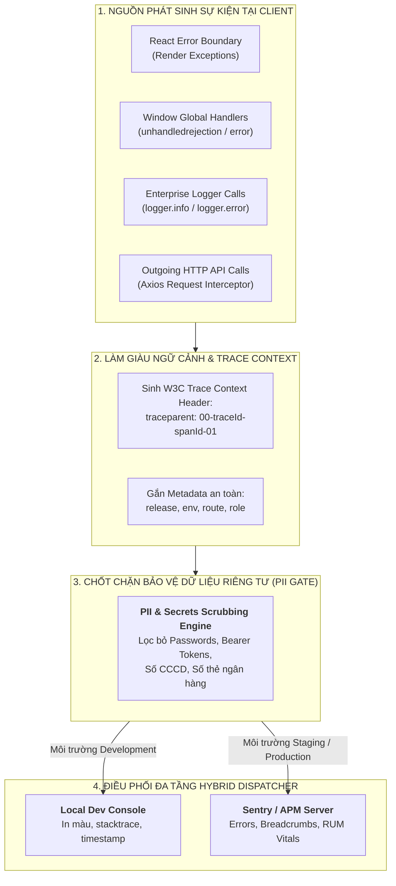

# Chuyên Đề 12: Giám Sát, Đo Lường Từ Xa (Telemetry) & Ghi Log (Observability, Telemetry & Logging)

> **Dự án:** Khung Tiêu Chuẩn Doanh Nghiệp & RoGym Management System Profile  
> **Phạm vi kỹ thuật:** Theo dõi sự cố tập trung (Sentry), Đo lường người dùng thực (RUM), Liên kết W3C Trace Context, Nhật ký có cấu trúc (Structured Logging), Làm sạch dữ liệu nhạy cảm (PII Scrubbing)  
> **Cổng quy chuẩn chính:** [`FRONTEND_CONVENTIONS.md`](../FRONTEND_CONVENTIONS.md) | [Bản Đồ Tài Liệu](./README.md)  
> **Cơ sở tham chiếu quốc tế:** [W3C Trace Context Specification](https://www.w3.org/TR/trace-context/), [Sentry Best Practices for React](https://docs.sentry.io/platforms/javascript/guides/react/), [OpenTelemetry JavaScript Client](https://opentelemetry.io/docs/languages/js/), [W3C Navigation Timing & Resource Timing](https://www.w3.org/TR/navigation-timing-2/), [OWASP Logging Cheat Sheet](https://cheatsheetseries.owasp.org/cheatsheets/Logging_Cheat_Sheet.html)  
> **Phiên bản:** 8.0 (Enterprise Quality Standard — 15 Spokes & Universal Decoupling)  
> **Trạng thái:** Bắt buộc tuân thủ 100% (Strict Mandatory Enforcement)

---

## MỤC LỤC
1. [Bối Cảnh, Tầm Quan Trọng & Cơ Sở Tham Chiếu Quốc Tế](#1-bối-cảnh-tầm-quan-trọng-cơ-sở-tham-chiếu-quốc-tế)
2. [Triết Lý Kiến Trúc & Sơ Đồ Tư Duy (Visual Mental Model)](#2-triết-lý-kiến-trúc-sơ-đồ-tư-duy-visual-mental-model)
3. [Đặc Tả Kỹ Thuật Chi Tiết (Bộ Quy Chuẩn OBS-001 đến OBS-008)](#3-đặc-tả-kỹ-thuật-chi-tiết-bộ-quy-chuẩn-obs-001-đến-obs-008)
   - 3.1. [Bảng Tổng Hợp 8 Quy Chuẩn Giám Sát, Đo Lường Từ Xa & Ghi Log Doanh Nghiệp](#31-bảng-tổng-hợp-8-quy-chuẩn-giám-sát-đo-lường-từ-xa-ghi-log-doanh-nghiệp)
   - 3.2. [Bảng Phân Định Mức Độ Log (Log Severity Matrix)](#32-bảng-phân-định-mức-độ-log-log-severity-matrix)
   - 3.3. [Đặc Tả Chi Tiết Từng Quy Chuẩn Kỹ Thuật](#33-đặc-tả-chi-tiết-từng-quy-chuẩn-kỹ-thuật)
4. [Thực Hành Thực Tế: Do's & Don'ts & Case Studies (Mô Hình 2 Tầng)](#4-thực-hành-thực-tế-dos-donts-case-studies-mô-hình-2-tầng)
   - 4.1. [Bảng Đối Chiếu Anti-Patterns vs Chuẩn Mực Doanh Nghiệp](#41-bảng-đối-chiếu-anti-patterns-vs-chuẩn-mực-doanh-nghiệp)
   - 4.2. [Tầng 1: Enterprise Reference Implementations (Mã Nguồn Mẫu Chuẩn)](#42-tầng-1-enterprise-reference-implementations-mã-nguồn-mẫu-chuẩn)
   - 4.3. [Tầng 2: RoGym Implementation Profile & Gap Analysis (Hồ Sơ Thực Tế)](#43-tầng-2-rogym-implementation-profile-gap-analysis-hồ-sơ-thực-tế)
5. [Ánh Xạ Tooling Kiểm Toán CI (Automation Integration)](#5-ánh-xạ-tooling-kiểm-toán-ci-automation-integration)
6. [Bảng Checklist Định Lượng Trước Khi Mở PR (Observability PR Review Gate)](#6-bảng-checklist-định-lượng-trước-khi-mở-pr-observability-pr-review-gate)

---

## 1. Bối Cảnh, Tầm Quan Trọng & Cơ Sở Tham Chiếu Quốc Tế

Trong môi trường vận hành phần mềm doanh nghiệp phân tán (Single Page Application kết nối Microservices API), sự cố người dùng gặp phải tại trình duyệt thường là "điểm mù" lớn nhất của đội ngũ kỹ thuật:
- **Hiện tượng lỗi thầm lặng (Silent Failures):** Các ngoại lệ runtime, lỗi render component hoặc promise bị từ chối không có bộ lọc bắt lỗi sẽ làm trắng màn hình mà hoàn toàn không để lại dấu vết trên máy chủ, khiến kỹ sư không thể tái hiện hoặc sửa chữa.
- **Mất liên kết vết thực thi (Trace Fragmentation):** Khi một request API bị thất bại hoặc chạy chậm, nếu Frontend không đính kèm mã định danh vết thực thi thống nhất (Correlation ID / Traceparent), đội ngũ Backend và DevOps sẽ mất hàng giờ tra cứu giữa hàng triệu bản ghi log để tìm ra nguyên nhân gốc rễ.
- **Rủi ro rò rỉ thông tin nhạy cảm vào hệ thống ghi log và telemetry (PII Breach):** Vô tình ghi log chứa mật khẩu, mã PIN, mã JWT, số căn cước công dân hoặc số tài khoản ngân hàng lên các dịch vụ đám mây (Sentry, Datadog) vi phạm nghiêm trọng các tiêu chuẩn bảo mật dữ liệu (GDPR, ISO 27001).

Hệ sinh thái tiêu chuẩn này được xây dựng trên các cơ sở tham chiếu chuẩn mực quốc tế:
1. **W3C Trace Context Specification (REC):** Chuẩn hóa cấu trúc header `traceparent` (`version-trace_id-parent_id-trace_flags`) giúp theo dõi luồng giao dịch xuyên suốt từ trình duyệt tới máy chủ.
2. **Sentry Best Practices for Modern React:** Các nguyên tắc thu thập ngoại lệ, lưu vết thao tác người dùng (Breadcrumbs) và cấu hình phân tầng môi trường.
3. **OpenTelemetry (OTel) JavaScript Client Standard:** Chuẩn mở của Linux Foundation về thu thập dữ liệu quan sát (Traces, Metrics, Logs) độc lập với nhà cung cấp đám mây.
4. **OWASP Logging & Privacy Cheat Sheet:** Nguyên tắc bắt buộc làm sạch dữ liệu định danh cá nhân (PII Redaction) ngay tại nguồn phát sinh log.

---

## 2. Triết Lý Kiến Trúc & Sơ Đồ Tư Duy (Visual Mental Model)

Triết lý cốt lõi: **"Observable Yet Privacy-Safe — Giám sát thấu suốt toàn diện mọi ngóc ngách vận hành nhưng tuyệt đối không xâm phạm dữ liệu riêng tư của người dùng"**.

Kiến trúc giám sát (observability), telemetry và ghi log được tổ chức theo **Mô Hình Xử Lý 3 Tầng**:
1. **Tầng Thu Thập & Làm Giàu Ngữ Cảnh (Context Enrichment Layer):** Tự động đính kèm thông tin phiên làm việc an toàn (`userId`, `role`, `appVersion`, `route`), môi trường (`mode`), và mã vết W3C (`traceparent`).
2. **Tầng Phòng Vệ & Lọc Dữ Liệu Riêng Tư (PII Scrubbing Gate):** 100% dữ liệu trước khi xuất ra console hoặc gửi qua mạng đều phải đi qua bộ lọc bóc tách thông tin nhạy cảm (Passwords, Tokens, CCCD, Thẻ tín dụng).
3. **Tầng Điều Phối Đa Nguồn (Hybrid Multi-Tier Dispatcher):**
   - *Môi trường Local Development:* In ra bảng điều khiển trình duyệt (Console) có định dạng màu sắc trực quan, timestamp và icon rõ ràng.
   - *Môi trường Staging / Production:* Khử bỏ `console.log` thông thường, tự động chuyển tiếp toàn bộ sự kiện cấp `WARN` và `ERROR` tới Sentry APM.



---

## 3. Đặc Tả Kỹ Thuật Chi Tiết (Bộ Quy Chuẩn OBS-001 đến OBS-008)

### 3.1. Bảng Tổng Hợp 8 Quy Chuẩn Giám Sát, Đo Lường Từ Xa & Ghi Log Doanh Nghiệp

| Mã Rule | Tên Quy Chuẩn & Phạm Vi | Mức Độ | Tiêu Chí Pass / Fail Kỹ Thuật | Anti-Pattern (Don't) | Best Practice (Do) | Tệp RoGym Đối Chiếu |
| :---: | :--- | :---: | :--- | :--- | :--- | :--- |
| `OBS-001` | Kiến Trúc Bắt Lỗi Tập Trung Toàn Cục | `ERROR` | **Pass:** 100% Unhandled Promise Rejections và React Render Errors đều được bắt giữ và gửi tới Sentry.<br/>**Fail:** Lỗi làm trắng màn hình hoặc console báo `Uncaught error` mà không có event gửi tới Sentry. | Bỏ qua việc lắng nghe sự kiện `unhandledrejection`. | Bọc ErrorBoundary cấp ứng dụng và đăng ký global error listener trong `main.tsx`. | [`src/components/shared/error-boundary/ErrorBoundary.tsx`](../src/components/shared/error-boundary/ErrorBoundary.tsx) |
| `OBS-002` | Liên Kết W3C Trace Context Header | `ERROR` | **Pass:** 100% API request gửi đi từ client bắt buộc đính kèm header `traceparent` (chuẩn W3C) hoặc `X-Correlation-ID`.<br/>**Fail:** Gửi API request không mang correlation header khiến backend không thể đối chiếu log. | Gọi API không truyền header định danh phiên giao dịch. | Tự động sinh `traceparent` trong Axios request interceptor và ghi lại vào breadcrumbs. | [`src/services/api.ts`](../src/services/api.ts) |
| `OBS-003` | Cấu Hình Sentry Phân Cấp Môi Trường | `WARN` | **Pass:** Bật Sentry trên Staging/Production với sample rate hợp lý (Error: 100%, Performance: 10%); tắt hoặc giả lập trên localhost.<br/>**Fail:** Gửi rác log debug từ môi trường phát triển máy cá nhân lên dashboard production. | Dùng chung DSN và config không kiểm tra môi trường. | Khởi tạo Sentry có điều kiện: `enabled: import.meta.env.PROD`. | [`src/main.tsx`](../src/main.tsx) |
| `OBS-004` | Lọc Bỏ Triệt Để PII Khỏi Telemetry Payload | `ERROR` | **Pass:** Mọi breadcrumbs, error message và network payload trước khi gửi tới Sentry phải qua bộ lọc `beforeSend` làm sạch PII.<br/>**Fail:** Gửi mật khẩu, số thẻ tín dụng, số CCCD hoặc token trong URL/body về Sentry. | Đính kèm `formValues` chứa password vào event log. | Cấu hình hàm sanitize loại bỏ các trường cấm: `password`, `token`, `idCard`, `cardNumber`. | [`src/lib/`](../src/lib/) |
| `OBS-005` | Tiêu Chuẩn Custom Enterprise Logger | `WARN` | **Pass:** Toàn bộ việc ghi log nghiệp vụ phải gọi qua `EnterpriseLogger` (`debug`, `info`, `warn`, `error`) có timestamp và context.<br/>**Fail:** Sử dụng tùy tiện các lệnh `console.log()` rải rác trong mã nguồn sản phẩm. | `console.log("Member checked in:", id);` | `logger.info("Hội viên điểm danh", { memberId: id });` | [`src/lib/`](../src/lib/) |
| `OBS-006` | Đo Lường Người Dùng Thực (RUM Metrics) | `WARN` | **Pass:** Thu thập các chỉ số Web Vitals thực tế và gửi về telemetry endpoint qua `navigator.sendBeacon`.<br/>**Fail:** Hoàn toàn mù mờ về thời gian tải trang và độ trễ thao tác của người dùng ngoài thực địa. | Không đo lường thời gian tương tác. | Thu thập $LCP, INP, CLS$ và gửi định kỳ về máy chủ telemetry / phân tích. | [`src/main.tsx`](../src/main.tsx) |
| `OBS-007` | Cấm Log Đối Tượng Non-serializable | `WARN` | **Pass:** Dữ liệu metadata truyền vào logger phải là Plain Objects (POJO) có thể chuyển đổi thành JSON an toàn.<br/>**Fail:** Log đối tượng chứa tham chiếu vòng (`window`, DOM element, React Fiber node) gây rò rỉ bộ nhớ. | `logger.error("Lỗi", { dom: event.target })` | `logger.error("Lỗi", { targetTag: (event.target as HTMLElement).tagName })` | [`src/`](../src/) |
| `OBS-008` | Khử Bỏ Console Debug Trong Production Build | `ERROR` | **Pass:** Bản đóng gói Production phải tự động loại bỏ toàn bộ `console.debug`, `console.log` thông qua cấu hình build Vite/esbuild.<br/>**Fail:** Để lộ toàn bộ console log debug nội bộ trên trình duyệt của người dùng cuối. | Giữ nguyên các dòng `console.log` trên production. | Cấu hình Vite `esbuild: { drop: ['console', 'debugger'] }` khi `mode === 'production'`. | [`client/vite.config.ts`](../vite.config.ts) |
| `OBS-009` / `OBS-VCL-001` | Thu Thập Telemetry RUM Qua Vercel Analytics & Speed Insights `[client-rum-telemetry]` | `WARN` | **Pass:** Tích hợp bộ thu thập telemetry RUM không xâm lấn (`@vercel/analytics`, `@vercel/speed-insights/react`) để theo dõi Core Web Vitals ($LCP, INP, CLS$) và lượt tương tác theo thời gian thực mà không làm tăng bundle khởi động.<br/>**Fail:** Không có công cụ đo lường trải nghiệm thực địa ngoài môi trường giả lập DevTools. | Chỉ đo tốc độ trên máy dev cấu hình cao. | Nhúng `<SpeedInsights />` và `<Analytics />` cấp root với cờ kiểm tra cookie consent. | [`src/App.tsx`](../src/App.tsx) |

---

### 3.2. Bảng Phân Định Mức Độ Log (Log Severity Matrix)

Nhằm đảm bảo tính chuẩn mực và tránh gây quá tải (noise) cho hệ thống giám sát, mọi sự kiện nhật ký phải tuân thủ nghiêm ngặt bảng phân loại cấp độ:

| Cấp Độ Log | Ý Nghĩa Kỹ Thuật | Hành Vi Môi Trường Dev | Hành Vi Môi Trường Production | Ví Dụ Điển Hình |
| :---: | :--- | :--- | :--- | :--- |
| **`DEBUG`** | Thông tin chi tiết phục vụ gỡ lỗi sâu của kỹ sư. | In ra console kèm màu xám nhạt. | **Bị loại bỏ hoàn toàn (Dropped).** | Payload request chi tiết, bước chuyển trạng thái nội bộ của state machine. |
| **`INFO`** | Mốc sự kiện quan trọng trong vòng đời ứng dụng. | In ra console kèm màu xanh dương. | Lưu vào Sentry Breadcrumbs (không gửi alert). | Khởi tạo phiên, hoàn tất thanh toán, chuyển đổi route thành công. |
| **`WARN`** | Tình huống bất thường nhưng ứng dụng tự phục hồi được. | In ra console kèm màu vàng cam. | Gửi sự kiện Warning về Sentry kèm ngữ cảnh. | Thử lại request API do mạng chậm, phản hồi API bị thiếu trường không bắt buộc. |
| **`ERROR`** | Sự cố nghiêm trọng khiến tác vụ người dùng thất bại. | In ra console kèm màu đỏ và stacktrace. | **Bắn Alert tức thì về Sentry/Slack on-call.** | Render ErrorBoundary, API trả về mã lỗi 500, lỗi xác thực token không thể refresh. |

---

### 3.3. Đặc Tả Chi Tiết Từng Quy Chuẩn Kỹ Thuật

<a id="obs-001"></a>
#### `OBS-001`: Kiến Trúc Bắt Lỗi Tập Trung Toàn Cục
- **Mục tiêu:** Không để bất kỳ lỗi nào bị "rơi rụng" mà không được nhận diện và báo cáo.
- **Quy tắc thực thi:**
  - Bọc component gốc của ứng dụng bằng `<ErrorBoundary>` chuẩn doanh nghiệp có hỗ trợ gửi dữ liệu tới Sentry SDK thông qua `Sentry.captureException(error, { extra: errorInfo })`.
  - Trong `main.tsx`, bắt buộc đăng ký 2 trình lắng nghe sự kiện toàn cục:
    ```typescript
    window.addEventListener('unhandledrejection', (event) => {
      logger.error('Unhandled Promise Rejection', event.reason)
    })
    window.addEventListener('error', (event) => {
      logger.error('Global Window Error', event.error || event.message)
    })
    ```

<a id="obs-002"></a>
#### `OBS-002`: Liên Kết W3C Trace Context Header (`traceparent`)
- **Mục tiêu:** Thiết lập liên kết phân tán (Distributed Tracing) giữa giao diện người dùng và máy chủ backend.
- **Quy tắc thực thi:**
  - Định dạng header chuẩn W3C: `traceparent: 00-{trace_id}-{span_id}-{trace_flags}`.
  - Axios Request Interceptor tự động sinh mã `trace_id` (32 ký tự hex) cho mỗi phiên tác vụ của người dùng và `span_id` (16 ký tự hex) cho mỗi request gọi API cụ thể.
  - Khi Backend gặp sự cố, mã lỗi trả về (RFC 7807) sẽ chứa cùng `trace_id` này, giúp kỹ sư tra cứu được hành vi tương ứng của người dùng trên Sentry.

<a id="obs-003"></a>
#### `OBS-003`: Cấu Hình Sentry Phân Cấp Theo Môi Trường
- **Mục tiêu:** Tiết kiệm chi phí hạn ngạch sự kiện (Quota) và ngăn ngừa làm loãng dữ liệu thực tế.
- **Quy tắc thực thi:**
  - Chỉ kích hoạt Sentry khi biến môi trường `import.meta.env.PROD` là `true` và có khai báo `VITE_SENTRY_DSN`.
  - Thiết lập tỷ lệ lấy mẫu hiệu năng (Traces Sample Rate):
    - Môi trường Staging: `tracesSampleRate: 1.0` (100% requests).
    - Môi trường Production: `tracesSampleRate: 0.1` (10% requests để tối ưu băng thông).
  - Tỷ lệ lấy mẫu lỗi (Errors Sample Rate): luôn đặt `1.0` (100% bắt giữ toàn bộ ngoại lệ).

<a id="obs-004"></a>
#### `OBS-004`: Lọc Bỏ Triệt Để PII Khỏi Telemetry Payload
- **Mục tiêu:** Đảm bảo tuân thủ 100% các quy định bảo mật quyền riêng tư của khách hàng.
- **Quy tắc thực thi:**
  - Cấu hình callback `beforeSend` trong `Sentry.init()` để duyệt qua toàn bộ event payload.
  - Quét và thay thế bằng `[REDACTED]` đối với các khóa nhạy cảm: `password`, `token`, `accessToken`, `refreshToken`, `secret`, `idCard`, `cccd`, `cardNumber`, `cvv`, `pin`.
  - Bóc tách các tham số query nhạy cảm khỏi URL (ví dụ: `?token=xyz` $\rightarrow$ `?token=[REDACTED]`).

<a id="obs-005"></a>
#### `OBS-005`: Tiêu Chuẩn Custom Enterprise Logger
- **Mục tiêu:** Thay thế hoàn toàn các lệnh `console.log` tự phát bằng một API ghi nhật ký chuẩn tắc.
- **Quy tắc thực thi:**
  - Toàn bộ component và service chỉ tương tác qua đối tượng singleton `logger` xuất từ `@/lib/logger`.
  - Mỗi bản ghi log bắt buộc nhận tối thiểu 2 tham số: thông điệp dạng chuỗi mô tả sự kiện (`message`) và đối tượng ngữ cảnh bổ sung (`context` - optional POJO).

<a id="obs-006"></a>
#### `OBS-006`: Giám Sát Người Dùng Thực (Real User Monitoring - RUM)
- **Mục tiêu:** Đo lường các chỉ số trải nghiệm người dùng thực tế tại hiện trường.
- **Quy tắc thực thi:**
  - Lắng nghe sự kiện Core Web Vitals ($LCP, INP, CLS$) thông qua thư viện `web-vitals` chuẩn của Google.
  - Khi người dùng hoàn thành tải trang hoặc tương tác quan trọng, gửi số liệu về máy chủ thông qua API `navigator.sendBeacon()` để không làm chậm luồng đóng trang của trình duyệt.

<a id="obs-007"></a>
#### `OBS-007`: Cấm Log Đối Tượng Non-serializable
- **Mục tiêu:** Bảo vệ độ bền bộ nhớ (Memory Hygiene) của trình duyệt.
- **Quy tắc thực thi:**
  - Không truyền trực tiếp đối tượng DOM (`HTMLDivElement`), React Virtual DOM Element (`<Component />`), hoặc đối tượng có tham chiếu vòng (Circular Reference) vào hàm log.
  - Trước khi ghi log, tiện ích `EnterpriseLogger` sẽ tự động bọc việc serialize qua khối `try-catch` an toàn và cảnh báo nếu phát hiện đối tượng không hợp lệ.

<a id="obs-008"></a>
#### `OBS-008`: Khử Bỏ Console Debug Trong Production Build
- **Mục tiêu:** Bảo vệ mã nguồn không bị phơi bày logic nội bộ ra F12 Console của khách hàng.
- **Quy tắc thực thi:**
  - Cấu hình `esbuild` trong `client/vite.config.ts`:
    ```typescript
    esbuild: {
      drop: mode === 'production' ? ['console', 'debugger'] : [],
    }
    ```
  - Kiểm tra kết quả đóng gói trong CI để đảm bảo thư mục `dist/` không còn sót lại bất kỳ chuỗi `console.log` nào.

<a id="obs-009"></a>
#### `OBS-009` / `OBS-VCL-001`: Thu Thập Telemetry RUM Qua Vercel Analytics & Speed Insights (`[client-rum-telemetry]`)
- **Mục tiêu:** Giám sát trải nghiệm người dùng thực địa theo thời gian thực (RUM) với độ trễ cực thấp, tự động thu thập Core Web Vitals ($LCP, INP, CLS$) và phễu người dùng mà không cần duy trì hạ tầng APM phức tạp.
- **Quy tắc thực thi:**
  - Nhúng các component telemetry cấp cao của Vercel tại root component (`App.tsx` hoặc Root Layout):
    ```tsx
    import { Analytics } from '@vercel/analytics/react'
    import { SpeedInsights } from '@vercel/speed-insights/react'

    export function AppRoot() {
      return (
        <>
          <Router />
          {/* Tự động kích hoạt khi chạy trên production environment */}
          {import.meta.env.PROD ? (
            <>
              <Analytics />
              <SpeedInsights />
            </>
          ) : null}
        </>
      )
    }
    ```
  - Đảm bảo tuân thủ quyền riêng tư người dùng (Privacy Consent): Không thu thập IP thô hoặc PII; chỉ ghi nhận các thông số hiệu năng phân vị 75th ($p75$).

---

## 4. Thực Hành Thực Tế: Do's & Don'ts & Case Studies (Mô Hình 2 Tầng)

### 4.1. Bảng Đối Chiếu Anti-Patterns vs Chuẩn Mực Doanh Nghiệp

| Lĩnh vực | ❌ Anti-Pattern (Don't) | ✅ Chuẩn Mực Doanh Nghiệp (Do) | Nguyên Nhân Kỹ Thuật |
| :--- | :--- | :--- | :--- |
| **Ghi Nhật Ký Nghiệp Vụ** | `console.log("User data:", user);` | `logger.info("Đăng nhập thành công", { userId: user.id });` | `console.log` không có timestamp, không phân cấp độ nghiêm trọng và không thể chuyển tiếp lên Sentry. |
| **Bắt Lỗi Ngoại Lệ** | `catch (e) { /* nuốt lỗi im lặng */ }` | `catch (err) { logger.error("Lưu dữ liệu thất bại", err, { memberId }); }` | Nuốt lỗi làm mất khả năng phát hiện sự cố, hệ thống chết âm thầm không thể gỡ lỗi. |
| **Liên Kết Vết Thực Thi API** | Gửi request HTTP không mang header định danh. | Tự động sinh và đính kèm `traceparent: 00-4bf9...-01` trong Axios Interceptor. | Khi Backend gặp lỗi 500, không có cách nào đối chiếu vết thực thi từ client tới microservices backend. |
| **Bảo Vệ Dữ Liệu Trong Log** | `logger.error("Auth error", { token: jwt, pass: rawPassword });` | Dữ liệu tự động đi qua bộ lọc `PIIScrubber` trước khi ghi log hoặc gửi telemetry. | Để lộ mật khẩu và token trong log vi phạm nghiêm trọng luật an toàn thông tin và các chứng chỉ bảo mật. |
| **Log Đối Tượng Phức Tạp** | `logger.error("Render error", { component: this });` | `logger.error("Render error", { componentName: "MemberCard", id: this.props.id });` | Truyền đối tượng component chứa Fiber tree gây rò rỉ bộ nhớ nghiêm trọng và lỗi Circular JSON exception. |

---

### 4.2. Tầng 1: Enterprise Reference Implementations (Mã Nguồn Mẫu Chuẩn)

Dưới đây là các module kỹ thuật mẫu hoàn chỉnh chuẩn Enterprise, sẵn sàng tích hợp cho bất kỳ ứng dụng React nào:

#### 1. Blueprint: Module Ghi Nhật Ký Doanh Nghiệp Phân Tầng (`enterprise-logger.ts`)
```typescript
import * as Sentry from '@sentry/react'

export type LogLevel = 'debug' | 'info' | 'warn' | 'error'

export interface LogContext {
  [key: string]: unknown
}

const BLOCKED_PII_KEYS = new Set([
  'password',
  'token',
  'accesstoken',
  'refreshtoken',
  'secret',
  'idcard',
  'cccd',
  'cardnumber',
  'cvv',
  'pin',
])

/**
 * Làm sạch dữ liệu nhạy cảm đệ quy từ context object
 */
export function sanitizeContext(context?: LogContext): LogContext {
  if (!context || typeof context !== 'object') return {}
  const clean: LogContext = {}

  for (const [key, value] of Object.entries(context)) {
    const lowerKey = key.toLowerCase()
    if (BLOCKED_PII_KEYS.has(lowerKey)) {
      clean[key] = '[REDACTED]'
    } else if (value && typeof value === 'object' && !Array.isArray(value)) {
      try {
        clean[key] = sanitizeContext(value as LogContext)
      } catch {
        clean[key] = '[Unserializable Object]'
      }
    } else {
      clean[key] = value
    }
  }
  return clean
}

/**
 * Enterprise Structured Logger chuẩn mực hỗ trợ Hybrid Dispatching
 */
class EnterpriseLogger {
  private isProd = import.meta.env.PROD

  private formatMessage(level: LogLevel, message: string): string {
    const time = new Date().toISOString()
    return `[${time}] [${level.toUpperCase()}] ${message}`
  }

  public debug(message: string, context?: LogContext): void {
    if (this.isProd) return // Bỏ qua debug trong production
    const cleanCtx = sanitizeContext(context)
    console.debug(`%c${this.formatMessage('debug', message)}`, 'color: #94a3b8', cleanCtx)
  }

  public info(message: string, context?: LogContext): void {
    const cleanCtx = sanitizeContext(context)
    if (!this.isProd) {
      console.info(`%c${this.formatMessage('info', message)}`, 'color: #38bdf8', cleanCtx)
    }

    // Gửi Sentry Breadcrumb phục vụ theo dõi hành trình người dùng
    Sentry.addBreadcrumb({
      category: 'app.info',
      message,
      data: cleanCtx,
      level: 'info',
    })
  }

  public warn(message: string, context?: LogContext): void {
    const cleanCtx = sanitizeContext(context)
    console.warn(`%c${this.formatMessage('warn', message)}`, 'color: #fbbf24', cleanCtx)

    if (this.isProd) {
      Sentry.captureMessage(message, {
        level: 'warning',
        extra: cleanCtx,
      })
    }
  }

  public error(message: string, error?: unknown, context?: LogContext): void {
    const cleanCtx = sanitizeContext(context)
    console.error(`%c${this.formatMessage('error', message)}`, 'color: #ef4444', error, cleanCtx)

    if (this.isProd) {
      if (error instanceof Error) {
        Sentry.captureException(error, {
          extra: { ...cleanCtx, customMessage: message },
        })
      } else {
        Sentry.captureMessage(message, {
          level: 'error',
          extra: { ...cleanCtx, rawError: error },
        })
      }
    }
  }
}

export const logger = new EnterpriseLogger()
```

#### 2. Blueprint: Bộ Tiện Ích Sinh Chuẩn W3C Traceparent Header (`trace-context.ts`)
```typescript
/**
 * Sinh chuỗi ngẫu nhiên định dạng hex có độ dài xác định
 */
function generateRandomHex(length: number): string {
  const bytes = new Uint8Array(length / 2)
  crypto.getRandomValues(bytes)
  return Array.from(bytes, (byte) => byte.toString(16).padStart(2, '0')).join('')
}

export interface W3CTraceContext {
  traceId: string
  spanId: string
  headerValue: string
}

/**
 * Sinh header chuẩn W3C Trace Context: 00-{trace_id}-{span_id}-{flags}
 */
export function generateW3CTraceContext(existingTraceId?: string): W3CTraceContext {
  const version = '00'
  const traceId = existingTraceId || generateRandomHex(32) // 16 bytes = 32 hex chars
  const spanId = generateRandomHex(16) // 8 bytes = 16 hex chars
  const flags = '01' // 01 nghĩa là sampled

  return {
    traceId,
    spanId,
    headerValue: `${version}-${traceId}-${spanId}-${flags}`,
  }
}
```

#### 3. Blueprint: Cấu Hình Khởi Tạo Sentry Bảo Vệ Riêng Tư (`sentry.config.ts`)
```typescript
import * as Sentry from '@sentry/react'

export function initSentry(): void {
  const dsn = import.meta.env.VITE_SENTRY_DSN
  const isProd = import.meta.env.PROD

  if (!isProd || !dsn) {
    return
  }

  Sentry.init({
    dsn,
    environment: import.meta.env.MODE || 'production',
    release: import.meta.env.VITE_APP_VERSION || '1.0.0',
    tracesSampleRate: 0.1, // Lấy mẫu 10% giao dịch hiệu năng

    // Bộ lọc PII trước khi gửi sự kiện
    beforeSend(event) {
      // Loại bỏ thông tin nhạy cảm từ request headers và URL
      if (event.request?.headers) {
        delete event.request.headers['Authorization']
        delete event.request.headers['Cookie']
      }

      if (event.request?.url) {
        try {
          const url = new URL(event.request.url)
          if (url.searchParams.has('token')) {
            url.searchParams.set('token', '[REDACTED]')
            event.request.url = url.toString()
          }
        } catch {
          // Bỏ qua nếu URL không phân tích được
        }
      }

      return event
    },
  })
}
```

#### 4. Blueprint: Bộ Kiểm Thử Đơn Vị Vitest (`enterprise-logger.test.ts`)
```typescript
import { describe, it, expect, vi, beforeEach } from 'vitest'
import { sanitizeContext } from './enterprise-logger'
import { generateW3CTraceContext } from './trace-context'

describe('Unit Test: Observability & Telemetry Utilities', () => {
  it('hàm sanitizeContext làm sạch chính xác các trường mật khẩu và token', () => {
    const rawContext = {
      userId: 'user_123',
      password: 'SuperSecretPassword!',
      nested: {
        accessToken: 'eyJhbGciOi...',
        safeField: 'normal_data',
      },
    }

    const cleaned = sanitizeContext(rawContext)

    expect(cleaned.userId).toBe('user_123')
    expect(cleaned.password).toBe('[REDACTED]')
    expect((cleaned.nested as Record<string, unknown>).accessToken).toBe('[REDACTED]')
    expect((cleaned.nested as Record<string, unknown>).safeField).toBe('normal_data')
  })

  it('hàm generateW3CTraceContext tạo header đúng cú pháp W3C', () => {
    const context = generateW3CTraceContext()
    const parts = context.headerValue.split('-')

    expect(parts.length).toBe(4)
    expect(parts[0]).toBe('00') // Version
    expect(parts[1]).toHaveLength(32) // Trace ID (32 hex)
    expect(parts[2]).toHaveLength(16) // Span ID (16 hex)
    expect(parts[3]).toBe('01') // Flags
  })
})
```

---

### 4.3. Tầng 2: RoGym Implementation Profile & Gap Analysis (Hồ Sơ Thực Tế)

#### 1. Đánh Giá Hiện Trạng [`src/components/shared/error-boundary/ErrorBoundary.tsx`](../src/components/shared/error-boundary/ErrorBoundary.tsx)
- **Điểm sáng xuất sắc đã đạt:**
  - Component bắt lỗi [`ErrorBoundary.tsx:L21-L153`](../src/components/shared/error-boundary/ErrorBoundary.tsx) đã được xây dựng rất bài bản với giao diện thông báo lỗi thân thiện, nút bấm Thử lại (Reset State) và Điều hướng về Trang chủ.
- **Khoảng cách kỹ thuật (Gap Analysis) cần nâng cấp:**
  - Trong phương thức `componentDidCatch` ([`ErrorBoundary.tsx:L38-L44`](../src/components/shared/error-boundary/ErrorBoundary.tsx)), lỗi hiện chỉ được in ra `console.error` cục bộ mà chưa tích hợp gửi tự động về Sentry APM.
  - *Lộ trình chuẩn hóa:* Bổ sung lời gọi `logger.error('React ErrorBoundary Caught Error', error, { componentStack: errorInfo.componentStack })` để tự động kích hoạt Sentry capture.

#### 2. Đánh Giá Hiện Trạng [`src/services/api.ts`](../src/services/api.ts)
- **Điểm sáng xuất sắc đã đạt:**
  - Tệp [`api.ts`](../src/services/api.ts) đã có request interceptor tập trung tự động đính kèm Authorization header cho toàn bộ cuộc gọi API.
- **Khoảng cách kỹ thuật (Gap Analysis) cần nâng cấp:**
  - Hiện tại interceptor chưa đính kèm header chuẩn W3C `traceparent` hoặc `X-Correlation-ID`. Khi phía máy chủ backend gặp lỗi 500, kỹ sư không có mã định danh để liên kết log client với log server.
  - *Lộ trình chuẩn hóa:* Tích hợp hàm `generateW3CTraceContext()` vào `api.interceptors.request.use` để mọi request đều mang theo `traceparent`.

#### 3. Đánh Giá Hiện Trạng [`client/vite.config.ts`](../vite.config.ts)
- **Khoảng cách kỹ thuật:** File cấu hình hiện tại chưa khai báo chỉ thị `esbuild: { drop: ['console', 'debugger'] }` khi build production. Các lập trình viên khi viết `console.log` thử nghiệm nếu quên xóa sẽ bị đóng gói thẳng vào bản phát hành thương phẩm.
- *Lộ trình chuẩn hóa:* Thêm tùy chọn `drop` của esbuild trong file cấu hình build Vite.

---

## 5. Ánh Xạ Tooling Kiểm Toán CI (Automation Integration)

Hệ thống giám sát và ghi log được kiểm soát qua các cổng kiểm toán tự động:

### 5.1. Bảng Ánh Xạ Quy Chuẩn Giám Sát & Log Sang Công Cụ Phân Tích Tự Động

| Mã Quy Chuẩn | Công Cụ Kiểm Soát Tự Động | Cấu Hình / Lệnh Thực Thi | Mức Độ Chặn Trong CI |
| :---: | :--- | :--- | :---: |
| `OBS-002` | API Integration Test | Kiểm tra header `traceparent` có hiện diện trong request Axios mock | **Chặn Test Suite (Exit 1)** |
| `OBS-004` | Unit Test Sanitizer | `vitest run enterprise-logger.test.ts` | **Chặn Build (Exit 1)** |
| `OBS-005` | ESLint (`no-console`) | `"no-console": ["warn", { "allow": ["warn", "error"] }]` | Cảnh báo PR Review |
| `OBS-008` | Vite Build Config Check | `grep -rn "drop: \['console'\]" client/vite.config.ts` | **Chặn Release Pipeline** |
| `OBS-*` | Sentry CLI Release Upload | `sentry-cli releases set-commits --auto $RELEASE` | Tự động hóa CI/CD |

### 5.2. Cấu Hình Vite Drop Console Chuẩn Doanh Nghiệp

```typescript
// client/vite.config.ts snippet
export default defineConfig(({ mode }) => {
  const isProduction = mode === 'production'

  return {
    esbuild: {
      // Tự động xóa sạch console.log và debugger khi đóng gói bản Production
      drop: isProduction ? ['console', 'debugger'] : [],
    },
  }
})
```

---

## 6. Bảng Checklist Định Lượng Trước Khi Mở PR (Observability PR Review Gate)

Nhằm đảm bảo tính thực tiễn và không làm ách tắc luồng phát hành tính năng hàng ngày của dự án RoGym, bảng nghiệm thu PR được phân định thành 2 cấp độ tuân thủ theo [Mục 9 Master Plan](../FRONTEND_CONVENTIONS.md):
- **Tầng DoD 9.2A (Target Enterprise DoD):** Áp dụng bắt buộc 100% đối với các dự án mới khởi tạo từ Starter Template hoặc khi hoàn tất tích hợp Sentry SDK tập trung.
- **Tầng DoD 9.2B (RoGym Transition DoD):** Áp dụng cho các Pull Request hiện hành trên RoGym theo nguyên tắc **Boy Scout Rule** (không viết thêm `console.log` bừa bãi, không nuốt lỗi ngoại lệ trong khối `catch`, không log mật khẩu/token).

### Checklist 8 Tiêu Chí Nghiệm Thu Giám Sát & Ghi Log:


- [ ] **1. `OBS-001` (Centralized Error Capture):** Các thao tác bất đồng bộ nguy hiểm đều được bọc xử lý lỗi và chuyển tiếp tới `logger.error()`.
- [ ] **2. `OBS-002` (W3C Trace Context):** Toàn bộ API request mới đều kế thừa cơ chế tự động đính kèm `traceparent` header.
- [ ] **3. `OBS-003` (Sentry Clean):** Không kích hoạt gửi dữ liệu giả lập từ môi trường local dev lên Sentry production.
- [ ] **4. `OBS-004` (PII Scrubbing):** Đã kiểm tra đối tượng context của log, đảm bảo không chứa mật khẩu, token hoặc thông tin CCCD/thẻ ngân hàng.
- [ ] **5. `OBS-005` (No Raw Console):** Không sử dụng `console.log` tùy tiện; 100% việc ghi nhật ký sử dụng `logger` tiện ích.
- [ ] **6. `OBS-006` (RUM Web Vitals):** Các màn hình mới tạo không làm suy giảm thời gian phản hồi tương tác INP.
- [ ] **7. `OBS-007` (Serializable Payload):** Context truyền vào logger là đối tượng JSON thuần túy, không chứa DOM hay React Fiber nodes.
- [ ] **8. `OBS-008` (Build Hygiene):** Đã kiểm tra bản build thử nghiệm, không còn log debug nội bộ xuất hiện trên console.


