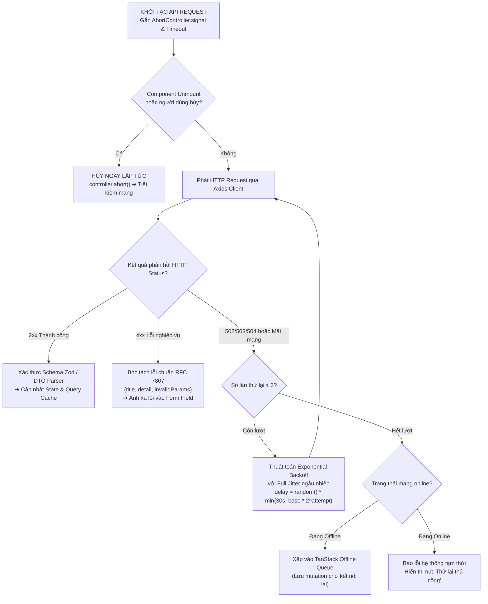

# Chuyên Đề 13: Hợp Đồng API, Khả Năng Chịu Lỗi & Xử Lý Ngoại Tuyến (API Contracts & Network Resilience)

> **Dự án:** Khung Tiêu Chuẩn Doanh Nghiệp & RoGym Management System Profile  
> **Phạm vi kỹ thuật:** Phát triển dựa trên hợp đồng (OpenAPI / Contract-First), Chuẩn hóa lỗi RFC 7807 Problem Details, Quy chuẩn hủy request với AbortController, Thử lại thích ứng (Exponential Backoff with Full Jitter), Xử lý ngoại tuyến (Offline Mutations Queue), Giả lập mạng qua Mock Service Worker (MSW 2.0)  
> **Cổng quy chuẩn chính:** [`FRONTEND_CONVENTIONS.md`](../FRONTEND_CONVENTIONS.md) | [Bản Đồ Tài Liệu](./README.md)  
> **Cơ sở tham chiếu quốc tế:** [RFC 7807 Problem Details for HTTP APIs](https://datatracker.ietf.org/doc/html/rfc7807), [OpenAPI Specification v3.1](https://spec.openapis.org/oas/latest.html), [Mock Service Worker (MSW 2.0)](https://mswjs.io/), [WHATWG DOM AbortController & AbortSignal](https://dom.spec.whatwg.org/#interface-abortcontroller), [TanStack Query Resilience Architecture](https://tanstack.com/query/latest)  
> **Phiên bản:** 8.0 (Enterprise Quality Standard — 15 Spokes & Universal Decoupling)  
> **Trạng thái:** Bắt buộc tuân thủ 100% (Strict Mandatory Enforcement)

---

## MỤC LỤC
1. [Bối Cảnh, Tầm Quan Trọng & Cơ Sở Tham Chiếu Quốc Tế](#1-bối-cảnh-tầm-quan-trọng-cơ-sở-tham-chiếu-quốc-tế)
2. [Triết Lý Kiến Trúc & Sơ Đồ Tư Duy (Visual Mental Model)](#2-triết-lý-kiến-trúc-sơ-đồ-tư-duy-visual-mental-model)
3. [Đặc Tả Kỹ Thuật Chi Tiết (Bộ Quy Chuẩn API-001 đến API-010)](#3-đặc-tả-kỹ-thuật-chi-tiết-bộ-quy-chuẩn-api-001-đến-api-010)
   - 3.1. [Bảng Tổng Hợp 10 Quy Chuẩn Hợp Đồng API & Khả Năng Chịu Lỗi](#31-bảng-tổng-hợp-10-quy-chuẩn-hợp-đồng-api-khả-năng-chịu-lỗi)
   - 3.2. [Cấu Trúc Lỗi Chuẩn Hóa Theo RFC 7807 Problem Details](#32-cấu-trúc-lỗi-chuẩn-hóa-theo-rfc-7807-problem-details)
   - 3.3. [Đặc Tả Chi Tiết Từng Quy Chuẩn Kỹ Thuật](#33-đặc-tả-chi-tiết-từng-quy-chuẩn-kỹ-thuật)
4. [Thực Hành Thực Tế: Do's & Don'ts & Case Studies (Mô Hình 2 Tầng)](#4-thực-hành-thực-tế-dos-donts-case-studies-mô-hình-2-tầng)
   - 4.1. [Bảng Đối Chiếu Anti-Patterns vs Chuẩn Mực Doanh Nghiệp](#41-bảng-đối-chiếu-anti-patterns-vs-chuẩn-mực-doanh-nghiệp)
   - 4.2. [Tầng 1: Enterprise Reference Implementations (Mã Nguồn Mẫu Chuẩn)](#42-tầng-1-enterprise-reference-implementations-mã-nguồn-mẫu-chuẩn)
   - 4.3. [Tầng 2: RoGym Implementation Profile & Gap Analysis (Hồ Sơ Thực Tế)](#43-tầng-2-rogym-implementation-profile-gap-analysis-hồ-sơ-thực-tế)
5. [Ánh Xạ Tooling Kiểm Toán CI (Automation Integration)](#5-ánh-xạ-tooling-kiểm-toán-ci-automation-integration)
6. [Bảng Checklist Định Lượng Trước Khi Mở PR (API Resilience PR Review Gate)](#6-bảng-checklist-định-lượng-trước-khi-mở-pr-api-resilience-pr-review-gate)

---

## 1. Bối Cảnh, Tầm Quan Trọng & Cơ Sở Tham Chiếu Quốc Tế

Trong kiến trúc ứng dụng web doanh nghiệp (SPA kết nối Backend REST/GraphQL Microservices), mạng truyền dẫn là thành phần **kém tin cậy nhất**:
- **Xung đột kiểu dữ liệu và phá vỡ hợp đồng dữ liệu (Contract Drift):** Khi Backend thay đổi cấu trúc trường dữ liệu nhưng Frontend không nhận diện được tại thời điểm biên dịch, ứng dụng sẽ phát sinh ngoại lệ `Cannot read property of undefined` tại môi trường production.
- **Lãng phí tài nguyên và rò rỉ bộ nhớ (Dangling Requests):** Khi người dùng chuyển trang liên tục hoặc gõ nhanh vào ô tìm kiếm, các request cũ không được hủy bỏ (`AbortController`) sẽ tiếp tục chạy ngầm, gây lãng phí băng thông và phát sinh Race Condition ghi đè dữ liệu sai lên giao diện.
- **Phản hồi lỗi thiếu cấu trúc (Inconsistent Error Handling):** Backend trả về lúc là chuỗi text thô, lúc là mảng lỗi, lúc là mã lỗi riêng biệt khiến tầng UI phải viết hàng trăm nhánh `if-else` chắp vá để parse thông báo lỗi.
- **Mạng chập chờn tại hiện trường (Unstable Field Connectivity):** Tại phòng tập hoặc quầy lễ tân, mạng Wi-Fi/4G có thể bị rớt trong 2–3 giây; nếu Frontend không có cơ chế tự động thử lại thích ứng (Retry with Backoff), giao dịch của người dùng sẽ bị gián đoạn oan uổng.

Các trụ cột tham chiếu chuẩn quốc tế của chuyên đề này gồm:
1. **RFC 7807 (Problem Details for HTTP APIs):** Tiêu chuẩn toàn cầu của IETF quy định định dạng JSON thống nhất cho mọi phản hồi lỗi HTTP 4xx và 5xx.
2. **OpenAPI Specification v3.1:** Chuẩn mô tả API độc lập với ngôn ngữ, đóng vai trò là "Hợp đồng dữ liệu kỹ thuật chuẩn mực" duy nhất giữa Frontend và Backend.
3. **Mock Service Worker (MSW 2.0):** Công nghệ mô phỏng mạng ở tầng Service Worker chuẩn W3C, cho phép kiểm thử và chạy local dev hoàn toàn độc lập mà không cần can thiệp giả mạo hàm `fetch` hay `axios`.
4. **WHATWG DOM AbortController Standard:** Cơ chế chuẩn hóa của trình duyệt cho phép ngắt kết nối HTTP ngay tức khắc từ phía client.

---

## 2. Triết Lý Kiến Trúc & Sơ Đồ Tư Duy (Visual Mental Model)

Triết lý cốt lõi: **"Assume Network Failure & Honor Contracts — Luôn giả định rằng mạng sẽ gặp sự cố, luôn kiểm soát vòng đời request và tuyệt đối tôn trọng hợp đồng dữ liệu"**.

Cây quyết định xử lý vòng đời một API Call được đặc tả như sau:



---

## 3. Đặc Tả Kỹ Thuật Chi Tiết (Bộ Quy Chuẩn API-001 đến API-010)

### 3.1. Bảng Tổng Hợp 10 Quy Chuẩn Hợp Đồng API & Khả Năng Chịu Lỗi

| Mã Rule | Tên Quy Chuẩn & Phạm Vi | Mức Độ | Tiêu Chí Pass / Fail Kỹ Thuật | Anti-Pattern (Don't) | Best Practice (Do) | Tệp RoGym Đối Chiếu |
| :---: | :--- | :---: | :--- | :--- | :--- | :--- |
| `API-001` | Phát Triển Contract-First Từ OpenAPI | `ERROR` | **Pass:** 100% TypeScript DTOs và Query Hooks được tự động sinh (codegen) từ `openapi.yaml`.<br/>**Fail:** Định nghĩa thủ công các interface API bằng tay gây lệch chuẩn. | Tự gõ `interface MemberDto { ... }` thủ công. | Sử dụng công cụ Orval/Zodios sinh tự động types từ schema backend. | `src/services/member.service.ts` |
| `API-002` | Chuẩn Hóa Schema Lỗi Theo RFC 7807 | `ERROR` | **Pass:** 100% lỗi API 4xx/5xx được parse theo chuẩn RFC 7807 (`type`, `title`, `status`, `detail`, `invalidParams`).<br/>**Fail:** Trả về chuỗi text thô hoặc cấu trúc lỗi bất quy tắc. | `{ message: "Dữ liệu sai" }` | `{ type: "https://api.rogym.com/errors/validation", title: "Lỗi dữ liệu", status: 422, detail: "Email đã tồn tại", invalidParams: [...] }` | [`src/lib/api-error.ts`](../src/lib/api-error.ts) |
| `API-003` | Quy Chuẩn Hủy Request Bắt Buộc (`AbortController`) | `ERROR` | **Pass:** 100% API functions và Query hooks phải tiếp nhận và liên kết `signal: AbortSignal`.<br/>**Fail:** Gọi `api.get()` không truyền signal khiến request mồ côi chạy ngầm khi unmount. | `api.get('/members', { params })` | `api.get('/members', { params, signal })` | [`src/services/`](../src/services/) |
| `API-004` | Thử Lại Thích Ứng (Exponential Backoff with Jitter) | `WARN` | **Pass:** Áp dụng thuật toán thử lại theo cấp số nhân có Full Jitter cho các lỗi mạng tạm thời (502, 503, 504, Timeout).<br/>**Fail:** Thử lại lập tức (Immediate retry) hoặc retry với khoảng thời gian cố định gây nghẽn bão mạng. | `for(let i=0; i<3; i++) retry()` | `delay = Math.random() * Math.min(30000, 1000 * 2 ** attempt)` | `src/services/api.ts` |
| `API-005` | Giám Sát Kết Nối Mạng (`useNetworkStatus`) | `WARN` | **Pass:** Lắng nghe sự kiện `online`/`offline` của trình duyệt, hiển thị Banner cảnh báo mạng và chặn submit form khi mất mạng.<br/>**Fail:** Không thông báo trạng thái mạng, để người dùng submit rồi mới báo lỗi thất bại. | Không có thông báo trạng thái kết nối trên UI. | Hook `useNetworkStatus()` hiển thị Banner cảnh báo mất mạng và tự động thông báo khi online trở lại. | [`src/hooks/`](../src/hooks/) |
| `API-006` | Xếp Hàng Ngoại Tuyến (Offline Mutations Queue) | `WARN` | **Pass:** Thao tác ghi dữ liệu (Mutations) khi offline được đưa vào hàng đợi `offlineFirst` của TanStack Query và tự chạy lại khi online.<br/>**Fail:** Báo lỗi vứt bỏ toàn bộ dữ liệu người dùng vừa nhập khi mất kết nối đột ngột. | Báo lỗi thất bại và xóa sạch dữ liệu form. | Tích hợp TanStack Query mutation offline resume để tự đồng bộ ngầm khi có mạng. | [`src/services/`](../src/services/) |
| `API-007` | Cấm Hardcode Endpoint URL Trong Components | `ERROR` | **Pass:** 100% URL endpoints phải được định nghĩa trong API Services hoặc URL constant modules.<br/>**Fail:** Viết trực tiếp chuỗi URL `/api/v1/members/123/checkin` bên trong thân component. | `axios.post('/api/v1/members/' + id)` | `memberService.checkIn(id, { signal })` | [`src/pages/`](../src/pages/) |
| `API-008` | Xác Thực Schema Dữ Liệu Phản Hồi Tại Tầng Service | `WARN` | **Pass:** Dữ liệu nhận từ API phải được parse và validate qua Zod schema trước khi chuyển xuống UI.<br/>**Fail:** Ép kiểu thô `res.data as MemberProfile` không qua kiểm tra runtime. | `return res.data as MemberProfile` | `return memberProfileSchema.parse(res.data)` | [`src/services/`](../src/services/) |
| `API-009` | Chiến Lược Đồng Bộ Cache-Control & StaleTime | `WARN` | **Pass:** Phân loại `staleTime` theo đặc thù dữ liệu (Dữ liệu tĩnh: 10 phút, Dữ liệu biến động: 30 giây, Realtime: 0 giây).<br/>**Fail:** Dùng mặc định `staleTime: 0` cho mọi query làm spam request backend liên tục. | Fetch lại toàn bộ dữ liệu tĩnh sau mỗi cú click chuột. | Sử dụng Query Key Factory và cấu hình `staleTime` khoa học theo từng domain. | [`src/lib/query-keys.ts`](../src/lib/query-keys.ts) |
| `API-010` | Chuẩn Hóa Mock Service Worker (MSW 2.0) | `ERROR` | **Pass:** 100% Mock APIs phục vụ Unit Test và Local Dev phải đi qua MSW handlers ở tầng Service Worker.<br/>**Fail:** Can thiệp giả mạo hàm `vi.spyOn(axios, 'get')` làm mất hành vi thật của request HTTP. | Mock thô `vi.mock('axios')`. | Bắt chặn ở tầng mạng bằng MSW `http.get('/api/v1/members', () => HttpResponse.json(...))`. | [`src/test/`](../src/test/) |
| `API-011` / `API-VCL-001` | Triệt Tiêu Thác Nước Gọi API Qua Parallel Fetching `[server-parallel-fetching]` | `ERROR` | **Pass:** 100% các request độc lập không phụ thuộc dữ liệu của nhau phải được kích hoạt song song qua `Promise.all()` hoặc song song TanStack Query hooks; cấm chuỗi `await` tuần tự.<br/>**Fail:** Gọi `const user = await getUser(); const gyms = await getGyms();` khiến thời gian phản hồi bị cộng dồn thành thác nước. | Gọi tuần tự từng API độc lập làm tăng độ trễ mạng gấp $N$ lần. | Dùng `Promise.all([getUser(), getGyms()])` hoặc khai báo nhiều `useQuery` độc lập cùng cấp. | [`src/pages/`](../src/pages/) |
| `API-012` / `API-VCL-002` | Khử Trùng Lặp Request Tại Client `[client-swr-deduping]` | `WARN` | **Pass:** Tận dụng cơ chế In-Flight Request Deduplication của TanStack Query / Axios Interceptor để gom các request trùng lặp trong cùng cửa sổ thời gian thành duy nhất một network call.<br/>**Fail:** 3 components con cùng fetch chung một resource `/api/v1/gym-config` phát ra 3 network round-trips đồng thời. | Mỗi component con tự phát request riêng lẻ không qua cache/deduping. | Khai báo chung Query Key `['gym-config']` để TanStack Query tự động chia sẻ kết quả và khử trùng. | [`src/lib/query-keys.ts`](../src/lib/query-keys.ts) |

---

### 3.2. Cấu Trúc Lỗi Chuẩn Hóa Theo RFC 7807 Problem Details

Mọi API lỗi trả về từ Backend bắt buộc phải tuân thủ schema JSON có cấu trúc dưới đây (Content-Type: `application/problem+json`):

```json
{
  "type": "https://api.rogym.com/errors/validation-failed",
  "title": "Dữ liệu gửi lên không hợp lệ",
  "status": 422,
  "detail": "Số điện thoại hoặc email đã được sử dụng bởi hội viên khác.",
  "instance": "/api/v1/members/registration",
  "code": "ERR_DUPLICATE_MEMBER_INFO",
  "invalidParams": [
    {
      "name": "email",
      "reason": "Email 'nguyen.van.a@example.com' đã tồn tại trong hệ thống."
    },
    {
      "name": "phone",
      "reason": "Số điện thoại phải bao gồm đúng 10 chữ số."
    }
  ]
}
```

#### Bảng Đối Chiếu Các Mã Lỗi HTTP & Chính Sách Xử Lý Trong Ứng Dụng

| HTTP Status | Phân Loại Lỗi RFC 7807 Type | Tiêu Đề Mặc Định (Title) | Chính Sách Retry Tự Động | Hành Vi Hiển Thị UI |
| :---: | :--- | :--- | :---: | :--- |
| **`400`** | `https://api.rogym.com/errors/bad-request` | Yêu cầu không hợp lệ | ❌ Cấm retry | Hiển thị Toast cảnh báo cú pháp dữ liệu gửi lên. |
| **`401`** | `https://api.rogym.com/errors/unauthorized` | Phiên đăng nhập hết hạn | ⚠️ Chuyển sang Mutex Refresh Queue | Kích hoạt Silent Refresh; nếu thất bại điều hướng sang `/login`. |
| **`403`** | `https://api.rogym.com/errors/forbidden` | Không có quyền truy cập | ❌ Cấm retry | Hiển thị màn hình hoặc banner "Truy cập bị từ chối" (403 Forbidden). |
| **`404`** | `https://api.rogym.com/errors/not-found` | Bản ghi không tồn tại | ❌ Cấm retry | Hiển thị `<EmptyState />` hoặc chuyển hướng trang 404. |
| **`409`** | `https://api.rogym.com/errors/conflict` | Xung đột dữ liệu phiên bản | ❌ Cấm retry | Báo lỗi xung đột đồng thời, yêu cầu người dùng tải lại bản ghi mới nhất. |
| **`422`** | `https://api.rogym.com/errors/validation-failed` | Dữ liệu đầu vào không hợp lệ | ❌ Cấm retry | **Tự động gán thông báo lỗi vào từng ô input của Form** (`invalidParams`). |
| **`502/503/504`** | `https://api.rogym.com/errors/service-unavailable` | Máy chủ bận / Gián đoạn kết nối | ✅ **Tự động thử lại 3 lần (Backoff Jitter)** | Hiển thị banner kết nối mạng chập chờn; thử lại ngầm không làm gián đoạn. |

---

### 3.3. Đặc Tả Chi Tiết Từng Quy Chuẩn Kỹ Thuật

<a id="api-001"></a>
#### `API-001`: Phát Triển Contract-First Từ OpenAPI
- **Mục tiêu:** Xóa bỏ sự thiếu đồng bộ giữa đội ngũ Frontend và Backend, phát hiện breaking changes ngay tại thời điểm build.
- **Quy tắc thực thi:**
  - File schema `openapi.yaml` của Backend là nguồn sự thật duy nhất (Single Source of Truth).
  - Sử dụng công cụ sinh mã tự động (Orval hoặc Zodios) để sinh toàn bộ TypeScript interfaces, Query Keys và API hooks. Kỹ sư Frontend không viết tay các kiểu dữ liệu DTO.

<a id="api-002"></a>
#### `API-002`: Chuẩn Hóa Schema Lỗi Theo RFC 7807
- **Mục tiêu:** Cung cấp thông báo lỗi có cấu trúc, cho phép tự động ánh xạ lỗi từ backend vào từng ô nhập liệu trên form (Field-level Error Mapping).
- **Quy tắc thực thi:**
  - Tiện ích phân tích lỗi `getApiError()` phải bóc tách cấu trúc RFC 7807. Nếu mảng `invalidParams` có giá trị, tự động truyền lỗi vào hàm `setError(name, { message })` của React Hook Form.

<a id="api-003"></a>
#### `API-003`: Quy Chuẩn Hủy Request Bắt Buộc (`AbortController`)
- **Mục tiêu:** Tiết kiệm tài nguyên mạng và ngăn chặn Race Condition khi người dùng chuyển trang hoặc gõ tìm kiếm liên tục.
- **Quy tắc thực thi:**
  - 100% hàm trong các API service phải nhận tham số tùy chọn `{ signal?: AbortSignal }`.
  - Trong TanStack Query, luôn truyền `signal` được cung cấp sẵn từ `queryFnContext`:
    ```typescript
    useQuery({
      queryKey: queryKeys.members.list(params),
      queryFn: ({ signal }) => memberService.list(params, { signal }),
    })
    ```

<a id="api-004"></a>
#### `API-004`: Thuật Toán Thử Lại Thích Ứng (Exponential Backoff with Full Jitter)
- **Mục tiêu:** Tự động phục hồi khi gặp lỗi mạng tạm thời mà không làm sập máy chủ bằng hiện tượng Thundering Herd.
- **Quy tắc thực thi:**
  - Công thức tính toán độ trễ Full Jitter chuẩn quốc tế:
    $$\text{Sleep} = \text{random}(0, \min(M, B \times 2^{\text{attempt}}))$$
    Trong đó: $B = 1000\text{ms}$ (Base delay), $M = 30000\text{ms}$ (Max delay), $\text{attempt} \in [1, 3]$.
  - Chỉ tự động retry đối với các lỗi tạm thời: HTTP 502 (Bad Gateway), 503 (Service Unavailable), 504 (Gateway Timeout), hoặc lỗi mất kết nối mạng. Cấm retry đối với các lỗi client 4xx (400, 401, 403, 404, 422).

<a id="api-005"></a>
#### `API-005`: Giám Sát Trạng Thái Kết Nối Mạng (`useNetworkStatus`)
- **Mục tiêu:** Cải thiện trải nghiệm thực tế khi người dùng làm việc trong môi trường mạng không ổn định.
- **Quy tắc thực thi:**
  - Đăng ký trình lắng nghe `window.addEventListener('online')` và `'offline'`.
  - Khi mất kết nối: hiển thị thông báo cố định (Offline Banner) và vô hiệu hóa các nút submit thanh toán nhằm bảo vệ dữ liệu.
  - Khi có mạng trở lại: hiển thị Toast xanh thông báo phục hồi kết nối và tự động kích hoạt `queryClient.resumePausedMutations()`.

<a id="api-006"></a>
#### `API-006`: Xếp Hàng Ngoại Tuyến (Offline Mutations Queue)
- **Mục tiêu:** Không làm mất công sức nhập liệu của người dùng khi gặp sự cố mạng ngắt quãng.
- **Quy tắc thực thi:**
  - Thiết lập thuộc tính `networkMode: 'offlineFirst'` cho các thao tác ghi dữ liệu nhạy cảm.
  - Các mutation bị treo do mất mạng sẽ được xếp vào hàng đợi bộ nhớ tạm và tự động chạy lại ngay khi sự kiện `online` được kích hoạt.

<a id="api-007"></a>
#### `API-007`: Cấm Hardcode Endpoint URL Trong Components
- **Mục tiêu:** Duy trì tính dễ bảo trì và khả năng quản lý phiên bản API tập trung.
- **Quy tắc thực thi:**
  - Mọi lời gọi HTTP phải nằm trong các tệp dịch vụ chuyên trách (`src/services/*.service.ts`).
  - Tuyệt đối cấm import trực tiếp instance `api` hoặc `axios` vào trong thân của component hoặc layout.

<a id="api-008"></a>
#### `API-008`: Xác Thực Schema Dữ Liệu Phản Hồi Tại Tầng Service
- **Mục tiêu:** Chặn đứng lỗi sai lệch kiểu dữ liệu tại ranh giới mạng trước khi rò rỉ vào luồng render của React.
- **Quy tắc thực thi:**
  - Sử dụng Zod để parse payload phản hồi từ Backend. Nếu Backend gửi thiếu trường bắt buộc hoặc sai kiểu (ví dụ trả về `string` thay vì `number`), Zod sẽ ném ngoại lệ rõ ràng thay vì để ứng dụng sập ngầm khó hiểu.

<a id="api-009"></a>
#### `API-009`: Chiến Lược Đồng Bộ Cache-Control & StaleTime
- **Mục tiêu:** Giảm 60–80% số lượng request trùng lặp gửi tới Backend.
- **Quy tắc thực thi:**
  - Tuân thủ ma trận thời gian lưu đệm:
    - Danh mục cấu hình hệ thống (Gói tập, Cơ sở): `staleTime: 10 * 60 * 1000` (10 phút).
    - Danh sách hội viên, huấn luyện viên: `staleTime: 60 * 1000` (1 phút).
    - Dữ liệu điểm danh, trạng thái ra vào: `staleTime: 0` (luôn làm tươi).

<a id="api-010"></a>
#### `API-010`: Chuẩn Hóa Mock Service Worker (MSW 2.0)
- **Mục tiêu:** Tạo môi trường kiểm thử thực tế và cho phép đội Frontend phát triển tính năng trước khi Backend hoàn thành API.
- **Quy tắc thực thi:**
  - 100% Mock APIs được định nghĩa tại `src/test/mocks/handlers.ts` bằng cú pháp MSW 2.0 (`http.get`, `http.post`).
  - Dùng chung bộ handlers này cho cả bài kiểm tra Vitest runner lẫn trình duyệt cục bộ khi bật chế độ `npm run dev:mock`.

<a id="api-011"></a>
#### `API-011` / `API-VCL-001`: Triệt Tiêu Thác Nước Gọi API Qua Parallel Fetching (`[server-parallel-fetching]`)
- **Mục tiêu:** Giảm thiểu độ trễ mạng (Network Latency) bằng cách chuyển đổi các chuỗi gọi API nối đuôi (Waterfalls) thành các lệnh gọi đồng thời (Concurrent/Parallel Requests).
- **Quy tắc thực thi:**
  - Nếu Component A cần cả `MemberProfile` và `GymPackages` mà 2 resource này hoàn toàn độc lập, tuyệt đối cấm dùng 2 lệnh `await` tuần tự.
  - Sử dụng `Promise.all()` hoặc khai báo 2 query độc lập bằng TanStack Query:
  ```typescript
  // ❌ ANTI-PATTERN: Nối đuôi thác nước làm tốn thời gian = T1 + T2
  async function loadDashboardData(memberId: string) {
    const member = await api.get(`/members/${memberId}`)
    const packages = await api.get('/packages')
    return { member, packages }
  }

  // ✅ CHUẨN MỰC: Thực thi song song = max(T1, T2)
  async function loadDashboardData(memberId: string) {
    const [member, packages] = await Promise.all([
      api.get(`/members/${memberId}`),
      api.get('/packages'),
    ])
    return { member, packages }
  }
  ```

<a id="api-012"></a>
#### `API-012` / `API-VCL-002`: Khử Trùng Lặp Request Tại Client (`[client-swr-deduping]`)
- **Mục tiêu:** Ngăn chặn tình trạng nhiều UI components nằm ở các nhánh cây khác nhau cùng gửi các request giống hệt nhau lên máy chủ trong cùng một khoảng thời gian ngắn.
- **Quy tắc thực thi:**
  - Sử dụng cơ chế In-Flight Request Deduplication của TanStack Query: Các components cùng dùng hook với cùng một Query Key sẽ chia sẻ chung một Promise đang bay trên mạng, chỉ phát ra đúng 1 HTTP network call duy nhất.
  ```typescript
  // Cả Header và Sidebar cùng gọi hook này, chỉ có 1 request thực sự được phát đi
  export function useGymProfile() {
    return useQuery({
      queryKey: queryKeys.gyms.detail('current'),
      queryFn: () => gymService.getCurrentProfile(),
      staleTime: 5 * 60 * 1000, // Dữ liệu cấu hình coi là fresh trong 5 phút
    })
  }
  ```

---

## 4. Thực Hành Thực Tế: Do's & Don'ts & Case Studies (Mô Hình 2 Tầng)

### 4.1. Bảng Đối Chiếu Anti-Patterns vs Chuẩn Mực Doanh Nghiệp

| Lĩnh vực | ❌ Anti-Pattern (Don't) | ✅ Chuẩn Mực Doanh Nghiệp (Do) | Nguyên Nhân Kỹ Thuật |
| :--- | :--- | :--- | :--- |
| **Xử Lý Hủy Request** | `api.get('/members/search?q=' + text)` | `api.get('/members/search', { params: { q: text }, signal })` | Người dùng gõ 5 ký tự phát 5 request song song; nếu không hủy, request cũ có thể về sau và ghi đè kết quả sai. |
| **Báo Lỗi Phía Client** | `alert(err.response?.data?.message || 'Có lỗi xảy ra!')` | Parse lỗi RFC 7807, trích xuất `detail` và `invalidParams` để hiển thị trực quan dưới từng trường input. | Thông báo lỗi chung chung gây ức chế cho người dùng vì không biết họ nhập sai trường dữ liệu nào. |
| **Chiến Lược Retry Mạng** | Gọi lại API ngay lập tức không có độ trễ: `while(!success) retry()` | Áp dụng Exponential Backoff có Full Jitter ngẫu nhiên (`delay = random * base * 2^attempt`). | Thử lại dồn dập khi server đang quá tải sẽ khiến hệ thống backend sập hoàn toàn (Cascading Failure). |
| **Định Nghĩa Interface** | Tự gõ tay hàng chục file interface DTO trong thư mục service. | Tự động sinh từ file đặc tả `openapi.yaml` của Backend bằng Orval/Zodios. | Khi Backend sửa tên trường (e.g. `memberId` thành `id`), Frontend không hề hay biết cho đến khi chạy lỗi trên production. |
| **Mock Dữ Liệu Kiểm Thử** | `vi.spyOn(api, 'get').mockResolvedValue({ data: [...] })` | Sử dụng MSW 2.0 bắt chặn ở network layer với `HttpResponse.json()`. | Mock thô thư viện axios làm mất toàn bộ logic của interceptors, headers và quy trình parse lỗi thật. |

---

### 4.2. Tầng 1: Enterprise Reference Implementations (Mã Nguồn Mẫu Chuẩn)

Dưới đây là các khối mã nguồn kỹ thuật mẫu hoàn chỉnh chuẩn mực, sẵn sàng kế thừa cho mọi dự án:

#### 1. Blueprint: Bộ Tiện Ích Bóc Tách Lỗi Chuẩn Quốc Tế RFC 7807 (`rfc7807-parser.ts`)
```typescript
import axios, { AxiosError } from 'axios'
import { z } from 'zod'

/**
 * Schema chuẩn mực cho RFC 7807 Problem Details
 */
export const rfc7807Schema = z.object({
  type: z.string().default('about:blank'),
  title: z.string(),
  status: z.number(),
  detail: z.string().optional(),
  instance: z.string().optional(),
  code: z.string().optional(),
  invalidParams: z
    .array(
      z.object({
        name: z.string(),
        reason: z.string(),
      })
    )
    .optional(),
})

export type RFC7807ProblemDetails = z.infer<typeof rfc7807Schema>

/**
 * Trích xuất lỗi có cấu trúc từ AxiosError hoặc trả về fallback an toàn
 */
export function parseProblemDetails(error: unknown, fallbackMessage = 'Đã có sự cố kết nối mạng'): RFC7807ProblemDetails {
  if (axios.isAxiosError(error) && error.response?.data) {
    const parseResult = rfc7807Schema.safeParse(error.response.data)
    if (parseResult.success) {
      return parseResult.data
    }

    // Xử lý tương thích ngược nếu server trả về dạng { message, code }
    const rawData = error.response.data as { message?: string; code?: string }
    return {
      type: 'about:blank',
      title: 'Lỗi phản hồi từ máy chủ',
      status: error.response.status,
      detail: typeof rawData.message === 'string' ? rawData.message : fallbackMessage,
      code: rawData.code,
    }
  }

  if (error instanceof Error) {
    return {
      type: 'about:blank',
      title: 'Lỗi thực thi ứng dụng',
      status: 0,
      detail: error.message || fallbackMessage,
    }
  }

  return {
    type: 'about:blank',
    title: 'Sự cố không xác định',
    status: 0,
    detail: fallbackMessage,
  }
}
```

#### 2. Blueprint: Thuật Toán Thử Lại Thích Ứng (Exponential Backoff with Full Jitter) (`backoff-retry.ts`)
```typescript
export interface RetryOptions {
  maxRetries?: number
  baseDelayMs?: number
  maxDelayMs?: number
  signal?: AbortSignal
}

/**
 * Tính toán độ trễ Full Jitter: Sleep = random(0, min(maxDelay, baseDelay * 2^attempt))
 */
export function calculateFullJitterDelay(attempt: number, baseDelay = 1000, maxDelay = 30000): number {
  const exponentialDelay = baseDelay * Math.pow(2, attempt)
  const cappedDelay = Math.min(maxDelay, exponentialDelay)
  return Math.floor(Math.random() * cappedDelay)
}

/**
 * Thực thi một hàm bất đồng bộ với cơ chế tự động thử lại thích ứng
 */
export async function fetchWithBackoffJitter<T>(
  task: () => Promise<T>,
  options: RetryOptions = {}
): Promise<T> {
  const { maxRetries = 3, baseDelayMs = 1000, maxDelayMs = 30000, signal } = options

  let attempt = 0

  while (attempt <= maxRetries) {
    if (signal?.aborted) {
      throw new DOMException('Request đã bị hủy bỏ bởi người dùng', 'AbortError')
    }

    try {
      return await task()
    } catch (error) {
      attempt++

      // Không thử lại nếu đã hết số lượt hoặc request đã bị abort
      if (attempt > maxRetries || signal?.aborted) {
        throw error
      }

      // Chỉ thử lại cho lỗi mạng hoặc lỗi server tạm thời (502, 503, 504)
      const isTransient =
        error instanceof Error &&
        (error.name === 'NetworkError' ||
          error.message.includes('timeout') ||
          error.message.includes('502') ||
          error.message.includes('503') ||
          error.message.includes('504'))

      if (!isTransient) {
        throw error
      }

      const delay = calculateFullJitterDelay(attempt, baseDelayMs, maxDelayMs)
      await new Promise((resolve) => setTimeout(resolve, delay))
    }
  }

  throw new Error('Đã vượt quá số lần thử lại tối đa')
}
```

#### 3. Blueprint: Hook Giám Sát Kết Nối Mạng Ngoại Tuyến (`useNetworkStatus.ts`)
```typescript
import { useState, useEffect } from 'react'

export interface NetworkStatus {
  isOnline: boolean
  offlineSince: Date | null
}

/**
 * Hook theo dõi trạng thái kết nối mạng của trình duyệt người dùng
 */
export function useNetworkStatus(): NetworkStatus {
  const [isOnline, setIsOnline] = useState<boolean>(() =>
    typeof navigator !== 'undefined' ? navigator.onLine : true
  )
  const [offlineSince, setOfflineSince] = useState<Date | null>(null)

  useEffect(() => {
    function handleOnline() {
      setIsOnline(true)
      setOfflineSince(null)
    }

    function handleOffline() {
      setIsOnline(false)
      setOfflineSince(new Date())
    }

    window.addEventListener('online', handleOnline)
    window.addEventListener('offline', handleOffline)

    return () => {
      window.removeEventListener('online', handleOnline)
      window.removeEventListener('offline', handleOffline)
    }
  }, [])

  return { isOnline, offlineSince }
}
```

#### 4. Blueprint: Bộ Kiểm Thử Đơn Vị Vitest Cho RFC 7807 & Backoff (`api-resilience.test.ts`)
```typescript
import { describe, it, expect } from 'vitest'
import { parseProblemDetails } from './rfc7807-parser'
import { calculateFullJitterDelay } from './backoff-retry'

describe('Unit Test: API Resilience & RFC 7807 Parser', () => {
  it('parse chính xác phản hồi lỗi đầy đủ chuẩn RFC 7807', () => {
    const mockAxiosError = {
      isAxiosError: true,
      response: {
        status: 422,
        data: {
          type: 'https://api.rogym.com/errors/validation',
          title: 'Validation Error',
          status: 422,
          detail: 'Email đã tồn tại',
          code: 'ERR_DUPLICATE_EMAIL',
          invalidParams: [{ name: 'email', reason: 'Email không được trùng lặp' }],
        },
      },
    }

    const problem = parseProblemDetails(mockAxiosError)

    expect(problem.status).toBe(422)
    expect(problem.title).toBe('Validation Error')
    expect(problem.detail).toBe('Email đã tồn tại')
    expect(problem.invalidParams).toHaveLength(1)
    expect(problem.invalidParams?.[0].name).toBe('email')
  })

  it('thuật toán calculateFullJitterDelay sinh độ trễ hợp lệ trong khoảng [0, cappedDelay]', () => {
    const baseDelay = 1000
    const maxDelay = 30000

    for (let attempt = 1; attempt <= 5; attempt++) {
      const delay = calculateFullJitterDelay(attempt, baseDelay, maxDelay)
      const expectedCappedMax = Math.min(maxDelay, baseDelay * Math.pow(2, attempt))

      expect(delay).toBeGreaterThanOrEqual(0)
      expect(delay).toBeLessThanOrEqual(expectedCappedMax)
    }
  })
})
```

---

### 4.3. Tầng 2: RoGym Implementation Profile & Gap Analysis (Hồ Sơ Thực Tế)

> [!IMPORTANT]
> 🧭 **ĐIỀU HƯỚNG TÀI LIỆU CHUYÊN SÂU — DOMAIN RESTFUL SERVICES & API CLIENT:**  
> Toàn bộ kiến trúc tầng dịch vụ 4 lớp, cấu hình Axios Client, interceptors, AbortSignal 100% và catalog toàn diện 22 modules dịch vụ được quản trị tập trung tại:  
> 👉 [**src/services/README.md — Cẩm Nang RESTful Services & API Client**](../src/services/README.md)  
>  
> **Các chương mục chi tiết cần đọc:**  
> - [Chương 1: Kiến Trúc Tầng Dịch Vụ Mạng & Luồng Dữ Liệu 4 Lớp](../src/services/README.md#chương-1-kiến-trúc-tầng-dịch-vụ-mạng-luồng-dữ-liệu-4-lớp-network-service-layer-architecture)  
> - [Chương 2: Cấu Hình Axios Client, Interceptors & Cơ Chế Silent Token Refresh](../src/services/README.md#chương-2-cấu-hình-axios-client-interceptors-cơ-chế-silent-token-refresh)  
> - [Chương 3: Giao Thức AbortSignal Bắt Buộc 100% Cho Mọi Service Calls](../src/services/README.md#chương-3-giao-thức-abortsignal-bắt-buộc-100-cho-mọi-service-calls-prevent-race-conditions-memory-leaks)  
> - [Chương 6: Catalog Toàn Diện 100% Services Tại `services/` (22 Modules Dịch Vụ)](../src/services/README.md#chương-6-catalog-toàn-diện-100-services-tại-services-22-modules-dịch-vụ)

#### Bảng Ma Trận Tóm Tắt 22 Modules Dịch Vụ Mạng Tại `src/services/`:

| STT | File Service | Phạm Vi Trách Nhiệm Nghiệp Vụ | Nhóm Endpoints Chính | Link Catalog Chi Tiết |
| :---: | :--- | :--- | :--- | :--- |
| 1 | [`api.ts`](../src/services/api.ts) | Cấu hình lõi Axios Client, Interceptors, Mutex Refresh | Toàn bộ các endpoints | [api.ts Catalog](../src/services/README.md#chương-6-catalog-toàn-diện-100-services-tại-services-22-modules-dịch-vụ) |
| 2 | [`auth.service.ts`](../src/services/auth.service.ts) | Xác thực người dùng, đăng ký, thông tin tài khoản | `/auth/*` | [auth.service.ts Catalog](../src/services/README.md#chương-6-catalog-toàn-diện-100-services-tại-services-22-modules-dịch-vụ) |
| 3 | `attendance.service.ts` | Điểm danh học viên, tạo QR code, lịch sử quét thẻ | `/attendance/*` | [attendance.service.ts Catalog](../src/services/README.md#chương-6-catalog-toàn-diện-100-services-tại-services-22-modules-dịch-vụ) |
| 4 | `chat.service.ts` | Hội thoại Socket.IO, gửi nhận tin nhắn & tệp đính kèm | `/chat/*` | [chat.service.ts Catalog](../src/services/README.md#chương-6-catalog-toàn-diện-100-services-tại-services-22-modules-dịch-vụ) |
| 5 | `facility.service.ts` | Cơ sở phòng tập, máy móc thiết bị, bảo trì cơ sở | `/facilities/*`, `/equipment/*` | [facility.service.ts Catalog](../src/services/README.md#chương-6-catalog-toàn-diện-100-services-tại-services-22-modules-dịch-vụ) |
| 6 | `feedback.service.ts` | Đánh giá buổi tập, phản ánh chất lượng dịch vụ | `/feedbacks/*` | [feedback.service.ts Catalog](../src/services/README.md#chương-6-catalog-toàn-diện-100-services-tại-services-22-modules-dịch-vụ) |
| 7 | `file.service.ts` | Upload ảnh avatar, chứng từ thanh toán lên storage | `/files/upload` | [file.service.ts Catalog](../src/services/README.md#chương-6-catalog-toàn-diện-100-services-tại-services-22-modules-dịch-vụ) |
| 8 | `member-progress.service.ts` | Tiến trình thể trạng InBody, chỉ số cơ, mỡ, cân nặng | `/members/:id/progress` | [member-progress Catalog](../src/services/README.md#chương-6-catalog-toàn-diện-100-services-tại-services-22-modules-dịch-vụ) |
| 9 | `member.service.ts` | Quản lý danh sách học viên, hồ sơ hội viên | `/members/*` | [member.service.ts Catalog](../src/services/README.md#chương-6-catalog-toàn-diện-100-services-tại-services-22-modules-dịch-vụ) |
| 10 | `notification.service.ts` | Thông báo đẩy, đánh dấu đã đọc, tùy chọn nhận tin | `/notifications/*` | [notification.service Catalog](../src/services/README.md#chương-6-catalog-toàn-diện-100-services-tại-services-22-modules-dịch-vụ) |
| 11 | `owner.service.ts` | Báo cáo tài chính tổng quan dành riêng cho chủ phòng tập | `/owner/*` | [owner.service.ts Catalog](../src/services/README.md#chương-6-catalog-toàn-diện-100-services-tại-services-22-modules-dịch-vụ) |
| 12 | `package.service.ts` | Danh mục gói dịch vụ, giá bán, thời hạn, quyền lợi | `/packages/*` | [package.service.ts Catalog](../src/services/README.md#chương-6-catalog-toàn-diện-100-services-tại-services-22-modules-dịch-vụ) |
| 13 | `payment.service.ts` | Tạo hóa đơn thanh toán, VietQR, đối soát giao dịch | `/payments/*` | [payment.service.ts Catalog](../src/services/README.md#chương-6-catalog-toàn-diện-100-services-tại-services-22-modules-dịch-vụ) |
| 14 | `paymentAccount.service.ts` | Cấu hình tài khoản ngân hàng thụ hưởng, QR thanh toán | `/payment-accounts/*` | [paymentAccount Catalog](../src/services/README.md#chương-6-catalog-toàn-diện-100-services-tại-services-22-modules-dịch-vụ) |
| 15 | `rbac.service.ts` | Vai trò (Roles) và ma trận phân quyền (Permissions) | `/rbac/*` | [rbac.service.ts Catalog](../src/services/README.md#chương-6-catalog-toàn-diện-100-services-tại-services-22-modules-dịch-vụ) |
| 16 | `report.service.ts` | Thống kê số lượng học viên, báo cáo doanh thu | `/reports/*` | [report.service.ts Catalog](../src/services/README.md#chương-6-catalog-toàn-diện-100-services-tại-services-22-modules-dịch-vụ) |
| 17 | `staff.service.ts` | Hồ sơ nhân viên, phân công ca trực lễ tân / PT | `/staff/*` | [staff.service.ts Catalog](../src/services/README.md#chương-6-catalog-toàn-diện-100-services-tại-services-22-modules-dịch-vụ) |
| 18 | `staffAttendance.service.ts` | Chấm công vào/ra hàng ngày của nhân viên phòng tập | `/staff-attendance/*` | [staffAttendance Catalog](../src/services/README.md#chương-6-catalog-toàn-diện-100-services-tại-services-22-modules-dịch-vụ) |
| 19 | `subscription.service.ts` | Hợp đồng hội viên, kích hoạt thẻ, bảo lưu, chuyển nhượng | `/subscriptions/*` | [subscription.service Catalog](../src/services/README.md#chương-6-catalog-toàn-diện-100-services-tại-services-22-modules-dịch-vụ) |
| 20 | `trainer.service.ts` | Thông tin Huấn luyện viên, danh sách học viên phụ trách | `/trainers/*` | [trainer.service.ts Catalog](../src/services/README.md#chương-6-catalog-toàn-diện-100-services-tại-services-22-modules-dịch-vụ) |
| 21 | `training-session.service.ts` | Lịch tập 1:1 với PT, đặt buổi tập, xác nhận hoàn thành | `/training-sessions/*` | [training-session Catalog](../src/services/README.md#chương-6-catalog-toàn-diện-100-services-tại-services-22-modules-dịch-vụ) |
| 22 | `workout.service.ts` | Giáo án tập luyện, bài tập, ghi nhận kết quả set/rep | `/workouts/*` | [workout.service.ts Catalog](../src/services/README.md#chương-6-catalog-toàn-diện-100-services-tại-services-22-modules-dịch-vụ) |

#### Đánh Giá Hiện Trạng & Gap Analysis
1. **[`src/lib/api-error.ts`](../src/lib/api-error.ts):** Đã có hàm kiểm tra lỗi mạng `isNetworkError()`, trích xuất mã lỗi `error.api.${code}`. Cần tiếp tục chuẩn hóa RFC 7807 Problem Details (`invalidParams`).
2. **`src/services/member.service.ts`:** Tổ chức theo Service Module độc lập. Cần tiếp tục bổ sung tham số `options?: { signal?: AbortSignal }` vào 100% methods.
3. **`src/services/api.ts`:** Đã có Axios Client với Mutex Silent Refresh cho LINE LIFF & Web. Cần tối ưu timeout mặc định và tích hợp Exponential Backoff có Full Jitter cho mã lỗi tạm thời.

---

## 5. Ánh Xạ Tooling Kiểm Toán CI (Automation Integration)

Hệ thống hợp đồng API và độ bền mạng được kiểm soát tự động qua các công cụ:

### 5.1. Bảng Ánh Xạ Quy Chuẩn Hợp Đồng API Sang Công Cụ Phân Tích Tự Động

| Mã Quy Chuẩn | Công Cụ Kiểm Soát Tự Động | Cấu Hình / Lệnh Thực Thi | Mức Độ Chặn Trong CI |
| :---: | :--- | :--- | :---: |
| `API-001` | OpenAPI Schema Validator | `openapi-diff swagger-base.yaml swagger-head.yaml --fail-on-breaking` | **Chặn PR (Phát hiện Breaking API)** |
| `API-002` | Zod Runtime Schema Validator | Chạy Vitest test suite kiểm tra hợp đồng lỗi `rfc7807Schema` | **Chặn Build (Exit 1)** |
| `API-003` | ESLint Custom Rule / TypeScript Check | Kiểm tra 100% Query Hooks truyền tham số `signal` vào hàm service | Cảnh báo PR Review |
| `API-010` | MSW Integration Suite | `vitest run src/test/` sử dụng MSW server giả lập mạng | **Chặn Merge PR (Exit 1)** |
| `API-*` | Orval Codegen Check | `npm run codegen:check` (kiểm tra code DTO có khớp với OpenAPI mới nhất) | **Chặn Build Pipeline** |

### 5.2. Hướng Dẫn Cấu Hình Mock Service Worker (MSW 2.0) Cho Test Suite

```typescript
// src/test/mocks/handlers.ts
import { http, HttpResponse, delay } from 'msw'

export const handlers = [
  // Giả lập danh sách hội viên thành công
  http.get('/api/v1/members', async () => {
    await delay(100) // Mô phỏng độ trễ mạng thực tế
    return HttpResponse.json({
      success: true,
      data: [{ memberId: 'mem_1', fullName: 'Nguyễn Văn A', memberCode: 'RO-001' }],
    })
  }),

  // Giả lập lỗi chuẩn RFC 7807
  http.post('/api/v1/members', async () => {
    return HttpResponse.json(
      {
        type: 'https://api.rogym.com/errors/validation',
        title: 'Validation Error',
        status: 422,
        detail: 'Email đã tồn tại trong hệ thống',
        invalidParams: [{ name: 'email', reason: 'Email không được trùng lặp' }],
      },
      { status: 422, headers: { 'Content-Type': 'application/problem+json' } }
    )
  }),
]
```

---

## 6. Bảng Checklist Định Lượng Trước Khi Mở PR (API Resilience PR Review Gate)

Nhằm đảm bảo tính thực tiễn và không làm ách tắc luồng phát hành tính năng hàng ngày của dự án RoGym, bảng nghiệm thu PR được phân định thành 2 cấp độ tuân thủ theo [Mục 9 Master Plan](../FRONTEND_CONVENTIONS.md):
- **Tầng DoD 9.2A (Target Enterprise DoD):** Áp dụng bắt buộc 100% đối với các dự án mới khởi tạo từ Starter Template hoặc khi sinh code DTO/Service mới từ OpenAPI schema.
- **Tầng DoD 9.2B (RoGym Transition DoD):** Áp dụng cho các Pull Request hiện hành trên RoGym theo nguyên tắc **Boy Scout Rule** (bắt buộc gắn `AbortSignal` cho các tính năng tìm kiếm tức thì/tác vụ dài, không hardcode URL trực tiếp trong component, parse lỗi form chi tiết khi refactor API).

### Checklist 10 Tiêu Chí Nghiệm Thu Hợp Đồng API & Độ Bền Mạng:


- [ ] **1. `API-001` (OpenAPI Contract):** Kiểu dữ liệu request/response được đối chiếu chính xác với tài liệu đặc tả OpenAPI của Backend.
- [ ] **2. `API-002` (RFC 7807 Parser):** Các khối bắt lỗi trong giao diện sử dụng parser Problem Details để hiển thị lỗi chi tiết đến từng trường input.
- [ ] **3. `API-003` (Abort Signal):** Mọi hàm gọi API trong Service đều chấp nhận `signal?: AbortSignal` và liên kết vào Axios config.
- [ ] **4. `API-004` (Exponential Backoff):** Các truy vấn dữ liệu quan trọng có cơ chế thử lại thích ứng với độ trễ Full Jitter.
- [ ] **5. `API-005` (Network Status):** Giao diện có thông báo thân thiện khi mất kết nối mạng và khóa các nút submit thanh toán.
- [ ] **6. `API-006` (Offline Resume):** Các mutation nhạy cảm được cấu hình để tự động đồng bộ khi có kết nối mạng trở lại.
- [ ] **7. `API-007` (No Hardcoded URLs):** Không có chuỗi URL endpoint nào bị hardcode trực tiếp bên trong component.
- [ ] **8. `API-008` (Runtime Validation):** Payload dữ liệu từ API được kiểm tra kiểu qua Zod hoặc mapper hàm trước khi gán vào React State.
- [ ] **9. `API-009` (Cache Discipline):** Query keys tuân thủ Query Key Factory và có thời gian `staleTime` phù hợp với tần suất biến thiên của dữ liệu.
- [ ] **10. `API-010` (MSW Mocked):** Có đầy đủ kịch bản kiểm thử giả lập thành công (200), lỗi nghiệp vụ (422 RFC 7807) và lỗi máy chủ (500) qua MSW.


