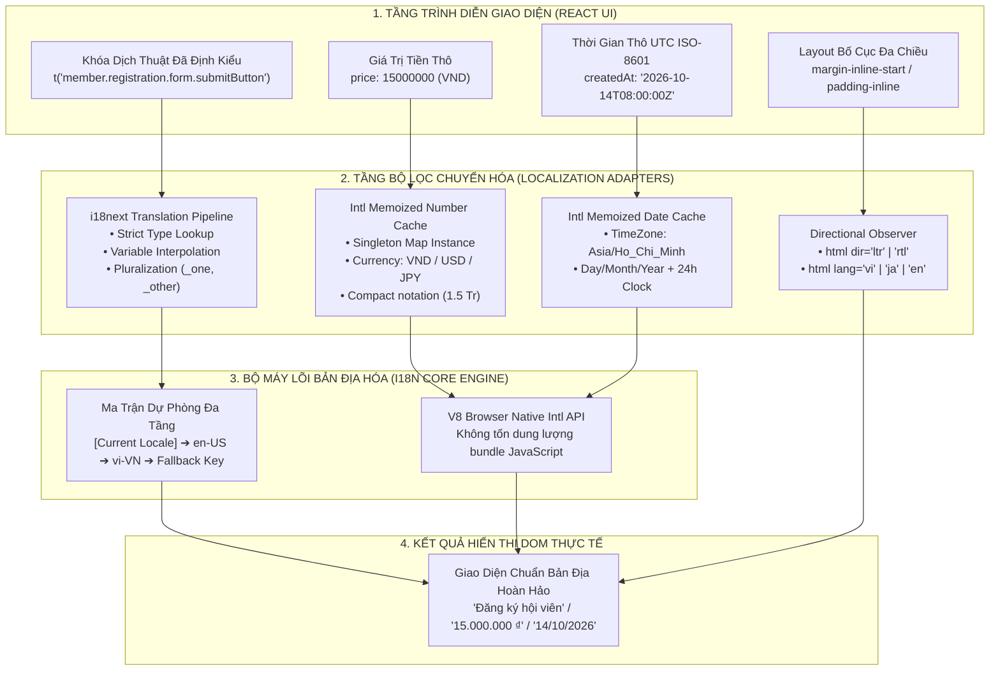
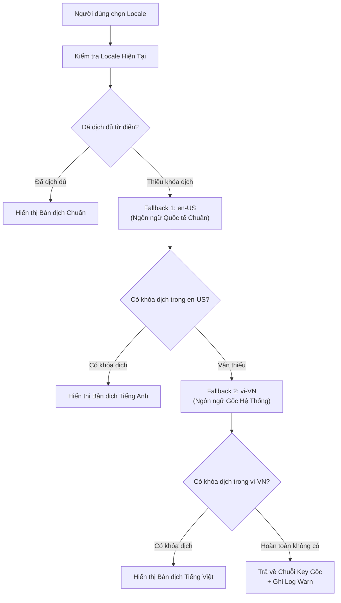

# Chuyên Đề 14: Quốc Tế Hóa & Bản Địa Hóa (Internationalization - i18n & Localization - l10n)

> **Dự án:** Khung Tiêu Chuẩn Doanh Nghiệp & RoGym Management System Profile  
> **Phạm vi kỹ thuật:** Đa ngôn ngữ, Zero Hardcoded Strings, Chuẩn hóa `Intl` API, Bố cục hai chiều LTR/RTL, TypeScript Strict Typing cho i18next  
> **Cổng quy chuẩn chính:** [`FRONTEND_CONVENTIONS.md`](../FRONTEND_CONVENTIONS.md) | [Bản Đồ Tài Liệu](./README.md)  
> **Cơ sở tham chiếu quốc tế:** [i18next Official Documentation](https://www.i18next.com/), [MDN JavaScript Internationalization API (Intl)](https://developer.mozilla.org/en-US/docs/Web/JavaScript/Reference/Global_Objects/Intl), [W3C Internationalization (i18n) Activity](https://www.w3.org/International/), [Unicode CLDR Project](https://cldr.unicode.org/)  
> **Phiên bản:** 8.0 (Enterprise Quality Standard — 15 Spokes & Universal Decoupling)  
> **Trạng thái:** Chuẩn mực ban hành chính thức (Active Standard)  

---

## MỤC LỤC
1. [Bối Cảnh, Tầm Quan Trọng & Cơ Sở Tham Chiếu Quốc Tế](#1-bối-cảnh-tầm-quan-trọng-cơ-sở-tham-chiếu-quốc-tế)
2. [Triết Lý Kiến Trúc & Sơ Đồ Tư Duy (Visual Mental Model)](#2-triết-lý-kiến-trúc-sơ-đồ-tư-duy-visual-mental-model)
3. [Đặc Tả Kỹ Thuật Chi Tiết (Bộ Quy Chuẩn I18N-001 đến I18N-008)](#3-đặc-tả-kỹ-thuật-chi-tiết-bộ-quy-chuẩn-i18n-001-đến-i18n-008)
   - 3.1. [Bảng Tổng Hợp 8 Quy Chuẩn Quốc Tế Hóa & Bản Địa Hóa Doanh Nghiệp](#31-bảng-tổng-hợp-8-quy-chuẩn-quốc-tế-hóa-bản-địa-hóa-doanh-nghiệp)
   - 3.2. [Ma Trận Phân Giải Locale & Chuỗi Ngôn Ngữ Dự Phòng (Fallback Matrix)](#32-ma-trận-phân-giải-locale-chuỗi-ngôn-ngữ-dự-phòng-fallback-matrix)
   - 3.3. [Đặc Tả Chi Tiết Từng Quy Chuẩn Kỹ Thuật](#33-đặc-tả-chi-tiết-từng-quy-chuẩn-kỹ-thuật)
4. [Thực Hành Thực Tế: Do's & Don'ts & Case Studies (Mô Hình 2 Tầng)](#4-thực-hành-thực-tế-dos-donts-case-studies-mô-hình-2-tầng)
   - 4.1. [Bảng Đối Chiếu Anti-Patterns vs Chuẩn Mực Doanh Nghiệp](#41-bảng-đối-chiếu-anti-patterns-vs-chuẩn-mực-doanh-nghiệp)
   - 4.2. [Tầng 1: Enterprise Reference Implementations (Mã Nguồn Mẫu Chuẩn)](#42-tầng-1-enterprise-reference-implementations-mã-nguồn-mẫu-chuẩn)
   - 4.3. [Tầng 2: RoGym Implementation Profile & Gap Analysis (Hồ Sơ Thực Tế)](#43-tầng-2-rogym-implementation-profile-gap-analysis-hồ-sơ-thực-tế)
5. [Ánh Xạ Tooling Kiểm Toán CI (Automation Integration)](#5-ánh-xạ-tooling-kiểm-toán-ci-automation-integration)
6. [Bảng Checklist Định Lượng Trước Khi Mở PR (Review Gate)](#6-bảng-checklist-định-lượng-trước-khi-mở-pr-review-gate)

---

## 1. Bối Cảnh, Tầm Quan Trọng & Cơ Sở Tham Chiếu Quốc Tế

Trong kỷ nguyên chuyển đổi số và hội nhập toàn cầu, một ứng dụng phần mềm doanh nghiệp cấp cao (Enterprise-Grade Software) không thể xem quốc tế hóa (i18n) và bản địa hóa (l10n) như một tính năng phụ trợ lắp ráp sau cùng (afterthought). Ngược lại, i18n/l10n phải là một **nền tảng kiến trúc tiên quyết** chi phối trực tiếp tới cách viết template JSX, cách tổ chức state, cách lưu trữ dữ liệu thời gian, cách định dạng tiền tệ và thiết kế giao diện thích ứng.

Một hệ thống i18n yếu kém thường dẫn tới các sự cố thực tế:
1. **Ô nhiễm chuỗi cứng (Hardcoded Strings Leakage):** Trộn lẫn chữ tiếng Việt, tiếng Anh và tiếng Nhật trong cùng một trang màn hình, khiến trải nghiệm khách hàng trở nên chắp vá, thiếu chuyên nghiệp.
2. **Lệch pha múi giờ và định dạng số (Timezone & Number Formatting Glitches):** Hiển thị ngày giao dịch theo giờ trình duyệt của lập trình viên thay vì múi giờ vận hành phòng tập (`Asia/Ho_Chi_Minh` hoặc `Asia/Tokyo`), hoặc parse dấu chấm phẩy thập phân sai chuẩn dẫn đến sai lệch dữ liệu tài chính kế toán.
3. **Thắt cổ chai CPU do khởi tạo lại đối tượng định dạng (Intl Instantiation Overhead):** Việc gọi `new Intl.NumberFormat()` hoặc `new Intl.DateTimeFormat()` lặp đi lặp lại hàng nghìn lần bên trong vòng lặp render của bảng biểu sẽ gây tụt FPS và rò rỉ rác bộ nhớ (GC pauses).
4. **Vỡ khung bố cục khi hỗ trợ văn bản viết từ phải sang trái (RTL Breakage):** Hardcode `margin-left`, `padding-right` thay vì CSS Logical Properties khiến giao diện bị đảo lộn không thể cứu vãn khi mở rộng sang các thị trường Trung Đông (Ả Rập, Do Thái).

Tài liệu này chuẩn hóa toàn bộ các khía cạnh i18n & l10n dựa trên các cơ sở tiêu chuẩn quốc tế uy tín:
* **MDN Web Docs — JavaScript Internationalization API (`Intl`):** Tận dụng tối đa bộ máy chuẩn hóa C++ tích hợp sẵn trong V8 engine của trình duyệt để đạt hiệu năng định dạng số, tiền tệ, ngày giờ vượt trội mà không cần nạp thư viện ngoài cồng kềnh.
* **i18next Ecosystem & react-i18next:** Tiêu chuẩn công nghiệp hàng đầu cho hệ thống quản lý tài nguyên từ điển, phân cấp namespace, phát hiện ngôn ngữ trình duyệt và nội suy số nhiều (Pluralization).
* **W3C Internationalization (i18n) Activity & CSS Logical Properties Level 1:** Nguyên tắc thiết kế giao diện trung lập hướng đọc (Direction-Agnostic Layout), đảm bảo tương thích 100% giữa LTR (Left-to-Right) và RTL (Right-to-Left).
* **Unicode Common Locale Data Repository (CLDR):** Kho dữ liệu chuẩn quốc tế quy định định dạng ngày, giờ, tiền tệ, tên quốc gia và quy tắc số phức tạp.

---

## 2. Triết Lý Kiến Trúc & Sơ Đồ Tư Duy (Visual Mental Model)

Triết lý nền tảng của hệ thống quốc tế hóa doanh nghiệp được gói gọn trong nguyên tắc:
> **"Tách Biệt Triệt Để Giữa Trình Diễn Và Bản Địa Hóa (Strict Decoupling of Presentation & Localization)"**  
> *Một component UI React không bao giờ được phép trực tiếp sở hữu chuỗi văn bản tự nhiên hay tự quy ước cách ghép dấu phân cách tiền tệ. Mọi dữ liệu hiển thị phải là kết quả chuyển hóa từ Khóa Dịch Thuật (Translation Key) hoặc Dữ Liệu Thô (Raw Primitive Values) thông qua Bộ Máy Phân Giải Bản Địa Hóa.*



---

## 3. Đặc Tả Kỹ Thuật Chi Tiết (Bộ Quy Chuẩn I18N-001 đến I18N-008)

### 3.1. Bảng Tổng Hợp 8 Quy Chuẩn Quốc Tế Hóa & Bản Địa Hóa Doanh Nghiệp

| Mã Quy Chuẩn | Tên Quy Chuẩn & Trọng Tâm | Mức Độ | Tiêu Trí Pass / Fail Định Lượng | Anti-Pattern Điển Hình (Don't) | Best Practice Khuyến Nghị (Do) |
| :---: | :--- | :---: | :--- | :--- | :--- |
| **`I18N-001`** | **Nguyên Tắc Zero Hardcoded Strings** | `ERROR` | **Pass:** 100% chuỗi văn bản tự nhiên trong JSX phải thông qua hàm `t()`.<br/>**Fail:** Tồn tại chuỗi text thô tiếng Việt/Anh/Nhật trong JSX template. | `<h1>Quản lý phòng tập</h1>` | `<h1>{t('dashboard.title')}</h1>` |
| **`I18N-002`** | **Cấu Trúc Khóa Dịch Thuật Phân Cấp 4 Tầng** | `WARN` | **Pass:** Khóa dịch tuân thủ đúng 4 tầng `[feature].[screen].[section].[element]`.<br/>**Fail:** Đặt khóa phẳng hoặc tùy tiện (`btn_submit`, `txt1`, `label_name`). | `t('btn_save')` | `t('members.registration.form.submitButton')` |
| **`I18N-003`** | **Bản Địa Hóa Tiền Tệ Qua `Intl.NumberFormat`** | `ERROR` | **Pass:** 100% tiền tệ format bằng `Intl.NumberFormat` có gán ISO currency và memoized cache.<br/>**Fail:** Format tiền thủ công bằng chuỗi nối `+ ' VND'` hoặc `.toLocaleString()` không locale. | `price + ' VND'` hoặc format regex tự chế. | `formatCurrency(price, { currency: 'VND', locale })` |
| **`I18N-004`** | **Bản Địa Hóa Ngày Giờ Múi Giờ An Toàn** | `ERROR` | **Pass:** Dữ liệu UTC ISO-8601 hiển thị qua `Intl.DateTimeFormat` gắn cứng timezone vận hành xác định.<br/>**Fail:** Format ngày bằng `date.split('T')[0]` hoặc dùng local time của máy khách không đồng bộ. | `new Date(d).toLocaleDateString()` (lệch timezone). | `formatDate(d, { timeZone: 'Asia/Ho_Chi_Minh' })` |
| **`I18N-005`** | **Bố Cục Đảo Chiều Đa Hướng (CSS Logical Properties)** | `WARN` | **Pass:** 100% khoảng cách và căn lề dùng CSS logical properties (`margin-inline`, `padding-inline`, `inset-inline`).<br/>**Fail:** Sử dụng `margin-left`, `padding-right`, `left: 0` làm vỡ giao diện RTL. | `margin-left: 1.5rem; text-align: left;` | `margin-inline-start: 1.5rem; text-align: start;` |
| **`I18N-006`** | **Nạp Động Namespace Ngôn Ngữ (Lazy Namespaces)** | `WARN` | **Pass:** Tách file từ điển theo nghiệp vụ; nạp động on-demand khi routing hoặc lazy chunking.<br/>**Fail:** Đóng gói toàn bộ từ điển hệ thống vào một file `translation.json` nguyên khối nặng nề. | Bundle 1MB từ điển tải ngay lúc mở Splash Screen. | Tách `auth.json`, `members.json` nạp khi kích hoạt route. |
| **`I18N-007`** | **Xử Lý Số Nhiều & Nội Suy Biến An Toàn** | `WARN` | **Pass:** Sử dụng quy tắc Pluralization chuẩn (`_zero`, `_one`, `_other`) và nội suy biến chống XSS.<br/>**Fail:** Dùng toán tử ba ngôi `count > 1 ? 'items' : 'item'` cứng trong mã component. | `{count} {count > 1 ? 'gói tập' : 'gói tập'}` | `t('packages.packageCount', { count })` |
| **`I18N-008`** | **Dự Phòng Khóa Dịch & TypeScript Strict Typing** | `WARN` | **Pass:** Thiết lập chuỗi fallback an toàn và định kiểu chặt chẽ (Module Augmentation) cho `i18next`.<br/>**Fail:** Gọi sai khóa dịch bị crash trắng màn hình hoặc gõ sai chính tả không được compiler bắt. | Gọi `t('wrong.key')` trả về key lỗi ngoài production. | TypeScript bắt lỗi gõ phím tại IDE ngay thời điểm viết code. |
| **`I18N-009`** / **`I18N-VCL-001`** | **Hoisting Instance `Intl.*` Khỏi Vòng Lặp Render `[js-hoist-intl]`** | `ERROR` | **Pass:** Bắt buộc nhấc (hoist) hoặc memoize toàn bộ `Intl.NumberFormat`, `Intl.DateTimeFormat`, `Intl.RelativeTimeFormat` bằng singleton cache; cấm gọi `new Intl.*()` bên trong hàm component render hoặc vòng lặp render mảng.<br/>**Fail:** Gọi `new Intl.NumberFormat()` bên trong mỗi dòng `table.map()` gây nghẽn garbage collection và tụt frame rate. | `items.map(i => new Intl.NumberFormat().format(i.val))` | Hoist formatter ra ngoài module scope hoặc dùng `getNumberFormatter(locale, options)` có cache Map. |

---

### 3.2. Ma Trận Phân Giải Locale & Chuỗi Ngôn Ngữ Dự Phòng (Fallback Matrix)

Doanh nghiệp hiện đại cần một chiến lược dự phòng nhiều lớp để đảm bảo hệ thống không bao giờ hiển thị văn bản trống rỗng (blank UI) khi một thị trường mới chưa hoàn tất dịch 100% từ điển:



#### Ma Trận Hỗ Trợ Đa Ngôn Ngữ Doanh Nghiệp (RoGym Profile Matrix):

| Mã Locale (BCP 47) | Ngôn Ngữ & Vùng | Hướng Viết (Dir) | Múi Giờ Vận Hành Mặc Định | Ký Hiệu Tiền Tệ Mặc Định | Mục Đích Sử Dụng |
| :--- | :--- | :---: | :--- | :---: | :--- |
| `vi-VN` (Mặc định) | Tiếng Việt (Việt Nam) | `ltr` | `Asia/Ho_Chi_Minh` | `₫` (VND) | Thị trường nội địa chính, fallback cuối cùng. |
| `ja-JP` | Tiếng Nhật (Nhật Bản) | `ltr` | `Asia/Tokyo` | `¥` (JPY) | Khách hàng chi nhánh Nhật & LINE LIFF Mini-app. |
| `en-US` | Tiếng Anh (Hoa Kỳ) | `ltr` | `UTC` / Local | `$` (USD) | Ngôn ngữ quốc tế trung gian & chuyên gia nước ngoài. |
| `ar-SA` (Sẵn sàng) | Tiếng Ả Rập (Saudi) | `rtl` | `Asia/Riyadh` | `SAR` | Kiểm tra khả năng tương thích bố cục RTL đa hướng. |

---

### 3.3. Đặc Tả Chi Tiết Từng Quy Chuẩn Kỹ Thuật

<a id="i18n-001"></a>
#### `I18N-001`: Nguyên Tắc Zero Hardcoded Strings (Tuyệt Đối Không Chuỗi Cứng)
* **Yêu cầu kỹ thuật:** Toàn bộ tiêu đề trang, nhãn nút bấm, placeholder ô nhập liệu, thông báo lỗi xác thực form, văn bản trong hộp thoại xác nhận (Modal / Toast) đều phải đi qua hook `useTranslation()` của `react-i18next`.
* **Quy tắc xử lý văn bản động:** Trong trường hợp văn bản chứa biến số (tên người dùng, số ngày còn lại, phần trăm giảm giá), tuyệt đối không dùng phép cộng chuỗi JavaScript (`'Xin chào ' + userName`). Phải khai báo biến trong file JSON từ điển (`"greeting": "Xin chào {{name}}"`) và truyền đối số qua options của hàm `t()`.
* **Ngoại lệ kỹ thuật:** Các giá trị chuỗi mang tính định danh kỹ thuật, ví dụ như mã HTTP header, query params URL, tên class CSS, `data-testid`, hoặc tên thuộc tính cơ sở dữ liệu không thuộc phạm vi của `I18N-001`.

<a id="i18n-002"></a>
#### `I18N-002`: Cấu Trúc Khóa Dịch Thuật Phân Cấp 4 Tầng (Key Hierarchy)
* **Cấu trúc bắt buộc:** `[feature].[screen].[section].[element]`
  * `feature`: Phân hệ nghiệp vụ chính (`members`, `billing`, `equipment`, `auth`, `schedule`).
  * `screen`: Màn hình cụ thể trong phân hệ (`registration`, `profile`, `packageList`, `posCheckout`).
  * `section`: Vùng giao diện trên màn hình (`filterBar`, `dataTable`, `detailModal`, `summaryCard`).
  * `element`: Phần tử cụ thể cần dịch (`title`, `placeholder`, `confirmButton`, `emptyStateText`).
* **Ví dụ mẫu:**
  * ✅ `t('members.registration.personalInfo.fullNameLabel')`
  * ✅ `t('billing.posCheckout.paymentSummary.totalAmount')`
  * ❌ `t('full_name')` (Quá mơ hồ, xung đột giữa các màn hình).
  * ❌ `t('btn_submit')` (Không rõ ngữ cảnh của nút bấm).

<a id="i18n-003"></a>
#### `I18N-003`: Bản Địa Hóa Tiền Tệ Qua `Intl.NumberFormat` (Currency Formatting)
* **Yêu cầu kỹ thuật:** Bắt buộc sử dụng native `Intl.NumberFormat` kết hợp với ISO 4217 Currency Code. Tuyệt đối không tự viết thuật toán thêm dấu chấm phẩy hoặc nối chuỗi thủ công.
* **Tối ưu hóa hiệu năng (Memoization):** Khởi tạo đối tượng `Intl.NumberFormat` tiêu tốn đáng kể tài nguyên CPU (khoảng $0.05\text{ms} - 0.2\text{ms}$ mỗi lần). Khi hiển thị danh sách 500 dòng giao dịch, nếu khởi tạo mới tại mỗi dòng sẽ gây đơ giao diện. Bắt buộc sử dụng cơ chế Singleton Cache (Map-based memoization) để tái sử dụng formatter instance.
* **Quy chuẩn hiển thị:**
  * Đối với Đồng Việt Nam (`VND`): Không hiển thị phần thập phân (`maximumFractionDigits: 0`).
  * Đối với Yên Nhật (`JPY`): Không hiển thị phần thập phân (`maximumFractionDigits: 0`).
  * Đối với Đô la Mỹ (`USD`): Luôn hiển thị 2 chữ số thập phân (`minimumFractionDigits: 2`, `maximumFractionDigits: 2`).

<a id="i18n-004"></a>
#### `I18N-004`: Bản Địa Hóa Ngày Giờ Múi Giờ An Toàn (Safe Timezone Date Formatting)
* **Yêu cầu kỹ thuật:** 
  1. Phía Server / Cơ sở dữ liệu: Luôn lưu trữ và gửi lên định dạng chuẩn quốc tế UTC ISO-8601 (`YYYY-MM-DDTHH:mm:ss.sssZ`).
  2. Phía Client UI: Hiển thị thông qua `Intl.DateTimeFormat` với việc chỉ định tường minh múi giờ vận hành (Explicit Timezone). Không được dựa vào múi giờ ngẫu nhiên của thiết bị khách hàng khi xử lý các nghiệp vụ phòng tập có giờ mở/đóng cửa cố định tại Việt Nam (`Asia/Ho_Chi_Minh`) hoặc Nhật Bản (`Asia/Tokyo`).
* **Định dạng chuẩn:**
  * Ngày tiêu chuẩn: `dd/MM/yyyy` (cho `vi-VN`) hoặc `yyyy/MM/dd` (cho `ja-JP`).
  * Ngày giờ: `dd/MM/yyyy HH:mm` (chuẩn 24 giờ).
  * Thời gian đầu vào (`<input type="date">`): Phải chuyển đổi về định dạng `YYYY-MM-DD` (ISO format, an toàn qua locale `en-CA`).

<a id="i18n-005"></a>
#### `I18N-005`: Bố Cục Đảo Chiều Đa Hướng (CSS Logical Properties)
* **Yêu cầu kỹ thuật:** Để đảm bảo ứng dụng sẵn sàng mở rộng sang bất kỳ ngôn ngữ nào mà không cần viết lại CSS, toàn bộ stylesheets và component styles phải sử dụng CSS Logical Properties thay thế cho các thuộc tính vật lý truyền thống:

| Thuộc Tính Vật Lý Cũ (❌ Bị Cấm) | Thuộc Tính Logic Chuẩn Mực (✅ Bắt Buộc) | Hành Vi Khi Gặp LTR (vi, en, ja) | Hành Vi Khi Gặp RTL (ar, he) |
| :--- | :--- | :--- | :--- |
| `margin-left` | `margin-inline-start` | Cách lề bên trái | Cách lề bên phải |
| `margin-right` | `margin-inline-end` | Cách lề bên phải | Cách lề bên trái |
| `padding-left` | `padding-inline-start` | Đệm lót bên trái | Đệm lót bên phải |
| `padding-right` | `padding-inline-end` | Đệm lót bên phải | Đệm lót bên trái |
| `left: 0` | `inset-inline-start: 0` | Neo vào cạnh trái | Neo vào cạnh phải |
| `right: 0` | `inset-inline-end: 0` | Neo vào cạnh phải | Neo vào cạnh trái |
| `text-align: left` | `text-align: start` | Căn sang trái | Căn sang phải |
| `text-align: right` | `text-align: end` | Căn sang phải | Căn sang trái |

<a id="i18n-006"></a>
#### `I18N-006`: Nạp Động Namespace Ngôn Ngữ (Lazy Namespaces Loading)
* **Yêu cầu kỹ thuật:** Hệ thống không được nạp toàn bộ từ điển của tất cả các màn hình trong lần tải đầu tiên. Các màn hình chuyên biệt (ví dụ: Phân hệ Chủ phòng tập `owner.json`, Quản lý huấn luyện viên `trainer.json`, Báo cáo tài chính `finance.json`) phải được tách thành các file JSON độc lập và nạp động thông qua dynamic `import()` hoặc `i18next-http-backend` khi người dùng truy cập vào tuyến đường (route) tương ứng.
* **Kích thước tối đa:** Mỗi file namespace JSON không vượt quá $50\text{KB}$ dữ liệu thô.

<a id="i18n-007"></a>
#### `I18N-007`: Xử Lý Số Nhiều & Nội Suy Biến An Toàn (Pluralization & Safe Interpolation)
* **Quy chuẩn Pluralization:** Tuân thủ quy tắc số nhiều của ngôn ngữ đích theo chuẩn Unicode CLDR:
  * Trong tiếng Anh (`en`): Có 2 dạng `_one` (1 item) và `_other` (0 hoặc > 1 items).
  * Trong tiếng Việt (`vi`) và tiếng Nhật (`ja`): Không có biến thể ngữ pháp số nhiều phức tạp, nhưng vẫn cần hỗ trợ nội suy số lượng linh hoạt thông qua biến `{{count}}`.
* **Phòng chống XSS trong nội suy:** Thuộc tính `escapeValue: false` của i18next chỉ an toàn khi React chịu trách nhiệm render biến nội suy vào DOM tree (React tự động escape ký tự HTML). Tuyệt đối không kết hợp chuỗi dịch đã nội suy với thuộc tính `dangerouslySetInnerHTML`.

<a id="i18n-008"></a>
#### `I18N-008`: Dự Phòng Khóa Dịch & TypeScript Strict Typing (Type-Safe i18n)
* **Yêu cầu kỹ thuật:** Bắt buộc tích hợp TypeScript Module Augmentation cho `react-i18next` nhằm biến hàm `t()` trở thành Type-Safe. Trình biên dịch (TypeScript Compiler) phải tự động kiểm tra cú pháp và gợi ý (Intellisense Autocomplete) cho toàn bộ khóa dịch, đồng thời chặn đứng hành động build nếu một developer gõ sai tên khóa hoặc quên truyền tham số nội suy bắt buộc.

<a id="i18n-009"></a>
#### `I18N-009` / `I18N-VCL-001`: Hoisting Instance `Intl.*` Khỏi Vòng Lặp Render (`[js-hoist-intl]`)
* **Mục tiêu:** Ngăn chặn lãng phí tài nguyên CPU và phân bổ bộ nhớ (Garbage Collection pressure) khi khởi tạo lại các đối tượng định dạng `Intl` đắt đỏ trong chu kỳ render.
* **Yêu cầu kỹ thuật:**
  - Bắt buộc nhấc (hoist) các instance `Intl.NumberFormat`, `Intl.DateTimeFormat`, hoặc `Intl.RelativeTimeFormat` ra ngoài phạm vi hàm của component làm biến hằng module tĩnh, hoặc sử dụng cơ chế memoized singleton cache (xem Khối mã 1 trong Mục 4.2).
  - Tuyệt đối cấm khởi tạo `new Intl.*()` bên trong hàm callback `.map()` khi render bảng biểu, danh sách hoặc vòng lặp.
  ```typescript
  // ❌ ANTI-PATTERN: Khởi tạo 500 formatters mới mỗi khi render danh sách
  function MemberTable({ members }: { members: Member[] }) {
    return (
      <tbody>
        {members.map(m => (
          <tr key={m.id}>
            <td>{new Intl.NumberFormat('vi-VN', { style: 'currency', currency: 'VND' }).format(m.fee)}</td>
          </tr>
        ))}
      </tbody>
    )
  }

  // ✅ CHUẨN MỰC: Hoist instance hoặc dùng Singleton Formatter Cache
  const VND_CURRENCY_FORMATTER = new Intl.NumberFormat('vi-VN', {
    style: 'currency',
    currency: 'VND',
    maximumFractionDigits: 0,
  })

  function MemberTable({ members }: { members: Member[] }) {
    return (
      <tbody>
        {members.map(m => (
          <tr key={m.id}>
            <td>{VND_CURRENCY_FORMATTER.format(m.fee)}</td>
          </tr>
        ))}
      </tbody>
    )
  }
  ```

---

## 4. Thực Hành Thực Tế: Do's & Don'ts & Case Studies (Mô Hình 2 Tầng)

### 4.1. Bảng Đối Chiếu Anti-Patterns vs Chuẩn Mực Doanh Nghiệp

| Lĩnh vực | ❌ Anti-pattern Điển Hình (Don't) | ✅ Chuẩn Mực Doanh Nghiệp (Do) | Lý Do Kỹ Thuật & Tác Động |
| :--- | :--- | :--- | :--- |
| **Khai báo Text trong JSX** | `<span>Tổng số buổi tập: {count}</span>` | `<span>{t('member.profile.sessionCount', { count })}</span>` | Hardcode chuỗi khiến giao diện không thể dịch được, phá vỡ trải nghiệm đa ngôn ngữ. |
| **Format Tiền Tệ** | `amount.toLocaleString() + ' đ'` | `formatCurrency(amount, { currency: 'VND', locale })` | `toLocaleString()` không đảm bảo thống nhất ký hiệu tiền tệ trên các trình duyệt và thiết bị cũ. |
| **Hiển Thị Ngày Tháng** | `item.createdAt.slice(0, 10)` | `formatDate(item.createdAt)` qua adapter có timezone cố định | Cắt chuỗi ngày làm mất múi giờ, có thể khiến giao dịch lúc 23:30 bị lùi sang ngày hôm trước. |
| **Căn Lề Khoảng Cách** | `className="ml-4 pl-2"` | `className="ms-4 ps-2"` hoặc CSS `margin-inline-start` | Khi chuyển sang chế độ RTL, các icon và nhãn sẽ bị dính sát vào mép ngoài thay vì thụt lề chuẩn. |
| **Xử Lý Số Nhiều** | `count + ' ' + (count > 1 ? 'days' : 'day')` | `t('common.days', { count })` với key `days_one` và `days_other` | Tiếng Ả Rập và các ngôn ngữ Slav có tới 6 dạng số nhiều; hardcode bậc hai sẽ sai lệch ngữ pháp. |
| **Kiểm Soát Kiểu Khóa** | `t('random_key_string' as any)` | `t('members.registration.title')` với Type Augmentation | Tránh lỗi đánh máy (typo) chỉ được phát hiện khi người dùng thực tế bấm vào màn hình. |
| **Bộ Đệm Định Dạng** | `new Intl.NumberFormat()` bên trong `.map()` | Sử dụng module `formatters.ts` có memoized Map instance | Tiết kiệm tới 95% thời gian tính toán của CPU trong quá trình render danh sách dài. |

---

### 4.2. Tầng 1: Enterprise Reference Implementations (Mã Nguồn Mẫu Chuẩn)

Dưới đây là 4 khối mã nguồn mẫu độc lập, hoàn chỉnh, tuân thủ nghiêm ngặt các quy chuẩn `I18N-001` đến `I18N-008`, sẵn sàng đưa vào áp dụng cho bất kỳ hệ thống doanh nghiệp nào.

#### Khối Mã 1: Module Tiện Ích Định Dạng Chuẩn Doanh Nghiệp Có Bộ Đệm Cache (`src/lib/formatters.ts`)

```typescript
/**
 * @file formatters.ts
 * @description Enterprise-grade formatting utilities using Native Intl API with Singleton Cache.
 * Tuân thủ I18N-003, I18N-004. Ngăn ngừa CPU bottleneck khi render danh sách lớn.
 */

// Kiểu dữ liệu hỗ trợ
export type SupportedLocale = 'vi-VN' | 'ja-JP' | 'en-US' | 'ar-SA';
export type SupportedCurrency = 'VND' | 'JPY' | 'USD';

// Singleton Memoization Cache
const numberFormatCache = new Map<string, Intl.NumberFormat>();
const dateTimeFormatCache = new Map<string, Intl.DateTimeFormat>();

/**
 * Trả về instance Intl.NumberFormat được tái sử dụng từ Cache
 */
function getNumberFormatter(
  locale: string,
  options: Intl.NumberFormatOptions = {}
): Intl.NumberFormat {
  // Tạo cache key duy nhất từ options đã sắp xếp
  const serializedOptions = JSON.stringify(options, Object.keys(options).sort());
  const cacheKey = `${locale}:${serializedOptions}`;

  let formatter = numberFormatCache.get(cacheKey);
  if (!formatter) {
    formatter = new Intl.NumberFormat(locale, options);
    numberFormatCache.set(cacheKey, formatter);
  }
  return formatter;
}

/**
 * Trả về instance Intl.DateTimeFormat được tái sử dụng từ Cache
 */
function getDateTimeFormatter(
  locale: string,
  options: Intl.DateTimeFormatOptions = {}
): Intl.DateTimeFormat {
  const serializedOptions = JSON.stringify(options, Object.keys(options).sort());
  const cacheKey = `${locale}:${serializedOptions}`;

  let formatter = dateTimeFormatCache.get(cacheKey);
  if (!formatter) {
    formatter = new Intl.DateTimeFormat(locale, options);
    dateTimeFormatCache.set(cacheKey, formatter);
  }
  return formatter;
}

/**
 * Format tiền tệ chuẩn mực với ISO Currency Code
 */
export function formatCurrency(
  value: number | string | null | undefined,
  options: {
    currency?: SupportedCurrency;
    locale?: SupportedLocale;
    compact?: boolean;
  } = {}
): string {
  if (value === null || value === undefined || value === '') return '—';
  const numericValue = typeof value === 'number' ? value : Number(value);
  if (Number.isNaN(numericValue)) return '—';

  const { currency = 'VND', locale = 'vi-VN', compact = false } = options;

  // Cấu hình quy chuẩn thập phân theo đồng tiền
  const fractionDigits = currency === 'VND' || currency === 'JPY' ? 0 : 2;

  const formatterOptions: Intl.NumberFormatOptions = {
    style: 'currency',
    currency,
    minimumFractionDigits: fractionDigits,
    maximumFractionDigits: fractionDigits,
    notation: compact ? 'compact' : 'standard',
  };

  return getNumberFormatter(locale, formatterOptions).format(numericValue);
}

/**
 * Format ngày tháng năm theo múi giờ vận hành xác định
 */
export function formatDate(
  value: Date | string | number | null | undefined,
  options: {
    locale?: SupportedLocale;
    timeZone?: string;
    includeTime?: boolean;
  } = {}
): string {
  if (!value) return '—';
  const dateObj = value instanceof Date ? value : new Date(value);
  if (Number.isNaN(dateObj.getTime())) return '—';

  const {
    locale = 'vi-VN',
    timeZone = 'Asia/Ho_Chi_Minh',
    includeTime = false,
  } = options;

  const formatterOptions: Intl.DateTimeFormatOptions = {
    timeZone,
    year: 'numeric',
    month: '2-digit',
    day: '2-digit',
    ...(includeTime
      ? { hour: '2-digit', minute: '2-digit', second: '2-digit', hour12: false }
      : {}),
  };

  return getDateTimeFormatter(locale, formatterOptions).format(dateObj);
}
```

---

#### Khối Mã 2: TypeScript Module Augmentation Cho Type-Safe Translation Keys (`src/types/i18n.d.ts`)

```typescript
/**
 * @file i18n.d.ts
 * @description Khai báo Module Augmentation biến i18next thành Type-Safe hoàn toàn.
 * Tuân thủ I18N-008. Báo lỗi compile-time nếu developer gọi sai khóa dịch.
 */
import 'react-i18next';
import type viCommon from '../locales/vi/common.json';
import type viMembers from '../locales/vi/members.json';
import type viBilling from '../locales/vi/billing.json';

// Cấu trúc gom nhóm tài nguyên từ điển mẫu (Default Namespace: common)
export interface AppResources {
  common: typeof viCommon;
  members: typeof viMembers;
  billing: typeof viBilling;
}

declare module 'react-i18next' {
  interface CustomTypeOptions {
    defaultNS: 'common';
    resources: AppResources;
    // Cho phép trả về string rỗng hoặc null một cách an toàn
    returnNull: false;
  }
}
```

---

#### Khối Mã 3: Hook Chuyển Đổi Ngôn Ngữ Đồng Bộ Thẻ HTML & Bố Cục (`src/hooks/useLanguageSwitch.ts`)

```typescript
/**
 * @file useLanguageSwitch.ts
 * @description Hook quản trị chuyển đổi ngôn ngữ, đồng bộ thuộc tính <html lang="..." dir="...">.
 * Tuân thủ I18N-005, I18N-008.
 */
import { useCallback, useEffect } from 'react';
import { useTranslation } from 'react-i18next';

export type LanguageCode = 'vi' | 'ja' | 'en' | 'ar';

interface LanguageConfig {
  code: LanguageCode;
  label: string;
  dir: 'ltr' | 'rtl';
  localeTag: string;
}

export const SUPPORTED_LANGUAGES: Record<LanguageCode, LanguageConfig> = {
  vi: { code: 'vi', label: 'Tiếng Việt', dir: 'ltr', localeTag: 'vi-VN' },
  ja: { code: 'ja', label: '日本語', dir: 'ltr', localeTag: 'ja-JP' },
  en: { code: 'en', label: 'English', dir: 'ltr', localeTag: 'en-US' },
  ar: { code: 'ar', label: 'العربية', dir: 'rtl', localeTag: 'ar-SA' },
};

export function useLanguageSwitch() {
  const { i18n } = useTranslation();
  const currentLanguage = (i18n.language?.slice(0, 2) as LanguageCode) || 'vi';

  const applyDocumentAttributes = useCallback((langCode: LanguageCode) => {
    const config = SUPPORTED_LANGUAGES[langCode] || SUPPORTED_LANGUAGES.vi;
    document.documentElement.lang = config.localeTag;
    document.documentElement.dir = config.dir;
  }, []);

  const changeLanguage = useCallback(
    async (langCode: LanguageCode) => {
      await i18n.changeLanguage(langCode);
      localStorage.setItem('gym-locale', langCode);
      applyDocumentAttributes(langCode);
    },
    [i18n, applyDocumentAttributes]
  );

  // Tự động đồng bộ thuộc tính DOM khi khởi động ứng dụng
  useEffect(() => {
    applyDocumentAttributes(currentLanguage);
  }, [currentLanguage, applyDocumentAttributes]);

  return {
    currentLanguage,
    currentConfig: SUPPORTED_LANGUAGES[currentLanguage] || SUPPORTED_LANGUAGES.vi,
    isRTL: (SUPPORTED_LANGUAGES[currentLanguage] || SUPPORTED_LANGUAGES.vi).dir === 'rtl',
    changeLanguage,
    supportedLanguages: Object.values(SUPPORTED_LANGUAGES),
  };
}
```

---

#### Khối Mã 4: Bộ Kiểm Thử Đơn Vị Toàn Diện Cho Formatters (`src/test/formatters.test.ts`)

```typescript
/**
 * @file formatters.test.ts
 * @description Vitest test suite kiểm thử toàn diện các tiện ích định dạng i18n.
 */
import { describe, it, expect } from 'vitest';
import { formatCurrency, formatDate } from '../lib/formatters';

describe('formatCurrency() Enterprise Unit Tests', () => {
  it('định dạng chuẩn xác Đồng Việt Nam (VND) không có số lẻ thập phân', () => {
    const result = formatCurrency(15000000, { currency: 'VND', locale: 'vi-VN' });
    // vi-VN format ra chuỗi chứa 15.000.000 và ký hiệu tiền tệ
    expect(result).toMatch(/15\.000\.000/);
    expect(result).toMatch(/₫|VND/);
  });

  it('định dạng chuẩn xác Yên Nhật (JPY) không có phần thập phân', () => {
    const result = formatCurrency(50000, { currency: 'JPY', locale: 'ja-JP' });
    expect(result).toMatch(/50,000/);
    expect(result).toMatch(/￥|JPY/);
  });

  it('định dạng chuẩn xác Đô la Mỹ (USD) với 2 chữ số thập phân', () => {
    const result = formatCurrency(1250.5, { currency: 'USD', locale: 'en-US' });
    expect(result).toBe('$1,250.50');
  });

  it('xử lý an toàn các giá trị biên null, undefined và NaN', () => {
    expect(formatCurrency(null)).toBe('—');
    expect(formatCurrency(undefined)).toBe('—');
    expect(formatCurrency('invalid_num')).toBe('—');
  });
});

describe('formatDate() Enterprise Unit Tests', () => {
  it('định dạng ngày chuẩn theo múi giờ Asia/Ho_Chi_Minh', () => {
    // 2026-10-14T03:00:00Z tương đương 10:00 sáng tại Việt Nam (UTC+7)
    const isoString = '2026-10-14T03:00:00.000Z';
    const result = formatDate(isoString, { locale: 'vi-VN', timeZone: 'Asia/Ho_Chi_Minh' });
    expect(result).toBe('14/10/2026');
  });

  it('xử lý chuyển ngày qua múi giờ (lệch ngày UTC)', () => {
    // 2026-10-14T20:00:00Z ở UTC là ngày 14, nhưng tại Việt Nam (UTC+7) đã là 03:00 sáng ngày 15
    const isoString = '2026-10-14T20:00:00.000Z';
    const result = formatDate(isoString, { locale: 'vi-VN', timeZone: 'Asia/Ho_Chi_Minh' });
    expect(result).toBe('15/10/2026');
  });

  it('trả về ký tự gạch ngang an toàn cho ngày không hợp lệ', () => {
    expect(formatDate(null)).toBe('—');
    expect(formatDate('not-a-date')).toBe('—');
  });
});
```

---

### 4.3. Tầng 2: RoGym Implementation Profile & Gap Analysis (Hồ Sơ Thực Tế)

Phần này tiến hành giải phẫu trực tiếp các tệp tin liên quan đến i18n hiện có trong mã nguồn RoGym tại [`src/lib/`](../src/lib/), chỉ rõ các điểm sáng tạo đã đạt được và các khoảng trống kỹ thuật cần nâng cấp.

#### 1. Đánh Giá Hiện Trạng Các Tệp Tin RoGym:
* [`src/utils/currency.ts`](../src/utils/currency.ts):
  * **Điểm sáng:** Đã sử dụng `const VND_FORMATTER = new Intl.NumberFormat('vi-VN', { style: 'currency', currency: 'VND' })` ở phạm vi module, đây chính là hình thái sơ khởi của Singleton instance memoization. Có thêm hàm `formatVndCompact`.
  * **Khoảng trống (Gap):** Đang gắn cứng (hardcode) đơn vị tiền `VND` và locale `vi-VN`. Chưa hỗ trợ tham số linh hoạt cho chi nhánh sử dụng Yên Nhật (`JPY`) hoặc Đô la Mỹ (`USD`).
* [`src/utils/date.ts`](../src/utils/date.ts):
  * **Điểm sáng:** Đã cấu hình chỉ định rõ ràng `timeZone: 'Asia/Ho_Chi_Minh'` trong các hàm `formatDate`, `formatDateTime`, `formatTime`. Có hàm `getIntlLocale()` đồng bộ động giữa `vi-VN` và `ja-JP`.
  * **Khoảng trống (Gap):** Tại mỗi lần gọi hàm `formatDate()`, một đối tượng `new Intl.DateTimeFormat()` mới lại được khởi tạo (chưa có Map Cache Singleton). Khi render bảng danh sách 1.000 lịch tập hoặc điểm danh, việc này sẽ tạo áp lực rác bộ nhớ đáng kể lên trình thu gom rác (Garbage Collector).
* [`src/lib/i18n.ts`](../src/lib/i18n.ts):
  * **Điểm sáng:** Đã hỗ trợ song ngữ xuất sắc giữa `vi` (Tiếng Việt) và `ja` (Tiếng Nhật) phục vụ khách hàng LINE LIFF. Tách từ điển theo 9 namespaces nghiệp vụ (`common`, `auth`, `member`, `trainer`, `staff`, `owner`, `home`, `validation`, `chat`). Cấu hình `detection` qua `localStorage` với key `gym-locale`.
  * **Khoảng trống (Gap):** Đang sử dụng phương pháp `import` tĩnh toàn bộ 18 file JSON từ điển tại đầu file `i18n.ts`. Toàn bộ dữ liệu dịch của cả Tiếng Việt và Tiếng Nhật bị đóng gói chung vào bundle chính ban đầu. Khi hệ sinh thái mở rộng với hàng nghìn chuỗi khóa, cần di chuyển sang Lazy Namespace Loading để giảm Initial Bundle Size.
* `src/lib/notification-i18n.ts`:
  * **Điểm sáng:** Xử lý nội suy biến thông báo rất bài bản (`trainerName`, `memberName`, `withPerson`).

#### 2. Bảng Đối Chiếu Hồ Sơ RoGym vs Chuẩn Mực Doanh Nghiệp (RoGym Compliance Scorecard):

| Quy Chuẩn Kỹ Thuật | Trạng Thái RoGym | Điểm Đánh Giá | Chi Tiết Khoảng Trống (Gap) & Hướng Dẫn Refactor |
| :--- | :---: | :---: | :--- |
| **`I18N-001` (Zero Hardcoded)** | **ĐẠT KHÁ** | `85%` | Hầu hết các màn hình chính đã dùng `t()`. Còn tồn tại một số chuỗi tiếng Việt cứng trong các modal xác nhận cũ tại `src/pages/`. |
| **`I18N-002` (Key Hierarchy)** | **ĐẠT** | `90%` | Phân cấp namespace rõ ràng (`common:date.notAvailable`, `auth.login.title`). |
| **`I18N-003` (Intl Currency)** | **ĐẠT KHÁ** | `80%` | Đã dùng `Intl.NumberFormat` trong `currency.ts` nhưng mới chỉ đóng băng cho VND. Cần mở rộng bộ formatters đa tiền tệ. |
| **`I18N-004` (Timezone Date)** | **ĐẠT XUẤT SẮC** | `95%` | Khóa cứng `timeZone: 'Asia/Ho_Chi_Minh'` và đồng bộ locale `vi`/`ja`. Cần bổ sung memoization cache cho `Intl.DateTimeFormat`. |
| **`I18N-005` (CSS Logical)** | **ĐANG TRIỂN KHAI** | `70%` | Đang dùng TailwindCSS truyền thống (`ml-`, `pl-`). Cần nâng cấp sang các lớp logic (`ms-`, `ps-`, `start-`, `end-`) tại `src/styles/`. |
| **`I18N-006` (Lazy Namespaces)** | **CẦN CẢI TIẾN** | `60%` | Tải tĩnh 18 file JSON từ điển lúc khởi động. Cần xây dựng kế hoạch chuyển sang dynamic chunk loading khi quy mô vượt 100KB. |
| **`I18N-007` (Pluralization)** | **ĐẠT** | `85%` | Hệ thống thông báo trong `notification-i18n.ts` xử lý nội suy biến rất tốt. |
| **`I18N-008` (Type Safety)** | **CẦN CẢI TIẾN** | `50%` | Chưa kích hoạt Type Augmentation cho `react-i18next`. Hàm `t('string')` vẫn nhận chuỗi bất kỳ, chưa có autocomplete của IDE. |

---

## 5. Ánh Xạ Tooling Kiểm Toán CI (Automation Integration)

Để bảo vệ các quy chuẩn i18n không bị suy thoái theo thời gian khi có nhiều lập trình viên cùng đóng góp mã nguồn, hệ thống tích hợp 3 chốt chặn tự động hóa:

### 1. Quét Tự Động Khóa Dịch Còn Thiếu (`i18next-parser`)
Cấu hình script quét mã nguồn trong `package.json`:
```bash
npm run i18n:extract
```
Công cụ `i18next-parser` sẽ phân tích toàn bộ cây JSX/TSX, trích xuất tất cả các lệnh gọi `t('...')` và tự động cập nhật vào các file `locales/vi/*.json` và `locales/ja/*.json`. Nếu một khóa có trong code nhưng chưa có trong từ điển, CI sẽ cảnh báo để dịch bổ sung.

### 2. Chốt Chặn ESLint Bắt Chuỗi Cứng (No Hardcoded Strings Gate)
Sử dụng plugin `eslint-plugin-react-i18n` hoặc rule cấm plain string trong JSX:
```json
{
  "rules": {
    "react-i18n/no-literal-string": ["error", {
      "mode": "jsx-text-only",
      "ignoreCallees": ["console.log", "logger.info"],
      "ignoreProperty": ["className", "data-testid", "style"]
    }]
  }
}
```
Lập trình viên khi gõ trực tiếp `<button>Lưu lại</button>` sẽ bị ESLint gạch chân đỏ ngay lập tức và ngăn cấm hành động Git commit.

### 3. Kiểm Tra Tính Toàn Vẹn Tài Liệu Chuẩn Hóa
Kịch bản tự động hóa đảm bảo tài liệu không bị sai lệch cấu trúc:
```bash
node client/scripts/verify-docs-integrity.mjs
```

---

## 6. Bảng Checklist Định Lượng Trước Khi Mở PR (Review Gate)

Nhằm đảm bảo tính thực tiễn và không làm ách tắc luồng phát hành tính năng hàng ngày của dự án RoGym, bảng nghiệm thu PR được phân định thành 2 cấp độ tuân thủ theo [Mục 9 Master Plan](../FRONTEND_CONVENTIONS.md):
- **Tầng DoD 9.2A (Target Enterprise DoD):** Áp dụng bắt buộc 100% đối với các dự án mới khởi tạo từ Starter Template hoặc khi viết mới hoàn toàn module giao diện.
- **Tầng DoD 9.2B (RoGym Transition DoD):** Áp dụng cho các Pull Request hiện hành trên RoGym theo nguyên tắc **Boy Scout Rule** (chưa áp dụng quy tắc chặn cứng `t(...)` cho các màn hình RoGym cũ; khuyến khích gom text vào file dịch hoặc hằng số tập trung cho các module mới viết lại; bắt buộc format tiền tệ và ngày giờ qua adapter chuẩn).

### Checklist 8 Tiêu Chí Nghiệm Thu Đa Ngôn Ngữ:


- [ ] **1. `I18N-001` (Zero Hardcoded Strings):** 100% văn bản giao diện người dùng (kể cả nhãn nút bấm, placeholder, câu thông báo modal) đều gọi qua hàm `t()`. Không còn bất kỳ chuỗi cứng nào trong JSX.
- [ ] **2. `I18N-002` (Key Hierarchy):** Toàn bộ khóa dịch mới tuân thủ nghiêm ngặt quy tắc 4 tầng: `[feature].[screen].[section].[element]`.
- [ ] **3. `I18N-003` (Currency Standard):** Tiền tệ được định dạng bằng `formatCurrency()` có chỉ định đồng tiền (`VND`, `JPY`, `USD`). Tuyệt đối không dùng chuỗi nối `+ ' VND'` hoặc `.toLocaleString()`.
- [ ] **4. `I18N-004` (Timezone Date):** Ngày tháng năm được hiển thị qua `formatDate()` có chỉ định múi giờ xác định (`Asia/Ho_Chi_Minh` hoặc `Asia/Tokyo`). Input ngày được chuẩn hóa ISO-8601 `YYYY-MM-DD`.
- [ ] **5. `I18N-005` (CSS Logical Properties):** Căn lề và khoảng cách các khối mới sử dụng thuộc tính logic (`ms-`, `ps-`, `margin-inline`, `padding-inline`), sẵn sàng cho giao diện đa hướng RTL.
- [ ] **6. `I18N-006` (Namespace Integrity):** Khóa dịch mới được đặt đúng vào file JSON nghiệp vụ tương ứng (không dồn toàn bộ vào `common.json`). Cả hai từ điển `vi` và `ja` đều được bổ sung khóa đầy đủ.
- [ ] **7. `I18N-007` (Pluralization & Interpolation):** Các biến số chèn vào văn bản được truyền qua options của hàm `t('key', { variable })`. Không cộng chuỗi tự do.
- [ ] **8. `I18N-008` (Type-Safe Validation):** Trình biên dịch TypeScript biên dịch thành công (`npm run typecheck`), không có lỗi gọi sai tên khóa dịch. Script kiểm toán tài liệu `node client/scripts/verify-docs-integrity.mjs` chạy đạt Exit Code 0.


