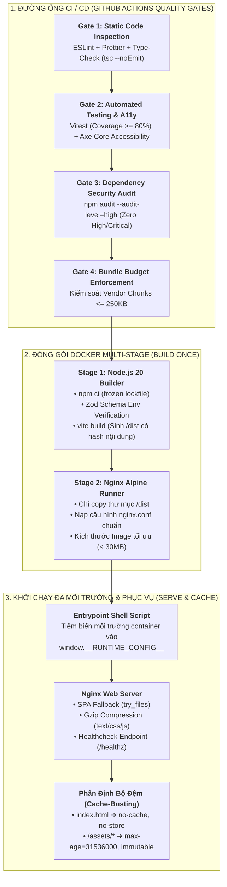

# Chuyên Đề 15: Kỹ Thuật Phát Hành, Đa Môi Trường & CI/CD DevOps Frontend (Release Engineering & DevOps)

> **Dự án:** Khung Tiêu Chuẩn Doanh Nghiệp & RoGym Management System Profile  
> **Phạm vi kỹ thuật:** Quản trị biến môi trường (Zod), Dockerfile multi-stage, Cache-Busting, Feature Flags, CI/CD Quality Gates, Semantic Versioning  
> **Cổng quy chuẩn chính:** [`FRONTEND_CONVENTIONS.md`](../FRONTEND_CONVENTIONS.md) | [Bản Đồ Tài Liệu](./README.md)  
> **Cơ sở tham chiếu quốc tế:** [The Twelve-Factor App (III. Config)](https://12factor.net/config), [Docker Multi-Stage Builds](https://docs.docker.com/build/building/multi-stage/), [Semantic Versioning 2.0.0](https://semver.org/), [Zod Schema Validation](https://zod.dev), [Conventional Commits 1.0.0](https://www.conventionalcommits.org/)  
> **Phiên bản:** 8.0 (Enterprise Quality Standard — 15 Spokes & Universal Decoupling)  
> **Trạng thái:** Chuẩn mực ban hành chính thức (Active Standard)  

---

## MỤC LỤC
1. [Bối Cảnh, Tầm Quan Trọng & Cơ Sở Tham Chiếu Quốc Tế](#1-bối-cảnh-tầm-quan-trọng-cơ-sở-tham-chiếu-quốc-tế)
2. [Triết Lý Kiến Trúc & Sơ Đồ Tư Duy (Visual Mental Model)](#2-triết-lý-kiến-trúc-sơ-đồ-tư-duy-visual-mental-model)
3. [Đặc Tả Kỹ Thuật Chi Tiết (Bộ Quy Chuẩn OPS-001 đến OPS-010)](#3-đặc-tả-kỹ-thuật-chi-tiết-bộ-quy-chuẩn-ops-001-đến-ops-010)
   - 3.1. [Bảng Tổng Hợp 10 Quy Chuẩn Phát Hành & DevOps Doanh Nghiệp](#31-bảng-tổng-hợp-10-quy-chuẩn-phát-hành-devops-doanh-nghiệp)
   - 3.2. [Ma Trận Phân Định Chiến Lược Bộ Đệm (Cache-Busting Matrix)](#32-ma-trận-phân-định-chiến-lược-bộ-đệm-cache-busting-matrix)
   - 3.3. [Đặc Tả Chi Tiết Từng Quy Chuẩn Kỹ Thuật](#33-đặc-tả-chi-tiết-từng-quy-chuẩn-kỹ-thuật)
4. [Thực Hành Thực Tế: Do's & Don'ts & Case Studies (Mô Hình 2 Tầng)](#4-thực-hành-thực-tế-dos-donts-case-studies-mô-hình-2-tầng)
   - 4.1. [Bảng Đối Chiếu Anti-Patterns vs Chuẩn Mực Doanh Nghiệp](#41-bảng-đối-chiếu-anti-patterns-vs-chuẩn-mực-doanh-nghiệp)
   - 4.2. [Tầng 1: Enterprise Reference Implementations (Mã Nguồn Mẫu Chuẩn)](#42-tầng-1-enterprise-reference-implementations-mã-nguồn-mẫu-chuẩn)
   - 4.3. [Tầng 2: RoGym Implementation Profile & Gap Analysis (Hồ Sơ Thực Tế)](#43-tầng-2-rogym-implementation-profile-gap-analysis-hồ-sơ-thực-tế)
5. [Ánh Xạ Tooling Kiểm Toán CI (Automation Integration)](#5-ánh-xạ-tooling-kiểm-toán-ci-automation-integration)
6. [Bảng Checklist Định Lượng Trước Khi Mở PR (Review Gate)](#6-bảng-checklist-định-lượng-trước-khi-mở-pr-review-gate)

---

## 1. Bối Cảnh, Tầm Quan Trọng & Cơ Sở Tham Chiếu Quốc Tế

Trong quy trình phát triển phần mềm hiện đại, việc một ứng dụng Single Page Application (SPA) hoạt động hoàn hảo trên máy phát triển cá nhân của lập trình viên (Localhost) mới chỉ giải quyết được một nửa bài toán. Nửa còn lại — đưa sản phẩm lên các môi trường Staging, UAT và Production một cách an toàn, tin cậy, lặp lại được và không có thời gian chết (Zero-Downtime Delivery) — đòi hỏi các tiêu chuẩn kỹ thuật phát hành (Release Engineering) và DevOps khắt khe.

Các rủi ro nghiêm trọng thường gặp khi thiếu vắng chuẩn mực phát hành Frontend:
1. **Sập ngầm thời gian chạy do thiếu biến môi trường (Silent Runtime Crash):** Quên khai báo biến môi trường hoặc cấu hình sai URL API khiến ứng dụng compile thành công nhưng trắng xóa màn hình khi khách hàng truy cập.
2. **Kẹt bộ đệm trình duyệt (Browser Cache Stale Lock):** Cấu hình sai chỉ thị `Cache-Control` cho tệp `index.html`, khiến trình duyệt của hàng nghìn khách hàng tiếp tục nạp bundle JavaScript cũ, không thể tương thích với API backend phiên bản mới.
3. **Phình to kích thước đóng gói (Container Bloat):** Đưa toàn bộ thư viện lập trình `node_modules`, công cụ build và mã nguồn TypeScript vào container production khiến dung lượng Docker image vượt quá $1\text{GB}$, làm chậm thời gian kéo (pull) và kéo dài thời gian triển khai.
4. **Lỗi 404 khi làm mới trang sâu (SPA Routing Refresh Error):** Máy chủ web (Nginx) không cấu hình chuyển tiếp fallback về `index.html`, khiến người dùng nhận mã lỗi HTTP 404 khi nhấn F5 tại các đường dẫn như `/members/profile/123`.
5. **Triển khai chứa lỗ hổng bảo mật nghiêm trọng (Supply Chain Vulnerabilities):** Bỏ qua các bước quét bảo mật phụ thuộc (npm audit) trong đường ống CI/CD, đưa các gói mã nguồn độc hại hoặc có lỗi tràn bộ đệm đã được công bố CVE lên Internet.

Tài liệu này chuẩn hóa toàn bộ kỹ thuật phát hành và DevOps Frontend dựa trên các tiêu chuẩn quốc tế:
* **The Twelve-Factor App (Nguyên lý III - Config):** Tách biệt tuyệt đối cấu hình môi trường ra khỏi mã nguồn; hỗ trợ nguyên lý *Build once, deploy anywhere*.
* **Docker Multi-Stage Builds Standard:** Tách rời môi trường biên dịch (Node.js Build Stage) khỏi môi trường phục vụ (Nginx Alpine Serving Stage).
* **Semantic Versioning 2.0.0 (SemVer):** Chuẩn hóa quy tắc đánh số phiên bản `MAJOR.MINOR.PATCH` dựa trên mức độ tác động và tính tương thích ngược.
* **Conventional Commits 1.0.0 & Git Commitlint:** Chuẩn hóa thông điệp thay đổi mã nguồn phục vụ việc tự động tạo nhật ký phát hành (Changelog generation).
* **Zod Schema Validation:** Xác thực dữ liệu và biến môi trường tĩnh/động tại thời điểm biên dịch và thời điểm chạy (Fail-Fast Architecture).

---

## 2. Triết Lý Kiến Trúc & Sơ Đồ Tư Duy (Visual Mental Model)

Triết lý cốt lõi của kỹ thuật phát hành doanh nghiệp:
> **"Bất Biến Trong Đóng Gói, Thích Ứng Trong Thời Gian Chạy Và Chặn Đứng Rủi Ro Ngay Tại Cổng CI (Immutable Artifacts, Runtime Adaptability & Strict CI Quality Gates)"**  
> *Một bản đóng gói (Docker Image) chỉ được biên dịch một lần duy nhất. Cùng một Docker Image đó phải có khả năng chạy xuyên suốt từ môi trường Thử nghiệm (Staging) đến Sản phẩm (Production) mà không cần biên dịch lại, chỉ cần thay đổi biến môi trường thời gian chạy.*



---

## 3. Đặc Tả Kỹ Thuật Chi Tiết (Bộ Quy Chuẩn OPS-001 đến OPS-010)

### 3.1. Bảng Tổng Hợp 10 Quy Chuẩn Phát Hành & DevOps Doanh Nghiệp

| Mã Quy Chuẩn | Tên Quy Chuẩn & Trọng Tâm | Mức Độ | Tiêu Chí Pass / Fail Định Lượng | Anti-Pattern Điển Hình (Don't) | Best Practice Khuyến Nghị (Do) |
| :---: | :--- | :---: | :--- | :--- | :--- |
| **`OPS-001`** | **Xác Thực Biến Môi Trường Chặt Chẽ Với Zod** | `ERROR` | **Pass:** 100% biến môi trường được validate qua Zod schema; dừng build lập tức nếu thiếu hoặc sai kiểu.<br/>**Fail:** Đọc biến môi trường trực tiếp `import.meta.env.VITE_URL` không kiểm tra. | `const url = import.meta.env.VITE_API_URL;` (nguy cơ undefined). | `export const env = clientEnvSchema.parse(rawEnv)` (fail-fast tại thời điểm build). |
| **`OPS-002`** | **Đóng Gói Docker SPA Đa Tầng Tiêu Chuẩn** | `ERROR` | **Pass:** Dockerfile chia 2 tầng: Builder (Node.js) và Runner (Nginx Alpine). Image cuối cùng $\le 35\text{MB}$.<br/>**Fail:** Đưa toàn bộ `node_modules` và source TypeScript vào image production khiến dung lượng $> 1\text{GB}$. | Chạy `node server.js` để phục vụ SPA tĩnh trên production. | Multi-stage build chỉ chép thư mục `dist/` vào Nginx Alpine gọn nhẹ. |
| **`OPS-003`** | **Cấu Hình Nginx SPA Fallback Routing & Nén Gzip** | `ERROR` | **Pass:** Cấu hình `try_files $uri $uri/ /index.html;` và bật nén Gzip cho text/js/css.<br/>**Fail:** Người dùng nhấn F5 tại trang con bị lỗi 404 Not Found; tắt nén khiến file js nặng nề. | Thiếu chỉ thị fallback trong `location /`. | Cấu hình `nginx.conf` chuẩn mực với `try_files` và `gzip on; gzip_min_length 1024;`. |
| **`OPS-004`** | **Chiến Lược Vô Hiệu Hóa Bộ Đệm Phân Tầng** | `ERROR` | **Pass:** `index.html` cấu hình `no-cache, no-store`; các tệp assets có mã băm (hash) cấu hình `max-age=1y, immutable`.<br/>**Fail:** Trình duyệt lưu đệm `index.html` khiến người dùng không nhận được phiên bản mới sau khi deploy. | Thiết lập `max-age` dài hạn cho cả `index.html`. | Tách biệt header theo định dạng tệp qua chỉ thị `location` trong Nginx hoặc `vercel.json`. |
| **`OPS-005`** | **Thiết Lập Security Headers Bảo Vệ Ứng Dụng** | `ERROR` | **Pass:** Web server trả về đầy đủ `X-Frame-Options`, `X-Content-Type-Options`, `Referrer-Policy`, `Permissions-Policy`.<br/>**Fail:** Hoàn toàn thiếu vắng các HTTP headers phòng thủ tấn công cơ bản. | Không thiết lập headers bảo mật trong cấu hình HTTP. | Khai báo tập trung các chỉ thị `add_header` trong block server Nginx. |
| **`OPS-006`** | **Quản Trị Cờ Tính Năng Linh Hoạt (Feature Flags)** | `WARN` | **Pass:** Quản lý bật/tắt tính năng qua Store tập trung, hỗ trợ override bằng URL query params phục vụ Dev/QA.<br/>**Fail:** Comment mã nguồn hoặc tạo nhánh Git riêng chỉ để bật tắt tính năng thử nghiệm. | Comment JSX trong component trước ngày demo. | Dùng `useFeatureFlagStore` với cơ chế đọc URL param `?ff_feature=1` và `localStorage`. |
| **`OPS-007`** | **Đánh Phiên Bản Ngữ Nghĩa SemVer & Commitlint** | `WARN` | **Pass:** Áp dụng SemVer 2.0.0 (`MAJOR.MINOR.PATCH`) kết hợp quy ước Conventional Commits (`feat:`, `fix:`, `chore:`).<br/>**Fail:** Commit với các thông điệp vô nghĩa (`fix bug`, `update`, `test`). | Đặt thông điệp commit tự do không cấu trúc. | Cấu hình Commitlint và tự động sinh CHANGELOG khi đánh tag release. |
| **`OPS-008`** | **Điểm Kiểm Tra Sức Khỏe Vận Hành (Healthcheck)** | `WARN` | **Pass:** Web server cung cấp endpoint `/healthz` trả về HTTP 200 phục vụ Docker / Kubernetes liveness probe.<br/>**Fail:** Không có cơ chế giám sát tình trạng sống/chết của máy chủ web Nginx. | Bỏ qua chỉ thị HEALTHCHECK trong container. | Cấu hình endpoint `location /healthz { return 200 'healthy\n'; }` trong Nginx. |
| **`OPS-009`** | **Tách Biệt Cấu Hình Thời Gian Chạy (Runtime Config)** | `WARN` | **Pass:** Hỗ trợ tiêm biến môi trường container tại runtime qua `window.__RUNTIME_CONFIG__` (1 image cho mọi môi trường).<br/>**Fail:** Bắt buộc phải rebuild lại toàn bộ Docker image từ đầu mỗi khi đổi địa chỉ URL API. | Đóng băng cứng địa chỉ API của Staging vào bundle JS. | Shell script `entrypoint.sh` sinh file `runtime-config.js` trước khi khởi động Nginx. |
| **`OPS-010`** | **Chốt Chặn Kiểm Toán Phụ Thuộc & Bundle Size CI** | `ERROR` | **Pass:** Pipeline CI tự động chạy `npm audit` (chặn lỗi High/Critical) và so khớp kích thước gói build với hạn mức.<br/>**Fail:** Triển khai mã nguồn chứa lỗ hổng bảo mật nghiêm trọng đã được cộng đồng cảnh báo. | Bỏ qua bước kiểm toán mã nguồn và kích thước bundle. | Tích hợp các bước kiểm tra tự động trong GitHub Actions workflow. |
| **`OPS-011`** / **`DEVOPS-VCL-001`** | **Bộ Đệm Biên Mạng Stale-While-Revalidate `[server-cache-swr]`** | `WARN` | **Pass:** Thiết lập header `Cache-Control: s-maxage=60, stale-while-revalidate=300` trên Edge Network / CDN cho các API dữ liệu bán tĩnh để phục vụ response tức thì trong khi revalidate ngầm.<br/>**Fail:** Dùng `no-cache` cho các tài nguyên công khai ít thay đổi khiến mọi request đều phải chạm database gốc. | Không cấu hình caching header cho public APIs. | Cấu hình SWR headers trong server middleware hoặc `vercel.json` routes. |
| **`OPS-012`** / **`DEVOPS-VCL-002`** | **Bảo Mật Triển Khai Vercel Production & Token Hyigiene** | `ERROR` | **Pass:** Sử dụng Vercel Preview Deployments cho mọi PR; bảo vệ 100% Environment Variables theo môi trường; cấm commit `VERCEL_TOKEN` hoặc `.vercel/` folder vào Git.<br/>**Fail:** Đưa token deploy vào script package.json hoặc để biến môi trường production dùng chung với local dev. | Commit token hoặc `.env.production` lên Git repo. | Quản lý biến qua Vercel Dashboard / CLI Secrets và cấu hình Branch Environments riêng biệt. |

---

### 3.2. Ma Trận Phân Định Chiến Lược Bộ Đệm (Cache-Busting Matrix)

Để đảm bảo người dùng luôn tải về phiên bản mã nguồn mới nhất ngay sau khi hệ thống hoàn tất triển khai mà vẫn tận dụng tối đa sức mạnh lưu đệm của trình duyệt và CDN đối với các tệp tĩnh, cấu hình phân phối HTTP phải tuân thủ nghiêm ngặt ma trận sau:

| Loại Tệp Tin (File Resource) | Quy Tắc Đặt Tên & Nhận Diện | Chỉ Thị `Cache-Control` Bắt Buộc | Thời Gian Lưu Đệm (TTL) | Mục Đích Kỹ Thuật |
| :--- | :--- | :--- | :---: | :--- |
| **Tệp Entrypoint HTML** | `index.html` (Không gắn mã hash) | `no-cache, no-store, must-revalidate` | `0 giây` | Luôn kiểm tra máy chủ để nạp các liên kết script/style mới nhất. Trình duyệt không được lưu đệm. |
| **Tệp Mã Nguồn Hashed** | `/assets/*.js`, `/assets/*.css` (Có gắn hash: `main.a8b1c2.js`) | `public, max-age=31536000, immutable` | `1 năm` (Vĩnh viễn) | Vì nội dung thay đổi sẽ sinh mã hash mới nên tệp cũ an toàn để lưu đệm vĩnh viễn, giảm tải mạng tối đa. |
| **Hình Ảnh & Tệp Đồ Họa** | `*.svg`, `*.png`, `*.jpg`, `*.webp`, `*.ico` | `public, max-age=86400, stale-while-revalidate=604800` | `1 ngày` (Tái xác thực trong 7 ngày) | Cân bằng giữa tốc độ tải trang đồ họa và khả năng cập nhật logo, banner phòng tập. |
| **Tài Nguyên Web Fonts** | `*.woff2`, `*.woff`, `*.ttf` | `public, max-age=31536000, immutable` | `1 năm` | Font chữ chuẩn doanh nghiệp (Inter, Roboto) không bao giờ thay đổi nội dung. |
| **Dữ Liệu JSON Động** | `/locales/**/*.json` (Từ điển dịch thuật nếu nạp động) | `public, max-age=3600, must-revalidate` | `1 giờ` | Cho phép cập nhật các bản dịch mới mà không phải chờ đợi quá lâu. |

---

### 3.3. Đặc Tả Chi Tiết Từng Quy Chuẩn Kỹ Thuật

<a id="ops-001"></a>
#### `OPS-001`: Xác Thực Biến Môi Trường Chặt Chẽ Với Zod (Fail-Fast Env Schema)
* **Yêu cầu kỹ thuật:** Toàn bộ biến môi trường của ứng dụng Frontend (tiền tố `VITE_`) phải được định nghĩa tường minh trong một schema Zod tại tệp `src/config/env.ts`.
* **Cơ chế Fail-Fast:** Khi chạy lệnh biên dịch `npm run build` hoặc khởi động `npm run dev`, nếu thiếu bất kỳ biến môi trường bắt buộc nào (ví dụ: `VITE_API_URL` chưa khai báo), schema Zod sẽ ném ra ngoại lệ có định dạng rõ ràng và tiến trình phải dừng lại ngay lập tức (Exit Code khác 0). Không cho phép ứng dụng khởi động trong trạng thái cấu hình không hoàn chỉnh.

<a id="ops-002"></a>
#### `OPS-002`: Đóng Gói Docker SPA Đa Tầng Tiêu Chuẩn (Multi-Stage Build)
* **Yêu cầu kỹ thuật:** Dockerfile phải được chia tách làm 2 tầng rõ rệt:
  1. **Tầng 1 (Build Stage):** Sử dụng base image `node:20-alpine`. Chạy `npm ci` để nạp chính xác các gói từ `package-lock.json`, chạy lệnh biên dịch `npm run build` để xuất ra thư mục sản phẩm `dist/`.
  2. **Tầng 2 (Production Runtime Stage):** Sử dụng base image `nginx:alpine` siêu nhẹ. Chỉ sao chép duy nhất thư mục `dist/` từ tầng 1 sang thư mục `/usr/share/nginx/html`. Toàn bộ `node_modules`, mã nguồn TypeScript và trình quản lý gói đều bị loại bỏ hoàn toàn khỏi image cuối cùng.
* **Quy chuẩn độ phức tạp:** Nhằm đảm bảo tính thực tiễn và dễ tiếp cận cho đội ngũ kỹ sư, cấu hình container áp dụng mô hình Nginx tiêu chuẩn, tránh các cấu hình quá phức tạp (như read-only root filesystem) gây xung đột quyền ghi tệp tin.

<a id="ops-003"></a>
#### `OPS-003`: Cấu Hình Nginx SPA Fallback Routing & Nén Gzip
* **Yêu cầu kỹ thuật:**
  * **SPA Fallback Routing:** Máy chủ Nginx bắt buộc phải cấu hình `try_files $uri $uri/ /index.html;` trong khối `location /`. Mọi yêu cầu HTTP trỏ vào các đường dẫn ảo của React Router (ví dụ: `/members/active`, `/trainer/classes`) khi không tìm thấy tệp vật lý tương ứng trên ổ đĩa sẽ tự động trả về tệp `index.html` với mã HTTP 200 để React Router tiếp quản việc điều hướng phía client.
  * **Nén dữ liệu mạng:** Bắt buộc kích hoạt `gzip on;` trong `nginx.conf` cho các định dạng văn bản: `text/plain`, `text/css`, `application/json`, `application/javascript`, `application/x-javascript`, `text/xml`, `application/xml`, `image/svg+xml`. Ngưỡng kích thước tối thiểu để nén là $1024\text{ bytes}$ (`gzip_min_length 1024;`).

<a id="ops-004"></a>
#### `OPS-004`: Chiến Lược Vô Hiệu Hóa Bộ Đệm Phân Tầng (Cache-Busting Matrix)
* **Yêu cầu kỹ thuật:** Tuyệt đối không được gán header `Cache-Control: max-age` dài hạn cho tệp `index.html`. Trong khối cấu hình Nginx:
  * Khối `location = /index.html`: Gắn header `Cache-Control "no-cache, no-store, must-revalidate"`.
  * Khối `location /assets/`: Gắn header `Cache-Control "public, max-age=31536000, immutable"`.

<a id="ops-005"></a>
#### `OPS-005`: Thiết Lập Security Headers Bảo Vệ Ứng Dụng
* **Yêu cầu kỹ thuật:** Máy chủ Nginx phải trả về các HTTP Security Headers sau trên mọi phản hồi:
  1. `X-Frame-Options: SAMEORIGIN`: Ngăn chặn website bị nhúng vào `<iframe>` của các tên miền lạ nhằm triệt tiêu nguy cơ tấn công Clickjacking.
  2. `X-Content-Type-Options: nosniff`: Ngăn chặn trình duyệt tự ý suy đoán kiểu MIME (MIME-sniffing), giảm nguy cơ thực thi mã độc trá hình.
  3. `Referrer-Policy: strict-origin-when-cross-origin`: Bảo vệ tính riêng tư của người dùng khi điều hướng sang các liên kết bên ngoài.
  4. `Permissions-Policy: camera=(), microphone=(), geolocation=()`: Giới hạn các quyền truy cập phần cứng nhạy cảm trừ khi tính năng đó được kích hoạt có chủ đích (ví dụ: camera quét mã QR check-in).

<a id="ops-006"></a>
#### `OPS-006`: Quản Trị Cờ Tính Năng Linh Hoạt (Feature Flags)
* **Yêu cầu kỹ thuật:** Triển khai một Store quản lý trạng thái cờ tính năng tập trung (sử dụng Zustand hoặc React Context).
* **Cơ chế linh hoạt cho Dev/QA:** Cho phép ghi đè (override) cờ tính năng trực tiếp thông qua URL query parameters (ví dụ: `?ff_new_pos=true`) hoặc lưu trữ vào `localStorage`. Tính năng này cho phép đội ngũ kiểm thử (QA) và lập trình viên kiểm thử tính năng mới ngay trên môi trường Staging/Production mà không cần mở cờ cho toàn bộ khách hàng và không cần phải triển khai lại mã nguồn.

<a id="ops-007"></a>
#### `OPS-007`: Đánh Phiên Bản Ngữ Nghĩa SemVer & Commitlint
* **Yêu cầu kỹ thuật:** Tuân thủ quy tắc Semantic Versioning 2.0.0:
  * `MAJOR` (x.0.0): Khi có các thay đổi phá vỡ tính tương thích ngược (Breaking Changes).
  * `MINOR` (0.x.0): Khi bổ sung thêm tính năng mới nhưng vẫn duy trì tính tương thích ngược.
  * `PATCH` (0.0.x): Khi sửa các lỗi kỹ thuật (Bug fixes) nhỏ mà không ảnh hưởng tới API hiện hữu.
* **Quy ước Commit:** 100% commit message phải tuân thủ chuẩn Conventional Commits: `type(scope): subject` (với `type` gồm `feat`, `fix`, `chore`, `docs`, `refactor`, `perf`, `test`).

<a id="ops-008"></a>
#### `OPS-008`: Điểm Kiểm Tra Sức Khỏe Vận Hành (Healthcheck Endpoint)
* **Yêu cầu kỹ thuật:** Cấu hình trong `nginx.conf` một endpoint `/healthz` trả về chuỗi văn bản thuần `healthy` kèm HTTP status code `200 OK` mà không ghi log truy cập (`access_log off;`).
* **Khai báo Docker:** Trong Dockerfile, khai báo chỉ thị kiểm tra sức khỏe định kỳ:
  `HEALTHCHECK --interval=30s --timeout=3s --start-period=5s --retries=3 CMD wget -qO- http://localhost/healthz || exit 1`.

<a id="ops-009"></a>
#### `OPS-009`: Tách Biệt Cấu Hình Thời Gian Chạy (Hybrid 12-Factor Runtime Config)
* **Yêu cầu kỹ thuật:** Để hiện thực hóa mục tiêu *Build một lần, chạy cho mọi môi trường*, ứng dụng hỗ trợ cơ chế nạp biến môi trường hỗn hợp (Hybrid):
  1. Khi chạy cục bộ (Local Dev): Tự động nạp từ `import.meta.env` thông qua Vite dev server.
  2. Khi chạy trong Docker Container (Production / Staging): Trước khi khởi động Nginx, một shell script `docker-entrypoint.sh` sẽ đọc các biến môi trường của container (như `API_URL`, `WS_URL`), sinh ra tệp tĩnh `runtime-config.js` chứa đối tượng toàn cục `window.__RUNTIME_CONFIG__`. Module `src/config/env.ts` sẽ ưu tiên đọc từ đối tượng này trước khi fallback về các giá trị biên dịch mặc định.

<a id="ops-010"></a>
#### `OPS-010`: Chốt Chặn Kiểm Toán Phụ Thuộc & Bundle Size CI
* **Yêu cầu kỹ thuật:** Đường ống CI (GitHub Actions) phải kích hoạt 2 chốt chặn tự động:
  1. **Chốt chặn Bảo mật Phụ thuộc:** Chạy lệnh `npm audit --audit-level=high`. Nếu phát hiện bất kỳ phụ thuộc nào chứa lỗ hổng mức độ `High` hoặc `Critical`, tiến trình CI sẽ báo đỏ và chặn không cho phép merge PR.
  2. **Chốt chặn Kích thước Gói:** Thiết lập ngân sách dung lượng cho các tệp JavaScript sau khi build; cảnh báo hoặc chặn nếu bất kỳ tệp vendor chunk nào vượt quá $250\text{KB}$ (gzip).

<a id="ops-011"></a>
#### `OPS-011` / `DEVOPS-VCL-001`: Bộ Đệm Biên Mạng Stale-While-Revalidate (`[server-cache-swr]`)
* **Mục tiêu:** Cung cấp trải nghiệm phản hồi tức thì (Instantaneous Response) từ Edge CDN của Vercel/Cloudflare đối với các tài nguyên bán tĩnh (danh mục gói tập, cấu hình tiện ích phòng gym, câu hỏi thường gặp).
* **Yêu cầu kỹ thuật:**
  - Thiết lập header `Cache-Control` hỗ trợ stale-while-revalidate tại gateway hoặc trong `vercel.json`:
    ```json
    {
      "headers": [
        {
          "source": "/api/v1/public/(.*)",
          "headers": [
            {
              "key": "Cache-Control",
              "value": "public, s-maxage=60, stale-while-revalidate=300"
            }
          ]
        }
      ]
    }
    ```
  - Khi trình duyệt hoặc Edge CDN nhận được request, nó sẽ phục vụ ngay bản ghi trong cache (ngay cả khi vừa hết hạn `s-maxage=60s`), đồng thời kích hoạt việc revalidate ngầm trong vòng 300 giây tiếp theo, loại bỏ hoàn toàn hiện tượng lag khi tải dữ liệu công khai.

<a id="ops-012"></a>
#### `OPS-012` / `DEVOPS-VCL-002`: Bảo Mật Triển Khai Vercel Production & Token Hygiene
* **Mục tiêu:** Đảm bảo toàn vẹn quy trình phân phối sản phẩm lên hạ tầng Vercel Edge Platform mà không để lộ khóa bí mật hay cấu hình nhầm môi trường.
* **Yêu cầu kỹ thuật:**
  - Tuyệt đối cấm commit thư mục `.vercel` hoặc file `.env.production` chứa token truy cập cơ sở dữ liệu/API keys vào kho lưu trữ Git (`.gitignore` phải khai báo chặt chẽ).
  - Tận dụng cơ chế Vercel Preview Deployments tự động cho mỗi Pull Request mở ra để phục vụ việc kiểm thử E2E và review giao diện trước khi merge vào nhánh chính.
  - Phân tách rạch ròi 3 tầng biến môi trường trên Vercel Project Settings: Development, Preview, Production.

---

## 4. Thực Hành Thực Tế: Do's & Don'ts & Case Studies (Mô Hình 2 Tầng)

### 4.1. Bảng Đối Chiếu Anti-Patterns vs Chuẩn Mực Doanh Nghiệp

| Lĩnh vực | ❌ Anti-pattern Điển Hình (Don't) | ✅ Chuẩn Mực Doanh Nghiệp (Do) | Hậu Quả & Tác Động Kỹ Thuật |
| :--- | :--- | :--- | :--- |
| **Quản Lý Biến Môi Trường** | Gọi `import.meta.env.VITE_XYZ` trực tiếp khắp nơi trong code | Khai báo schema Zod tập trung trong `src/config/env.ts` và export đối tượng `env` | Gọi trực tiếp dễ bị sai chính tả (typo), app không báo lỗi lúc build mà sập ngầm lúc người dùng click. |
| **Đóng Gói Ứng Dụng** | Dùng chung Docker image chứa cả Node, TypeScript compiler, devDeps để chạy web | Docker Multi-stage: Stage 1 build Node, Stage 2 chỉ dùng Nginx Alpine thuần túy | Kích thước container lên tới $1.2\text{GB}$, thời gian kéo image deploy chậm, tiềm ẩn nguy cơ bảo mật từ dev tools thừa. |
| **Cấu Hình Cache HTML** | Đặt `Cache-Control: public, max-age=86400` cho cả trang chủ `index.html` | Đặt `no-cache, no-store, must-revalidate` cho `index.html` | Khách hàng tiếp tục chạy code cũ trong 24 giờ sau khi phát hành phiên bản mới, gây xung đột API và lỗi giao diện. |
| **Điều Hướng SPA** | Để mặc định Nginx không có `try_files` khiến router client bị lỗi | Cấu hình `try_files $uri $uri/ /index.html;` trong khối `location /` | Người dùng chia sẻ đường dẫn chi tiết hoặc bấm F5 tải lại trang bị màn hình trắng xóa kèm lỗi HTTP 404 Not Found. |
| **Bật Tắt Tính Năng** | Tạo nhiều branch Git và comment code thủ công để ẩn tính năng chưa xong | Xây dựng Store Feature Flag hỗ trợ bật/tắt qua URL query params và LocalStorage | Merge code vào nhánh chính an toàn (Trunk-Based Development), kiểm thử tính năng độc lập mà không làm phiền người dùng khác. |
| **Giám Sát Vận Hành** | Chạy container Nginx không có endpoint kiểm tra sức khỏe | Cung cấp endpoint `/healthz` và cấu hình chỉ thị `HEALTHCHECK` trong Docker | Hệ thống Kubernetes hoặc Docker Swarm không biết container bị treo, tiếp tục định tuyến lưu lượng vào máy chủ chết. |

---

### 4.2. Tầng 1: Enterprise Reference Implementations (Mã Nguồn Mẫu Chuẩn)

Dưới đây là 4 khối mã nguồn mẫu độc lập, hoàn chỉnh, tuân thủ nghiêm ngặt các quy chuẩn `OPS-001` đến `OPS-010`.

#### Khối Mã 1: Module Xác Thực Biến Môi Trường Chặt Chẽ (`src/config/env.ts`)

```typescript
/**
 * @file env.ts
 * @description Enterprise Environment Validation using Zod.
 * Tuân thủ OPS-001, OPS-009. Hỗ trợ mô hình Hybrid 12-Factor (Runtime Config + Build-time Fallback).
 */
import { z } from 'zod';

// Khai báo kiểu dữ liệu cho đối tượng Runtime Configuration toàn cục
declare global {
  interface Window {
    __RUNTIME_CONFIG__?: {
      VITE_API_URL?: string;
      VITE_WS_URL?: string;
      VITE_LIFF_ID?: string;
      VITE_ENVIRONMENT?: string;
    };
  }
}

// Định nghĩa Schema kiểm tra biến môi trường
const envSchema = z.object({
  VITE_API_URL: z
    .string()
    .url({ message: 'VITE_API_URL phải là một URL hợp lệ bắt đầu bằng http:// hoặc https://' })
    .default('http://127.0.0.1:3000/api/v1'),
  VITE_WS_URL: z
    .string()
    .url({ message: 'VITE_WS_URL phải là một URL WebSocket hoặc HTTP hợp lệ' })
    .default('http://localhost:3000'),
  VITE_LIFF_ID: z.string().optional().default(''),
  VITE_ENVIRONMENT: z
    .enum(['development', 'staging', 'production', 'test'])
    .default('development'),
});

// Hàm trích xuất dữ liệu: Ưu tiên Runtime Window Config trước khi fallback về import.meta.env
function extractRawEnv(): Record<string, unknown> {
  const runtimeConfig = typeof window !== 'undefined' ? window.__RUNTIME_CONFIG__ : undefined;

  return {
    VITE_API_URL: runtimeConfig?.VITE_API_URL || import.meta.env.VITE_API_URL,
    VITE_WS_URL: runtimeConfig?.VITE_WS_URL || import.meta.env.VITE_WS_URL,
    VITE_LIFF_ID: runtimeConfig?.VITE_LIFF_ID || import.meta.env.VITE_LIFF_ID,
    VITE_ENVIRONMENT:
      runtimeConfig?.VITE_ENVIRONMENT ||
      import.meta.env.VITE_ENVIRONMENT ||
      import.meta.env.MODE,
  };
}

// Thực hiện parse và validate ngay thời điểm nạp module
function validateEnv() {
  const rawEnv = extractRawEnv();
  const parsed = envSchema.safeParse(rawEnv);

  if (!parsed.success) {
    const errorDetails = parsed.error.issues
      .map((issue) => `❌ [${issue.path.join('.')}]: ${issue.message}`)
      .join('\n');

    const errorMessage = `\n🚨 [ENV CONFIGURATION ERROR] Phát hiện cấu hình biến môi trường không hợp lệ:\n${errorDetails}\nỨng dụng bị dừng khởi động để đảm bảo an toàn.\n`;

    console.error(errorMessage);
    if (typeof document !== 'undefined') {
      // Hiển thị thông báo thân thiện nếu xảy ra lỗi trên trình duyệt
      document.body.innerHTML = `<pre style="color:red;padding:20px;font-family:monospace;white-space:pre-wrap;">${errorMessage}</pre>`;
    }
    throw new Error(errorMessage);
  }

  return parsed.data;
}

export const env = validateEnv();
export type Environment = z.infer<typeof envSchema>;
```

---

#### Khối Mã 2: Tệp Đóng Gói Docker Multi-Stage Tiêu Chuẩn Doanh Nghiệp (`Dockerfile`)

```dockerfile
# ==============================================================================
# TẦNG 1: BIÊN DỊCH ỨNG DỤNG (BUILD STAGE)
# Sử dụng Node.js 20 Alpine siêu nhẹ, nạp chính xác dependencies từ lockfile
# ==============================================================================
FROM node:20-alpine AS builder

WORKDIR /app

# Thiết lập biến môi trường biên dịch
ENV NODE_ENV=production

# Tối ưu hóa bộ nhớ đệm Docker: Chỉ sao chép lockfile trước
COPY package.json package-lock.json ./

# Cài đặt chính xác các phụ thuộc bao gồm cả devDependencies phục vụ build
RUN npm ci --include=dev

# Sao chép toàn bộ mã nguồn dự án vào container
COPY . .

# Biên dịch mã nguồn TypeScript thành gói tĩnh tối ưu (/app/dist)
RUN npm run build

# ==============================================================================
# TẦNG 2: PHỤC VỤ WEB (RUNTIME SERVING STAGE)
# Sử dụng Nginx Alpine tiêu chuẩn, loại bỏ hoàn toàn Node.js và devDependencies
# ==============================================================================
FROM nginx:alpine AS runner

# Đặt nhãn metadata tiêu chuẩn OCI
LABEL maintainer="RoGym Enterprise DevOps Team"
LABEL version="8.0"
LABEL description="RoGym Enterprise Frontend Distribution Image"

# Xóa trang chủ mặc định của Nginx
RUN rm -rf /usr/share/nginx/html/*

# Sao chép sản phẩm tĩnh đã biên dịch từ Tầng 1
COPY --from=builder /app/dist /usr/share/nginx/html

# Sao chép tệp cấu hình Nginx tiêu chuẩn đã gia cố
COPY nginx.conf /etc/nginx/conf.d/default.conf

# Sao chép script tiêm biến môi trường thời gian chạy (12-Factor Runtime Config)
COPY docker-entrypoint.sh /docker-entrypoint.sh
RUN chmod +x /docker-entrypoint.sh

# Mở cổng giao tiếp HTTP tiêu chuẩn
EXPOSE 80

# Khai báo điểm kiểm tra sức khỏe vận hành định kỳ (Healthcheck)
HEALTHCHECK --interval=30s --timeout=3s --start-period=5s --retries=3 \
  CMD wget -qO- http://localhost/healthz || exit 1

# Khởi động ứng dụng thông qua entrypoint script
ENTRYPOINT ["/docker-entrypoint.sh"]
CMD ["nginx", "-g", "daemon off;"]
```

---

#### Khối Mã 3: Cấu Hình Máy Chủ Nginx Chuẩn Doanh Nghiệp (`nginx.conf`)

```nginx
# ==============================================================================
# CẤU HÌNH MÁY CHỦ NGINX CHO SINGLE PAGE APPLICATION (SPA) CHUẨN DOANH NGHIỆP
# Tuân thủ OPS-003, OPS-004, OPS-005, OPS-008
# ==============================================================================

server {
    listen 80;
    server_name localhost;
    root /usr/share/nginx/html;
    index index.html;

    # 1. Kích hoạt nén Gzip tối ưu băng thông mạng
    gzip on;
    gzip_vary on;
    gzip_proxied any;
    gzip_comp_level 6;
    gzip_min_length 1024;
    gzip_types
        text/plain
        text/css
        text/xml
        text/javascript
        application/json
        application/javascript
        application/x-javascript
        application/xml
        application/xml+rss
        image/svg+xml;

    # 2. Khai báo Security Headers bảo vệ ứng dụng
    add_header X-Frame-Options "SAMEORIGIN" always;
    add_header X-Content-Type-Options "nosniff" always;
    add_header Referrer-Policy "strict-origin-when-cross-origin" always;
    add_header Permissions-Policy "camera=(), microphone=(), geolocation=()" always;

    # 3. Endpoint Kiểm tra sức khỏe vận hành (Healthcheck)
    location = /healthz {
        access_log off;
        default_type text/plain;
        return 200 "healthy\n";
    }

    # 4. Chiến lược Cache-Busting cho các tệp tĩnh có mã băm (Hashed Assets)
    location /assets/ {
        expires 1y;
        add_header Cache-Control "public, max-age=31536000, immutable";
        access_log off;
    }

    # 5. Định tuyến các tệp hình ảnh, biểu tượng và web fonts
    location ~* \.(ico|svg|png|jpg|jpeg|webp|woff|woff2|ttf)$ {
        expires 7d;
        add_header Cache-Control "public, max-age=604800, stale-while-revalidate=86400";
        access_log off;
    }

    # 6. Điều hướng SPA Fallback và vô hiệu hóa bộ đệm cho index.html
    location / {
        try_files $uri $uri/ /index.html;
    }

    location = /index.html {
        add_header Cache-Control "no-cache, no-store, must-revalidate" always;
        add_header Pragma "no-cache" always;
        add_header Expires "0" always;
    }
}
```

---

#### Khối Mã 4: Quản Trị Cờ Tính Năng Linh Hoạt (`src/stores/feature-flag.store.ts`)

```typescript
/**
 * @file feature-flag.store.ts
 * @description Enterprise Feature Flag Store with URL Query Param Override and LocalStorage.
 * Tuân thủ OPS-006. Cho phép Dev/QA bật tắt tính năng tức thì mà không cần deploy lại code.
 */
import { create } from 'zustand';

export interface FeatureFlags {
  enableNewCheckoutPos: boolean;
  enableRealtimeSocketChat: boolean;
  enableAdvancedAnalyticsReport: boolean;
  enableBiometricQrScanner: boolean;
}

// Giá trị mặc định theo cấu hình hệ thống
const DEFAULT_FLAGS: FeatureFlags = {
  enableNewCheckoutPos: false,
  enableRealtimeSocketChat: true,
  enableAdvancedAnalyticsReport: false,
  enableBiometricQrScanner: true,
};

interface FeatureFlagState {
  flags: FeatureFlags;
  setFlag: (flagName: keyof FeatureFlags, enabled: boolean) => void;
  resetAll: () => void;
}

// Đọc giá trị ghi đè từ URL Query Params hoặc LocalStorage
function getInitialFlags(): FeatureFlags {
  const initial = { ...DEFAULT_FLAGS };

  if (typeof window === 'undefined') return initial;

  const urlParams = new URLSearchParams(window.location.search);

  // Duyệt qua từng cờ để kiểm tra override
  (Object.keys(DEFAULT_FLAGS) as Array<keyof FeatureFlags>).forEach((key) => {
    // 1. Ưu tiên cao nhất: URL param ?ff_enableNewCheckoutPos=true hoặc ?ff_enableNewCheckoutPos=1
    const queryParam = urlParams.get(`ff_${key}`);
    if (queryParam !== null) {
      initial[key] = queryParam === 'true' || queryParam === '1';
      return;
    }

    // 2. Ưu tiên thứ hai: LocalStorage lưu trữ từ trước
    const storedValue = localStorage.getItem(`ff_${key}`);
    if (storedValue !== null) {
      initial[key] = storedValue === 'true';
    }
  });

  return initial;
}

export const useFeatureFlagStore = create<FeatureFlagState>((set) => ({
  flags: getInitialFlags(),
  setFlag: (flagName, enabled) => {
    localStorage.setItem(`ff_${flagName}`, String(enabled));
    set((state) => ({
      flags: { ...state.flags, [flagName]: enabled },
    }));
  },
  resetAll: () => {
    (Object.keys(DEFAULT_FLAGS) as Array<keyof FeatureFlags>).forEach((key) => {
      localStorage.removeItem(`ff_${key}`);
    });
    set({ flags: { ...DEFAULT_FLAGS } });
  },
}));

/**
 * Hook tiện ích đọc trạng thái của một cờ tính năng cụ thể
 */
export function useFeatureFlag(flagName: keyof FeatureFlags): boolean {
  return useFeatureFlagStore((state) => state.flags[flagName]);
}
```

---

### 4.3. Tầng 2: RoGym Implementation Profile & Gap Analysis (Hồ Sơ Thực Tế)

Phần này phân tích trực tiếp hiện trạng cơ sở hạ tầng phát hành và DevOps của RoGym Management System, chỉ ra các điểm xuất sắc đã có và các khoảng trống kỹ thuật cần lấp đầy.

#### 1. Đánh Giá Hiện Trạng Các Tệp Tin Cấu Hình RoGym:
* [`client/.env.example`](../.env.example):
  * **Điểm sáng:** Đã tài liệu hóa rõ ràng các biến `VITE_API_URL`, `API_PROXY_TARGET`, `VITE_WS_URL`, `VITE_LIFF_ID`.
  * **Khoảng trống (Gap):** Dự án hiện chưa có tệp `src/config/env.ts` để thực hiện xác thực Zod lúc biên dịch. Các biến đang được gọi trực tiếp bằng `import.meta.env.*` rải rác trong `src/services/api.ts` và `src/lib/liff.ts`.
* [`client/vercel.json`](../vercel.json):
  * **Điểm sáng:** Đã thiết lập xuất sắc cấu hình `rewrites` cho SPA (`"source": "/(.*)", "destination": "/index.html"`). Đã phân tách quy chuẩn cache cho `/assets/(.*)` (`max-age=31536000, immutable`) và hình ảnh (`stale-while-revalidate`).
  * **Khoảng trống (Gap):** Mới chỉ hỗ trợ nền tảng Vercel Edge Serverless. Dự án chưa có tệp `Dockerfile` và `nginx.conf` tiêu chuẩn để triển khai trên các hạ tầng tự quản (On-Premise, VPS Docker, Kubernetes) của các chuỗi phòng tập lớn.
* [`.github/workflows/ci.yml`](../.github/workflows/ci.yml):
  * **Điểm sáng:** Pipeline GitHub Actions được tổ chức rất bài bản với 3 luồng kiểm toán song song: `codebase-metrics` (cloc), `client` (lint, test:coverage, build, upload artifact), `server` (postgres container, test:coverage, build).
  * **Khoảng trống (Gap):** Luồng `client` đang dùng cờ `--if-present` cho test coverage. Chưa bổ sung bước `npm audit` tự động để chặn các lỗ hổng bảo mật cấp cao, và chưa có chốt chặn kiểm soát ngân sách kích thước gói bundle (Bundle Size Budget Gate).
* [`client/vite.config.ts`](../vite.config.ts):
  * **Điểm sáng:** Cấu hình plugin `waitForBackend` thông minh giúp tránh lỗi `ECONNREFUSED` trong lúc NestJS khởi động. Đã cấu hình phân tách `manualChunks` rất khoa học (`vendor-react`, `vendor-query`, `vendor-charts`, `vendor-ui`, `vendor-i18n`). Tích hợp plugin `@tailwindcss/vite` với engine Lightning CSS (Tailwind CSS v4 Active Standard), loại bỏ hoàn toàn PostCSS/Autoprefixer, tuân thủ nghiêm ngặt ngân sách bundle Initial JS $\le 180\text{KB}$ gzip (`PERF-002`).

#### 2. Bảng Đối Chiếu Hồ Sơ RoGym vs Chuẩn Mực Doanh Nghiệp (RoGym Compliance Scorecard):

| Quy Chuẩn Kỹ Thuật | Trạng Thái RoGym | Điểm Đánh Giá | Chi Tiết Khoảng Trống (Gap) & Hướng Dẫn Refactor |
| :--- | :---: | :---: | :--- |
| **`OPS-001` (Zod Env Schema)** | **CHƯA CÓ** | `40%` | Đang đọc trực tiếp `import.meta.env`. Cần tạo tệp `src/config/env.ts` bọc Zod schema theo mẫu Khối Mã 1. |
| **`OPS-002` (Docker Multi-Stage)** | **CẦN BỔ SUNG** | `50%` | Đã có hướng dẫn Vercel nhưng chưa có Dockerfile chuẩn cho client. Cần áp dụng Khối Mã 2. |
| **`OPS-003` (Nginx Fallback & Gzip)** | **ĐẠT (Vercel)** | `85%` | `vercel.json` đã có rewrite SPA. Cần tệp `nginx.conf` tương đương cho hạ tầng Docker tự quản. |
| **`OPS-004` (Cache-Busting Matrix)** | **ĐẠT XUẤT SẮC** | `95%` | Cấu hình cache-control trong `vercel.json` tuân thủ hoàn hảo quy chuẩn 1 năm cho assets. |
| **`OPS-005` (Security Headers)** | **CẦN CẢI TIẾN** | `60%` | Chưa khai báo đầy đủ các security headers (`X-Frame-Options`, `nosniff`) trong `vercel.json`. |
| **`OPS-006` (Feature Flags Store)** | **CẦN BỔ SUNG** | `50%` | Chưa có Store quản lý cờ tính năng tập trung hỗ trợ URL query override. Cần đưa Khối Mã 4 vào `src/stores/`. |
| **`OPS-007` (SemVer & Commitlint)** | **ĐẠT KHÁ** | `80%` | Đã tuân thủ Conventional Commits trên lịch sử Git. Cần tích hợp công cụ kiểm tra tự động commitlint. |
| **`OPS-008` (Healthcheck Endpoint)** | **ĐẠT (Backend)** | `75%` | Backend NestJS đã có `/health`. Phía Frontend Nginx cần bổ sung endpoint `/healthz` nội bộ. |
| **`OPS-009` (Runtime Config Injection)** | **CHƯA CÓ** | `30%` | Các biến môi trường đang bị đóng băng tĩnh lúc build Vite. Cần thêm cơ chế runtime window injection. |
| **`OPS-010` (CI Security & Bundle Gate)** | **ĐẠT KHÁ** | `80%` | `.github/workflows/ci.yml` đã chạy lint, test coverage, build. Cần bổ sung `npm audit` vào pipeline. |

---

## 5. Ánh Xạ Tooling Kiểm Toán CI (Automation Integration)

Để đảm bảo quy trình phát hành luôn giữ vững chất lượng cao nhất, hệ thống tích hợp 3 công cụ kiểm toán tự động vào đường ống CI/CD:

### 1. Kịch Bản Xác Thực Biến Môi Trường Tự Động Trước Khi Build
Bổ sung script kiểm tra trước khi chạy build Vite trong `package.json`:
```json
{
  "scripts": {
    "validate:env": "tsx scripts/validate-env.ts",
    "prebuild": "npm run validate:env",
    "build": "tsc && vite build"
  }
}
```

### 2. Chốt Chặn Quét Lỗ Hổng Bảo Mật (GitHub Actions Security Gate)
Bổ sung bước kiểm toán bảo mật vào `.github/workflows/ci.yml`:
```yaml
      - name: Security audit dependencies
        run: npm audit --audit-level=high
```
Nếu có bất kỳ thư viện bên thứ ba nào xuất hiện lỗ hổng ở mức độ High hoặc Critical, quy trình CI sẽ lập tức dừng lại, bảo vệ hệ thống khỏi các cuộc tấn công chuỗi cung ứng.

### 3. Kịch Bản Kiểm Tra Tính Toàn Vẹn Tài Liệu Chuẩn Hóa
Đảm bảo 100% tài liệu kỹ thuật luôn đồng bộ và tuân thủ định dạng:
```bash
node client/scripts/verify-docs-integrity.mjs
```

---

## 6. Bảng Checklist Định Lượng Trước Khi Mở PR (Review Gate)

Nhằm đảm bảo tính thực tiễn và không làm ách tắc luồng phát hành tính năng hàng ngày của dự án RoGym, bảng nghiệm thu PR được phân định thành 2 cấp độ tuân thủ theo [Mục 9 Master Plan](../FRONTEND_CONVENTIONS.md):
- **Tầng DoD 9.2A (Target Enterprise DoD):** Áp dụng bắt buộc 100% đối với các dự án mới khởi tạo từ Starter Template hoặc khi cấu hình mới đường ống phát hành Docker / CI/CD.
- **Tầng DoD 9.2B (RoGym Transition DoD):** Áp dụng cho các Pull Request hiện hành trên RoGym theo nguyên tắc **Boy Scout Rule** (định nghĩa biến môi trường mới vào `.env.example`, tuân thủ Conventional Commits, không làm giảm độ phủ kiểm thử của CI).

### Checklist 10 Tiêu Chí Nghiệm Thu DevOps Frontend:


- [ ] **1. `OPS-001` (Zod Schema Validation):** 100% biến môi trường mới đã được định nghĩa trong schema Zod tại `src/config/env.ts` và có giá trị dự phòng hợp lệ.
- [ ] **2. `OPS-002` (Docker Multi-Stage Isolation):** Bản đóng gói Dockerfile tách riêng 2 tầng rõ rệt; không để lọt `node_modules` hay mã nguồn TypeScript vào image cuối cùng.
- [ ] **3. `OPS-003` (SPA Routing Fallback):** Thử nghiệm tải lại trang ở đường dẫn sâu trên máy chủ Web/Nginx không bị lỗi HTTP 404 Not Found.
- [ ] **4. `OPS-004` (Cache-Busting Header Separation):** Tệp `index.html` được cấu hình `no-cache, no-store`. Toàn bộ tệp trong thư mục `/assets/` được gắn mã hash và lưu đệm 1 năm (`immutable`).
- [ ] **5. `OPS-005` (Security Headers Enforcement):** Web server trả về đầy đủ các HTTP security headers cơ bản (`X-Frame-Options`, `X-Content-Type-Options: nosniff`).
- [ ] **6. `OPS-006` (Feature Flag URL Override):** Tính năng mới đang thử nghiệm được bọc trong cờ tính năng; kiểm tra thử nghiệm khả năng bật/tắt bằng URL parameter `?ff_feature=true`.
- [ ] **7. `OPS-007` (Conventional Commits):** Toàn bộ các thông điệp commit trong nhánh tuân thủ đúng cú pháp `type(scope): message`.
- [ ] **8. `OPS-008` (Healthcheck Verification):** Endpoint `/healthz` trả về mã HTTP 200 OK và lệnh kiểm tra trong Dockerfile hoạt động chính xác.
- [ ] **9. `OPS-009` (Runtime Config Adaptability):** Ứng dụng có thể thay đổi địa chỉ URL API thông qua biến môi trường container mà không cần biên dịch lại tệp tĩnh.
- [ ] **10. `OPS-010` (CI Security & Typecheck Pass):** Lệnh kiểm tra kiểu `npm run type-check` và kiểm toán `npm audit --audit-level=high` đều vượt qua thành công với Exit Code 0. Script `node client/scripts/verify-docs-integrity.mjs` chạy đạt 0 cảnh báo.


