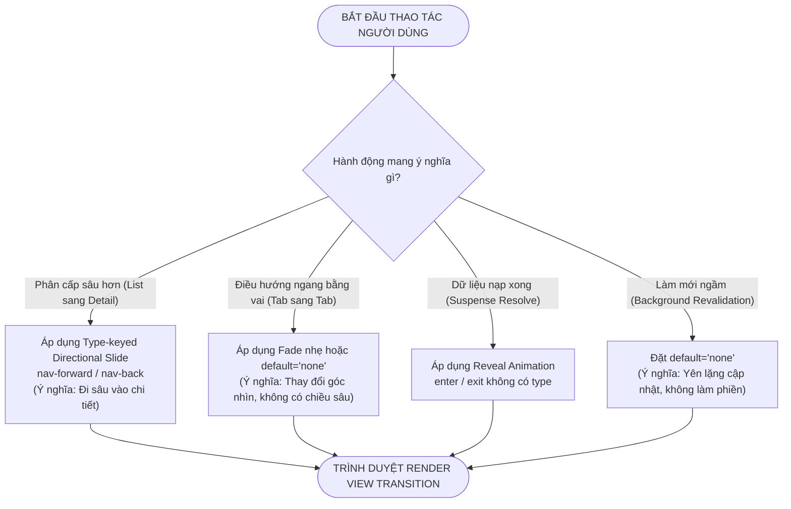

# Chuyên Đề 16: Kỹ Thuật Chuyển Cảnh Giao Diện Tự Nhiên & Native View Transitions

> **Dự án:** Khung Tiêu Chuẩn Doanh Nghiệp & RoGym Management System Profile  
> **Phạm vi kỹ thuật:** Chuyển cảnh giao diện tự nhiên (Native View Transition API), Phân cấp không gian (Spatial Continuity), Thành phần chia sẻ (Shared Element Transitions), Bố cục trượt thích ứng (Layout Displacement Morph), Cải thiện hiệu ứng theo ngữ cảnh điều hướng (Directional Slide vs Fade), Khả năng tiếp cận an toàn chuyển động (`prefers-reduced-motion`)  
> **Cổng quy chuẩn chính:** [`FRONTEND_CONVENTIONS.md`](../FRONTEND_CONVENTIONS.md) | [Bản Đồ Tài Liệu](./README.md)  
> **Cơ sở tham chiếu quốc tế:**  
> - [W3C CSS View Transitions Module Level 2](https://drafts.csswg.org/css-view-transitions-2/)  
> - [React 19 ViewTransition Specification](https://react.dev) & Vercel React View Transitions Skill  
> - [Chrome for Developers - Smooth transitions with the View Transition API](https://developer.chrome.com/docs/web-platform/view-transitions/)  
> - [W3C WAI-ARIA APG - Animation and Movement](https://www.w3.org/WAI/ARIA/apg/practices/names-and-descriptions/)  
> **Phiên bản:** 8.0 (Enterprise Quality Standard — 17 Spokes & Universal Decoupling)  
> **Áp dụng cho:** Toàn bộ trang View (`src/pages/*`), Modal / Drawer overlays (`src/components/ui/overlay/*`), và Component chuyển trạng thái danh sách / chi tiết  
> **Trạng thái:** Bắt buộc tuân thủ 100% (Strict Mandatory Enforcement)  

---

## MỤC LỤC
1. [Bối Cảnh Kỹ Thuật, Tầm Quan Trọng & Cơ Sở Tham Chiếu](#1-bối-cảnh-kỹ-thuật-tầm-quan-trọng-cơ-sở-tham-chiếu)
2. [Triết Lý Kiến Trúc & Sơ Đồ Tư Duy (Visual Mental Model)](#2-triết-lý-kiến-trúc-sơ-đồ-tư-duy-visual-mental-model)
   - [2.1. Triết Lý Tiếp Nối Không Gian (Spatial Continuity)](#21-triết-lý-tiếp-nối-không-gian-spatial-continuity)
   - [2.2. Kim Tự Tháp 5 Cấp Độ Chuyển Cảnh Ưu Tiên](#22-kim-tự-tháp-5-cấp-độ-chuyển-cảnh-ưu-tiên)
3. [Đặc Tả Kỹ Thuật Chi Tiết (Bộ Quy Chuẩn MOTION-001 đến MOTION-008)](#3-đặc-tả-kỹ-thuật-chi-tiết-bộ-quy-chuẩn-motion-001-đến-motion-008)
   - [3.1. Bảng Tổng Hợp 8 Quy Chuẩn Chuyển Cảnh Giao Diện](#31-bảng-tổng-hợp-8-quy-chuẩn-chuyển-cảnh-giao-diện)
   - [3.2. Đặc Tả Chi Tiết Từng Quy Chuẩn Kỹ Thuật](#32-đặc-tả-chi-tiết-từng-quy-chuẩn-kỹ-thuật)
4. [Thực Hành Thực Tế: Do's & Don'ts & Case Studies](#4-thực-hành-thực-tế-dos-donts-case-studies)
   - [4.1. Case Study 1: Shared Element Morph Từ Thẻ Gói Tập Sang Trang Chi Tiết](#41-case-study-1-shared-element-morph-từ-thẻ-gói-tập-sang-trang-chi-tiết)
   - [4.2. Case Study 2: Sắp Xếp Danh Sách & Bố Cục Trượt Thích Ứng (Layout Displacement Morph)](#42-case-study-2-sắp-xếp-danh-sách-bố-cục-trượt-thích-ứng-layout-displacement-morph)
   - [4.3. Bảng Đối Chiếu Anti-Patterns vs Chuẩn Mực Doanh Nghiệp](#43-bảng-đối-chiếu-anti-patterns-vs-chuẩn-mực-doanh-nghiệp)
5. [Bộ CSS Recipes Chuẩn Doanh Nghiệp Cho View Transitions](#5-bộ-css-recipes-chuẩn-doanh-nghiệp-cho-view-transitions)
6. [Ánh Xạ Tooling Kiểm Toán CI & Checklist Review PR](#6-ánh-xạ-tooling-kiểm-toán-ci-checklist-review-pr)

---

## 1. Bối Cảnh Kỹ Thuật, Tầm Quan Trọng & Cơ Sở Tham Chiếu

Trong các ứng dụng web doanh nghiệp truyền thống (Single Page Application), việc chuyển đổi qua lại giữa danh sách dữ liệu và màn hình chi tiết hoặc thao tác lọc/sắp xếp thường xảy ra theo hai thái cực:
1. **Chuyển đổi giật cục (Instant Jump / Hard Cut):** Màn hình cũ biến mất ngay lập tức và màn hình mới xuất hiện, khiến mắt người dùng mất phương hướng thị giác (Cognitive Disorientation), không nhận thức được bản ghi chi tiết vừa mở có nguồn gốc từ đâu trong bảng danh sách.
2. **Lạm dụng thư viện hoạt ảnh nặng nề (Heavy JS Animation Bloat):** Nhúng các thư viện hoạt ảnh JavaScript cồng kềnh (Framer Motion, React Spring) gây tăng thêm 30–60KB gói bundle ban đầu, đồng thời chiếm dụng Main Thread khiến chỉ số phản hồi tương tác **INP (Interaction to Next Paint)** bị suy giảm nghiêm trọng.

Sự ra đời của **W3C View Transition API** kết hợp cùng component `<ViewTransition>` của React 19 giải quyết triệt để vấn đề này bằng cách:
- Ủy thác toàn bộ việc chụp ảnh trạng thái (DOM Snapshots) và nội suy chuyển động (Interpolation) cho luồng Compositor của trình duyệt (GPU-accelerated).
- Đảm bảo tốc độ khung hình ổn định 60–120fps trên cả thiết bị di động yếu (như WebView của LINE LIFF).
- Khả năng suy giảm duyên dáng (Graceful Degradation): Trình duyệt không hỗ trợ API vẫn chuyển trang bình thường mà không phát sinh bất kỳ lỗi runtime nào.

---

## 2. Triết Lý Kiến Trúc & Sơ Đồ Tư Duy (Visual Mental Model)

### 2.1. Triết Lý Tiếp Nối Không Gian (Spatial Continuity)

> [!IMPORTANT]
> **Nguyên tắc cốt lõi:** *"Mỗi hiệu ứng View Transition bắt buộc phải truyền tải một mối quan hệ không gian hoặc sự tiếp nối trạng thái rõ ràng. Nếu bạn không thể giải thích bằng lời hiệu ứng đó truyền tải điều gì cho người dùng, tuyệt đối không được thêm vào mã nguồn."*



### 2.2. Kim Tự Tháp 5 Cấp Độ Chuyển Cảnh Ưu Tiên

Hệ thống phân cấp thứ tự ưu tiên áp dụng chuyển cảnh từ cao xuống thấp. Lập trình viên triển khai **tất cả các mẫu phù hợp** theo đúng thứ tự này, không nhảy cóc:

| Cấp Độ | Mẫu Chuyển Cảnh | Thuộc Tính Cốt Lõi | Thông Điệp Không Gian Truyền Tải |
| :---: | :--- | :--- | :--- |
| **1 (Cao nhất)** | **Shared Element** | `name="item-${id}"` | *"Cùng một thực thể nghiệp vụ — người dùng đang đi sâu vào chi tiết."* |
| **2** | **Suspense Reveal** | `enter="..." exit="..."` | *"Dữ liệu từ máy chủ đã nạp xong và trình bày lên màn hình."* |
| **3** | **List Identity** | `key={item.id}` | *"Cùng các bản ghi đó, nhưng được hoán đổi sang vị trí sắp xếp mới."* |
| **4** | **State Change** | `enter="auto" exit="auto"` | *"Một khối giao diện mới vừa xuất hiện hoặc đóng lại."* |
| **5** | **Route Change** | Page-level transition | *"Người dùng đang di chuyển sang một phân hệ nghiệp vụ hoàn toàn mới."* |

---

## 3. Đặc Tả Kỹ Thuật Chi Tiết (Bộ Quy Chuẩn MOTION-001 đến MOTION-008)

### 3.1. Bảng Tổng Hợp 8 Quy Chuẩn Chuyển Cảnh Giao Diện

| Mã Quy Chuẩn | Tên Quy Chuẩn & Phạm Vi | Mức Độ | Tiêu Chí Đạt (Pass) | Anti-Pattern (Don't) | Best Practice (Do) |
| :---: | :--- | :---: | :--- | :--- | :--- |
| `MOTION-001` | Tính Có Ý Nghĩa Không Gian (`vt-spatial-meaning`) | `ERROR` | Hiệu ứng thể hiện rõ chiều sâu phân cấp hoặc sự tiếp nối trạng thái. | Thêm animation trượt ngẫu nhiên cho tab ngang gây ảo giác về chiều sâu. | Phân định rạch ròi: trượt có hướng cho List $\rightarrow$ Detail; fade cho Tabs. |
| `MOTION-002` | Điều Hướng Có Hướng (`vt-directional-nav`) | `ERROR` | Điều hướng tiến dùng `nav-forward` (trượt từ phải); quay lại dùng `nav-back` (trượt từ trái). | Dùng fade-out toàn trang khi trang đang có Shared Element Morph. | Gắn nhãn type qua `addTransitionType('nav-forward')` trước khi chuyển trang. |
| `MOTION-003` | Vị Trí Đặt Thẻ ViewTransition (`vt-placement-rule`) | `ERROR` | Thẻ `<ViewTransition>` xuất hiện trước mọi thẻ DOM node cấp con trực tiếp. | Bọc thẻ `<div>` bên ngoài `<ViewTransition>` làm vô hiệu hóa enter/exit. | Đặt `<ViewTransition>` trực tiếp bao bọc component hoặc DOM node. |
| `MOTION-004` | Định Danh Độc Nhất Cho Shared Element (`vt-shared-element`) | `ERROR` | Thuộc tính `name` mang tính duy nhất toàn cục tại thời điểm chuyển cảnh (`package-${id}`). | Dùng tên tĩnh `name="card"` cho nhiều phần tử xuất hiện cùng lúc. | Gắn ID nghiệp vụ vào name và xử lý conditional name khi modal mở. |
| `MOTION-005` | Khai Báo `default="none"` Có Chủ Đích (`vt-default-none`) | `WARN` | Tắt cross-fade mặc định trên các phần tử chỉ muốn kích hoạt animation theo type. | Để `default="auto"` khiến trang bị chớp nháy khi TanStack Query revalidate ngầm. | Khai báo tường minh `default="none"` cho các type-keyed transitions. |
| `MOTION-006` | Bố Cục Trượt Thích Ứng (`vt-displacement-morph`) | `WARN` | Các phần tử bên dưới danh sách co giãn trượt êm ái thay vì giật bước (teleport). | Để nội dung chân trang (Footer) nhảy giật khi danh sách lọc co lại. | Bọc phần tử bên dưới trong `<ViewTransition update="auto">` để kích hoạt layout morph. |
| `MOTION-007` | Triển Khai Kép Tương Thích (`vt-dual-track-compat`) | `ERROR` | Mã nguồn hoạt động hoàn hảo trên React 19 Canary/Stable và có helper fallback cho React 18. | Gọi trực tiếp `document.startViewTransition` mà không kiểm tra trình duyệt hỗ trợ. | Sử dụng wrapper `executeViewTransition()` chuẩn hóa kiểm tra tính sẵn sàng. |
| `MOTION-008` | Quy Chuẩn An Toàn Chuyển Động (`vt-reduced-motion`) | `ERROR` | Vô hiệu hóa 100% hoạt ảnh chuyển cảnh khi người dùng bật `prefers-reduced-motion: reduce`. | Tiếp tục chạy hiệu ứng trượt màn hình đối với người dùng bị rối loạn tiền đình. | Bắt buộc khai báo CSS rule tắt toàn bộ pseudo-elements khi reduced motion bật. |

---

### 3.2. Đặc Tả Chi Tiết Từng Quy Chuẩn Kỹ Thuật

<a id="motion-001"></a>
#### `MOTION-001`: Tính Có Ý Nghĩa Không Gian (`vt-spatial-meaning`)
- **Quy tắc:** Chỉ sử dụng hiệu ứng chuyển động trượt có hướng (Directional Slide) cho các luồng điều hướng có thứ bậc rõ ràng:
  - Danh sách $\rightarrow$ Chi tiết (Đi sâu vào phân cấp: Trượt từ phải sang trái).
  - Chi tiết $\rightarrow$ Danh sách (Quay ra ngoài phân cấp: Trượt từ trái sang phải).
  - Chuỗi tuần tự có thứ tự (Bước 1 $\rightarrow$ Bước 2 $\rightarrow$ Bước 3 trong Wizard Form).
- **Cấm:** Không sử dụng trượt ngang cho điều hướng cùng cấp (ngang hàng) như chuyển đổi qua lại giữa các Tab hoặc các trang trên thanh Sidebar (Tổng quan, Điểm danh, Báo cáo). Các điều hướng này chỉ dùng hiệu ứng mờ dần nhẹ (Fade) hoặc tắt hoàn toàn animation.

<a id="motion-002"></a>
#### `MOTION-002`: Điều Hướng Có Hướng Bằng Transition Types (`vt-directional-nav`)
- **Quy tắc:** Sử dụng hàm `addTransitionType()` để gắn nhãn ngữ cảnh chuyển trang, cho phép stylesheet CSS chọn đúng hướng trượt:

```tsx
// ✅ DO: Đính kèm nhãn type trước khi chuyển tuyến đường
import { startTransition } from 'react'

export function useNavigateWithTransition() {
  const navigate = useNavigate()

  const pushForward = (to: string) => {
    startTransition(() => {
      // @ts-expect-error - React 19 / View Transition Types API
      if (typeof addTransitionType === 'function') {
        addTransitionType('nav-forward')
      }
      navigate(to)
    })
  }

  const pushBack = (to: string) => {
    startTransition(() => {
      // @ts-expect-error - React 19 / View Transition Types API
      if (typeof addTransitionType === 'function') {
        addTransitionType('nav-back')
      }
      navigate(to)
    })
  }

  return { pushForward, pushBack }
}
```

<a id="motion-003"></a>
#### `MOTION-003`: Vị Trí Đặt Thẻ ViewTransition (`vt-placement-rule`)
- **Quy tắc vàng:** Thẻ `<ViewTransition>` chỉ kích hoạt được hiệu ứng `enter` và `exit` khi nó xuất hiện **ngay trước thẻ DOM đầu tiên**. Nếu có một thẻ DOM bọc bên ngoài thẻ `<ViewTransition>`, hiệu ứng xuất hiện/biến mất sẽ bị trình duyệt vô hiệu hóa hoàn toàn.

```tsx
// ❌ DON'T (Anti-pattern): Thẻ div bọc bên ngoài khiến enter/exit bị triệt tiêu
export function BadModal({ isOpen, children }: { isOpen: boolean; children: React.ReactNode }) {
  if (!isOpen) return null
  return (
    <div className="fixed inset-0 z-50">
      <ViewTransition enter="slide-up" exit="slide-down">
        <div className="bg-card p-6">{children}</div>
      </ViewTransition>
    </div>
  )
}

// ✅ DO (Chuẩn mực): Đặt ViewTransition ở ngoài cùng trước mọi DOM node
export function GoodModal({ isOpen, children }: { isOpen: boolean; children: React.ReactNode }) {
  if (!isOpen) return null
  return (
    <ViewTransition enter="slide-up" exit="slide-down">
      <div className="fixed inset-0 z-50">
        <div className="bg-card p-6">{children}</div>
      </div>
    </ViewTransition>
  )
}
```

<a id="motion-004"></a>
#### `MOTION-004`: Định Danh Độc Nhất Cho Shared Element (`vt-shared-element`)
- **Quy tắc:** Chỉ được phép có duy nhất một phần tử DOM mang cùng một giá trị `name` hiển thị trên màn hình tại bất kỳ thời điểm nào. Khi chuyển trang, phần tử cũ unmount và phần tử mới mount có cùng `name` sẽ tự động biến hình (morph) vào nhau mượt mà.
- **Xử lý xung đột Modal / Popover:** Nếu một component vừa được hiển thị trên trang nền, vừa được mở trong cửa sổ Modal (ví dụ: ảnh đại diện hội viên), lập trình viên phải truyền prop `enableTransition={!isInsideModal}` để tránh việc 2 phần tử cùng mang một `name` làm hỏng chuyển động.

<a id="motion-005"></a>
#### `MOTION-005`: Khai Báo `default="none"` Có Chủ Đích (`vt-default-none`)
- **Nguyên lý:** Mặc định của View Transition API là cross-fade toàn bộ trang (`default="auto"`). Tuy nhiên, khi các tác vụ ngầm như TanStack Query revalidate dữ liệu trong nền hoặc cập nhật một phần tử nhỏ, hiệu ứng cross-fade toàn màn hình sẽ khiến giao diện bị chớp nháy gây khó chịu cho người dùng.
- **Quy tắc:** Bắt buộc khai báo tường minh `default="none"` cho các thành phần ViewTransition gắn liền với type cụ thể (`types={['nav-forward', 'nav-back']}`), chỉ kích hoạt hiệu ứng chuyển cảnh khi có hành vi điều hướng có chủ đích từ người dùng:

```tsx
// ✅ DO: Tắt cross-fade mặc định, chỉ animate khi đúng transition type
<ViewTransition
  default="none"
  types={{
    'nav-forward': 'slide-left',
    'nav-back': 'slide-right'
  }}
>
  <Outlet />
</ViewTransition>
```

<a id="motion-006"></a>
#### `MOTION-006`: Bố Cục Trượt Thích Ứng (`vt-displacement-morph`)
- **Nguyên lý:** Khi một phần tử trong danh sách bị thu gọn hoặc bộ lọc thu hẹp danh sách lại, các phần tử nằm bên dưới (hoặc phần Footer) thường bị nhảy giật bước đột ngột (teleport layout shift).
- **Quy tắc:** Sử dụng `<ViewTransition update="auto">` bọc quanh vùng nội dung chuyển động hoặc các phần tử bên dưới để trình duyệt tự động tính toán hình học FLIP (First-Last-Invert-Play) và trượt mượt mà theo vị trí mới mà không cần can thiệp JavaScript thủ công.

<a id="motion-007"></a>
#### `MOTION-007`: Triển Khai Kép Tương Thích (Dual-Track Implementation)
- Nhằm đảm bảo tương thích tuyệt đối giữa phiên bản React 18 hiện tại và React 19 Stable, RoGym cung cấp helper tiêu chuẩn `executeViewTransition`:

```typescript
// File: src/lib/view-transition.ts
export function executeViewTransition(updateCallback: () => void | Promise<void>): void {
  // Kiểm tra tính sẵn sàng của View Transition API trên trình duyệt
  if (typeof document !== 'undefined' && 'startViewTransition' in document) {
    // @ts-expect-error - Document.startViewTransition W3C standard
    document.startViewTransition(() => {
      return updateCallback()
    })
  } else {
    // Graceful degradation: chạy trực tiếp không hiệu ứng
    updateCallback()
  }
}
```

<a id="motion-008"></a>
#### `MOTION-008`: Quy Chuẩn An Toàn Chuyển Động (`vt-reduced-motion`)
- **Quy tắc:** Bắt buộc nhúng đoạn CSS vô hiệu hóa chuyển cảnh trong tệp CSS toàn cục `src/index.css`. Khi người dùng bật tính năng giảm chuyển động trên hệ điều hành, thời lượng hoạt ảnh sẽ lập tức gán về 0 giây.

---

## 4. Thực Hành Thực Tế: Do's & Don'ts & Case Studies

### 4.1. Case Study 1: Shared Element Morph Từ Thẻ Gói Tập Sang Trang Chi Tiết

Khi hội viên nhấn vào một thẻ Gói tập gym (`PackageCard`) trên màn hình danh sách `/packages` để mở trang chi tiết `/packages/:id`, hình ảnh và tiêu đề của gói tập sẽ biến hình chuyển tiếp mượt mà vào vị trí mới:

```tsx
// File: src/pages/member/packages/PackageCard.tsx
import { Link } from 'react-router-dom'
import { executeViewTransition } from '@/lib/view-transition'

export interface PackageCardProps {
  id: string
  title: string
  imageUrl: string
  price: number
}

export function PackageCard({ id, title, imageUrl, price }: PackageCardProps) {
  const navigate = useNavigate()

  const handleSelect = () => {
    executeViewTransition(() => {
      navigate(`/member/packages/${id}`)
    })
  }

  return (
    <article
      onClick={handleSelect}
      className="cursor-pointer rounded-2xl border border-[var(--rogym-border-subtle)] bg-[var(--rogym-bg-card)] p-4"
    >
      {/* Gán view-transition-name duy nhất cho ảnh và tiêu đề */}
      
      <h3
        style={{ viewTransitionName: `package-title-${id}` }}
        className="mt-3 text-lg font-bold text-white"
      >
        {title}
      </h3>
      <p className="mt-1 text-sm text-[var(--rogym-text-secondary)]">{price.toLocaleString()} VNĐ</p>
    </article>
  )
}
```

```tsx
// File: src/pages/member/packages/PackageDetailPage.tsx
export function PackageDetailPage({ pkg }: { pkg: PackageDetail }) {
  return (
    <main className="mx-auto max-w-4xl p-6">
      {/* Tái sử dụng cùng view-transition-name để trình duyệt tự động nội suy vị trí và kích thước */}
      
      <h1
        style={{ viewTransitionName: `package-title-${pkg.id}` }}
        className="mt-6 text-3xl font-extrabold text-white"
      >
        {pkg.title}
      </h1>
      <p className="mt-4 text-base leading-relaxed text-[var(--rogym-text-secondary)]">
        {pkg.description}
      </p>
    </main>
  )
}
```

---

### 4.2. Case Study 2: Sắp Xếp Danh Sách & Bố Cục Trượt Thích Ứng (Layout Displacement Morph)

Khi người dùng lọc danh sách hội viên, danh sách bị co lại đột ngột. Nếu không áp dụng `update morph`, khối nút hành động và phân trang phía dưới sẽ bị giật dịch chuyển tức thời. Bằng cách áp dụng **Layout Displacement Morph**, các phần tử bên dưới sẽ trượt êm ái lên vị trí mới:

```tsx
// File: src/pages/staff/members/MemberListSection.tsx
export function MemberListSection({ members }: { members: Member[] }) {
  return (
    <section className="space-y-6">
      {/* Danh sách các item có key duy nhất */}
      <ul className="space-y-3">
        {members.map((member) => (
          <li
            key={member.id}
            style={{ viewTransitionName: `member-item-${member.id}` }}
            className="flex items-center justify-between rounded-xl bg-[var(--rogym-bg-card)] p-4 border border-[var(--rogym-border-subtle)]"
          >
            <span className="font-medium text-white">{member.fullName}</span>
            <span className="text-sm text-[var(--rogym-text-muted)]">{member.membershipType}</span>
          </li>
        ))}
      </ul>

      {/* Khối phân trang bên dưới trượt thích ứng êm ái */}
      <div
        style={{ viewTransitionName: 'pagination-controls' }}
        className="flex items-center justify-between pt-4 border-t border-[var(--rogym-border-subtle)]"
      >
        <p className="text-sm text-[var(--rogym-text-secondary)]">Hiển thị {members.length} hội viên</p>
        <PaginationNav />
      </div>
    </section>
  )
}
```

---

### 4.3. Bảng Đối Chiếu Anti-Patterns vs Chuẩn Mực Doanh Nghiệp

| Anti-Pattern (Don't) | Hậu Quả Kỹ Thuật | Chuẩn Mực Doanh Nghiệp (Do) | Lợi Ích Kỹ Thuật |
| :--- | :--- | :--- | :--- |
| Dùng `framer-motion` cho toàn bộ các chuyển cảnh trang đơn giản. | Tăng gói JS bundle thêm 45KB; làm giảm INP trên di động. | Sử dụng **Native View Transition API** có sẵn trong trình duyệt. | Kích thước bundle 0KB; chạy 100% trên GPU compositor thread. |
| Để `default="auto"` trên toàn bộ trang khiến background refresh bị chớp. | Màn hình nhấp nháy cross-fade mỗi khi TanStack Query revalidate ngầm. | Thiết lập `default="none"` cho các type-keyed transitions. | Ứng dụng tĩnh lặng làm mới dữ liệu ngầm mà không làm phiền mắt người dùng. |
| Dùng hiệu ứng trượt màn hình khi chuyển đổi giữa các Tab ngang hàng. | Tạo ảo giác sai lệch về độ sâu không gian và cấu trúc phân cấp. | Sử dụng Fade nhẹ nhàng hoặc chuyển trạng thái tức thì không trượt. | Người dùng nhận biết rõ ràng mình đang đứng ở cùng một tầng thông tin. |

---

## 5. Bộ CSS Recipes Chuẩn Doanh Nghiệp Cho View Transitions

Nhúng toàn bộ khối định kiểu chuẩn mực này vào tệp stylesheet toàn cục `src/index.css`:

```css
/* ==========================================================================
   VIEW TRANSITION CORE RECIPES (RoGym Standard Specification V1.0)
   ========================================================================== */

/* 1. Keyframes: Trượt Phân Cấp (Hierarchical Navigation) */
@keyframes slide-to-left {
  from { transform: translateX(0); opacity: 1; }
  to { transform: translateX(-20%); opacity: 0; }
}

@keyframes slide-from-right {
  from { transform: translateX(100%); opacity: 0; }
  to { transform: translateX(0); opacity: 1; }
}

@keyframes slide-to-right {
  from { transform: translateX(0); opacity: 1; }
  to { transform: translateX(100%); opacity: 0; }
}

@keyframes slide-from-left {
  from { transform: translateX(-20%); opacity: 0; }
  to { transform: translateX(0); opacity: 1; }
}

/* 2. Áp dụng cho Chuyển Cảnh Tiến (nav-forward) */
html:active-view-transition-type(nav-forward)::view-transition-old(root) {
  animation: 250ms cubic-bezier(0.2, 0, 0, 1) both slide-to-left;
}

html:active-view-transition-type(nav-forward)::view-transition-new(root) {
  animation: 300ms cubic-bezier(0.2, 0, 0, 1) both slide-from-right;
}

/* 3. Áp dụng cho Chuyển Cảnh Lùi (nav-back) */
html:active-view-transition-type(nav-back)::view-transition-old(root) {
  animation: 250ms cubic-bezier(0.2, 0, 0, 1) both slide-to-right;
}

html:active-view-transition-type(nav-back)::view-transition-new(root) {
  animation: 300ms cubic-bezier(0.2, 0, 0, 1) both slide-from-left;
}

/* 4. Khử Chuyển Động Cho Khả Năng Tiếp Cận (Reduced Motion Discipline) */
@media (prefers-reduced-motion: reduce) {
  ::view-transition-group(*),
  ::view-transition-old(*),
  ::view-transition-new(*) {
    animation: none !important;
    transition: none !important;
  }
}
```

---

## 6. Ánh Xạ Tooling Kiểm Toán CI & Checklist Review PR

### 6.1. Ánh Xạ Bộ Công Cụ Kiểm Toán
- **Kiểm tra cú pháp và toàn vẹn:** `npm run verify:docs` đảm bảo toàn bộ mã quy chuẩn `MOTION-*` và liên kết trong chuyên đề không bị đứt gãy.
- **Kiểm thử tự động Vitest:** Mock `document.startViewTransition` trong `src/test/setup.ts` để kiểm tra việc gọi chuyển cảnh không gây crash trong môi trường jsdom.

### 6.2. Bảng Checklist Định Lượng Trước Khi Mở PR (6 Tiêu Chí)

| STT | Mã Tiêu Chí | Nội Dung Kiểm Tra Thực Tế | Phương Pháp Xác Minh | Trọng Tài |
| :---: | :--- | :--- | :--- | :---: |
| **1** | `CHECK-MOT-01` | Mọi chuyển cảnh đều giải thích được ý nghĩa không gian (List $\rightarrow$ Detail trượt, Tab dùng fade). | Review luồng thao tác UI | Bắt buộc |
| **2** | `CHECK-MOT-02` | `view-transition-name` của các phần tử là duy nhất, không trùng lặp khi mở Modal. | Thanh tra thuộc tính DOM | Bắt buộc |
| **3** | `CHECK-MOT-03` | Không dùng thẻ `<div>` bọc ngoài làm vô hiệu hóa thẻ `<ViewTransition>`. | Code Review file JSX | Bắt buộc |
| **4** | `CHECK-MOT-04` | Các cập nhật ngầm (Background refetch) được cấu hình `default="none"`, không gây chớp nháy màn hình. | Quan sát Network DevTools | Bắt buộc |
| **5** | `CHECK-MOT-05` | Đã kiểm thử tính năng với `@media (prefers-reduced-motion: reduce)` và hiệu ứng được tắt hoàn toàn. | Bật chế độ Emulate reduced motion | Bắt buộc |
| **6** | `CHECK-MOT-06` | Có hàm fallback an toàn trên trình duyệt chưa hỗ trợ View Transition API. | Kiểm tra trình duyệt không hỗ trợ | Bắt buộc |


