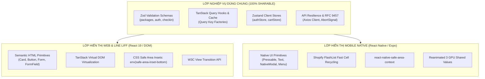

# Chuyên Đề 17: Kiến Trúc Ứng Dụng Di Động Đa Nền Tảng (LINE LIFF WebView & React Native / Expo)

> **Dự án:** Khung Tiêu Chuẩn Doanh Nghiệp & RoGym Management System Profile  
> **Phạm vi kỹ thuật:** Kiến trúc di động đa nền tảng (Universal Mobile Architecture), Tối ưu hóa trình duyệt nhúng LINE LIFF (In-App Browser), Ảo hóa danh sách di động (FlashList & TanStack Virtual), Hoạt ảnh tăng tốc phần cứng (GPU-Accelerated Transforms), Quản trị vùng an toàn (Safe Area Insets), Chuẩn công thái học ngón cái Touch Targets ($\ge 44\text{px}$), Cấm rò rỉ cú pháp `&&` trong JSX di động, Chiến lược chia sẻ mã nguồn Monorepo  
> **Cổng quy chuẩn chính:** [`FRONTEND_CONVENTIONS.md`](../FRONTEND_CONVENTIONS.md) | [Bản Đồ Tài Liệu](./README.md)  
> **Cơ sở tham chiếu quốc tế:**  
> - [Vercel React Native Skills Specification](../.agents/skills/vercel-react-native-skills/SKILL.md)  
> - [Shopify FlashList Architecture Guide](https://shopify.github.io/flash-list/)  
> - [Software Mansion React Native Reanimated 3](https://docs.swmansion.com/react-native-reanimated/)  
> - [LINE Front-end Framework (LIFF) Documentation](https://developers.line.biz/en/docs/liff/)  
> - [Apple Human Interface Guidelines - Touch Targets & Safe Areas](https://developer.apple.com/design/human-interface-guidelines/)  
> **Phiên bản:** 8.0 (Enterprise Quality Standard — 17 Spokes & Universal Decoupling)  
> **Áp dụng cho:** Toàn bộ phân hệ Hội viên di động (`/member/*`, `/liff/*`), các view responsive trên màn hình $\le 430\text{px}$, và gói ứng dụng di động RoGym Mobile App tương lai  
> **Trạng thái:** Bắt buộc tuân thủ 100% (Strict Mandatory Enforcement)  

---

## MỤC LỤC
1. [Bối Cảnh Kỹ Thuật, Thách Thức Di Động & Cơ Sở Tham Chiếu](#1-bối-cảnh-kỹ-thuật-thách-thức-di-động-cơ-sở-tham-chiếu)
2. [Triết Lý Kiến Trúc & Sơ Đồ Tư Duy (Visual Mental Model)](#2-triết-lý-kiến-trúc-sơ-đồ-tư-duy-visual-mental-model)
   - [2.1. Triết Lý Universal Mobile Architecture](#21-triết-lý-universal-mobile-architecture)
   - [2.2. Sơ Đồ Luồng Chia Sẻ Mã Nguồn Web & Mobile](#22-sơ-đồ-luồng-chia-sẻ-mã-nguồn-web-mobile)
3. [Đặc Tả Kỹ Thuật Chi Tiết (Bộ Quy Chuẩn MOB-001 đến MOB-010)](#3-đặc-tả-kỹ-thuật-chi-tiết-bộ-quy-chuẩn-mob-001-đến-mob-010)
   - [3.1. Bảng Tổng Hợp 10 Quy Chuẩn Di Động Doanh Nghiệp](#31-bảng-tổng-hợp-10-quy-chuẩn-di-động-doanh-nghiệp)
   - [3.2. Đặc Tả Chi Tiết Từng Quy Chuẩn Kỹ Thuật](#32-đặc-tả-chi-tiết-từng-quy-chuẩn-kỹ-thuật)
4. [Thực Hành Thực Tế: Do's & Don'ts & Case Studies](#4-thực-hành-thực-tế-dos-donts-case-studies)
   - [4.1. Case Study 1: Ảo Hóa Danh Sách Lịch Sử Điểm Danh & Cuộn Mượt 60fps](#41-case-study-1-ảo-hóa-danh-sách-lịch-sử-điểm-danh-cuộn-mượt-60fps)
   - [4.2. Case Study 2: Quản Trị Safe Area Insets Cho Thanh Đặt Đơn & Home Bar](#42-case-study-2-quản-trị-safe-area-insets-cho-thanh-đặt-đơn-home-bar)
   - [4.3. Bảng Đối Chiếu Anti-Patterns vs Chuẩn Mực Doanh Nghiệp](#43-bảng-đối-chiếu-anti-patterns-vs-chuẩn-mực-doanh-nghiệp)
5. [Toàn Bộ 38 Quy Tắc Vercel React Native Ánh Xạ Sang Môi Trường Doanh Nghiệp](#5-toàn-bộ-38-quy-tắc-vercel-react-native-ánh-xạ-sang-môi-trường-doanh-nghiệp)
6. [Ánh Xạ Tooling Kiểm Toán CI & Checklist Review PR](#6-ánh-xạ-tooling-kiểm-toán-ci-checklist-review-pr)

---

## 1. Bối Cảnh Kỹ Thuật, Thách Thức Di Động & Cơ Sở Tham Chiếu

Tại chuỗi phòng tập RoGym, hơn **85% tương tác của hội viên** (điểm danh QR, xem lịch tập, đăng ký huấn luyện viên, gia hạn gói tập) diễn ra trên điện thoại thông minh thông qua hai kênh tiếp cận:
1. **Kênh Hiện Tại (LINE LIFF WebView):** Ứng dụng web Single Page Application chạy nhúng trực tiếp bên trong trình duyệt In-App Browser của ứng dụng nhắn tin LINE.
2. **Kênh Tương Lai (RoGym Native Mobile App):** Ứng dụng di động độc lập được xây dựng trên nền tảng React Native / Expo nhằm tận dụng tối đa các cảm biến phần cứng (Bluetooth máy chạy bộ, Apple HealthKit, Push Notifications thời gian thực).

### Các Thách Thức Sống Còn Trên Môi Trường Di Động:
- **Tài nguyên phần cứng hạn chế:** Bộ nhớ RAM và CPU của điện thoại tầm trung dễ bị quá tải khi hiển thị danh sách hàng trăm buổi tập nếu không được ảo hóa DOM / View recycling.
- **Xung đột vùng cảm ứng và cử chỉ:** Thanh điều hướng ảo (iOS Home Bar / Android Navigation Pill) thường che mất nút bấm xác nhận nếu thiếu quản trị Safe Area Insets; thao tác vuốt cuộn dễ bị giật nếu hàm xử lý sự kiện tạo ra các closure mới liên tục.
- **Lỗi hiển thị chuỗi ký tự (Text in Text Component Crash):** Trên nền tảng di động, chuỗi ký tự không được bọc trong thẻ Text sẽ gây sập ứng dụng ngay lập tức (Crash to Desktop).

---

## 2. Triết Lý Kiến Trúc & Sơ Đồ Tư Duy (Visual Mental Model)

### 2.1. Triết Lý Universal Mobile Architecture

> [!IMPORTANT]
> **Nguyên tắc cốt lõi:** *"Một bộ não nghiệp vụ — Đa tầng trải nghiệm hiển thị (One Business Engine — Multi-surface Rendering). 100% logic nghiệp vụ (Zod Validation, TanStack Query Cache, Zustand State, API Resilience) phải hoàn toàn độc lập với nền tảng hiển thị, cho phép chia sẻ liền mạch giữa Web, LINE LIFF và React Native Native App."*

### 2.2. Sơ Đồ Luồng Chia Sẻ Mã Nguồn Web & Mobile



---

## 3. Đặc Tả Kỹ Thuật Chi Tiết (Bộ Quy Chuẩn MOB-001 đến MOB-010)

### 3.1. Bảng Tổng Hợp 10 Quy Chuẩn Di Động Doanh Nghiệp

| Mã Quy Chuẩn | Tên Quy Chuẩn & Phạm Vi | Mức Độ | Tiêu Chí Đạt (Pass) | Anti-Pattern (Don't) | Best Practice (Do) |
| :---: | :--- | :---: | :--- | :--- | :--- |
| `MOB-001` | Ảo Hóa Danh Sách Lớn (`list-performance-virtualize`) | `ERROR` | Dùng `@tanstack/react-virtual` (Web/LIFF) hoặc `FlashList` (RN) khi danh sách $\ge 50$ mục. | Dùng `.map()` render 500 thẻ buổi tập gây tràn bộ nhớ RAM. | Chỉ render số lượng cell tương ứng kích thước màn hình hiển thị. |
| `MOB-002` | Memoize Từng Item Component (`list-performance-item-memo`) | `ERROR` | 100% component con đại diện cho từng dòng danh sách bắt buộc bọc qua `React.memo`. | Component item re-render toàn bộ khi chỉ có 1 item thay đổi dữ liệu. | Bọc item component trong `memo` và truyền primitive ID. |
| `MOB-003` | Hoạt Ảnh Trên Thuộc Tính GPU (`animation-gpu-properties`) | `ERROR` | 100% animations chỉ biến đổi `transform` và `opacity`. | Chạy animation thay đổi `height`, `width`, `top`, `margin`. | Dùng CSS transform hoặc Reanimated Shared Values chạy trên UI Thread. |
| `MOB-004` | Quản Trị Vùng An Toàn Safe Area (`ui-safe-area-governance`) | `ERROR` | Nút hành động cố định chân trang có padding bảo vệ khỏi iOS Home Bar. | Đặt nút submit cố định ở `bottom-0` bị che bởi thanh điều hướng. | Thêm `pb-[max(1rem,env(safe-area-inset-bottom))]` trên Web/LIFF. |
| `MOB-005` | Vùng Bấm Chạm Công Thái Học (`ui-touch-targets`) | `ERROR` | Mọi nút bấm, icon bấm được có diện tích tối thiểu **$44 \times 44\text{px}$**. | Đặt icon đóng nhỏ $20 \times 20\text{px}$ khiến hội viên bấm hụt nhiều lần. | Đảm bảo kích thước tối thiểu $44\text{px}$ kèm padding hỗ trợ. |
| `MOB-006` | Ưu Tiên Thành Phần Native (`ui-native-modals-menus`) | `WARN` | Dùng context menus và modal native thay vì giả lập hoàn toàn bằng JS trên di động. | Tự code JS bottom sheet phức tạp gây giật khung hình khi vuốt. | Sử dụng component ActionSheet native hoặc Radix Sheet tối ưu. |
| `MOB-007` | Tuyệt Đối Cấm Rò Rỉ `&&` Trong JSX (`rendering-no-falsy-and`) | `ERROR` | 100% điều kiện hiển thị dùng toán tử 3 ngôi `? : null`. | Dùng `{count && <Text>{count}</Text>}` làm in ra số "0" hoặc crash native. | Viết `{count > 0 ? <Text>{count}</Text> : null}`. |
| `MOB-008` | Tách Biệt Cử Chỉ & Vuốt Chạm (`mobile-gesture-handling`) | `WARN` | Dùng `Pressable` / `Gesture.Tap()` thay vì `TouchableOpacity` cũ kỹ. | Sự kiện tap kích hoạt nhầm khi người dùng đang vuốt cuộn danh sách. | Tận dụng cơ chế delay tap và gesture responder an toàn. |
| `MOB-009` | Bộ Đệm Ngoại Tuyến Thích Ứng (`offline-mobile-resilience`) | `WARN` | Lưu đệm mã QR điểm danh và thông tin gói tập vào IndexedDB/AsyncStorage. | Mất mạng 4G tại tầng hầm phòng tập làm trắng màn hình điểm danh. | Tự động hiển thị mã offline token được ký sẵn khi mất kết nối. |
| `MOB-010` | Nhất Quán Phiên Bản Phụ Thuộc (`monorepo-single-dependency`) | `ERROR` | Đồng nhất 1 phiên bản thư viện dùng chung trong Monorepo (React, Zod, TanStack). | Web dùng Zod v4, Mobile dùng Zod v3 gây lệch validate schema. | Quản trị phiên bản tập trung tại root workspace. |

---

### 3.2. Đặc Tả Chi Tiết Từng Quy Chuẩn Kỹ Thuật

<a id="mob-001"></a>
#### `MOB-001`: Ảo Hóa Danh Sách Lớn (`list-performance-virtualize`)
- **Nguyên lý:** Khi danh sách vượt quá 50 phần tử (ví dụ: lịch sử quét mã vào phòng tập qua các tháng), trình duyệt di động hoặc ứng dụng Native không thể duy trì hàng nghìn phần tử DOM cùng lúc.
- **Quy tắc thực thi:**
  - Trên **Web & LINE LIFF:** Bắt buộc sử dụng `@tanstack/react-virtual` kết hợp container có `overflow-y: auto`.
  - Trên **React Native / Expo:** Bắt buộc sử dụng `@shopify/flash-list` thay cho `FlatList` mặc định nhờ cơ chế tái sử dụng ô hiển thị (Cell Recycling) vượt trội gấp 5 lần về hiệu năng CPU.

<a id="mob-002"></a>
#### `MOB-002`: Memoize Từng Item Component (`list-performance-item-memo`)
- **Nguyên lý:** Trong danh sách ảo hóa cuộn nhanh (Virtual List / FlashList), khi người dùng cuộn hoặc có một mục thay đổi trạng thái (ví dụ check-in thành công), toàn bộ các component item không đổi sẽ bị re-render nếu không được bọc memo.
- **Quy tắc:** Bắt buộc bọc từng item component bằng `React.memo` (hoặc `memo()`), và chỉ truyền primitive props (như `id`, `name`, `status`) hoặc stable callback (`useCallback`) để giữ shallow compare luôn trả về `true`.

```tsx
// ✅ DO: Bọc memo cho item component trong danh sách ảo hóa
export const CheckinItemRow = memo(function CheckinItemRow({
  id,
  title,
  time,
  onPress
}: {
  id: string
  title: string
  time: string
  onPress: (id: string) => void
}) {
  return (
    <div onClick={() => onPress(id)} className="h-16 flex items-center justify-between px-4">
      <span className="font-medium text-[var(--rogym-text-primary)]">{title}</span>
      <span className="text-sm text-[var(--rogym-text-muted)]">{time}</span>
    </div>
  )
})
```

<a id="mob-003"></a>
#### `MOB-003`: Hoạt Ảnh Trên Thuộc Tính Tăng Tốc Phần Cứng GPU (`animation-gpu-properties`)
- **Nguyên lý:** Các thuộc tính hình học như `width`, `height`, `top`, `left`, `padding` buộc trình duyệt phải tính toán lại bố cục (Layout/Reflow) và vẽ lại từng pixel (Repaint) trên luồng CPU, làm tụt khung hình xuống dưới 30fps.
- **Quy tắc:** Chỉ chạy hiệu ứng chuyển động trên hai thuộc tính duy nhất:
  - `transform`: `translateX`, `translateY`, `scale`, `rotate`.
  - `opacity`: làm mờ/hiện dần.

<a id="mob-004"></a>
#### `MOB-004`: Quản Trị Vùng An Toàn Safe Area Insets (`ui-safe-area-governance`)
- **Vấn đề thực tế:** Màn hình iPhone có dải loa Dynamic Island / Notch ở cạnh trên và thanh điều hướng Home Indicator Bar ở cạnh dưới. Nếu đặt phần tử cố định `position: fixed; bottom: 0` mà không có vùng đệm an toàn, nút bấm sẽ bị thanh Home Bar đè lên, khiến người dùng bấm nhầm thoát ứng dụng thay vì xác nhận giao dịch.
- **Quy tắc CSS chuẩn mực cho LINE LIFF:**

```css
/* Áp dụng cho các thanh Footer / Action Bar cố định đáy */
.fixed-bottom-bar {
  position: fixed;
  bottom: 0;
  left: 0;
  right: 0;
  padding-bottom: max(1rem, env(safe-area-inset-bottom));
  padding-left: max(1rem, env(safe-area-inset-left));
  padding-right: max(1rem, env(safe-area-inset-right));
}
```

<a id="mob-005"></a>
#### `MOB-005`: Vùng Bấm Chạm Công Thái Học (`ui-touch-targets`)
- **Nguyên lý:** Ngón tay người dùng trên màn hình cảm ứng di động có kích thước tiếp xúc trung bình từ 8mm đến 10mm. Vùng bấm nhỏ hơn $44 \times 44\text{px}$ sẽ dẫn đến hiện tượng bấm trượt, bấm nhầm nút lân cận gây ức chế và vi phạm WCAG 2.2 Success Criterion 2.5.8 (Target Size).
- **Quy tắc:** Mọi phần tử tương tác (Button, IconButton, Checkbox, Tab, Badge có thể bấm) phải đạt diện tích tối thiểu **$44 \times 44\text{px}$**.
- **Giải pháp cho Icon nhỏ:** Nếu thiết kế bắt buộc hiển thị icon kích thước $20\text{px}$ hoặc $24\text{px}$, lập trình viên phải thêm padding tương ứng (`p-2.5` hoặc `p-3`) hoặc sử dụng pseudo-element `::after` mở rộng vùng bấm vô hình (hit slop) đạt chuẩn $\ge 44\text{px}$.

<a id="mob-006"></a>
#### `MOB-006`: Ưu Tiên Thành Phần Native Cho Menu & Modal (`ui-native-modals-menus`)
- **Nguyên lý:** Trên môi trường di động thực tế, việc dựng bottom-sheet hoặc context-menu hoàn toàn bằng JavaScript custom thường gây giật lag khung hình khi người dùng vuốt trượt nhanh bằng ngón tay và không hỗ trợ haptic feedback của hệ điều hành.
- **Quy tắc:** Ưu tiên sử dụng ActionSheet/Modal native trên React Native (`ActionSheetIOS`, `@gorhom/bottom-sheet`) hoặc Radix UI Dialog / Sheet với CSS touch-action trên LINE LIFF / Web Mobile.

<a id="mob-007"></a>
#### `MOB-007`: Cấm Rò Rỉ Ký Tự Trong JSX Di Động (`rendering-no-falsy-and`)
- **Nguyên nhân sự cố:** Trong React Native, bất kỳ chuỗi văn bản trần trụi nào nằm ngoài thẻ `<Text>` đều kích hoạt ngoại lệ runtime nghiêm trọng: `Invariant Violation: Text strings must be rendered within a <Text> component`. Khi viết `{items.length && <List />}`, nếu mảng rỗng (`length === 0`), biểu thức sẽ đánh giá ra ký tự `"0"`, làm ứng dụng di động bị sập ngay lập tức.
- **Quy tắc bất biến:** Luôn sử dụng toán tử ba ngôi `? : null`.

```tsx
// ❌ CẤM (Gây sập ứng dụng Native & rò rỉ ký tự số 0 trên LINE LIFF)
{unreadNotifications.length && (
  <Badge>{unreadNotifications.length}</Badge>
)}

// ✅ CHUẨN MỰC DOANH NGHIỆP
{unreadNotifications.length > 0 ? (
  <Badge>{unreadNotifications.length}</Badge>
) : null}
```

<a id="mob-008"></a>
#### `MOB-008`: Tách Biệt Cử Chỉ & Vuốt Chạm (`mobile-gesture-handling`)
- **Nguyên lý:** Sử dụng các thẻ bấm cổ điển (như `div onClick` trên Web hoặc `TouchableOpacity` với delay mặc định trên Mobile) thường kích hoạt sự kiện tap nhầm lẫn khi người dùng chỉ đang vuốt để cuộn màn hình (scroll gesture).
- **Quy tắc:** Sử dụng `Pressable` / `GestureDetector` với cấu hình delay tap nhẹ hoặc CSS `touch-action: pan-y` để trình duyệt phân biệt rạch ròi giữa cử chỉ cuộn dọc danh sách và cử chỉ bấm chọn phần tử.

<a id="mob-009"></a>
#### `MOB-009`: Bộ Đệm Ngoại Tuyến Thích Ứng (`offline-mobile-resilience`)
- **Nguyên lý:** Mạng di động (4G/5G) tại khu vực tầng hầm phòng tập thể hình (Gym basement) thường xuyên mất sóng hoặc chập chờn. Nếu không có cơ chế offline cache, ứng dụng sẽ bị trắng màn hình và hội viên không thể quét mã QR để vào phòng.
- **Quy tắc:** Tích hợp bộ đệm ngoại tuyến (IndexedDB qua `localforage` trên Web/LIFF hoặc `AsyncStorage` / `MMKV` trên React Native), lưu đệm trước thẻ hội viên và token mã QR định danh offline có thời hạn hợp lệ ít nhất 24 giờ.

<a id="mob-010"></a>
#### `MOB-010`: Nhất Quán Phiên Bản Phụ Thuộc Trong Monorepo (`monorepo-single-dependency`)
- **Nguyên lý:** Khi phát triển song song Web SPA (React 19) và Native App (Expo/React Native), việc sử dụng các phiên bản lệch nhau của các thư viện dùng chung (như React, Zod, TanStack Query) dẫn đến xung đột phiên bản peer-dependency, lỗi serialization JSON và validation schema bất nhất.
- **Quy tắc:** Quản trị phiên bản tập trung tại root workspace, đồng bộ phiên bản `zod`, `@tanstack/react-query` và `date-fns` trên toàn bộ hệ thống monorepo.

---

## 4. Thực Hành Thực Tế: Do's & Don'ts & Case Studies

### 4.1. Case Study 1: Ảo Hóa Danh Sách Lịch Sử Điểm Danh & Cuộn Mượt 60fps

Màn hình lịch sử điểm danh của hội viên hiển thị hàng trăm phiên tập qua các tháng. Áp dụng `@tanstack/react-virtual` để bảo đảm số lượng DOM node luôn duy trì ở mức tối thiểu:

```tsx
// File: src/pages/member/checkin-history/CheckinVirtualList.tsx
import { useRef, memo } from 'react'
import { useVirtualizer } from '@tanstack/react-virtual'

export interface CheckinRecord {
  id: string
  checkinTime: string
  branchName: string
  lockerNumber: string
}

// 1. Memoize từng phần tử dòng để tránh re-render thừa khi cuộn
const CheckinItemRow = memo(function CheckinItemRow({ record }: { record: CheckinRecord }) {
  return (
    <article className="flex h-[72px] items-center justify-between rounded-xl border border-[var(--rogym-border-subtle)] bg-[var(--rogym-bg-card)] px-4">
      <div>
        <h4 className="font-semibold text-white">{record.branchName}</h4>
        <time className="text-xs text-[var(--rogym-text-secondary)]">{record.checkinTime}</time>
      </div>
      <span className="rounded-lg bg-[var(--rogym-bg-surface)] px-2.5 py-1 text-xs font-bold text-[var(--rogym-accent-primary)]">
        Tủ #{record.lockerNumber}
      </span>
    </article>
  )
})

export function CheckinVirtualList({ records }: { records: CheckinRecord[] }) {
  const parentRef = useRef<HTMLDivElement>(null)

  // 2. Cấu hình ảo hóa kích thước cố định
  const rowVirtualizer = useVirtualizer({
    count: records.length,
    getScrollElement: () => parentRef.current,
    estimateSize: () => 80, // Chiều cao 72px + 8px khoảng cách gap
    overscan: 5,            // Render trước 5 phần tử trên và dưới viewport
  })

  return (
    <section
      ref={parentRef}
      className="h-[600px] overflow-y-auto rounded-2xl border border-[var(--rogym-border-subtle)] p-2"
    >
      <div
        style={{
          height: `${rowVirtualizer.getTotalSize()}px`,
          width: '100%',
          position: 'relative',
        }}
      >
        {rowVirtualizer.getVirtualItems().map((virtualRow) => {
          const record = records[virtualRow.index]
          if (!record) return null
          return (
            <div
              key={record.id}
              style={{
                position: 'absolute',
                top: 0,
                left: 0,
                width: '100%',
                height: `${virtualRow.size}px`,
                transform: `translateY(${virtualRow.start}px)`,
              }}
            >
              <CheckinItemRow record={record} />
            </div>
          )
        })}
      </div>
    </section>
  )
}
```

---

### 4.2. Case Study 2: Quản Trị Safe Area Insets Cho Thanh Đặt Đơn & Home Bar

Trong giao diện hội viên trên LINE LIFF, thanh toán gói tập yêu cầu nút xác nhận cố định dưới chân màn hình:

```tsx
// File: src/pages/member/packages/PackageCheckoutBar.tsx
import { Button } from '@/components/ui/button'

export interface PackageCheckoutBarProps {
  totalAmount: number
  onCheckout: () => void
  isLoading?: boolean
}

export function PackageCheckoutBar({ totalAmount, onCheckout, isLoading }: PackageCheckoutBarProps) {
  return (
    <footer className="fixed bottom-0 left-0 right-0 z-40 border-t border-[var(--rogym-border-subtle)] bg-[var(--rogym-bg-card)]/90 backdrop-blur-lg">
      <div className="mx-auto flex max-w-lg items-center justify-between px-4 pt-3 pb-[max(0.75rem,env(safe-area-inset-bottom))]">
        <div>
          <span className="block text-xs text-[var(--rogym-text-secondary)]">Tổng thanh toán:</span>
          <span className="text-lg font-bold text-[var(--rogym-accent-primary)]">
            {totalAmount.toLocaleString()} VNĐ
          </span>
        </div>
        <Button
          onClick={onCheckout}
          isLoading={isLoading}
          className="min-h-[44px] min-w-[140px] font-bold"
        >
          Xác Nhận Đặt Gói
        </Button>
      </div>
    </footer>
  )
}
```

---

### 4.3. Bảng Đối Chiếu Anti-Patterns vs Chuẩn Mực Doanh Nghiệp

| Anti-Pattern (Don't) | Rủi Ro Kỹ Thuật | Chuẩn Mực Doanh Nghiệp (Do) | Lợi Ích Kỹ Thuật |
| :--- | :--- | :--- | :--- |
| Dùng `onPress={() => doSomething(id)}` tạo hàm inline trong render item. | Mỗi lần cuộn sinh ra hàng trăm closure mới, kích hoạt Garbage Collection gây giật màn hình. | Trích xuất hàm callback ổn định qua `useCallback` hoặc truyền handler cố định. | Bộ nhớ ổn định, tốc độ cuộn mượt mà 60fps không bị đứng hình. |
| Dùng `inline style={{ width: 100 }}` bên trong từng cell danh sách. | Tạo đối tượng style mới mỗi frame render, làm vô hiệu hóa bộ nhớ đệm style engine. | Định nghĩa `const styles = StyleSheet.create(...)` hoặc class Tailwind tĩnh bên ngoài. | Tối ưu hóa tính đồng nhất của đối tượng tham chiếu. |
| Sử dụng `measure()` đồng bộ để đo kích thước view. | Chặn luồng thực thi JS (Synchronous bridge blocking). | Lắng nghe qua sự kiện bất đồng bộ `onLayout`. | Không gây đóng băng giao diện khi đo đạc bố cục động. |

---

## 5. Toàn Bộ 38 Quy Tắc Vercel React Native Ánh Xạ Sang Môi Trường Doanh Nghiệp

Dưới đây là bảng tra cứu đầy đủ **38 quy tắc Vercel React Native** được hệ thống hóa vào quy chuẩn RoGym:

| Mã Gốc Vercel | Phân Nhóm | Tên Quy Tắc & Mô Tả Kỹ Thuật | Mã Quy Chuẩn RoGym |
| :--- | :---: | :--- | :--- |
| `list-performance-virtualize` | List | Bắt buộc ảo hóa danh sách lớn (FlashList / TanStack Virtual) | `MOB-VCL-001` |
| `list-performance-item-memo` | List | Bắt buộc `React.memo` cho item component danh sách | `MOB-VCL-002` |
| `list-performance-callbacks` | List | Ổn định hóa tham chiếu callback truyền vào item | `MOB-VCL-003` |
| `list-performance-inline-objects`| List | Tránh tạo đối tượng style inline bên trong cell | `MOB-VCL-004` |
| `list-performance-function-references` | List | Trích xuất hàm xử lý ra ngoài phạm vi render | `MOB-VCL-005` |
| `list-performance-images` | List | Tối ưu hóa kích thước và bộ đệm ảnh trong danh sách | `MOB-VCL-006` |
| `list-performance-item-expensive`| List | Chuyển các phép tính nặng ra ngoài phạm vi item | `MOB-VCL-007` |
| `list-performance-item-types` | List | Định nghĩa rõ `getItemType` cho danh sách đa hình thức | `MOB-VCL-008` |
| `animation-gpu-properties` | Animation | Chỉ chạy animation trên `transform` và `opacity` | `MOB-VCL-009` |
| `animation-derived-value` | Animation | Sử dụng `useDerivedValue` cho các tính toán animation | `MOB-VCL-010` |
| `animation-gesture-detector-press` | Animation | Dùng `Gesture.Tap()` thay thế cho `Pressable` lồng nhau | `MOB-VCL-011` |
| `navigation-native-navigators` | Navigation| Ưu tiên Native Stack Navigator thay vì JS Stack | `MOB-VCL-012` |
| `ui-expo-image` | UI | Sử dụng `expo-image` thay thế thẻ Image mặc định | `MOB-VCL-013` |
| `ui-image-gallery` | UI | Sử dụng giải pháp thư viện lightbox chuyên biệt cho ảnh | `MOB-VCL-014` |
| `ui-pressable` | UI | Dùng `Pressable` thay thế `TouchableOpacity` cũ kỹ | `MOB-VCL-015` |
| `ui-safe-area-scroll` | UI | Xử lý Safe Area Insets bên trong ScrollView | `MOB-VCL-016` |
| `ui-scrollview-content-inset` | UI | Áp dụng `contentInset` cho khoảng trống header | `MOB-VCL-017` |
| `ui-menus` | UI | Ưu tiên Context Menus native của hệ điều hành | `MOB-VCL-018` |
| `ui-native-modals` | UI | Sử dụng Modal native có sẵn của hệ thống | `MOB-VCL-019` |
| `ui-measure-views` | UI | Lắng nghe qua `onLayout`, cấm gọi hàm `measure()` đồng bộ | `MOB-VCL-020` |
| `ui-styling` | UI | Quản trị kiểu dáng qua `StyleSheet.create` hoặc Nativewind | `MOB-VCL-021` |
| `react-state-minimize` | State | Giảm thiểu số lượng component đăng ký lắng nghe state | `MOB-VCL-022` |
| `react-state-dispatcher` | State | Áp dụng Dispatcher pattern cho các callback gọi lên cha | `MOB-VCL-023` |
| `react-state-fallback` | State | Hiển thị ngay fallback skeleton trong lần render đầu | `MOB-VCL-024` |
| `react-compiler-destructure-functions` | State | Destructure hàm tường minh để hỗ trợ React Compiler | `MOB-VCL-025` |
| `react-compiler-reanimated-shared-values` | State | Quản trị Reanimated Shared Values tương thích compiler | `MOB-VCL-026` |
| `rendering-text-in-text-component` | Rendering| 100% chuỗi ký tự phải nằm bên trong thẻ Text | `MOB-VCL-027` |
| `rendering-no-falsy-and` | Rendering| Tuyệt đối cấm toán tử `&&` trong điều kiện render JSX | `MOB-VCL-028` |
| `monorepo-native-deps-in-app` | Monorepo | Đặt các phụ thuộc native tại gói ứng dụng di động chính | `MOB-VCL-029` |
| `monorepo-single-dependency-versions` | Monorepo | Đồng nhất phiên bản thư viện dùng chung trong repo | `MOB-VCL-030` |
| `fonts-config-plugin` | Config | Cấu hình phông chữ thông qua Expo Config Plugins | `MOB-VCL-031` |
| `imports-design-system-folder` | Config | Tổ chức thư mục import Design System nhất quán | `MOB-VCL-032` |
| `js-hoist-intl` | Config | Hoist khởi tạo đối tượng `Intl` ra ngoài module level | `MOB-VCL-033` |

---

## 6. Ánh Xạ Tooling Kiểm Toán CI & Checklist Review PR

### 6.1. Ánh Xạ Bộ Công Cụ Kiểm Toán
- **Kiểm tra cú pháp và toàn vẹn:** `npm run verify:docs` đảm bảo toàn bộ mã quy chuẩn `MOB-*` và liên kết trong chuyên đề không bị đứt gãy.
- **Kiểm thử tự động kích thước Touch Target:** Tích hợp `vitest-axe` với quy tắc kiểm tra chiều cao và chiều rộng tối thiểu $44\text{px}$ trên các nút bấm di động.

### 6.2. Bảng Checklist Định Lượng Trước Khi Mở PR (6 Tiêu Chí)

| STT | Mã Tiêu Chí | Nội Dung Kiểm Tra Thực Tế | Phương Pháp Xác Minh | Trọng Tài |
| :---: | :--- | :--- | :--- | :---: |
| **1** | `CHECK-MOB-01` | Mọi danh sách $\ge 50$ phần tử đều được ảo hóa qua Virtualizer hoặc FlashList. | Thanh tra cây DOM khi cuộn | Bắt buộc |
| **2** | `CHECK-MOB-02` | Mọi phần tử tương tác (Nút, Tab, Icon) đều đạt diện tích $\ge 44 \times 44\text{px}$. | Bật thước đo Inspect Element | Bắt buộc |
| **3** | `CHECK-MOB-03` | Nút cố định dưới chân màn hình có padding `env(safe-area-inset-bottom)`. | Thử nghiệm trên mô phỏng iPhone | Bắt buộc |
| **4** | `CHECK-MOB-04` | Tuyệt đối không dùng toán tử `&&` với các biểu thức số hoặc chuỗi trong JSX. | Code Review file JSX | Bắt buộc |
| **5** | `CHECK-MOB-05` | 100% animations chỉ chạy trên `transform` và `opacity`. | Thanh tra thuộc tính CSS / Reanimated | Bắt buộc |
| **6** | `CHECK-MOB-06` | Có cơ chế fallback hiển thị dữ liệu đệm khi mất mạng tại phòng tập. | Thử nghiệm chế độ Offline DevTools | Bắt buộc |


