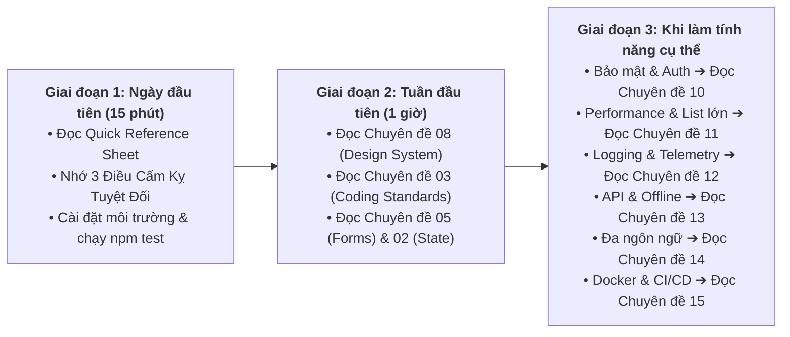

# 🚀 Quick Reference Sheet: Sổ Tay Tra Cứu Nhanh Chuẩn Frontend Doanh Nghiệp

> **Dành cho:** Kỹ sư Frontend mới gia nhập dự án, Reviewers kiểm tra Pull Request và AI Pair-programming Assistants.  
> **Mục tiêu:** Tra cứu nhanh quy chuẩn cốt lõi, công thức viết code chuẩn và checklist nghiệm thu PR trong 15 phút.  
> **Cổng vào tài liệu chuyên sâu:** [`FRONTEND_CONVENTIONS.md`](../FRONTEND_CONVENTIONS.md) | [`Bản đồ 15 Chuyên đề`](./README.md)  
> **Phiên bản:** 8.0 (Enterprise Quality Standard)

---

## MỤC LỤC
1. [Lộ Trình Đọc 3 Giai Đoạn (Onboarding Reading Path)](#1-lộ-trình-đọc-3-giai-đoạn-onboarding-reading-path)
2. [Checklist Nghiệm Thu PR 12 Tiêu Chí Vàng (Definition of Done)](#2-checklist-nghiệm-thu-pr-12-tiêu-chí-vàng-definition-of-done)
3. [Top 4 Công Thức Viết Mã Cốt Lõi (Cheat-Recipes)](#3-top-4-công-thức-viết-mã-cốt-lõi-cheat-recipes)
   - [Recipe 1: Tạo Component Mới Chuẩn CVA & Primitive Boundary](#recipe-1-tạo-component-mới-chuẩn-cva-primitive-boundary)
   - [Recipe 2: Tạo Biểu Mẫu Chuẩn Type-Safe Với Zod & Form Primitives](#recipe-2-tạo-biểu-mẫu-chuẩn-type-safe-với-zod-form-primitives)
   - [Recipe 3: Tạo Data-Fetching Hook Chuẩn TanStack Query & AbortController](#recipe-3-tạo-data-fetching-hook-chuẩn-tanstack-query-abortcontroller)
   - [Recipe 4: Viết Unit Test Chuẩn Vitest + React Testing Library](#recipe-4-viết-unit-test-chuẩn-vitest-react-testing-library)
4. [Bảng Tổng Hợp 11 Nhóm Tiền Tố Quy Chuẩn Doanh Nghiệp](#4-bảng-tổng-hợp-11-nhóm-tiền-tố-quy-chuẩn-doanh-nghiệp)
5. [Phụ Lục Tra Cứu Toàn Diện 106 Mã Quy Chuẩn (106 Rule ID Matrix)](#5-phụ-lục-tra-cứu-toàn-diện-106-mã-quy-chuẩn-106-rule-id-matrix)
6. [Các Lệnh CLI Hàng Ngày Cho Kỹ Sư](#6-các-lệnh-cli-hàng-ngày-cho-kỹ-sư)

---

## 1. Lộ Trình Đọc 3 Giai Đoạn (Onboarding Reading Path)

Hệ thống tài liệu bao gồm 17 chuyên đề với hàng ngàn dòng kiến trúc sâu rộng. Để tránh quá tải, bạn hãy tiếp cận theo 3 giai đoạn:



### 3 Điều Cấm Kỵ Cốt Lõi Cần Nhớ Ngay Ngày Đầu
1. 🔴 **Cấm dùng kiểu `any` và ép kiểu mù quáng (`as unknown as`)** ([`STD-TS-001`](./03-coding-standards.md#std-ts-001)).
2. 🔴 **Cấm dùng thẻ HTML native thô (`<button>`, `<input>`, `<form>`, `<select>`) trên các trang nghiệp vụ** — bắt buộc dùng UI Primitives ([`SEM-HTML-001`](./08-semantic-design-system.md#sem-html-001)).
3. 🔴 **Cấm hardcode mã màu HEX/RGB hoặc dùng class màu thô trong JSX** — bắt buộc dùng CSS Semantic Variables ([`SEM-TOKEN-002`](./08-semantic-design-system.md#sem-token-002) & [`06-styling-and-design-tokens.md`](./06-styling-and-design-tokens.md)).

---

## 2. Checklist Nghiệm Thu PR 12 Tiêu Chí Vàng (Definition of Done)

Sao chép khối markdown bên dưới dán trực tiếp vào phần mô tả của GitHub Pull Request trước khi yêu cầu Code Review:

```markdown
### PR Verification Checklist (12 Tiêu Chí Chuẩn Doanh Nghiệp)
- [ ] **1. Type Safety:** 100% code mới không dùng kiểu `any`; không ép kiểu cưỡng bức `as unknown as` (STD-TS-001).
- [ ] **2. Request Cancellation:** Mọi API fetch/search bất đồng bộ đều nhận và liên kết `signal: AbortSignal` (STD-ASYNC-001).
- [ ] **3. UTC Time:** Mọi mốc thời gian giao tiếp API đều là ISO-8601 UTC; hiển thị người dùng qua `formatDate` (STD-TIME-001).
- [ ] **4. Error Handling:** Xử lý lỗi theo mô hình RFC 9457/RFC 7807 (`ProblemDetailsError`), không throw string thô (STD-ERR-001).
- [ ] **5. File Size Limit:** Không có tệp `.tsx` nào vượt quá 250 dòng code (Single Responsibility) (STD-SIZE-001).
- [ ] **6. DisplayName:** 100% component sử dụng `forwardRef` đều khai báo tường minh `displayName` (STD-REF-001).
- [ ] **7. Pure Render:** Không mutate trực tiếp state/props; không tạo side-effect trong hàm render body (STD-PURE-001).
- [ ] **8. Debugging Clean:** Đã dọn sạch toàn bộ `console.log`, `debugger` và code rác thử nghiệm (STD-CLEAN-001).
- [ ] **9. Naming Symmetry:** Đặt tên đúng chuẩn: boolean (`is/has`), handler (`handle...`), prop callback (`on...`).
- [ ] **10. Primitive Boundary:** 100% tương tác giao diện thông qua UI Primitives (`<Button>`, `<Input>`, `<Form>`) (SEM-HTML-001).
- [ ] **11. Boy Scout Audit:** Lệnh `npm run audit:strict` đạt Exit Code 0, không làm tăng cảnh báo so với baseline snapshot.
- [ ] **12. Zero Regression:** Lệnh `npm run type-check` và `npm test` vượt qua 100% không phát sinh lỗi hồi quy.
```

---

## 3. Top 4 Công Thức Viết Mã Cốt Lõi (Cheat-Recipes)

<a id="recipe-1"></a>
### Recipe 1: Tạo Component Mới Chuẩn CVA & Primitive Boundary
Áp dụng cho mọi component giao diện có biến thể (variants).

* ❌ **Lỗi Thường Gặp (Anti-Pattern):** Dùng thẻ button thô, hardcode màu Tailwind, nhận prop `color="green"`.
* ✅ **Chuẩn Doanh Nghiệp (Semantic CVA Component):**

```tsx
import React, { forwardRef } from 'react';
import { cva, type VariantProps } from 'class-variance-authority';
import { cn } from '@/utils/cn';

const cardVariants = cva(
  'rounded-xl border transition-all duration-200 outline-none focus-visible:ring-2 focus-visible:ring-action-focus',
  {
    variants: {
      tone: {
        neutral: 'bg-surface-card border-surface-subtle text-surface-card-fg',
        accent: 'bg-surface-card border-brand-accent/40 text-brand-accent',
        danger: 'bg-status-danger-subtle border-status-danger-border text-status-danger-fg',
      },
      elevation: {
        flat: 'shadow-none',
        raised: 'shadow-sm hover:shadow-md',
      },
      padding: {
        sm: 'p-3',
        md: 'p-5',
        lg: 'p-8',
      },
    },
    defaultVariants: {
      tone: 'neutral',
      elevation: 'flat',
      padding: 'md',
    },
  }
);

export interface CardProps
  extends React.HTMLAttributes<HTMLDivElement>,
    VariantProps<typeof cardVariants> {
  children: React.ReactNode;
}

export const Card = forwardRef<HTMLDivElement, CardProps>(
  ({ className, tone, elevation, padding, children, ...props }, ref) => {
    return (
      <div
        ref={ref}
        className={cn(cardVariants({ tone, elevation, padding }), className)}
        {...props}
      >
        {children}
      </div>
    );
  }
);

Card.displayName = 'Card';
```

---

<a id="recipe-2"></a>
### Recipe 2: Tạo Biểu Mẫu Chuẩn Type-Safe Với Zod & Form Primitives
Áp dụng cho mọi màn hình nhập liệu thông tin.

* ❌ **Lỗi Thường Gặp (Anti-Pattern):** Dùng thẻ `<form>`, `<input>`, `<button>` native trần, tự quản lý lỗi bằng chuỗi string và `useState`.
* ✅ **Chuẩn Doanh Nghiệp (Bộ Ba Form Primitives + Zod):**

```tsx
import React from 'react';
import { useForm } from 'react-hook-form';
import { zodResolver } from '@hookform/resolvers/zod';
import { z } from 'zod';
import { SubmitButton } from '@/components/ui/actions'
import { Form, FormField } from '@/components/ui/forms'

const userProfileSchema = z.object({
  fullName: z.string().min(2, 'Họ và tên phải có ít nhất 2 ký tự'),
  email: z.string().email('Địa chỉ email không hợp lệ'),
  role: z.enum(['admin', 'member', 'guest'], { required_error: 'Vui lòng chọn vai trò' }),
});

type UserProfileFormValues = z.infer<typeof userProfileSchema>;

export const UserProfileForm: React.FC<{ onSubmit: (data: UserProfileFormValues) => Promise<void> }> = ({ onSubmit }) => {
  const form = useForm<UserProfileFormValues>({
    resolver: zodResolver(userProfileSchema),
    defaultValues: { fullName: '', email: '', role: 'member' },
    mode: 'onTouched',
  });

  const handleSubmit = async (values: UserProfileFormValues) => {
    await onSubmit(values);
  };

  return (
    <Form form={form} onSubmit={handleSubmit} className="space-y-4">
      <FormField
        control={form.control}
        name="fullName"
        label="Họ và tên"
        placeholder="Nguyễn Văn A"
        required
      />

      <FormField
        control={form.control}
        name="email"
        label="Địa chỉ Email"
        type="email"
        placeholder="user@example.com"
        required
      />

      <SubmitButton
        isLoading={form.formState.isSubmitting}
        tone="accent"
        emphasis="solid"
      >
        Lưu Thông Tin
      </SubmitButton>
    </Form>
  );
};
```

---

<a id="recipe-3"></a>
### Recipe 3: Tạo Data-Fetching Hook Chuẩn TanStack Query & AbortController
Áp dụng cho mọi API call nghiệp vụ.

* ❌ **Lỗi Thường Gặp (Anti-Pattern):** Dùng `useEffect` gọi `fetch()`/`axios` trực tiếp, không có Query Key Factory, không hủy request khi rời trang.
* ✅ **Chuẩn Doanh Nghiệp (TanStack Query v5 + AbortSignal):**

```ts
import { useQuery, useMutation, useQueryClient } from '@tanstack/react-query';
import { userService, type UserDto } from '@/services/user.service';

export const userQueryKeys = {
  all: ['users'] as const,
  lists: () => [...userQueryKeys.all, 'list'] as const,
  list: (filters: Record<string, unknown>) => [...userQueryKeys.lists(), filters] as const,
  details: () => [...userQueryKeys.all, 'detail'] as const,
  detail: (id: string) => [...userQueryKeys.details(), id] as const,
};

export function useUserDetail(userId: string) {
  return useQuery({
    queryKey: userQueryKeys.detail(userId),
    queryFn: ({ signal }) => userService.getById(userId, { signal }),
    enabled: Boolean(userId),
    staleTime: 5 * 60 * 1000, // 5 phút
  });
}

export function useUpdateUser() {
  const queryClient = useQueryClient();

  return useMutation({
    mutationFn: ({ id, data }: { id: string; data: Partial<UserDto> }) =>
      userService.update(id, data),
    onSuccess: (_, { id }) => {
      queryClient.invalidateQueries({ queryKey: userQueryKeys.detail(id) });
      queryClient.invalidateQueries({ queryKey: userQueryKeys.lists() });
    },
  });
}
```

---

<a id="recipe-4"></a>
### Recipe 4: Viết Unit Test Chuẩn Vitest + React Testing Library
Áp dụng cho mọi component hoặc UI feature.

* ❌ **Lỗi Thường Gặp (Anti-Pattern):** Truy vấn DOM bằng class name (`container.querySelector('.btn-primary')`), test chi tiết nội bộ thay vì vai trò người dùng.
* ✅ **Chuẩn Doanh Nghiệp (Accessible Queries + Testing Trophy):**

```tsx
import { describe, it, expect, vi } from 'vitest';
import { render, screen } from '@testing-library/react';
import userEvent from '@testing-library/user-event';
import { Card } from '@/components/ui/Card';

describe('Card Component (Unit)', () => {
  it('renders content with accessible semantics and respects custom tone', () => {
    render(
      <Card tone="accent" data-testid="test-card">
        <h3>Thông tin thẻ tập</h3>
        <p>Chi tiết gói tập VIP</p>
      </Card>
    );

    expect(screen.getByRole('heading', { level: 3, name: /thông tin thẻ tập/i })).toBeInTheDocument();
    expect(screen.getByText(/chi tiết gói tập vip/i)).toBeInTheDocument();
  });

  it('triggers user interaction correctly', async () => {
    const user = userEvent.setup();
    const handleClick = vi.fn();

    render(
      <Card onClick={handleClick} role="button" tabIndex={0}>
        Nhấn để chọn
      </Card>
    );

    const buttonCard = screen.getByRole('button', { name: /nhấn để chọn/i });
    await user.click(buttonCard);
    expect(handleClick).toHaveBeenCalledTimes(1);
  });
});
```

---

## 4. Bảng Tổng Hợp 11 Nhóm Tiền Tố Quy Chuẩn Doanh Nghiệp

Toàn bộ **135+ Quy chuẩn kỹ thuật** của hệ thống được phân loại theo 11 miền tiền tố quy chuẩn:

| Tiền Tố | Lĩnh Vực Chuyên Môn | Số Lượng Quy Tắc | Mức Độ Nghiêm Ngặt | Tài Liệu SSOT Chuyên Trách |
| :---: | :--- | :---: | :---: | :--- |
| **`STD-*`** | Coding Standards, TypeScript Strict, React 19 & JS Performance | 19 Quy tắc | 🔴 ERROR / 🟡 WARN | [`03-coding-standards.md`](./03-coding-standards.md) |
| **`SEM-*`** | Semantic Design System, Tokens, CVA & Governance | 23 Quy tắc | 🔴 ERROR / 🟡 WARN | [`08-semantic-design-system.md`](./08-semantic-design-system.md) |
| **`A11Y-*`**| W3C Accessibility WCAG 2.2 Level AA & Focus Ring | 12 Quy tắc | 🔴 ERROR / 🟡 WARN | [`09-accessibility.md`](./09-accessibility.md) |
| **`SEC-*`** | Frontend Security, OWASP, PII Masking & CSP | 11 Quy tắc | 🔴 ERROR | [`10-frontend-security-and-auth.md`](./10-frontend-security-and-auth.md) |
| **`PERF-*`**| Core Web Vitals, Virtualization, Bundle Budget & Content-Visibility | 13 Quy tắc | 🔴 ERROR / 🟡 WARN | [`11-performance-and-web-vitals.md`](./11-performance-and-web-vitals.md) |
| **`OBS-*`** | Observability, Structured Logging, Trace Context & Vercel RUM | 9 Quy tắc | 🔴 ERROR / 🟡 WARN | [`12-observability-and-telemetry.md`](./12-observability-and-telemetry.md) |
| **`API-*`** | API Resilience, RFC 7807, Backoff, Parallel Fetch & MSW | 12 Quy tắc | 🔴 ERROR / 🟡 WARN | [`13-api-contracts-and-resilience.md`](./13-api-contracts-and-resilience.md) |
| **`I18N-*`**| Internationalization, CLDR, Intl Formats & Hoisting | 9 Quy tắc | 🔴 ERROR / 🟡 WARN | [`14-internationalization-and-localization.md`](./14-internationalization-and-localization.md) |
| **`OPS-*`** | Multi-stage Docker, Nginx Hardening, SWR Edge & DevOps | 12 Quy tắc | 🔴 ERROR / 🟡 WARN | [`15-release-engineering-and-devops.md`](./15-release-engineering-and-devops.md) |
| **`MOTION-*`** | W3C View Transitions, Micro-interactions & Reduced Motion | 8 Quy tắc | 🔴 ERROR / 🟡 WARN | [`16-view-transitions-and-motion.md`](./16-view-transitions-and-motion.md) |
| **`MOB-*`** | Universal Mobile Architecture, LINE LIFF & React Native | 10 Quy tắc | 🔴 ERROR / 🟡 WARN | [`17-mobile-and-native-architecture.md`](./17-mobile-and-native-architecture.md) |

---

<a id="5-phụ-lục-tra-cứu-toàn-diện-102-mã-quy-chuẩn-102-rule-id-matrix"></a>
## 5. Phụ Lục Tra Cứu Toàn Diện 106 Mã Quy Chuẩn (106 Rule ID Matrix)

Dưới đây là danh mục chi tiết toàn bộ các quy chuẩn kỹ thuật để đối soát nhanh:

### 5.1. Nhóm Coding Standards & TypeScript Strict (`STD-*`)
| Mã Quy Chuẩn | Tên Ngắn & Trọng Tâm | Mức Độ | Tài Liệu SSOT |
| :---: | :--- | :---: | :--- |
| [`STD-TS-001`](./03-coding-standards.md#std-ts-001) | Cấm tuyệt đối kiểu `any` và ép kiểu `as unknown as` | 🔴 ERROR | [`03-coding-standards.md`](./03-coding-standards.md) |
| [`STD-TS-002`](./03-coding-standards.md#std-ts-002) | Khai báo tường minh kiểu trả về cho functions và hooks | 🟡 WARN | [`03-coding-standards.md`](./03-coding-standards.md) |
| [`STD-TS-003`](./03-coding-standards.md#std-ts-003) | Mô hình hóa trạng thái phức tạp bằng Discriminated Unions | 🟡 WARN | [`03-coding-standards.md`](./03-coding-standards.md) |
| [`STD-ASYNC-001`](./03-coding-standards.md#std-async-001) | Bắt buộc liên kết `signal: AbortSignal` cho request bất đồng bộ | 🔴 ERROR | [`03-coding-standards.md`](./03-coding-standards.md) |
| [`STD-TIME-001`](./03-coding-standards.md#std-time-001) | 100% thời gian lưu trữ/trao đổi là ISO-8601 UTC | 🔴 ERROR | [`03-coding-standards.md`](./03-coding-standards.md) |
| [`STD-TIME-002`](./03-coding-standards.md#std-time-002) | Định dạng ngày tháng hiển thị qua `Intl.DateTimeFormat` | 🔴 ERROR | [`03-coding-standards.md`](./03-coding-standards.md) |
| [`STD-ERR-001`](./03-coding-standards.md#std-err-001) | Cấu trúc hóa lỗi theo chuẩn quốc tế RFC 9457 / RFC 7807 | 🔴 ERROR | [`03-coding-standards.md`](./03-coding-standards.md) |
| [`STD-EXEMPT-001`](./03-coding-standards.md#std-exempt-001) | Cú pháp chú thích ngoại lệ chuẩn `rogym-convention-exempt` có `until:` | 🟡 WARN | [`03-coding-standards.md`](./03-coding-standards.md) |
| [`STD-MEMO-001`](./03-coding-standards.md#std-memo-001) | Quy tắc sử dụng `useMemo` & `useCallback` có đo lường | 🟡 WARN | [`03-coding-standards.md`](./03-coding-standards.md) |
| [`STD-CLEAN-001`](./03-coding-standards.md#std-clean-001) | Cấm `console.log` và `debugger` trong mã nguồn sản phẩm | 🔴 ERROR | [`03-coding-standards.md`](./03-coding-standards.md) |
| [`STD-REF-001`](./03-coding-standards.md#std-ref-001) | Khai báo `displayName` bắt buộc cho mọi component `forwardRef` | 🔴 ERROR | [`03-coding-standards.md`](./03-coding-standards.md) |
| [`STD-SIZE-001`](./03-coding-standards.md#std-size-001) | Giới hạn dung lượng tệp `.tsx` không vượt quá 250 dòng | 🟡 WARN | [`03-coding-standards.md`](./03-coding-standards.md) |
| [`STD-MAGIC-001`](./03-coding-standards.md#std-magic-001) | Cấm kích thước pixel tùy tiện và magic z-index | 🟡 WARN | [`03-coding-standards.md`](./03-coding-standards.md) |
| [`STD-PURE-001`](./03-coding-standards.md#std-pure-001) | Đảm bảo tính thuần khiết (Pure Rendering) và bất biến của state | 🔴 ERROR | [`03-coding-standards.md`](./03-coding-standards.md) |
| [`STD-NAME-001`](./03-coding-standards.md#std-name-001) | Quy ước đặt tên đối xứng: boolean `is/has`, event handler `handle/on` | 🟡 WARN | [`03-coding-standards.md`](./03-coding-standards.md) |
| [`STD-VCL-001`](./03-coding-standards.md#std-vcl-001) | Toán tử điều kiện JSX: ternary `? : null` thay vì `&&` `[rendering-conditional-render]` | 🔴 ERROR | [`03-coding-standards.md`](./03-coding-standards.md) |

### 5.2. Nhóm Semantic Design System & CVA (`SEM-*`)
| Mã Quy Chuẩn | Tên Ngắn & Trọng Tâm | Mức Độ | Tài Liệu SSOT |
| :---: | :--- | :---: | :--- |
| [`SEM-HTML-001`](./08-semantic-design-system.md#sem-html-001) | Cấm thẻ tương tác thô ngoài thư mục UI & Shared | 🔴 ERROR | [`08-semantic-design-system.md`](./08-semantic-design-system.md) |
| [`SEM-HTML-002`](./08-semantic-design-system.md#sem-html-002) | Hạn chế thẻ phi ngữ nghĩa (`div`, `span`) thiếu chú thích | 🟡 WARN | [`08-semantic-design-system.md`](./08-semantic-design-system.md) |
| [`SEM-HTML-003`](./08-semantic-design-system.md#sem-html-003) | Vai trò ARIA và bàn phím cho sự kiện click trên thẻ thô | 🟡 WARN | [`08-semantic-design-system.md`](./08-semantic-design-system.md) |
| [`SEM-TOKEN-001`](./08-semantic-design-system.md#sem-token-001) | 100% mã màu HEX ở tầng Primitive Tokens CSS | 🔴 ERROR | [`08-semantic-design-system.md`](./08-semantic-design-system.md) |
| [`SEM-TOKEN-002`](./08-semantic-design-system.md#sem-token-002) | Cấm mã màu HEX/RGB trực tiếp trong JSX/TSX | 🔴 ERROR | [`08-semantic-design-system.md`](./08-semantic-design-system.md) |
| [`SEM-TOKEN-003`](./08-semantic-design-system.md#sem-token-003) | Cấm sử dụng inline styles cho màu sắc và kích thước | 🟡 WARN | [`08-semantic-design-system.md`](./08-semantic-design-system.md) |
| [`SEM-TOKEN-004`](./08-semantic-design-system.md#sem-token-004) | Cấm tạo token màu cục bộ gắn chặt tên component | 🟡 WARN | [`08-semantic-design-system.md`](./08-semantic-design-system.md) |
| [`SEM-TOKEN-005`](./08-semantic-design-system.md#sem-token-005) | Cấm sử dụng Primitive Tokens trực tiếp trong component | 🟡 WARN | [`08-semantic-design-system.md`](./08-semantic-design-system.md) |
| [`SEM-TOKEN-006`](./08-semantic-design-system.md#sem-token-006) | Cấm sử dụng class palette màu thô của Tailwind | 🟡 WARN | [`08-semantic-design-system.md`](./08-semantic-design-system.md) |
| [`SEM-TOKEN-007`](./08-semantic-design-system.md#sem-token-007) | Cấm modifier `/opacity` trên Primitive Tokens | 🟡 WARN | [`08-semantic-design-system.md`](./08-semantic-design-system.md) |
| [`SEM-TOKEN-008`](./08-semantic-design-system.md#sem-token-008) | Đối xứng 100% biến màu giữa Dark Mode và Light Mode | 🟡 WARN | [`08-semantic-design-system.md`](./08-semantic-design-system.md) |
| [`SEM-TOKEN-009`](./08-semantic-design-system.md#sem-token-009) | Cấm tiền tố `dark:` thủ công trong JSX | 🟡 WARN | [`08-semantic-design-system.md`](./08-semantic-design-system.md) |
| [`SEM-TOKEN-010`](./08-semantic-design-system.md#sem-token-010) | Thang Z-index 5 tầng chuẩn doanh nghiệp (`z-0` đến `z-100`) | 🟡 WARN | [`08-semantic-design-system.md`](./08-semantic-design-system.md) |
| [`SEM-TOKEN-011`](./08-semantic-design-system.md#sem-token-011) | Thang kích thước và khoảng cách tuân thủ bội số 4px | 🟡 WARN | [`08-semantic-design-system.md`](./08-semantic-design-system.md) |
| [`SEM-PROPS-001`](./08-semantic-design-system.md#sem-props-001) | CVA Multi-Axis: Chuẩn hóa trục `tone` | 🟡 WARN | [`08-semantic-design-system.md`](./08-semantic-design-system.md) |
| [`SEM-PROPS-002`](./08-semantic-design-system.md#sem-props-002) | Cấm prop `color` và `bgColor` trực tiếp | 🟡 WARN | [`08-semantic-design-system.md`](./08-semantic-design-system.md) |
| [`SEM-PROPS-003`](./08-semantic-design-system.md#sem-props-003) | Chuẩn hóa enum `tone` từ `variants.ts` | 🟡 WARN | [`08-semantic-design-system.md`](./08-semantic-design-system.md) |
| [`SEM-PROPS-004`](./08-semantic-design-system.md#sem-props-004) | Đóng gói component nghiệp vụ theo vai trò ngữ nghĩa | 🟡 WARN | [`08-semantic-design-system.md`](./08-semantic-design-system.md) |
| [`SEM-PROPS-010`](./08-semantic-design-system.md#sem-props-010) | Khai báo `displayName` bắt buộc cho `forwardRef` | 🔴 ERROR | [`08-semantic-design-system.md`](./08-semantic-design-system.md) |
| [`SEM-PROPS-011`](./08-semantic-design-system.md#sem-props-011) | Cấm dùng chỉ số mảng `key={index}` khi render danh sách động | 🟡 WARN | [`08-semantic-design-system.md`](./08-semantic-design-system.md) |
| [`SEM-PROPS-012`](./08-semantic-design-system.md#sem-props-012) | Cấm rò rỉ số 0 ra giao diện qua toán tử `count && <Component />` | 🔴 ERROR | [`08-semantic-design-system.md`](./08-semantic-design-system.md) |
| [`SEM-PROPS-013`](./08-semantic-design-system.md#sem-props-013) | Cấm nhúng thẻ `<svg>` raw trực tiếp trên trang | 🟡 WARN | [`08-semantic-design-system.md`](./08-semantic-design-system.md) |
| [`SEM-GOV-001`](./08-semantic-design-system.md#sem-gov-001) | Ngoại lệ bắt buộc có lý do kỹ thuật và hạn sử dụng `until` | 🟡 WARN | [`08-semantic-design-system.md`](./08-semantic-design-system.md) |

### 5.3. Nhóm Accessibility WCAG 2.2 AA (`A11Y-*`)
| Mã Quy Chuẩn | Tên Ngắn & Trọng Tâm | Mức Độ | Tài Liệu SSOT |
| :---: | :--- | :---: | :--- |
| [`A11Y-001`](./09-accessibility.md#a11y-001) | Tương phản màu sắc đạt tối thiểu 4.5:1 (WCAG AA) | 🔴 ERROR | [`09-accessibility.md`](./09-accessibility.md) |
| [`A11Y-002`](./09-accessibility.md#a11y-002) | Vùng chạm cảm ứng di động tối thiểu $44 \times 44\text{px}$ | 🟡 WARN | [`09-accessibility.md`](./09-accessibility.md) |
| [`A11Y-003`](./09-accessibility.md#a11y-003) | Cấu trúc vùng địa Landmark (`<main>`, `<nav>`) & Skip-link | 🔴 ERROR | [`09-accessibility.md`](./09-accessibility.md) |
| [`A11Y-004`](./09-accessibility.md#a11y-004) | Phân cấp tiêu đề H1-H6 tuyến tính, không nhảy cóc | 🟡 WARN | [`09-accessibility.md`](./09-accessibility.md) |
| [`A11Y-005`](./09-accessibility.md#a11y-005) | 100% thẻ `` có thuộc tính `alt` mô tả chính xác | 🟡 WARN | [`09-accessibility.md`](./09-accessibility.md) |
| [`A11Y-006`](./09-accessibility.md#a11y-006) | Nối liên kết khả năng tiếp cận (A11y) Form controls (`id` $\leftrightarrow$ `htmlFor`, `aria-describedby`) | 🟡 WARN | [`09-accessibility.md`](./09-accessibility.md) |
| [`A11Y-007`](./09-accessibility.md#a11y-007) | Cấm `outline: none` thiếu viền tiêu điểm `:focus-visible` | 🔴 ERROR | [`09-accessibility.md`](./09-accessibility.md) |
| [`A11Y-008`](./09-accessibility.md#a11y-008) | Điều hướng bàn phím đầy đủ, không gây bẫy bàn phím | 🔴 ERROR | [`09-accessibility.md`](./09-accessibility.md) |
| [`A11Y-009`](./09-accessibility.md#a11y-009) | ARIA Live Regions (`polite` / `assertive`) cho nội dung động | 🟡 WARN | [`09-accessibility.md`](./09-accessibility.md) |
| [`A11Y-010`](./09-accessibility.md#a11y-010) | Hỗ trợ triệt tiêu hoạt họa qua `prefers-reduced-motion` | 🟡 WARN | [`09-accessibility.md`](./09-accessibility.md) |
| [`A11Y-011`](./09-accessibility.md#a11y-011) | Cấm dùng màu sắc làm phương tiện duy nhất để biểu đạt trạng thái | 🟡 WARN | [`09-accessibility.md`](./09-accessibility.md) |
| [`A11Y-012`](./09-accessibility.md#a11y-012) | Kiểm thử tự động qua `vitest-axe` với kết quả 0 violations | 🔴 ERROR | [`09-accessibility.md`](./09-accessibility.md) |

### 5.4. Nhóm Frontend Security & Auth (`SEC-*`)
| Mã Quy Chuẩn | Tên Ngắn & Trọng Tâm | Mức Độ | Tài Liệu SSOT |
| :---: | :--- | :---: | :--- |
| [`SEC-001`](./10-frontend-security-and-auth.md#sec-001) | Cấm render HTML thô không qua `DOMPurify.sanitize()` | 🔴 ERROR | [`10-frontend-security-and-auth.md`](./10-frontend-security-and-auth.md) |
| [`SEC-002`](./10-frontend-security-and-auth.md#sec-002) | Cấu hình Content Security Policy (CSP) chặt chẽ | 🔴 ERROR | [`10-frontend-security-and-auth.md`](./10-frontend-security-and-auth.md) |
| [`SEC-003`](./10-frontend-security-and-auth.md#sec-003) | Quản trị token an toàn (In-Memory Access Token + HttpOnly Cookie) | 🔴 ERROR | [`10-frontend-security-and-auth.md`](./10-frontend-security-and-auth.md) |
| [`SEC-004`](./10-frontend-security-and-auth.md#sec-004) | Che giấu thông tin định danh cá nhân nhạy cảm (PII Masking) | 🔴 ERROR | [`10-frontend-security-and-auth.md`](./10-frontend-security-and-auth.md) |
| [`SEC-005`](./10-frontend-security-and-auth.md#sec-005) | Phòng chống tấn công Clickjacking (`X-Frame-Options: DENY`) | 🔴 ERROR | [`10-frontend-security-and-auth.md`](./10-frontend-security-and-auth.md) |
| [`SEC-006`](./10-frontend-security-and-auth.md#sec-006) | Phòng chống DOM Clobbering & Prototype Pollution | 🟡 WARN | [`10-frontend-security-and-auth.md`](./10-frontend-security-and-auth.md) |
| [`SEC-007`](./10-frontend-security-and-auth.md#sec-007) | Bảo mật liên kết tab mới: `rel="noopener noreferrer"` | 🔴 ERROR | [`10-frontend-security-and-auth.md`](./10-frontend-security-and-auth.md) |
| [`SEC-008`](./10-frontend-security-and-auth.md#sec-008) | Cơ chế Mutex Queue cho Refresh Token chống race condition | 🔴 ERROR | [`10-frontend-security-and-auth.md`](./10-frontend-security-and-auth.md) |
| [`SEC-009`](./10-frontend-security-and-auth.md#sec-009) | Kiểm soát CORS nghiêm ngặt & Headers bảo mật HSTS | 🔴 ERROR | [`10-frontend-security-and-auth.md`](./10-frontend-security-and-auth.md) |
| [`SEC-010`](./10-frontend-security-and-auth.md#sec-010) | Hủy phiên đăng xuất sạch sẽ (State + Cache + Server Cookie) | 🔴 ERROR | [`10-frontend-security-and-auth.md`](./10-frontend-security-and-auth.md) |
| [`SEC-011`](./10-frontend-security-and-auth.md#sec-011) / `SEC-VCL-001` | Xác thực quyền hạn phía server cho mọi mutation `[server-auth-actions]` | 🔴 ERROR | [`10-frontend-security-and-auth.md`](./10-frontend-security-and-auth.md) |

### 5.5. Nhóm Performance & Core Web Vitals (`PERF-*`)
| Mã Quy Chuẩn | Tên Ngắn & Trọng Tâm | Mức Độ | Tài Liệu SSOT |
| :---: | :--- | :---: | :--- |
| [`PERF-001`](./11-performance-and-web-vitals.md#perf-001) | Đạt ngưỡng Core Web Vitals: $LCP \le 2.5s$, $INP \le 200ms$, $CLS \le 0.1$ | 🔴 ERROR | [`11-performance-and-web-vitals.md`](./11-performance-and-web-vitals.md) |
| [`PERF-002`](./11-performance-and-web-vitals.md#perf-002) | Ngân sách Initial JS Bundle $\le 180\text{KB}$ (gzip) | 🔴 ERROR | [`11-performance-and-web-vitals.md`](./11-performance-and-web-vitals.md) |
| [`PERF-003`](./11-performance-and-web-vitals.md#perf-003) | Phân tách tuyến đường qua `lazyWithRetry()` và `<Suspense>` | 🔴 ERROR | [`11-performance-and-web-vitals.md`](./11-performance-and-web-vitals.md) |
| [`PERF-004`](./11-performance-and-web-vitals.md#perf-004) | Bắt buộc ảo hóa danh sách/bảng vượt quá 100 phần tử | 🔴 ERROR | [`11-performance-and-web-vitals.md`](./11-performance-and-web-vitals.md) |
| [`PERF-005`](./11-performance-and-web-vitals.md#perf-005) | Tối ưu hình ảnh WebP/AVIF, lazy loading và kích thước cố định | 🟡 WARN | [`11-performance-and-web-vitals.md`](./11-performance-and-web-vitals.md) |
| [`PERF-006`](./11-performance-and-web-vitals.md#perf-006) | Quy tắc dùng `useMemo`/`useCallback` cho tác vụ nặng | 🟡 WARN | [`11-performance-and-web-vitals.md`](./11-performance-and-web-vitals.md) |
| [`PERF-007`](./11-performance-and-web-vitals.md#perf-007) | Preload Web Fonts WOFF2 và chỉ thị `font-display: swap` | 🟡 WARN | [`11-performance-and-web-vitals.md`](./11-performance-and-web-vitals.md) |
| [`PERF-008`](./11-performance-and-web-vitals.md#perf-008) | Tách biệt thao tác đọc/ghi DOM chống Layout Thrashing | 🟡 WARN | [`11-performance-and-web-vitals.md`](./11-performance-and-web-vitals.md) |
| [`PERF-009`](./11-performance-and-web-vitals.md#perf-009) | Atomic Selectors cho Zustand (`s => s.user`) chống re-render | 🟡 WARN | [`11-performance-and-web-vitals.md`](./11-performance-and-web-vitals.md) |
| [`PERF-010`](./11-performance-and-web-vitals.md#perf-010) | Cấm nhập monolithic libraries lớn (dùng ES modular tree-shaking) | 🔴 ERROR | [`11-performance-and-web-vitals.md`](./11-performance-and-web-vitals.md) |
| [`PERF-011`](./11-performance-and-web-vitals.md#perf-011) / `PERF-VCL-002` | Tối ưu bỏ qua layout ngoài viewport (Below the fold) `[rendering-content-visibility]` | 🟡 WARN | [`11-performance-and-web-vitals.md`](./11-performance-and-web-vitals.md) |
| [`PERF-012`](./11-performance-and-web-vitals.md#perf-012) / `PERF-VCL-003` | Hoisting phần tử JSX tĩnh khỏi render scope `[rendering-hoist-jsx]` | 🟡 WARN | [`11-performance-and-web-vitals.md`](./11-performance-and-web-vitals.md) |
| [`PERF-013`](./11-performance-and-web-vitals.md#perf-013) / `PERF-VCL-004` | Trì hoãn script bên thứ ba đến khi rảnh rỗi `[bundle-defer-third-party]` | 🔴 ERROR | [`11-performance-and-web-vitals.md`](./11-performance-and-web-vitals.md) |

### 5.6. Nhóm Observability & Telemetry (`OBS-*`)
| Mã Quy Chuẩn | Tên Ngắn & Trọng Tâm | Mức Độ | Tài Liệu SSOT |
| :---: | :--- | :---: | :--- |
| [`OBS-001`](./12-observability-and-telemetry.md#obs-001) | Bắt lỗi tập trung toàn cục (Unhandled Rejections + React Errors) | 🔴 ERROR | [`12-observability-and-telemetry.md`](./12-observability-and-telemetry.md) |
| [`OBS-002`](./12-observability-and-telemetry.md#obs-002) | Gắn header chuẩn W3C TraceContext (`traceparent`) vào 100% API | 🔴 ERROR | [`12-observability-and-telemetry.md`](./12-observability-and-telemetry.md) |
| [`OBS-003`](./12-observability-and-telemetry.md#obs-003) | Cấu hình Sentry phân cấp môi trường (Production/Staging sampling) | 🟡 WARN | [`12-observability-and-telemetry.md`](./12-observability-and-telemetry.md) |
| [`OBS-004`](./12-observability-and-telemetry.md#obs-004) | Bộ lọc làm sạch PII (`beforeSend`) trước khi gửi telemetry log | 🔴 ERROR | [`12-observability-and-telemetry.md`](./12-observability-and-telemetry.md) |
| [`OBS-005`](./12-observability-and-telemetry.md#obs-005) | Ghi log qua `EnterpriseLogger` phân cấp chuẩn RFC 5424 | 🟡 WARN | [`12-observability-and-telemetry.md`](./12-observability-and-telemetry.md) |
| [`OBS-006`](./12-observability-and-telemetry.md#obs-006) | Thu thập chỉ số trải nghiệm người dùng thực (RUM) qua `sendBeacon` | 🟡 WARN | [`12-observability-and-telemetry.md`](./12-observability-and-telemetry.md) |
| [`OBS-007`](./12-observability-and-telemetry.md#obs-007) | Chỉ log Plain Objects (POJO), cấm đối tượng vòng (Circular DOM) | 🟡 WARN | [`12-observability-and-telemetry.md`](./12-observability-and-telemetry.md) |
| [`OBS-008`](./12-observability-and-telemetry.md#obs-008) | Tự động loại bỏ console log debug trong bản build Production | 🔴 ERROR | [`12-observability-and-telemetry.md`](./12-observability-and-telemetry.md) |
| [`OBS-009`](./12-observability-and-telemetry.md#obs-009) / `OBS-VCL-001` | Đo lường từ xa (Telemetry / RUM) qua Vercel Analytics & Speed Insights `[client-rum-telemetry]` | 🟡 WARN | [`12-observability-and-telemetry.md`](./12-observability-and-telemetry.md) |

### 5.7. Nhóm API Contracts & Resilience (`API-*`)
| Mã Quy Chuẩn | Tên Ngắn & Trọng Tâm | Mức Độ | Tài Liệu SSOT |
| :---: | :--- | :---: | :--- |
| [`API-001`](./13-api-contracts-and-resilience.md#api-001) | Phát triển Contract-First đồng bộ TypeScript DTO từ OpenAPI | 🔴 ERROR | [`13-api-contracts-and-resilience.md`](./13-api-contracts-and-resilience.md) |
| [`API-002`](./13-api-contracts-and-resilience.md#api-002) | Chuẩn hóa schema phản hồi lỗi API theo chuẩn RFC 7807 / RFC 9457 | 🔴 ERROR | [`13-api-contracts-and-resilience.md`](./13-api-contracts-and-resilience.md) |
| [`API-003`](./13-api-contracts-and-resilience.md#api-003) | Tiếp nhận và chuyển tiếp `signal: AbortSignal` trong API services | 🔴 ERROR | [`13-api-contracts-and-resilience.md`](./13-api-contracts-and-resilience.md) |
| [`API-004`](./13-api-contracts-and-resilience.md#api-004) | Thử lại thích ứng với Exponential Backoff và Full Jitter | 🟡 WARN | [`13-api-contracts-and-resilience.md`](./13-api-contracts-and-resilience.md) |
| [`API-005`](./13-api-contracts-and-resilience.md#api-005) | Giám sát kết nối mạng (`useNetworkStatus`) cảnh báo người dùng | 🟡 WARN | [`13-api-contracts-and-resilience.md`](./13-api-contracts-and-resilience.md) |
| [`API-006`](./13-api-contracts-and-resilience.md#api-006) | Hàng đợi thao tác ngoại tuyến (Offline Mutations Queue) | 🟡 WARN | [`13-api-contracts-and-resilience.md`](./13-api-contracts-and-resilience.md) |
| [`API-007`](./13-api-contracts-and-resilience.md#api-007) | Cấm hardcode endpoint URL trong components (qua Service Layer) | 🔴 ERROR | [`13-api-contracts-and-resilience.md`](./13-api-contracts-and-resilience.md) |
| [`API-008`](./13-api-contracts-and-resilience.md#api-008) | Xác thực dữ liệu phản hồi API bằng Zod schema tại Service | 🟡 WARN | [`13-api-contracts-and-resilience.md`](./13-api-contracts-and-resilience.md) |
| [`API-009`](./13-api-contracts-and-resilience.md#api-009) | Phân tầng cấu hình `staleTime` theo đặc thù dữ liệu nghiệp vụ | 🟡 WARN | [`13-api-contracts-and-resilience.md`](./13-api-contracts-and-resilience.md) |
| [`API-010`](./13-api-contracts-and-resilience.md#api-010) | Chuẩn hóa Mock Service Worker (MSW 2.0) chặn ở tầng mạng | 🔴 ERROR | [`13-api-contracts-and-resilience.md`](./13-api-contracts-and-resilience.md) |
| [`API-011`](./13-api-contracts-and-resilience.md#api-011) / `API-VCL-001` | Triệt tiêu thác nước qua parallel fetching `[server-parallel-fetching]` | 🔴 ERROR | [`13-api-contracts-and-resilience.md`](./13-api-contracts-and-resilience.md) |
| [`API-012`](./13-api-contracts-and-resilience.md#api-012) / `API-VCL-002` | Khử trùng lặp request tại client `[client-swr-deduping]` | 🟡 WARN | [`13-api-contracts-and-resilience.md`](./13-api-contracts-and-resilience.md) |

### 5.8. Nhóm Internationalization & Localization (`I18N-*`)
| Mã Quy Chuẩn | Tên Ngắn & Trọng Tâm | Mức Độ | Tài Liệu SSOT |
| :---: | :--- | :---: | :--- |
| [`I18N-001`](./14-internationalization-and-localization.md#i18n-001) | Cấm văn bản tự nhiên thô trong JSX (100% qua `t()`) | 🔴 ERROR | [`14-internationalization-and-localization.md`](./14-internationalization-and-localization.md) |
| [`I18N-002`](./14-internationalization-and-localization.md#i18n-002) | Cấu trúc khóa dịch phân cấp 4 tầng `[feature].[screen].[sec].[elem]` | 🟡 WARN | [`14-internationalization-and-localization.md`](./14-internationalization-and-localization.md) |
| [`I18N-003`](./14-internationalization-and-localization.md#i18n-003) | Bản địa hóa tiền tệ qua `Intl.NumberFormat` với mã ISO chuẩn | 🔴 ERROR | [`14-internationalization-and-localization.md`](./14-internationalization-and-localization.md) |
| [`I18N-004`](./14-internationalization-and-localization.md#i18n-004) | Bản địa hóa ngày giờ qua `Intl.DateTimeFormat` xác định timezone | 🔴 ERROR | [`14-internationalization-and-localization.md`](./14-internationalization-and-localization.md) |
| [`I18N-005`](./14-internationalization-and-localization.md#i18n-005) | Bố cục đa hướng tương thích RTL bằng CSS Logical Properties | 🟡 WARN | [`14-internationalization-and-localization.md`](./14-internationalization-and-localization.md) |
| [`I18N-006`](./14-internationalization-and-localization.md#i18n-006) | Tách từ điển theo module và nạp động on-demand khi routing | 🟡 WARN | [`14-internationalization-and-localization.md`](./14-internationalization-and-localization.md) |
| [`I18N-007`](./14-internationalization-and-localization.md#i18n-007) | Quy chuẩn Pluralization (`_zero`, `_one`, `_other`) & nội suy biến | 🟡 WARN | [`14-internationalization-and-localization.md`](./14-internationalization-and-localization.md) |
| [`I18N-008`](./14-internationalization-and-localization.md#i18n-008) | Chuỗi fallback đa tầng và type-safe autocomplete cho khóa dịch | 🟡 WARN | [`14-internationalization-and-localization.md`](./14-internationalization-and-localization.md) |
| [`I18N-009`](./14-internationalization-and-localization.md#i18n-009) / `I18N-VCL-001` | Hoisting instance `Intl.*` khỏi vòng lặp render `[js-hoist-intl]` | 🔴 ERROR | [`14-internationalization-and-localization.md`](./14-internationalization-and-localization.md) |

### 5.9. Nhóm DevOps Frontend & Release Engineering (`OPS-*`)
| Mã Quy Chuẩn | Tên Ngắn & Trọng Tâm | Mức Độ | Tài Liệu SSOT |
| :---: | :--- | :---: | :--- |
| [`OPS-001`](./15-release-engineering-and-devops.md#ops-001) | Xác thực biến môi trường chặt chẽ bằng Zod (Fail-Fast Env) | 🔴 ERROR | [`15-release-engineering-and-devops.md`](./15-release-engineering-and-devops.md) |
| [`OPS-002`](./15-release-engineering-and-devops.md#ops-002) | Đóng gói Docker SPA đa tầng (Node Builder + Nginx Runner $\le 35\text{MB}$) | 🔴 ERROR | [`15-release-engineering-and-devops.md`](./15-release-engineering-and-devops.md) |
| [`OPS-003`](./15-release-engineering-and-devops.md#ops-003) | Cấu hình Nginx `try_files` SPA routing fallback và nén Gzip | 🔴 ERROR | [`15-release-engineering-and-devops.md`](./15-release-engineering-and-devops.md) |
| [`OPS-004`](./15-release-engineering-and-devops.md#ops-004) | Phân tầng Cache-Busting (`index.html`: `no-cache`, `assets`: `1 year`) | 🔴 ERROR | [`15-release-engineering-and-devops.md`](./15-release-engineering-and-devops.md) |
| [`OPS-005`](./15-release-engineering-and-devops.md#ops-005) | Trả về đầy đủ Security Headers bảo vệ ứng dụng (`nosniff`, `SAMEORIGIN`) | 🔴 ERROR | [`15-release-engineering-and-devops.md`](./15-release-engineering-and-devops.md) |
| [`OPS-006`](./15-release-engineering-and-devops.md#ops-006) | Quản trị Feature Flags tập trung hỗ trợ override qua URL query | 🟡 WARN | [`15-release-engineering-and-devops.md`](./15-release-engineering-and-devops.md) |
| [`OPS-007`](./15-release-engineering-and-devops.md#ops-007) | Đánh phiên bản SemVer 2.0 và kiểm soát Conventional Commits | 🟡 WARN | [`15-release-engineering-and-devops.md`](./15-release-engineering-and-devops.md) |
| [`OPS-008`](./15-release-engineering-and-devops.md#ops-008) | Điểm kiểm tra sức khỏe máy chủ web Nginx (`/healthz` HTTP 200) | 🟡 WARN | [`15-release-engineering-and-devops.md`](./15-release-engineering-and-devops.md) |
| [`OPS-009`](./15-release-engineering-and-devops.md#ops-009) | Tiêm cấu hình runtime `window.__RUNTIME_CONFIG__` không cần rebuild | 🟡 WARN | [`15-release-engineering-and-devops.md`](./15-release-engineering-and-devops.md) |
| [`OPS-010`](./15-release-engineering-and-devops.md#ops-010) | Chốt chặn kiểm toán lỗ hổng `npm audit` và giới hạn bundle size trong CI | 🔴 ERROR | [`15-release-engineering-and-devops.md`](./15-release-engineering-and-devops.md) |
| [`OPS-011`](./15-release-engineering-and-devops.md#ops-011) / `DEVOPS-VCL-001` | Bộ đệm biên mạng stale-while-revalidate `[server-cache-swr]` | 🟡 WARN | [`15-release-engineering-and-devops.md`](./15-release-engineering-and-devops.md) |
| [`OPS-012`](./15-release-engineering-and-devops.md#ops-012) / `DEVOPS-VCL-002` | Bảo mật triển khai Vercel Production & Token Hygiene | 🔴 ERROR | [`15-release-engineering-and-devops.md`](./15-release-engineering-and-devops.md) |

### 5.10. Nhóm View Transitions & Motion Kỹ Thuật (`MOTION-*`)
| Mã Quy Chuẩn | Tên Ngắn & Trọng Tâm | Mức Độ | Tài Liệu SSOT |
| :---: | :--- | :---: | :--- |
| [`MOTION-001`](./16-view-transitions-and-motion.md#motion-001) | Bọc chuyển cảnh qua API W3C `document.startViewTransition()` | 🔴 ERROR | [`16-view-transitions-and-motion.md`](./16-view-transitions-and-motion.md) |
| [`MOTION-002`](./16-view-transitions-and-motion.md#motion-002) | Định danh `view-transition-name` duy nhất trên trang | 🔴 ERROR | [`16-view-transitions-and-motion.md`](./16-view-transitions-and-motion.md) |
| [`MOTION-003`](./16-view-transitions-and-motion.md#motion-003) | Khử bỏ layout thrashing: chỉ chuyển động qua `transform` & `opacity` | 🔴 ERROR | [`16-view-transitions-and-motion.md`](./16-view-transitions-and-motion.md) |
| [`MOTION-004`](./16-view-transitions-and-motion.md#motion-004) | Phân tầng ưu tiên chuyển động 4 bậc (Interactive > Layout > Page > Ambient) | 🟡 WARN | [`16-view-transitions-and-motion.md`](./16-view-transitions-and-motion.md) |
| [`MOTION-005`](./16-view-transitions-and-motion.md#motion-005) | Thời lượng chuyển động vi mô nằm trong khoảng $150\text{ms} - 300\text{ms}$ | 🟡 WARN | [`16-view-transitions-and-motion.md`](./16-view-transitions-and-motion.md) |
| [`MOTION-006`](./16-view-transitions-and-motion.md#motion-006) | Sử dụng đường cong gia tốc chuẩn (Easing Curves): Ease-out & Ease-in-out | 🟡 WARN | [`16-view-transitions-and-motion.md`](./16-view-transitions-and-motion.md) |
| [`MOTION-007`](./16-view-transitions-and-motion.md#motion-007) | FLIP Animation cho sắp xếp, lọc và thêm/xóa phần tử trong danh sách | 🟡 WARN | [`16-view-transitions-and-motion.md`](./16-view-transitions-and-motion.md) |
| [`MOTION-008`](./16-view-transitions-and-motion.md#motion-008) | Bắt buộc hỗ trợ `@media (prefers-reduced-motion: reduce)` | 🔴 ERROR | [`16-view-transitions-and-motion.md`](./16-view-transitions-and-motion.md) |

### 5.11. Nhóm Kiến Trúc Di Động Đa Nền Tảng & React Native (`MOB-*`)
| Mã Quy Chuẩn | Tên Ngắn & Trọng Tâm | Mức Độ | Tài Liệu SSOT |
| :---: | :--- | :---: | :--- |
| [`MOB-001`](./17-mobile-and-native-architecture.md#mob-001) | Universal Component Tree phân tách Platform-specific qua `.web.tsx` / `.native.tsx` | 🔴 ERROR | [`17-mobile-and-native-architecture.md`](./17-mobile-and-native-architecture.md) |
| [`MOB-002`](./17-mobile-and-native-architecture.md#mob-002) | Vùng chạm cảm ứng di động tối thiểu $44 \times 44\text{px}$ (`min-h-[44px]`) | 🔴 ERROR | [`17-mobile-and-native-architecture.md`](./17-mobile-and-native-architecture.md) |
| [`MOB-003`](./17-mobile-and-native-architecture.md#mob-003) | Hiệu ứng chuyển động chạy trên GPU (`transform` / `opacity`), bật `useNativeDriver` | 🔴 ERROR | [`17-mobile-and-native-architecture.md`](./17-mobile-and-native-architecture.md) |
| [`MOB-004`](./17-mobile-and-native-architecture.md#mob-004) | Ảo hóa danh sách di động bắt buộc qua `FlashList` hoặc `@tanstack/react-virtual` | 🔴 ERROR | [`17-mobile-and-native-architecture.md`](./17-mobile-and-native-architecture.md) |
| [`MOB-005`](./17-mobile-and-native-architecture.md#mob-005) | Thích ứng vùng an toàn (Safe Area Insets: Notch tai thỏ, Dynamic Island) | 🔴 ERROR | [`17-mobile-and-native-architecture.md`](./17-mobile-and-native-architecture.md) |
| [`MOB-006`](./17-mobile-and-native-architecture.md#mob-006) | Cấm render có điều kiện rò rỉ chuỗi rỗng / số 0 (Dùng ternary `? : null`) | 🔴 ERROR | [`17-mobile-and-native-architecture.md`](./17-mobile-and-native-architecture.md) |
| [`MOB-007`](./17-mobile-and-native-architecture.md#mob-007) | Xử lý bàn phím ảo thích ứng (`KeyboardAvoidingView`, `keyboardShouldPersistTaps`) | 🟡 WARN | [`17-mobile-and-native-architecture.md`](./17-mobile-and-native-architecture.md) |
| [`MOB-008`](./17-mobile-and-native-architecture.md#mob-008) | Cầu nối LINE LIFF SDK bọc trong Service Module cách ly độc lập | 🔴 ERROR | [`17-mobile-and-native-architecture.md`](./17-mobile-and-native-architecture.md) |
| [`MOB-009`](./17-mobile-and-native-architecture.md#mob-009) | Quản trị bộ nhớ hình ảnh (Explicit dimensions, FastImage caching) | 🟡 WARN | [`17-mobile-and-native-architecture.md`](./17-mobile-and-native-architecture.md) |
| [`MOB-010`](./17-mobile-and-native-architecture.md#mob-010) | Offline-First Data Architecture & Hàng đợi đồng bộ nền thích ứng | 🟡 WARN | [`17-mobile-and-native-architecture.md`](./17-mobile-and-native-architecture.md) |

### 5.12. Bảng Tra Cứu Toàn Diện Quy Chuẩn Kỹ Thuật Vercel (Vercel Master Rules Taxonomy — 120+ Rules)

Hệ thống quy chuẩn Vercel được cấu trúc thành 5 bộ quy tắc chuẩn mực quốc tế kế thừa trực tiếp từ `client/.agents/skills/`:

| Nhóm Quy Tắc Vercel | Danh Sách Mã Quy Chuẩn Chi Tiết | Chuyên Đề Phụ Trách | Mức Độ |
| :--- | :--- | :---: | :---: |
| **Vercel React Best Practices (70 Rules)** | `bundle-barrel-imports`, `bundle-defer-third-party`, `bundle-dynamic-imports`, `bundle-preload`, `rendering-conditional-render`, `rendering-content-visibility`, `rendering-hoist-jsx`, `rendering-svg-precision`, `rerender-functional-setstate`, `rerender-memo-with-default`, `rerender-simple-expression-in-jsx`, `rerender-transitions`, `rerender-use-ref-transient`, `server-auth-actions`, `server-parallel-fetching`, `server-cache-swr`, `client-swr-deduping`, `client-rum-telemetry`, `js-hoist-intl`, `js-set-map-lookups`, `js-index-maps`, `js-flat-loops`, `js-min-max-loop`, `js-early-exit`, `js-batch-mutations`, `js-cache-length`, `js-regex-precompile`, `js-avoid-delete`, `js-bitwise-flags`, `advanced-event-delegation`, `advanced-custom-equality`, `advanced-shallow-props`, `advanced-primitive-unions` | Chuyên đề `01`, `02`, `03`, `10`, `11`, `12`, `13`, `14`, `15` | 🔴 ERROR / 🟡 WARN |
| **Vercel Composition Patterns (8 Rules)** | `anti-boolean-props`, `explicit-variants`, `compound-context-state`, `compound-actions-separation`, `compound-meta-contract`, `children-over-render-props`, `context-interface-split`, `polymorphic-as-props` | Chuyên đề `04`, `08` | 🟡 WARN |
| **Vercel React View Transitions (8 Rules)** | `vt-native-wrapper`, `vt-unique-names`, `vt-gpu-only`, `vt-priority-hierarchy`, `vt-duration-budget`, `vt-easing-curves`, `vt-flip-morphing`, `vt-reduced-motion` | Chuyên đề `16` | 🔴 ERROR / 🟡 WARN |
| **Vercel React Native Skills (38 Rules)** | `rn-universal-tree`, `rn-touch-target-44`, `rn-gpu-transforms`, `rn-flash-list-virtual`, `rn-safe-areas`, `rn-conditional-no-zero`, `rn-keyboard-avoiding`, `rn-isolated-liff-bridge`, `rn-fast-image-cache`, `rn-offline-first-queue`, `rn-layout-flex-only`, `rn-text-wrapper-only`, `rn-no-css-units`, `rn-platform-extensions`, `rn-interaction-manager`, `rn-hermes-opt`, `rn-style-sheet-create`, `rn-memo-renders`, `rn-unmount-abort`, `rn-native-event-emitters`, `rn-deep-linking`, `rn-reanimated-worklets`, `rn-gesture-handler-root`, `rn-status-bar-translucent`, `rn-hardware-back-press`, `rn-app-state-listener`, `rn-splash-screen-hide`, `rn-secure-keystore`, `rn-biometrics-auth`, `rn-network-info-sync`, `rn-svg-native-inline`, `rn-font-scaling-limits`, `rn-rtl-i18n-manager`, `rn-haptic-feedback`, `rn-audio-session-category`, `rn-camera-permissions-justification`, `rn-push-notification-tokens`, `rn-ota-codepush-safety` | Chuyên đề `17` | 🔴 ERROR / 🟡 WARN |
| **Vercel Optimize Doctrines (6 Doctrines)** | `opt-profile-first`, `opt-measure-rum`, `opt-eliminate-waterfalls`, `opt-content-visibility-skip`, `opt-hoist-static-jsx`, `opt-defer-third-party-scripts` | Chuyên đề `11` | 🔴 ERROR / 🟡 WARN |

### 5.13. Bảng 10 Quy Tắc Bắt Buộc Dành Cho Lập Trình Viên (10 Core Rules)

| STT | Mã Quy Tắc | Tên Quy Tắc | Nội Dung Bắt Buộc | Lỗi Thường Gặp Cần Tránh |
| :--- | :--- | :--- | :--- | :--- |
| **01** | `RULE-SEMANTIC-BOUNDARY` | Biên Giới UI Primitives | 100% trang và component cấp cao không dùng thẻ `<button>`, `<a>`, `<form>` thô. Bắt buộc dùng UI Primitives (`Button`, `ButtonLink`, `Form`). | Dùng thẻ `<button onClick={...}>` trên trang nghiệp vụ. |
| **02** | `RULE-EXEMPT-COMMENT` | Chú Thích Thẻ Không Ngữ Nghĩa | Dùng `<div>` hoặc `<span>` bắt buộc phải có comment giải thích lý do ngay phía trên: `{/* rogym-convention-exempt: NO_NONSEMANTIC_TAGS [...] */}`. | Dùng `<div>` bừa bãi để bọc layout mà không chú thích. |
| **03** | `RULE-SEMANTIC-TOKENS` | Kỷ Luật 100% Semantic Tokens | 100% màu sắc trong JSX/TSX phải dùng Semantic Tokens (`bg-card`, `text-primary`, `border-border`). Cấm class màu thô (`slate-`, `blue-`) và cấm inline style màu. | Viết `className="bg-slate-900 text-[#06c384]"`. |
| **04** | `RULE-NO-EFFECT-FETCH` | Cấm Gọi API Bằng useEffect | 100% dữ liệu từ server (Server State) phải lấy qua TanStack Query v5 (`useQuery`). Tuyệt đối cấm viết `useEffect` gọi API rồi `setUsers(res)`. | Dùng `useEffect` fetch dữ liệu gây race condition và mất cache. |
| **05** | `RULE-ZUSTAND-CLIENT-ONLY` | Zustand Chỉ Dành Cho Client State | Zustand chỉ dùng để lưu trạng thái client (Auth session, Theme, Feature Flags, Ephemeral Chat Socket). Cấm lưu dữ liệu server trong store. | Tự tạo store lưu mảng danh sách từ server và tự viết logic retry. |
| **06** | `RULE-MANDATORY-ABORT-SIGNAL` | Hỗ Trợ AbortSignal Cho Service | 100% hàm trong `services/` phải nhận tham số tùy chọn `signal?: AbortSignal` và truyền vào Axios request. | Viết hàm service không nhận signal khiến request không thể hủy khi unmount. |
| **07** | `RULE-I18N-MANDATORY` | Đa Ngôn Ngữ Bắt Buộc | 100% chuỗi văn bản hiển thị cho người dùng (kể cả trong toast và validation) phải gọi qua `const { t } = useTranslation()`. Cấm hardcode tiếng Việt. | Viết `toast.success("Thành công")` hoặc `<Input placeholder="Họ tên" />`. |
| **08** | `RULE-STRUCTURED-LOGGER` | Ghi Log Qua Logger Tiện Ích | Cấm để sót lệnh `console.log()` hoặc `debugger` trong code. Mọi thông tin theo dõi nghiệp vụ phải gọi qua `logger.info`, `logger.error` từ `@/lib/logger`. | Viết `console.log("data:", res)` trong component hoặc store. |
| **09** | `RULE-NO-BARREL-MONOLITH` | Cấm Import Monolithic Barrel | Khuyến khích import trực tiếp từ file cụ thể (`@/utils/date`, `@/utils/cn`) để tối ưu bundle size và tree-shaking của Vercel. Tránh lạm dụng file barrel `index.ts`. | Viết `import { a, b, c, d } from '@/utils'` kéo theo toàn bộ 15 modules. |
| **10** | `RULE-PURE-CALCULATORS` | Hàm Tiện Ích Phải Là Pure Function | Các hàm tiện ích tại `utils/` phải là pure functions: cùng đầu vào luôn cho cùng kết quả, không phụ thuộc mutable state, an toàn với múi giờ UTC+7. | Viết hàm format ngày tháng bằng chuỗi regex tự chế hoặc không cố định múi giờ. |

---

## 6. Các Lệnh CLI Hàng Ngày Cho Kỹ Sư

```bash
# 1. Khởi động môi trường phát triển cục bộ
npm run dev

# 2. Kiểm tra an toàn kiểu tĩnh (TypeScript strict check)
npm run type-check

# 3. Kiểm toán tuân thủ quy chuẩn nghiêm ngặt (chặn hồi quy baseline)
npm run audit:strict

# 4. Chạy toàn bộ bộ kiểm thử tự động Vitest
npm test

# 5. Kiểm tra tính toàn vẹn và không gãy liên kết tài liệu
npm run verify:docs
```


