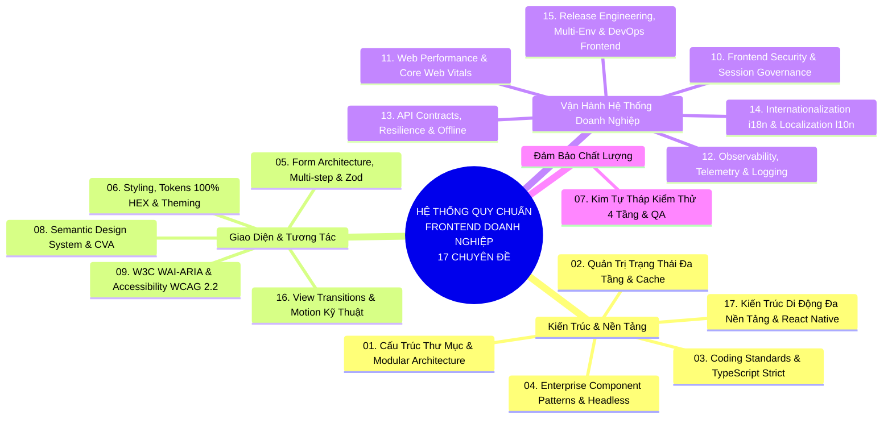
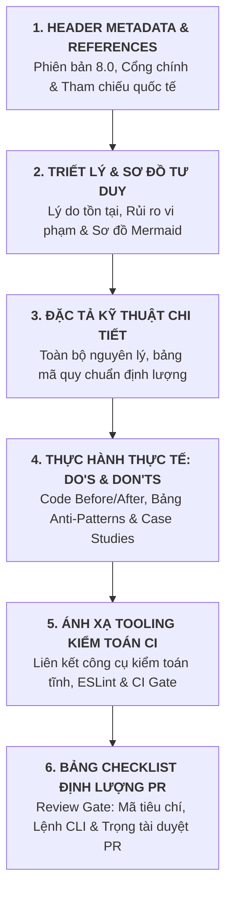
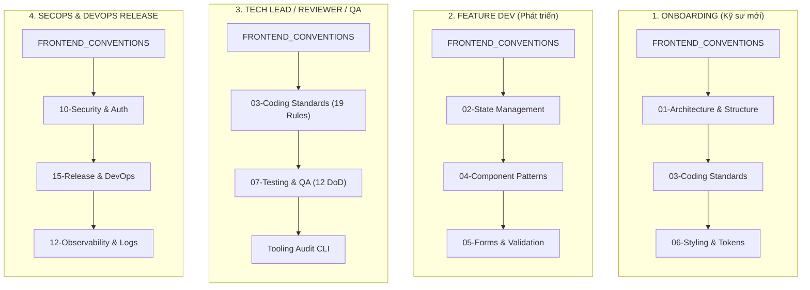

# Bản Đồ Tài Liệu & Lộ Trình Đọc Bộ Quy Chuẩn Frontend Doanh Nghiệp (Enterprise Blueprint Roadmap)

> **Dự án:** Khung Tiêu Chuẩn Doanh Nghiệp & Hồ Sơ Dự Án RoGym  
> **Phạm vi kỹ thuật:** Hệ sinh thái tài liệu quy chuẩn kỹ thuật `docs/` (17 Chuyên đề Doanh nghiệp)  
> **Cổng thông tin quy chuẩn trung tâm:** [`FRONTEND_CONVENTIONS.md`](../FRONTEND_CONVENTIONS.md)  
> **Cơ sở tham chiếu quốc tế:** [Bulletproof React](https://github.com/alan2207/bulletproof-react), [TkDodo's Practical React Query](https://tkdodo.eu/blog), [W3C WAI-ARIA APG](https://www.w3.org/WAI/ARIA/apg/), [OWASP](https://owasp.org), [Web.dev](https://web.dev), [RFC 7807](https://datatracker.ietf.org/doc/html/rfc7807), [Vercel React Best Practices](https://vercel.com).  
> **Phiên bản:** 8.0 (Enterprise Quality Standard — 17 Spokes & Universal Decoupling)  
> **Áp dụng cho:** Kỹ sư Frontend, Kỹ sư Fullstack, QA / Test Engineers, Tech Leads, SecOps / DevOps và AI Assistants pair-programming.  

> [!TIP]
> 🚀 **Dành Cho Kỹ Sư Mới — Khởi Động Nhanh Trong 15 Phút:**  
> Truy cập ngay **[`QUICK_REFERENCE.md`](./QUICK_REFERENCE.md)** để nắm bắt Lộ trình đọc 3 giai đoạn, Checklist 12 tiêu chí DoD trước khi mở PR, Top 4 công thức code chuẩn mực và Ma trận 120+ Rule IDs!

---

## MỤC LỤC
0. [🚀 Quick Reference Sheet (Tra cứu nhanh 15 phút)](./QUICK_REFERENCE.md)
1. [Giới Thiệu & Triết Lý Kiến Trúc Hub & Spokes](#1-giới-thiệu-triết-lý-kiến-trúc-hub-spokes)
2. [Bối Cảnh Kỹ Thuật Dự Án RoGym Frontend](#2-bối-cảnh-kỹ-thuật-dự-án-rogym-frontend)
3. [Sitemaps Toàn Bộ Hệ Thống Tài Liệu Quy Chuẩn (17 Chuyên Đề)](#3-sitemaps-toàn-bộ-hệ-thống-tài-liệu-quy-chuẩn-17-chuyên-đề)
4. [Khung Cấu Trúc 6 Phần Doanh Nghiệp Của Bộ Chuyên Đề (Unified 6-Part Anatomy)](#4-khung-cấu-trúc-6-phần-doanh-nghiệp-của-bộ-chuyên-đề-unified-6-part-anatomy)
5. [4 Lộ Trình Đọc Tài Liệu Theo Vai Trò](#5-4-lộ-trình-đọc-tài-liệu-theo-vai-trò)
6. [Ma Trận Phân Phối Trách Nhiệm Theo Tài Liệu (RACI Matrix)](#6-ma-trận-phân-phối-trách-nhiệm-theo-tài-liệu-raci-matrix)
7. [Quy Ước Đóng Góp & Cập Nhật Quy Chuẩn (RFC Governance Workflow)](#7-quy-ước-đóng-góp-cập-nhật-quy-chuẩn-rfc-governance-workflow)
8. [Các Câu Hỏi Thường Gặp (FAQ) Cho Kỹ Sư Mới](#8-các-câu-hỏi-thường-gặp-faq-cho-kỹ-sư-mới)

---

## 1. Giới Thiệu & Triết Lý Kiến Trúc Hub & Spokes

Hệ thống tài liệu quy chuẩn Frontend Doanh nghiệp được cấu trúc theo mô hình **Foundation Code + Hub & Spokes** nhằm giải quyết hai bài toán kinh điển trong phát triển phần mềm quy mô lớn:
1. **Tránh quá tải thông tin:** Kỹ sư mới vào dự án không bị choáng ngợp bởi hàng chục trang quy chuẩn dài dòng, mà có thể tiếp cận theo từng lát cắt công việc cụ thể.
2. **Loại bỏ sự phân mảnh & ảo giác:** Tất cả quy chuẩn đều quy tụ về một nguồn dữ liệu chuẩn duy nhất (Single Source of Truth - SSOT), có dẫn chiếu học thuật chuẩn quốc tế và liên kết chặt chẽ với codebase thực tế.

### 1.1. Sơ Đồ Tư Duy Hệ Thống 17 Chuyên Đề

### 1.2. Sơ Đồ Luồng Điều Hướng Hub & 17 Spokes

```mermaid
flowchart TD

    HUB["MASTER HUB PORTAL<br/>FRONTEND_CONVENTIONS.md"]

    subgraph CoreFoundations ["NHÓM 1: KIẾN TRÚC & NỀN TẢNG CỐT LÕI"]
        direction TB
        S01["<b>docs/01-ARCH & STRUCTURE</b><br/>Modular Monolith, Co-location,<br/>Rule of Three & Asset Pipeline"]
        S02["<b>docs/02-STATE MANAGEMENT</b><br/>4 Lớp State, TanStack Query,<br/>BroadcastChannel & Persistent Cache"]
        S03["<b>docs/03-CODING STANDARDS</b><br/>TypeScript Strict, AbortController,<br/>UTC Discipline & Primitive Boundary"]
        S04["<b>docs/04-COMPONENT PATTERNS</b><br/>Compound, Headless UI,<br/>Portal Stacking & Error Boundary"]
        S17["<b>docs/17-MOBILE & NATIVE</b><br/>Universal Architecture, LINE LIFF,<br/>Expo React Native & 44px Targets"]
    end

    subgraph DesignAndInterface ["NHÓM 2: GIAO DIỆN, DESIGN SYSTEM & TƯƠNG TÁC"]
        direction TB
        S05["<b>docs/05-FORMS & VALIDATION</b><br/>Bộ ba Primitive, Wizard Form,<br/>Dynamic useFieldArray & Async Zod"]
        S06["<b>docs/06-STYLING & TOKENS</b><br/>Tokens trung tính 100% HEX,<br/>Dark Mode chống FOUC, @container"]
        S08["<b>docs/08-SEMANTIC DESIGN</b><br/>Trụ cột S1-S4, CVA Multi-axis,<br/>Storybook Catalog & SEM-* Rules"]
        S09["<b>docs/09-ACCESSIBILITY</b><br/>W3C WAI-ARIA APG, WCAG 2.2 AA,<br/>Widget Navigation & Reduced Motion"]
        S16["<b>docs/16-VIEW TRANSITIONS</b><br/>W3C View Transitions, Motion,<br/>FLIP Animation & Reduced Motion"]
    end

    subgraph EnterpriseOps ["NHÓM 3: VẬN HÀNH HỆ THỐNG DOANH NGHIỆP"]
        direction TB
        S10["<b>docs/10-SECURITY & AUTH</b><br/>OWASP Top 10, CSP, HttpOnly Cookie,<br/>Token Rotation & PII Masking"]
        S11["<b>docs/11-PERFORMANCE & VITALS</b><br/>Core Web Vitals, Bundle Budget,<br/>Code-splitting & Virtualization"]
        S12["<b>docs/12-OBSERVABILITY & LOGS</b><br/>Sentry/Datadog, RUM Metrics,<br/>Trace Context & Privacy Scrubbing"]
        S13["<b>docs/13-API CONTRACT & OFFLINE</b><br/>Contract Code-gen, RFC 7807 Errors,<br/>Exponential Backoff & MSW"]
        S14["<b>docs/14-I18N & LOCALIZATION</b><br/>Zero Hardcoded String, i18next,<br/>Intl API & Logical RTL Layout"]
        S15["<b>docs/15-DEVOPS & RELEASE</b><br/>Zod Env Schema, Docker Nginx SPA,<br/>Cache-Busting & Feature Flags"]
    end

    subgraph QualityAssurance ["NHÓM 4: ĐẢM BẢO CHẤT LƯỢNG & KIỂM THỬ"]
        direction TB
        S07["<b>docs/07-TESTING & QA</b><br/>Kim tự tháp 4 tầng: Vitest, RTL,<br/>MSW, Playwright & Visual Regression"]
    end

    HUB --> CoreFoundations
    HUB --> DesignAndInterface
    HUB --> EnterpriseOps
    CoreFoundations & DesignAndInterface & EnterpriseOps --> QualityAssurance
```

---

## 2. Bối Cảnh Kỹ Thuật Dự Án RoGym Frontend

RoGym là nền tảng quản lý phòng tập thể hình quy mô doanh nghiệp với kiến trúc Single Page Application (SPA). Toàn bộ hệ thống frontend được xây dựng trên stack công nghệ hiện đại:
- **Ngôn ngữ & Runtime:** React 18.3, TypeScript 5.4, Vite 5.2.
- **Quản lý Dữ liệu & State:** TanStack Query v5.35 (Server Cache), Zustand 4.5 (Client Session), React Router DOM (URL State).
- **Giao diện & Styling:** Tailwind CSS 3.4 kết hợp CSS Design Tokens thuần 100% HEX, Radix UI Primitives, Lucide React Icons.
- **Kiểm thử tự động:** Vitest 2.1 runner, React Testing Library, jsdom environment, tích hợp CI GitHub Actions và script kiểm toán tĩnh `audit-conventions.mjs`.

---

## 3. Sitemaps Toàn Bộ Hệ Thống Tài Liệu Quy Chuẩn (17 Chuyên Đề)

Dưới đây là danh mục chi tiết 17 chuyên đề kỹ thuật thuộc bộ quy chuẩn Frontend Doanh nghiệp:

| Chuyên đề | Tên tài liệu & Liên kết | Phạm vi kỹ thuật & Nội dung cốt lõi | Tài liệu tham chiếu chuẩn quốc tế |
| :---: | :--- | :--- | :--- |
| **01** | [`01-architecture-and-structure.md`](./01-architecture-and-structure.md) | Bản đồ 12 thư mục `src/`, quy tắc Co-location theo Bulletproof React, Rule of Three và Component Anatomy 4 khối chuẩn mực. | [Bulletproof React](https://github.com/alan2207/bulletproof-react) (Alan Eicker / Sandro Roth) |
| **02** | [`02-state-management.md`](./02-state-management.md) | Phân tầng State 4 lớp (Server, Global, URL, Local UI), nguyên tắc Derived State "Compute, Don't Duplicate", State Decision Tree. | [TkDodo's Practical React Query](https://tkdodo.eu/blog) & [React.dev](https://react.dev/learn/you-might-not-need-an-effect) |
| **03** | [`03-coding-standards.md`](./03-coding-standards.md) | Chi tiết 19 Tiêu chuẩn Coding Standards Doanh nghiệp, Bảng ánh xạ 1-1 Native sang Primitive và quy chuẩn chú thích ngoại lệ. | [W3C WAI-ARIA APG](https://www.w3.org/WAI/ARIA/apg/) & [TypeScript Handbook](https://www.typescriptlang.org/docs/) |
| **04** | [`04-component-patterns.md`](./04-component-patterns.md) | React Design Patterns: Compound Components, Container/Presentational, Error Boundaries phân cấp, Polymorphic UI Primitives (`as`). | [Patterns.dev](https://www.patterns.dev/react) |
| **05** | [`05-forms-and-validation.md`](./05-forms-and-validation.md) | Form Architecture Tầng 1 (Primitive `<Form>`, `<FormField>`, `<SubmitButton>`), Wizard Form nhiều bước, dynamic `useFieldArray`. | [W3C Form Pattern](https://www.w3.org/WAI/ARIA/apg/patterns/landmarks/examples/form.html) |
| **06** | [`06-styling-and-design-tokens.md`](./06-styling-and-design-tokens.md) | Quy chuẩn 100% mã màu HEX trong CSS (6-digit & 8-digit alpha), hệ thống tokens trung tính, Container Queries `@container`. | RoGym Design Token Specification V1.0 |
| **07** | [`07-testing-and-quality-assurance.md`](./07-testing-and-quality-assurance.md) | Kim tự tháp kiểm thử 4 tầng: Vitest 2.1, RTL, MSW Mocking, Playwright E2E và PR Definition of Done 12 tiêu chí. | [Testing Library](https://testing-library.com/) & [Vitest Docs](https://vitest.dev) |
| **08** | [`08-semantic-design-system.md`](./08-semantic-design-system.md) | Nguồn dữ liệu chuẩn cho Semantic Design System: 4 trụ cột S1–S4, Token naming `--color-<category>-<role>`, CVA variants, Quản trị vòng đời quy chuẩn `SEM-*`. | RoGym Semantic Design System V1.0 |
| **09** | [`09-accessibility.md`](./09-accessibility.md) | Tiêu chuẩn Tiếp cận W3C WAI-ARIA APG, Form a11y, Contrast Matrix AA, Touch target $\ge 44\text{px}$, Focus visibility, và tự động hóa với `vitest-axe`. | [W3C WAI-ARIA APG](https://www.w3.org/WAI/ARIA/apg/) & WCAG 2.2 AA |
| **10** | [`10-frontend-security-and-auth.md`](./10-frontend-security-and-auth.md) | OWASP Client-Side Top 10, Cấu hình CSP headers, In-memory Access Token + HttpOnly Refresh Token Cookie, PII Masking. | [OWASP Foundation](https://owasp.org) & [RFC 6749](https://datatracker.ietf.org/doc/html/rfc6749) |
| **11** | [`11-performance-and-web-vitals.md`](./11-performance-and-web-vitals.md) | Bộ ba chỉ số Core Web Vitals (LCP, INP, CLS), Bundle Budget $\le 180\text{KB}$, Route-based Lazy loading, Virtualization `@tanstack/react-virtual`. | [Google Web Vitals](https://web.dev/vitals/) & [Web.dev](https://web.dev) |
| **12** | [`12-observability-and-telemetry.md`](./12-observability-and-telemetry.md) | Bắt lỗi tập trung Sentry/Datadog, Real User Monitoring (RUM), W3C Trace Context (`traceparent`), Structured Logger loại trừ PII. | [W3C Trace Context](https://www.w3.org/TR/trace-context/) & [Sentry](https://sentry.io) |
| **13** | [`13-api-contracts-and-resilience.md`](./13-api-contracts-and-resilience.md) | Hợp đồng API OpenAPI codegen, Định dạng lỗi RFC 7807 Problem Details, Hủy request `AbortController`, Thử lại Exponential Backoff, MSW. | [RFC 7807](https://datatracker.ietf.org/doc/html/rfc7807) & [MSW](https://mswjs.io) |
| **14** | [`14-internationalization-and-localization.md`](./14-internationalization-and-localization.md) | Nguyên tắc Zero Hardcoded Strings, Khóa dịch phân cấp, Bản địa hóa tiền tệ/ngày giờ qua `Intl` API, CSS Logical Properties hỗ trợ RTL. | [i18next](https://www.i18next.com) & [MDN Intl API](https://developer.mozilla.org) |
| **15** | [`15-release-engineering-and-devops.md`](./15-release-engineering-and-devops.md) | Xác thực biến môi trường qua Zod schema, Dockerfile multi-stage Nginx Alpine, Chiến lược Cache-Busting, Feature Flags, SemVer 2.0.0. | [12-Factor App](https://12factor.net) & [Docker](https://docker.com) |
| **16** | [`16-view-transitions-and-motion.md`](./16-view-transitions-and-motion.md) | Chuyển cảnh trang W3C Native View Transitions, FLIP Morphing, Quy tắc ưu tiên chuyển động 4 tầng, CSS Recipes & `@media (prefers-reduced-motion)`. | [W3C View Transitions](https://www.w3.org/TR/css-view-transitions-1/) & [Vercel View Transitions](https://github.com/vercel-labs/react-view-transitions) |
| **17** | [`17-mobile-and-native-architecture.md`](./17-mobile-and-native-architecture.md) | Kiến trúc di động đa nền tảng Universal Component Tree, WebView Bridge LINE LIFF, Expo / React Native, Quy chuẩn Touch target $\ge 44\text{px}$, Virtualization di động. | [React Native Architecture](https://reactnative.dev) & [LINE Developers LIFF](https://developers.line.biz/en/docs/liff/) |

### 3.1. Danh Mục Tài Liệu Kiến Trúc Module Cấp Cao (`src/*/README.md`)

Bên cạnh 17 chuyên đề nghiệp vụ, mỗi thư mục chức năng trong `src/` sở hữu một tài liệu kiến trúc riêng biệt (Enterprise README) phục vụ tra cứu catalog và lộ trình refactor:

| Module Thư Mục | Tài Liệu README | Trách Nhiệm Kiến Trúc Cốt Lõi |
| :--- | :--- | :--- |
| `src/components/` | [`../src/components/README.md`](../src/components/README.md) | Thư viện UI Primitives và Application Composites, Compound Components & Vercel Patterns. |
| `src/hooks/` | [`../src/hooks/README.md`](../src/hooks/README.md) | Tháp phân tầng Hooks 4 cấp, TanStack Query hooks, Caching & Deduplication. |
| `src/lib/` | [`../src/lib/README.md`](../src/lib/README.md) | 12 Infrastructure Modules: Axios instance, Logger, i18n, LIFF, RFC 7807, Query Key Factory. |
| `src/services/` | [`../src/services/README.md`](../src/services/README.md) | 28 RESTful API services, giao thức AbortSignal bắt buộc, xử lý lỗi RFC 7807/9457. |
| `src/stores/` | [`../src/stores/README.md`](../src/stores/README.md) | Quản lý Client State bằng Zustand, ranh giới cấm Server Cache, atomic selectors & đa tab. |
| `src/styles/` | [`../src/styles/README.md`](../src/styles/README.md) | Hệ thống Design Tokens 2 tầng 100% HEX, Dark mode chống FOUC, Container Queries. |
| `src/utils/` | [`../src/utils/README.md`](../src/utils/README.md) | Generic Formatters, PII Masker, và Domain Business Calculators (subscription, shift, package). |

---

## 4. Khung Cấu Trúc 6 Phần Doanh Nghiệp Của Bộ Chuyên Đề (Unified 6-Part Anatomy)

Nhằm đảm bảo tính đồng bộ, dễ đọc, dễ hiểu, dễ áp dụng và dễ rà soát lỗi, toàn bộ 17 chuyên đề kỹ thuật (`01` đến `17`) đều được thiết kế nhất quán theo **Khung Cấu Trúc 6 Phần**:

1. **Phần 1: Header Metadata & Tài Liệu Tham Chiếu Quốc Tế:** Định danh phiên bản 8.0 chuẩn doanh nghiệp, ranh giới áp dụng và tài liệu quốc tế đối chiếu.
2. **Phần 2: Triết Lý Kiến Trúc & Sơ Đồ Tư Duy (Visual Mental Model):** Trình bày trực quan lý do quy chuẩn tồn tại và sơ đồ Mermaid định hướng luồng xử lý.
3. **Phần 3: Đặc Tả Kỹ Thuật Chi Tiết:** Chi tiết hóa các quy tắc bất biến, phân tầng kiến trúc và bảng mã quy chuẩn định lượng (`STD-*`, `SEM-*`, `SEC-*`, `PERF-*`, `OBS-*`, `API-*`, `I18N-*`, `OPS-*`).
4. **Phần 4: Thực Hành Thực Tế (Do's & Don'ts & Case Studies):** Phân tách rạch ròi ❌ Anti-Pattern (Don't) và ✅ Chuẩn Mực Doanh Nghiệp (Do) với ví dụ mã nguồn thực tế.
5. **Phần 5: Ánh Xạ Tooling Kiểm Toán CI (Automation Integration):** Liên kết trực tiếp tới các công cụ kiểm soát tự động và scripts kiểm toán.
6. **Phần 6: Bảng Checklist Định Lượng Trước Khi Mở PR (Review Gate):** Bảng kiểm tra nhanh gồm Mã tiêu chí, Mô tả và Lệnh CLI giúp Tech Lead / QA / Dev duyệt code nhanh chóng.

---

## 5. 4 Lộ Trình Đọc Tài Liệu Theo Vai Trò

Nhằm đảm bảo hiệu suất tiếp thu cao nhất, các kỹ sư nên lựa chọn lộ trình đọc phù hợp với bối cảnh thực tế:

### 🚀 Lộ trình 1: Onboarding Kỹ Sư Mới (Thời lượng dự kiến: 2 - 3 giờ)
- **Mục tiêu:** Nắm vững cấu trúc dự án, hiểu quy tắc viết mã và có thể gửi PR đầu tiên mà không mắc các lỗi cơ bản.
- **Bước 1:** Đọc kỹ [`FRONTEND_CONVENTIONS.md`](../FRONTEND_CONVENTIONS.md) để nắm 4 trụ cột kỹ thuật, Tháp Ngữ Nghĩa và Ma trận 19 Tiêu chuẩn.
- **Bước 2:** Đọc [`01-architecture-and-structure.md`](./01-architecture-and-structure.md) để hiểu cách tổ chức thư mục, co-location theo tính năng và mẫu cấu trúc component (Component Anatomy).
- **Bước 3:** Đọc [`03-coding-standards.md`](./03-coding-standards.md) để nắm chắc 19 tiêu chuẩn, ghi nhớ Bảng ánh xạ 1-1 thẻ native sang primitive components và cú pháp chú thích ngoại lệ.
- **Bước 4:** Đọc [`06-styling-and-design-tokens.md`](./06-styling-and-design-tokens.md) để nắm được cách sử dụng hệ thống Design Token và quy chuẩn 100% màu HEX.

### 💻 Lộ trình 2: Lập Trình Viên Phát Triển Tính Năng / Màn Hình Nghiệp Vụ
- **Mục tiêu:** Xây dựng màn hình nghiệp vụ mới tuân thủ đúng kiến trúc dữ liệu và khả năng tiếp cận.
- **Bước 1:** Đọc [`02-state-management.md`](./02-state-management.md) để xác định rạch ròi trạng thái nào đưa vào TanStack Query, Zustand, URL hay `useState`.
- **Bước 2:** Đọc [`04-component-patterns.md`](./04-component-patterns.md) để áp dụng các mẫu thiết kế phù hợp (Compound Components, Widget Error Boundaries).
- **Bước 3:** Đọc [`05-forms-and-validation.md`](./05-forms-and-validation.md) khi xây dựng màn hình nhập liệu, đảm bảo 100% form được bọc bằng primitive `<Form>`.
- **Bước 4:** Đọc [`13-api-contracts-and-resilience.md`](./13-api-contracts-and-resilience.md) để tích hợp hủy request `AbortController` và xử lý lỗi mạng thích ứng.
- **Bước 5:** Đối chiếu với checklist 12 tiêu chí DoD tại [`FRONTEND_CONVENTIONS.md`](../FRONTEND_CONVENTIONS.md) trước khi gửi PR.

### 🛡️ Lộ trình 3: Tech Lead, Code Reviewer & Kỹ Sư QA
- **Mục tiêu:** Thiết lập hàng rào kiểm duyệt chất lượng mã nguồn, đảm bảo tính nhất quán của toàn bộ dự án.
- **Bước 1:** Nắm vững 19 Tiêu chuẩn Coding Standards tại [`03-coding-standards.md`](./03-coding-standards.md) làm tiêu chí từ chối PR nếu có vi phạm.
- **Bước 2:** Đọc [`07-testing-and-quality-assurance.md`](./07-testing-and-quality-assurance.md) để áp dụng bộ tiêu chí Definition of Done (DoD) và kịch bản test a11y.
- **Bước 3:** Chạy script kiểm tra tĩnh `node client/scripts/audit-conventions.mjs` trên local trước khi tiến hành review mã nguồn thủ công.

### ⚙️ Lộ trình 4: Kỹ Sư SecOps, DevOps & Kỹ Sư Vận Hành Phát Hành (SecOps & Release Engineering)
- **Mục tiêu:** Thiết lập hạ tầng phát hành an toàn, bảo vệ phiên làm việc và giám sát hệ thống production.
- **Bước 1:** Đọc [`10-frontend-security-and-auth.md`](./10-frontend-security-and-auth.md) để nắm quy chuẩn CSP headers, quản trị token an toàn và che giấu PII.
- **Bước 2:** Đọc [`15-release-engineering-and-devops.md`](./15-release-engineering-and-devops.md) để áp dụng schema kiểm tra biến môi trường Zod, cấu hình Docker Nginx đa tầng và chiến lược Cache-Busting.
- **Bước 3:** Đọc [`12-observability-and-telemetry.md`](./12-observability-and-telemetry.md) để cấu hình Sentry, Real User Monitoring (RUM) và liên kết W3C Trace Context.
- **Bước 4:** Đọc [`11-performance-and-web-vitals.md`](./11-performance-and-web-vitals.md) để giám sát ngân sách Bundle Budget trong pipeline CI.

---

## 6. Ma Trận Phân Phối Trách Nhiệm Theo Tài Liệu (RACI Matrix)

| Tài liệu quy chuẩn | Kỹ sư Frontend | Kỹ sư Fullstack | Tech Lead / Reviewer | QA Engineer | DevOps / SecOps |
| :--- | :---: | :---: | :---: | :---: | :---: |
| [`FRONTEND_CONVENTIONS.md`](../FRONTEND_CONVENTIONS.md) | Bắt buộc | Bắt buộc | Bắt buộc | Bắt buộc | Bắt buộc |
| [`01-architecture-and-structure.md`](./01-architecture-and-structure.md) | Bắt buộc | Bắt buộc | Bắt buộc | Tham khảo | Tham khảo |
| [`02-state-management.md`](./02-state-management.md) | Bắt buộc | Bắt buộc | Bắt buộc | Tham khảo | Tham khảo |
| [`03-coding-standards.md`](./03-coding-standards.md) | Bắt buộc | Bắt buộc | Bắt buộc | Bắt buộc | Tham khảo |
| [`04-component-patterns.md`](./04-component-patterns.md) | Bắt buộc | Tham khảo | Bắt buộc | Tham khảo | Tham khảo |
| [`05-forms-and-validation.md`](./05-forms-and-validation.md) | Bắt buộc | Bắt buộc | Bắt buộc | Bắt buộc | Tham khảo |
| [`06-styling-and-design-tokens.md`](./06-styling-and-design-tokens.md) | Bắt buộc | Tham khảo | Bắt buộc | Tham khảo | Tham khảo |
| [`07-testing-and-quality-assurance.md`](./07-testing-and-quality-assurance.md) | Bắt buộc | Bắt buộc | Bắt buộc | Bắt buộc | Tham khảo |
| [`08-semantic-design-system.md`](./08-semantic-design-system.md) | Bắt buộc | Bắt buộc | Bắt buộc | Bắt buộc | Tham khảo |
| [`09-accessibility.md`](./09-accessibility.md) | Bắt buộc | Bắt buộc | Bắt buộc | Bắt buộc | Tham khảo |
| [`10-frontend-security-and-auth.md`](./10-frontend-security-and-auth.md) | Bắt buộc | Bắt buộc | Bắt buộc | Tham khảo | Bắt buộc |
| [`11-performance-and-web-vitals.md`](./11-performance-and-web-vitals.md) | Bắt buộc | Bắt buộc | Bắt buộc | Bắt buộc | Bắt buộc |
| [`12-observability-and-telemetry.md`](./12-observability-and-telemetry.md) | Bắt buộc | Bắt buộc | Bắt buộc | Tham khảo | Bắt buộc |
| [`13-api-contracts-and-resilience.md`](./13-api-contracts-and-resilience.md) | Bắt buộc | Bắt buộc | Bắt buộc | Bắt buộc | Tham khảo |
| [`14-internationalization-and-localization.md`](./14-internationalization-and-localization.md) | Bắt buộc | Tham khảo | Bắt buộc | Bắt buộc | Tham khảo |
| [`15-release-engineering-and-devops.md`](./15-release-engineering-and-devops.md) | Bắt buộc | Bắt buộc | Bắt buộc | Tham khảo | Bắt buộc |
| [`16-view-transitions-and-motion.md`](./16-view-transitions-and-motion.md) | Bắt buộc | Bắt buộc | Bắt buộc | Bắt buộc | Tham khảo |
| [`17-mobile-and-native-architecture.md`](./17-mobile-and-native-architecture.md) | Bắt buộc | Bắt buộc | Bắt buộc | Bắt buộc | Tham khảo |

---

## 7. Quy Ước Đóng Góp & Cập Nhật Quy Chuẩn (RFC Governance Workflow)

Bộ quy chuẩn Frontend Doanh nghiệp là một tập tài liệu sống (Living Documentation). Khi dự án phát triển và có yêu cầu kỹ thuật mới phát sinh, quy trình cập nhật tuân theo 4 giai đoạn nghiêm ngặt:

1. **Giai đoạn 1: Đề xuất (Draft RFC)**
   - Kỹ sư mở GitHub Issue với nhãn `rfc:convention` mô tả: Lý do thay đổi, vấn đề gặp phải với quy chuẩn hiện tại, đề xuất phương án mới kèm ví dụ so sánh Before / After.
2. **Giai đoạn 2: Thẩm định Kỹ thuật (Technical Evaluation)**
   - Core Team / Tech Leads đánh giá dựa trên 4 trụ cột kỹ thuật: Predictability, Modularity, Accessibility, Testability.
   - Thử nghiệm giải pháp trên branch thử nghiệm (`spike/`).
3. **Giai đoạn 3: Phê duyệt & Ban hành (Approved & Implemented)**
   - Khi RFC được phê duyệt, tài liệu chuyên đề tương ứng tại `docs/` sẽ được cập nhật.
   - Cập nhật đồng thời Master Portal [`FRONTEND_CONVENTIONS.md`](../FRONTEND_CONVENTIONS.md) và file luật AI assistant `.agents/skills/rogym-frontend-conventions/SKILL.md`.
4. **Giai đoạn 4: Cập nhật Tooling Automation**
   - Viết thêm hoặc điều chỉnh rule tương ứng trong script kiểm toán tĩnh `client/scripts/audit-conventions.mjs` để CI tự động kiểm soát.

---

## 8. Các Câu Hỏi Thường Gặp (FAQ) Cho Kỹ Sư Mới

**Q1: Tại sao hệ thống lại cấm dùng thẻ `<button>` và `<a>` trực tiếp trên các trang nghiệp vụ?**  
*Trả lời:* Vì để đảm bảo 100% tính nhất quán về style, accessible state (focus-visible, loading, disabled) và an toàn liên kết (`rel="noopener noreferrer"`). Khi dùng `<Button>`, `<ButtonLink>` hoặc `<ButtonAnchor>`, bạn được bảo vệ tự động bởi Design System mà không cần nhớ viết lại từng thuộc tính ARIA.

**Q2: Khi nào tôi được phép dùng thẻ `
` hoặc `` trên trang?**  
*Trả lời:* Chỉ khi bạn gặp rào cản kỹ thuật từ thư viện thứ 3 (như Recharts `ResponsiveContainer`, Radix Slot) hoặc layout flex/grid đa trục không có thẻ ngữ nghĩa tương đương. Trong mọi trường hợp đó, bạn **bắt buộc** phải ghi chú thích: `{/* rogym-convention-exempt: NO_NONSEMANTIC_TAGS [Lý do cụ thể] */}` ngay trên thẻ.

**Q3: Tôi có thể sử dụng `useEffect` để cập nhật state sau khi dữ liệu API trả về không?**  
*Trả lời:* **Tuyệt đối không.** Hãy sử dụng hàm `select` trong TanStack Query v5 hoặc tính toán trực tiếp giá trị đó trong thân hàm component (Derived State). Đọc chi tiết tại [`02-state-management.md`](./02-state-management.md).

**Q4: Làm sao để kiểm tra nhanh mã nguồn của tôi có vi phạm quy chuẩn nào không trước khi mở PR?**  
*Trả lời:* Bạn có thể chạy script kiểm tra tĩnh: `node client/scripts/audit-conventions.mjs` hoặc kiểm tra toàn vẹn tài liệu với `node client/scripts/verify-docs-integrity.mjs` từ thư mục gốc của dự án.

