# RoGym Design System & Components Architecture (README)

> **Tiêu chuẩn Kỹ thuật Frontend Doanh nghiệp RoGym (client/src/components/)**  
> *Phiên bản:* 2.2.0 (Strict Enterprise, Maximum Internal Reusability & Refactoring Blueprint)  
> *Cập nhật lần cuối:* 2026-10-18  
> *Phạm vi áp dụng:* Toàn bộ lập trình viên frontend khi tạo mới, chỉnh sửa, hoặc tái cấu trúc giao diện trong RoGym Management System. Phục vụ chuyên biệt cho hai phân hệ cốt lõi: UI Primitives ([`ui/`](ui/)) và Application Composites ([`shared/`](shared/)).

---

## MỤC LỤC TỔNG QUAN

1. [Chương 1: Kiến Trúc Thư Viện Component & Mô Hình Tái Sử Dụng Nội Bộ 3 Cấp](#chương-1-kiến-trúc-thư-viện-component-mô-hình-tái-sử-dụng-nội-bộ-3-cấp)
2. [Chương 2: Bản Đồ Cấu Trúc Thư Mục & Quy Chuẩn Import Chống Vòng Lặp](#chương-2-bản-đồ-cấu-trúc-thư-mục-quy-chuẩn-import-chống-vòng-lặp)
3. [Chương 3: Quy Chuẩn Vercel Composition Patterns & Hiệu Năng](#chương-3-quy-chuẩn-vercel-composition-patterns-hiệu-năng)
   - [3.1 Compound Components thay thế Boolean Props Proliferation](#31-compound-components-thay-thế-boolean-props-proliferation)
   - [3.2 Explicit CVA Variants thay thế Boolean Modes](#32-explicit-cva-variants-thay-thế-boolean-modes)
   - [3.3 Heavy Primitives & Quy Chuẩn Bundle Size / Lazy Loading](#33-heavy-primitives-quy-chuẩn-bundle-size-lazy-loading)
   - [3.4 Tách Biệt State Nội Bộ & Context Decoupling](#34-tách-biệt-state-nội-bộ-context-decoupling)
   - [3.5 Tối Ưu Re-render & Ngăn Chặn Suy Giảm Web Vitals](#35-tối-ưu-re-render-ngăn-chặn-suy-giảm-web-vitals)
4. [Chương 4: Cẩm Nang & Lộ Trình Refactor Tái Cấu Trúc Toàn Diện](#chương-4-cẩm-nang-lộ-trình-refactor-tái-cấu-trúc-toàn-diện)
   - [4.1 Bảng Nhận Diện 6 Anti-Patterns & Code Smells](#41-bảng-nhận-diện-6-anti-patterns-code-smells)
   - [4.2 Bốn Công Thức Chuyển Đổi Refactoring Chuẩn Vercel](#42-bốn-công-thức-chuyển-đổi-refactoring-chuẩn-vercel)
   - [4.3 Ma Trận Lộ Trình Refactor 3 Giai Đoạn](#43-ma-trận-lộ-trình-refactor-3-giai-đoạn)
5. [Chương 5: Cây Quyết Định Chọn Component (10 Decision Trees)](#chương-5-cây-quyết-định-chọn-component-10-decision-trees)
   - [5.1 Cây 1: Chọn Nút Bấm & Bộ Điều Hướng (Actions & Navigation)](#51-cây-1-chọn-nút-bấm-bộ-điều-hướng-actions-navigation)
   - [5.2 Cây 2: Hiển Thị Dữ Liệu Bảng & Danh Sách (Tables & Grids)](#52-cây-2-hiển-thị-dữ-liệu-bảng-danh-sách-tables-grids)
   - [5.3 Cây 3: Hiển Thị Trạng Thái Trang & Tiến Trình (States, Feedback & Progress)](#53-cây-3-hiển-thị-trạng-thái-trang-tiến-trình-states-feedback-progress)
   - [5.4 Cây 4: Nhập Liệu Form (Form Input Controls)](#54-cây-4-nhập-liệu-form-form-input-controls)
   - [5.5 Cây 5: Hộp Thoại, Popup & Menu Lớp Phủ (Overlays & Dialogs)](#55-cây-5-hộp-thoại-popup-menu-lớp-phủ-overlays-dialogs)
   - [5.6 Cây 6: Bố Cục Khối, Thẻ & Phân Cách (Layout, Cards & Badges)](#56-cây-6-bố-cục-khối-thẻ-phân-cách-layout-cards-badges)
   - [5.7 Cây 7: Bố Cục Khung & Hệ Thống Lưới Layout (Grid, Flex, Box & Container)](#57-cây-7-bố-cục-khung-hệ-thống-lưới-layout-grid-flex-box-container)
   - [5.8 Cây 8: Kiểu Chữ & Phân Cấp Nội Dung Typography (Heading & Text)](#58-cây-8-kiểu-chữ-phân-cấp-nội-dung-typography-heading-text)
   - [5.9 Cây 9: Hình Ảnh & Phương Tiện Media CLS = 0 (Image & Avatar)](#59-cây-9-hình-ảnh-phương-tiện-media-cls-0-image-avatar)
   - [5.10 Cây 10: Trình Diễn Dữ Liệu Key-Value & Metadata (DescriptionList & Tables)](#510-cây-10-trình-diễn-dữ-liệu-key-value-metadata-descriptionlist-tables)
6. [Chương 6: Catalog Toàn Diện 100% UI Primitives (`ui/`)](#chương-6-catalog-toàn-diện-100-ui-primitives-ui)
   - [6.1 Buttons & Actions](#61-buttons-actions)
   - [6.2 Form Controls & Inputs](#62-form-controls-inputs)
   - [6.3 Filter & Search Controls](#63-filter-search-controls)
   - [6.4 Overlays, Modals & Dialogs](#64-overlays-modals-dialogs)
   - [6.5 Data Display, Cards, Badges & Separator](#65-data-display-cards-badges-separator)
   - [6.6 Tables & Lists](#66-tables-lists)
   - [6.7 Navigation, Accordion & Layout Controls](#67-navigation-accordion-layout-controls)
   - [6.8 Feedback, Loaders & Progress States](#68-feedback-loaders-progress-states)
   - [6.9 Security & Data Optimization](#69-security-data-optimization)
   - [6.10 Icons & Graphics](#610-icons-graphics)
   - [6.11 Layout Primitives (Box, Flex, HStack, VStack, Grid, Container)](#611-layout-primitives-box-flex-hstack-vstack-grid-container)
   - [6.12 Typography, Media & Presentation Primitives (Text, Heading, Label, Image, DescriptionList)](#612-typography-media-presentation-primitives-text-heading-label-image-descriptionlist)
7. [Chương 7: Catalog Shared Composites & Application Shells (`shared/`)](#chương-7-catalog-shared-composites-application-shells-shared)
8. [Chương 8: Quy Chuẩn Chuẩn Mực Chống Trùng Lặp & Không Dùng Facades](#chương-8-quy-chuẩn-chuẩn-mực-chống-trùng-lặp-không-dùng-facades)
9. [Chương 9: Quy Chuẩn Nghiêm Cấm & Cảnh Báo Lạm Dụng (Anti-Abuse Directives & Severe System Consequences)](#chương-9-quy-chuẩn-nghiêm-cấm-cảnh-báo-lạm-dụng-anti-abuse-directives-severe-system-consequences)
10. [Chương 10: Bảng Tra Cứu Nhanh 5 Giây (Cheat Sheet Matrix)](#chương-10-bảng-tra-cứu-nhanh-5-giây-cheat-sheet-matrix)

---

## CHƯƠNG 1: KIẾN TRÚC THƯ VIỆN COMPONENT & MÔ HÌNH TÁI SỬ DỤNG NỘI BỘ 3 CẤP

Hệ thống thành phần giao diện RoGym được xây dựng trên nền tảng **Design System 2 lớp (Two-Layer Token System)**, tuân thủ chuẩn tiếp cận **W3C WAI-ARIA Authoring Practices Guide (APG)** và áp dụng triệt để mô hình **Tái sử dụng nội bộ tối đa (Maximum Internal Composition & Reusability)**.

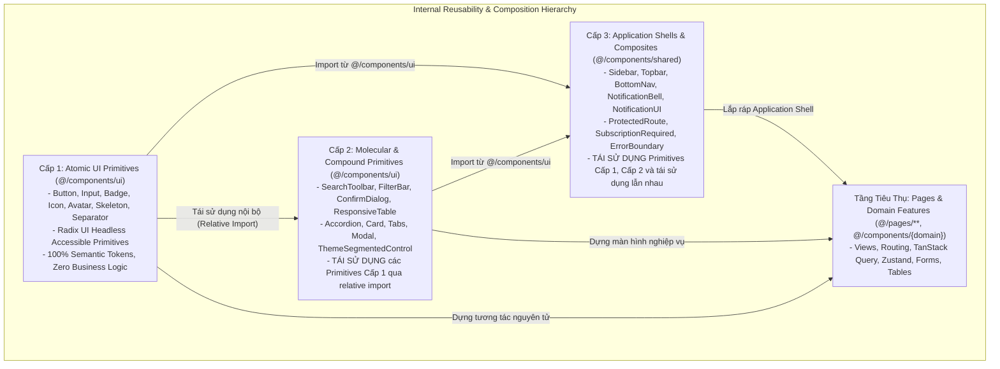

### 1.1 Nguyên Tắc Vàng về Tái Sử Dụng Nội Bộ Tối Đa (Internal Maximum Reusability)

1. **Tuyệt đối không tái phát minh bánh xe (Never Re-invent Primitives):**  
   - Bất kỳ thành phần nào trong `shared/` (như [`Topbar`](shared/topbar/Topbar.tsx), [`Sidebar`](shared/sidebar/Sidebar.tsx), `NotificationBell`) khi cần hiển thị nút bấm, avatar, huy hiệu số, menu thả nổi hay popover **BẮT BUỘC PHẢI TÁI SỬ DỤNG** các component từ `ui/` ([`Button`](ui/actions/Button.tsx), [`Avatar`](ui/data-display/Avatar.tsx), [`Badge`](ui/data-display/Badge.tsx), [`DropdownMenu`](ui/overlay/DropdownMenu.tsx), [`Popover`](ui/overlay/Popover.tsx)).
   - Tuyệt đối cấm viết lại thẻ HTML trần (`<button>`, `<span>`, `<div>`) hay tự viết các sự kiện click-outside thủ công trong `shared/`.

2. **Tái sử dụng nội bộ ngay trong chính `ui/` (Molecular Composition):**  
   - Các UI Primitives phức hợp cấp cao (Molecular Primitives) được khuyến khích mạnh mẽ tái sử dụng các primitives nguyên tử anh em:
     - [`SearchToolbar`](ui/forms/SearchToolbar.tsx) tái sử dụng [`SearchInput`](ui/forms/SearchInput.tsx) và [`Button`](ui/actions/Button.tsx).
     - [`FilterBar`](ui/forms/FilterBar.tsx) tái sử dụng [`Chip`](ui/data-display/Chip.tsx) và [`Button`](ui/actions/Button.tsx).
     - [`ConfirmDialog`](ui/overlay/ConfirmDialog.tsx) tái sử dụng [`Modal`](ui/overlay/Modal.tsx) và [`Button`](ui/actions/Button.tsx).
     - [`ResponsiveTable`](ui/data-display/ResponsiveTable.tsx) tái sử dụng [`Table`](ui/data-display/Table.tsx) và [`Card`](ui/data-display/Card.tsx).
     - [`ThemeSegmentedControl`](ui/navigation/ThemeSegmentedControl.tsx) tái sử dụng icon primitives và token variables.

3. **Tái sử dụng giữa các Shared Composites:**  
   - Các component trong `shared/` có thể tái sử dụng lẫn nhau: [`Topbar`](shared/topbar/Topbar.tsx) tái sử dụng `NotificationBell`; `NotificationBell` tái sử dụng [`NotificationUI`](shared/notification/NotificationUI.tsx) (`NotificationPanel`).

4. **Kiến Trúc Token 2 Lớp (2-Layer Token Architecture):**
   - **Layer 1: Primitive Tokens (`tokens/primitive.css`)**: Nơi duy nhất định nghĩa các giá trị màu HEX vật lý thuần túy (ví dụ: `--rogym-green: #06c384`).
   - **Layer 2: Semantic Tokens (`tokens/semantic.css` & `theme.css`)**: Ánh xạ Layer 1 sang vai trò ngữ cảnh (ví dụ: `--color-action-primary: var(--rogym-green)`, class `bg-action-primary`, `text-fg-primary`).
   - **Nguyên tắc:** Toàn bộ components (cả trong `ui/` lẫn `shared/`) **CHỈ ĐƯỢC PHÉP tiêu thụ Semantic Tokens ở Layer 2**, tự động tương thích 100% Dark/Light Mode.

### 1.2 Danh Sách Cấm Tuyệt Đối (Strictly Banned HTML Elements on Pages)
Theo quy ước phát triển RoGym Frontend, việc viết thẻ HTML tương tác trần trụi (Raw Interactive Elements) trên các trang (`client/src/pages/**`) bị nghiêm cấm hoàn toàn qua hệ thống Static Audit:

| Raw HTML Element | Mức độ vi phạm | Nguyên nhân cấm | Giải pháp thay thế bắt buộc |
| :--- | :---: | :--- | :--- |
| `<button type="...">` | **CRITICAL** | Thiếu APG focus-visible, token state, loading state, tap-target 44px | [`Button`](ui/actions/Button.tsx), [`ButtonLink`](ui/actions/Button.tsx), [`SubmitButton`](ui/actions/SubmitButton.tsx) |
| `<input type="...">` | **CRITICAL** | Thiếu semantic token, vi phạm contrast dark-mode, thiếu aria error auto-link | [`Input`](ui/forms/Input.tsx), [`NumberInput`](ui/forms/NumberInput.tsx), [`SearchInput`](ui/forms/SearchInput.tsx) |
| `<select>` | **CRITICAL** | UI native không đồng bộ, thiếu Radix accessibility cho bàn phím | [`Select`](ui/forms/Select.tsx) |
| `<textarea>` | **CRITICAL** | Thiếu autosize, vi phạm border-tokens và focus-ring | [`Textarea`](ui/forms/Textarea.tsx) |
| `<table>`, `<th>`, `<td>` | **CRITICAL** | Không hỗ trợ responsive table wrapper, thiếu border và padding token chuẩn | [`Table`](ui/data-display/Table.tsx) + [`TableContainer`](ui/data-display/Table.tsx) hoặc [`ResponsiveTable`](ui/data-display/ResponsiveTable.tsx) |
| `<div onClick={...}>` | **CRITICAL** | Vi phạm nghiêm trọng APG: thiếu role button, không focusable bằng bàn phím, thiếu phím Enter/Space | Dùng [`Button`](ui/actions/Button.tsx) với `variant="plain"` |

### 1.3 Bảng Ma Trận Ánh Xạ Toàn Diện 1-1: Native sang Primitives & Semantic Tags

Nhằm loại bỏ tính mơ hồ khi phát triển giao diện, bảng quy chuẩn dưới đây là **nguyên tắc bắt buộc** cho toàn bộ lập trình viên khi phát triển mã nguồn tại các trang giao diện (`src/pages/`) và các components ngoài thư mục `ui/`/`shared/`:

| STT | Thẻ Bị Cấm trên Page / High-Level | Nhóm Phân Loại | Thành Phần / Thẻ Bắt Buộc Dùng Thay Thế | Hướng Dẫn & Cách Dùng Chuẩn |
| :---: | :--- | :--- | :--- | :--- |
| **01** | `<button>` | Native Interactive | [`Button`](ui/actions/Button.tsx), [`SubmitButton`](ui/actions/SubmitButton.tsx), [`BackButton`](ui/actions/BackButton.tsx) | Import từ `@/components/ui`. Chọn đúng `tone` (`primary`, `neutral`, `danger`...) và `variant` (`solid`, `outline`, `ghost`). |
| **02** | `<a href="...">` (Nội bộ) | Native Interactive | [`ButtonLink`](ui/actions/Button.tsx), [`BreadcrumbLink`](ui/navigation/Breadcrumb.tsx) | Dùng cho liên kết nội bộ `react-router-dom`. Đồng bộ giao diện Button. |
| **03** | `<a href="...">` (Ngoài) | Native Interactive | [`ButtonAnchor`](ui/actions/Button.tsx) | Dùng cho liên kết ngoài. Tự động kiểm soát an toàn `rel="noopener noreferrer"`. |
| **04** | `<form>` | Native Interactive | [`Form`](ui/forms/Form.tsx) | Import từ `@/components/ui`. Bọc toàn bộ form nghiệp vụ với `noValidate`. |
| **05** | `<div>` (Container chính của Page) | Nonsemantic Layout | [`Page`](ui/layout/PageUI.tsx), [`PageHeader`](ui/layout/PageUI.tsx) | Import từ `@/components/ui`. Chuẩn hóa layout container. |
| **06** | `<div>` (Khối nội dung độc lập) | Nonsemantic Layout | [`Card as="article">`](ui/data-display/Card.tsx), [`Card as="section">`](ui/data-display/Card.tsx) | Import từ `@/components/ui`. Chọn variant (`default`, `compact`, `glass`...). |
| **07** | `<div>` (Section phân vùng nội dung) | Nonsemantic Layout | `<section aria-labelledby="...">` | Thẻ HTML5 Semantic bắt buộc có heading liên kết nhận diện. |
| **08** | `<div>` (Khối bài viết / item danh sách) | Nonsemantic Layout | `<article>` hoặc [`Card as="article">`](ui/data-display/Card.tsx) | Đại diện cho một đơn vị dữ liệu hoàn chỉnh. |
| **09** | `<div>` (Header / Footer của card/vùng) | Nonsemantic Layout | `<header>`, `<footer>` hoặc [`CardHeader`](ui/data-display/Card.tsx), [`CardFooter`](ui/data-display/Card.tsx) | Cấu trúc phân cấp ngữ nghĩa chuẩn W3C. |
| **10** | `<div>` (Thanh điều hướng / tabs bar) | Nonsemantic Layout | `<nav aria-label="...">` hoặc [`Tabs`](ui/navigation/Tabs.tsx), [`Breadcrumb`](ui/navigation/Breadcrumb.tsx) | Đảm bảo khả năng điều hướng bằng phím và screen reader. |
| **11** | `<div>` (Sidebar / Cột thông tin phụ) | Nonsemantic Layout | `<aside>` hoặc [`Sidebar`](shared/sidebar/Sidebar.tsx) | Phân tách nội dung phụ trợ khỏi luồng chính. |
| **12** | `<div>` (Đường kẻ phân cách) | Nonsemantic Layout | [`Separator`](ui/layout/Separator.tsx) hoặc `<hr>` | Import từ `@/components/ui`. Hỗ trợ label chữ ở giữa. |
| **13** | `<div>` (Chỉ để flexbox/grid layout) | Nonsemantic Layout | Bọc trực tiếp bằng thẻ ngữ nghĩa (`<section>`, `<fieldset>`, `<ul/ol>`) | **Nếu bắt buộc dùng div**: Dùng chú thích ngoại lệ `{/* rogym-convention-exempt: NO_NONSEMANTIC_TAGS [Lý do] */}`. |
| **14** | `<span>` (Nhãn trạng thái / tag) | Nonsemantic Text | [`Badge`](ui/data-display/Badge.tsx), [`StatusBadge`](ui/data-display/StatusBadge.tsx), [`Chip`](ui/data-display/Chip.tsx) | Import từ `@/components/ui`. Chuẩn hóa tone màu semantic. |
| **15** | `<span>` (Đoạn văn / text mô tả) | Nonsemantic Text | `<p>`, `<small>`, `<time>`, `<data>` | Dùng đúng thẻ ngữ nghĩa văn bản theo chuẩn HTML5. |
| **16** | `<span>` (Nhãn tiêu đề trường nhập) | Nonsemantic Text | [`FormField`](ui/forms/FormField.tsx) hoặc `<label htmlFor="...">` | Đảm bảo liên kết trực tiếp với id của input field. |
| **17** | `<span>` (Chỉ để đổi màu/font inline) | Nonsemantic Text | `<strong className="...">`, `<em className="...">` | **Nếu bắt buộc dùng span**: Thêm chú thích ngoại lệ có cấu trúc. |
| **18** | `<b>` | Nonsemantic Formatting | `<strong>` | Nhấn mạnh tầm quan trọng của nội dung văn bản. |
| **19** | `<i>` | Nonsemantic Formatting | `<em>` (nhấn mạnh ngữ nghĩa) hoặc SVG icons từ `lucide-react` | Cấm dùng `<i>` làm icon class hoặc text in nghiêng thuần túy. |

---

## CHƯƠNG 2: BẢN ĐỒ CẤU TRÚC THƯ MỤC & QUY CHUẨN IMPORT CHỐNG VÒNG LẶP

### 2.1 Cấu Trúc Thư Mục Chuẩn Hóa
```
client/src/components/
├── ui/                     # 100% Design System Primitives (Radix Headless + CVA)
│   ├── Button.tsx          # Button, ButtonLink, ButtonAnchor, ButtonContent
│   ├── SubmitButton.tsx    # Nút submit tự động tích hợp loading & disabled states
│   ├── BackButton.tsx      # Nút quay lại trang trước tích hợp i18n
│   ├── Input.tsx           # Text input chuẩn token
│   ├── NumberInput.tsx     # Number input tiền tệ / số học
│   ├── OtpInput.tsx        # Ô nhập mã OTP 6 số
│   ├── Textarea.tsx        # Textarea tự co giãn
│   ├── Form.tsx            # Form wrapper noValidate
│   ├── FormField.tsx       # FormField tự liên kết label, aria-describedby, error
│   ├── Select.tsx          # Radix Custom Accessible Select
│   ├── Combobox.tsx        # Combobox tìm kiếm gõ lọc danh sách
│   ├── Checkbox.tsx        # Accessible checkbox
│   ├── Switch.tsx          # Accessible toggle switch
│   ├── RadioGroup.tsx      # RadioGroup & RadioCard
│   ├── DatePickerInput.tsx # Popover lịch chọn ngày chuẩn ISO
│   ├── DateTimePickerInput.tsx # Chọn ngày & giờ
│   ├── TimeSlotPicker.tsx  # Bộ chọn khung ca tập slot-based
│   ├── FileUpload.tsx      # Tải file / ảnh kéo thả
│   ├── SearchInput.tsx     # Ô tìm kiếm tích hợp debounce & clear icon
│   ├── SearchToolbar.tsx   # Thanh công cụ tìm kiếm kèm slot filter & actions
│   ├── FilterBar.tsx       # Thanh lọc trạng thái đa chip
│   ├── FilterDropdown.tsx  # Dropdown lọc nhiều tiêu chí
│   ├── Modal.tsx           # Radix Dialog (Modal & ModalFooter)
│   ├── ConfirmDialog.tsx   # Hộp thoại xác nhận thao tác nguy hiểm
│   ├── Sheet.tsx           # Drawer trượt từ cạnh màn hình (Radix Sheet)
│   ├── DropdownMenu.tsx    # Menu ngữ cảnh (Radix DropdownMenu)
│   ├── Popover.tsx         # Popup thả nổi (Radix Popover)
│   ├── Tooltip.tsx         # Gợi ý ngữ cảnh khi hover (Radix Tooltip)
│   ├── Card.tsx            # Card Container, CardHeader, CardTitle, CardDescription, CardMedia, CardContent, CardFooter, CardRibbon, CardSkeleton
│   ├── StatCard.tsx        # Thẻ KPI thống kê Dashboard
│   ├── Table.tsx           # Semantic Table, TableContainer, TableHeader, TableRow, TableCell...
│   ├── ResponsiveTable.tsx # Bảng dữ liệu tự động chuyển thẻ Card trên mobile
│   ├── VirtualDataTable.tsx# [HEAVY PRIMITIVE] Bảng ảo hóa DOM cho danh sách cực lớn
│   ├── PageUI.tsx          # Page, PageHeader, PageSkeleton, PageErrorState, PageEmptyState
│   ├── Accordion.tsx       # Accordion, AccordionItem, AccordionTrigger, AccordionContent, AccordionGroup
│   ├── Tabs.tsx            # Tabs, TabsList, TabsTrigger, TabsContent, TabsBar
│   ├── SegmentedControl.tsx# Thanh chọn phân đoạn
│   ├── Stepper.tsx         # Thanh tiến trình bước (Wizard stepper)
│   ├── LanguageSwitcher.tsx# Bộ chuyển ngôn ngữ giao diện (VI/JA)
│   ├── ThemeToggle.tsx     # Nút chuyển đổi Dark/Light theme dạng toggle
│   ├── ThemeSegmentedControl.tsx # Điều khiển Dark/Light/System theme dạng radio group
│   ├── Separator.tsx       # Đường phân cách ngữ nghĩa (Radix Separator + label)
│   ├── ProgressBar.tsx     # Thanh tiến trình định lượng có label & animation
│   ├── Skeleton.tsx        # Skeleton, SkeletonText, SkeletonCircle
│   ├── EmptyState.tsx      # Khối trống dữ liệu trong container/card
│   ├── Alert.tsx           # Hộp thông báo cảnh báo inline
│   ├── StatusBadge.tsx     # Nhãn trạng thái hệ thống
│   ├── Badge.tsx           # Nhãn phân loại tag/chip
│   ├── Chip.tsx            # Thẻ chip lọc có thể xóa
│   ├── TagInput.tsx        # Ô nhập thẻ tag tương tác
│   ├── Avatar.tsx          # Ảnh đại diện cá nhân & AvatarGroup
│   ├── Icon.tsx            # Wrapper biểu tượng chuẩn a11y & token
│   ├── LineIcon.tsx        # Biểu tượng LINE Messenger chuẩn LIFF
│   ├── SanitizedHTML.tsx   # [HEAVY PRIMITIVE] Render HTML an toàn qua DOMPurify
│   └── index.ts            # Canonical Export Barrel (Điểm nhập chuẩn hóa duy nhất)
├── shared/                 # Multi-domain Composites & Application Shells
│   ├── Sidebar.tsx         # Shell thanh điều hướng cạnh bên màn hình lớn
│   ├── Topbar.tsx          # Shell thanh tiêu đề đỉnh ứng dụng
│   ├── BottomNav.tsx       # Shell thanh điều hướng đáy ứng dụng trên di động/LIFF
│   ├── ProtectedRoute.tsx  # Component bọc bảo vệ Route theo quyền & trạng thái đăng nhập
│   ├── NotificationUI.tsx  # Hệ thống UI hiển thị thông báo (Toast, Panel, Alert)
│   ├── NotificationBell.tsx# Chuông thông báo Realtime tích hợp WebSocket
│   ├── Spinner.tsx         # PageLoader, ComponentLoader
│   ├── SubscriptionRequired.tsx # Khóa màn hình khi chưa có gói tập hợp lệ
│   └── ErrorBoundary.tsx   # Bắt lỗi sập React runtime
└── README.md               # Tài liệu chuẩn hóa kiến trúc này
```

### 2.2 Quy Chuẩn Import Chống Vòng Lặp Tuyệt Đối (Anti-Circular Dependency Import Rule)

Để triệt tiêu 100% rủi ro tạo vòng lặp phụ thuộc (Circular Dependency) trong bundler Rollup/Vite khi các component tái sử dụng lẫn nhau, quy tắc import được phân định rành mạch như sau:

> [!IMPORTANT]
> **QUY TẮC BẮT BUỘC:**
> 1. **Ngoại cảnh (Pages, Features, Shared -> UI):** Toàn bộ component bên ngoài (bao gồm `shared/`, `pages/`, `{domain}/`) PHẢI import UI Primitives thông qua 8 Category Barrels chuyên biệt: `@/components/ui/<category>` (ví dụ: `@/components/ui/actions`, `@/components/ui/forms`,...). Tuyệt đối không dùng monolithic root barrel.
> 2. **Nội bộ `ui/` tái sử dụng `ui/`:** Khi một component bên trong thư mục `client/src/components/ui/` cần tái sử dụng một primitive anh em (ví dụ: `SearchToolbar` cần `SearchInput` và `Button`), **BẮT BUỘC PHẢI import tương đối trực tiếp từ file sibling** (ví dụ: `import { Button } from './Button'`, `import { SearchInput } from './SearchInput'`). **TUYỆT ĐỐI CẤM** import từ barrel `./index` hoặc `@/components/ui` bên trong thư mục `ui/`.
> 3. **Nội bộ `shared/` tái sử dụng `shared/`:** Import tương đối trực tiếp từ file sibling (ví dụ: `import { NotificationPanel } from './NotificationUI'`).

#### ❌ CÁC MẪU CODE SAI PHẠM:
```tsx
// ❌ SAI: Import từ monolithic root barrel @/components/ui (đã bị loại bỏ hoàn toàn để chống bundle bloat)
import { Button, Input, Modal } from '@/components/ui' 

// ❌ SAI: Import từ các file Facade trung gian đã bị xóa bỏ:
import { OwnerPage, OwnerPageHeader } from '@/components/OwnerUI'
```

#### ✅ MẪU CODE CHUẨN MỰC:
```tsx
// ✅ ĐÚNG: Trong nội bộ client/src/components/ui/forms/SearchToolbar.tsx (Relative direct import)
import { Button } from '../actions/Button'
import { SearchInput } from './SearchInput'

// ✅ ĐÚNG: Trong client/src/components/shared/topbar/Topbar.tsx (Import UI qua Category Barrels, Shared qua subfolder)
import { Button } from '@/components/ui/actions'
import { Avatar } from '@/components/ui/data-display'
import { DropdownMenu } from '@/components/ui/overlay'
import { LanguageSwitcher } from '@/components/ui/typography'
import { ThemeToggle } from '@/components/ui/navigation'
import { NotificationBell } from '@/components/shared/notification/NotificationBell'

// ✅ ĐÚNG: Trên các trang Pages (import trực tiếp từ Category Barrels và Shared subfolder)
import { Button } from '@/components/ui/actions'
import { Card } from '@/components/ui/data-display'
import { Page, PageHeader } from '@/components/ui/layout'
import { Sidebar } from '@/components/shared/sidebar/Sidebar'
```

---

## CHƯƠNG 3: QUY CHUẨN VERCEL COMPOSITION PATTERNS & HIỆU NĂNG

### 3.1 Compound Components thay thế Boolean Props Proliferation

> **Nguyên tắc Vercel (`architecture-avoid-boolean-props` & `architecture-compound-components`):**  
> Tuyệt đối không thêm hàng loạt props kiểu boolean (`hasHeader`, `isCompact`, `showFooter`, `withIcon`, `showBadge`) để tùy biến cấu trúc bên trong component. Hãy phân rã thành các **Compound Subcomponents** chia sẻ ngữ cảnh (Context) nội bộ.

#### ❌ MẪU CODE SAI PHẠM (Boolean Prop Proliferation):
```tsx
// ❌ SAI: Nhồi nhét vô số boolean props tạo component "God Object" khó mở rộng
<Card
  hasHeader
  title="Thông Tin Học Viên"
  showRibbon
  ribbonText="VIP"
  hasMedia
  mediaSrc="/gym.jpg"
  showFooter
  hasAction
  actionText="Chỉnh sửa"
  isCompact
/>
```

#### ✅ MẪU CODE CHUẨN MỰC (Compound Components Composition):
```tsx
// ✅ ĐÚNG: Linh hoạt, tường minh, tự do sắp xếp qua các Compound Subcomponents

<Card as="article" variant="compact">
  <CardRibbon tone="accent">VIP</CardRibbon>
  <CardMedia src="/gym.jpg" alt="Phòng tập RoGym" aspectRatio="video" />
  <CardHeader>
    <CardTitle as="h2" size="md">Thông Tin Học Viên</CardTitle>
    <CardDescription>Cập nhật lần cuối: Hôm nay</CardDescription>
  </CardHeader>
  <CardContent>
    <p className="text-sm text-fg-secondary">Nội dung chi tiết...</p>
  </CardContent>
  <CardFooter align="end">
    <Button variant="primary" size="sm">Chỉnh Sửa</Button>
  </CardFooter>
</Card>
```

### 3.2 Explicit CVA Variants thay thế Boolean Modes

> **Nguyên tắc Vercel (`patterns-explicit-variants`):**  
> Thay vì tạo các props boolean như `primary`, `danger`, `outline`, `large`, component phải sử dụng các trục phân loại rõ ràng (Multi-axis variants) định nghĩa qua Class Variance Authority (CVA): `variant`, `tone`, `emphasis`, `size`.

```tsx
// ❌ SAI: Boolean modes gây xung đột khi truyền nhiều cờ cùng lúc
<Button isPrimary isDanger isOutline isLarge>Xóa Bản Ghi</Button>

// ✅ ĐÚNG: Explicit multi-axis variants qua CVA
<Button variant="danger" size="lg">Xóa Bản Ghi</Button>
<Alert tone="warning" emphasis="subtle">Gói tập sắp hết hạn!</Alert>
<ProgressBar tone="accent" size="md" value={75} />
```

### 3.3 Heavy Primitives & Quy Chuẩn Bundle Size / Lazy Loading

> **Nguyên tắc Vercel (`bundle-barrel-imports` & `bundle-dynamic-imports`):**  
> Trong hệ thống UI Primitives, hầu hết các component có kích thước rất nhỏ (< 5KB) và được đóng gói tối ưu. Tuy nhiên, có **hai Heavy Primitives** mang theo thư viện bên thứ ba có dung lượng lớn:
> 1. [`VirtualDataTable`](ui/data-display/VirtualDataTable.tsx): Sử dụng `@tanstack/react-virtual` để ảo hóa DOM cho bảng hàng nghìn dòng.
> 2. [`SanitizedHTML`](ui/typography/SanitizedHTML.tsx): Sử dụng `dompurify` (~20KB gzip) để làm sạch mã HTML chống XSS.

#### Quy Chuẩn Sử Dụng Heavy Primitives:
- **Tránh import đồng bộ ở màn hình Landing / Critical Path:** Không được import `VirtualDataTable` hoặc `SanitizedHTML` tại các trang đầu tiên cần First Contentful Paint (FCP) nhanh nếu trang đó chỉ cần bảng nhỏ hoặc hiển thị văn bản tĩnh.
- **Sử dụng React.lazy / Dynamic Import:** Khi trang cần hiển thị bảng dữ liệu ảo hóa hoặc nội dung HTML người dùng, bắt buộc dùng `React.lazy()` kết hợp `<Suspense>`:

```tsx
// ✅ ĐÚNG: Tải động Heavy Primitive để bảo vệ Initial JS Bundle
import { lazy, Suspense } from 'react'
import { PageLoader } from '@/components/shared/spinner/Spinner'

const VirtualDataTable = lazy(() =>
  import('@/components/ui/VirtualDataTable').then((mod) => ({ default: mod.VirtualDataTable }))
)

export function LargeAttendanceLogView({ records }: { records: AttendanceRecord[] }) {
  return (
    <Suspense fallback={<PageLoader />}>
      <VirtualDataTable data={records} columns={columns} height={600} />
    </Suspense>
  )
}
```

### 3.4 Tách Biệt State Nội Bộ & Context Decoupling

> **Nguyên tắc Vercel (`state-decouple-implementation` & `state-lift-state`):**  
> Khi xây dựng hoặc mở rộng các Compound Components tương tác phức tạp ([`Accordion`](ui/data-display/Accordion.tsx), [`Tabs`](ui/navigation/Tabs.tsx), [`FormField`](ui/forms/FormField.tsx), [`RadioGroup`](ui/forms/RadioGroup.tsx)), việc quản lý trạng thái mở/đóng, tiêu điểm hoặc giá trị chọn PHẢI được đóng gói hoàn toàn bên trong Provider Component thông qua React Context. Người tiêu thụ bên ngoài chỉ tương tác qua props `value` / `defaultValue` / `onValueChange` mà không cần quản lý DOM ref thủ công.

### 3.5 Tối Ưu Re-render & Ngăn Chặn Suy Giảm Web Vitals

1. **Triệt tiêu Layout Shift (CLS = 0):**  
   - Khi tải hình ảnh hoặc tài nguyên ngoài, BẮT BUỘC sử dụng [`Image`](ui/data-display/Image.tsx) với prop `aspectRatio` ("16/9", "1/1", "4/3", "21/9") để trình duyệt cấp phát trước kích thước khung hình, chống rung lắc DOM (Zero Layout Shift).
   - Khi dữ liệu đang tải, PHẢI sử dụng [`PageSkeleton`](ui/layout/PageUI.tsx), `TableSkeleton`, hoặc [`ProgressBar`](ui/feedback/ProgressBar.tsx) với chiều cao cố định (`min-h-[...]`, `h-[...]`) tương đương nội dung thực tế.
2. **Ngăn chặn trễ tương tác (INP):**  
   - Đối với các ô tìm kiếm nhập liệu văn bản liên tục, PHẢI sử dụng [`SearchToolbar`](ui/forms/SearchToolbar.tsx) hoặc [`SearchInput`](ui/forms/SearchInput.tsx) (đã tích hợp sẵn `useDebounce` 300ms) để không gây block Main Thread khi người dùng gõ phím.
3. **Tránh định nghĩa component con bên trong hàm render (`rerender-no-inline-components`):**  
   - Tuyệt đối không viết `const ActionButton = () => <Button ... />` hoặc `function SubItem() { ... }` bên trong thân của một React Page/Component vì nó sẽ khiến React hủy bỏ và tạo mới DOM node ở mỗi lần re-render, gây mất focus bàn phím và rò rỉ state nội bộ.
4. **Rendering điều kiện tường minh (`rendering-conditional-render`):**  
   - Luôn sử dụng toán tử ba ngôi `{condition ? <Component /> : null}` hoặc `{Boolean(count) ? <Badge>{count}</Badge> : null}`. Tuyệt đối không dùng `{count && <Component />}` vì khi `count === 0`, React sẽ render số `0` vô nghĩa trực tiếp ra DOM.
5. **Cấm Boolean Props Proliferation (`architecture-avoid-boolean-props`):**  
   - Thay thế việc nhồi nhét cờ boolean (`isRow`, `isCol`, `isCenter`, `isSmall`, `hasBorder`) bằng CVA Multi-Axis Variants (`direction`, `align`, `justify`, `size`, `border`, `tone`) hoặc các Presets tường minh ([`HStack`](ui/layout/Flex.tsx), [`VStack`](ui/layout/Flex.tsx)).

---

## CHƯƠNG 4: CẨM NANG & LỘ TRÌNH REFACTOR TÁI CẤU TRÚC TOÀN DIỆN

Để hệ thống component RoGym luôn đáp ứng tiêu chuẩn Enterprise và loại bỏ hoàn toàn nợ kỹ thuật (Technical Debt), toàn bộ các đợt tái cấu trúc (Refactoring) cho `ui/` và `shared/` phải tuân theo cẩm nang và lộ trình dưới đây:

### 4.1 Bảng Nhận Diện 6 Anti-Patterns & Code Smells

Trước khi bắt tay refactor bất kỳ component nào, hãy đối chiếu với bảng 6 dấu hiệu vi phạm cần xóa bỏ:

| STT | Dấu Hiệu Vi Phạm (Code Smell) | Triệu chứng trong Codebase | Nguyên tắc vi phạm | Hướng khắc phục chuẩn |
| :-: | :--- | :--- | :--- | :--- |
| **1** | **Monolithic God File** | Tệp component vượt quá 250 dòng vật lý (`Sidebar.tsx` 461 dòng, `NotificationBell.tsx` 416 dòng). | `SEM-ARCH-001` (Single Responsibility) | Phân rã thành các subcomponents hoặc tách hook xử lý logic riêng biệt. |
| **2** | **Raw HTML Interactive Leaks** | Sử dụng trực tiếp thẻ `<button>`, `<input>`, `<table>` trong các shared shell (`Topbar.tsx:67`, `Sidebar.tsx:71`). | `SEM-HTML-001` - `SEM-HTML-005` | Thay thế bằng [`Button`](ui/actions/Button.tsx), [`Input`](ui/forms/Input.tsx), [`Table`](ui/data-display/Table.tsx). |
| **3** | **Re-inventing Dropdowns / Popovers** | Tự gắn sự kiện `document.addEventListener('mousedown')` để đóng mở menu (`Topbar.tsx:37`). | WAI-ARIA APG & `rerender-defer-reads` | Tái sử dụng [`DropdownMenu`](ui/overlay/DropdownMenu.tsx) hoặc [`Popover`](ui/overlay/Popover.tsx) chuẩn Radix. |
| **4** | **Hardcoded Badges & Tokens** | Tự code class `bg-status-danger-solid rounded-full text-[10px]` để hiển thị số đếm badge (`Sidebar.tsx:85`). | DRY & Two-Layer Tokens | Tái sử dụng [`Badge`](ui/data-display/Badge.tsx) với `tone="danger"` và `size="sm"`. |
| **5** | **`NO_EFFECT_FETCH` Polling** | Gọi API hoặc polling WebSocket trực tiếp trong `useEffect` (`NotificationBell.tsx:173`). | `SEM-STATE-001` & Vercel Waterfall | Chuyển toàn bộ việc truy vấn dữ liệu sang TanStack Query v5 hooks. |
| **6** | **Boolean Props Explosion** | Nhồi nhét hơn 4 props boolean để thay đổi giao diện hoặc logic hiển thị. | `architecture-avoid-boolean-props` | Chuyển đổi sang Compound Components Pattern hoặc CVA Explicit Variants. |

---

### 4.2 Bốn Công Thức Chuyển Đổi Refactoring Chuẩn Vercel

#### Công Thức 1: Chuyển đổi Monolithic Shell sang Compound Subcomponents (VD: `Sidebar.tsx`)
```tsx
// ❌ TRƯỚC REFACTOR: Monolithic 461 lines với hardcoded badge và custom collapse
export function Sidebar() {
  return (
    <nav>
      {items.map(item => (
        <NavLink to={item.to}>
          <span className="bg-status-danger-solid ...">{item.badge}</span>
        </NavLink>
      ))}
    </nav>
  )
}

// ✅ SAU REFACTOR: Phân rã Compound Subcomponents, tái sử dụng Badge

export function Sidebar({ children }: { children: ReactNode }) {
  return <aside className="rogym-sidebar">{children}</aside>
}

Sidebar.Nav = function SidebarNav({ children }: { children: ReactNode }) {
  return <nav className="flex flex-col gap-1">{children}</nav>
}

Sidebar.Item = function SidebarItem({ to, icon, label, badgeCount }: SidebarItemProps) {
  return (
    <NavLink to={to} className="rogym-sidebar__item">
      {icon}
      <span>{label}</span>
      {badgeCount > 0 && <Badge tone="danger" size="sm">{badgeCount}</Badge>}
    </NavLink>
  )
}
```

#### Công Thức 2: Thay thế Custom Click-Outside Dropdown bằng Radix UI (VD: `Topbar.tsx`)
```tsx
// ❌ TRƯỚC REFACTOR: Dùng useEffect gắn listener, raw button, tự render avatar
const [open, setOpen] = useState(false)
useEffect(() => { /* addEventListener mousedown... */ }, [])
return (
  <div ref={dropdownRef}>
    <button onClick={() => setOpen(!open)}>
      
    </button>
    {open && <div className="dropdown-menu">...</div>}
  </div>
)

// ✅ SAU REFACTOR: Tái sử dụng DropdownMenu và Avatar từ @/components/ui

<DropdownMenu>
  <DropdownMenuTrigger asChild>
    <Button variant="ghost" className="rounded-full p-0 h-auto cursor-pointer focus-visible:ring-2" aria-label="Menu cá nhân">
      <Avatar src={user?.avatarUrl} name={user?.fullName} size="md" />
    </Button>
  </DropdownMenuTrigger>
  <DropdownMenuContent align="end" className="w-56">
    <DropdownMenuItem onClick={goProfile}>Hồ sơ cá nhân</DropdownMenuItem>
    <DropdownMenuItem onClick={goPayment}>Tài khoản thanh toán</DropdownMenuItem>
    <DropdownMenuSeparator />
    <DropdownMenuItem onClick={handleLogout} className="text-status-danger-fg">
      Đăng xuất
    </DropdownMenuItem>
  </DropdownMenuContent>
</DropdownMenu>
```

#### Công Thức 3: Chuyển Đổi useEffect Fetching sang TanStack Query + Popover (VD: `NotificationBell.tsx`)
```tsx
// ❌ TRƯỚC REFACTOR: 416 dòng với raw useEffect direct API call và manual fixed popup
// -> Vi phạm SEM-STATE-001 (NO_EFFECT_FETCH) và FILE_SIZE_LIMIT

// ✅ SAU REFACTOR: Tách custom hook useNotifications() + Popover từ @/components/ui

import { NotificationPanel } from './NotificationUI'
import { useNotifications } from '@/hooks/useNotifications'

export function NotificationBell() {
  const { notifications, unreadCount, markAllAsRead } = useNotifications()

  return (
    <Popover>
      <PopoverTrigger asChild>
        <Button variant="ghost" size="icon" aria-label="Thông báo" className="relative">
          <Bell size={18} />
          {unreadCount > 0 && (
            <Badge tone="danger" size="sm" className="absolute -top-1 -right-1">
              {unreadCount}
            </Badge>
          )}
        </Button>
      </PopoverTrigger>
      <PopoverContent align="end" className="w-80 p-0 sm:w-96">
        <NotificationPanel items={notifications} onMarkAll={markAllAsRead} />
      </PopoverContent>
    </Popover>
  )
}
```

#### Công Thức 4: Chuẩn Hóa Tái Sử Dụng Chéo Bảng Dữ Liệu (VD: `ResponsiveTable.tsx`)
- Khi render trên Desktop (>= 768px): Tái sử dụng trực tiếp [`Table`](ui/data-display/Table.tsx), `TableHeader`, `TableRow`, `TableCell`.
- Khi render trên Mobile (< 768px): Tái sử dụng [`Card`](ui/data-display/Card.tsx), `CardHeader`, `CardTitle`, `CardContent`.
- Khi tải dữ liệu: Tái sử dụng `TableSkeleton` hoặc `CardSkeleton`.

---

### 4.3 Ma Trận Lộ Trình Refactor 3 Giai Đoạn

Lộ trình tái cấu trúc được phân kỳ theo mức độ ưu tiên từ cao xuống thấp nhằm tối đa hóa độ ổn định và khả năng tái sử dụng:

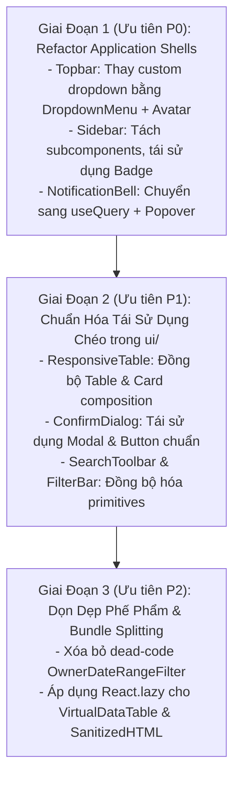

#### Chi Tiết Các Hạng Mục Refactor Theo Giai Đoạn:

| Giai Đoạn | Component Mục Tiêu | Vị Trí File | Component Nội Bộ Cần Tái Sử Dụng | Mục Tiêu & Lợi Ích Đo Lường Được |
| :---: | :--- | :--- | :--- | :--- |
| **P0** | **`Topbar`** | [`shared/topbar/Topbar.tsx`](shared/topbar/Topbar.tsx) | [`DropdownMenu`](ui/overlay/DropdownMenu.tsx), [`Avatar`](ui/data-display/Avatar.tsx), [`Button`](ui/actions/Button.tsx) | Xóa bỏ `mousedown` listener thủ công, loại bỏ raw `<button>`, chuẩn hóa APG focus. |
| **P0** | **`Sidebar`** | [`shared/sidebar/Sidebar.tsx`](shared/sidebar/Sidebar.tsx) | [`Badge`](ui/data-display/Badge.tsx), [`Accordion`](ui/data-display/Accordion.tsx) | Giảm từ 461 dòng xuống < 250 dòng (`SEM-ARCH-001`), loại bỏ hardcoded badge classes. |
| **P0** | **`NotificationBell`** | `shared/notification/NotificationBell.tsx` | [`Popover`](ui/overlay/Popover.tsx), [`Button`](ui/actions/Button.tsx), [`Badge`](ui/data-display/Badge.tsx) | Xóa bỏ `useEffect` direct fetch (`SEM-STATE-001`), giảm từ 416 dòng xuống < 200 dòng. |
| **P1** | **`ResponsiveTable`** | [`ui/ResponsiveTable.tsx`](ui/data-display/ResponsiveTable.tsx) | [`Table`](ui/data-display/Table.tsx), [`Card`](ui/data-display/Card.tsx), [`Skeleton`](ui/feedback/Skeleton.tsx) | Thống nhất padding, border tokens giữa Desktop và Mobile card view. |
| **P1** | **`ConfirmDialog`** | [`ui/ConfirmDialog.tsx`](ui/overlay/ConfirmDialog.tsx) | [`Modal`](ui/overlay/Modal.tsx), [`Button`](ui/actions/Button.tsx) | Loại bỏ trùng lặp Radix Dialog logic, hỗ trợ đầy đủ variant danger/warning. |
| **P1** | **`SearchToolbar`** | [`ui/SearchToolbar.tsx`](ui/forms/SearchToolbar.tsx) | [`SearchInput`](ui/forms/SearchInput.tsx), [`Button`](ui/actions/Button.tsx), [`FilterDropdown`](ui/forms/FilterDropdown.tsx) | Đồng bộ debounce 300ms, chống lag Main Thread (INP tối ưu). |
| **P2** | **`OwnerDateRangeFilter`** | `shared/OwnerDateRangeFilter.tsx` (Đã xóa) | — | Đã xóa bỏ dead-code vi phạm quy chuẩn khỏi codebase. |
| **P2** | **`VirtualDataTable`** | [`ui/VirtualDataTable.tsx`](ui/data-display/VirtualDataTable.tsx) | `React.lazy` | Đưa vào Dynamic Import trên các view quản lý lớn, giảm Initial Bundle ~40KB. |

---

## CHƯƠNG 5: CÂY QUYẾT ĐỊNH CHỌN COMPONENT (10 DECISION TREES)

Khi phát triển tính năng, hãy đối chiếu nhu cầu với 10 cây quyết định sau trước khi viết bất kỳ thẻ JSX nào:

### 5.1 Cây 1: Chọn Nút Bấm & Bộ Điều Hướng (Actions & Navigation)

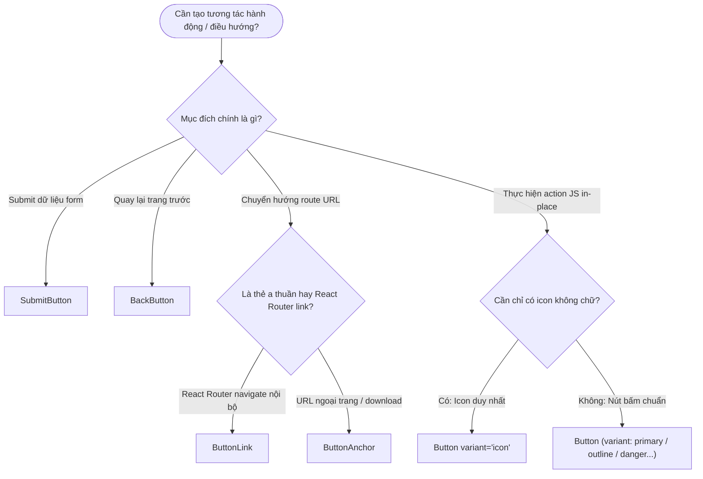

### 5.2 Cây 2: Hiển Thị Dữ Liệu Bảng & Danh Sách (Tables & Grids)

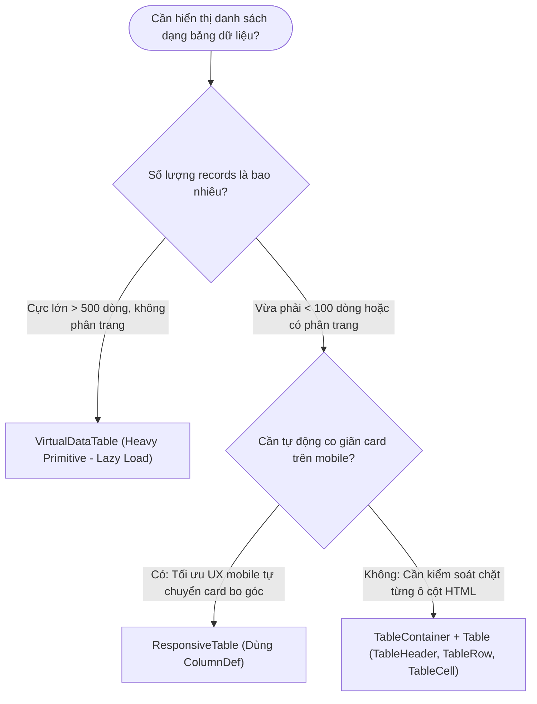

### 5.3 Cây 3: Hiển Thị Trạng Thái Trang & Tiến Trình (States, Feedback & Progress)

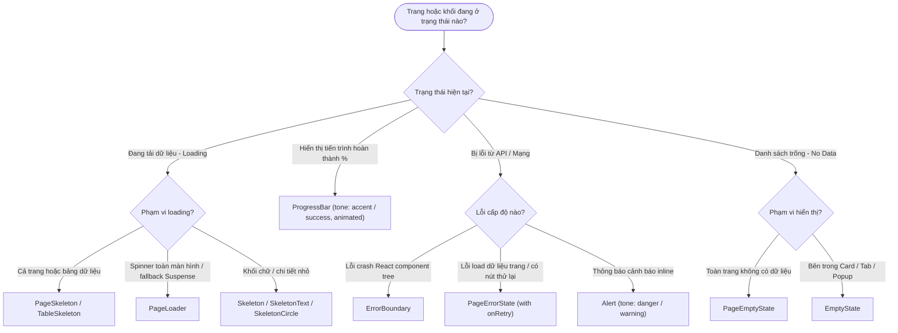

### 5.4 Cây 4: Nhập Liệu Form (Form Input Controls)

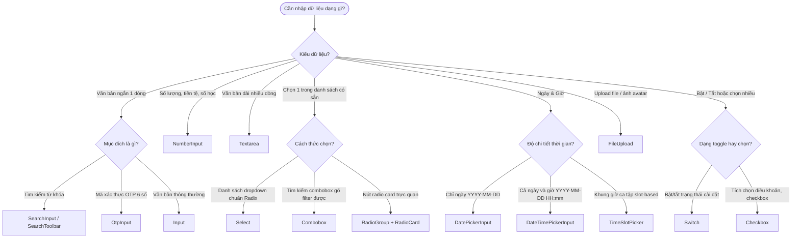

### 5.5 Cây 5: Hộp Thoại, Popup & Menu Lớp Phủ (Overlays & Dialogs)

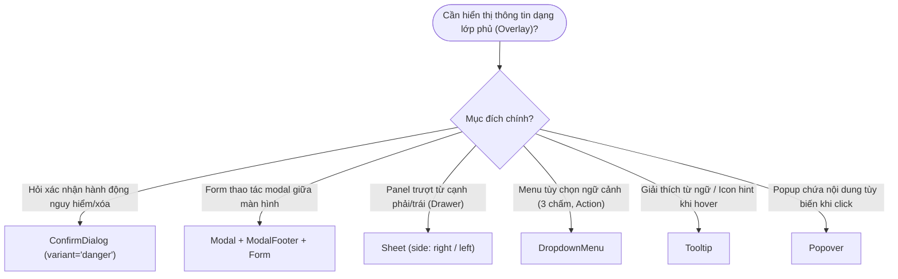

### 5.6 Cây 6: Bố Cục Khối, Thẻ & Phân Cách (Layout, Cards & Badges)

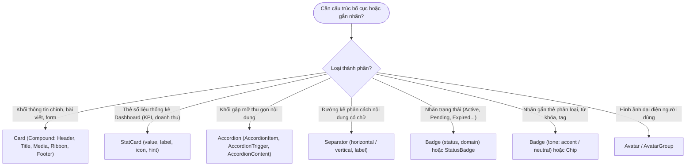

### 5.7 Cây 7: Bố Cục Khung & Hệ Thống Lưới Layout (Grid, Flex, Box & Container)

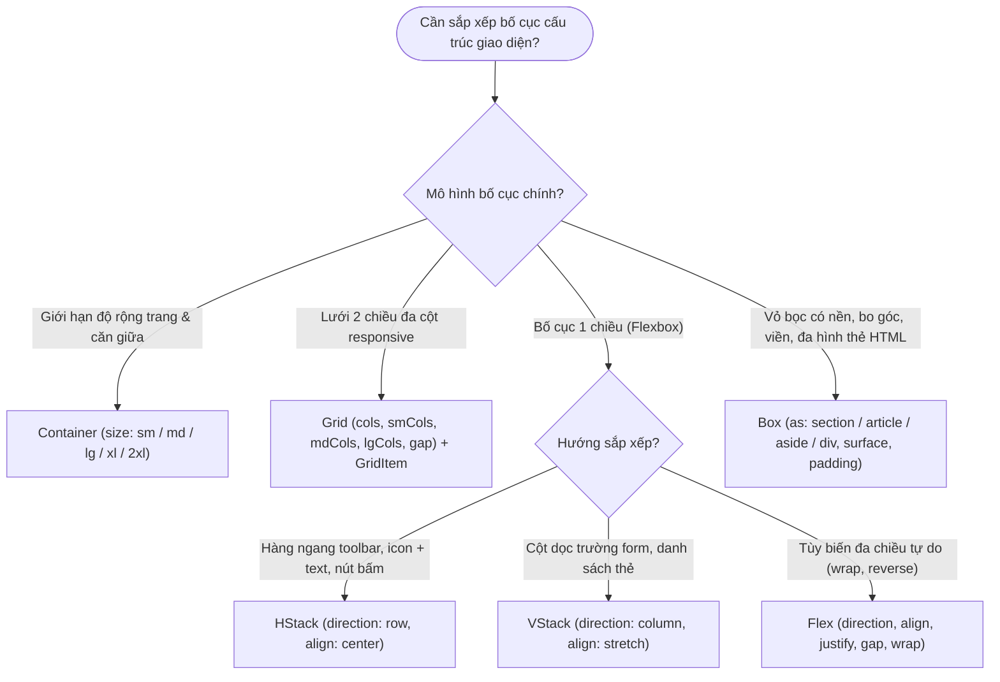

### 5.8 Cây 8: Kiểu Chữ & Phân Cấp Nội Dung Typography (Heading & Text)

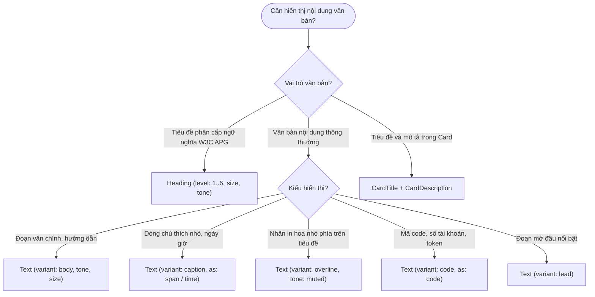

### 5.9 Cây 9: Hình Ảnh & Phương Tiện Media CLS = 0 (Image & Avatar)

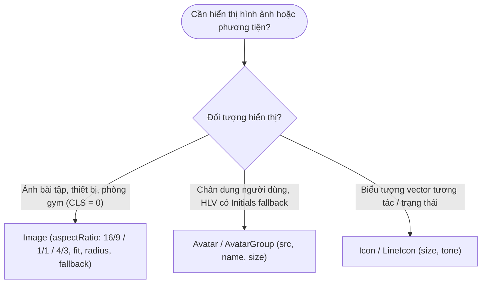

### 5.10 Cây 10: Trình Diễn Dữ Liệu Key-Value & Metadata (DescriptionList & Tables)

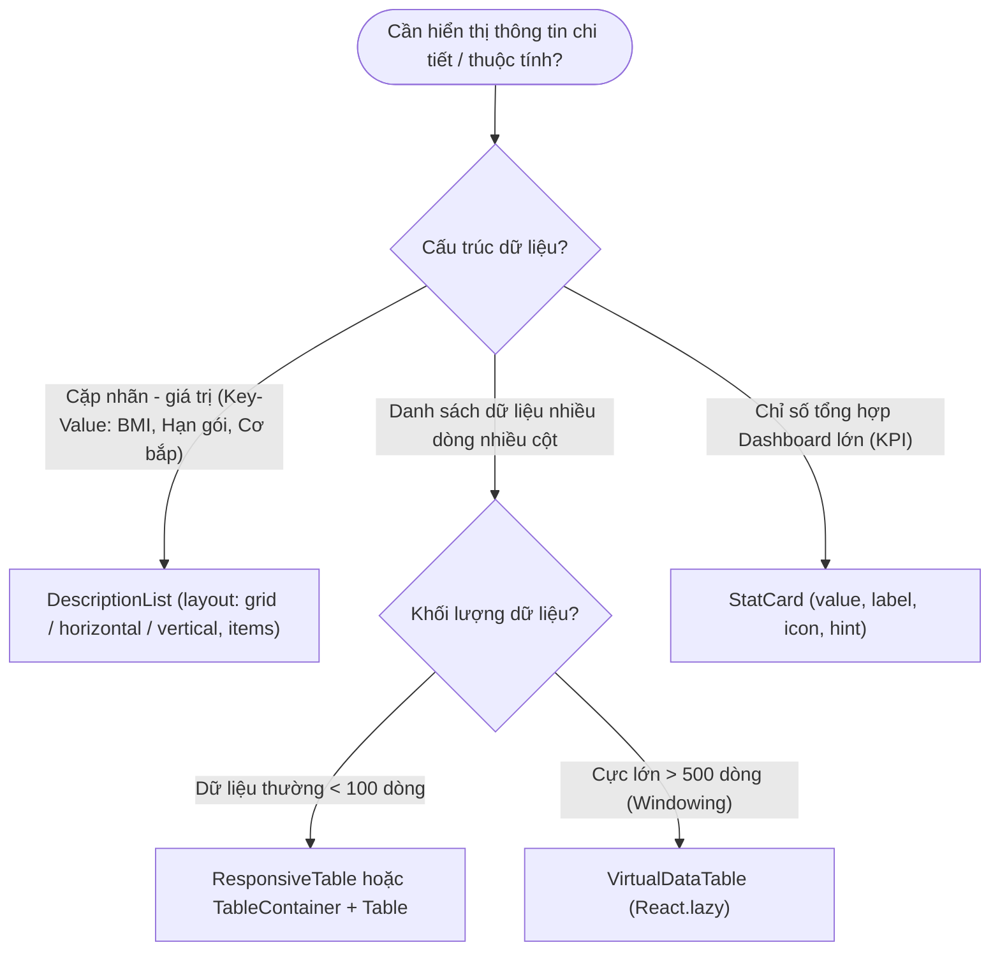

---

## CHƯƠNG 6: CATALOG TOÀN DIỆN 100% UI PRIMITIVES (`ui/`)

Tất cả các thành phần dưới đây được xuất (export) chính thức qua 8 Category Barrels tại [`ui/`](ui/).

### 6.1 Buttons & Actions

#### 1. `Button`
- **File nguồn:** [`ui/Button.tsx`](ui/actions/Button.tsx)
- **Vai trò ngữ nghĩa APG:** Render thẻ `<button>` tương tác, tự động quản lý focus outline, `disabled`, `loading` state và hỗ trợ bàn phím `Enter`/`Space`.
- **Props & Variants chính:**
  - `variant`: `'primary'` | `'outline'` | `'outline-white'` | `'outline-green'` | `'secondary'` | `'danger'` | `'ghost'` | `'text'` | `'text-accent'` | `'plain'` | `'icon'`
  - `size`: `'sm'` | `'md'` | `'lg'` | `'compact'`
  - `loading?: boolean`: Khi `true`, tự hiển thị spinner và khóa nút không cho click.
  - `leftIcon?: ReactNode`, `rightIcon?: ReactNode`
  - `mobileFull?: boolean`: Tự động kéo giãn 100% chiều rộng trên màn hình nhỏ.
- **Code mẫu chuẩn TSX:**
```tsx

import { Plus } from 'lucide-react'

<Button
  variant="primary"
  size="md"
  loading={isSubmitting}
  leftIcon={<Plus size={16} />}
  onClick={handleCreate}
>
  Tạo Buổi Tập Mới
</Button>
```

#### 2. `ButtonLink` & `ButtonAnchor`
- **File nguồn:** [`ui/Button.tsx`](ui/actions/Button.tsx)
- **Vai trò:** Render thẻ link (`<Link>` của React Router hoặc `<a>` ngoại vi) nhưng khoác giao diện và hiệu ứng hover/focus chuẩn của `Button`.
- **Props:** Tương tự `Button`, kèm prop `to` (với `ButtonLink`) hoặc `href` (với `ButtonAnchor`).

#### 3. `SubmitButton`
- **File nguồn:** [`ui/SubmitButton.tsx`](ui/actions/SubmitButton.tsx)
- **Vai trò:** Nút bấm chuyên biệt cho Form submit (`type="submit"`). Tự động vô hiệu hóa khi `disabled` hoặc `loading`.

#### 4. `BackButton`
- **File nguồn:** [`ui/BackButton.tsx`](ui/actions/BackButton.tsx)
- **Vai trò:** Nút điều hướng quay lại trang trước, tích hợp sẵn icon mũi tên lùi và i18n fallback route.

---

### 6.2 Form Controls & Inputs

#### 1. `Form` & `FormField`
- **File nguồn:** [`ui/Form.tsx`](ui/forms/Form.tsx), [`ui/FormField.tsx`](ui/forms/FormField.tsx)
- **Vai trò ngữ nghĩa APG:**
  - `<Form>` bọc khối nhập liệu với `noValidate`, chuẩn hóa submit event.
  - `<FormField>` tự sinh cặp `id` duy nhất và liên kết tự động `htmlFor` của `<label>` với `id` của input con, đồng thời tự động đẩy `aria-invalid="true"` và `aria-describedby` trỏ tới dòng thông báo lỗi `error`.
- **Code mẫu chuẩn TSX:**
```tsx

<Form onSubmit={handleSubmit} className="space-y-4">
  <FormField label="Họ và tên" error={errors.fullName} required fullWidth>
    <Input
      value={fullName}
      onChange={(e) => setFullName(e.target.value)}
      placeholder="Nguyễn Văn A"
    />
  </FormField>
</Form>
```

#### 2. `Input`, `NumberInput`, `OtpInput` & `Textarea`
- **File nguồn:** [`ui/Input.tsx`](ui/forms/Input.tsx), [`ui/NumberInput.tsx`](ui/forms/NumberInput.tsx), [`ui/OtpInput.tsx`](ui/forms/OtpInput.tsx), [`ui/Textarea.tsx`](ui/forms/Textarea.tsx)
- **Vai trò:** Input văn bản, số tiền, mã OTP 6 số và textarea chuẩn Design Token, chống vỡ giao diện trên Safari iOS (zoom-prevention 16px font-size) và hiển thị focus-ring xanh thương hiệu RoGym.

#### 3. `Select` & `Combobox`
- **File nguồn:** [`ui/Select.tsx`](ui/forms/Select.tsx), [`ui/Combobox.tsx`](ui/forms/Combobox.tsx)
- **Vai trò ngữ nghĩa APG:** Select dạng Radix UI Headless. Lập trình viên truyền thẻ `<option>` bên trong như select native, component tự parse thành Radix Accessible Select Item.

#### 4. `Checkbox`, `Switch` & `RadioGroup` (kèm `RadioCard`)
- **File nguồn:** [`ui/Checkbox.tsx`](ui/forms/Checkbox.tsx), [`ui/Switch.tsx`](ui/forms/Switch.tsx), [`ui/RadioGroup.tsx`](ui/forms/RadioGroup.tsx)
- **Vai trò:** Điều khiển chọn lựa đa dạng tuân thủ chuẩn APG (`role="checkbox"`, `role="switch"`, `role="radiogroup"`). Hỗ trợ `RadioCard` với viền highlight khi được active.

#### 5. `DatePickerInput`, `DateTimePickerInput`, `TimeSlotPicker` & `FileUpload`
- **File nguồn:** [`ui/DatePickerInput.tsx`](ui/forms/DatePickerInput.tsx), [`ui/DateTimePickerInput.tsx`](ui/forms/DateTimePickerInput.tsx), [`ui/TimeSlotPicker.tsx`](ui/forms/TimeSlotPicker.tsx), [`ui/FileUpload.tsx`](ui/forms/FileUpload.tsx)
- **Vai trò:** Nhập ngày tháng định dạng chuẩn ISO/Địa phương Việt Nam (`Asia/Ho_Chi_Minh`), popup lịch popover chống tràn mobile và upload ảnh kéo thả.

---

### 6.3 Filter & Search Controls

#### 1. `SearchInput` & `SearchToolbar`
- **File nguồn:** [`ui/SearchInput.tsx`](ui/forms/SearchInput.tsx), [`ui/SearchToolbar.tsx`](ui/forms/SearchToolbar.tsx)
- **Vai trò:** Hộp tìm kiếm có sẵn icon kính lúp, nút xóa (clear icon), debounce tự động 300ms, tích hợp slot `filters` và `actions` thành một thanh công cụ chuẩn mực.

#### 2. `FilterDropdown`, `FilterBar`, `Chip`, `TagInput`
- **File nguồn:** [`ui/FilterDropdown.tsx`](ui/forms/FilterDropdown.tsx), [`ui/FilterBar.tsx`](ui/forms/FilterBar.tsx), [`ui/Chip.tsx`](ui/data-display/Chip.tsx), [`ui/TagInput.tsx`](ui/forms/TagInput.tsx)
- **Vai trò:** Hỗ trợ xây dựng giao diện lọc dữ liệu phức tạp nhiều tiêu chí (status, date range, coach, package).

---

### 6.4 Overlays, Modals & Dialogs

#### 1. `Modal` & `ModalFooter`
- **File nguồn:** [`ui/Modal.tsx`](ui/overlay/Modal.tsx)
- **Vai trò ngữ nghĩa APG:** Hộp thoại Radix Dialog (`role="dialog"`, `aria-modal="true"`). Tự động khóa scroll body khi mở, bẫy tiêu điểm (focus trap), đóng bằng phím ESC.
- **Code mẫu chuẩn TSX:**
```tsx

<Modal
  open={isOpen}
  onClose={() => setIsOpen(false)}
  title="Gán Giáo Án Tập Luyện"
  size="md"
  footer={
    <ModalFooter>
      <Button variant="outline-white" onClick={() => setIsOpen(false)}>Hủy</Button>
      <SubmitButton form="assign-plan-form" loading={isAssigning}>Xác Nhận</SubmitButton>
    </ModalFooter>
  }
>
  <Form id="assign-plan-form" onSubmit={handleAssign}>
    {/* Form Fields */}
  </Form>
</Modal>
```

#### 2. `ConfirmDialog`
- **File nguồn:** [`ui/ConfirmDialog.tsx`](ui/overlay/ConfirmDialog.tsx)
- **Vai trò:** Hộp thoại xác nhận nhanh các thao tác nguy hiểm (Xóa tài khoản, Hủy buổi tập, Gỡ ảnh đại diện, Đăng xuất) với nút xác nhận màu đỏ khi `variant="danger"`. Tái sử dụng [`Button`](ui/actions/Button.tsx).

#### 3. `Sheet`, `DropdownMenu`, `Popover`, `Tooltip`
- **File nguồn:** [`ui/Sheet.tsx`](ui/overlay/Sheet.tsx), [`ui/DropdownMenu.tsx`](ui/overlay/DropdownMenu.tsx), [`ui/Popover.tsx`](ui/overlay/Popover.tsx), [`ui/Tooltip.tsx`](ui/overlay/Tooltip.tsx)
- **Vai trò:** Radix-based primitives cho drawer trượt bên hông, menu ngữ cảnh, popup thả nổi và gợi ý tooltip.

---

### 6.5 Data Display, Cards, Badges & Separator

#### 1. `Card` & Toàn bộ Compound Subcomponents
- **File nguồn:** [`ui/Card.tsx`](ui/data-display/Card.tsx)
- **Vai trò:** Khung hiển thị nội dung khối chuẩn RoGym với viền `border-line-subtle`, nền `bg-surface-card` và border-radius bo tròn chuẩn mực.
- **Subcomponents đầy đủ:**
  - `CardHeader`: Khối tiêu đề đầu thẻ
  - `CardTitle`: Thẻ tiêu đề hỗ trợ prop `as` (`h1` - `h6`) và kích cỡ `size`
  - `CardDescription`: Dòng phụ đề mô tả
  - `CardMedia`: Khung hình ảnh/video tỉ lệ cố định (`aspectRatio`: `'video'` | `'square'` | `'wide'`)
  - `CardRibbon`: Dải ruy-băng gắn góc nhãn nổi bật (`tone`: `'accent'` | `'success'` | `'danger'`)
  - `CardContent`: Vùng nội dung thân thẻ
  - `CardFooter`: Khối chân thẻ chứa các action buttons (hỗ trợ `align`: `'start'` | `'end'` | `'between'`)
  - `CardSkeleton`: Khung xương tải cho toàn bộ thẻ Card

#### 2. `StatCard`
- **File nguồn:** [`ui/StatCard.tsx`](ui/data-display/StatCard.tsx)
- **Vai trò:** Thẻ số liệu thống kê chuẩn Dashboard (KPI card) với icon, nhãn, giá trị số lớn, gợi ý trend hoặc link chuyển tiếp.

#### 3. `Badge` & `StatusBadge`
- **File nguồn:** [`ui/Badge.tsx`](ui/data-display/Badge.tsx), [`ui/StatusBadge.tsx`](ui/data-display/StatusBadge.tsx)
- **Vai trò:** Smart Unified Primitive hiển thị nhãn phân loại, từ khóa hoặc trạng thái hệ thống tự động suy luận tone và đa ngôn ngữ i18n theo domain.
- **Props & Cấu hình chính:**
  - `status?: string | null`: Mã trạng thái nghiệp vụ (ví dụ: `active`, `pending`, `expired`, `in_progress`...).
  - `domain?: 'member' | 'payment' | 'session' | 'subscription' | 'equipment' | 'general'`: Phân vùng nghiệp vụ để tự động suy luận Semantic Tone và text dịch đa ngôn ngữ i18n.
  - `tone?: 'success' | 'warning' | 'danger' | 'info' | 'neutral' | 'accent'`: Ghi đè màu sắc ngữ nghĩa thủ công khi không dùng status.
  - `emphasis?: 'solid' | 'subtle' | 'outline'`: Độ nổi bật của nhãn (mặc định `'subtle'`).
  - `variant?: 'pill' | 'rounded'`: Kiểu dáng bo tròn hoàn toàn (`pill`, mặc định) hoặc bo góc (`rounded`).
  - `size?: 'xs' | 'sm' | 'md' | 'lg' | 'xl'`: Kích thước nhãn theo thang chuẩn.
  - `dot?: boolean`, `pulse?: boolean`: Chấm chỉ báo trạng thái và hiệu ứng nhấp nháy động (tự động bật khi status là `in_progress` hoặc `realtime`).
  - `interactive?: boolean`: Chế độ tương tác hỗ trợ click, phím bấm Enter/Space và touch-target tối thiểu 44px trên mobile (chuẩn W3C APG & LINE LIFF).
  - **Compound Sub-components:** `<Badge.Dot />`, `<Badge.Icon />`, `<Badge.Text />`.
- **Code mẫu chuẩn TSX:**
```tsx

// 1. Shorthand Status Badge tự động suy luận tone & text tiếng Việt theo domain
<Badge status={member.status} domain="member" />
<Badge status={session.status} domain="session" dot pulse />

// 2. Tag / Nhãn phân loại tùy biến
<Badge tone="accent" emphasis="subtle" size="sm">Hội viên VIP</Badge>
<Badge tone="success" variant="rounded" dot>Đang tập</Badge>

// 3. Cú pháp Compound Sub-components
<Badge tone="warning">
  <Badge.Dot pulse />
  <Badge.Text>Đang xử lý yêu cầu</Badge.Text>
</Badge>

// 4. Backward-compatible Alias
<StatusBadge status="active" />
```

#### 4. `Separator`
- **File nguồn:** [`ui/Separator.tsx`](ui/layout/Separator.tsx)
- **Vai trò:** Đường phân cách ngữ nghĩa dựa trên Radix Separator. Hỗ trợ hiển thị nhãn chữ giữa dòng (`label`) và xoay chiều `orientation="horizontal" | "vertical"`.
- **Code mẫu:**
```tsx

// Đường kẻ ngang có nhãn chữ giữa
<Separator label="HOẶC TIẾP TỤC VỚI" />

// Đường kẻ dọc phân cách thanh công cụ
<div className="flex h-6 items-center">
  <span>Mục 1</span>
  <Separator orientation="vertical" />
  <span>Mục 2</span>
</div>
```

#### 5. `Avatar` & `AvatarGroup`
- **File nguồn:** [`ui/Avatar.tsx`](ui/data-display/Avatar.tsx)
- **Vai trò:** Hiển thị ảnh đại diện học viên / HLV với fallback ký tự chữ cái đầu tiên (Initials) và viền chuẩn.

---

### 6.6 Tables & Lists

#### 1. `Table` & `TableContainer`
- **File nguồn:** [`ui/Table.tsx`](ui/data-display/Table.tsx)
- **Vai trò:** Bộ khung bảng dữ liệu chuẩn semantic: `TableContainer`, `Table`, `TableHeader`, `TableBody`, `TableFooter`, `TableRow`, `TableHead`, `TableCell`, `TableCaption`, `TableEmpty`.

#### 2. `ResponsiveTable`
- **File nguồn:** [`ui/ResponsiveTable.tsx`](ui/data-display/ResponsiveTable.tsx)
- **Vai trò:** Nhận vào danh sách `columns` (`ColumnDef<T>`) và mảng `data`. Tự động render dạng Bảng dữ liệu trên Desktop (>= 768px) và tự chuyển sang danh sách dạng Card bo góc trên Mobile (< 768px).

#### 3. `VirtualDataTable` *(Heavy Primitive)*
- **File nguồn:** [`ui/VirtualDataTable.tsx`](ui/data-display/VirtualDataTable.tsx)
- **Vai trò:** Tối ưu hiệu năng cho danh sách lớn (> 500 records) bằng kỹ thuật ảo hóa DOM (Windowing/Virtualization qua `@tanstack/react-virtual`).
- **Chỉ dẫn:** Bắt buộc áp dụng `React.lazy` khi sử dụng ở các màn hình thông thường để tránh làm nặng initial bundle (Xem mục 3.3).

---

### 6.7 Navigation, Accordion & Layout Controls

#### 1. `Accordion` & `AccordionGroup`
- **File nguồn:** [`ui/Accordion.tsx`](ui/data-display/Accordion.tsx)
- **Vai trò ngữ nghĩa APG:** Khối gập mở thu gọn nội dung tuân thủ APG Accordion pattern. Hỗ trợ phím mũi tên `ArrowUp`/`ArrowDown`/`Home`/`End`, tự động đồng bộ `aria-expanded` và `aria-controls`.
- **Subcomponents & Props:**
  - `Accordion`: Provider chính (`type`: `'single'` | `'multiple'`, `variant`: `'card'` | `'separated'` | `'flush'`)
  - `AccordionItem`: Khối từng mục (`value`: string duy nhất)
  - `AccordionTrigger`: Nút bấm gập mở có icon chevron xoay tự động
  - `AccordionContent`: Vùng nội dung trượt mở mượt mà
  - `AccordionGroup`: Component bọc tiện ích nhận mảng `items` (`AccordionGroupItem[]`)
- **Code mẫu TSX:**
```tsx

<Accordion type="single" variant="card" defaultValue="faq-1">
  <AccordionItem value="faq-1">
    <AccordionTrigger>Quy định bảo lưu gói tập thế nào?</AccordionTrigger>
    <AccordionContent>Hội viên được bảo lưu tối đa 30 ngày mỗi năm...</AccordionContent>
  </AccordionItem>
</Accordion>
```

#### 2. `Page` & `PageHeader` (from `PageUI.tsx`)
- **File nguồn:** [`ui/PageUI.tsx`](ui/layout/PageUI.tsx)
- **Vai trò:** Khung bao bọc layout của toàn bộ màn hình chức năng. `PageHeader` chuẩn hóa tiêu đề trang, dòng thông tin phụ (eyebrow, description) và khối các nút hành động (actions).

#### 3. `Tabs`, `TabsBar` & `SegmentedControl`
- **File nguồn:** [`ui/Tabs.tsx`](ui/navigation/Tabs.tsx), [`ui/SegmentedControl.tsx`](ui/navigation/SegmentedControl.tsx)
- **Vai trò:** Điều hướng tab pills/underline và thanh chọn phân đoạn.

#### 4. `Breadcrumb` & `Stepper`
- **File nguồn:** [`ui/Breadcrumb.tsx`](ui/navigation/Breadcrumb.tsx), [`ui/Stepper.tsx`](ui/navigation/Stepper.tsx)
- **Vai trò:** Vệt điều hướng phân cấp trang và thanh điều khiển tiến trình nhiều bước (Wizard steps).

#### 5. `ThemeToggle` & `ThemeSegmentedControl`
- **File nguồn:** [`ui/ThemeToggle.tsx`](ui/navigation/ThemeToggle.tsx), [`ui/ThemeSegmentedControl.tsx`](ui/navigation/ThemeSegmentedControl.tsx)
- **Vai trò:** Điều khiển giao diện Dark/Light/System theme theo Design Tokens 2 lớp:
  - `ThemeToggle`: Nút tròn icon Sun/Moon xoay hiệu ứng mượt mà.
  - `ThemeSegmentedControl`: Thanh chọn phân đoạn chuẩn APG RadioGroup hỗ trợ 3 chế độ (`light`, `dark`, `system`).
- **Code mẫu:**
```tsx

// Đặt trên Topbar
<ThemeToggle size="md" />

// Đặt trong trang Cài đặt (Settings)
<ThemeSegmentedControl size="md" fullWidth />
```

#### 6. `LanguageSwitcher`
- **File nguồn:** [`ui/LanguageSwitcher.tsx`](ui/typography/LanguageSwitcher.tsx)
- **Vai trò:** Nút chuyển đổi nhanh ngôn ngữ i18n giữa Tiếng Việt (`vi`) và Tiếng Nhật (`ja`).

---

### 6.8 Feedback, Loaders & Progress States

#### 1. `ProgressBar`
- **File nguồn:** [`ui/ProgressBar.tsx`](ui/feedback/ProgressBar.tsx)
- **Vai trò ngữ nghĩa APG:** Thanh tiến trình định lượng tuân thủ chuẩn `role="progressbar"`, tự động cập nhật `aria-valuenow`, `aria-valuemin`, `aria-valuemax`.
- **Props chính:** `value: number`, `max?: number`, `tone?: Tone`, `size?: 'xs' | 'sm' | 'md' | 'lg' | 'xl'`, `label?: ReactNode`, `showValue?: boolean`, `animated?: boolean`.
- **Code mẫu:**
```tsx

<ProgressBar
  value={8}
  max={12}
  tone="accent"
  size="md"
  label="Tiến độ buổi tập đã hoàn thành"
  showValue
  animated
/>
```

#### 2. `PageSkeleton`, `Skeleton`, `TableSkeleton`
- **File nguồn:** [`ui/Skeleton.tsx`](ui/feedback/Skeleton.tsx), [`ui/PageUI.tsx`](ui/layout/PageUI.tsx)
- **Vai trò:** Hiệu ứng khung xương tải dữ liệu (Shimmer animation) cố định kích thước để triệt tiêu hiện tượng giật giao diện (CLS = 0).

#### 3. `PageEmptyState` & `EmptyState`
- **File nguồn:** [`ui/PageUI.tsx`](ui/layout/PageUI.tsx), [`ui/EmptyState.tsx`](ui/feedback/EmptyState.tsx)
- **Vai trò:** Hiển thị khi danh sách trống dữ liệu kèm hình minh họa, thông điệp hướng dẫn và nút tạo mới (Action CTA).

#### 4. `PageErrorState` & `Alert`
- **File nguồn:** [`ui/PageUI.tsx`](ui/layout/PageUI.tsx), [`ui/Alert.tsx`](ui/feedback/Alert.tsx)
- **Vai trò:** Báo lỗi tải dữ liệu với nút "Thử lại" (`onRetry`) hoặc thông báo cảnh báo inline (`tone`: `'danger'` | `'warning'`).

---

### 6.9 Security & Data Optimization

#### 1. `SanitizedHTML` *(Heavy Primitive)*
- **File nguồn:** [`ui/SanitizedHTML.tsx`](ui/typography/SanitizedHTML.tsx)
- **Vai trò:** Làm sạch chuỗi HTML bằng DOMPurify trước khi render, chống tấn công XSS. Tuyệt đối không dùng `dangerouslySetInnerHTML` trần trụi.
- **Chỉ dẫn:** Bắt buộc áp dụng Dynamic Import khi trang không thuộc Critical Rendering Path (Xem mục 3.3).

---

### 6.10 Icons & Graphics

#### 1. `Icon` & `LineIcon`
- **File nguồn:** [`ui/Icon.tsx`](ui/typography/Icon.tsx), [`ui/LineIcon.tsx`](ui/typography/LineIcon.tsx)
- **Vai trò:** UI Primitives biểu tượng tuân thủ hệ thống Design Tokens (size `xs` - `xl`, tone, fg) và chuẩn WCAG 2.1 AA a11y (`aria-hidden="true"` khi trang trí, `role="img"` kèm `<title>` và `aria-label` khi có label). `LineIcon` cung cấp icon vector chuẩn của nền tảng LINE messenger/LIFF cho các tác vụ đăng nhập và liên kết tài khoản.

---

### 6.11 Layout Primitives (Box, Flex, HStack, VStack, Grid, Container)

#### 1. `Box`
- **File nguồn:** [`ui/Box.tsx`](ui/layout/Box.tsx), [`ui/box-utils.ts`](ui/layout/box-utils.ts)
- **Vai trò:** Vỏ bọc bố cục đa hình (Polymorphic Container) thay thế các thẻ `<div>`, `section`, `article`, `aside`, `header`, `footer`. Hỗ trợ gắn token surface, padding, border và bo góc chuẩn mực.
- **Props chính:** `as?: 'div' | 'section' | 'article' | 'aside' | 'header' | 'footer' | 'nav' | 'main'`, `surface?: 'transparent' | 'default' | 'card' | 'elevated' | 'subtle'`, `padding?: 'none' | 'xs' | 'sm' | 'md' | 'lg' | 'xl'`, `border?: 'none' | 'subtle' | 'default'`, `rounded?: 'none' | 'sm' | 'md' | 'lg' | 'xl' | 'full'`.
- **Code mẫu chuẩn TSX:**
```tsx

<Box as="section" surface="card" padding="lg" rounded="xl" border="subtle">
  <Text weight="semibold">Nội dung khối</Text>
</Box>
```

#### 2. `Flex`, `HStack`, `VStack`
- **File nguồn:** [`ui/Flex.tsx`](ui/layout/Flex.tsx), [`ui/flex-utils.ts`](ui/layout/flex-utils.ts)
- **Vai trò:** Hệ thống bố cục Flexbox một chiều trực quan tuân thủ nguyên tắc `patterns-explicit-variants`.
  - `HStack`: Preset cố định `direction="row"`, `align="center"`. Chuyên dùng cho toolbar, icon + text, hàng nút hành động.
  - `VStack`: Preset cố định `direction="column"`, `align="stretch"`. Chuyên dùng cho cột dọc form fields, danh sách thẻ.
  - `Flex`: Thành phần linh hoạt hỗ trợ cấu hình đa chiều (`direction`, `align`, `justify`, `gap`, `wrap`).
- **Props chính:** `gap?: 0 | 1 | 2 | 3 | 4 | 5 | 6 | 8 | 10 | 12`, `align?: 'start' | 'center' | 'end' | 'stretch' | 'baseline'`, `justify?: 'start' | 'center' | 'end' | 'between' | 'around' | 'evenly'`.
- **Code mẫu chuẩn TSX:**
```tsx

// Thanh công cụ hàng ngang
<HStack justify="between" className="border-b border-border-subtle pb-3">
  <Text weight="semibold">Danh sách học viên</Text>
  <Button size="sm">Thêm mới</Button>
</HStack>

// Cột trường nhập liệu dọc
<VStack gap={4}>
  <FormField label="Họ và tên" name="fullName" />
  <FormField label="Số điện thoại" name="phone" />
</VStack>
```

#### 3. `Grid`, `GridItem`
- **File nguồn:** [`ui/Grid.tsx`](ui/layout/Grid.tsx), [`ui/grid-utils.ts`](ui/layout/grid-utils.ts)
- **Vai trò:** Hệ thống CSS Grid responsive hai chiều thay thế các thẻ `<div className="grid...">`. Hỗ trợ khai báo số cột theo từng breakpoint Tailwind ngay trên props.
- **Props chính:**
  - `Grid`: `cols?: 1..12`, `smCols?`, `mdCols?`, `lgCols?`, `xlCols?`, `gap?: 1 | 2 | 3 | 4 | 6 | 8`, `as?: 'div' | 'section' | 'ul' | 'ol'`.
  - `GridItem`: `colSpan?: 1..12`, `smColSpan?`, `mdColSpan?`, `lgColSpan?`, `rowSpan?`.
- **Code mẫu chuẩn TSX:**
```tsx

<Grid cols={1} smCols={2} lgCols={4} gap={4}>
  {items.map(item => (
    <Card key={item.id}>...</Card>
  ))}
</Grid>
```

#### 4. `Container`
- **File nguồn:** [`ui/Container.tsx`](ui/layout/Container.tsx), [`ui/container-utils.ts`](ui/layout/container-utils.ts)
- **Vai trò:** Giới hạn chiều rộng trang chuẩn doanh nghiệp, tự động căn giữa `mx-auto` và đệm lề `px-4 sm:px-6 lg:px-8`.
- **Props chính:** `size?: 'sm' | 'md' | 'lg' | 'xl' | '2xl' | 'full'`, `centered?: boolean`.
- **Code mẫu:**
```tsx

<Container size="xl">
  <PageHeader title="Báo cáo tài chính" />
</Container>
```

---

### 6.12 Typography, Media & Presentation Primitives (Text, Heading, Label, Image, DescriptionList)

#### 1. `Text`
- **File nguồn:** [`ui/Text.tsx`](ui/typography/Text.tsx), [`ui/text-utils.ts`](ui/typography/text-utils.ts)
- **Vai trò:** UI Primitive kiểu chữ đa hình (Polymorphic Typography) thay thế 100% thẻ `<span>` trần và các thẻ `<p>` định kiểu thủ công.
- **Props chính:**
  - `variant?: 'body' | 'caption' | 'overline' | 'code' | 'lead'`.
  - `size?: 'xs' | 'sm' | 'md' | 'lg' | 'xl'`.
  - `weight?: 'normal' | 'medium' | 'semibold' | 'bold'`.
  - `tone?: 'default' | 'muted' | 'dim' | 'accent' | 'success' | 'warning' | 'danger'`.
  - `truncate?: boolean` (cắt 1 dòng kèm dấu `...`).
  - `clamp?: 1 | 2 | 3 | 4 | 5 | 6` (cắt nhiều dòng qua `line-clamp-*`).
  - `as?: 'span' | 'p' | 'strong' | 'em' | 'small' | 'time' | 'code' | 'label'`.
- **Code mẫu chuẩn TSX:**
```tsx

<Text variant="caption" tone="muted">Cập nhật lúc:</Text>
<Text as="time" weight="semibold">10:30 19/10/2026</Text>
<Text variant="overline" tone="accent">GÓI TẬP VIP</Text>
```

#### 2. `Heading`
- **File nguồn:** [`ui/Heading.tsx`](ui/typography/Heading.tsx), [`ui/heading-utils.ts`](ui/typography/heading-utils.ts)
- **Vai trò:** Đảm bảo thứ tự tiêu đề tiếp cận (A11y) W3C APG (`A11Y_HEADING_ORDER`), tự động kết xuất thẻ HTML5 `<h1>` đến `<h6>`.
- **Props chính:** `level: 1 | 2 | 3 | 4 | 5 | 6` (Bắt buộc), `size?: 'xs' | 'sm' | 'md' | 'lg' | 'xl' | '2xl' | '3xl'`, `tone?: 'default' | 'accent' | 'muted'`.
- **Code mẫu:**
```tsx

<Heading level={1} size="2xl">Quản lý Hội viên</Heading>
<Heading level={2} size="lg" tone="accent">Thông tin cá nhân</Heading>
```

#### 3. `Label`
- **File nguồn:** [`ui/Label.tsx`](ui/forms/Label.tsx), [`ui/label-utils.ts`](ui/forms/label-utils.ts)
- **Vai trò:** Nhãn trường nhập liệu độc lập thay thế các thẻ `<label>` trần. Tự động hiển thị dấu `*` đỏ khi `required={true}` (có `aria-hidden="true"`) và liên kết khả năng tiếp cận (a11y) qua `htmlFor`.
- **Props chính:** `htmlFor?: string`, `required?: boolean`, `size?: 'sm' | 'md'`, `disabled?: boolean`.
- **Code mẫu:**
```tsx

<Label htmlFor="member-code" required>Mã hội viên</Label>
<Input id="member-code" placeholder="MEM-12345" />
```

#### 4. `Image`
- **File nguồn:** [`ui/Image.tsx`](ui/data-display/Image.tsx), [`ui/image-utils.ts`](ui/data-display/image-utils.ts)
- **Vai trò:** Triệt tiêu hoàn toàn hiện tượng rung giật giao diện (Web Vitals CLS = 0) khi tải ảnh, tự động xử lý lazy loading và fallback icon khi ảnh mạng bị lỗi.
- **Props chính:**
  - `src?: string | null`: Đường dẫn ảnh.
  - `alt: string`: Mô tả khả năng tiếp cận (a11y) bắt buộc theo chuẩn WCAG 2.1 AA.
  - `aspectRatio?: '1/1' | '16/9' | '4/3' | '21/9' | 'auto'`: Tỉ lệ khung hình cố định.
  - `fit?: 'cover' | 'contain' | 'fill' | 'none'`.
  - `radius?: 'none' | 'sm' | 'md' | 'lg' | 'xl' | 'full'`.
  - `fallbackIcon?: ReactNode`: Biểu tượng thay thế khi lỗi ảnh.
- **Code mẫu chuẩn TSX:**
```tsx

<Image
  src={exercise.imageUrl}
  alt={exercise.name}
  aspectRatio="16/9"
  fit="cover"
  radius="xl"
  loading="lazy"
/>
```

#### 5. `DescriptionList`
- **File nguồn:** [`ui/DescriptionList.tsx`](ui/data-display/DescriptionList.tsx), [`ui/description-list-utils.ts`](ui/data-display/description-list-utils.ts)
- **Vai trò:** Trình diễn các cặp dữ liệu nhãn - giá trị (Key-Value metadata) bằng thẻ ngữ nghĩa HTML5 `<dl>`, `<dt>`, `<dd>`. Thay thế hoàn toàn các khối lồng ghép `div` + `span` lộn xộn.
- **Compound Subcomponents:** `DescriptionList`, `DescriptionItem`, `DescriptionTerm`, `DescriptionDetails`.
- **Props chính:** `layout?: 'horizontal' | 'vertical' | 'grid'`, `columns?: 1 | 2 | 3 | 4`, `size?: 'sm' | 'md' | 'lg'`, `items?: DescriptionItemData[]`.
- **Code mẫu chuẩn TSX:**
```tsx

// 1. Shorthand Items Prop tiện dụng
<DescriptionList
  layout="grid"
  columns={2}
  size="sm"
  items={[
    { term: 'Nhóm cơ chính', details: exercise.targetMuscle?.name ?? '—' },
    { term: 'Thiết bị yêu cầu', details: exercise.equipment?.name ?? '—' },
  ]}
/>

// 2. Cú pháp Compound Subcomponents tùy biến cao
<DescriptionList layout="horizontal">
  <DescriptionList.Item>
    <DescriptionList.Term>Hạn sử dụng gói:</DescriptionList.Term>
    <DescriptionList.Details>31/12/2026</DescriptionList.Details>
  </DescriptionList.Item>
</DescriptionList>
```

---

## CHƯƠNG 7: CATALOG SHARED COMPOSITES & APPLICATION SHELLS (`shared/`)

Tất cả các thành phần trong `client/src/components/shared/` phục vụ mục đích xây dựng khung ứng dụng (Shells) và tái sử dụng đa vai trò (Multi-role composites):

| Component | File nguồn | Vai trò chính | Cách áp dụng chuẩn |
| :--- | :--- | :--- | :--- |
| **`Sidebar`** | [`shared/sidebar/Sidebar.tsx`](shared/sidebar/Sidebar.tsx) | Shell thanh điều hướng cạnh bên màn hình lớn cho Owner, Staff, Trainer | Đặt trong Layout chính của Desktop |
| **`Topbar`** | [`shared/topbar/Topbar.tsx`](shared/topbar/Topbar.tsx) | Shell thanh tiêu đề đỉnh ứng dụng chứa Avatar, ThemeToggle, Chuông thông báo | Đặt trên cùng của mọi trang Dashboard |
| **`BottomNav`** | `shared/bottom-nav/BottomNav.tsx` | Shell thanh điều hướng đáy ứng dụng trên di động & LINE LIFF | Tự động hiển thị trên thiết bị `< 768px` |
| **`ProtectedRoute`** | [`shared/protected-route/ProtectedRoute.tsx`](shared/protected-route/ProtectedRoute.tsx) | Bọc bảo vệ Route: Kiểm tra hydrate store, vai trò `allowedRoles` và redirect LINE an toàn | `<ProtectedRoute allowedRoles={['owner', 'staff']}><Page /></ProtectedRoute>` |
| **`NotificationUI`** | [`shared/notification/NotificationUI.tsx`](shared/notification/NotificationUI.tsx) | Hệ thống thành phần hiển thị thông báo: `NotificationToast`, `NotificationAlert`, `NotificationPanel` | Sử dụng trong hệ thống Toast & Notification Dropdown |
| **`NotificationBell`** | `shared/notification/NotificationBell.tsx` | Chuông thông báo Realtime tích hợp Supabase WebSocket | Đặt trên Topbar ứng dụng |
| **`PageLoader`** | [`shared/spinner/Spinner.tsx`](shared/spinner/Spinner.tsx) | Spinner tải dữ liệu toàn màn hình hoặc khối Suspense fallback | `<Suspense fallback={<PageLoader />}>` |
| **`SubscriptionRequired`** | `shared/subscription-required/SubscriptionRequired.tsx` | Khóa màn hình nếu học viên chưa có gói tập hợp lệ | Bọc quanh nội dung trang tập luyện của Member |
| **`ErrorBoundary`** | [`shared/error-boundary/ErrorBoundary.tsx`](shared/error-boundary/ErrorBoundary.tsx) | Bắt lỗi Runtime React, chống sập ứng dụng trắng màn hình | Bọc ở cấp Router hoặc Layout |

> [!CAUTION]
> **Lưu ý về Tách biệt Phạm vi (Scope Boundary):**  
> Thư mục `client/src/components/shared/` chỉ chứa các thành phần đa vai trò (Multi-role) đã được kiểm duyệt. Các file mang tính chất dead-code hoặc vi phạm đặt tên role trong shared (như `OwnerDateRangeFilter.tsx`) đã bị loại trừ khỏi catalog chính thức và được lên kế hoạch dọn dẹp ở Giai đoạn 3 (P2).

---

## CHƯƠNG 8: QUY CHUẨN CHUẨN MỰC CHỐNG TRÙNG LẶP & KHÔNG DÙNG FACADES

### 8.1 Năm Quy Tắc Vàng (The 5 Golden Rules)

> [!CAUTION]
> **QUY TẮC BẤT KHẢ XÂM PHẠM:**
> 1. **Tra cứu trước khi Code (Search First, Code Later):** Trước khi tạo bất kỳ thẻ tương tác hoặc khối giao diện nào, bạn BẮT BUỘC phải tra cứu xem thành phần đó đã có trong `@/components/ui` hoặc `@/components/shared` hay chưa.
> 2. **Nghiêm Cấm Tạo Facade Proxy:** Tuyệt đối KHÔNG tạo các file trung gian re-export đổi tên (như `MemberUI.tsx`, `TrainerUI.tsx`, `OwnerUI.tsx`, `StaffUI.tsx`). Tất cả import phải trực tiếp từ Category Barrels `@/components/ui/<category>`.
> 3. **Nghiêm Cấm Trùng Logic / Trùng Mục Đích:** Nếu một component đã có khả năng hiển thị bằng cách cấu hình Props/Variants (ví dụ: `Button` có 10+ variants, `Card` có 8+ subcomponents, `Accordion` có 3 variants), NGHIÊM CẤM tạo một component mới có cùng mục đích (ví dụ: cấm tạo `CustomButton`, `CustomCard`, `MyAccordion`).
> 4. **Tách Rời Rạch Ròi Business Logic Khỏi Primitives:** Nếu component có logic nghiệp vụ (như query API, dropdown chứa danh sách học viên PT), nó PHẢI nằm trong thư mục domain tương ứng (ví dụ: `@/components/trainer/StudentCombobox.tsx`), KHÔNG ĐƯỢC nhét vào `@/components/ui`.
> 5. **Quy Trình 4 Bước Đóng Góp Component Mới:** Nếu thực sự phát sinh một UI Primitive mới chưa từng có trong hệ thống, phải thực hiện đúng quy trình kiểm định tại mục 8.2.

### 8.2 Quy Trình 4 Bước Đóng Góp Component Mới (Contribution Workflow)

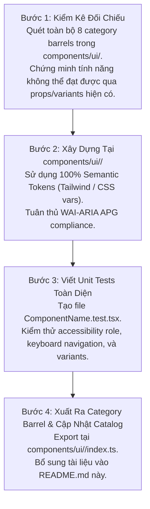

---

## CHƯƠNG 9: QUY CHUẨN NGHIÊM CẤM & CẢNH BÁO LẠM DỤNG (ANTI-ABUSE DIRECTIVES & SEVERE SYSTEM CONSEQUENCES)

Tài liệu này là **hợp đồng kỹ thuật tối thượng** bắt buộc tuân thủ khi xây dựng mới hoặc tái cấu trúc các components trong RoGym. Việc lạm dụng bừa bãi hoặc áp dụng sai mục đích sẽ gây ra suy thoái nghiêm trọng về trải nghiệm người dùng, khả năng tiếp cận (A11y) và hiệu năng của toàn hệ thống.

### 9.1 Bảng Ma Trận Quy Tắc Cấm & Đo Lường Hậu Quả Hệ Thống

| Mã Rule ID | Hành Vi Lạm Dụng Bị Nghiêm Cấm | Mức Độ | Hậu Quả Nặng Nề & Blast Radius |
| :--- | :--- | :---: | :--- |
| `RULE_NO_BUTTON_ABUSE` | Đặt $\ge 2$ Primary CTA trên 1 view/card; dùng Button thay cho link điều hướng; lồng nút trong container click; dàn trải $\ge 3$ nút bấm rời rạc trên từng dòng bảng; icon button thiếu `aria-label`. | `CRITICAL` | Phá vỡ phân cấp thị giác (Visual Hierarchy); người dùng bối rối không biết hành động chính là gì; mất chuột phải mở tab mới và SEO; xung đột sự kiện click ngoài tầm kiểm soát (`e.stopPropagation`); bảng biểu bị tràn vỡ giao diện trên mobile. |
| `RULE_NO_REDUNDANT_BORDER_PADDING` | Bọc nhiều thẻ `<div>` lồng nhau có border/padding; tạo viền đôi (Double Border); tự style card lặp đi lặp lại bằng `<div>` thay vì dùng `<Card as="...">`. | `CRITICAL` | Gây hiệu ứng "Hộp trong hộp" (Box-in-Box); 60% diện tích màn hình bị lãng phí cho viền và đệm; nội dung bị bóp nghẹt trên thiết bị di động; duplicate mã CSS lên 300%. |
| `RULE_NO_INLINE_COMPONENT_DEFINITION` | Định nghĩa component con (`function SubComponent() { ... }`) ngay bên trong render body của component cha. | `CRITICAL` | Con trỏ hàm component con bị tạo mới ở **mọi lần cha render**; ép React phải unmount/remount toàn bộ cây DOM con; mất vĩnh viễn focus bàn phím khi đang gõ text; reset toàn bộ state nội bộ; suy thoái hiệu năng render nghiêm trọng. |
| `RULE_NO_ZERO_LEAK_CONDITIONAL_RENDER` | Dùng `{items.length && <Component />}` trong JSX khi hiển thị có điều kiện. | `SEVERE` | Khi mảng rỗng (`length === 0`), biểu thức trả về số `0`, khiến React in số `0` trần trụi ra giao diện gây mất thẩm mỹ chuyên nghiệp. |
| `RULE_NO_UNCONTROLLED_TO_CONTROLLED_DRIFT` | Truyền `value={data?.field}` vào input mà không có fallback `value={data?.field ?? ''}`. | `SEVERE` | Ban đầu input nhận `undefined` (Uncontrolled), khi dữ liệu về nhận string (Controlled). React cảnh báo đỏ console và gây mất đồng bộ ký tự người dùng đang nhập. |
| `RULE_NO_BYPASS_PORTAL_OVERLAYS` | Đặt Modal, Popover, Dropdown Menu trực tiếp trong container cha có `overflow: hidden` hoặc `transform` thay vì kết xuất qua `<Portal>`. | `CRITICAL` | Nội dung popup bị cắt cụt (Clipping Hazard); bị kẹt bên dưới các tầng giao diện khác do giới hạn của Stacking Context cục bộ. |
| `RULE_NO_MAGIC_Z_INDEX` | Tự đặt giá trị z-index tùy tiện (`z-[9999]`, `z-[1000]`, `z-[999]`) thay vì Thang 5 Tầng chuẩn. | `SEVERE` | Khơi mào cuộc chiến z-index (Z-Index War), modal bị chìm dưới dropdown hoặc toast bị chìm dưới modal. |

### 9.2 Sơ Đồ Trực Quan & Phân Tích Kỹ Thuật Runtime/DOM

#### Hiện Tượng Nhiễu Loạn Nút Bấm (Button Clutter)
```
❌ GIAO DIỆN BỊ NHIỄU LOẠN NÚT BẤM (BUTTON CLUTTER)
┌─────────────────────────────────────────────────────────────┐
│ HỘI VIÊN: NGUYỄN VĂN A                           [Gói VIP]  │
│                                                             │
│ [Gia Hạn Ngay]   [Đổi Gói]   [Xem Lịch Sử]   [In Hóa Đơn]   │ <── 4 nút bấm cùng kích thước, cùng tone màu
│ (Primary Solid)  (Primary)    (Primary)      (Primary)      │     gây tranh chấp thị giác gay gắt!
└─────────────────────────────────────────────────────────────┘

✅ GIAO DIỆN PHÂN CẤP RÕ RÀNG (CLEAR HIERARCHY)
┌─────────────────────────────────────────────────────────────┐
│ HỘI VIÊN: NGUYỄN VĂN A                           [Gói VIP]  │
│                                                             │
│ [Gia Hạn Ngay (Primary CTA)]    [Xem Chi Tiết (Ghost)]  [⋮] │ <── 1 Primary CTA duy nhất, các thao tác phụ
│                                                             │     được đưa vào DropdownMenu tinh gọn
└─────────────────────────────────────────────────────────────┘
```

#### Hiện Tượng Hộp Trong Hộp (Box-in-Box) & Padding Stacking
```
❌ BOX-IN-BOX & PADDING STACKING (LÃNG PHÍ KHÔNG GIAN)
┌─────────────────────────────────────────────────────────────┐ <── Outer Wrapper: border p-6
│  ┌───────────────────────────────────────────────────────┐  │
│  │  ┌─────────────────────────────────────────────────┐  │  │ <── Inner Container: border p-4
│  │  │  ┌───────────────────────────────────────────┐  │  │  │
│  │  │  │ Card Content bị bóp nghẹt chỉ còn 40% bề  │  │  │  │ <── Nested Card: border p-4
│  │  │  │ rộng, 60% diện tích là viền và đệm thừa!  │  │  │  │
│  │  │  └───────────────────────────────────────────┘  │  │  │
│  │  └─────────────────────────────────────────────────┘  │  │
│  └───────────────────────────────────────────────────────┘  │
└─────────────────────────────────────────────────────────────┘
```

### 9.3 Công Thức Tái Cấu Trúc Thực Chiến (Refactoring Recipes)

#### Recipe 1: Khắc Phục Button Proliferation Trên Hàng Bảng Biểu (`MemberTableRow`)
```tsx
// ❌ TRƯỚC REFACTOR: Dàn trải nhiều nút, lạm dụng Button để chuyển trang, vỡ responsive
export function MemberTableRow({ member }: { member: Member }) {
  const navigate = useNavigate()
  return (
    <tr>
      <td>{member.fullName}</td>
      <td className="flex gap-2">
        <Button tone="primary" size="sm" onClick={() => navigate(`/members/${member.id}`)}>Xem</Button>
        <Button tone="primary" size="sm" onClick={() => handleRenew(member.id)}>Gia hạn</Button>
        <Button tone="danger" size="sm" onClick={() => handleDelete(member.id)}>Xóa</Button>
      </td>
    </tr>
  )
}

// ✅ SAU REFACTOR: Dùng ButtonLink ngữ nghĩa và DropdownMenu tinh gọn
export function MemberTableRow({ member }: { member: Member }) {
  return (
    <tr>
      <td>{member.fullName}</td>
      <td className="text-right">
        <div className="flex items-center justify-end gap-2">
          <ButtonLink to={`/members/${member.id}`} variant="outline" size="sm">
            Xem
          </ButtonLink>
          <DropdownMenu>
            <DropdownMenuTrigger asChild>
              <Button variant="ghost" size="sm" aria-label={`Thao tác cho hội viên ${member.fullName}`}>
                <Icon name="MoreHorizontal" />
              </Button>
            </DropdownMenuTrigger>
            <DropdownMenuContent align="end">
              <DropdownMenuItem onClick={() => handleRenew(member.id)}>Gia hạn hợp đồng</DropdownMenuItem>
              <DropdownMenuSeparator />
              <DropdownMenuItem tone="danger" onClick={() => handleDelete(member.id)}>Xóa hội viên</DropdownMenuItem>
            </DropdownMenuContent>
          </DropdownMenu>
        </div>
      </td>
    </tr>
  )
}
```

#### Recipe 2: Khắc Phục Lỗi Inline Component Definition Gây Mất Focus Bàn Phím
```tsx
// ❌ TRƯỚC REFACTOR: Component con bị remount liên tục mỗi khi gõ phím
export function MemberSearchFilter() {
  const [keyword, setKeyword] = useState('')

  // LỖI NGUY HIỂM: Function này bị tạo mới ở MỖI lần render, React remount toàn bộ input!
  function FilterInput() {
    return <input value={keyword} onChange={(e) => setKeyword(e.target.value)} />
  }

  return <div><FilterInput /></div>
}

// ✅ SAU REFACTOR: Tách biệt component con ra ngoài phạm vi hàm cha
interface FilterInputProps {
  value: string
  onChange: (val: string) => void
}

function FilterInput({ value, onChange }: FilterInputProps) {
  return (
    <Input
      value={value ?? ''}
      onChange={(e) => onChange(e.target.value)}
      placeholder="Tìm kiếm hội viên..."
    />
  )
}

export function MemberSearchFilter() {
  const [keyword, setKeyword] = useState('')
  return <FilterInput value={keyword} onChange={setKeyword} />
}
```

#### Recipe 3: Khắc Phục Box-in-Box & Padding Stacking
```tsx
// ❌ TRƯỚC REFACTOR: 3 tầng container đều có border và padding
<div className="bg-surface-card border border-line-default p-6 rounded-xl">
  <div className="border border-line-subtle p-4 rounded-lg">
    <Card className="p-4 border border-line-default">
      <h3>Thông tin buổi tập</h3>
    </Card>
  </div>
</div>

// ✅ SAU REFACTOR: Chỉ 1 Card bao bọc duy nhất, bên trong dùng layout spacing
<Card as="article" padding="lg">
  <CardHeader>
    <Heading level={3}>Thông tin buổi tập</Heading>
  </CardHeader>
  <CardContent className="space-y-4">
    <p>Nội dung buổi tập tinh gọn, thoáng đãng</p>
  </CardContent>
</Card>
```

#### Recipe 4: Khắc Phục Rò Rỉ Số 0 Trong Conditional Rendering (The 0 Leak)
```tsx
// ❌ TRƯỚC REFACTOR: Render ra số 0 khi danh sách rỗng
<div>
  {notifications.length && <NotificationList items={notifications} />}
</div>

// ✅ SAU REFACTOR: So sánh rõ ràng hoặc ép kiểu boolean
<div>
  {notifications.length > 0 ? <NotificationList items={notifications} /> : null}
</div>
```

### 9.4 Checklist Nghiệm Thu PR (Definition of Done)
- [ ] View/Card chỉ có tối đa 1 nút Primary Solid CTA. Các nút phụ dùng Outline, Ghost hoặc gom vào DropdownMenu.
- [ ] Không sử dụng `<Button onClick={() => navigate(...)}>` cho điều hướng đơn thuần. 100% dùng `<ButtonLink>`.
- [ ] Không có nút tương tác nào nằm bên trong Card có click handler hoặc nằm trong thẻ `<a>`.
- [ ] 100% Icon Buttons đều có thuộc tính `aria-label` mô tả rõ hành động.
- [ ] Không có cấu trúc Card nằm lồng bên trong Card hoặc container có cùng màu nền/viền (Box-in-Box).
- [ ] Không có component con nào được khai báo bên trong render body của component cha.
- [ ] 100% biểu thức render mảng có điều kiện dùng `items.length > 0 ? ... : null` (chống rò rỉ số 0).
- [ ] 100% text input có fallback `value ?? ''` (chống uncontrolled sang controlled).
- [ ] 100% Overlays (Modal, Popover) được kết xuất qua `<Portal>` vào `#portal-root` và tuân thủ Thang 5 Tầng Z-Index.

---

## CHƯƠNG 10: BẢNG TRA CỨU NHANH 5 GIÂY (CHEAT SHEET MATRIX)

Khi muốn hiện thực một tác vụ giao diện, hãy tra cứu nhanh bảng sau để biết chính xác component và đường dẫn import:

| Tôi muốn làm gì? | Sử dụng Component | Import từ đâu? |
| :--- | :--- | :--- |
| Nút bấm tương tác thông thường | `Button` | `import { Button } from '@/components/ui/actions'` |
| Nút chuyển trang (navigate nội bộ) | `ButtonLink` | `import { ButtonLink } from '@/components/ui/actions'` |
| Nút liên kết ra ngoài / download | `ButtonAnchor` | `import { ButtonAnchor } from '@/components/ui/actions'` |
| Nút submit form có loading | `SubmitButton` | `import { SubmitButton } from '@/components/ui/actions'` |
| Nút quay lại trang trước | `BackButton` | `import { BackButton } from '@/components/ui/actions'` |
| Bao bọc toàn trang + Tiêu đề trang | `Page`, `PageHeader` | `import { Page, PageHeader } from '@/components/ui/layout'` |
| Khung xương tải trang (Skeleton) | `PageSkeleton` | `import { PageSkeleton } from '@/components/ui/layout'` |
| Báo lỗi tải trang kèm nút thử lại | `PageErrorState` | `import { PageErrorState } from '@/components/ui/layout'` |
| Báo danh sách rỗng kèm nút thêm | `PageEmptyState` | `import { PageEmptyState } from '@/components/ui/layout'` |
| Form nhập liệu + Label + Báo lỗi | `Form`, `FormField` | `import { Form, FormField } from '@/components/ui/forms'` |
| Nhãn trường nhập liệu độc lập | `Label` | `import { Label } from '@/components/ui/forms'` |
| Ô nhập chữ 1 dòng | `Input` | `import { Input } from '@/components/ui/forms'` |
| Ô nhập số lượng, tiền tệ | `NumberInput` | `import { NumberInput } from '@/components/ui/forms'` |
| Ô nhập mã OTP 6 số | `OtpInput` | `import { OtpInput } from '@/components/ui/forms'` |
| Ô nhập văn bản nhiều dòng | `Textarea` | `import { Textarea } from '@/components/ui/forms'` |
| Dropdown chọn 1 giá trị chuẩn Radix | `Select` | `import { Select } from '@/components/ui/forms'` |
| Hộp tìm kiếm có debounce 300ms | `SearchToolbar`, `SearchInput` | `import { SearchToolbar, SearchInput } from '@/components/ui/forms'` |
| Chọn ngày tháng (Popover lịch) | `DatePickerInput` | `import { DatePickerInput } from '@/components/ui/forms'` |
| Hộp thoại xác nhận hành động nguy hiểm | `ConfirmDialog` | `import { ConfirmDialog } from '@/components/ui/overlay'` |
| Hộp thoại Modal chứa nội dung form | `Modal`, `ModalFooter` | `import { Modal, ModalFooter } from '@/components/ui/overlay'` |
| Khung khối thông tin dạng Card | `Card`, `CardTitle`, `CardContent` | `import { Card, CardTitle, CardContent } from '@/components/ui/data-display'` |
| Thẻ thống kê Dashboard (KPI) | `StatCard` | `import { StatCard } from '@/components/ui/data-display'` |
| Khối gập mở nội dung (Accordion) | `Accordion`, `AccordionItem` | `import { Accordion, AccordionItem } from '@/components/ui/data-display'` |
| Đường kẻ phân cách có nhãn chữ | `Separator` | `import { Separator } from '@/components/ui/layout'` |
| Thanh tiến trình định lượng % | `ProgressBar` | `import { ProgressBar } from '@/components/ui/feedback'` |
| Nút chuyển đổi Dark/Light theme | `ThemeToggle` | `import { ThemeToggle } from '@/components/ui/navigation'` |
| Bộ chọn theme Dark/Light/System | `ThemeSegmentedControl` | `import { ThemeSegmentedControl } from '@/components/ui/navigation'` |
| Nút chuyển ngôn ngữ giao diện (VI/JA) | `LanguageSwitcher` | `import { LanguageSwitcher } from '@/components/ui/typography'` |
| Bảng dữ liệu tự co giãn trên mobile | `ResponsiveTable` | `import { ResponsiveTable } from '@/components/ui/data-display'` |
| Bảng dữ liệu HTML semantic chuẩn | `TableContainer`, `Table` | `import { TableContainer, Table } from '@/components/ui/data-display'` |
| Bảng dữ liệu cực lớn > 500 dòng | `VirtualDataTable` *(Lazy load)* | `const VirtualDataTable = lazy(...)` |
| Bọc bố cục đa hình có nền & bo góc | `Box` | `import { Box } from '@/components/ui/layout'` |
| Hàng ngang căn giữa mặc định (Toolbar) | `HStack` | `import { HStack } from '@/components/ui/layout'` |
| Cột dọc co giãn mặc định (Form/List) | `VStack` | `import { VStack } from '@/components/ui/layout'` |
| Bố cục Flexbox đa chiều linh hoạt | `Flex` | `import { Flex } from '@/components/ui/layout'` |
| Lưới chia cột responsive đa breakpoint | `Grid`, `GridItem` | `import { Grid, GridItem } from '@/components/ui/layout'` |
| Giới hạn chiều rộng trang & căn giữa | `Container` | `import { Container } from '@/components/ui/layout'` |
| Kiểu chữ nội dung đa hình, chuẩn token | `Text` | `import { Text } from '@/components/ui/typography'` |
| Tiêu đề chuẩn W3C APG heading order | `Heading` | `import { Heading } from '@/components/ui/typography'` |
| Hình ảnh chuẩn Web Vitals CLS = 0 | `Image` | `import { Image } from '@/components/ui/data-display'` |
| Cặp dữ liệu Key-Value metadata chuẩn dl | `DescriptionList` | `import { DescriptionList } from '@/components/ui/data-display'` |
| Khung ứng dụng: Sidebar cạnh bên | `Sidebar` | `import { Sidebar } from '@/components/shared/sidebar/Sidebar'` |
| Khung ứng dụng: Topbar đỉnh màn hình | `Topbar` | `import { Topbar } from '@/components/shared/topbar/Topbar'` |
| Khung ứng dụng: BottomNav đáy mobile | `BottomNav` | `import { BottomNav } from '@/components/shared/bottom-nav/BottomNav'` |
| Bọc bảo vệ route theo role & hydrate | `ProtectedRoute` | `import { ProtectedRoute } from '@/components/shared/protected-route/ProtectedRoute'` |
| Nhãn trạng thái nghiệp vụ (Học viên, PT, Gói tập, Thanh toán) | `Badge` (status, domain) | `import { Badge } from '@/components/ui/data-display'` |
| Nhãn trạng thái hệ thống chung | `StatusBadge` | `import { StatusBadge } from '@/components/ui/data-display'` |
| Chuông thông báo Realtime | `NotificationBell` | `import { NotificationBell } from '@/components/shared/notification/NotificationBell'` |
| Thông báo toast / panel thông báo | `NotificationUI` | `import { NotificationToast } from '@/components/shared/notification/NotificationUI'` |
| Spinner tải trang toàn màn hình | `PageLoader` | `import { PageLoader } from '@/components/shared/spinner/Spinner'` |
| Biểu tượng LINE Messenger (LIFF / Login) | `LineIcon` | `import { LineIcon } from '@/components/ui/typography'` |


