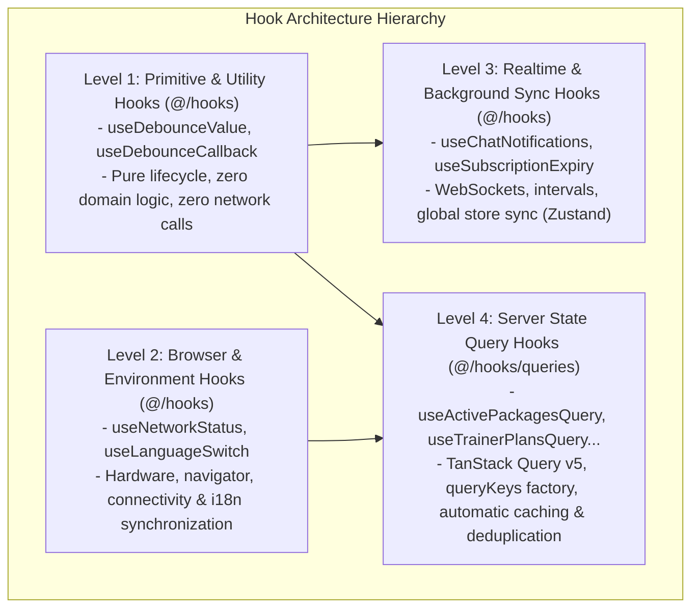
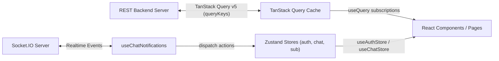
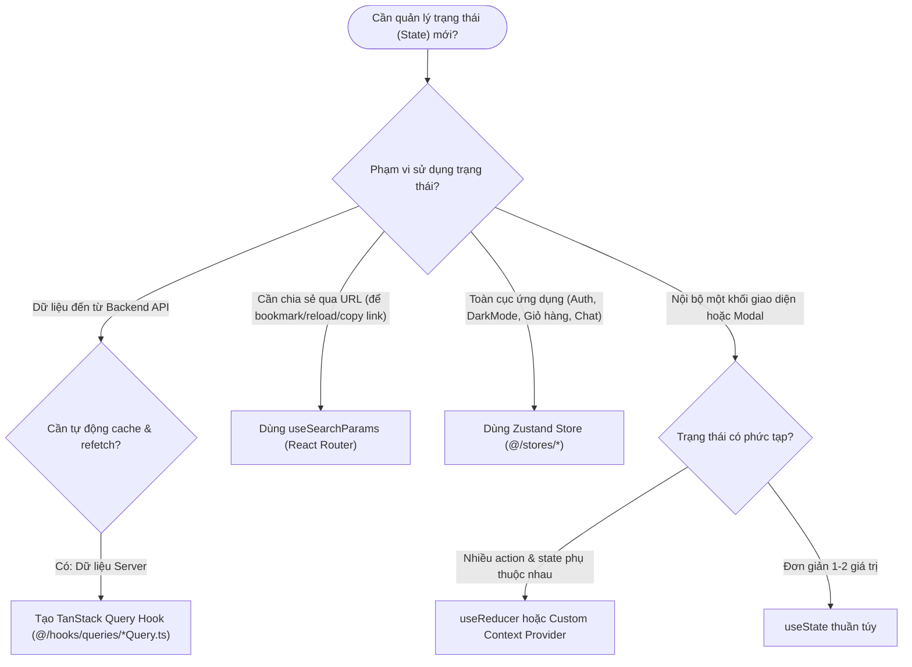
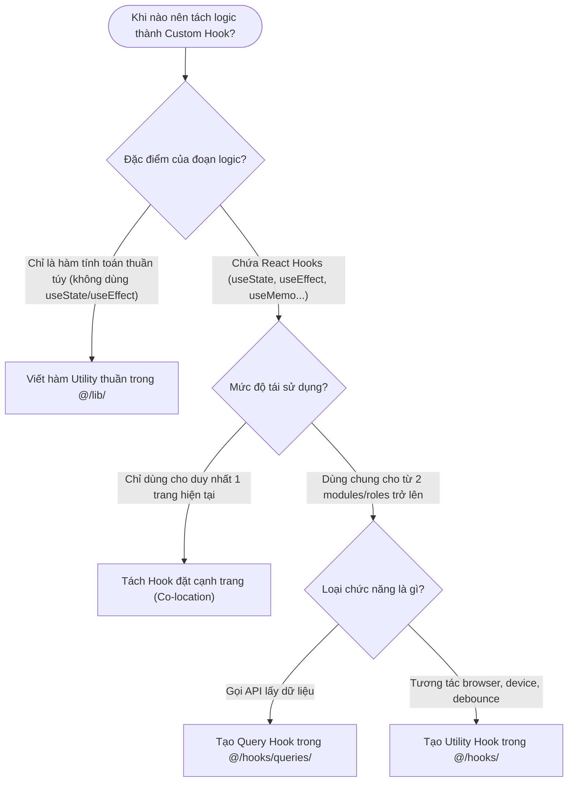
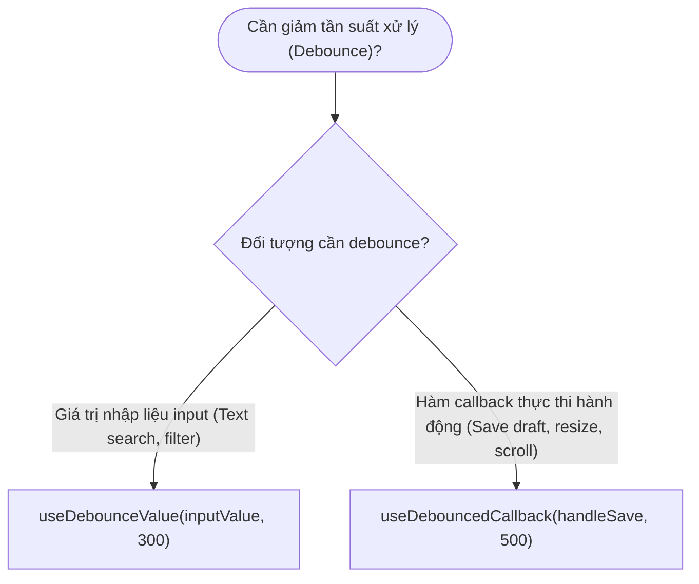
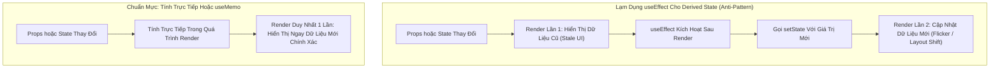
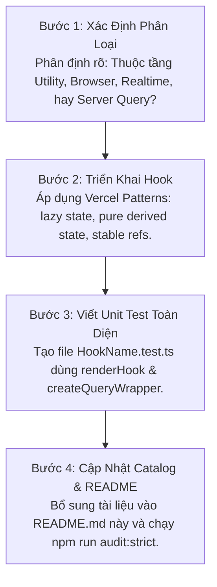

# RoGym Custom Hooks & State Architecture (README)

> **Cẩm Nang Kiến Trúc & Tái Cấu Trúc Quản Lý State Frontend RoGym (`src/hooks/`)**  
> *Phiên bản:* 2.0.0 (Strict Enterprise Standard)  
> *Cập nhật lần cuối:* 2026-10-18  
> *Phạm vi áp dụng:* Toàn bộ lập trình viên frontend khi tạo mới, sử dụng, hoặc tái cấu trúc các Custom Hooks trong hệ thống RoGym Management System.

---

## MỤC LỤC TỔNG QUAN

1. [Chương 1: Kiến Trúc State & Tháp Phân Tầng Hook (State & Hook Hierarchy)](#chương-1-kiến-trúc-state-tháp-phân-tầng-hook-state-hook-hierarchy)
2. [Chương 2: Chuẩn Thiết Kế Hook Theo Vercel Composition & Performance Patterns](#chương-2-chuẩn-thiết-kế-hook-theo-vercel-composition-performance-patterns)
3. [Chương 3: Chiến Lược Caching & TanStack Query v5 Best Practices](#chương-3-chiến-lược-caching-tanstack-query-v5-best-practices)
4. [Chương 4: Cẩm Nang Tái Cấu Trúc & 5 Anti-patterns Điển Hình (Refactoring Playbook)](#chương-4-cẩm-nang-tái-cấu-trúc-5-anti-patterns-điển-hình-refactoring-playbook)
5. [Chương 5: Cây Quyết Định Thiết Kế & Lựa Chọn Hook (3 Decision Trees)](#chương-5-cây-quyết-định-thiết-kế-lựa-chọn-hook-3-decision-trees)
6. [Chương 6: Catalog Toàn Diện 100% Hooks (`hooks/` & `hooks/queries/`)](#chương-6-catalog-toàn-diện-100-hooks-hooks-hooksqueries)
7. [Chương 7: Chuẩn Mực Kiểm Thử Hook (Testing Standards With Vitest & RTL)](#chương-7-chuẩn-mực-kiểm-thử-hook-testing-standards-with-vitest-rtl)
8. [Chương 8: Quy Chuẩn Nghiêm Cấm & Cảnh Báo Lạm Dụng (Anti-Abuse Directives & Severe System Consequences)](#chương-8-quy-chuẩn-nghiêm-cấm-cảnh-báo-lạm-dụng-anti-abuse-directives-severe-system-consequences)
9. [Chương 9: Quy Chuẩn Chuẩn Mực, Quy Trình Đóng Góp & Ma Trận Tra Cứu Nhanh 5 Giây](#chương-9-quy-chuẩn-chuẩn-mực-quy-trình-đóng-góp-ma-trận-tra-cứu-nhanh-5-giây)

---

## CHƯƠNG 1: KIẾN TRÚC STATE & THÁP PHÂN TẦNG HOOK (STATE & HOOK HIERARCHY)

Hệ thống quản lý trạng thái của RoGym được thiết kế theo nguyên tắc phân định trách nhiệm rõ ràng (Separation of Concerns). Mọi trạng thái trong ứng dụng được phân định thành 4 tầng hooks độc lập:



### 1.1 Ranh Giới Nghiêm Ngặt Bất Khả Xâm Phạm (Hard Boundaries)

1. **Tuyệt Đối Cấm Fetch API Bằng `useEffect` + `useState` Trên UI Components (Rule `NO_EFFECT_FETCH`)**:
   - Mọi thao tác tải dữ liệu từ máy chủ (Server State) **BẮT BUỘC** phải đi qua TanStack Query v5 hoặc các custom query hooks tại [`queries/`](queries/).
   - Cấm viết `useEffect(() => { service.getData().then(...) }, [])` trực tiếp trên trang hay component. Cách làm này gây ra:
     - Thất thoát bộ nhớ (Memory leaks) khi component unmount.
     - Race conditions khi tham số tìm kiếm/lọc thay đổi nhanh.
     - Triệt tiêu hoàn toàn khả năng chia sẻ cache giữa các màn hình, gây ra Network Waterfalls.
2. **Nguyên Tắc Co-location Cho Custom Hooks Nghiệp Vụ Đặc Thù**:
   - Nếu một hook chỉ phục vụ riêng cho một trang cụ thể (ví dụ: `useTrainerProfileForm` chỉ dùng cho trang hồ sơ huấn luyện viên), hook đó **PHẢI** được đặt ngay cạnh trang đó (Co-location), không đưa vào thư mục chung `src/hooks/`.
   - Thư mục `src/hooks/` chỉ chứa các hooks có tính tái sử dụng cao trên phạm vi toàn hệ thống hoặc dùng chung cho ít nhất 2 roles khác nhau.

### 1.2 Luồng Dữ Liệu Đồng Bộ Giữa Server, Cache & Client Store



---

## CHƯƠNG 2: CHUẨN THIẾT KẾ HOOK THEO VERCEL COMPOSITION & PERFORMANCE PATTERNS

Dựa trên bộ tiêu chuẩn **Vercel React Best Practices** và **Vercel Composition Patterns**, mọi custom hook trong RoGym phải tuân thủ nghiêm ngặt 5 quy tắc thiết kế:

### 2.1 Quy Tắc 1: Interface `state-actions-meta` Cho Complex & Context Hooks

Khi thiết kế các custom hooks phức tạp quản lý nhiều biến trạng thái hoặc chia sẻ qua Context Provider, tuyệt đối tránh trả về danh sách phẳng gồm hàng chục biến boolean và handler rời rạc. Hãy gom nhóm theo bộ ba:

```tsx
// ✅ ĐÚNG: Cấu trúc generic interface gồm state, actions, meta
export interface UseWorkflowResult<TState, TActions, TMeta> {
  state: TState      // Dữ liệu đọc thuần túy (data, isLoading, isError, status)
  actions: TActions  // Các hàm điều khiển hành động (submit, reset, retry, update)
  meta: TMeta        // Thông tin phụ trợ hoặc refs (inputRef, lastUpdated, stepIndex)
}
```

### 2.2 Quy Tắc 2: Tính Toán Trực Tiếp Render (Pure Derived State — `rerender-derived-state-no-effect`)

Tuyệt đối không dùng `useEffect` để sao chép hoặc đồng bộ trạng thái phụ từ state chính. Việc này kích hoạt chu kỳ re-render thứ hai không cần thiết và dễ gây trễ giao diện.

```tsx
// ❌ SAI: Dùng useEffect sao chép state phụ gây re-render kép
const [search, setSearch] = useState('')
const [filteredItems, setFilteredItems] = useState(items)
useEffect(() => {
  setFilteredItems(items.filter(item => item.name.includes(search)))
}, [search, items])

// ✅ ĐÚNG: Tính toán trực tiếp trong quá trình render (Derive state during render)
const [search, setSearch] = useState('')
const filteredItems = useMemo(
  () => items.filter(item => item.name.includes(search)),
  [items, search]
)
```

### 2.3 Quy Tắc 3: Khởi Tạo Lười Cho Giá Trị Nặng (`rerender-lazy-state-init`)

Khi giá trị khởi tạo của `useState` đòi hỏi tính toán logic ngày tháng, giải mã JSON hoặc đọc Storage, **bắt buộc** truyền một hàm khởi tạo (Function initializer) để tránh chạy lại phép tính trong mỗi lần re-render:

```tsx
// ❌ SAI: Phép tính ngày tháng chạy lại ở mỗi lần component render
const [startOfMonth, setStartOfMonth] = useState(new Date(new Date().getFullYear(), new Date().getMonth(), 1))

// ✅ ĐÚNG: Khởi tạo lười (Lazy initialization), chỉ chạy đúng 1 lần khi mount
const [startOfMonth, setStartOfMonth] = useState(() => {
  const now = new Date()
  return new Date(now.getFullYear(), now.getMonth(), 1)
})
```

### 2.4 Quy Tắc 4: Bảo Toàn Tham Chiếu Bằng Stable Callback Refs (`advanced-use-latest`)

Khi một effect cần gọi một callback được truyền từ props nhưng không muốn effect bị kích hoạt lại mỗi khi hàm callback đó thay đổi reference, hãy neo giữ hàm qua `useRef`:

```tsx
// ✅ ĐÚNG: Pattern giữ stable callback ref
export function useStableCallback<T extends (...args: unknown[]) => unknown>(callback: T): T {
  const callbackRef = useRef(callback)
  useEffect(() => {
    callbackRef.current = callback
  })
  return useCallback(((...args) => callbackRef.current(...args)) as T, [])
}
```

### 2.5 Quy Tắc 5: Triệt Tiêu 100% Rò Rỉ Bộ Nhớ (Zero Memory Leaks)

Mọi hook có sử dụng Timer (`setTimeout`, `setInterval`), Event Listener (`window.addEventListener`), hoặc WebSockets (`socket.on`) **bắt buộc phải trả về cleanup function**:

```tsx
// ✅ ĐÚNG: Cleanup toàn bộ side-effects khi unmount
useEffect(() => {
  const handler = () => setIsOnline(navigator.onLine)
  window.addEventListener('online', handler)
  window.addEventListener('offline', handler)

  return () => {
    window.removeEventListener('online', handler)
    window.removeEventListener('offline', handler)
  }
}, [])
```

---

## CHƯƠNG 3: CHIẾN LƯỢC CACHING & TANSTACK QUERY V5 BEST PRACTICES

### 3.1 Nguồn Dữ Liệu Chuẩn Duy Nhất (Single Source of Truth) Cho Query Keys (`queryKeys`)

Mọi query key trong toàn bộ ứng dụng RoGym **BẮT BUỘC** phải được sinh ra từ factory tập trung tại [`src/lib/query-keys.ts`](../lib/query-keys.ts). Tuyệt đối không hardcode mảng chuỗi tùy tiện như `queryKey: ['my-packages']`.

Hệ thống quản lý 12 domains cốt lõi:
1. `packages`: Gói tập luyện (`all`, `active`, `list`, `detail`)
2. `trainers`: Huấn luyện viên cá nhân (`all`, `available`, `detail`)
3. `subscription`: Hợp đồng hội viên (`all`, `member`, `current`)
4. `members`: Hồ sơ học viên (`all`, `profile`, `list`)
5. `classes`: Lớp học nhóm (`all`, `schedule`, `detail`)
6. `notifications`: Thông báo hệ thống (`all`, `unread`, `list`)
7. `payments`: Giao dịch thanh toán (`all`, `history`)
8. `feedback`: Đánh giá phản hồi (`all`, `list`)
9. `facilities`: Cơ sở phòng tập (`all`, `list`)
10. `equipment`: Trang thiết bị (`all`, `list`)
11. `workouts`: Giáo án & kế hoạch tập luyện (`all`, `plans`, `planDetail`)
12. `sessions`: Ca dạy & buổi tập PT (`all`, `list`, `detail`)

### 3.2 Quy Chuẩn Thời Gian Sống Cache (`staleTime` vs `gcTime`)

Để cân bằng giữa trải nghiệm phản hồi tức thì và tính tươi mới của dữ liệu:
- **Dữ liệu tĩnh / Ít biến động** (Gói tập, Cơ sở, Danh sách HLV khả dụng, Giáo án tập mẫu):  
  `staleTime: 5 * 60 * 1000` (5 phút). Dữ liệu được xem là tươi mới trong 5 phút; trong khoảng này chuyển trang không gọi lại API.
- **Dữ liệu động trung bình** (Lịch tập cá nhân, Lịch dạy PT theo tuần):  
  `staleTime: 3 * 60 * 1000` (3 phút).
- **Dữ liệu nhạy cảm / Thay đổi liên tục** (Số thông báo chưa đọc, Trạng thái socket):  
  `staleTime: 0` (Luôn kiểm tra và làm mới khi focus lại tab).

### 3.3 Quy Ước Đặt Tên & Cấu Trúc File Query Hooks

- **Tên file:** Nằm trong thư mục [`queries/`](queries/), theo mẫu: `use<Domain><Entity>Query.ts`.
- **Tên hàm:** `export function use<Domain><Entity>Query(...)`.
- **Tên file test:** Nằm cùng thư mục, theo mẫu: `use<Domain><Entity>Query.test.ts`.

---

## CHƯƠNG 4: CẨM NANG TÁI CẤU TRÚC & 5 ANTI-PATTERNS ĐIỂN HÌNH (REFACTORING PLAYBOOK)

Chương này ghi lại các mẫu mã nguồn chưa tối ưu phát hiện được trong dự án kèm hướng dẫn tái cấu trúc cụ thể để lập trình viên và AI Subagents áp dụng khi nâng cấp hệ thống.

---

### 4.1 Case Study #1: Tái Cấu Trúc `AttendancePage.tsx` (Từ `useEffect` Sang TanStack Query)

#### 🔴 Hiện Trạng Cần Cải Tổ (`src/pages/member/attendance/AttendancePage.tsx` dòng 355-420):
Trang điểm danh học viên hiện đang quản lý **8 biến state thủ công** và fetch dữ liệu qua 2 hàm `useCallback` + 2 `useEffect`:

```tsx
// ❌ HIỆN TRẠNG CHƯA TỐI ƯU (Trích đoạn AttendancePage.tsx)
export default function AttendancePage() {
  const memberId = useAuthStore((s) => s.user?.memberId) ?? ''

  // Quản lý thủ công 4 biến cho Lịch tháng
  const [calMonth, setCalMonth] = useState(() => ...)
  const [calLogs, setCalLogs] = useState<AttendanceLog[]>([])
  const [calLoading, setCalLoading] = useState(true)
  const [calError, setCalError] = useState<string | null>(null)

  // Quản lý thủ công 4 biến cho Danh sách lọc
  const [from, setFrom] = useState(...)
  const [to, setTo] = useState(...)
  const [listLogs, setListLogs] = useState<AttendanceLog[]>([])
  const [listLoading, setListLoading] = useState(true)
  const [listError, setListError] = useState<string | null>(null)

  const loadCalLogs = useCallback(() => {
    setCalLoading(true)
    attendanceService.getAttendance({ memberId, from: fromISO, to: toISO, pageSize: 100 })
      .then(res => setCalLogs(res.data))
      .catch(err => setCalError(getApiError(err, '...')))
      .finally(() => setCalLoading(false))
  }, [memberId, calMonth])

  useEffect(() => { loadCalLogs() }, [loadCalLogs])
  // ... tương tự cho loadListLogs ...
}
```

#### 🟢 Hướng Dẫn Tái Cấu Trúc Chuẩn (Target Refactored Pattern):
1. **Bước 1**: Bổ sung `attendance` domain vào [`src/lib/query-keys.ts`](../lib/query-keys.ts):
   ```ts
   attendance: {
     all: ['attendance'] as const,
     list: (params?: Record<string, unknown>) => ['attendance', 'list', params] as const,
   }
   ```
2. **Bước 2**: Tạo Custom Query Hook [`queries/useAttendanceLogsQuery.ts`](queries/):
   ```tsx
   export function useAttendanceLogsQuery(params: AttendanceFilterParams) {
     return useQuery({
       queryKey: queryKeys.attendance.list(params as Record<string, unknown>),
       queryFn: () => attendanceService.getAttendance(params),
       enabled: Boolean(params.memberId),
       staleTime: 1000 * 60 * 3,
     })
   }
   ```
3. **Bước 3**: Thay thế toàn bộ mã nguồn rườm rà trên trang bằng 2 dòng gọi hook:
   ```tsx
   // ✅ MÃ NGUỒN CHUẨN MỰC SAU KHI REFACTOR:
   const { data: calLogsData, isLoading: calLoading, error: calError } = useAttendanceLogsQuery({
     memberId, from: calFromISO, to: calToISO, pageSize: 100
   })
   const calLogs = calLogsData?.data ?? []

   const { data: listLogsData, isLoading: listLoading, error: listError } = useAttendanceLogsQuery({
     memberId, from, to, pageSize: 100
   })
   const listLogs = listLogsData?.data ?? []
   ```
   *Lợi ích đạt được:* Giảm hơn 60 dòng code rác, triệt tiêu `NO_EFFECT_FETCH`, tự động cache khi chuyển qua lại giữa các tháng, tự động xử lý loading/error state.

---

### 4.2 Anti-pattern 2: Sync State Phụ Qua `useEffect` (State Duplication Penalty)

- **Mô tả:** Tạo một state mới `const [filtered, setFiltered] = useState([])` rồi dùng `useEffect` lắng nghe mảng dữ liệu gốc và gọi `setFiltered`.
- **Hậu quả:** Gây ra hiện tượng FOUC (Flash of Unfiltered Content) và re-render thừa 1 frame.
- **Giải pháp:** Xóa bỏ state phụ, tính toán trực tiếp bằng `useMemo` hoặc biểu thức đơn giản trong thân hàm component.

---

### 4.3 Anti-pattern 3: Unstable Function References Kích Hoạt Fetch Vô Hạn

- **Mô tả:** Truyền function khai báo inline không bọc `useCallback` vào `useEffect` dependencies.
- **Hậu quả:** Mỗi lần component re-render sinh ra địa chỉ function mới ➔ `useEffect` bị kích hoạt lại ➔ gọi API liên tục (Infinite Request Loop) làm nghẽn mạng và sập backend.
- **Giải pháp:** Tách logic fetch vào custom query hook hoặc neo giữ bằng `useCallback` với dependencies nguyên thủy (primitive types).

---

### 4.4 Anti-pattern 4: Bùng Nổ Biến Boolean Rời Rạc (Boolean State Explosion)

- **Mô tả:** Khai báo đồng thời `const [isEditing, setIsEditing] = useState(false)`, `const [isSaving, setIsSaving] = useState(false)`, `const [isDeleting, setIsDeleting] = useState(false)`, `const [hasError, setHasError] = useState(false)`.
- **Hậu quả:** Dễ sinh ra trạng thái mâu thuẫn (vừa `isSaving = true` vừa `isDeleting = true`).
- **Giải pháp:** Chuyển sang State Machine hoặc chuỗi trạng thái rời rạc (`status: 'idle' | 'editing' | 'saving' | 'deleting' | 'error'`).

---

### 4.5 Anti-pattern 5: Rò Rỉ Kết Nối Thời Gian Thực (Uncleaned Realtime Sockets)

- **Mô tả:** Kết nối tới WebSocket hoặc gán cờ `setInterval` nhưng quên hàm `return () => cleanup()` trong `useEffect`.
- **Hậu quả:** Khi người dùng chuyển qua trang khác và quay lại nhiều lần, hàng chục timer hoặc socket listeners chạy ngầm cùng lúc làm ứng dụng giật lag và tiêu hao pin mobile.
- **Giải pháp:** Luôn có hàm hủy kết nối (Tham khảo mã nguồn chuẩn tại `useChatNotifications.ts`).

---

## CHƯƠNG 5: CÂY QUYẾT ĐỊNH THIẾT KẾ & LỰA CHỌN HOOK (3 DECISION TREES)

### 5.1 Cây 1: Chọn Nơi Lưu Trữ Trạng Thái (State Placement Decision Tree)



### 5.2 Cây 2: Khi Nào Cần Tách Một Custom Hook Mới?



### 5.3 Cây 3: Lựa Chọn Cơ Chế Trì Hoãn (Debounce Strategy)



---

## CHƯƠNG 6: CATALOG TOÀN DIỆN 100% HOOKS (`hooks/` & `hooks/queries/`)

Tất cả các hooks trong hệ thống được liệt kê chi tiết dưới đây:

### 6.1 Nhóm Tiện Ích & Hiệu Năng (Utility & Performance Hooks)

#### 1. `useDebounceValue` & `useDebounceCallback`
- **File nguồn:** [`useDebounce.ts`](useDebounce.ts)
- **Kiểm thử:** [`useDebounce.test.ts`](useDebounce.test.ts)
- **Vai trò:** Trì hoãn việc cập nhật giá trị hoặc thực thi hàm callback sau khoảng thời gian `delayMs` không có tác vụ mới (chống tràn request khi người dùng gõ phím tìm kiếm).
- **TypeScript Signatures:**
  ```ts
  export function useDebounceValue<T>(value: T, delayMs?: number): T
  export function useDebouncedCallback<Args extends unknown[], R = void>(
    callback: (...args: Args) => R,
    delayMs?: number
  ): (...args: Args) => void
  ```
- **Code mẫu chuẩn TSX:**
  ```tsx
  import { useState } from 'react'
  import { useDebounceValue } from '@/hooks/useDebounce'

  export function SearchBox() {
    const [keyword, setKeyword] = useState('')
    const debouncedKeyword = useDebounceValue(keyword, 300)

    // debouncedKeyword chỉ đổi sau 300ms kể từ lần gõ phím cuối
    return <Input value={keyword} onChange={(e) => setKeyword(e.target.value)} />
  }
  ```
- **Cảnh báo chống lạm dụng:** Không dùng `useDebounceValue` cho các input form cần hiển thị giá trị tức thời trên màn hình (sẽ gây cảm giác gõ phím bị trễ). Hãy bind `keyword` vào UI và chỉ truyền `debouncedKeyword` vào hook truy vấn query.

---

### 6.2 Nhóm Trình Duyệt & Thiết Bị (Browser & Environment Hooks)

#### 2. `useNetworkStatus`
- **File nguồn:** [`useNetworkStatus.ts`](useNetworkStatus.ts)
- **Kiểm thử:** [`useNetworkStatus.test.ts`](useNetworkStatus.test.ts)
- **Vai trò:** Lắng nghe sự kiện Online/Offline của trình duyệt và tốc độ đường truyền (`downlink`), giúp giao diện hiển thị banner cảnh báo mất kết nối kịp thời.
- **TypeScript Signature:**
  ```ts
  export function useNetworkStatus(): {
    isOnline: boolean
    wasOffline: boolean
    downlink?: number
  }
  ```
- **Code mẫu:**
  ```tsx
  import { useNetworkStatus } from '@/hooks/useNetworkStatus'
  import { Alert } from '@/components/ui'

  export function ConnectivityBanner() {
    const { isOnline, wasOffline } = useNetworkStatus()
    if (isOnline && !wasOffline) return null

    return (
      <Alert tone={isOnline ? 'success' : 'danger'}>
        {isOnline ? 'Đã khôi phục kết nối Internet!' : 'Mất kết nối mạng. Đang chạy ở chế độ ngoại tuyến.'}
      </Alert>
    )
  }
  ```

#### 3. `useLanguageSwitch`
- **File nguồn:** [`useLanguageSwitch.ts`](useLanguageSwitch.ts)
- **Kiểm thử:** [`useLanguageSwitch.test.ts`](useLanguageSwitch.test.ts)
- **Vai trò:** Quản lý thay đổi ngôn ngữ (`vi`, `ja`, `en`), tự động đồng bộ thuộc tính `lang` và hướng văn bản `dir="ltr"|"rtl"` lên thẻ `<html>`, lưu tùy chọn vào `localStorage`.
- **TypeScript Signature:**
  ```ts
  export function useLanguageSwitch(): {
    currentLanguage: string
    changeLanguage: (lang: 'vi' | 'ja' | 'en') => Promise<void>
    isRTL: boolean
  }
  ```

---

### 6.3 Nhóm Thời Gian Thực & Nền (Realtime & Background Sync Hooks)

#### 4. `useChatNotifications`
- **File nguồn:** `useChatNotifications.ts`
- **Kiểm thử:** `useChatNotifications.test.ts`
- **Vai trò:** Quản lý vòng đời kết nối Socket.IO thời gian thực cho Member và Trainer đã đăng nhập; tự động nạp hội thoại và dọn dẹp kết nối socket khi unmount khỏi dashboard.
- **TypeScript Signature:**
  ```ts
  export function useChatNotifications(): {
    isEligible: boolean
    isConnected: boolean
    unreadTotal: number
  }
  ```

#### 5. `useSubscriptionExpiry`
- **File nguồn:** `useSubscriptionExpiry.ts`
- **Kiểm thử:** `useSubscriptionExpiry.test.ts`
- **Vai trò:** Thiết lập đồng hồ thăm dò nền (Polling qua TanStack Query v5 `refetchInterval: 60s`) để kiểm tra hạn gói tập của hội viên; tự động cập nhật store và kích hoạt callback `onExpired` khi gói hết hạn.
- **TypeScript Signature:**
  ```ts
  export function useSubscriptionExpiry(onExpired: () => void): void
  ```

---

### 6.4 Nhóm Truy Vấn Dữ Liệu Máy Chủ (Server State Query Hooks — `queries/`)

#### 6. `useActivePackagesQuery`
- **File nguồn:** `queries/useActivePackagesQuery.ts`
- **Kiểm thử:** `queries/useActivePackagesQuery.test.ts`
- **Vai trò:** Truy vấn danh sách các gói tập đang mở bán (`status: 'active'`), áp dụng `staleTime: 5 phút`.
- **Code mẫu:**
  ```tsx
  import { useActivePackagesQuery } from '@/hooks/queries/useActivePackagesQuery'

  const { data: packages = [], isLoading, error } = useActivePackagesQuery()
  ```

#### 7. `useAvailableTrainersQuery`
- **File nguồn:** `queries/useAvailableTrainersQuery.ts`
- **Kiểm thử:** `queries/useAvailableTrainersQuery.test.ts`
- **Vai trò:** Truy vấn danh sách huấn luyện viên cá nhân đang sẵn sàng tiếp nhận học viên mới.

#### 8. `useTrainerPlansQuery`
- **File nguồn:** `queries/useTrainerPlansQuery.ts`
- **Kiểm thử:** `queries/useTrainerPlansQuery.test.ts`
- **Vai trò:** Truy vấn danh sách giáo án tập luyện do huấn luyện viên quản lý, tự động cache theo key `queryKeys.workouts.plans()`.
- **TypeScript Signature:**
  ```ts
  export function useTrainerPlansQuery(): UseQueryResult<WorkoutPlan[], Error>
  ```

#### 9. `useTrainerSessionsQuery`
- **File nguồn:** `queries/useTrainerSessionsQuery.ts`
- **Kiểm thử:** `queries/useTrainerSessionsQuery.test.ts`
- **Vai trò:** Truy vấn danh sách ca tập của huấn luyện viên có phân trang và bộ lọc linh hoạt theo phòng tập, học viên, và khoảng thời gian.
- **TypeScript Signature:**
  ```ts
  export function useTrainerSessionsQuery(
    filters?: TrainerSessionFilters
  ): UseQueryResult<{ data: TrainingSession[]; total: number }, Error>
  ```

#### 10. `useTrainerStudentsQuery`
- **File nguồn:** `queries/useTrainerStudentsQuery.ts`
- **Kiểm thử:** `queries/useTrainerStudentsQuery.test.ts`
- **Vai trò:** Truy vấn danh sách học viên phụ trách có hỗ trợ tìm kiếm từ khóa và phân trang.
- **TypeScript Signature:**
  ```ts
  export function useTrainerStudentsQuery(
    params?: TrainerStudentsParams
  ): UseQueryResult<TrainerStudentsResponse, Error>
  ```

#### 11. `useAttendanceLogsQuery`
- **File nguồn:** `queries/useAttendanceLogsQuery.ts`
- **Kiểm thử:** `queries/useAttendanceLogsQuery.test.ts`
- **Vai trò:** Truy vấn nhật ký điểm danh hội viên theo tháng hoặc khoảng ngày có phân trang, tự động kích hoạt khi có `memberId` và áp dụng `staleTime: 3 phút`.
- **TypeScript Signature:**
  ```ts
  export function useAttendanceLogsQuery(
    filters?: AttendanceLogsFilters
  ): UseQueryResult<{ data: AttendanceLog[]; total: number }, Error>
  ```

---

## CHƯƠNG 7: CHUẨN MỰC KIỂM THỬ HOOK (TESTING STANDARDS WITH VITEST & RTL)

Mọi custom hook trong hệ thống **BẮT BUỘC** phải có file kiểm thử đi kèm (`.test.ts`).

### 7.1 Mẫu Kiểm Thử Query Hook Với `createQueryWrapper`

Khi kiểm thử hook sử dụng TanStack Query, luôn sử dụng tiện ích `createQueryWrapper()` từ `@/test/query-test-utils` để khởi tạo `QueryClient` độc lập với `retry: false`:

```tsx
import { describe, expect, it, vi, beforeEach } from 'vitest'
import { renderHook, waitFor } from '@testing-library/react'
import { useTrainerPlansQuery } from './useTrainerPlansQuery'
import workoutService from '@/services/workout.service'
import { createQueryWrapper } from '@/test/query-test-utils'

vi.mock('@/services/workout.service', () => ({
  default: { getPlans: vi.fn() },
}))

describe('useTrainerPlansQuery', () => {
  beforeEach(() => {
    vi.clearAllMocks()
  })

  it('tải danh sách kế hoạch tập luyện thành công', async () => {
    vi.mocked(workoutService.getPlans).mockResolvedValue([{ planId: 'p1', name: 'Giáo án A' } as any])

    const { result } = renderHook(() => useTrainerPlansQuery(), {
      wrapper: createQueryWrapper(),
    })

    await waitFor(() => {
      expect(result.current.isSuccess).toBe(true)
    })

    expect(result.current.data).toHaveLength(1)
    expect(workoutService.getPlans).toHaveBeenCalledTimes(1)
  })
})
```

---

## CHƯƠNG 8: QUY CHUẨN NGHIÊM CẤM & CẢNH BÁO LẠM DỤNG (ANTI-ABUSE DIRECTIVES & SEVERE SYSTEM CONSEQUENCES)

> [!CAUTION]
> Hooks là trái tim điều khiển vòng đời và trạng thái phản ứng (reactivity) của RoGym. Việc lạm dụng hooks (đặc biệt là `useEffect`), tính toán sai vòng đời, hoặc bỏ quên hàm dọn dẹp tài nguyên sẽ lập tức dẫn đến Memory Leak, Race Conditions, giật lag UI do render thừa, và phá vỡ kiến trúc đơn hướng của React. 100% lập trình viên phải tuyệt đối tuân thủ các điều cấm sau đây.

### 8.1 Bảng Ma Trận Quy Tắc Cấm & Đo Lường Hậu Quả Hệ Thống

| Mã Quy Tắc | Hành Vi Nghiêm Cấm Tuyệt Đối | Mức Độ | Bán Kính Ảnh Hưởng (Blast Radius) | Hậu Quả Hệ Thống & Trải Nghiệm Người Dùng |
| :--- | :--- | :---: | :--- | :--- |
| `RULE_NO_EFFECT_FETCH` | Tự viết `fetch` / `axios` trực tiếp trong `useEffect` trên UI component hoặc custom utility hook | **CRITICAL** | Tầng Mạng & Toàn bộ Màn hình | Gây Race Conditions (dữ liệu request trước đè request sau), Request Waterfall, mất sạch cơ chế caching, deduplication, retry tự động của TanStack Query. |
| `RULE_NO_EFFECT_DERIVED_STATE` | Dùng `useEffect` kết hợp `setState` để tính toán giá trị phụ thuộc vào Props hoặc State khác | **SEVERE** | Chu kỳ Render Component | Gây ra **Double Render Cycle** (Render 1 với data cũ -> Effect kích hoạt -> setState -> Render 2 với data mới). Gây giật lag UI, layout flash, và lãng phí CPU. |
| `RULE_NO_EFFECT_EVENT_HANDLING` | Đặt logic phản hồi hành động người dùng (click, submit) vào `useEffect` dựa trên cờ boolean | **SEVERE** | Luồng Tương Tác & Form | Làm mất tính nhân quả (causality) trực tiếp, dễ gây vòng lặp vô tận (Infinite Re-render Loops), cực kỳ khó lần vết và debug khi form bị submit lặp. |
| `RULE_NO_LEAKING_EVENT_LISTENERS` | Đăng ký `addEventListener` (resize, scroll, keydown, socket) mà thiếu cleanup function hoặc thiếu `{ passive: true }` | **CRITICAL** | Trình Duyệt & Bộ Nhớ RAM | Gây **Memory Leak** nghiêm trọng; các ghost listeners tiếp tục chạy ngầm sau khi unmount gây đơ lag trình duyệt và bắn sự kiện rác. |
| `RULE_NO_HOOK_COLOCATION_VIOLATION` | Đưa các hook chỉ dùng riêng cho 1 page/feature vào thư mục dùng chung `src/hooks/` | **MODERATE** | Cấu Trúc Mã Nguồn | Làm ô nhiễm global namespace của hooks, tăng sự phụ thuộc lỏng lẻo, gây khó khăn cho việc bảo trì hoặc dọn dẹp code khi xóa tính năng. |

---

### 8.2 Sơ Đồ Trực Quan & Phân Tích Kỹ Thuật Vòng Đời Render

#### Vòng Lặp Render Lãng Phí (Double Render Cycle) Do Lạm Dụng useEffect So Với Pure Derived Computation:



---

### 8.3 Công Thức Tái Cấu Trúc Thực Chiến (Refactoring Recipes)

#### Công thức 1: Phòng chống rò rỉ tài nguyên với Event Listener an toàn (`useWindowDimensions`)

##### ❌ Code Sai Phạm (Gây Memory Leak & Cản Trở Scroll Performance):
```typescript
// ANTI-PATTERN: Không dọn dẹp listener, không có passive flag
export function useWindowDimensions() {
  const [dimensions, setDimensions] = useState({ width: window.innerWidth, height: window.innerHeight })

  useEffect(() => {
    window.addEventListener('resize', () => {
      setDimensions({ width: window.innerWidth, height: window.innerHeight })
    })
    // THIẾU return () => window.removeEventListener(...)
  }, [])

  return dimensions
}
```

##### ✅ Code Tái Cấu Trúc Chuẩn Mực RoGym:
```typescript
import { useState, useEffect } from 'react'

export interface WindowDimensions {
  width: number
  height: number
}

export function useWindowDimensions(): WindowDimensions {
  const [dimensions, setDimensions] = useState<WindowDimensions>(() => ({
    width: typeof window !== 'undefined' ? window.innerWidth : 0,
    height: typeof window !== 'undefined' ? window.innerHeight : 0,
  }))

  useEffect(() => {
    if (typeof window === 'undefined') return

    const handleResize = () => {
      setDimensions({
        width: window.innerWidth,
        height: window.innerHeight,
      })
    }

    // Luôn sử dụng { passive: true } cho các sự kiện kích thước/cuộn
    window.addEventListener('resize', handleResize, { passive: true })

    // BẮT BUỘC có hàm cleanup để triệt tiêu 100% memory leak
    return () => {
      window.removeEventListener('resize', handleResize)
    }
  }, [])

  return dimensions
}
```

---

#### Công thức 2: Khai tử Double Render - Chuyển đổi từ `useEffect` sang Pure Derived State

##### ❌ Code Sai Phạm (Double Render Cycle & Giật Lag UI):
```typescript
// ANTI-PATTERN: useEffect để tính toán dữ liệu dẫn xuất từ danh sách học viên
export function useFilteredStudents(students: Student[], searchTerm: string) {
  const [filtered, setFiltered] = useState<Student[]>([])

  useEffect(() => {
    // Gây render lần 1 với state cũ, sau đó mới filter và kích hoạt render lần 2!
    const result = students.filter((s) =>
      s.fullName.toLowerCase().includes(searchTerm.toLowerCase())
    )
    setFiltered(result)
  }, [students, searchTerm])

  return filtered
}
```

##### ✅ Code Tái Cấu Trúc Chuẩn Mực RoGym:
```typescript
import { useMemo } from 'react'
import type { Student } from '@/types'

// CHUẨN MỰC: Tính toán trực tiếp trong chu kỳ render, chỉ cache khi danh sách lớn
export function useFilteredStudents(students: Student[], searchTerm: string): Student[] {
  return useMemo(() => {
    const normalizedTerm = searchTerm.trim().toLowerCase()
    if (!normalizedTerm) return students

    return students.filter((student) =>
      student.fullName.toLowerCase().includes(normalizedTerm) ||
      student.phone.includes(normalizedTerm)
    )
  }, [students, searchTerm])
}
```

---

### 8.4 Checklist Nghiệm Thu PR Dành Cho Hooks (Definition of Done)

- [ ] **100% Không Có Fetch Trực Tiếp:** Mọi truy vấn dữ liệu từ API đều phải sử dụng TanStack Query Hooks tại `@/hooks/queries/` kết hợp khóa `queryKeys`, tuyệt đối cấm gọi `fetch`/`axios` trong `useEffect`.
- [ ] **100% Triệt Tiêu Derived State Trong Effect:** Không tồn tại bất kỳ cặp `useEffect` + `setState` nào chỉ phục vụ việc tính toán phụ thuộc vào Props/State khác.
- [ ] **100% Cleanup Đầy Đủ:** Mọi `useEffect` có đăng ký listener, interval, timeout, hoặc kết nối WebSocket đều phải trả về hàm cleanup tương ứng.
- [ ] **Tối Ưu Sự Kiện Trình Duyệt:** Các listener lắng nghe sự kiện `resize`, `scroll`, `touch` bắt buộc cấu hình `{ passive: true }`.
- [ ] **Nguyên Tắc Colocation:** Custom hook chỉ phục vụ riêng 1 màn hình/tính năng phải được đặt tại thư mục của tính năng đó, không đưa vào `@/hooks/` dùng chung.

---

## CHƯƠNG 9: QUY CHUẨN CHUẨN MỰC, QUY TRÌNH ĐÓNG GÓP & MA TRẬN TRA CỨU NHANH 5 GIÂY

### 9.1 Năm Quy Tắc Vàng Bất Khả Xâm Phạm (The 5 Golden Rules)

> [!CAUTION]
> 1. **Cấm Fetch API Trong useEffect Trên UI:** 100% Server State phải được trừu tượng hóa thành Query Hooks kết hợp `queryKeys`.
> 2. **Quy Chuẩn Đặt Tên Đồng Bộ:** Toàn bộ query hooks nằm tại `queries/` và có hậu tố `Query` (ví dụ: `useTrainerSessionsQuery`).
> 3. **Triệt Tiêu Rò Rỉ Tài Nguyên:** Bắt buộc có hàm cleanup cho mọi side-effects (Socket, Timers, DOM Listeners).
> 4. **Bảo Vệ Tính Toàn Vẹn Của Cache:** Sau khi thực hiện Mutation (Thêm, Sửa, Xóa), bắt buộc gọi `queryClient.invalidateQueries({ queryKey: queryKeys.<domain>.all })`.
> 5. **Bắt Buộc Viết Unit Test Đạt 100% Pass:** Không hợp nhất bất kỳ hook nào vào codebase nếu thiếu test suite đi kèm.

### 9.2 Quy Trình 4 Bước Đóng Góp Hook Mới



### 9.3 Bảng Tra Cứu Nhanh 5 Giây (Cheat Sheet Matrix)

| Nhu cầu của bạn | Sử dụng Hook | Đường dẫn Import |
| :--- | :--- | :--- |
| Giảm tần suất gõ phím ô tìm kiếm | `useDebounceValue` | `import { useDebounceValue } from '@/hooks/useDebounce'` |
| Trì hoãn thực thi một hàm hành động | `useDebouncedCallback` | `import { useDebounceCallback } from '@/hooks/useDebounce'` |
| Kiểm tra trạng thái Internet Online/Offline | `useNetworkStatus` | `import { useNetworkStatus } from '@/hooks/useNetworkStatus'` |
| Đổi ngôn ngữ hiển thị (VI / JA / EN) | `useLanguageSwitch` | `import { useLanguageSwitch } from '@/hooks/useLanguageSwitch'` |
| Kết nối thông báo Chat thời gian thực | `useChatNotifications` | `import { useChatNotifications } from '@/hooks/useChatNotifications'` |
| Kiểm tra gói tập hội viên hết hạn | `useSubscriptionExpiry` | `import { useSubscriptionExpiry } from '@/hooks/useSubscriptionExpiry'` |
| Lấy danh sách gói tập đang mở bán | `useActivePackagesQuery` | `import { useActivePackagesQuery } from '@/hooks/queries/useActivePackagesQuery'` |
| Lấy danh sách Huấn luyện viên sẵn sàng | `useAvailableTrainersQuery` | `import { useAvailableTrainersQuery } from '@/hooks/queries/useAvailableTrainersQuery'` |
| Lấy danh sách giáo án tập của Trainer | `useTrainerPlansQuery` | `import { useTrainerPlansQuery } from '@/hooks/queries/useTrainerPlansQuery'` |
| Lấy lịch dạy PT / Ca tập luyện | `useTrainerSessionsQuery` | `import { useTrainerSessionsQuery } from '@/hooks/queries/useTrainerSessionsQuery'` |
| Lấy danh sách học viên phụ trách | `useTrainerStudentsQuery` | `import { useTrainerStudentsQuery } from '@/hooks/queries/useTrainerStudentsQuery'` |
| Lấy lịch sử điểm danh hội viên | `useAttendanceLogsQuery` | `import { useAttendanceLogsQuery } from '@/hooks/queries/useAttendanceLogsQuery'` |


