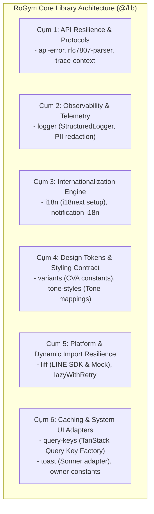
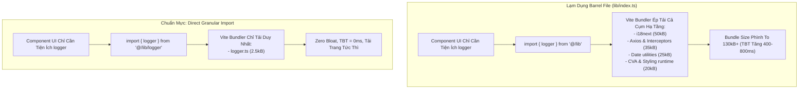
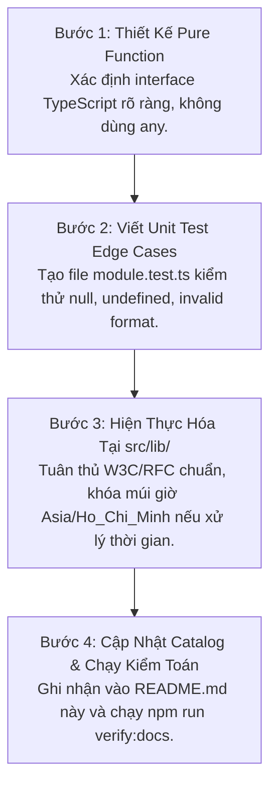

# RoGym Core Libraries & Utilities Architecture (README)

> **Cẩm Nang Kiến Trúc & Tiện Ích Nền Tảng Frontend RoGym (`src/lib/`)**  
> *Phiên bản:* 2.0.0 (Strict Enterprise Standard)  
> *Cập nhật lần cuối:* 2026-10-18  
> *Phạm vi áp dụng:* Toàn bộ lập trình viên frontend khi tạo mới, sử dụng, hoặc mở rộng các module tiện ích, giao thức bảo mật và thư viện lõi trong RoGym Management System.

---

## MỤC LỤC TỔNG QUAN

1. [Chương 1: Kiến Trúc Hạ Tầng Thư Viện Lõi & Phân Tầng Trách Nhiệm (Core Architecture)](#chương-1-kiến-trúc-hạ-tầng-thư-viện-lõi-phân-tầng-trách-nhiệm-core-architecture)
2. [Chương 2: Tối Ưu Bundle Size & Quy Chuẩn Direct Imports (Vercel Bundle Rules)](#chương-2-tối-ưu-bundle-size-quy-chuẩn-direct-imports-vercel-bundle-rules)
3. [Chương 3: Giao Thức Khả Năng Phục Hồi & Xử Lý Lỗi (API Resilience & RFC Standards)](#chương-3-giao-thức-khả-năng-phục-hồi-xử-lý-lỗi-api-resilience-rfc-standards)
4. [Chương 4: Bảo Mật PII, Vệ Sinh Dữ Liệu & Logging Có Cấu Trúc (Security & Observability)](#chương-4-bảo-mật-pii-vệ-sinh-dữ-liệu-logging-có-cấu-trúc-security-observability)
5. [Chương 5: Đa Ngôn Ngữ & Thông Báo Hệ Thống (Internationalization & Notifications)](#chương-5-đa-ngôn-ngữ-thông-báo-hệ-thống-internationalization-notifications)
6. [Chương 6: Cẩm Nang Nâng Cấp, Tái Cấu Trúc & Mở Rộng Thư Viện (Library Refactoring Playbook)](#chương-6-cẩm-nang-nâng-cấp-tái-cấu-trúc-mở-rộng-thư-viện-library-refactoring-playbook)
7. [Chương 7: Catalog Toàn Diện 12 Infrastructure Modules Cốt Lõi](#chương-7-catalog-toàn-diện-12-infrastructure-modules-cốt-lõi)
8. [Chương 8: Quy Chuẩn Nghiêm Cấm & Cảnh Báo Lạm Dụng (Anti-Abuse Directives & Severe System Consequences)](#chương-8-quy-chuẩn-nghiêm-cấm-cảnh-báo-lạm-dụng-anti-abuse-directives-severe-system-consequences)
9. [Chương 9: Quy Chuẩn Chuẩn Mực, Quy Trình Đóng Góp & Ma Trận Tra Cứu Nhanh 5 Giây](#chương-9-quy-chuẩn-chuẩn-mực-quy-trình-đóng-góp-ma-trận-tra-cứu-nhanh-5-giây)

---

## CHƯƠNG 1: KIẾN TRÚC HẠ TẦNG THƯ VIỆN LÕI & PHÂN TẦNG TRÁCH NHIỆM (CORE ARCHITECTURE)

Thư mục `src/lib/` là tầng hạ tầng nền tảng (Foundation Infrastructure) của frontend RoGym. Phân hệ bao gồm **12 modules độc lập** đóng vai trò cầu nối với các thư viện bên thứ ba và giao thức hệ thống:



> [!NOTE]
> **Phân định ranh giới kiến trúc:** Các hàm tiện ích tính toán thuần túy (`date.ts`, `currency.ts`, `formatters.ts`, `cn.ts`) và các bộ tính toán nghiệp vụ gym (`subscription.ts`, `shift.ts`, `package.ts`, `status.ts`, `score-utils.ts`) thuộc về tầng tiện ích tại `src/utils/`. Vui lòng xem tài liệu chi tiết tại [**src/utils/README.md**](../utils/README.md).

### 1.1 Bốn Trụ Cột Thiết Kế Cốt Lõi (The 4 Architectural Pillars)

1. **Hàm Thuần Túy & Deterministic Output**:
   - Các hàm tiện ích phải là Pure Functions: Cùng đầu vào luôn trả về cùng kết quả; không gây side-effects ngầm và không phụ thuộc vào mutable global state.
2. **Tuân Thủ Tuyệt Đối Các Chuẩn W3C & IETF RFC**:
   - Lỗi API tuân thủ **IETF RFC 7807 / RFC 9457 (Problem Details for HTTP APIs)**.
   - Truy vết phân tán tuân thủ **W3C Distributed Trace Context Recommendation**.
   - Thời gian tuân thủ **ISO 8601** và khóa cứng múi giờ Việt Nam **`Asia/Ho_Chi_Minh` (UTC+7)**.
3. **Quy Tắc 100% Design Tokens & Không Hardcode**:
   - Toàn bộ màu sắc và tone trạng thái (như `tone-styles.ts`, `owner-constants.ts`) tuyệt đối không dùng mã HEX thô, mà ánh xạ trực tiếp sang **Semantic Token CSS Variables** (`--color-...`, `--rogym-...`) hoặc `SEMANTIC_TOKEN_COLORS`.
4. **Ghi Log Qua Structured Logger**:
   - 100% thông tin theo dõi và cảnh báo trong ứng dụng phải đi qua [`logger.ts`](logger.ts) để tự động lọc thông tin cá nhân (PII) và tự động tắt chế độ debug trên môi trường Production.

---

## CHƯƠNG 2: TỐI ƯU BUNDLE SIZE & QUY CHUẨN DIRECT IMPORTS (VERCEL BUNDLE RULES)

### 2.1 Nguyên Tắc Vercel `bundle-barrel-imports`: Nghiêm Cấm Monolithic Barrel

> [!CAUTION]
> **QUY TẮC CỐT LÕI:** Tuyệt đối **KHÔNG ĐƯỢC TẠO** tệp `src/lib/index.ts` tập trung để re-export toàn bộ các modules hạ tầng.

#### Phân Tích Chi Phí Bundle (Bundle Cost Analysis):
Nếu tạo tệp barrel `lib/index.ts`:
- Khi một component đơn giản chỉ cần hàm `getApiError`, cơ chế import từ barrel `import { getApiError } from '@/lib'` sẽ kéo theo toàn bộ:
  - `@line/liff` SDK (~120KB)
  - `sonner` toast animations (~20KB)
  - `axios` runtime dependencies
- Việc này phá vỡ khả năng Tree-shaking của Vite/Rollup, làm tăng chỉ số **First Contentful Paint (FCP)** và **Largest Contentful Paint (LCP)** trên thiết bị di động.

### 2.2 Quy Chuẩn Import Trực Tiếp (Static Analyzable Direct Imports)

Mọi module trong `src/lib/` bắt buộc phải được import trực tiếp theo từng tệp chức năng cụ thể:

```tsx
// ❌ SAI: Import từ barrel trung gian (BỊ CẤM HOÀN TOÀN)
import { toast, logger, getApiError } from '@/lib'

// ✅ ĐÚNG: Import trực tiếp đích danh từng tệp tiện ích
import { toast } from '@/lib/toast'
import { logger } from '@/lib/logger'
import { getApiError } from '@/lib/api-error'
import { queryKeys } from '@/lib/query-keys'
import { TONES, SIZES } from '@/lib/variants'

// ✅ Với các hàm format và class names, import từ @/utils:
import { cn } from '@/utils/cn'
import { formatDate } from '@/utils/date'
```

---

## CHƯƠNG 3: GIAO THỨC KHẢ NĂNG PHỤC HỒI & XỬ LÝ LỖI (API RESILIENCE & RFC STANDARDS)

### 3.1 Bộ Phân Tích Lỗi Tiêu Chuẩn IETF RFC 7807 / RFC 9457 (`rfc7807-parser.ts`)

Hệ thống backend RoGym trả về lỗi theo chuẩn Problem Details. Frontend chuẩn hóa việc bóc tách thông qua [`rfc7807-parser.ts`](rfc7807-parser.ts):

- **Interface chuẩn:**
  ```ts
  export interface ProblemDetailsPayload {
    type?: string
    title?: string
    status?: number
    detail?: string
    instance?: string
    code?: string
    errors?: Record<string, string[]> // Field-level validation errors
    [key: string]: unknown
  }
  ```
- **Thứ tự ưu tiên trích xuất thông báo thân thiện (`getFriendlyErrorMessage`)**:
  1. Nếu có mảng lỗi validation theo từng trường (`errors`), lấy thông báo lỗi đầu tiên.
  2. Nếu có `detail`, trả về chuỗi `detail`.
  3. Nếu có `title`, trả về chuỗi `title`.
  4. Nếu là `Error` chuẩn, trả về `error.message`.
  5. Fallback về chuỗi mặc định đã bản địa hóa.

### 3.2 Cơ Chế Exponential Backoff Kèm Full Jitter (`backoff-retry.ts`)

Khi gặp sự cố mạng chập chờn hoặc máy chủ phản hồi mã lỗi 5xx tạm thời, tiện ích [`retryWithBackoff`](../utils/backoff-retry.ts) tự động thực hiện lại yêu cầu:

$$\text{CalculatedDelay} = \min\left(\text{maxDelayMs}, \text{initialDelayMs} \times \text{factor}^{\text{attempt} - 1}\right)$$

Để triệt tiêu hiện tượng **Thundering Herd** (hàng nghìn máy khách cùng đồng loạt gửi lại request tại cùng một giây gây sập hoàn toàn máy chủ), thuật toán áp dụng **Full Jitter**:
$$\text{ActualDelay} = \text{random}(0, \text{CalculatedDelay})$$

Hàm sử dụng bộ tạo số ngẫu nhiên an toàn mã hóa:
```ts
// Dùng CSPRNG chuẩn trình duyệt thay vì Math.random() thông thường
const uint32Array = new Uint32Array(1)
globalThis.crypto.getRandomValues(uint32Array)
const ratio = uint32Array[0] / (0xffffffff + 1)
```

### 3.3 W3C Distributed Trace Context (`trace-context.ts`)

Để phục vụ phân tích nhật ký phân tán xuyên suốt giữa Client, API Gateway và Microservices, tiện ích [`trace-context.ts`](trace-context.ts) tự động khởi tạo các tiêu đề HTTP chuẩn:
- **`traceparent`**: Định dạng `00-{trace_id}-{span_id}-{trace_flags}` (ví dụ: `00-4bf92f3577b34da6a3ce929d0e0e4736-00f067aa0ba902b7-01`).
- **`X-Correlation-ID`**: Mã định danh truy vết đồng nhất.

---

## CHƯƠNG 4: BẢO MẬT PII, VỆ SINH DỮ LIỆU & LOGGING CÓ CẤU TRÚC (SECURITY & OBSERVABILITY)

### 4.1 Bộ Che Giấu Thông Tin Định Danh Cá Nhân (`pii-masker.ts`)

Để tuân thủ các quy định bảo mật dữ liệu người dùng (GDPR / Nghị định bảo vệ dữ liệu cá nhân), [`pii-masker.ts`](../utils/pii-masker.ts) cung cấp các thuật toán che giấu ở cấp độ trường và đệ quy toàn bộ object:

| Loại dữ liệu nhạy cảm | Đầu vào mẫu | Kết quả sau che giấu | Thuật toán áp dụng |
| :--- | :--- | :--- | :--- |
| **Số điện thoại** | `0901234567` | `090****567` | Giữ 3 số đầu và 3 số cuối |
| **Email cá nhân** | `an.nguyen@example.com` | `a***n@example.com` | Giữ ký tự đầu và cuối của username |
| **Căn cước công dân (CCCD)**| `001095012345` | `0010****2345` | Giữ 4 số đầu và 4 số cuối |
| **Số tài khoản ngân hàng** | `1903456789012` | `*********9012` | Giữ 4 số cuối, ẩn toàn bộ số đầu |

#### Che Giấu Tự Động Cấp Độ Object (`maskObjectPII`):
Hàm tự động quét toàn bộ cây dữ liệu (kể cả object lồng nhau và mảng) dựa trên Regex nhận diện tên khóa:
```ts
const sanitizedMember = maskObjectPII({
  fullName: 'Nguyễn Văn A',
  phone: '0901234567',
  email: 'a@example.com',
  bankAccount: '1234567890',
})
```

### 4.2 Nhật Ký Có Cấu Trúc Độc Lập (`logger.ts`)

[`logger.ts`](logger.ts) cung cấp instance `logger` chuẩn doanh nghiệp:
- **Tự động chặn thông tin bí mật (Automatic Credential Redaction):** Bất kỳ thuộc tính nào khớp với: `password`, `token`, `secret`, `accesstoken`, `refreshtoken`, `auth`, `authorization`, `credential` đều bị thay thế bằng chuỗi `[REDACTED]`.
- **Lọc theo môi trường:** Tự động tắt nhật ký mức `debug` khi chạy trên môi trường `production`.
- **Enrichment ngữ cảnh:** Hỗ trợ hàm `logger.withContext({ route: '/trainer/plans', userId: '...' })`.

---

## CHƯƠNG 5: ĐA NGÔN NGỮ & THÔNG BÁO HỆ THỐNG (INTERNATIONALIZATION & NOTIFICATIONS)

### 5.1 Cấu Hình i18next Đa Ngôn Ngữ (`i18n.ts`)

Module [`i18n.ts`](i18n.ts) khởi tạo thư viện `i18next` và `react-i18next`, thiết lập song ngữ Tiếng Việt (`vi`) làm mặc định và Tiếng Nhật (`ja`).
- Tự động phát hiện ngôn ngữ qua `i18next-browser-languagedetector`.
- Nạp động tài nguyên từ `locales/` theo các namespace nghiệp vụ (common, auth, member, trainer, staff, owner).
- Khóa chế độ `escapeValue: false` để tương thích hoàn toàn với React JSX (React đã tự động chống XSS).

### 5.2 Bản Địa Hóa Thông Báo Hệ Thống (`notification-i18n.ts`)

Module `notification-i18n.ts` chịu trách nhiệm định dạng thông báo theo thời gian thực (Realtime Notifications):
- Phân tích payload sự kiện từ backend (buổi tập mới, chấm công, gia hạn hợp đồng, thanh toán).
- Ánh xạ mã sự kiện sang tiêu đề và nội dung thông báo đa ngôn ngữ thân thiện với người dùng cuối.

> [!TIP]
> Các hàm định dạng ngày tháng (`date.ts`), tiền tệ (`currency.ts`) và số lượng (`formatters.ts`) được quản lý tập trung tại tầng tiện ích. Xem chi tiết tại [**src/utils/README.md**](../utils/README.md).

---

## CHƯƠNG 6: CẨM NANG NÂNG CẤP, TÁI CẤU TRÚC & MỞ RỘNG THƯ VIỆN (LIBRARY REFACTORING PLAYBOOK)

Khi nâng cấp hoặc mở rộng tầng thư viện, lập trình viên cần tuân thủ các quy tắc sau:

### 6.1 Quy Chuẩn 5 Bước Khi Bổ Sung Module Tiện Ích Mới

1. **Khẳng định tính thuần túy (Pure Function):** Tiện ích không được tạo kết nối mạng ngầm, không đọc biến môi trường toàn cục trừ khi được đóng gói rõ ràng.
2. **Khóa kiểu dữ liệu chặt chẽ (Zero `any`):** Tuyệt đối không dùng kiểu `any`, bắt buộc sử dụng generics hoặc `unknown` kết hợp Type Guards (`isNetworkError`, `isValidTone`).
3. **Bao phủ 100% trường hợp biên (Edge Cases):** Unit test phải kiểm thử các giá trị dị biệt: `null`, `undefined`, chuỗi rỗng `""`, số âm, định dạng ngày không hợp lệ (`Invalid Date`).
4. **Không phụ thuộc chéo vòng tròn (Circular Dependency Protection):** Tệp `A` import `B` thì `B` không được phép import ngược lại `A`.
5. **Cập nhật tài liệu Catalog:** Khai báo module mới vào Chương 7 của tài liệu này.

---

## CHƯƠNG 7: CATALOG TOÀN DIỆN 12 INFRASTRUCTURE MODULES CỐT LÕI

### 7.1 Cụm 1: API Resilience & Error Protocols

#### 1. `api-error.ts`
- **File nguồn:** [`api-error.ts`](api-error.ts) | **Kiểm thử:** [`api-error.test.ts`](api-error.test.ts)
- **Vai trò:** Nhận diện và thu hẹp kiểu lỗi Axios, phân biệt lỗi mất mạng (`isNetworkError`), lỗi xung đột dữ liệu (`isApiConflict`), và bóc tách thông báo lỗi thân thiện (`getApiError`).

#### 2. `rfc7807-parser.ts`
- **File nguồn:** [`rfc7807-parser.ts`](rfc7807-parser.ts) | **Kiểm thử:** [`rfc7807-parser.test.ts`](rfc7807-parser.test.ts)
- **Vai trò:** Parser chuẩn RFC 7807/9457 trích xuất `title`, `detail`, `status`, `code`, và mảng validation errors từ phản hồi của server.

#### 3. `backoff-retry.ts`
- **File nguồn:** [`trace-context.ts`](trace-context.ts) | **Kiểm thử:** [`trace-context.test.ts`](trace-context.test.ts)
- **Vai trò:** Sinh mã `trace-id` (16 bytes hex), `span-id` (8 bytes hex) và tiêu đề `traceparent` theo chuẩn W3C Distributed Tracing.

---

### 7.2 Cụm 2: Observability & Telemetry

#### 4. `logger.ts`
- **File nguồn:** [`logger.ts`](logger.ts) | **Kiểm thử:** [`logger.test.ts`](logger.test.ts)
- **Vai trò:** Structured Logger phân cấp (`debug`, `info`, `warn`, `error`), tự động lọc credentials và tắt debug trên Production.

---

### 7.3 Cụm 3: Internationalization Engine

#### 5. `i18n.ts`
- **File nguồn:** [`i18n.ts`](i18n.ts)
- **Vai trò:** Cấu hình và khởi tạo thư viện `i18next`, thiết lập ngôn ngữ mặc định (`vi`), nạp các tài nguyên dịch thuật từ `locales/`.

#### 6. `notification-i18n.ts`
- **File nguồn:** `notification-i18n.ts`
- **Vai trò:** Bản địa hóa nội dung thông báo hệ thống (buổi tập, điểm danh, thanh toán, hợp đồng) dựa trên metadata sự kiện.

---

### 7.4 Cụm 4: Design Tokens & Styling Contract

#### 7. `variants.ts`
- **File nguồn:** [`variants.ts`](variants.ts)
- **Vai trò:** Single Source of Truth định nghĩa các hằng số và Type Guards cho hệ thống Semantic Design System: `TONES`, `EMPHASES`, `SIZES`.

#### 8. `tone-styles.ts`
- **File nguồn:** [`tone-styles.ts`](tone-styles.ts) | **Kiểm thử:** [`__tests__/tone-styles.test.ts`](__tests__/tone-styles.test.ts)
- **Vai trò:** Ma trận ánh xạ 6 Tones (`success`, `warning`, `danger`, `info`, `neutral`, `accent`) $\times$ 3 Emphases (`solid`, `subtle`, `outline`) sang các class Tailwind Semantic Tokens tự động hỗ trợ Dark/Light mode.

---

### 7.5 Cụm 5: Platform & Dynamic Import Resilience

#### 9. `liff.ts`
- **File nguồn:** `liff.ts`
- **Vai trò:** Tích hợp bộ SDK LINE Front-end Framework (LIFF), hỗ trợ đăng nhập, trích xuất ID token và chế độ Mock giả lập trong môi trường phát triển local.

#### 10. `lazyWithRetry.ts`
- **File nguồn:** [`lazyWithRetry.ts`](lazyWithRetry.ts) | **Kiểm thử:** [`lazyWithRetry.test.tsx`](lazyWithRetry.test.tsx)
- **Vai trò:** Bọc `React.lazy` với cơ chế tự động thử lại (Retry) khi tải chunk JavaScript thất bại do mất mạng đột ngột hoặc bản release mới làm mất chunk cũ.

---

### 7.6 Cụm 6: Caching, UI Adapters & Constants

#### 11. `query-keys.ts`
- **File nguồn:** [`query-keys.ts`](query-keys.ts) | **Kiểm thử:** [`query-keys.test.ts`](query-keys.test.ts)
- **Vai trò:** Quản lý khóa bộ nhớ đệm tập trung (Query Key Factory) cho 10 domains của TanStack Query v5.

#### 12. `toast.tsx`
- **File nguồn:** [`toast.tsx`](toast.tsx) | **Kiểm thử:** [`toast.test.tsx`](toast.test.tsx)
- **Vai trò:** Hệ thống thông báo nổi (Sonner toast wrapper) tích hợp giao diện RoGym Notification UI, hỗ trợ tone màu và tự động khử trùng lặp (Deduplication trong 1.5s).

#### 13. `owner-constants.ts`
- **File nguồn:** [`owner-constants.ts`](owner-constants.ts)
- **Vai trò:** Bảng hằng số và ánh xạ màu sắc chuẩn token cho bảng điều khiển của Chủ phòng tập (Owner Dashboard).

---

### 7.7 Phân Định Sang Tầng Tiện Ích Thuần Túy & Domain Calculators (`src/utils/`)

Toàn bộ 15 modules tính toán thuần túy (formatters, ngày tháng, tiền tệ, class names) và các bộ tính toán nghiệp vụ gym đã được phân định ranh giới sang thư mục `src/utils/`. Xem catalog chi tiết tại [**src/utils/README.md**](../utils/README.md):
- **Formatters & Math:** `date.ts`, `currency.ts`, `formatters.ts`, `cn.ts`, `utils.ts`.
- **Platform & Security:** `pii-masker.ts`, `backoff-retry.ts`, `line-browser.ts`.
- **Domain Calculators:** `subscription.ts`, `subscriptionResponse.ts`, `package.ts`, `shift.ts`, `staff-schedule-calendar.ts`, `score-utils.ts`, `status.ts`.

---

## CHƯƠNG 8: QUY CHUẨN NGHIÊM CẤM & CẢNH BÁO LẠM DỤNG (ANTI-ABUSE DIRECTIVES & SEVERE SYSTEM CONSEQUENCES)

> [!CAUTION]
> Thư viện lõi (`src/lib/`) là tầng hạ tầng nền móng liên kết trực tiếp với các chuẩn giao thức quốc tế (RFC, W3C, ISO). Việc lạm dụng Barrel File làm tê liệt tree-shaking, tự ý nạp thư viện rác, hoặc bỏ qua cơ chế lọc dữ liệu nhạy cảm PII sẽ ngay lập tức kéo sập hiệu năng tải trang và gây ra các lỗ hổng an ninh thông tin nghiêm trọng. 100% lập trình viên phải tuyệt đối tuân thủ các quy tắc sau.

### 8.1 Bảng Ma Trận Quy Tắc Cấm & Đo Lường Hậu Quả Hệ Thống

| Mã Quy Tắc | Hành Vi Nghiêm Cấm Tuyệt Đối | Mức Độ | Bán Kính Ảnh Hưởng (Blast Radius) | Hậu Quả Hệ Thống & Trải Nghiệm Người Dùng |
| :--- | :--- | :---: | :--- | :--- |
| `RULE_NO_BARREL_IMPORT_LIB` | Tạo hoặc sử dụng barrel file `src/lib/index.ts` để re-export tập trung các modules hạ tầng | **CRITICAL** | Tốc Độ Tải & Bundle Size Toàn Ứng Dụng | Làm tê liệt cơ chế Tree-Shaking của Vite/Rollup; ép trình duyệt tải toàn bộ các module nặng (Axios, i18next, date utilities, toast) ngay tại initial chunk, làm tăng Total Blocking Time (TBT) thêm 400-800ms trên mobile. |
| `RULE_NO_UNAUDITED_DEPENDENCY` | Tự ý cài đặt npm package mới vào dự án mà không qua kiểm toán Bundlephobia (< 10kB) và phê duyệt kiến trúc | **CRITICAL** | An Ninh Mã Nguồn & Hiệu Năng | Phình to bundle size ngoài tầm kiểm soát, tăng nguy cơ rò rỉ lỗ hổng bảo mật Supply Chain (CVEs) và gây xung đột transitive dependencies. |
| `RULE_NO_RAW_CONSOLE_LOG` | Dùng lệnh `console.log`, `console.error` trần trụi thay vì module `logger.ts` | **SEVERE** | Bảo Mật Dữ Liệu & Tuân Thủ Pháp Lý | Rò rỉ thông tin định danh cá nhân nhạy cảm (PII: SĐT, Email, CCCD, Token) trên Console trình duyệt; vi phạm tiêu chuẩn OWASP và luật bảo vệ dữ liệu cá nhân; không tắt được trên Production. |
| `RULE_NO_NON_RFC_ERROR_FORMAT` | Tự bóc tách lỗi API dạng ad-hoc (`err.response.data.message`) thay vì parser chuẩn RFC 7807/9457 | **SEVERE** | Trải Nghiệm Lỗi & Khả Năng Phục Hồi | Bỏ sót các lỗi validation lồng nhau (`invalid-params`); hiển thị thông báo lỗi kỹ thuật khó hiểu (như "[object Object]") cho người dùng cuối. |

---

### 8.2 Sơ Đồ Trực Quan & Phân Tích Kỹ Thuật Tree-Shaking

#### Lạm Dụng Barrel File Làm Tê Liệt Tree-Shaking So Với Chuẩn Mực Direct Modular Import:



---

### 8.3 Công Thức Tái Cấu Trúc Thực Chiến (Refactoring Recipes)

#### Công thức 1: Loại bỏ triệt để Barrel Import sang Direct Granular Import

##### ❌ Code Sai Phạm (Vô Hiệu Hóa Tree-Shaking, Kéo Theo Toàn Bộ Libs Nặng):
```typescript
// ANTI-PATTERN: Import từ barrel index làm phình to bundle của route
import { logger, toast, createTraceHeaders, queryKeys } from '@/lib'
```

##### ✅ Code Tái Cấu Trúc Chuẩn Mực RoGym:
```typescript
// CHUẨN MỰC: Import trực tiếp từng module hạ tầng độc lập
import { logger } from '@/lib/logger'
import { toast } from '@/lib/toast'
import { createTraceHeaders } from '@/lib/trace-context'
import { queryKeys } from '@/lib/query-keys'
```

---

#### Công thức 2: Thay thế `console.log` trần trụi bằng Structured Logger bảo vệ PII

##### ❌ Code Sai Phạm (Rò Rỉ Thông Tin Cá Nhân & Không Thể Tắt Trên Production):
```typescript
// ANTI-PATTERN: console.log trần trụi làm lộ SĐT, Token và CCCD
console.error('Đăng ký gói tập thất bại cho hội viên:', memberData)
```

##### ✅ Code Tái Cấu Trúc Chuẩn Mực RoGym:
```typescript
import { logger } from '@/lib/logger'

// CHUẨN MỰC: Structured Logger tự động che PII và tự tắt debug trên Production
logger.error('Đăng ký gói tập thất bại cho hội viên', {
  memberId: memberData.id,
  packageId: memberData.packageId,
  // Dữ liệu nhạy cảm được logger tự động lọc hoặc che qua maskPhone / maskEmail
})
```

---

### 8.4 Checklist Nghiệm Thu PR Dành Cho Infrastructure Libs (Definition of Done)

- [ ] **100% Direct Import:** Tuyệt đối không import qua barrel file (`@/lib`), 100% import phải trỏ trực tiếp tới từng file cụ thể (ví dụ `@/lib/logger`, `@/lib/toast`).
- [ ] **100% Cấm Console Trần Trụi:** Không tồn tại bất kỳ lệnh `console.log`, `console.warn`, `console.error` nào trong mã nguồn giao diện; toàn bộ log phải thông qua `@/lib/logger`.
- [ ] **Kiểm Toán Phụ Thuộc:** Không có bất kỳ npm package mới nào được thêm vào dự án nếu chưa qua kiểm tra Bundlephobia (< 10kB) và được Technical Lead phê duyệt.
- [ ] **Chuẩn Hóa Phản Hồi Lỗi:** 100% lỗi API phải được trích xuất thông qua parser chuẩn RFC 7807/9457 tại `@/lib/rfc7807-parser` hoặc `@/lib/api-error`.

---

## CHƯƠNG 9: QUY CHUẨN CHUẨN MỰC, QUY TRÌNH ĐÓNG GÓP & MA TRẬN TRA CỨU NHANH 5 GIÂY

### 9.1 Năm Quy Tắc Vàng Bất Khả Xâm Phạm (The 5 Golden Rules)

> [!CAUTION]
> 1. **Cấm Tạo Tệp Re-export Tập Trung (`index.ts`):** 100% import phải trỏ trực tiếp tới từng file cụ thể (`@/lib/<module>`).
> 2. **Hàm Phải Thuần Túy:** Không phụ thuộc biến toàn cục mutable; không gây side-effect không mong muốn.
> 3. **Không Hardcode Màu Thô / Tokens:** Sử dụng 100% Semantic CSS Variables và `SEMANTIC_TOKEN_COLORS`.
> 4. **Bao Phủ Unit Test Toàn Diện:** Mọi tiện ích mới phải có file `.test.ts` kiểm thử đầy đủ các trường hợp ngoại lệ.
> 5. **Bảo Mật Tuyệt Đối:** Không bao giờ log dữ liệu nhạy cảm ra ngoài mà không qua `maskPII` hoặc `logger`.

### 9.2 Quy Trình 4 Bước Đóng Góp Tiện Ích Mới



### 9.3 Bảng Tra Cứu Nhanh 5 Giây (Cheat Sheet Matrix)

| Bạn muốn làm gì? | Sử dụng Hàm / Đối tượng | Đường dẫn Import |
| :--- | :--- | :--- |
| Ghép class Tailwind thông minh, khử xung đột | `cn` | `import { cn } from '@/lib/utils'` |
| Lấy thông báo lỗi API thân thiện | `getApiError` | `import { getApiError } from '@/lib/api-error'` |
| Phân tích chi tiết lỗi chuẩn RFC 7807/9457 | `parseProblemDetails`, `getFriendlyErrorMessage` | `import { parseProblemDetails } from '@/lib/rfc7807-parser'` |
| Gửi lại request khi mạng chập chờn (Backoff) | `retryWithBackoff` | `import { retryWithBackoff } from '@/lib/backoff-retry'` |
| Tạo tiêu đề W3C Trace Context truy vết phân tán | `createTraceHeaders` | `import { createTraceHeaders } from '@/lib/trace-context'` |
| Che giấu thông tin cá nhân (SĐT, Email, CCCD) | `maskPhone`, `maskEmail`, `maskObjectPII` | `import { maskPhone, maskObjectPII } from '@/lib/pii-masker'` |
| Ghi nhật ký có cấu trúc, tự che credentials | `logger` | `import { logger } from '@/lib/logger'` |
| Định dạng ngày tháng chuẩn múi giờ Việt Nam | `formatDate`, `formatDateTime`, `todayInput` | `import { formatDate } from '@/lib/date'` |
| Định dạng tiền tệ Việt Nam Đồng | `formatVnd`, `formatVndCompact` | `import { formatVnd } from '@/lib/currency'` |
| Lấy class Semantic Tone theo mức độ nhấn | `toneClasses` | `import { toneClasses } from '@/lib/tone-styles'` |
| Khởi tạo SDK LINE LIFF | `initLiff` | `import { initLiff } from '@/lib/liff'` |
| Lấy Query Key cho TanStack Query v5 | `queryKeys` | `import { queryKeys } from '@/lib/query-keys'` |
| Hiển thị thông báo nổi Toast (Sonner) | `toast` | `import { toast } from '@/lib/toast'` |
| Chuyển chuỗi trạng thái thành Tone màu | `statusTone`, `statusLabel` | `import { statusTone } from '@/lib/status'` |
| Kiểm tra gói tập hội viên còn hạn không | `hasActiveSubscription` | `import { hasActiveSubscription } from '@/lib/subscription'` |


