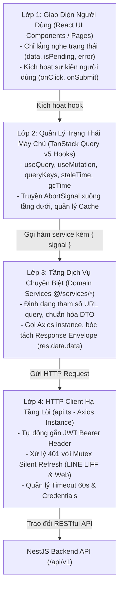
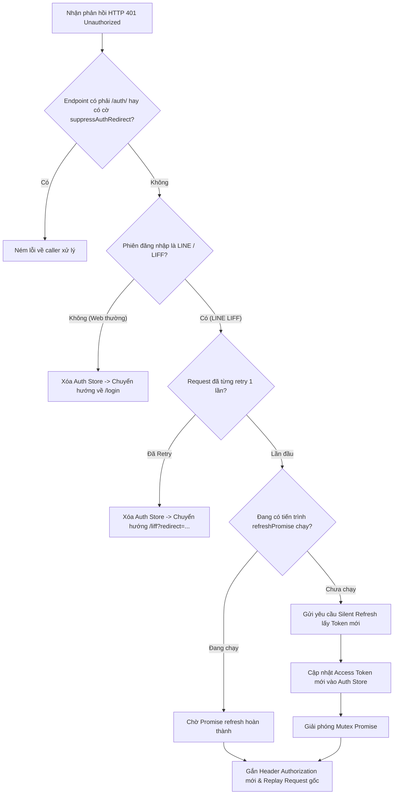
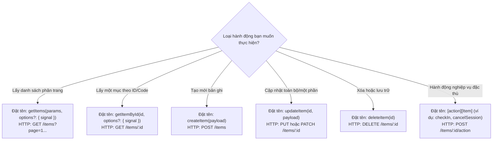
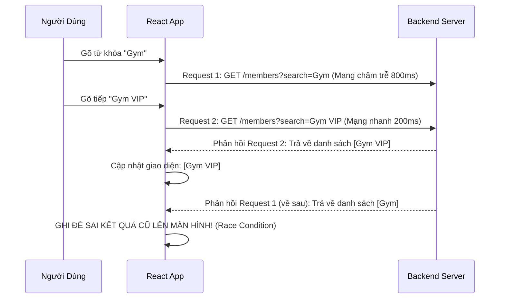

# RoGym RESTful Services & API Client Architecture (README)

> **Cẩm Nang Kiến Trúc Tầng Dịch Vụ Mạng & API Client RoGym Frontend (`src/services/`)**  
> *Phiên bản:* 2.0.0 (React Enterprise Standard)  
> *Cập nhật lần cuối:* 2026-10-23  
> *Phạm vi áp dụng:* Toàn bộ lập trình viên frontend khi định nghĩa, sử dụng hoặc tái cấu trúc các cuộc gọi API, cấu hình Axios instance, bộ lọc request/response interceptors và tích hợp với TanStack Query v5 trong RoGym Management System.  
> *Tài liệu liên quan:* [Cổng Quy Chuẩn Master Frontend](../../FRONTEND_CONVENTIONS.md) | [Chuyên Đề 01: Kiến Trúc & Cấu Trúc Thư Mục](../../docs/01-architecture-and-structure.md) | [Chuyên Đề 02: Quản Lý Trạng Thái](../../docs/02-state-management.md) | [Chuyên Đề 10: Bảo Mật & Xác Thực](../../docs/10-frontend-security-and-auth.md) | [Hạ Tầng Thư Viện Lõi (`src/lib/README.md`)](../lib/README.md)

---

## MỤC LỤC TỔNG QUAN

1. [Chương 1: Kiến Trúc Tầng Dịch Vụ Mạng & Luồng Dữ Liệu 4 Lớp (Network Service Layer Architecture)](#chương-1-kiến-trúc-tầng-dịch-vụ-mạng-luồng-dữ-liệu-4-lớp-network-service-layer-architecture)
2. [Chương 2: Cấu Hình Axios Client, Interceptors & Cơ Chế Silent Token Refresh](#chương-2-cấu-hình-axios-client-interceptors-cơ-chế-silent-token-refresh)
3. [Chương 3: Giao Thức AbortSignal Bắt Buộc 100% Cho Mọi Service Calls (Prevent Race Conditions & Memory Leaks)](#chương-3-giao-thức-abortsignal-bắt-buộc-100-cho-mọi-service-calls-prevent-race-conditions-memory-leaks)
4. [Chương 4: Nhận Diện Anti-patterns & Cẩm Nang Tái Cấu Trúc (Refactoring Playbook)](#chương-4-nhận-diện-anti-patterns-cẩm-nang-tái-cấu-trúc-refactoring-playbook)
5. [Chương 5: Cây Quyết Định Thiết Kế & Đặt Tên Phương Thức Service Trong 15 Giây (Decision Tree)](#chương-5-cây-quyết-định-thiết-kế-đặt-tên-phương-thức-service-trong-15-giây-decision-tree)
6. [Chương 6: Catalog Toàn Diện 100% Services Tại `services/` (22 Modules Dịch Vụ)](#chương-6-catalog-toàn-diện-100-services-tại-services-22-modules-dịch-vụ)
7. [Chương 7: Tiêu Chuẩn Kiểm Thử Tầng Dịch Vụ Với Vitest & Mocking (Unit & Mocking Standards)](#chương-7-tiêu-chuẩn-kiểm-thử-tầng-dịch-vụ-với-vitest-mocking-unit-mocking-standards)
8. [Chương 8: Quy Chuẩn Nghiêm Cấm & Cảnh Báo Lạm Dụng (Anti-Abuse Directives & Severe System Consequences)](#chương-8-quy-chuẩn-nghiêm-cấm-cảnh-báo-lạm-dụng-anti-abuse-directives-severe-system-consequences)
9. [Chương 9: Quy Định Bắt Buộc & Bảng Tra Cứu Nhanh 5 Giây (Quick Reference)](#chương-9-quy-định-bắt-buộc-bảng-tra-cứu-nhanh-5-giây-quick-reference)

---

## CHƯƠNG 1: KIẾN TRÚC TẦNG DỊCH VỤ MẠNG & LUỒNG DỮ LIỆU 4 LỚP (NETWORK SERVICE LAYER ARCHITECTURE)

Trong RoGym Frontend, tầng Dịch vụ mạng (`src/services/`) đóng vai trò là **lớp ranh giới độc lập (Isolation Boundary)** giữa giao thức mạng HTTP bên ngoài và luồng dữ liệu nội bộ của ứng dụng React.

Mọi hoạt động tương tác với Backend bắt buộc phải tuân thủ nghiêm ngặt **Luồng Dữ Liệu 4 Lớp (4-tier Data Flow)**:



### 1.1 Nguyên Tắc Trách Nhiệm Duy Nhất (Single Responsibility Principle)

1. **Dumb Data Transport (Vận chuyển dữ liệu thuần túy):** Tầng service không chứa UI logic, không lưu trữ component state, không gọi thông báo `toast` (ngoại trừ log debug ở cấp thấp) và không thực hiện chuyển trang `navigate`.
2. **DTO Normalization (Chuẩn hóa dữ liệu):** Nhận TypeScript Request Payload từ Query Hook, chuyển đổi định dạng ngày giờ hoặc query params nếu cần, và trả về dữ liệu thuần (`data`) đã được unwrap từ Envelope chuẩn của backend:
   ```typescript
   // Envelope chuẩn của NestJS Backend:
   export interface ApiResponse<T> {
     success: boolean
     data: T
     message?: string
     meta?: {
       page: number
       pageSize: number
       totalItems: number
       totalPages: number
     }
   }
   ```
3. **Decoupled Lifecycle (Không phụ thuộc vòng đời Component):** Mọi hàm service là các hàm bất đồng bộ độc lập (standalone async functions) hoặc methods trong một plain object/class, có thể dễ dàng test độc lập trong môi trường Node.js mà không cần render React component.

---

## CHƯƠNG 2: CẤU HÌNH AXIOS CLIENT, INTERCEPTORS & CƠ CHẾ SILENT TOKEN REFRESH

Hạ tầng kết nối mạng trung tâm được định nghĩa tại [`api.ts`](api.ts). Đây là phiên bản cấu hình duy nhất của Axios Client được phép sử dụng trong toàn bộ dự án.

### 2.1 Cấu Hình Khởi Tạo Axios Instance

```typescript
const api = axios.create({
  baseURL: import.meta.env.VITE_API_URL || '/api/v1',
  headers: { 'Content-Type': 'application/json' },
  timeout: 60000, // 60 giây đề phòng mạng di động 3G/4G yếu
  withCredentials: true, // Hỗ trợ gửi cookie phiên an toàn
})
```

### 2.2 Request Interceptor: Tự Động Gắn JWT Bearer Token

Mỗi request trước khi rời khỏi trình duyệt sẽ được kiểm tra qua `useAuthStore` để bổ sung Header xác thực:

```typescript
api.interceptors.request.use((config) => {
  const token = useAuthStore.getState().token
  const headers = AxiosHeaders.from(config.headers)
  if (token && !headers.has('Authorization')) {
    headers.set('Authorization', `Bearer ${token}`)
  }
  config.headers = headers
  return config
})
```

### 2.3 Response Interceptor: Xử Lý 401 & Hàng Đợi Mutex Silent Refresh

Đối với môi trường ứng dụng lai (Web thông thường và LINE Mini App / LIFF), khi gặp lỗi `HTTP 401 Unauthorized`, Axios Response Interceptor sẽ kích hoạt cơ chế xử lý thông minh:



#### Quy Tắc Chống Vòng Lặp Vô Hạn:
- Cờ `config._retry = true` được gán vào request để bảo đảm một request chỉ được phép thử refresh token tối đa 1 lần duy nhất.
- Hàng đợi Mutex (`refreshPromise`) bảo đảm khi 5 request đồng thời nhận 401, chỉ có đúng **1 request** được gửi lên máy chủ để refresh token, 4 request còn lại sẽ đăng ký chờ kết quả và replay đồng loạt khi có token mới.

---

## CHƯƠNG 3: GIAO THỨC `AbortSignal` BẮT BUỘC 100% CHO MỌI SERVICE CALLS (PREVENT RACE CONDITIONS & MEMORY LEAKS)

### 3.1 Vì Sao Phải Truyền `AbortSignal`?

Trong các ứng dụng React quy mô doanh nghiệp, người dùng thường xuyên gõ ô tìm kiếm, chuyển trang phân trang nhanh, hoặc chuyển tab trước khi request mạng phản hồi xong.

Nếu không có cơ chế hủy request:
1. **Race Condition (Xung đột thứ tự phản hồi):** Request tìm kiếm từ khoá `"A"` (chậm 500ms) phản hồi sau request từ khoá `"AB"` (nhanh 100ms), ghi đè kết quả sai lên màn hình.
2. **Lãng Phí Băng Thông:** Máy chủ tiếp tục tốn tài nguyên xử lý dữ liệu cho các màn hình mà người dùng đã unmount rời đi.
3. **Cảnh Báo Rò Rỉ Bộ Nhớ:** Trình duyệt giữ nguyên promise context trong bộ nhớ.

### 3.2 Chuẩn Mực Triển Khai Trong Service Methods

Mọi hàm fetch hoặc tìm kiếm trong service bắt buộc phải hỗ trợ nhận tham số `signal?: AbortSignal`:

```typescript
// ✅ CHUẨN MỰC: Phương thức Service chấp nhận AbortSignal
export interface GetMemberListParams {
  page?: number
  pageSize?: number
  search?: string
  status?: string
}

export const memberService = {
  getMembers: async (
    params: GetMemberListParams,
    options?: { signal?: AbortSignal }
  ): Promise<{ data: Member[]; total: number }> => {
    const res = await api.get<ApiResponse<Member[]>>('/members', {
      params,
      signal: options?.signal, // Bắt buộc truyền signal vào Axios Request Config
    })
    return {
      data: res.data.data,
      total: res.data.meta?.totalItems ?? res.data.data.length,
    }
  },
}
```

### 3.3 Tích Hợp Tự Động Với TanStack Query v5

TanStack Query v5 tự động khởi tạo và inject thuộc tính `signal` vào hàm `queryFn`:

```typescript
// ✅ CHUẨN MỰC: Hook TanStack Query kết nối AbortSignal
export function useMembers(params: GetMemberListParams) {
  return useQuery({
    queryKey: queryKeys.members.list(params),
    queryFn: ({ signal }) => memberService.getMembers(params, { signal }),
    staleTime: 60_000,
  })
}
```

Khi component unmount hoặc tham số `params` thay đổi, TanStack Query sẽ tự động gọi `abort()`, Axios ngay lập tức ngắt kết nối HTTP socket ở tầng trình duyệt một cách an toàn và nhẹ nhàng.

---

## CHƯƠNG 4: NHẬN DIỆN ANTI-PATTERNS & CẨM NANG TÁI CẤU TRÚC (REFACTORING PLAYBOOK)

Bảng sau đây chỉ rõ các lỗi thường gặp trong mã nguồn tầng service và hướng dẫn cách khắc phục theo đúng chuẩn mực:

| Anti-pattern | Mức Độ Rủi Ro | Biểu Hiện Trong Code | Cách Khắc Phục Chuẩn Mực |
| :--- | :--- | :--- | :--- |
| **Bỏ quên `signal`** | 🔴 Cao (Race Condition) | `getRecords: async (query) => { return api.get(...) }` | Bổ sung `options?: { signal?: AbortSignal }` và truyền vào Axios config. |
| **Gọi Axios trực tiếp tại UI** | 🔴 Cao (Bypass Architecture) | Component dùng `useEffect` gọi `axios.get('/api/v1/...')` | Đóng gói thành phương thức trong `service`, sau đó gọi qua TanStack Query hook. |
| **Hiển thị Toast trong Service** | 🟡 Trung Bình (Vi phạm SRP) | `toast.error('Lỗi mạng')` đặt bên trong hàm service | Ném lỗi (`throw error`) để tầng UI hoặc hook `useMutation.onError` tự quyết định cách hiển thị. |
| **Trả về nguyên AxiosResponse** | 🟡 Trung Bình (Dư thừa dữ liệu) | `return res` (bao gồm headers, config, status, data) | Unwrap dữ liệu chuẩn: `return res.data.data` để tầng trên chỉ thao tác với Domain DTO. |
| **Hardcode Base URL** | 🔴 Cao (Lỗi môi trường) | `api.get('http://localhost:3000/api/v1/...')` | Dùng đường dẫn tương đối `/endpoint`, baseURL đã được cấu hình tự động qua biến môi trường. |

### Hướng Dẫn Tái Cấu Trúc Điển Hình:

```typescript
// ❌ CŨ: Không có signal, gọi toast trong service, trả về response lộn xộn
export const badSubscriptionService = {
  fetchSubs: async (memberId: string) => {
    try {
      const res = await api.get(`/subscriptions?memberId=${memberId}`)
      return res.data
    } catch (err) {
      toast.error('Không thể lấy danh sách gói tập')
      return []
    }
  }
}

// ✅ MỚI (CHUẨN MỰC): Dumb transport, hỗ trợ AbortSignal, ném lỗi đúng cách
export const subscriptionService = {
  getByMember: async (
    memberId: string,
    options?: { signal?: AbortSignal }
  ): Promise<Subscription[]> => {
    const res = await api.get<ApiResponse<Subscription[]>>('/subscriptions', {
      params: { memberId },
      signal: options?.signal,
    })
    return res.data.data
  }
}
```

---

## CHƯƠNG 5: CÂY QUYẾT ĐỊNH THIẾT KẾ & ĐẶT TÊN PHƯƠNG THỨC SERVICE TRONG 15 GIÂY (DECISION TREE)

Khi tạo mới một phương thức giao tiếp API, hãy làm theo lưu đồ sau để chọn tên và chuẩn HTTP tương ứng:



### Quy Tắc Đặt Tên Chuẩn Hóa:
- **Tập hợp (List):** `getItems`, `getLogs`, `getMembers` (Luôn kèm `params` và `signal`).
- **Chi tiết (Single Item):** `getItemById`, `getByMember`, `getProfile`.
- **Hành động (Action):** Động từ rõ ràng: `checkIn`, `checkOut`, `cancel`, `freeze`, `transfer`, `renew`.

---

## CHƯƠNG 6: CATALOG TOÀN DIỆN 100% SERVICES TẠI `services/` (22 MODULES DỊCH VỤ)

Dưới đây là danh mục đầy đủ toàn bộ 22 modules dịch vụ đang vận hành trong dự án:

| STT | File Service | Mô Tả Trách Nhiệm Nghiệp Vụ | Endpoints Tương Tác Chính |
| :---: | :--- | :--- | :--- |
| 1 | [`api.ts`](api.ts) | Cấu hình lõi Axios Client, Interceptors, Mutex Refresh. | Toàn bộ các endpoints |
| 2 | [`auth.service.ts`](auth.service.ts) | Đăng nhập credentials, đăng ký, hồ sơ `me`, đổi mật khẩu. | `/auth/login`, `/auth/register`, `/auth/me` |
| 3 | `attendance.service.ts` | Điểm danh học viên, tạo mã QR, check-in QR, check-out. | `/attendance-logs`, `/attendance/qr-token`, `/attendance/manual-checkin` |
| 4 | `chat.service.ts` | Nhắn tin thời gian thực, lịch sử hội thoại, upload tệp đính kèm. | `/chat/conversations`, `/chat/messages`, `/chat/eligibility` |
| 5 | `facility.service.ts` | Quản lý phòng tập, thiết bị thể hình, lịch bảo trì máy tập. | `/facilities`, `/equipment`, `/maintenance-logs` |
| 6 | `feedback.service.ts` | Gửi đánh giá buổi tập, phản ánh dịch vụ của học viên. | `/feedbacks`, `/feedbacks/:id` |
| 7 | `file.service.ts` | Upload tài liệu, hình ảnh avatar và lưu trữ media qua backend. | `/files/upload` |
| 8 | `member-progress.service.ts` | Theo dõi tiến độ thể trạng InBody, biểu đồ cân nặng, mỡ, cơ. | `/members/:id/progress`, `/member-progress` |
| 9 | `member.service.ts` | Quản lý danh sách hội viên, tra cứu thông tin thẻ, trạng thái. | `/members`, `/members/:id`, `/members/search` |
| 10 | `notification.service.ts` | Danh sách thông báo đẩy, đánh dấu đã đọc, tùy chọn nhận tin. | `/notifications`, `/notifications/:id/read` |
| 11 | `owner.service.ts` | Báo cáo doanh số và hiệu suất dành riêng cho chủ phòng tập (Gym Owner). | `/owner/overview`, `/owner/financial-summary` |
| 12 | `package.service.ts` | Danh mục gói tập, giá bán niêm yết, thời hạn, quyền lợi đi kèm. | `/packages`, `/packages/:id` |
| 13 | `payment.service.ts` | Tạo hóa đơn thanh toán, đối soát giao dịch, VietQR thanh toán. | `/payments`, `/payments/create-intent`, `/payments/:id/verify` |
| 14 | `paymentAccount.service.ts` | Cấu hình tài khoản ngân hàng thụ hưởng, tài khoản QR phòng tập. | `/payment-accounts`, `/payment-accounts/active` |
| 15 | `rbac.service.ts` | Quản lý vai trò (Roles) và ma trận phân quyền (Permissions). | `/rbac/roles`, `/rbac/permissions` |
| 16 | `report.service.ts` | Thống kê số lượng học viên, báo cáo doanh thu theo tháng/quý. | `/reports/revenue`, `/reports/attendance-stats` |
| 17 | `staff.service.ts` | Hồ sơ nhân sự, lịch trực ca, phân quyền vị trí làm việc. | `/staff`, `/staff/:id`, `/staff/shifts` |
| 18 | `staffAttendance.service.ts` | Chấm công ca làm việc nhân viên (Chấm vào / Chấm ra theo ngày). | `/staff-attendance/checkin`, `/staff-attendance/checkout`, `/staff-attendance/me` |
| 19 | `subscription.service.ts` | Đăng ký gói tập, kích hoạt thẻ, chuyển nhượng, bảo lưu hợp đồng. | `/subscriptions`, `/subscriptions/:id/freeze`, `/subscriptions/:id/transfer` |
| 20 | `trainer.service.ts` | Thông tin Huấn luyện viên (PT), bằng cấp, danh sách học viên phụ trách. | `/trainers`, `/trainers/:id/clients` |
| 21 | `training-session.service.ts` | Lịch tập PT 1:1, đặt buổi tập, xác nhận hoàn thành, hủy lịch. | `/training-sessions`, `/training-sessions/:id/complete` |
| 22 | `workout.service.ts` | Giáo án tập luyện, bài tập chi tiết, ghi nhận kết quả từng set/rep. | `/workouts`, `/exercises`, `/workout-logs` |

---

## CHƯƠNG 7: TIÊU CHUẨN KIỂM THỬ TẦNG DỊCH VỤ VỚI VITEST & MOCKING (UNIT & MOCKING STANDARDS)

Để bảo đảm kiểm thử tầng service chạy nhanh, độc lập và không phụ thuộc mạng internet thực tế, lập trình viên sử dụng Vitest với cơ chế mock `api.ts`.

### 7.1 Mẫu Test Case Chuẩn Cho Service

```typescript
import { describe, it, expect, vi, beforeEach } from 'vitest'
import { attendanceService } from './attendance.service'
import api from './api'

// Mock instance Axios lõi
vi.mock('./api', () => ({
  default: {
    get: vi.fn(),
    post: vi.fn(),
    patch: vi.fn(),
  },
}))

describe('attendanceService', () => {
  beforeEach(() => {
    vi.clearAllMocks()
  })

  it('lấy danh sách điểm danh và truyền đúng params & AbortSignal', async () => {
    const mockData = [
      { attendanceId: 'att-1', memberName: 'Nguyễn Văn A', startTime: '2026-10-23T08:00:00Z' },
    ]
    vi.mocked(api.get).mockResolvedValueOnce({
      data: { success: true, data: mockData, meta: { totalItems: 1 } },
    })

    const controller = new AbortController()
    const result = await attendanceService.getAttendance(
      { memberId: 'mem-123' },
      { signal: controller.signal }
    )

    expect(api.get).toHaveBeenCalledWith(
      '/attendance-logs',
      expect.objectContaining({
        params: expect.objectContaining({ memberId: 'mem-123' }),
        signal: controller.signal,
      })
    )
    expect(result.data).toEqual(mockData)
    expect(result.total).toBe(1)
  })

  it('xử lý ném lỗi khi API trả về mã lỗi 500', async () => {
    vi.mocked(api.get).mockRejectedValueOnce(new Error('Internal Server Error'))

    await expect(
      attendanceService.getAttendance({ memberId: 'mem-123' })
    ).rejects.toThrow('Internal Server Error')
  })
})
```

---

## CHƯƠNG 8: QUY CHUẨN NGHIÊM CẤM & CẢNH BÁO LẠM DỤNG (ANTI-ABUSE DIRECTIVES & SEVERE SYSTEM CONSEQUENCES)

Tài liệu này là **hợp đồng kỹ thuật tối thượng** cho toàn bộ tầng giao tiếp mạng RESTful API của RoGym. Mọi vi phạm về bỏ qua AbortSignal, nhồi nhét UI state hoặc bypass kiến trúc Axios Client đều gây ra hậu quả nặng nề về tính toàn vẹn dữ liệu và độ tin cậy của ứng dụng.

### 8.1 Bảng Ma Trận Quy Tắc Cấm Trong Services

| Mã Rule ID | Hành Vi Lạm Dụng Bị Nghiêm Cấm | Mức Độ | Hậu Quả Nặng Nề & Blast Radius |
| :--- | :--- | :---: | :--- |
| `RULE_NO_BYPASS_ABORT_SIGNAL` | Không nhận hoặc không truyền `signal?: AbortSignal` vào request Axios khi fetch dữ liệu/search. | `CRITICAL` | Lỗi Race Condition nguy hiểm (kết quả tìm kiếm ký tự cũ về sau đè bẹp kết quả mới); lãng phí tài nguyên CPU của backend; ngốn băng thông 3G/4G của học viên. |
| `RULE_NO_UI_IN_SERVICE` | Gọi trực tiếp `toast.success`, `toast.error`, `navigate('/...')` bên trong các hàm service. | `CRITICAL` | Vi phạm triệt để nguyên tắc Đơn trách nhiệm (Single Responsibility Principle); khiến service không thể tái sử dụng cho background syncing hoặc cron; không thể chạy unit test trong môi trường Node.js. |
| `RULE_NO_DIRECT_AXIOS_IN_UI` | Tự import `axios` gốc để gọi HTTP request trong component hoặc `useEffect`. | `CRITICAL` | Vượt rào kiểm soát bảo mật, không được gắn JWT Bearer token và bỏ qua cơ chế Mutex Silent Token Refresh, gây lỗi 401 văng người dùng ra màn hình đăng nhập. |
| `RULE_NO_RAW_AXIOS_RESPONSE` | Trả về nguyên đối tượng `AxiosResponse` thay vì unwrap dữ liệu sạch (`res.data.data`). | `SEVERE` | Ép các hooks và components phải xử lý chi tiết giao thức HTTP (`response.status`, `response.headers`), phá vỡ tính bao đóng DTO. |

### 8.2 Sơ Đồ Trực Quan & Phân Tích Kỹ Thuật



### 8.3 Công Thức Tái Cấu Trúc Thực Chiến (Refactoring Recipes)

#### Recipe 1: Tái Cấu Trúc Service Method Chuẩn Dumb Transport Kèm AbortSignal
```typescript
// ❌ TRƯỚC REFACTOR: Bỏ quên signal, tự gọi toast, trả về AxiosResponse thô
export const attendanceService = {
  getLogs: async (memberId: string) => {
    try {
      const res = await axios.get(`/api/v1/attendance-logs?memberId=${memberId}`)
      return res
    } catch (err) {
      toast.error('Không thể tải lịch sử điểm danh')
      return null
    }
  }
}

// ✅ SAU REFACTOR: Dumb Transport, hỗ trợ AbortSignal, unwrap DTO, để UI bắt lỗi
export const attendanceService = {
  getLogs: async (
    params: { memberId: string },
    options?: { signal?: AbortSignal }
  ): Promise<AttendanceLog[]> => {
    const res = await api.get<ApiResponse<AttendanceLog[]>>('/attendance-logs', {
      params,
      signal: options?.signal,
    })
    return res.data.data
  }
}
```

#### Recipe 2: Chặn Đứng Direct Axios Trong UI Bằng Service Method Chuẩn
```typescript
// ❌ TRƯỚC REFACTOR: Component tự gọi axios trực tiếp, mất token và mutex refresh
useEffect(() => {
  axios.get('/api/v1/packages').then(res => setPackages(res.data.data))
}, [])

// ✅ SAU REFACTOR: Đóng gói vào packageService và dùng qua TanStack Query
export function usePackagesQuery() {
  return useQuery({
    queryKey: queryKeys.packages.all(),
    queryFn: ({ signal }) => packageService.getAll({ signal }),
    staleTime: 300_000,
  })
}
```

### 8.4 Checklist Nghiệm Thu PR (Definition of Done)
- [ ] 100% các phương thức GET / Search / Filter đều nhận tham số `options?: { signal?: AbortSignal }` và truyền vào Axios config.
- [ ] Tệp service không import bất kỳ thư viện UI nào (`sonner`, `toast`, `react-router-dom`).
- [ ] 100% HTTP requests trong dự án đều đi qua instance `api.ts` duy nhất.
- [ ] Mọi phương thức service đều unwrap và trả về `res.data.data` (DTO sạch).

---

## CHƯƠNG 9: QUY ĐỊNH BẮT BUỘC & BẢNG TRA CỨU NHANH 5 GIÂY (QUICK REFERENCE)

### 9.1 5 Quy Định Bắt Buộc Dành Cho Lập Trình Viên

1. **100% Request Bắt Buộc Qua `api.ts`:** Tuyệt đối không import thư viện `axios` gốc để tự tạo HTTP request trong components hoặc services khác.
2. **Hỗ Trợ `AbortSignal` Cho Các Hàm Tìm Kiếm & Lấy Danh Sách:** Mọi phương thức fetch dữ liệu cần có tùy chọn `options?: { signal?: AbortSignal }`.
3. **Cấm Chứa UI State & Toast Trong Services:** Tầng service chỉ làm nhiệm vụ giao tiếp dữ liệu. Thông báo thành công/thất bại thuộc về tầng UI / Mutation callbacks.
4. **Luôn Bóc Tách Envelope (`res.data.data`):** Trả về dữ liệu sạch cho tầng trên sử dụng, không bắt các hooks phải gọi thêm `.data.data`.
5. **Đồng Bộ Kiểu Dữ Liệu DTO:** Mọi Response và Request Payload bắt buộc phải được định nghĩa kiểu bằng TypeScript Interface rõ ràng, không sử dụng `any`.

### 9.2 Bảng Tra Cứu Nhanh 5 Giây (5-Second Cheat Sheet)

```typescript
// 1. Khai báo interface chuẩn
export interface CreatePackagePayload {
  name: string
  price: number
  durationDays: number
}

// 2. Viết service method chuẩn
export const packageService = {
  create: async (payload: CreatePackagePayload): Promise<Package> => {
    const res = await api.post<ApiResponse<Package>>('/packages', payload)
    return res.data.data
  },
  getAll: async (options?: { signal?: AbortSignal }): Promise<Package[]> => {
    const res = await api.get<ApiResponse<Package[]>>('/packages', {
      signal: options?.signal,
    })
    return res.data.data
  },
}
```


