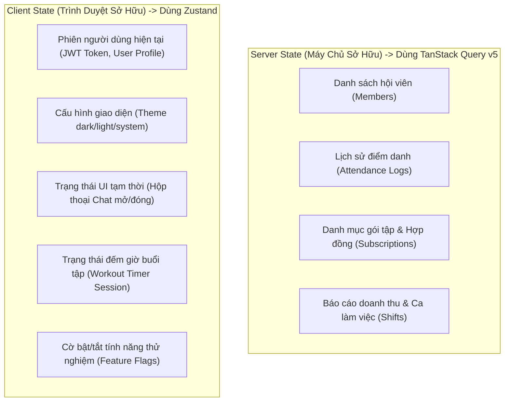
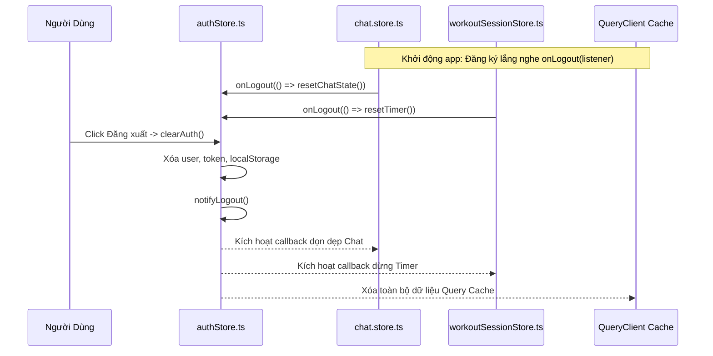
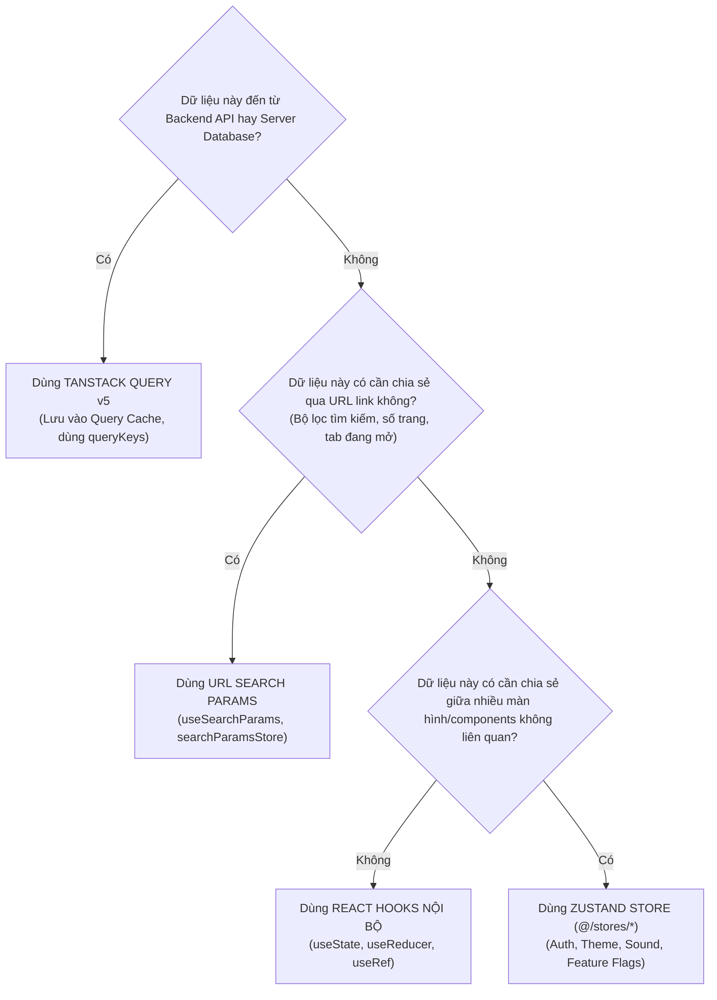
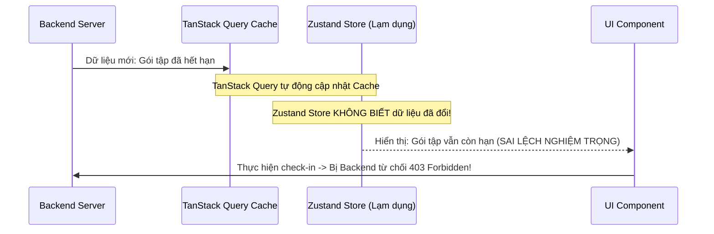

# RoGym Zustand Stores & Client State Architecture (README)

> **Cẩm Nang Kiến Trúc Quản Lý Trạng Thái Client RoGym Frontend (`src/stores/`)**  
> *Phiên bản:* 2.0.0 (React Enterprise Standard)  
> *Cập nhật lần cuối:* 2026-10-23  
> *Phạm vi áp dụng:* Toàn bộ lập trình viên frontend khi tạo mới, sử dụng, hoặc tái cấu trúc các kho trạng thái toàn cục (Global Client State), phiên đăng nhập, giao diện, và cờ tính năng trong RoGym Management System.  
> *Tài liệu liên quan:* [Cổng Quy Chuẩn Master Frontend](../../FRONTEND_CONVENTIONS.md) | [Chuyên Đề 01: Kiến Trúc & Cấu Trúc Thư Mục](../../docs/01-architecture-and-structure.md) | [Chuyên Đề 02: Quản Lý Trạng Thái](../../docs/02-state-management.md) | [Chuyên Đề 10: Bảo Mật & Xác Thực](../../docs/10-frontend-security-and-auth.md) | [Hạ Tầng Thư Viện Lõi (`src/lib/README.md`)](../lib/README.md)

---

## MỤC LỤC TỔNG QUAN

1. [Chương 1: Kiến Trúc Quản Lý Trạng Thái Toàn Cục & Ranh Giới: Zustand = Client State ONLY (No Server Cache)](#chương-1-kiến-trúc-quản-lý-trạng-thái-toàn-cục-ranh-giới-zustand-client-state-only-no-server-cache)
2. [Chương 2: Atomic Selectors & Đồng Bộ Đa Tab Qua BroadcastChannel / Storage](#chương-2-atomic-selectors-đồng-bộ-đa-tab-qua-broadcastchannel-storage)
3. [Chương 3: Cơ Chế Dọn Dẹp Tài Nguyên Tập Trung Với `onLogout` Listener Pattern](#chương-3-cơ-chế-dọn-dẹp-tài-nguyên-tập-trung-với-onlogout-listener-pattern)
4. [Chương 4: Nhận Diện Anti-patterns & Cẩm Nang Tái Cấu Trúc (Refactoring Playbook)](#chương-4-nhận-diện-anti-patterns-cẩm-nang-tái-cấu-trúc-refactoring-playbook)
5. [Chương 5: Cây Quyết Định Chọn Nơi Lưu Trữ Trạng Thái Trong 15 Giây (Decision Tree)](#chương-5-cây-quyết-định-chọn-nơi-lưu-trữ-trạng-thái-trong-15-giây-decision-tree)
6. [Chương 6: Catalog Toàn Diện 100% Stores Tại `stores/` (7 Modules Stores)](#chương-6-catalog-toàn-diện-100-stores-tại-stores-7-modules-stores)
7. [Chương 7: Tiêu Chuẩn Kiểm Thử Zustand Stores Với Vitest (Unit Testing Standards)](#chương-7-tiêu-chuẩn-kiểm-thử-zustand-stores-với-vitest-unit-testing-standards)
8. [Chương 8: Quy Chuẩn Nghiêm Cấm & Cảnh Báo Lạm Dụng (Anti-Abuse Directives & Severe System Consequences)](#chương-8-quy-chuẩn-nghiêm-cấm-cảnh-báo-lạm-dụng-anti-abuse-directives-severe-system-consequences)
9. [Chương 9: Quy Định Bắt Buộc & Bảng Tra Cứu Nhanh 5 Giây (Quick Reference)](#chương-9-quy-định-bắt-buộc-bảng-tra-cứu-nhanh-5-giây-quick-reference)

---

## CHƯƠNG 1: KIẾN TRÚC QUẢN LÝ TRẠNG THÁI TOÀN CỤC & RANH GIỚI: ZUSTAND = CLIENT STATE ONLY (NO SERVER CACHE)

Trong ứng dụng RoGym Frontend, việc phân định rõ ràng giữa **Client State** và **Server State** là nguyên tắc quan trọng hàng đầu để ngăn chặn lỗi đồng bộ dữ liệu và re-render lãng phí.

### 1.1 Ranh Giới Bắt Buộc: Zustand Chỉ Dành Cho Client State



### 1.2 Bảng Phân Định Trách Nhiệm Giữa 2 Công Cụ

| Đặc Tính | Zustand (`src/stores/`) | TanStack Query v5 (`src/hooks/`) |
| :--- | :--- | :--- |
| **Loại trạng thái** | **Client State thuần túy:** Token xác thực, theme, UI toggle, timer. | **Server State:** Dữ liệu lưu trong PostgreSQL / Backend API. |
| **Bản quyền dữ liệu** | Thuộc về phiên duyệt web hiện tại của Client. | Thuộc về Database trên máy chủ (Client chỉ giữ bản cache tạm). |
| **Cơ chế Cache** | Không tự động hết hạn (lưu trong memory hoặc `localStorage`). | Tự động làm mới (Auto-refetch), xóa rác (gcTime), quản lý cũ (staleTime). |
| **Xử lý bất đồng bộ** | Thao tác synchronous đơn giản, không nên tự viết retry/dedup. | Xử lý triệt để loading, error, deduplication và hủy request (`signal`). |
| **Hành vi khi unmount** | Dữ liệu vẫn được giữ trong store trừ khi chủ động `reset/clear`. | Tự hủy subscription lắng nghe, tự động thu hồi bộ nhớ theo `gcTime`. |

> [!IMPORTANT]
> **NGUYÊN TẮC BẤT DI BẤT DỊCH:** Tuyệt đối không sao chép danh sách dữ liệu từ máy chủ (như `subscriptions`, `attendanceLogs`, `memberList`) vào một mảng lưu trong Zustand Store. Hãy để TanStack Query v5 làm nhiệm vụ đó.

---

## CHƯƠNG 2: ATOMIC SELECTORS & ĐỒNG BỘ ĐA TAB QUA BROADCASTCHANNEL / STORAGE

### 2.1 Atomic Selectors: Chống Re-render Toàn Bộ Cây Giao Diện

Một lỗi phổ biến khi sử dụng Zustand là destructure toàn bộ state object trong React Component:

```tsx
// ❌ SAI LẦM: Gây re-render component mỗi khi BẤT KỲ state nào trong store thay đổi
const { user, token, setAuth, clearAuth } = useAuthStore()

// ✅ CHUẨN MỰC: Sử dụng Atomic Selector cho từng giá trị cần thiết
const user = useAuthStore((s) => s.user)
const isAuthenticated = useAuthStore((s) => s.isAuthenticated)
const clearAuth = useAuthStore((s) => s.clearAuth)
```

Khi sử dụng Atomic Selector, React Component chỉ re-render khi và chỉ khi giá trị mà selector trả về thực sự thay đổi (so sánh bằng `Object.is`).

### 2.2 Đồng Bộ Đa Tab (Multi-Tab Synchronization)

Khi người dùng mở ứng dụng trên nhiều tab trình duyệt:
1. Nếu người dùng **Đăng xuất (Logout)** ở Tab A, Tab B phải lập tức xóa session và chuyển hướng về trang đăng nhập để bảo mật.
2. Nếu người dùng **Đổi Theme** ở Tab A, Tab B phải lập tức cập nhật giao diện mà không cần reload trang.

`authStore` và `themeStore` sử dụng middleware `persist` ghi dữ liệu vào `localStorage`. Để đồng bộ tức thì giữa các tab, một listener theo dõi sự kiện `storage` được kích hoạt:

```typescript
// Lắng nghe sự kiện đồng bộ từ các Tab khác
if (typeof window !== 'undefined') {
  window.addEventListener('storage', (event) => {
    if (event.key === 'gym-auth' && !event.newValue) {
      // Khi Tab khác xóa token, Tab hiện tại lập tức reset auth
      useAuthStore.getState().clearAuth()
    }
  })
}
```

---

## CHƯƠNG 3: CƠ CHẾ DỌN DẸP TÀI NGUYÊN TẬP TRUNG VỚI `onLogout` LISTENER PATTERN

### 3.1 Giải Quyết Vấn Đề Circular Dependency

Khi người dùng đăng xuất, nhiều module độc lập cần giải phóng tài nguyên:
- `chat.store.ts`: Ngắt kết nối WebSocket socket, xóa lịch sử tin nhắn chưa gửi.
- `workoutSessionControlStore.ts`: Hủy timer, xóa dữ liệu nháp của buổi tập.
- `TanStack Query`: Xóa sạch cache (`queryClient.clear()`).

Nếu `authStore.ts` trực tiếp import từng store trên để gọi hàm reset, dự án sẽ ngay lập tức rơi vào bẫy **Circular Dependency (Phụ thuộc vòng tròn)**.

### 3.2 Cơ Chế Publish / Subscribe Thông Qua `onLogout`

Tại [`authStore.ts`](authStore.ts), một cơ chế Pub/Sub siêu nhẹ được thiết lập:



#### Mã Nguồn Chuẩn Triển Khai:

```typescript
// authStore.ts
export type LogoutListener = () => void
const logoutListeners = new Set<LogoutListener>()

export function onLogout(listener: LogoutListener): () => void {
  logoutListeners.add(listener)
  return () => {
    logoutListeners.delete(listener)
  }
}

export function notifyLogout(): void {
  logoutListeners.forEach((listener) => {
    try {
      listener()
    } catch (err) {
      // Ghi log bảo vệ, không để lỗi của một listener làm gián đoạn luồng logout
      logger.error('Error during logout listener cleanup', { error: err })
    }
  })
}
```

---

## CHƯƠNG 4: NHẬN DIỆN ANTI-PATTERNS & CẨM NANG TÁI CẤU TRÚC (REFACTORING PLAYBOOK)

Trong mã nguồn hiện hữu, có một số store được xây dựng ở giai đoạn đầu chứa các anti-pattern cần được nhận diện rõ ràng và đưa vào lộ trình tái cấu trúc:

| Anti-pattern | Vị Trí Phát Hiện | Phân Tích Rủi Ro Kỹ Thuật | Phương Án Tái Cấu Trúc Mục Tiêu |
| :--- | :--- | :--- | :--- |
| **Server Cache Trong Zustand** | `subscriptionStore.ts` | Tự triển khai biến `inFlight`, `lastSuccessfulResult`, đếm thế hệ `generation`, và vòng lặp `retry` thủ công trong Zustand. Gây duplicate tính năng với TanStack Query. | Xóa bỏ `subscriptionStore`. Chuyển sang hook `useSubscriptionCheck(memberId)` sử dụng `useQuery`. |
| **Lưu Records & Toast Trong Store** | `staffAttendanceStore.ts` | Lưu mảng `todayLogs` của server, tự gọi `toast.success` trong action của Zustand thay vì để UI quản lý. | Chuyển sang hook `useStaffAttendanceLogs` (query) và `useStaffCheckIn` (mutation có `onSuccess`). |
| **Ghi Log Thô `console.error`** | [`authStore.ts`](authStore.ts) | Dùng trực tiếp hàm `console.error` trong listener callback thay vì hệ thống logger chuẩn. | Thay bằng `logger.error` từ `@/lib/logger`. |

### Kế Hoạch Chuyển Đổi Chi Tiết: Từ `subscriptionStore` Sang `useSubscriptionCheck`

```typescript
// ❌ CŨ: Quá phức tạp, 192 dòng mã tự quản lý retry & in-flight requests trong Zustand
import { useSubscriptionStore } from '@/stores/subscriptionStore'
// Trong component:
const { check, status, hasActiveSub } = useSubscriptionStore()

// ✅ MỚI (CHUẨN MỰC TƯƠNG LAI): Chỉ 15 dòng với TanStack Query v5
export function useSubscriptionCheck(memberId: string) {
  return useQuery({
    queryKey: queryKeys.subscriptions.byMember(memberId),
    queryFn: ({ signal }) => subscriptionService.getByMember(memberId, { signal }),
    enabled: Boolean(memberId),
    select: (subs) => ({
      subscriptions: subs,
      hasActiveSub: hasActiveSubscription(subs),
    }),
    staleTime: 30_000,
    retry: 1,
  })
}
```

---

## CHƯƠNG 5: CÂY QUYẾT ĐỊNH CHỌN NƠI LƯU TRỮ TRẠNG THÁI TRONG 15 GIÂY (DECISION TREE)

Khi bắt đầu làm một tính năng mới, hãy trả lời câu hỏi sau để chọn đúng nơi lưu trữ trạng thái:



---

## CHƯƠNG 6: CATALOG TOÀN DIỆN 100% STORES TẠI `stores/` (7 MODULES STORES)

Bảng tổng hợp chi tiết toàn bộ 7 files store trong thư mục `src/stores/`:

| STT | File Store | Mục Đích Nghiệp Vụ | Trạng Thái Lưu Trữ Chính | Phân Loại Chuẩn |
| :---: | :--- | :--- | :--- | :---: |
| 1 | [`authStore.ts`](authStore.ts) | Quản lý phiên xác thực, token và quyền người dùng. | `user`, `token`, `authProvider`, `isAuthenticated`. Persist `localStorage`. | ✅ Client Core |
| 2 | [`themeStore.ts`](themeStore.ts) | Quản lý giao diện sáng/tối và đồng bộ hệ điều hành. | `theme` ('dark'/'light'/'system'), `resolvedTheme`. Persist `localStorage`. | ✅ Client Core |
| 3 | `feature-flag.store.ts` | Bật/tắt tính năng thử nghiệm nội bộ. | `flags`: `enableVirtualTable`, `enableNewAuthFlow`, v.v. | ✅ Client Core |
| 4 | `chat.store.ts` | Phiên nhắn tin thời gian thực và cửa sổ chat nổi. | `conversations`, `typingUsers`, `isFloatingOpen`, `soundEnabled`. | ✅ Client Core |
| 5 | `workoutSessionControlStore.ts` | Bộ điều khiển đếm giờ buổi tập luyện trực tiếp. | `controls`: `status`, `startTimer`, `pauseTimer`, `resumeTimer`. | ✅ Client Core |
| 6 | `subscriptionStore.ts` | Kiểm tra quyền truy cập hội viên theo hợp đồng. | `status`, `hasActiveSub`, `errorCode`, `inFlight` request tracking. | ⚠️ Cần Refactor |
| 7 | `staffAttendanceStore.ts` | Chấm công nhanh của nhân viên ca trực tại quầy. | `openLog`, `todayLogs`, `loadingToday`, `actionLoading`. | ⚠️ Cần Refactor |

---

## CHƯƠNG 7: TIÊU CHUẨN KIỂM THỬ ZUSTAND STORES VỚI VITEST (UNIT TESTING STANDARDS)

Zustand stores chạy thuần túy bằng JavaScript nên việc viết unit tests rất nhanh chóng và không yêu cầu render component.

### 7.1 Mẫu Test Case Chuẩn Cho Zustand Store

```typescript
import { describe, it, expect, beforeEach } from 'vitest'
import { useFeatureFlagStore } from './feature-flag.store'

describe('useFeatureFlagStore', () => {
  beforeEach(() => {
    // Reset store về trạng thái mặc định trước mỗi bài test
    useFeatureFlagStore.getState().resetFlags()
  })

  it('khởi tạo với các giá trị mặc định chính xác', () => {
    const isTelemetryEnabled = useFeatureFlagStore.getState().isEnabled('enableTelemetry')
    const isVirtualTableEnabled = useFeatureFlagStore.getState().isEnabled('enableVirtualTable')

    expect(isTelemetryEnabled).toBe(true)
    expect(isVirtualTableEnabled).toBe(false)
  })

  it('cập nhật giá trị flag khi gọi setFlag', () => {
    useFeatureFlagStore.getState().setFlag('enableVirtualTable', true)

    expect(useFeatureFlagStore.getState().isEnabled('enableVirtualTable')).toBe(true)
  })
})
```

---

## CHƯƠNG 8: QUY CHUẨN NGHIÊM CẤM & CẢNH BÁO LẠM DỤNG (ANTI-ABUSE DIRECTIVES & SEVERE SYSTEM CONSEQUENCES)

Tài liệu này là **hợp đồng kỹ thuật tối thượng** quy định ranh giới vận hành của Zustand Stores trong RoGym. Việc lạm dụng lưu trữ Server Cache hoặc quản lý Local State sai chỗ sẽ làm phá vỡ toàn bộ tính dự đoán được của ứng dụng, gây rò rỉ dữ liệu cá nhân (PII) và suy giảm hiệu năng nghiêm trọng.

### 8.1 Bảng Ma Trận Quy Tắc Cấm Trong Stores

| Mã Rule ID | Hành Vi Lạm Dụng Bị Nghiêm Cấm | Mức Độ | Hậu Quả Nặng Nề & Blast Radius |
| :--- | :--- | :---: | :--- |
| `RULE_NO_SERVER_STATE_IN_ZUSTAND` | Sao chép mảng dữ liệu máy chủ (`members`, `attendanceLogs`, `subscriptions`) vào Zustand Store và tự viết hàm retry/fetch thủ công. | `CRITICAL` | Gây phân kỳ dữ liệu (Stale State Divergence) giữa các màn hình; triệt tiêu cơ chế tự động refetch và xóa rác của TanStack Query; phát sinh bug "dữ liệu ma" khi dữ liệu máy chủ đã thay đổi nhưng store client vẫn giữ giá trị cũ. |
| `RULE_NO_GLOBAL_LOCAL_STATE` | Đưa trạng thái đóng/mở modal, popover, tab active hoặc giá trị ô tìm kiếm của 1 component cụ thể vào Zustand Store toàn cục. | `SEVERE` | Kích hoạt chu kỳ re-render diện rộng (Global Re-render Cascades) trên toàn bộ cây giao diện; làm phức tạp hóa vòng đời component; khiến unit test bị phụ thuộc chéo vào global state. |
| `RULE_NO_UNREGISTERED_LOGOUT_CLEANUP` | Khởi tạo store chứa dữ liệu định danh người dùng hoặc kết nối WebSocket mà không đăng ký dọn dẹp qua `onLogout`. | `CRITICAL` | Rò rỉ dữ liệu phiên (Session & PII Data Leakage); học viên sau đăng nhập vào máy tính của lễ tân có thể nhìn thấy tin nhắn hoặc thông tin của học viên trước đó. |
| `RULE_NO_BULK_STORE_DESTRUCTURING` | Gọi store theo cú pháp destructure toàn bộ: `const { a, b, c } = useStore()`. | `SEVERE` | Thành phần React sẽ bị ép re-render mỗi khi **bất kỳ** giá trị nào trong store thay đổi, dù component hoàn toàn không sử dụng giá trị đó. |
| `RULE_NO_UNVALIDATED_LOCALSTORAGE` | Đọc `JSON.parse` từ `localStorage` trong custom store mà không có `try/catch` hoặc Zod Schema an toàn. | `CRITICAL` | Khi cấu trúc state trong phiên bản mới thay đổi, chuỗi dữ liệu cũ trong localStorage làm văng lỗi runtime, khiến ứng dụng bị **Crash trắng màn hình vĩnh viễn** cho đến khi người dùng tự xóa cache trình duyệt. |

### 8.2 Sơ Đồ Trực Quan & Phân Tích Kỹ Thuật



### 8.3 Công Thức Tái Cấu Trúc Thực Chiến (Refactoring Recipes)

#### Recipe 1: Tái Cấu Trúc `subscriptionStore.ts` Sang TanStack Query v5 Hook
```typescript
// ❌ TRƯỚC REFACTOR: 192 dòng tự làm inFlight, retry, generation count trong Zustand
export const useSubscriptionStore = create((set, get) => ({
  status: 'idle',
  hasActiveSub: false,
  check: async (memberId: string) => {
    // Logic fetch, retry, mảng lỗi tự tạo cực kỳ cồng kềnh...
  }
}))

// ✅ SAU REFACTOR: Chỉ 15 dòng TanStack Query v5 hook, tự động dedup và refetch
export function useSubscriptionCheck(memberId: string) {
  return useQuery({
    queryKey: queryKeys.subscriptions.byMember(memberId),
    queryFn: ({ signal }) => subscriptionService.getByMember(memberId, { signal }),
    enabled: Boolean(memberId),
    select: (subs) => ({
      subscriptions: subs,
      hasActiveSub: hasActiveSubscription(subs),
    }),
    staleTime: 30_000,
    retry: 1,
  })
}
```

#### Recipe 2: Khắc Phục Unvalidated LocalStorage Gây Crash Trắng Trang
```typescript
// ❌ TRƯỚC REFACTOR: Parse trực tiếp localStorage, app crash vĩnh viễn nếu dữ liệu hỏng
const savedFilter = JSON.parse(localStorage.getItem('member-filter')!)

// ✅ SAU REFACTOR: Bọc try/catch và fallback an toàn
let savedFilter = DEFAULT_FILTER
try {
  const raw = localStorage.getItem('member-filter')
  if (raw) savedFilter = JSON.parse(raw)
} catch (err) {
  logger.warn('Failed to parse member filter from storage, fallback to default', { err })
}
```

### 8.4 Checklist Nghiệm Thu PR (Definition of Done)
- [ ] Store không chứa bất kỳ mảng hay thực thể nào thuộc quyền sở hữu của Backend API.
- [ ] Trạng thái UI cục bộ (modal, dropdown, tab active) được giữ trong `useState` hoặc URL search params.
- [ ] Store có lưu token, user profile, websocket phải đăng ký callback dọn dẹp với `onLogout`.
- [ ] 100% component gọi store bằng Atomic Selector `useStore((s) => s.value)` hoặc `useShallow`.
- [ ] Việc đọc `localStorage` có bọc khối `try/catch` với giá trị fallback an toàn.

---

## CHƯƠNG 9: QUY ĐỊNH BẮT BUỘC & BẢNG TRA CỨU NHANH 5 GIÂY (QUICK REFERENCE)

### 9.1 5 Quy Định Bắt Buộc Dành Cho Lập Trình Viên

1. **Tuyệt Đối Không Lưu Server Data Trong Zustand:** Server State phải được xử lý bởi TanStack Query v5. Zustand chỉ quản lý Client State thuần túy.
2. **Luôn Sử Dụng Atomic Selector:** Không bao giờ gọi `const { a, b } = useStore()`. Hãy viết `const a = useStore(s => s.a)` để tránh re-render thừa.
3. **Đăng Ký Dọn Dẹp Với `onLogout`:** Nếu một store có giữ dữ liệu cá nhân hoặc kết nối WebSocket, bắt buộc phải đăng ký giải phóng thông qua `onLogout`.
4. **Không Gọi Thông Báo `toast` Trong Store Actions:** Store actions chỉ thay đổi state. Việc hiển thị thông báo giao diện phải do tầng UI hoặc hook đảm nhiệm.
5. **Dùng Logger Chuẩn Khi Bắt Lỗi:** Sử dụng `logger.error` từ `@/lib/logger` khi xử lý lỗi trong middleware hoặc listeners, không dùng `console.log`.

### 9.2 Bảng Tra Cứu Nhanh 5 Giây (5-Second Cheat Sheet)

```typescript
// 1. Tạo store chuẩn cho Client State
interface ModalState {
  isOpen: boolean
  activeId: string | null
  openModal: (id: string) => void
  closeModal: () => void
}

export const useModalStore = create<ModalState>((set) => ({
  isOpen: false,
  activeId: null,
  openModal: (id) => set({ isOpen: true, activeId: id }),
  closeModal: () => set({ isOpen: false, activeId: null }),
}))

// 2. Sử dụng trong Component với Atomic Selectors
export function ModalTrigger() {
  const openModal = useModalStore((s) => s.openModal)
  return <Button onClick={() => openModal('item-1')}>Mở Modal</Button>
}
```


