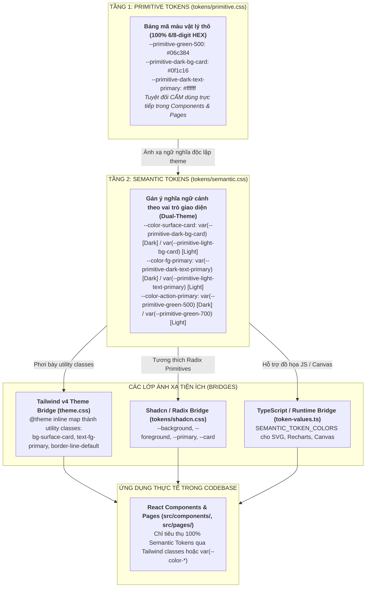

# RoGym Styles & Design Tokens Architecture

> **Tài liệu chuẩn kiến trúc CSS & Hệ thống Design Tokens cho RoGym Frontend (`client/src/styles`)**  
> Tuân thủ nghiêm ngặt chuẩn Semantic HTML & Design Tokens 2 tầng, kỷ luật 100% HEX trong primitives, 100% Semantic Tokens trong components và tương phản WCAG 2.1 AA.  
> **Cổng quy chuẩn chính:** [`client/FRONTEND_CONVENTIONS.md`](../../FRONTEND_CONVENTIONS.md) | [**Kiến Trúc UI Components** (`src/components/README.md`)](../components/README.md) | [**Chuyên Đề 06: Styling & Design Tokens** (`docs/06-styling-and-design-tokens.md`)](../../docs/06-styling-and-design-tokens.md) | [**Chuyên Đề 08: Hệ Thống Thiết Kế Ngữ Nghĩa** (`docs/08-semantic-design-system.md`)](../../docs/08-semantic-design-system.md)

---

## MỤC LỤC TỔNG QUAN

1. [Chương 1: Tổng quan Kiến trúc Design Tokens 2 Tầng (2-Layer Token Architecture)](#1-tổng-quan-kiến-trúc-design-tokens-2-tầng-2-layer-token-architecture)
2. [Chương 2: Bản đồ Cấu trúc Thư mục `src/styles/`](#2-bản-đồ-cấu-trúc-thư-mục-srcstyles)
3. [Chương 3: Bảng Tra Cứu Toàn Diện Semantic Tokens (Dual-Theme Cheat Sheet)](#3-bảng-tra-cứu-toàn-diện-semantic-tokens-dual-theme-cheat-sheet)
4. [Chương 4: Non-Color Tokens (Kích Thước, Bo Góc, Z-Index, Bóng Đổ & Chuyển Động)](#4-non-color-tokens-kích-thước-bo-góc-z-index-bóng-đổ-chuyển-động)
5. [Chương 5: Lớp Tương Thích Shadcn UI & Radix Primitives (`tokens/shadcn.css`)](#5-lớp-tương-thích-shadcn-ui-radix-primitives-tokensshadcncss)
6. [Chương 6: Sử dụng Design Tokens trong TypeScript / JS (Recharts, Canvas, SVG)](#6-sử-dụng-design-tokens-trong-typescript-js-recharts-canvas-svg)
7. [Chương 7: Bảy Điều Cấm Kỵ Tối Cao (Seven Deadly Sins)](#7-bảy-điều-cấm-kỵ-tối-cao-seven-deadly-sins)
8. [Chương 8: Quy Chuẩn Nghiêm Cấm & Cảnh Báo Lạm Dụng (Anti-Abuse Directives & Severe System Consequences)](#8-quy-chuẩn-nghiêm-cấm-cảnh-báo-lạm-dụng-anti-abuse-directives-severe-system-consequences)
9. [Chương 9: Cây Quyết Định Tạo Kiểu (Developer Decision Tree)](#9-cây-quyết-định-tạo-kiểu-developer-decision-tree)
10. [Chương 10: Bộ Kiểm Thử Tự Động & Lệnh Kiểm Toán Thường Dùng](#10-bộ-kiểm-thử-tự-động-lệnh-kiểm-toán-thường-dùng)

---

## 1. Tổng quan Kiến trúc Design Tokens 2 Tầng (2-Layer Token Architecture)

Hệ thống token của RoGym được thiết kế theo mô hình **2-layer token architecture** hiện đại, tách biệt hoàn toàn giữa giá trị vật lý thô (Primitive) và ngữ cảnh sử dụng (Semantic):



### Ba Nguyên Tắc Cốt Lõi Bất Di Bất Dịch

1. **Dark Mode First & Theme-Agnostic**: Toàn bộ hệ thống mặc định vận hành trên nền tối cao cấp (`#080e0b`). Khi chuyển sang light mode (`[data-theme='light']`), các biến semantic tự động chuyển đổi giá trị, mã JSX **không cần thay đổi class hay thêm tiền tố `dark:`**.
2. **Kỷ luật 100% HEX trong Primitives (`SEM-TOKEN-001`)**: Tất cả mã màu khai báo tại `tokens/primitive.css` bắt buộc phải là HEX 6 ký tự (`#RRGGBB`) hoặc 8 ký tự (`#RRGGBBAA`). Tuyệt đối **CẤM** sử dụng `rgb()`, `rgba()`, `hsl()`, `hsla()` hay tên màu HTML (`red`, `blue`...).
3. **100% Semantic Tokens trong Components & Primitives (`SEM-TOKEN-002`, `SEM-TOKEN-009`)**: Mọi component (kể cả UI Primitives tại `src/components/ui/`) **chỉ được phép tiêu thụ Semantic Tokens** (`bg-surface-*`, `text-fg-*`, `border-line-*`, `var(--color-*)`). Tuyệt đối **CẤM** dùng trực tiếp biến `--primitive-*` hoặc mã HEX thô trong JSX/TSX.
4. **WCAG 2.1 AA Compliant**: Toàn bộ 26 cặp màu tương phản FG/BG trong hệ thống đã được kiểm toán tự động qua `contrast-check.mjs` đảm bảo tỉ lệ tối thiểu **4.5:1** (Normal Text) và **3.0:1** (Large Text / UI Components).

---

## 2. Bản đồ Cấu trúc Thư mục `src/styles/`

Thư mục `client/src/styles/` được tổ chức tinh gọn và phân định ranh giới trách nhiệm rõ ràng (**Single Responsibility Principle**):

```
client/src/styles/
├── __tests__/                    # Bộ unit tests cho hệ thống token
│   ├── __snapshots__/            # Snapshot giá trị tính toán của tokens
│   ├── semantic-tokens.test.ts   # Kiểm tra 5 bất biến (Dual-Theme, No HEX leak, Oracle, Tailwind, Isolation)
│   └── token-test-helpers.ts     # Helpers trích xuất và giải quyết biến CSS phục vụ testing
├── tokens/
│   ├── compat.css                # Lớp tương thích ngược (@deprecated) cho các biến legacy --rogym-*
│   ├── contrast-pairs.json       # NGUỒN SỰ THẬT DUY NHẤT cho 26 cặp tương phản WCAG 2.1 AA
│   ├── non-color.css             # Tokens kích thước, bo góc, bóng đổ, chuyển động, thang Z-index
│   ├── primitive.css             # Layer 1: Primitive Palette (100% HEX, không ngữ cảnh)
│   ├── semantic.css              # Layer 2: Semantic Tokens theo ngữ cảnh (:root & [data-theme=light])
│   └── shadcn.css                # Bridge kết nối primitives của Radix / shadcn/ui sang Semantic Tokens
├── globals.css                   # Global styles: phông chữ, thanh cuộn, hiệu ứng sweep, utilities tối thiểu (.rogym-eyebrow, .no-scrollbar)
├── reset.css                     # Reset chuẩn thẻ HTML, cấu hình tối ưu render font và tap highlight
├── theme.css                     # Tailwind v4 @theme inline configuration (ánh xạ semantic tokens thành utility classes)
├── token-values.ts               # Runtime TypeScript exports cho JS consumers (Recharts, Canvas, SVG)
├── tokens.css                    # Entry point gom toàn bộ các file trong tokens/
└── README.md                     # Tài liệu này
```

---

## 3. Bảng Tra Cứu Toàn Diện Semantic Tokens (Dual-Theme Cheat Sheet)

Dưới đây là từ điển tra cứu đầy đủ 100% các Design Tokens ngữ nghĩa đang vận hành trong RoGym. Khi xây dựng giao diện trong React / TSX, luôn ưu tiên sử dụng các class Tailwind đã được ánh xạ sẵn.

### 3.1. Surfaces (Bề Mặt & Nền Giao Diện)

| Tailwind Class               | Token Biến CSS                    | Dark Mode HEX | Light Mode HEX | Ý Nghĩa & Vị Trí Sử Dụng                                            |
| :--------------------------- | :-------------------------------- | :------------ | :------------- | :------------------------------------------------------------------ |
| `bg-surface-base`            | `--color-surface-base`            | `#080e0b`     | `#f8fafc`      | Nền canvas chính của toàn bộ trang web                              |
| `bg-surface-sunken`          | `--color-surface-sunken`          | `#030907`     | `#f1f5f9`      | Nền chìm sâu hơn base (track thanh cuộn, container lõm)             |
| `bg-surface-sunken-alt`      | `--color-surface-sunken-alt`      | `#040d08`     | `#e2e8f0`      | Nền chìm thay thế cho các khối phân vùng sâu                        |
| `bg-surface-card`            | `--color-surface-card`            | `#0f1c16`     | `#ffffff`      | Nền thẻ (card), panel, modal, widget floating chuẩn                 |
| `bg-surface-card-hover`      | `--color-surface-card-hover`      | `#132218`     | `#f1f5f9`      | Trạng thái hover của các thẻ hoặc hàng danh sách tương tác          |
| `bg-surface-card-inset`      | `--color-surface-card-inset`      | `#0b1610`     | `#f8fafc`      | Nền input, dropdown item chìm, header bảng biểu                     |
| `bg-surface-elevated`        | `--color-surface-elevated`        | `#1a2520`     | `#ffffff`      | Nền các phần tử nổi trên card (popover, dropdown menu, tooltip)     |
| `bg-surface-elevated-accent` | `--color-surface-elevated-accent` | `#1a3326`     | `#ecfdf5`      | Nền nổi bật có sắc xanh nhẹ cho item được chọn / active             |
| `bg-surface-inverse`         | `--color-surface-inverse`         | `#ffffff`     | `#0f172a`      | Nền tương phản đảo ngược (badge trắng trên nền tối, tooltip đen)    |
| `bg-surface-glass`           | `--color-surface-glass`           | `#0c1611d1`   | `#ffffffcc`    | Nền kính mờ thể thao cao cấp (Dark Glassmorphism kèm backdrop-blur) |
| `bg-surface-overlay`         | `--color-surface-overlay`         | `#00000099`   | `#ffffffeb`    | Lớp backdrop làm mờ nền khi mở modal / dialog                       |

### 3.2. Foregrounds (Màu Chữ, Nhãn & Biểu Tượng)

| Tailwind Class             | Token Biến CSS                | Dark Mode HEX | Light Mode HEX | Ý Nghĩa & Vị Trí Sử Dụng                                    |
| :------------------------- | :---------------------------- | :------------ | :------------- | :---------------------------------------------------------- |
| `text-fg-primary`          | `--color-fg-primary`          | `#ffffff`     | `#0f172a`      | Tiêu đề chính (H1-H6), văn bản quan trọng bậc nhất          |
| `text-fg-secondary`        | `--color-fg-secondary`        | `#bbcabf`     | `#334155`      | Văn bản nội dung phụ, nhãn mô tả thông thường               |
| `text-fg-muted`            | `--color-fg-muted`            | `#8ab89c`     | `#64748b`      | Placeholder, text chú thích, timestamp mờ                   |
| `text-fg-subtle`           | `--color-fg-subtle`           | `#ffffff73`   | `#94a3b8`      | Icon vô hiệu, text trạng thái mờ tinh tế                    |
| `text-fg-disabled`         | `--color-fg-disabled`         | `#ffffff40`   | `#cbd5e1`      | Văn bản và icon ở trạng thái bị vô hiệu hóa hoàn toàn       |
| `text-fg-on-inverse`       | `--color-fg-on-inverse`       | `#0a0f0e`     | `#ffffff`      | Chữ nằm trên nền đảo ngược `surface-inverse`                |
| `text-fg-on-inverse-muted` | `--color-fg-on-inverse-muted` | `#00000080`   | `#e2e8f0`      | Chữ mờ nằm trên nền đảo ngược `surface-inverse`             |
| `text-fg-on-solid`         | `--color-fg-on-solid`         | `#ffffff`     | `#ffffff`      | Chữ nằm trên nền solid đậm có màu (badge trạng thái, alert) |

### 3.3. Lines & Borders (Đường Viền & Phân Cách)

| Tailwind Class              | Token Biến CSS               | Dark Mode HEX | Light Mode HEX | Ý Nghĩa & Vị Trí Sử Dụng                                          |
| :-------------------------- | :--------------------------- | :------------ | :------------- | :---------------------------------------------------------------- |
| `border-line-subtle`        | `--color-line-subtle`        | `#ffffff12`   | `#e2e8f0`      | Đường kẻ mờ, phân cách giữa các item trong danh sách              |
| `border-line-divider`       | `--color-line-divider`       | `#ffffff0a`   | `#f1f5f9`      | Đường phân chia khu vực lớn giữa các section                      |
| `border-line-default`       | `--color-line-default`       | `#ffffff1a`   | `#cbd5e1`      | Viền mặc định cho card, container, bảng biểu, input               |
| `border-line-strong`        | `--color-line-strong`        | `#ffffff73`   | `#94a3b8`      | Viền tương tác nổi bật khi hover hoặc active                      |
| `border-line-hover`         | `--color-line-hover`         | `#ffffff`     | `#64748b`      | Viền trạng thái hover nhấn mạnh                                   |
| `border-line-accent-subtle` | `--color-line-accent-subtle` | `#42e09e1a`   | `#99f6e4`      | Viền viền xanh teal tinh tế cho sidebar, card công nghệ           |
| `border-line-accent-hover`  | `--color-line-accent-hover`  | `#42e09e66`   | `#2dd4bf`      | Viền xanh teal khi hover vào các thẻ tính năng đặc biệt           |
| `ring-line-focus`           | `--color-line-focus`         | `#42e09e`     | `#0d9488`      | Vòng sáng focus-visible đạt chuẩn trợ năng tiếp cận (WCAG 2.1 AA) |

### 3.4. Actions & Brand (Bản Sắc Thương Hiệu & Tương Tác)

| Tailwind Class                      | Token Biến CSS                       | Dark Mode HEX | Light Mode HEX | Ý Nghĩa & Vị Trí Sử Dụng                                |
| :---------------------------------- | :----------------------------------- | :------------ | :------------- | :------------------------------------------------------ |
| `bg-action-primary`                 | `--color-action-primary`             | `#06c384`     | `#047857`      | Nền nút bấm chính CTA (Call To Action), switch active   |
| `hover:bg-action-primary-hover`     | `--color-action-primary-hover`       | `#08d891`     | `#00492f`      | Trạng thái hover của nút bấm chính CTA                  |
| `text-action-primary-fg`            | `--color-action-primary-fg`          | `#00492f`     | `#ffffff`      | Màu chữ trên nền nút bấm CTA (tương phản AA 4.5:1)      |
| `text-action-primary-fg-strong`     | `--color-action-primary-fg-strong`   | `#003d28`     | `#ffffff`      | Màu chữ đậm nét trên nút CTA khi active                 |
| `bg-action-primary-soft`            | `--color-action-primary-soft`        | `#06c38414`   | `#ecfdf5`      | Nền nhạt cho nút phụ (ghost/outline), badge active      |
| `border-action-primary-soft-border` | `--color-action-primary-soft-border` | `#06c38438`   | `#a7f3d0`      | Viền cho nút bấm dạng soft/outline màu xanh thương hiệu |
| `text-action-accent`                | `--color-action-accent`              | `#42e09e`     | `#0d9488`      | Màu nhấn hành động phụ Teal, link nổi bật, icon active  |
| `bg-action-accent-soft`             | `--color-action-accent-soft`         | `#42e09e1f`   | `#99f6e4`      | Nền mềm phụ màu Teal cho tag/badge thể thao             |
| `text-accent`                       | `--color-accent`                     | `#42e09e`     | `#0d9488`      | Alias đồng nghĩa cho điểm nhấn Accent                   |
| `bg-accent-soft`                    | `--color-accent-soft`                | `#42e09e1f`   | `#99f6e4`      | Alias đồng nghĩa cho nền mềm Accent                     |
| `ring-focus-ring`                   | `--color-focus-ring`                 | `#42e09e`     | `#0d9488`      | Vòng tiêu điểm focus-visible cho bàn phím               |

### 3.5. Statuses (Trạng Thái Phản Hồi Toàn Diện)

Mỗi trạng thái phản hồi cung cấp đầy đủ 6 thành phần:

- `solid`: Nền đậm cho badge hoặc nút cảnh báo quan trọng
- `on-solid`: Màu chữ tương phản cao hiển thị trên nền solid
- `fg`: Màu chữ và biểu tượng tương phản cao hiển thị trên nền nhạt
- `bg`: Nền nhạt có pha alpha độ mờ êm dịu
- `border`: Đường viền mềm đi kèm nền nhạt
- `surface`: Nền tối ưu cho Toast notification hoặc hộp thoại nổi

| Trạng Thái  | Vai Trò    | Tailwind Class                 | Dark HEX    | Light HEX | Mô Tả                              |
| :---------- | :--------- | :----------------------------- | :---------- | :-------- | :--------------------------------- |
| **Success** | `solid`    | `bg-status-success-solid`      | `#06c384`   | `#059669` | Nền đậm badge thành công           |
|             | `on-solid` | `text-status-success-on-solid` | `#00492f`   | `#ffffff` | Chữ trên nền solid                 |
|             | `fg`       | `text-status-success-fg`       | `#b6f4d7`   | `#065f46` | Chữ / icon trên nền nhạt           |
|             | `bg`       | `bg-status-success-bg`         | `#06c38421` | `#ecfdf5` | Nền nhạt thông báo thành công      |
|             | `border`   | `border-status-success-border` | `#06c38445` | `#a7f3d0` | Viền thông báo thành công          |
|             | `surface`  | `bg-status-success-surface`    | `#173527`   | `#ffffff` | Nền Toast thông báo thành công     |
| **Warning** | `solid`    | `bg-status-warning-solid`      | `#f59e0b`   | `#d97706` | Nền đậm cảnh báo                   |
|             | `on-solid` | `text-status-warning-on-solid` | `#ffffff`   | `#ffffff` | Chữ trên nền solid                 |
|             | `fg`       | `text-status-warning-fg`       | `#fcd34d`   | `#92400e` | Chữ / icon cảnh báo trên nền nhạt  |
|             | `bg`       | `bg-status-warning-bg`         | `#f59e0b14` | `#fffbeb` | Nền nhạt cảnh báo                  |
|             | `border`   | `border-status-warning-border` | `#f59e0b38` | `#fde68a` | Viền thông báo cảnh báo            |
|             | `surface`  | `bg-status-warning-surface`    | `#332412`   | `#ffffff` | Nền Toast thông báo cảnh báo       |
| **Danger**  | `solid`    | `bg-status-danger-solid`       | `#ef4444`   | `#dc2626` | Nền đậm báo lỗi nguy hiểm          |
|             | `on-solid` | `text-status-danger-on-solid`  | `#ffffff`   | `#ffffff` | Chữ trên nền solid                 |
|             | `fg`       | `text-status-danger-fg`        | `#ff6b6b`   | `#991b1b` | Chữ / icon lỗi trên nền nhạt       |
|             | `bg`       | `bg-status-danger-bg`          | `#ef444421` | `#fef2f2` | Nền nhạt báo lỗi                   |
|             | `border`   | `border-status-danger-border`  | `#ef444445` | `#fecaca` | Viền thông báo lỗi                 |
|             | `surface`  | `bg-status-danger-surface`     | `#321616`   | `#ffffff` | Nền Toast báo lỗi nguy cấp         |
| **Info**    | `solid`    | `bg-status-info-solid`         | `#3b82f6`   | `#2563eb` | Nền đậm thông tin                  |
|             | `on-solid` | `text-status-info-on-solid`    | `#ffffff`   | `#ffffff` | Chữ trên nền solid                 |
|             | `fg`       | `text-status-info-fg`          | `#93c5fd`   | `#1e40af` | Chữ / icon thông tin trên nền nhạt |
|             | `bg`       | `bg-status-info-bg`            | `#3b82f621` | `#eff6ff` | Nền nhạt thông tin                 |
|             | `border`   | `border-status-info-border`    | `#3b82f645` | `#bfdbfe` | Viền hộp thoại thông tin           |
|             | `surface`  | `bg-status-info-surface`       | `#132238`   | `#ffffff` | Nền Toast hộp thoại thông tin      |
| **Neutral** | `solid`    | `bg-status-neutral-solid`      | `#6b7280`   | `#4b5563` | Nền đậm trung tính                 |
|             | `on-solid` | `text-status-neutral-on-solid` | `#ffffff`   | `#ffffff` | Chữ trên nền solid                 |
|             | `fg`       | `text-status-neutral-fg`       | `#9ca3af`   | `#374151` | Chữ / icon trung tính              |
|             | `bg`       | `bg-status-neutral-bg`         | `#6b728021` | `#f3f4f6` | Nền nhạt trung tính                |
|             | `border`   | `border-status-neutral-border` | `#6b728045` | `#e5e7eb` | Viền trung tính                    |
|             | `surface`  | `bg-status-neutral-surface`    | `#1f2937`   | `#ffffff` | Nền Toast trung tính               |
| **Accent**  | `solid`    | `bg-status-accent-solid`       | `#8b5cf6`   | `#7c3aed` | Nền đậm đặc quyền VIP / Hạng vé    |
|             | `on-solid` | `text-status-accent-on-solid`  | `#ffffff`   | `#ffffff` | Chữ trên nền solid                 |
|             | `fg`       | `text-status-accent-fg`        | `#c4b5fd`   | `#5b21b6` | Chữ / icon tím VIP                 |
|             | `bg`       | `bg-status-accent-bg`          | `#8b5cf621` | `#f5f3ff` | Nền nhạt tím VIP                   |
|             | `border`   | `border-status-accent-border`  | `#8b5cf645` | `#ddd6fe` | Viền nhãn tím VIP                  |
|             | `surface`  | `bg-status-accent-surface`     | `#2e1065`   | `#ffffff` | Nền Toast tím VIP                  |

### 3.6. Charts & Data Visualization (Biểu Đồ & Trực Quan Hóa Dữ Liệu)

| Token Biến CSS             | Dark Mode HEX | Light Mode HEX | Ý Nghĩa Dữ Liệu                                      |
| :------------------------- | :------------ | :------------- | :--------------------------------------------------- |
| `--color-chart-1`          | `#06c384`     | `#059669`      | Chuỗi dữ liệu chính (Doanh thu, Buổi tập hoàn thành) |
| `--color-chart-2`          | `#42e09e`     | `#0d9488`      | Chuỗi dữ liệu phụ (Số hội viên mới, Tần suất tập)    |
| `--color-chart-3`          | `#3b82f6`     | `#2563eb`      | Chuỗi so sánh kỳ trước, dữ liệu mục tiêu             |
| `--color-chart-4`          | `#f59e0b`     | `#d97706`      | Dữ liệu chú ý, hội viên sắp hết hạn gói              |
| `--color-chart-5`          | `#8b5cf6`     | `#7c3aed`      | Dữ liệu đặc quyền PT, phân khúc khách hàng VIP       |
| `--color-chart-6`          | `#ef4444`     | `#dc2626`      | Tỉ lệ hủy lịch, sự cố thiết bị                       |
| `--color-chart-grid`       | `#ffffff12`   | `#e2e8f0`      | Lưới tọa độ Cartesian grid trong Recharts            |
| `--color-chart-axis`       | `#8ab89c`     | `#64748b`      | Màu chữ và vạch chia trục tọa độ X/Y                 |
| `--color-chart-tooltip-bg` | `#1a2520`     | `#ffffff`      | Nền tooltip hiển thị số liệu khi hover điểm          |

### 3.7. Bảng Tra Cứu Toàn Diện 19 Mức Độ Alpha Sang 2 Ký Tự Hex & Công Thức Chuyển Đổi Toán Học

Khi làm việc với màu sắc có độ trong suốt (alpha channel) trong CSS Primitives (`tokens/primitive.css`) hoặc các hiệu ứng kính mờ (glassmorphism), backdrop modal, và overlay, chuẩn mực doanh nghiệp bắt buộc **100% sử dụng mã HEX 8 ký tự** (`#RRGGBBAA`). Tuyệt đối **CẤM** sử dụng `rgba()`, `hsla()` hay cú pháp slash modifier trên primitive (`SEM-TOKEN-001`, `SEM-TOKEN-007`).

Dưới đây là bảng tra cứu chuẩn 19 mức alpha thường dùng trong RoGym:

| Giá Trị Alpha Số Thập Phân | Phần Trăm (%) | 2 Ký Tự Hex | Ví Dụ Mã Màu Trắng (`#ffffff`) | Ví Dụ Mã Màu Xanh (`#06c384`) | Ngữ Cảnh Ứng Dụng Thực Tế Trong RoGym |
| :------------------------- | :------------ | :---------- | :----------------------------- | :---------------------------- | :------------------------------------ |
| `0.04`                     | 4%            | `0a`        | `#ffffff0a`                    | `#06c3840a`                   | Viền phân chia khu vực lớn (`--color-line-divider`) |
| `0.07`                     | 7%            | `12`        | `#ffffff12`                    | `#06c38412`                   | Viền thẻ mặc định (`--color-line-subtle`) |
| `0.10`                     | 10%           | `1a`        | `#ffffff1a`                    | `#06c3841a`                   | Viền trường nhập liệu nghỉ (`--color-line-default`) |
| `0.13`                     | 13%           | `21`        | `#ffffff21`                    | `#06c38421`                   | Nền nhạt thông báo trạng thái (`--color-status-*-bg`) |
| `0.15`                     | 15%           | `26`        | `#ffffff26`                    | `#06c38426`                   | Nền hover nút phụ nhẹ |
| `0.20`                     | 20%           | `33`        | `#ffffff33`                    | `#06c38433`                   | Bóng đổ thẻ card khuếch tán (`--shadow-card`) |
| `0.22`                     | 22%           | `38`        | `#ffffff38`                    | `#06c38438`                   | Viền nút dạng soft (`--color-action-primary-soft-border`) |
| `0.25`                     | 25%           | `40`        | `#ffffff40`                    | `#06c38440`                   | Chữ/icon trạng thái vô hiệu (`--color-fg-disabled`) |
| `0.27`                     | 27%           | `45`        | `#ffffff45`                    | `#06c38445`                   | Viền thông báo trạng thái (`--color-status-*-border`) |
| `0.30`                     | 30%           | `4d`        | `#ffffff4d`                    | `#06c3844d`                   | Bóng phát sáng xanh nút chính (`--shadow-primary`) |
| `0.35`                     | 35%           | `59`        | `#ffffff59`                    | `#06c38459`                   | Bóng phát sáng xanh ngọc nhỏ (`--shadow-tone-sm`) |
| `0.40`                     | 40%           | `66`        | `#ffffff66`                    | `#06c38466`                   | Viền xanh teal khi hover (`--color-line-accent-hover`) |
| `0.45`                     | 45%           | `73`        | `#ffffff73`                    | `#06c38473`                   | Văn bản phụ mờ (`--color-fg-subtle`), viền nổi bật |
| `0.50`                     | 50%           | `80`        | `#ffffff80`                    | `#06c38480`                   | Overlay nền phụ, chữ mờ trên nền đảo ngược |
| `0.55`                     | 55%           | `8c`        | `#ffffff8c`                    | `#06c3848c`                   | Bóng đổ đa tầng bề mặt kính (`--shadow-glass`) |
| `0.60`                     | 60%           | `99`        | `#ffffff99`                    | `#06c38499`                   | Lớp backdrop mờ khi mở modal dialog (`--color-surface-overlay`) |
| `0.70`                     | 70%           | `b3`        | `#ffffffb3`                    | `#06c384b3`                   | Nền phủ làm tối vừa |
| `0.82`                     | 82%           | `d1`        | `#ffffffd1`                    | `#0c1611d1`                   | **Nền Dark Glassmorphism đặc thù RoGym** (`--color-surface-glass`) |
| `0.97`                     | 97%           | `f7`        | `#fffffff7`                    | `#080e0bf7`                   | Bề mặt gần như đặc tuyệt đối, che phủ nền dưới |

#### Công Thức Chuyển Đổi Alpha Toán Học

Khi cần xác định 2 ký tự hex của một mức alpha bất kỳ ngoài bảng trên, công thức tính toán chuẩn:

$$\text{hex\_alpha} = \text{Math.round}(\text{alpha} \times 255).\text{toString}(16).\text{padStart}(2, '0')$$

Ví dụ minh họa:
- Alpha $0.82 \rightarrow \text{Math.round}(0.82 \times 255) = 209 \rightarrow 209_{10} = \text{d1}_{16}$. Do đó màu đen xanh có alpha 0.82 chuyển đổi từ `rgba(12, 22, 17, 0.82)` sang `#0c1611d1`.
- Alpha $0.45 \rightarrow \text{Math.round}(0.45 \times 255) = 115 \rightarrow 115_{10} = \text{73}_{16}$. Do đó màu trắng alpha 0.45 chuyển đổi từ `rgba(255, 255, 255, 0.45)` sang `#ffffff73`.

### 3.8. Từ Điển Ánh Xạ Tương Thích Ngược 42 Biến `--rogym-*` Cũ Sang Semantic Tokens Mới

Hệ thống kế thừa 42 CSS Custom Properties từ các phiên bản đầu, hiện được duy trì trong lớp tương thích ngược tại `client/src/styles/tokens/compat.css`. Khi bảo trì hoặc refactor code cũ, đối chiếu theo bảng sau để chuyển đổi sang Semantic Tokens chuẩn:

| Biến CSS Legacy (`--rogym-*`) | Giá Trị HEX (Dark) | Biến Semantic Token Chuẩn Mới | Class Tailwind Ngữ Nghĩa | Vai Trò & Vị Trí Sử Dụng |
| :--- | :--- | :--- | :--- | :--- |
| `--rogym-green` | `#06c384` | `--color-action-primary` | `bg-action-primary` | Màu xanh chủ đạo thương hiệu |
| `--rogym-green-hover` | `#08d891` | `--color-action-primary-hover` | `hover:bg-action-primary-hover` | Hover nút bấm & liên kết chính |
| `--rogym-teal` | `#42e09e` | `--color-action-accent` / `--color-accent` | `text-action-accent` | Điểm nhấn phụ trợ Teal |
| `--rogym-green-dark` | `#00492f` | `--color-action-primary-fg` | `text-action-primary-fg` | Màu chữ trên nền nút primary |
| `--rogym-green-deeper` | `#003d28` | `--color-action-primary-fg-strong` | `text-action-primary-fg-strong` | Tông màu xanh đậm khi active |
| `--rogym-bg-base` | `#080e0b` | `--color-surface-base` | `bg-surface-base` | Nền canvas chính ứng dụng |
| `--rogym-bg-deep` | `#030907` | `--color-surface-sunken` | `bg-surface-sunken` | Nền tối sâu thẳm, khoang hero |
| `--rogym-bg-deep-alt` | `#040d08` | `--color-surface-sunken-alt` | `bg-surface-sunken-alt` | Nền chìm thay thế phân vùng |
| `--rogym-bg-card` | `#0f1c16` | `--color-surface-card` | `bg-surface-card` | Nền mặc định của thẻ Card |
| `--rogym-bg-card-hover` | `#132218` | `--color-surface-card-hover` | `bg-surface-card-hover` | Nền thẻ khi hover tương tác |
| `--rogym-bg-card-darker` | `#0b1610` | `--color-surface-card-inset` | `bg-surface-card-inset` | Nền input, dropdown chìm |
| `--rogym-bg-elevated` | `#1a2520` | `--color-surface-elevated` | `bg-surface-elevated` | Nền popover, menu, dialog |
| `--rogym-bg-elevated-green` | `#1a3326` | `--color-surface-elevated-accent`| `bg-surface-elevated-accent` | Nền nổi bật ánh xanh nhẹ |
| `--rogym-bg-light` | `#ffffff` | `--color-surface-inverse` | `bg-surface-inverse` | Nền trắng tinh khiết tương phản |
| `--rogym-bg-glass` | `#0c1611d1` | `--color-surface-glass` | `bg-surface-glass` | Bề mặt kính mờ Glassmorphism |
| `--rogym-text-primary` | `#ffffff` | `--color-fg-primary` | `text-fg-primary` | Chữ chính, tiêu đề H1-H6 |
| `--rogym-text-secondary` | `#bbcabf` | `--color-fg-secondary` | `text-fg-secondary` | Chữ phụ trợ, mô tả thẻ |
| `--rogym-text-muted` | `#8ab89c` | `--color-fg-muted` | `text-fg-muted` | Gợi ý, chú thích, placeholder |
| `--rogym-text-dim` | `#ffffff73` | `--color-fg-subtle` | `text-fg-subtle` | Văn bản mờ nhạt (45% alpha) |
| `--rogym-text-faint` | `#ffffff40` | `--color-fg-disabled` | `text-fg-disabled` | Chữ trạng thái disabled |
| `--rogym-text-on-light` | `#0a0f0e` | `--color-fg-on-inverse` | `text-fg-on-inverse` | Chữ tương phản trên nền sáng |
| `--rogym-text-on-light-muted`| `#00000080` | `--color-fg-on-inverse-muted` | `text-fg-on-inverse-muted` | Chữ phụ trên nền sáng |
| `--rogym-error` | `#ff6b6b` | `--color-status-danger-fg` | `text-status-danger-fg` | Màu cảnh báo lỗi validation |
| `--rogym-border-subtle` | `#ffffff12` | `--color-line-subtle` | `border-line-subtle` | Viền mặc định của thẻ (7% alpha) |
| `--rogym-border-section` | `#ffffff0a` | `--color-line-divider` | `border-line-divider` | Viền phân cách section (4% alpha) |
| `--rogym-border-white-dim` | `#ffffff1a` | `--color-line-default` | `border-line-default` | Viền input ở trạng thái nghỉ |
| `--rogym-border-white-button`| `#ffffff73` | `--color-line-strong` | `border-line-strong` | Viền nút bấm outline trắng |
| `--rogym-border-white-hover` | `#ffffff` | `--color-line-hover` | `border-line-hover` | Viền khi hover nút outline |
| `--rogym-border-teal-dim` | `#42e09e1a` | `--color-line-accent-subtle` | `border-line-accent-subtle` | Viền xanh ngọc mờ (10% alpha) |
| `--rogym-border-teal-hover` | `#42e09e66` | `--color-line-accent-hover` | `border-line-accent-hover` | Viền xanh ngọc hover (40% alpha) |
| `--rogym-border-teal-focus` | `#42e09e` | `--color-line-focus` | `ring-line-focus` | Viền xanh ngọc khi focus |
| `--rogym-shadow-primary` | `0 8px 24px -4px #06c3844d` | `--shadow-primary` | `--` | Bóng phát sáng nút chính |
| `--rogym-shadow-card` | `0 24px 56px -12px #06c38433` | `--shadow-card` | `--` | Bóng khuếch tán thẻ Dashboard |
| `--rogym-shadow-glass` | `0 24px 64px #0000008c...` | `--shadow-glass` | `--` | Bóng đa tầng bề mặt kính mờ |
| `--rogym-shadow-tone-sm` | `0 0 12px #06c38459` | `--shadow-tone-sm` | `--` | Phát sáng xanh ngọc nhỏ |
| `--rogym-shadow-tone-md` | `0 0 15px #06c38466` | `--shadow-tone-md` | `--` | Phát sáng xanh ngọc trung bình |
| `--rogym-font-body` | `'Be Vietnam Pro', sans-serif` | `--font-body` | `font-body` | Phông nội dung và giao diện chính |
| `--rogym-font-display` | `'Anton', sans-serif` | `--font-display` | `font-display` | Phông hiển thị tiêu đề lớn, banner |
| `--rogym-ease-standard` | `cubic-bezier(0.4, 0, 0.2, 1)`| `--ease-standard` | `--` | Hàm gia tốc chuyển động tự nhiên |
| `--rogym-duration-button` | `380ms` | `--duration-button` | `--` | Thời lượng quét sáng nút bấm |
| `--rogym-duration-link` | `280ms` | `--duration-link` | `--` | Thời lượng chuyển màu liên kết |
| `--rogym-duration-image` | `650ms` | `--duration-image` | `--` | Thời lượng zoom/fade ảnh bìa |

---

## 4. Non-Color Tokens (Kích Thước, Bo Góc, Z-Index, Bóng Đổ & Chuyển Động)

Tại `client/src/styles/tokens/non-color.css`, hệ thống định nghĩa các thông số hình học và chuyển động chuẩn mực:

### 4.1. Thang Z-Index Chuẩn 5 Tầng (`SEM-TOKEN-010`)

Tuyệt đối **CẤM** sử dụng các giá trị z-index tùy tiện (`z-[999]`, `z-[9999]`). Bắt buộc dùng thang 5 tầng chuẩn sau:

| Tầng         | Biến CSS       | Giá Trị Số | Vai Trò & Vị Trí Áp Dụng                                                 |
| :----------- | :------------- | :--------- | :----------------------------------------------------------------------- |
| **Base**     | `--z-base`     | `0`        | Nội dung luồng thông thường trên trang (Static content)                  |
| **Sticky**   | `--z-sticky`   | `10`       | Header cố định, thanh lọc dính, tiêu đề bảng cuộn                        |
| **Dropdown** | `--z-dropdown` | `20`       | Dropdown menu, Popover, Autocomplete listbox, DatePicker                 |
| **Modal**    | `--z-modal`    | `50`       | Dialog, Modal popup, Drawer trượt từ cạnh, Backdrop phủ mờ               |
| **Toast**    | `--z-toast`    | `100`      | Toast notifications (Sonner/Radix), Alert khẩn cấp, Top notification bar |

### 4.2. Thang Bo Góc (Radius Scale)

- `--radius-sm`: `0.375rem` (`6px`) — Badge nhỏ, checkbox, tooltip đơn giản
- `--radius-md`: `0.5rem` (`8px`) — Nút bấm nhỏ, dropdown item, input phụ
- `--radius-lg`: `0.75rem` (`12px`) — Nút CTA tiêu chuẩn, input chuẩn, card con
- `--radius-full`: `9999px` — Avatar tròn, pill badge, nút bấm tròn tròn

### 4.3. Độ Đổ Bóng & Hiệu Ứng Phát Sáng (Elevation Shadows)

Tất cả độ đổ bóng đều tuân thủ kỷ luật **100% HEX với alpha**:

- `--shadow-primary`: `0 8px 24px -4px #06c3844d` — Bóng đổ nổi bật cho nút CTA xanh
- `--shadow-card`: `0 24px 56px -12px #06c38433` — Bóng đổ nhẹ sang trọng cho card Dashboard
- `--shadow-glass`: `0 24px 64px #0000008c, inset 0 1px 0 #ffffff0d` — Bóng đổ kính mờ Dark Glassmorphism kèm viền sáng mép trên
- `--shadow-tone-sm`: `0 0 12px #06c38459` — Phát sáng xanh ngọc nhẹ
- `--shadow-tone-md`: `0 0 15px #06c38466` — Phát sáng xanh ngọc trung bình
- `--shadow-warning-glow`: `0 0 16px #f59e0b59` — Phát sáng vàng cảnh báo (workout paused)

### 4.4. Gia Tốc Chuyển Động (Motion & Transitions)

- `--ease-standard`: `cubic-bezier(0.4, 0, 0.2, 1)` — Gia tốc chuẩn mượt mà
- `--duration-button`: `380ms` — Thời lượng hiệu ứng quét sáng (sweep) của nút bấm
- `--duration-link`: `280ms` — Chuyển đổi màu chữ của liên kết
- `--duration-image`: `650ms` — Hiệu ứng zoom/fade ảnh mượt mà
- **Reduced Motion Support**: Khi người dùng kích hoạt `prefers-reduced-motion: reduce`, toàn bộ hoạt ảnh tự động rút xuống `0.01ms` hoặc thời lượng tối giản để bảo vệ sức khỏe thị giác.

### 4.5. Phông Chữ & Layout Metrics

- Phông chính (Body): `'Be Vietnam Pro', sans-serif` (`--font-body`)
- Phông trưng bày thể thao (Display): `'Anton', sans-serif` (`--font-display`)
- Thanh điều hướng di động: `--bottom-nav-height: 64px`, khoảng hở nút tập luyện trung tâm `--bottom-nav-center-action-clearance: 44px`.

---

## 5. Lớp Tương Thích Shadcn UI & Radix Primitives (`tokens/shadcn.css`)

Để các UI Primitives của Radix UI và shadcn/ui vận hành trơn tru mà không phá vỡ kiến trúc 2 tầng, file `tokens/shadcn.css` đã ánh xạ 100% các biến quy ước của shadcn sang RoGym Semantic Tokens:

```css
@layer base {
  :root {
    --background: var(--color-surface-base);
    --foreground: var(--color-fg-primary);
    --card: var(--color-surface-card);
    --card-foreground: var(--color-fg-primary);
    --popover: var(--color-surface-elevated);
    --popover-foreground: var(--color-fg-primary);
    --primary: var(--color-action-primary);
    --primary-foreground: var(--color-action-primary-fg);
    --secondary: var(--color-surface-elevated);
    --secondary-foreground: var(--color-fg-primary);
    --muted: var(--color-surface-card);
    --muted-foreground: var(--color-fg-muted);
    --accent: var(--color-accent);
    --accent-foreground: var(--color-surface-base);
    --destructive: var(--color-status-danger-fg);
    --border: var(--color-line-subtle);
    --input: var(--color-line-default);
    --ring: var(--color-focus-ring);
    --radius: 0.75rem;

    /* Sidebar tokens */
    --sidebar: var(--color-surface-card);
    --sidebar-foreground: var(--color-fg-primary);
    --sidebar-primary: var(--color-action-primary);
    --sidebar-primary-foreground: var(--color-action-primary-fg);
    --sidebar-accent: var(--color-surface-card-hover);
    --sidebar-accent-foreground: var(--color-fg-primary);
    --sidebar-border: var(--color-line-accent-subtle);
    --sidebar-ring: var(--color-focus-ring);
  }
}
```

Nhờ lớp ánh xạ này, khi bổ sung bất kỳ primitive nào từ hệ sinh thái shadcn/ui, component sẽ **tự động đồng bộ màu sắc với RoGym Dark/Light theme** mà không cần tinh chỉnh biến CSS thủ công.

---

## 6. Sử dụng Design Tokens trong TypeScript / JS (Recharts, Canvas, SVG)

Khi vẽ biểu đồ (Recharts) hoặc thao tác đồ họa canvas, **tuyệt đối không hardcode chuỗi mã màu hex** (như `stroke="#06c384"`). Hãy sử dụng module chuẩn hóa `token-values.ts`:

### Ngữ cảnh 1: SVG & Recharts (Tự Động Đổi Theo Theme)

Recharts nằm trong React DOM hỗ trợ trực tiếp cú pháp `var(--color-*)`. Sử dụng đối tượng `SEMANTIC_TOKEN_COLORS` với các key camelCase phẳng:

```tsx
import { SEMANTIC_TOKEN_COLORS } from '@/styles/token-values'
import { LineChart, Line, XAxis, YAxis, Tooltip, ResponsiveContainer } from 'recharts'

export function WorkoutProgressChart({ data }: { data: Array<{ date: string; weight: number }> }) {
  return (
    <ResponsiveContainer width="100%" height={300}>
      <LineChart data={data}>
        <XAxis dataKey="date" stroke={SEMANTIC_TOKEN_COLORS.fgMuted} />
        <YAxis stroke={SEMANTIC_TOKEN_COLORS.fgMuted} />
        <Tooltip
          contentStyle={{
            backgroundColor: SEMANTIC_TOKEN_COLORS.surfaceCard,
            borderColor: SEMANTIC_TOKEN_COLORS.lineDefault,
            color: SEMANTIC_TOKEN_COLORS.fgPrimary,
          }}
        />
        <Line
          type="monotone"
          dataKey="weight"
          stroke={SEMANTIC_TOKEN_COLORS.actionPrimary}
          strokeWidth={2}
          dot={{ fill: SEMANTIC_TOKEN_COLORS.actionPrimary }}
        />
      </LineChart>
    </ResponsiveContainer>
  )
}
```

> [!CAUTION]
> **Lưu ý cú pháp:** `SEMANTIC_TOKEN_COLORS` sử dụng **cấu trúc phẳng camelCase** (`SEMANTIC_TOKEN_COLORS.fgMuted`, `SEMANTIC_TOKEN_COLORS.surfaceCard`, `SEMANTIC_TOKEN_COLORS.actionPrimary`), **KHÔNG dùng dạng lồng nhau** như `SEMANTIC_TOKEN_COLORS.fg.muted` (sẽ gây lỗi `TypeError: Cannot read properties of undefined` tại runtime).

### Ngữ cảnh 2: Canvas 2D API / WebGL (Cần Giá Trị Màu Thực Tế)

Trong môi trường Canvas 2D thuần (`ctx.fillStyle = ...`), trình duyệt không phân giải trực tiếp được chuỗi `var(--color-*)`. Hãy sử dụng hàm trợ năng `getTokenColor` hoặc trích xuất từ DOM:

```ts
import { getTokenColor } from '@/styles/token-values'

export function drawProgressRing(ctx: CanvasRenderingContext2D, progress: number) {
  // Trích xuất giá trị tính toán thực tế từ DOM nếu cần hỗ trợ dynamic theme
  const computedColor = getComputedStyle(document.documentElement)
    .getPropertyValue('--color-action-primary')
    .trim()

  ctx.strokeStyle = computedColor || getTokenColor('actionPrimary')
  ctx.lineWidth = 8
  ctx.beginPath()
  ctx.arc(50, 50, 40, 0, Math.PI * 2 * progress)
  ctx.stroke()
}
```

---

## 7. Bảy Điều Cấm Kỵ Tối Cao (Seven Deadly Sins)

Hệ thống CI/CD và Script kiểm toán tĩnh `client/scripts/audit-conventions.mjs` sẽ **chặn đứng (Exit Code 1)** mọi PR hoặc commit vi phạm các điều sau:

1. **Cấm viết mã màu thô trong JSX (Rule: `NO_RAW_COLORS_IN_JSX` - `SEM-TOKEN-002`)**:
   - ❌ Sai: `<div className="bg-[#0f1c16] text-[#bbcabf]">`
   - ✅ Đúng: `<div className="bg-surface-card text-fg-secondary">`
2. **Cấm dùng hàm màu không phải HEX trong CSS (Rule: `HEX_COLOR_ONLY_IN_CSS` - `SEM-TOKEN-001`)**:
   - ❌ Sai: `color: rgb(255, 255, 255);`, `background: rgba(6, 195, 132, 0.2);`
   - ✅ Đúng: `color: #ffffff;`, `background: #06c38433;`
3. **Cấm tự ý đặt class tiện ích tùy tiện (Rule: `NO_ARBITRARY_CLASSES_OR_TOKENS` - `SEM-TOKEN-012`)**:
   - ❌ Cấm: Tự tạo class `.my-custom-box`, `.btn-blue` trong CSS hoặc sử dụng `rogym-text-secondary`, `rogym-bg-card` đã bị khai tử.
   - ✅ Đúng: Sử dụng các utility classes của Tailwind hoặc thiết kế Component UI Primitive tái sử dụng.
4. **Cấm dùng trực tiếp biến Primitive trong Component (Rule: `NO_PRIMITIVE_IN_COMPONENT` - `SEM-TOKEN-009`)**:
   - ❌ Sai: `className="bg-[var(--primitive-green-500)]"` hoặc `className="bg-[var(--rogym-green)]"`
   - ✅ Đúng: `className="bg-action-primary"`
5. **Cấm dùng palette mặc định của Tailwind (Rule: `NO_RAW_TAILWIND_PALETTE` - `SEM-TOKEN-007`)**:
   - ❌ Sai: `className="bg-slate-900 text-gray-400 border-red-500"`
   - ✅ Đúng: `className="bg-surface-base text-fg-secondary border-status-danger-solid"`
6. **Cấm viết CSS inline trong JSX (Rule: `NO_INLINE_STYLE`)**:
   - ❌ Sai: `<div style={{ backgroundColor: '#0f1c16', padding: '16px' }}>`
   - ✅ Đúng: `<div className="bg-surface-card p-4">`
7. **Cấm bỏ viền outline mà không có focus-visible (Rule: `A11Y_OUTLINE_NONE`)**:
   - ❌ Sai: `className="outline-none"`
   - ✅ Đúng: `className="outline-none focus-visible:ring-2 focus-visible:ring-line-focus"`

---

## 8. Quy Chuẩn Nghiêm Cấm & Cảnh Báo Lạm Dụng (Anti-Abuse Directives & Severe System Consequences)

Tài liệu này là **hợp đồng kỹ thuật chuẩn mực** cho toàn bộ hệ thống styles và design tokens của RoGym. Mọi vi phạm về lạm dụng border, padding, arbitrary spacing hoặc rò rỉ mã màu đều dẫn đến sự suy thoái nghiêm trọng về nhận diện thương hiệu, tính ổn định giao diện và trải nghiệm đa nền tảng.

### 8.1 Bảng Ma Trận Quy Tắc Cấm Trong Styles

| Mã Rule ID | Hành Vi Lạm Dụng Bị Nghiêm Cấm | Mức Độ | Hậu Quả Nặng Nề & Blast Radius |
| :--- | :--- | :---: | :--- |
| `RULE_NO_ARBITRARY_SPACING_DIMENSIONS` | Tùy tiện dùng arbitrary values (`p-[13px]`, `m-[17px]`, `w-[325px]`, `h-[47px]`) thay vì thang đo Tailwind chuẩn 4px/8px. | `CRITICAL` | Phá vỡ nhịp điệu không gian thị giác (Visual Rhythm); gây lệch pixel giữa các màn hình; làm vỡ responsive trên thiết bị di động. |
| `RULE_NO_DECORATIVE_BORDER_OVERLOAD` | Dùng viền dày kịt (`border-2`, `border-4`, neon borders) hoặc dùng viền bao quanh mọi phần tử con khi whitespace và surface elevation đã đủ rõ. | `SEVERE` | Biến giao diện hiện đại Dark Mode thành một mớ lưới chằng chịt (Visual Clutter / Prison Grid effect), phân tán sự tập trung vào dữ liệu. |
| `RULE_NO_PADDING_OVERFLOW_DRIFT` | Đặt đệm quá mức (`p-8`, `p-10`) trên các component con khiến màn hình bị cuộn ngang (Horizontal Overflow) trên LINE Mini App / Mobile viewport. | `CRITICAL` | Gây lỗi hiển thị nghiêm trọng trên 100% thiết bị di động; người dùng không thể bấm các nút hành động nằm ngoài màn hình. |
| `RULE_NO_INLINE_STYLES_JSX` | Sử dụng thuộc tính `style={{ ... }}` trực tiếp trong JSX thay vì class tiện ích hoặc Design Tokens. | `CRITICAL` | Đối tượng style object bị khởi tạo mới ở mỗi lần render làm mất tối ưu shallow equality, không tương thích với bộ lọc Dark/Light Theme. |
| `RULE_NO_RAW_COLOR_HEX_LEAK` | Rò rỉ mã HEX thô ra ngoài `tokens/primitive.css` hoặc dùng trực tiếp biến primitive trong JSX/CSS component. | `CRITICAL` | Làm tê liệt tính năng chuyển đổi Dual-Theme (Dark/Light mode); giao diện bị loang lổ màu sắc khi người dùng đổi theme. |

### 8.2 Sơ Đồ Trực Quan & Phân Tích Kỹ Thuật

```
❌ LẠM DỤNG VIỀN KHUNG (PRISON GRID SYNDROME)
┌─────────────────────────────────────────────────────────────┐
│ ┌───────────────┐ ┌───────────────┐ ┌─────────────────────┐ │
│ │ Viền dày kịt  │ │ Viền dày kịt  │ │ Viền dày kịt        │ │ <── Quá nhiều border-2 / border-line-*
│ └───────────────┘ └───────────────┘ └─────────────────────┘ │     khiến mắt người mệt mỏi
├─────────────────────────────────────────────────────────────┤ <── Viền phân cách dày đặc
│ ┌─────────────────────────────────────────────────────────┐ │
│ │ Lại thêm một khối có viền bao quanh                     │ │
│ └─────────────────────────────────────────────────────────┘ │
└─────────────────────────────────────────────────────────────┘

✅ BỐ CỤC THỞ TỰ NHIÊN BẰNG KHOẢNG TRẮNG (WHITESPACE SEPARATION)
┌─────────────────────────────────────────────────────────────┐
│ [Card Section 1]       [Card Section 2]      [Card Section 3]
│ (Phân cách nhẹ nhàng bằng gap-6 và nền card phân tầng)     │
│                                                             │
│ Nội dung chính nằm trên cùng một mặt phẳng thị giác êm ái   │
└─────────────────────────────────────────────────────────────┘
```

### 8.3 Công Thức Tái Cấu Trúc Thực Chiến (Refactoring Recipes)

#### Recipe 1: Khắc Phục Arbitrary Spacing & Inline Styles Bằng Semantic Tokens
```tsx
// ❌ TRƯỚC REFACTOR: Inline styles và arbitrary padding phá vỡ design system
<div style={{ backgroundColor: '#0f1c16' }} className="p-[19px] border-2 border-[#ffffff1a] rounded-[14px]">
  <div className="border border-[#ffffff12] p-[11px] mb-[9px]">
    <span style={{ color: '#06c384' }}>Doanh thu hôm nay</span>
  </div>
</div>

// ✅ SAU REFACTOR: 100% Semantic Token classes và spacing scale chuẩn
<div className="bg-surface-card p-4 rounded-xl border border-line-default">
  <div className="bg-surface-card-inset p-3 rounded-lg">
    <span className="text-action-primary font-medium">Doanh thu hôm nay</span>
  </div>
</div>
```

#### Recipe 2: Khắc Phục Prison Grid Bằng Phân Tầng Surface Tokens
```tsx
// ❌ TRƯỚC REFACTOR: Bọc viền dày khắp nơi gây nhức mắt
<div className="border-2 border-line-strong p-4 rounded-xl">
  <div className="border border-line-default p-2 mb-2">Dòng 1</div>
  <div className="border border-line-default p-2">Dòng 2</div>
</div>

// ✅ SAU REFACTOR: Dùng màu nền phân tầng (Surface Elevation) và khoảng cách
<div className="bg-surface-card p-4 rounded-xl border border-line-default space-y-2">
  <div className="bg-surface-card-inset p-3 rounded-lg">Dòng 1</div>
  <div className="bg-surface-card-inset p-3 rounded-lg">Dòng 2</div>
</div>
```

### 8.4 Checklist Nghiệm Thu PR (Definition of Done)
- [ ] 100% padding, margin, width, height dùng thang Tailwind chuẩn (`p-2`, `p-3`, `p-4`, `p-6`). Không có arbitrary pixel `p-[...px]`.
- [ ] Không có thẻ nào dùng `border-2`, `border-4` cho mục đích phân chia khu vực thông thường.
- [ ] Padding trên mobile (màn hình 375px) không vượt quá `p-4` để chống cuộn ngang.
- [ ] 100% không có `style={{ ... }}` trong file JSX/TSX.
- [ ] Không có mã màu HEX thô nào xuất hiện ngoài `tokens/primitive.css`.

---

## 9. Cây Quyết Định Tạo Kiểu (Developer Decision Tree)

Khi bạn muốn áp dụng kiểu dáng cho một phần tử giao diện, hãy tuân theo lưu đồ chuẩn hóa sau:

```
Bạn muốn style một phần tử giao diện?
  │
  ├── 1. Phần tử là một UI Component cốt lõi (Nút, Input, Modal, Dropdown, Badge)?
  │     └── Dùng Primitive Component từ `@/components/ui/<category>` (<Button>, <Input>, <Dialog>, <Badge>...)
  │
  ├── 2. Bạn muốn chỉnh màu nền (Surface)?
  │     ├── Nền chính toàn trang ───────────────────────> `bg-surface-base`
  │     ├── Nền thẻ card / panel / modal ───────────────> `bg-surface-card`
  │     ├── Nền tương tác khi hover ────────────────────> `hover:bg-surface-card-hover`
  │     ├── Nền input / ô tìm kiếm / hàng chìm ─────────> `bg-surface-card-inset`
  │     ├── Nền popover / dropdown menu / tooltip nổi ──> `bg-surface-elevated`
  │     ├── Nền kính mờ thể thao ───────────────────────> `bg-surface-glass backdrop-blur-md`
  │     └── Lớp phủ backdrop mờ ────────────────────────> `bg-surface-overlay`
  │
  ├── 3. Bạn muốn chỉnh màu chữ & biểu tượng (Foreground)?
  │     ├── Tiêu đề chính / Văn bản quan trọng ─────────> `text-fg-primary`
  │     ├── Văn bản bình thường / Nhãn mô tả ───────────> `text-fg-secondary`
  │     ├── Text chú thích / Chữ mờ / Placeholder ──────> `text-fg-muted`
  │     ├── Icon vô hiệu / Text tinh tế ────────────────> `text-fg-subtle`
  │     └── Nằm trên nút bấm CTA xanh ──────────────────> `text-action-primary-fg`
  │
  ├── 4. Bạn muốn tạo đường kẻ viền (Line & Border)?
  │     ├── Viền mặc định cho container / thẻ ──────────> `border border-line-default`
  │     ├── Phân cách mờ giữa các hàng ─────────────────> `border-b border-line-subtle`
  │     ├── Viền xanh teal công nghệ nổi bật ───────────> `border border-line-accent-subtle`
  │     └── Vòng sáng khi tab bàn phím (A11y) ──────────> `focus-visible:ring-2 focus-visible:ring-line-focus`
  │
  ├── 5. Bạn muốn hiển thị thông báo trạng thái (Status)?
  │     └── Dùng bộ thành phần: `bg-status-{type}-bg`, `text-status-{type}-fg`, `bg-status-{type}-solid`
  │         (Với {type} là success | warning | danger | info | neutral | accent)
  │
  └── 6. Không tìm thấy token phù hợp?
        └── KHÔNG ĐƯỢC TỰ TẠO TOKEN TÙY TIỆN HOẶC HARDCODE MÃ MÀU.
            Hãy liên hệ Design Lead / Tech Lead để mở rộng bộ token tại `tokens/semantic.css`!
```

---

## 10. Bộ Kiểm Thử Tự Động & Lệnh Kiểm Toán Thường Dùng

Hệ thống cung cấp bộ kiểm toán và kiểm thử nghiêm ngặt để đảm bảo chất lượng CSS không bao giờ suy thoái:

### 9.1. Năm Bất Biến Kiểm Thử Tokens (`src/styles/__tests__/semantic-tokens.test.ts`)

1. **Dual-Theme Symmetry**: 100% biến `--color-*` xuất hiện đối xứng giữa chế độ `:root` (dark) và `[data-theme='light']`.
2. **No HEX Leak Outside Primitive**: Ngoại trừ `tokens/primitive.css`, tuyệt đối không có mã màu HEX thô nào xuất hiện trong `tokens/semantic.css`, `tokens/compat.css` hay `tokens/shadcn.css`.
3. **Oracle Invariance**: Các biến legacy `--rogym-*` trong `tokens/compat.css` phải phân giải chính xác 100% về giá trị neo gốc.
4. **Tailwind Exposure**: Mọi token trong `tokens/semantic.css` đều được đăng ký đầy đủ trong `theme.css` dưới directive `@theme inline`.
5. **Primitive Isolation**: `compat.css` và `shadcn.css` chỉ được tham chiếu đến Semantic Tokens, tuyệt đối không trỏ trực tiếp vào `--primitive-*`.

### 9.2. Các Lệnh Kiểm Toán CI/CD Bắt Buộc

Trước khi gửi pull request hoặc hoàn tất task, nhà phát triển bắt buộc chạy các lệnh kiểm tra sau:

```bash
# 1. Kiểm tra độ tương phản 26 cặp màu chuẩn WCAG 2.1 AA
npm run audit:contrast

# 2. Kiểm toán kỷ luật CSS và Tokens
npm run audit:css

# 3. Kiểm toán toàn bộ 34 quy tắc conventions tĩnh
npm run audit:summary

# 4. Kiểm toán chế độ nghiêm ngặt (chốt chặn CI/CD với baseline snapshot)
npm run audit:strict

# 5. Kiểm tra kỷ luật 100% HEX trong CSS
npm run verify:batch-1

# 6. Kiểm tra tính toàn vẹn tài liệu Markdown & Link Paths
npm run verify:docs

# 7. Chạy trọn vẹn test suite của styles & tokens
npm test -- src/styles/
```


