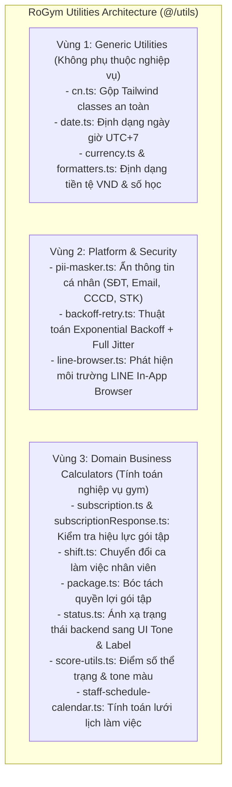
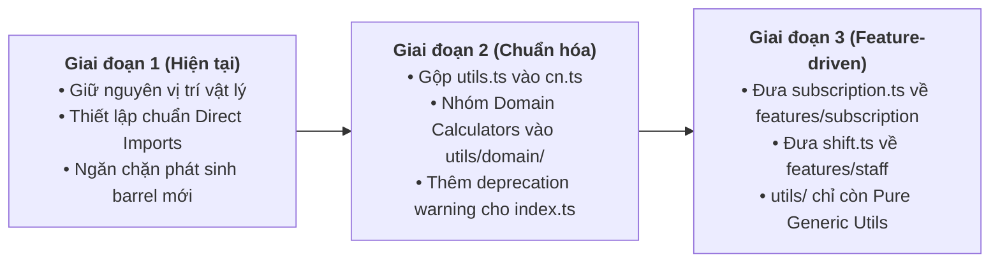
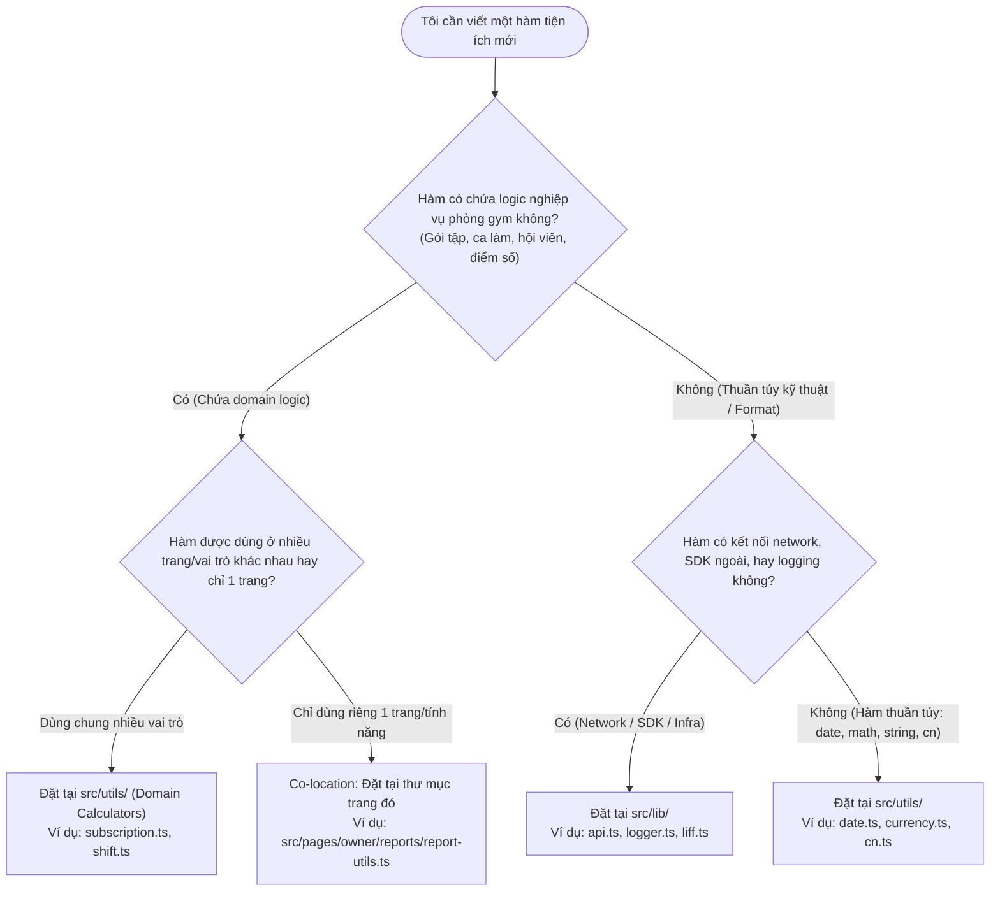

# RoGym Utilities & Domain Calculators Architecture (README)

> **Cẩm Nang Kiến Trúc & Tiện Ích Thuần Túy RoGym Frontend (`client/src/utils/`)**  
> *Phiên bản:* 2.0.0 (React Enterprise Standard)  
> *Cập nhật lần cuối:* 2026-10-23  
> *Phạm vi áp dụng:* Toàn bộ lập trình viên frontend khi tạo mới, sử dụng, hoặc tái cấu trúc các hàm tiện ích, formatters, bộ lọc PII và các bộ tính toán nghiệp vụ trong RoGym Management System.  
> *Tài liệu liên quan:* [Cổng Quy Chuẩn Master Frontend](../../FRONTEND_CONVENTIONS.md) | [Kiến Trúc Hạ Tầng Thư Viện Lõi (`src/lib/README.md`)](../lib/README.md) | [Chuyên Đề 01: Kiến Trúc & Cấu Trúc Thư Mục](../../docs/01-architecture-and-structure.md) | [Chuyên Đề 03: 19 Tiêu Chuẩn Coding](../../docs/03-coding-standards.md)

---

## MỤC LỤC TỔNG QUAN

1. [Chương 1: Kiến Trúc Phân Hệ Tiện Ích & 3 Vùng Trách Nhiệm (Core Architecture)](#chương-1-kiến-trúc-phân-hệ-tiện-ích-3-vùng-trách-nhiệm-core-architecture)
2. [Chương 2: Tối Ưu Bundle Size Theo Chuẩn Vercel: Cấm Monolithic Barrel & Dùng Direct Imports](#chương-2-tối-ưu-bundle-size-theo-chuẩn-vercel-cấm-monolithic-barrel-dùng-direct-imports)
3. [Chương 3: Tính Thuần Túy Của Hàm & An Toàn Múi Giờ UTC+7 (Pure Functions & Timezone Safety)](#chương-3-tính-thuần-túy-của-hàm-an-toàn-múi-giờ-utc7-pure-functions-timezone-safety)
4. [Chương 4: Nhận Diện Anti-patterns & Cẩm Nang Tái Cấu Trúc (Refactoring Playbook)](#chương-4-nhận-diện-anti-patterns-cẩm-nang-tái-cấu-trúc-refactoring-playbook)
5. [Chương 5: Cây Quyết Định Định Vị Tiện Ích Trong 15 Giây (Decision Tree)](#chương-5-cây-quyết-định-định-vị-tiện-ích-trong-15-giây-decision-tree)
6. [Chương 6: Catalog Toàn Diện 100% Modules Tại `utils/` (15 Modules)](#chương-6-catalog-toàn-diện-100-modules-tại-utils-15-modules)
7. [Chương 7: Tiêu Chuẩn Kiểm Thử Tiện Ích Với Vitest (Unit Testing Standards)](#chương-7-tiêu-chuẩn-kiểm-thử-tiện-ích-với-vitest-unit-testing-standards)
8. [Chương 8: Quy Chuẩn Nghiêm Cấm & Cảnh Báo Lạm Dụng (Anti-Abuse Directives & Severe System Consequences)](#chương-8-quy-chuẩn-nghiêm-cấm-cảnh-báo-lạm-dụng-anti-abuse-directives-severe-system-consequences)
9. [Chương 9: Quy Định Bắt Buộc & Bảng Tra Cứu Nhanh 5 Giây (Quick Reference)](#chương-9-quy-định-bắt-buộc-bảng-tra-cứu-nhanh-5-giây-quick-reference)

---

## CHƯƠNG 1: KIẾN TRÚC PHÂN HỆ TIỆN ÍCH & 3 VÙNG TRÁCH NHIỆM (CORE ARCHITECTURE)

Thư mục `client/src/utils/` là nơi tập trung các hàm tiện ích thuần túy (Pure Functions) và các bộ tính toán nghiệp vụ (Calculators) phục vụ toàn bộ ứng dụng frontend. Phân hệ được chia thành **3 vùng trách nhiệm chuyên biệt**:



### 1.1 Phân Định Rạch Ròi Giữa `@/utils` và `@/lib`

Để tránh nhầm lẫn và trùng lặp trách nhiệm trong dự án, lập trình viên cần tuân thủ ranh giới phân định sau:

| Tiêu Chí | Thư Mục `client/src/utils/` | Thư Mục `client/src/lib/` |
| :--- | :--- | :--- |
| **Bản chất** | Hàm tính toán thuần túy (Pure Functions), formatters và calculators. | Cấu hình hạ tầng mạng, adapter thư viện bên thứ 3 và SDKs. |
| **Ví dụ điển hình** | `formatDate`, `formatVnd`, `maskPII`, `hasActiveSubscription`, `cn`. | `api.ts` (Axios), `logger.ts`, `i18n.ts`, `liff.ts`, `query-keys.ts`, `toast.tsx`. |
| **Side-effects** | 100% không có side-effect; không gọi network, không khởi tạo global client. | Có thể chứa singletons, interceptors, SDK event listeners hoặc third-party wrappers. |
| **Trạng thái (State)** | Không nắm giữ mutable state hoặc in-memory state. | Có thể quản lý state kết nối (LIFF session, Axios interceptors, cache key mapping). |

---

## CHƯƠNG 2: TỐI ƯU BUNDLE SIZE THEO CHUẨN VERCEL: CẤM MONOLITHIC BARREL & DÙNG DIRECT IMPORTS

### 2.1 Quy Tắc Vercel `bundle-barrel-imports`

> [!WARNING]
> **CẢNH BÁO BUNDLE SIZE:** File `client/src/utils/index.ts` hiện tại re-export toàn bộ 15 modules. Đây là một anti-pattern khiến cơ chế Tree-shaking của Vite/Rollup gặp khó khăn khi tối ưu gói mã nguồn build production.

#### Phân Tích Kỹ Thuật (Tree-shaking Hazard):
Khi một component chỉ cần hàm `cn` để gộp class CSS:
- Nếu import qua barrel: `import { cn } from '@/utils'`
- Trình đóng gói bundler có nguy cơ phải phân tích và nạp kèm các dependencies nặng từ các module khác trong barrel (như logic regex phức tạp của `pii-masker.ts`, cấu trúc tính toán ngày tháng của `date.ts`).
- Kết quả: Làm tăng kích thước initial JavaScript chunk không cần thiết, làm chậm chỉ số LCP và FCP trên thiết bị di động.

### 2.2 Quy Chuẩn Import Trực Tiếp (Granular Direct Imports)

Mọi module tại `client/src/utils/` bắt buộc phải được import trực tiếp từ file đích danh:

```tsx
// ❌ TRÁNH: Import toàn bộ qua monolithic barrel
import { cn, formatDate, formatVnd } from '@/utils'

// ✅ NÊN LÀM: Import trực tiếp theo từng tệp chức năng
import { cn } from '@/utils/cn'
import { formatDate } from '@/utils/date'
import { formatVnd } from '@/utils/currency'
import { maskPII } from '@/utils/pii-masker'
```

---

## CHƯƠNG 3: TÍNH THUẦN TÚY CỦA HÀM & AN TOÀN MÚI GIỜ UTC+7 (PURE FUNCTIONS & TIMEZONE SAFETY)

### 3.1 Tiêu Chí Pure Function Bắt Buộc Cho Tầng `utils/`

Mọi hàm được đặt tại thư mục `utils/` bắt buộc phải thỏa mãn 3 tiêu chí:
1. **Deterministic (Định lượng xác định):** Cùng một tham số đầu vào luôn luôn trả về cùng một kết quả đầu ra.
2. **Zero Side-effects (Không tác dụng phụ):** Không thay đổi tham số truyền vào (no mutations), không đọc/ghi biến toàn cục bên ngoài hàm, không phát sinh network request ngầm.
3. **Fail-safe (An toàn trước giá trị dị biệt):** Luôn xử lý an toàn khi tham số là `null`, `undefined`, chuỗi rỗng `""` hoặc số không hợp lệ `NaN`. Không bao giờ để phát sinh lỗi `Uncaught TypeError` làm crash ứng dụng.

### 3.2 Khóa Cứng Múi Giờ Việt Nam `Asia/Ho_Chi_Minh` (UTC+7)

Trong ứng dụng quản lý phòng gym, việc lệch ngày tháng giữa học viên và phòng tập sẽ dẫn đến sai lệch lịch tập và trạng thái hợp đồng. Module [`date.ts`](date.ts) khóa cứng múi giờ chuẩn:

```typescript
export const VIETNAM_TIMEZONE = 'Asia/Ho_Chi_Minh'

// Mọi phép định dạng hiển thị ngày giờ bắt buộc gắn timezone cố định:
export function formatDate(date: string | Date, options?: Intl.DateTimeFormatOptions): string {
  // Tự động fallback và ép múi giờ Asia/Ho_Chi_Minh
}
```

---

## CHƯƠNG 4: NHẬN DIỆN ANTI-PATTERNS & CẨM NANG TÁI CẤU TRÚC (REFACTORING PLAYBOOK)

### 4.1 Bảng Nhận Diện 3 Anti-patterns Trong Code Hiện Tại

| Anti-pattern Hiện Tại | Vị Trí Code | Rủi Ro Kỹ Thuật | Giải Pháp Chuẩn Mực |
| :--- | :--- | :--- | :--- |
| **1. Trộn lẫn Domain Calculators vào Utils** | `subscription.ts`, `shift.ts`, `package.ts`, `score-utils.ts` nằm ngay gốc `src/utils/` | Vi phạm ranh giới kiến trúc: logic nghiệp vụ phòng gym bị đặt lẫn với tiện ích thuần túy dùng chung. | Chuyển dần các file này sang `src/features/<domain>/utils` hoặc gom vào thư mục con `src/utils/domain/`. |
| **2. Tồn tại 2 file trùng chức năng** | `src/utils/cn.ts` và `src/utils/utils.ts` | Gây phân mảnh import: một số file import `cn` từ `cn.ts`, file khác import từ `utils.ts` hoặc barrel `index.ts`. | Thống nhất dùng duy nhất `src/utils/cn.ts`, đánh dấu `utils.ts` là deprecated và dọn dẹp dần. |
| **3. Monolithic Barrel Export** | `src/utils/index.ts` re-export 15 modules | Phá vỡ tree-shaking, kéo theo toàn bộ module vào bundle khi chỉ cần 1 hàm nhỏ. | Loại bỏ thói quen import từ `@/utils`, chuyển sang import đích danh `@/utils/<file>`. |

### 4.2 Lộ Trình Tái Cấu Trúc 3 Giai Đoạn (Refactoring Roadmap)



---

## CHƯƠNG 5: CÂY QUYẾT ĐỊNH ĐỊNH VỊ TIỆN ÍCH TRONG 15 GIÂY (DECISION TREE)

Khi tạo một hàm hỗ trợ mới, lập trình viên sử dụng cây quyết định sau để chọn đúng vị trí đặt code:



---

## CHƯƠNG 6: CATALOG TOÀN DIỆN 100% MODULES TẠI `UTILS/` (15 MODULES)

### 6.1 Nhóm 1: Generic Utilities (Tiện Ích Thuần Túy)

#### 1. `cn.ts` (Class Names Merger)
- **Đường dẫn:** [`cn.ts`](cn.ts) | **Phụ thuộc:** `clsx`, `tailwind-merge`
- **Các hàm xuất bản:** `cn(...inputs: ClassValue[]): string`
- **Vai trò:** Hợp nhất classnames có điều kiện và tự động xử lý xung đột class Tailwind (ví dụ: `px-2` bị ghi đè chuẩn xác bởi `px-4`).

#### 2. `date.ts` (DateTime Formatter)
- **Đường dẫn:** [`date.ts`](date.ts) | **Kiểm thử:** [`date.test.ts`](date.test.ts)
- **Các hàm xuất bản:** `formatDate`, `formatDateTime`, `formatTime`, `todayInput`, `startOfLocalDayIso`, `endOfLocalDayIso`.
- **Vai trò:** Định dạng ngày giờ chuẩn ISO UTC sang giờ hiển thị Việt Nam (`Asia/Ho_Chi_Minh`), hỗ trợ các component lịch và form nhập ngày.

#### 3. `currency.ts` (Currency Formatter)
- **Đường dẫn:** [`currency.ts`](currency.ts) | **Kiểm thử:** [`currency.test.ts`](currency.test.ts)
- **Các hàm xuất bản:** `formatVnd(amount: number): string`, `formatVndCompact(amount: number): string`.
- **Vai trò:** Định dạng số tiền sang định dạng tiền tệ Việt Nam Đồng (ví dụ: `1500000` ➔ `1.500.000 ₫`, `15000000` ➔ `15 Tr`).

#### 4. `formatters.ts` (Memoized High-Performance Formatters)
- **Đường dẫn:** [`formatters.ts`](formatters.ts) | **Kiểm thử:** [`formatters.test.ts`](formatters.test.ts)
- **Các hàm xuất bản:** `formatCurrency`, `formatNumber`, `formatPercentage`.
- **Vai trò:** Quản lý bộ đệm `Intl.NumberFormat` cache trong `Map` để tái sử dụng instance, ngăn chặn nghẽn Garbage Collection khi render bảng hàng nghìn dòng.

---

### 6.2 Nhóm 2: Platform & Security

#### 5. `pii-masker.ts` (Personally Identifiable Information Masker)
- **Đường dẫn:** [`pii-masker.ts`](pii-masker.ts) | **Kiểm thử:** [`pii-masker.test.ts`](pii-masker.test.ts)
- **Các hàm xuất bản:** `maskPII(value: string, type: PIIType): string`, `maskObjectPII(data: T): T`.
- **Vai trò:** Che giấu các trường dữ liệu nhạy cảm theo quy định bảo vệ dữ liệu cá nhân (SĐT: `090 ••• 1234`, CCCD: `•••••••• 5678`, STK: `•••• •••• •••• 1234`).

#### 6. `backoff-retry.ts` (Network Resilience Retry Algorithm)
- **Đường dẫn:** [`backoff-retry.ts`](backoff-retry.ts) | **Kiểm thử:** [`backoff-retry.test.ts`](backoff-retry.test.ts)
- **Các hàm xuất bản:** `retryWithBackoff<T>(fn: () => Promise<T>, options?: RetryOptions): Promise<T>`.
- **Vai trò:** Thử lại request bất đồng bộ khi gặp lỗi mạng tạm thời bằng thuật toán Exponential Backoff kết hợp Full Jitter ngẫu nhiên.

#### 7. `line-browser.ts` (LINE In-App Browser Detector)
- **Đường dẫn:** [`line-browser.ts`](line-browser.ts) | **Kiểm thử:** [`line-browser.test.ts`](line-browser.test.ts)
- **Các hàm xuất bản:** `isLineBrowser(): boolean`.
- **Vai trò:** Phát hiện người dùng đang truy cập bằng trình duyệt in-app của LINE để kích hoạt giao diện tối ưu Safe Area Insets.

---

### 6.3 Nhóm 3: Domain Business Calculators (Tính Toán Nghiệp Vụ)

#### 8. `subscription.ts` (Subscription Validity Calculator)
- **Đường dẫn:** `subscription.ts` | **Kiểm thử:** `subscription.test.ts`
- **Các hàm xuất bản:** `hasActiveSubscription(subscriptions: Subscription[]): boolean`, `isSubscriptionActive(sub: Subscription): boolean`.
- **Vai trò:** Kiểm tra xem hội viên có gói tập nào đang còn hiệu lực tính đến ngày hiện tại theo giờ Việt Nam.

#### 9. `subscriptionResponse.ts` (Subscription API Response Parser)
- **Đường dẫn:** `subscriptionResponse.ts` | **Kiểm thử:** `subscriptionResponse.test.ts`
- **Các hàm xuất bản:** `parseSubscriptionResponse(data: unknown): Subscription[]`, `InvalidSubscriptionResponseError`.
- **Vai trò:** Bóc tách và kiểm tra tính toàn vẹn cấu trúc danh sách hợp đồng trả về từ API backend.

#### 10. `package.ts` (Package Benefits Parser)
- **Đường dẫn:** [`package.ts`](package.ts) | **Kiểm thử:** [`package.test.ts`](package.test.ts)
- **Các hàm xuất bản:** `parsePackageBenefits(benefits: string | string[]): string[]`.
- **Vai trò:** Phân tích chuỗi quyền lợi gói tập hỗ trợ cả định dạng mảng JSON lẫn văn bản ngăn cách bằng dấu xuống dòng.

#### 11. `shift.ts` (Staff Shift Mapper)
- **Đường dẫn:** `shift.ts`
- **Các hàm xuất bản:** `getShiftLabel(shift: string): string`, `getShiftTime(shift: string): string`.
- **Vai trò:** Chuyển đổi mã ca làm việc (`morning`, `afternoon`, `evening`) sang nhãn hiển thị và khung giờ làm việc.

#### 12. `staff-schedule-calendar.ts` (Staff Calendar Range Calculator)
- **Đường dẫn:** `staff-schedule-calendar.ts`
- **Các hàm xuất bản:** `getMonthDateRange(year: number, month: number): { startDate: string, endDate: string }`.
- **Vai trò:** Tính toán khoảng ngày đầu tháng và cuối tháng phục vụ truy vấn và dựng lưới lịch phân ca nhân viên.

#### 13. `status.ts` (Status to UI Tone Mapper)
- **Đường dẫn:** [`status.ts`](status.ts) | **Kiểm thử:** [`status.test.ts`](status.test.ts)
- **Các hàm xuất bản:** `getStatusTone(status: string): Tone`, `getStatusLabel(status: string): string`.
- **Vai trò:** Ánh xạ trạng thái chuỗi (`active`, `pending`, `expired`, `cancelled`) sang Semantic Tone tương ứng (`success`, `warning`, `danger`, `neutral`).

#### 14. `score-utils.ts` (Physical Score & Tone Calculator)
- **Đường dẫn:** [`score-utils.ts`](score-utils.ts) | **Kiểm thử:** [`score-utils.test.ts`](score-utils.test.ts)
- **Các hàm xuất bản:** `getScoreTone(score: number): Tone`, `getScoreColor(score: number): string`.
- **Vai trò:** Tính toán màu sắc và tone đánh giá dựa trên thang điểm thể trạng học viên (0–100).

#### 15. `utils.ts` (Legacy Helper - Deprecated)
- **Đường dẫn:** [`utils.ts`](utils.ts) | **Kiểm thử:** [`utils.test.ts`](utils.test.ts)
- **Vai trò:** File cũ chứa hàm `cn`. Được giữ lại để tương thích ngược, khuyến khích chuyển sang dùng `cn.ts`.

---

## CHƯƠNG 7: TIÊU CHUẨN KIỂM THỬ TIỆN ÍCH VỚI VITEST (UNIT TESTING STANDARDS)

Toàn bộ các hàm tại thư mục `utils/` phải có độ bao phủ kiểm thử cao vì chúng là nền móng tính toán cho toàn bộ ứng dụng:

```typescript
// Ví dụ test case mẫu cho date.ts kiểm thử cả trường hợp biên (Edge Cases):
import { describe, it, expect } from 'vitest'
import { formatDate } from './date'

describe('formatDate()', () => {
  it('định dạng chính xác ngày hợp lệ theo chuẩn giờ Việt Nam', () => {
    const result = formatDate('2026-10-15T08:30:00.000Z')
    expect(result).toBe('15/10/2026')
  })

  it('xử lý an toàn khi giá trị đầu vào là chuỗi rỗng hoặc không hợp lệ', () => {
    expect(formatDate('')).toBe('—')
    expect(formatDate('invalid-date')).toBe('—')
  })

  it('xử lý an toàn khi giá trị đầu vào là null hoặc undefined', () => {
    expect(formatDate(null as unknown as string)).toBe('—')
    expect(formatDate(undefined as unknown as string)).toBe('—')
  })
})
```

---

## CHƯƠNG 8: QUY CHUẨN NGHIÊM CẤM & CẢNH BÁO LẠM DỤNG (ANTI-ABUSE DIRECTIVES & SEVERE SYSTEM CONSEQUENCES)

> [!CAUTION]
> Tầng tiện ích (`client/src/utils/`) là nền tảng tính toán toán học và nghiệp vụ cốt lõi cho toàn bộ giao diện RoGym. Việc đột biến trực tiếp mảng đầu vào, duy trì biến toàn cục mutable, hoặc phân tán logic tính toán nghiệp vụ gym ra các components sẽ ngay lập tức gây ra các lỗi bóng ma (Ghost Mutation Bugs), phá vỡ cơ chế phát hiện thay đổi của React và gây sai lệch dữ liệu tài chính nghiêm trọng. 100% lập trình viên phải tuyệt đối tuân thủ các quy tắc sau.

### 8.1 Bảng Ma Trận Quy Tắc Cấm & Đo Lường Hậu Quả Hệ Thống

| Mã Quy Tắc | Hành Vi Nghiêm Cấm Tuyệt Đối | Mức Độ | Bán Kính Ảnh Hưởng (Blast Radius) | Hậu Quả Hệ Thống & Trải Nghiệm Người Dùng |
| :--- | :--- | :---: | :--- | :--- |
| `RULE_NO_MUTATING_PROPS_OR_STATE` | Đột biến trực tiếp mảng hoặc đối tượng đầu vào trong hàm tiện ích (dùng `sort()`, `splice()`, `reverse()` thay vì `toSorted()`, `slice()`) | **CRITICAL** | Bộ Nhớ Cache & Toàn Bộ Cây DOM | Gây đột biến ngầm React Query Cache hoặc State nội bộ (Ghost Mutation Bug); React không phát hiện thay đổi con trỏ tham chiếu nên không kích hoạt re-render; giao diện hiển thị dữ liệu sai lệch. |
| `RULE_NO_MUTABLE_UTILS` | Khai báo biến `let` toàn cục hoặc lưu trữ in-memory state bên trong các module tiện ích | **CRITICAL** | Toàn Ứng Dụng & Test Suites | Biến hàm thuần túy thành impure (bất định); gây ô nhiễm dữ liệu giữa các test cases (Test Pollution) và rò rỉ trạng thái giữa các phiên người dùng. |
| `RULE_NO_FRAGMENTED_CALCULATORS` | Viết logic tính toán nghiệp vụ gym (tính hạn gói tập, tính lương/ca PT, tính điểm thể trạng) rải rác trong UI component | **SEVERE** | Nghiệp Vụ Kinh Doanh & Báo Cáo | Gây hiện tượng trôi dạt nghiệp vụ (Business Logic Drift); số liệu trên Dashboard lệch so với trang Thanh toán; cực kỳ rủi ro khi có thay đổi chính sách gói tập. |
| `RULE_NO_UNLOCKED_TIMEZONE` | Sử dụng `new Date()` thuần mà không khóa cứng múi giờ `Asia/Ho_Chi_Minh` (UTC+7) | **SEVERE** | Dữ Liệu Thời Gian Toàn Hệ Thống | Gây lệch ngày điểm danh, nhảy sai ca trực của PT khi thiết bị học viên/nhân viên ở múi giờ khác hoặc server trả về chuỗi UTC. |
| `RULE_NO_BARREL_IMPORT_UTILS` | Import tiện ích từ barrel file `src/utils/index.ts` thay vì import trực tiếp từ file cụ thể | **SEVERE** | Bundle Size & Tốc Độ Tải Trang | Vô hiệu hóa tính năng Tree-shaking; kéo theo toàn bộ regex và helpers không dùng vào chunk của trang, làm tăng kích thước tải trang ban đầu. |

---

### 8.2 Sơ Đồ Trực Quan & Phân Tích Kỹ Thuật Đột Biến Dữ Liệu

#### Lỗi Đột Biến Mảng Trực Tiếp (In-Place Mutation Bug) So Với Chuẩn Mực Hàm Thuần Túy Bất Biến:

```mermaid
graph TD
    subgraph AntiPattern["Đột Biến Trực Tiếp Mảng (In-Place Mutation Bug)"]
        Cache1["TanStack Query Cache: [LogA, LogB, LogC]"] --> SortFunc["sortWorkoutLogs(logs) dùng logs.sort()"]
        SortFunc --> Mutated["Cache Gốc Bị Đột Biến Ngầm Cùng Tham Chiếu"]
        Mutated --> Bug["React So Sánh prev === next (Bỏ Qua Render) -> UI Giữ Nguyên Dữ Liệu Cũ!"]
    end

    subgraph BestPractice["Chuẩn Mực: Hàm Thuần Túy Bất Biến (Immutable Pure Function)"]
        Cache2["TanStack Query Cache: [LogA, LogB, LogC]"] --> PureFunc["sortWorkoutLogs(logs) dùng [...logs].sort()"]
        PureFunc --> NewArray["Tạo Ra Mảng Mới Hoàn Toàn [LogC, LogB, LogA]"]
        NewArray --> SafeRender["React Phát Hiện Tham Chiếu Mới -> Kích Hoạt Re-render Chính Xác 100%"]
    end
```



---

### 8.3 Công Thức Tái Cấu Trúc Thực Chiến (Refactoring Recipes)

#### Công thức 1: Khắc phục triệt để lỗi đột biến mảng bằng bản sao bất biến (`sortWorkoutLogs`)

##### ❌ Code Sai Phạm (Đột Biến Trực Tiếp Tham Chiếu Props / Cache):
```typescript
// ANTI-PATTERN: logs.sort() thay đổi trực tiếp thứ tự phần tử trong mảng gốc!
export function sortWorkoutLogs(logs: WorkoutLog[]): WorkoutLog[] {
  return logs.sort((a, b) => new Date(b.date).getTime() - new Date(a.date).getTime())
}
```

##### ✅ Code Tái Cấu Trúc Chuẩn Mực RoGym:
```typescript
import type { WorkoutLog } from '@/types'

// CHUẨN MỰC: Nhận mảng readonly và sao chép trước khi sắp xếp (Pure Function)
export function sortWorkoutLogs(logs: readonly WorkoutLog[]): WorkoutLog[] {
  return [...logs].sort((a, b) => new Date(b.date).getTime() - new Date(a.date).getTime())
}
```

---

#### Công thức 2: Hợp nhất logic tính toán hạn dùng gói tập vào Domain Calculator tập trung

##### ❌ Code Sai Phạm (Tự Viết Logic Kiểm Tra Rải Rác Trên UI):
```typescript
// ANTI-PATTERN: Viết ad-hoc trên component UI, không xử lý timezone UTC+7
const isExpired = new Date(subscription.endDate).getTime() < Date.now()
```

##### ✅ Code Tái Cấu Trúc Chuẩn Mực RoGym:
```typescript
// CHUẨN MỰC: Sử dụng domain calculator tập trung tại @/utils/subscription
import { hasActiveSubscription } from '@/utils/subscription'

const isExpired = !hasActiveSubscription(subscription)
```

---

### 8.4 Checklist Nghiệm Thu PR Dành Cho Utilities & Calculators (Definition of Done)

- [ ] **100% Pure Functions:** Toàn bộ hàm tính toán nhận tham số `readonly`, không làm thay đổi giá trị của đối số truyền vào và không sinh side-effect.
- [ ] **100% An Toàn Thao Tác Mảng:** Các hàm thao tác mảng (`sort`, `reverse`, `splice`) phải tạo bản sao mới bằng toán tử spread `[...items]` hoặc phương thức chuẩn ES2023 (`toSorted()`, `toReversed()`).
- [ ] **Khóa Múi Giờ UTC+7:** Toàn bộ tiện ích xử lý định dạng ngày tháng phải sử dụng múi giờ Việt Nam `Asia/Ho_Chi_Minh`.
- [ ] **Hợp Nhất Nghiệp Vụ:** Không viết logic tính toán gói tập, ca trực hoặc thang điểm rải rác trong UI components; 100% phải quy tụ về `@/utils/<domain>.ts`.
- [ ] **100% Direct Import:** Tuyệt đối không import từ file barrel `@/utils`; 100% import phải trỏ trực tiếp (ví dụ `@/utils/date`, `@/utils/cn`).

---

## CHƯƠNG 9: QUY ĐỊNH BẮT BUỘC & BẢNG TRA CỨU NHANH 5 GIÂY (QUICK REFERENCE)

### 9.1 Năm Nguyên Tắc Bắt Buộc Khi Làm Việc Với `src/utils/`

1. **Hàm Phải Thuần Túy:** Tuyệt đối không tạo kết nối mạng, không đọc `window.localStorage` hoặc biến toàn cục mutable trong hàm tiện ích.
2. **Khóa Múi Giờ UTC+7:** Xử lý ngày tháng luôn chỉ định múi giờ `Asia/Ho_Chi_Minh` để bảo đảm tính thống nhất cho hệ thống phòng gym.
3. **Import Đích Danh:** Không import từ file barrel `index.ts`; luôn import trực tiếp từ file chức năng cụ thể (`@/utils/date`, `@/utils/cn`).
4. **Viết Unit Test Cho Mọi Tiện Ích Mới:** File tiện ích mới bắt buộc phải đi kèm file `*.test.ts` kiểm thử đầy đủ các trường hợp ngoại lệ.
5. **Cấm Hardcode Mã Màu Thô:** Các hàm trả về tone màu (như `status.ts`, `score-utils.ts`) phải trả về Semantic Tone (`success`, `warning`, `danger`, `neutral`), cấm trả về mã màu HEX thô hoặc tên màu HTML.
