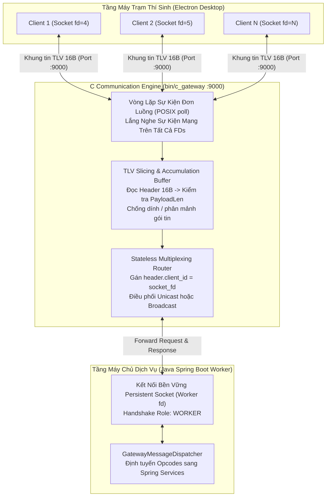

# C Communication Engine — Máy Chủ TCP Gateway Hiệu Năng Cao

Phân hệ **C Communication Engine** là một cổng mạng TCP trung gian (Stateless TCP Gateway / Message Multiplexer) hiệu năng cao được xây dựng từ đầu bằng ngôn ngữ C (chuẩn C11 / POSIX). Đóng vai trò cầu nối dữ liệu hai chiều thời gian thực giữa ứng dụng máy trạm **Electron Desktop** và hệ thống dịch vụ **Java 21 Spring Boot Worker**, loại bỏ hoàn toàn việc phụ thuộc vào HTTP, REST API hay WebSocket.

---

## 1. Triết Lý Thiết Kế & Kiến Trúc Tinh Gọn

Hệ thống tuân thủ 4 nguyên tắc kỹ thuật cốt lõi:
1. **Stateless I/O Multiplexer (Không Lưu Trạng Thái Nghiệp Vụ Trong C):** C Gateway không quản lý phòng thi, câu hỏi hay tài khoản. 100% logic nghiệp vụ được ủy quyền cho Java Spring Boot.
2. **Zero JSON Parsing:** C Gateway không phân tích cú pháp JSON trong đường dẫn truyền dữ liệu chính (Critical Forwarding Path), loại bỏ hoàn toàn rủi ro rò rỉ bộ nhớ (Memory Leak) và phân mảnh bộ nhớ động (`malloc`/`free`).
3. **Single-Threaded POSIX `poll()` Event Loop:** Vận hành trên một luồng duy nhất thông qua cơ chế I/O multiplexing với lời gọi hệ thống `poll()` chuẩn POSIX. Triệt tiêu hoàn toàn đa luồng, khóa mutex và tranh chấp tài nguyên (Race Condition / Deadlock).
4. **Single Port (:9000) & Handshake Phân Quyền:** Cổng 9000 duy nhất lắng nghe cả kết nối từ Client và Worker. Java Worker gửi gói tin Handshake định danh ban đầu để C Gateway xác lập kênh chuyển tiếp.



---

## 2. Đặc Tả Khung Tin Nhị Phân 16-byte TLV Framing

Toàn bộ gói tin trao đổi trên kênh TCP sử dụng cấu trúc **Type-Length-Value (TLV)** với **Header cố định 16 bytes** theo chuẩn thứ tự byte mạng Big-Endian (Network Byte Order):

```text
 0                   1                   2                   3
 0 1 2 3 4 5 6 7 8 9 0 1 2 3 4 5 6 7 8 9 0 1 2 3 4 5 6 7 8 9 0 1
+-+-+-+-+-+-+-+-+-+-+-+-+-+-+-+-+-+-+-+-+-+-+-+-+-+-+-+-+-+-+-+-+
|          MAGIC (0x4D43)       |    VERSION    |    MSG_TYPE   |
+-+-+-+-+-+-+-+-+-+-+-+-+-+-+-+-+-+-+-+-+-+-+-+-+-+-+-+-+-+-+-+-+
|                         SEQUENCE_ID                           |
+-+-+-+-+-+-+-+-+-+-+-+-+-+-+-+-+-+-+-+-+-+-+-+-+-+-+-+-+-+-+-+-+
|                          CLIENT_ID                            |
+-+-+-+-+-+-+-+-+-+-+-+-+-+-+-+-+-+-+-+-+-+-+-+-+-+-+-+-+-+-+-+-+
|                         PAYLOAD_LEN                           |
+-+-+-+-+-+-+-+-+-+-+-+-+-+-+-+-+-+-+-+-+-+-+-+-+-+-+-+-+-+-+-+-+
|                     PAYLOAD (JSON UTF-8) ...                  |
+-+-+-+-+-+-+-+-+-+-+-+-+-+-+-+-+-+-+-+-+-+-+-+-+-+-+-+-+-+-+-+-+
```

### Chi Tiết Các Trường:
| Offset (Byte) | Tên Trường | Kiểu Dữ Liệu | Mô Tả Kỹ Thuật |
| :---: | :--- | :---: | :--- |
| **0 – 1** | `MAGIC` | `uint16_t` | Luôn là `0x4D43` (ASCII `"MC"` cho mooc-clone). Nhận diện gói tin hợp lệ. |
| **2** | `VERSION` | `uint8_t` | Phiên bản giao thức (`0x01`). |
| **3** | `MSG_TYPE` | `uint8_t` | Mã lệnh nghiệp vụ (Opcode định tuyến). |
| **4 – 7** | `SEQUENCE_ID` | `uint32_t` | Correlation ID để Client khớp phản hồi bất đồng bộ (Request-Response matching). |
| **8 – 11** | `CLIENT_ID` | `uint32_t` | Socket descriptor của Client. C Gateway tự ghi vào khi chuyển tiếp sang Java; giá trị `0xFFFFFFFF` quy ước là **BROADCAST**. |
| **12 – 15** | `PAYLOAD_LEN` | `uint32_t` | Kích thước phần thân JSON tính theo byte (tối đa 2MB/gói). |
| **16...** | `PAYLOAD` | `char[]` | Chuỗi ký tự JSON UTF-8 chứa dữ liệu nghiệp vụ. |

---

## 3. Danh Mục Mã Lệnh Tường Minh (Explicit Opcodes)

| Opcode (Hex) | Tên Hằng Số | Chiều Dữ Liệu | Chức Năng Nghiệp Vụ |
| :---: | :--- | :--- | :--- |
| `0x00` | `OP_SYS_HANDSHAKE` | Worker -> Gateway | Đăng ký kết nối là Java Backend Worker (`{"role":"WORKER"}`). |
| `0x01` | `OP_AUTH_LOGIN_REQ` | Client -> Gateway -> Java | Yêu cầu đăng nhập tài khoản. |
| `0x02` | `OP_AUTH_LOGIN_RESP` | Java -> Gateway -> Client | Kết quả đăng nhập (cấp phiên/token). |
| `0x03` | `OP_AUTH_REGISTER_REQ` | Client -> Gateway -> Java | Yêu cầu đăng ký tài khoản mới. |
| `0x04` | `OP_AUTH_REGISTER_RESP` | Java -> Gateway -> Client | Kết quả đăng ký tài khoản. |
| `0x10` | `OP_ROOM_LIST_REQ` | Client -> Gateway -> Java | Yêu cầu danh sách phòng thi. |
| `0x11` | `OP_ROOM_LIST_RESP` | Java -> Gateway -> Client | Danh sách phòng thi và trạng thái. |
| `0x12` | `OP_ROOM_CREATE_REQ` | Client -> Gateway -> Java | Tạo phòng thi mới. |
| `0x13` | `OP_ROOM_CREATE_RESP` | Java -> Gateway -> Client | Xác nhận tạo phòng thành công. |
| `0x14` | `OP_ROOM_JOIN_REQ` | Client -> Gateway -> Java | Thí sinh vào phòng thi. |
| `0x15` | `OP_ROOM_JOIN_RESP` | Java -> Gateway -> Client | Xác nhận vào phòng thi. |
| `0x20` | `OP_EXAM_START_REQ` | Client -> Gateway -> Java | Chủ phòng bấm bắt đầu bài thi. |
| `0x21` | `OP_EXAM_START_RESP` | Java -> Gateway -> Client | Xác nhận bắt đầu và phân phối đề thi. |
| `0x22` | `OP_EXAM_SUBMIT_REQ` | Client -> Gateway -> Java | Nộp bài thi kèm mảng câu trả lời. |
| `0x23` | `OP_EXAM_SUBMIT_RESP` | Java -> Gateway -> Client | Kết quả điểm số chi tiết từng câu. |
| `0x80` | `OP_SERVER_BROADCAST` | Java -> Gateway -> All | Sự kiện thời gian thực tới tất cả thí sinh (đếm ngược, thi sinh vào phòng, hết giờ). |
| `0xFE` | `OP_PING` | Hai chiều | Gói tin nhịp tim kiểm tra đường truyền rảnh. |
| `0xFF` | `OP_PONG` | Hai chiều | Phản hồi nhịp tim. |

---

## 4. Cơ Chế Điều Phối Dữ Liệu (Multiplexing Workflow)

1. **Client Gửi Yêu Cầu:**
   - Client gửi khung tin TLV (Header 16B + JSON).
   - C Gateway nhận vào bộ đệm tích lũy `conn->buffer`.
   - Khi đủ `16 + payload_len`, C Gateway bóc tách khung tin, ghi đè `header.client_id = conn->fd`, và đẩy toàn bộ sang `worker_fd`.
2. **Worker Trả Lời (Unicast):**
   - Java Worker xử lý nghiệp vụ xong, giữ nguyên `header.client_id` và gửi lại cho C Gateway.
   - C Gateway đọc `header.client_id` -> tìm socket client có `fd == header.client_id` -> gọi `tcp_send_all()` trả về đúng máy trạm đã gửi yêu cầu.
3. **Worker Phát Broadcast (Fanout):**
   - Khi có sự kiện phòng thi (chủ phòng bắt đầu thi, hết giờ), Java Worker gửi khung tin có `header.client_id = 0xFFFFFFFF` (`BROADCAST_CLIENT_ID`).
   - C Gateway chạy vòng lặp duyệt toàn bộ các client đang kết nối và gửi khung tin tới từng client trong 1 chu kỳ `poll()`.

---

## 5. Hướng Dẫn Vận Hành & Kiểm Thử (Runbook)

### 5.1 Biên Dịch Máy Chủ C Gateway
```bash
make clean
make gateway
```
*Tệp thực thi được tạo tại `build/c_gateway`.*

### 5.2 Khởi Chạy C Gateway (Lắng nghe cổng 9000)
```bash
./build/c_gateway 9000
# hoặc dùng lệnh tắt:
make run
```

### 5.3 Chạy Bộ Kiểm Thử Đơn Vị (Unit Tests)
```bash
make test
```
*Kiểm thử toàn diện tầng Socket non-blocking, đóng gói/giải mã Header TLV, phát hiện Magic/Version sai, và xử lý luồng byte dính gói / phân mảnh.*

### 5.4 Kiểm Tra Rò Rỉ Bộ Nhớ (Valgrind / AddressSanitizer)
```bash
make memcheck
```
*Mặc định nhúng `-fsanitize=address,undefined` trực tiếp trong cờ biên dịch để bắt lỗi tràn bộ đệm ngay lập tức.*

### 5.5 Kiểm Tra Tuân Thủ Quy Chuẩn Lập Trình (CONVENTIONS Linter)
```bash
make lint
```
*Xác thực 100% tệp mã nguồn C tuân thủ nghiêm ngặt chuẩn 0 tabs, tối đa 100 ký tự/dòng và Doxygen comment đầy đủ.*
