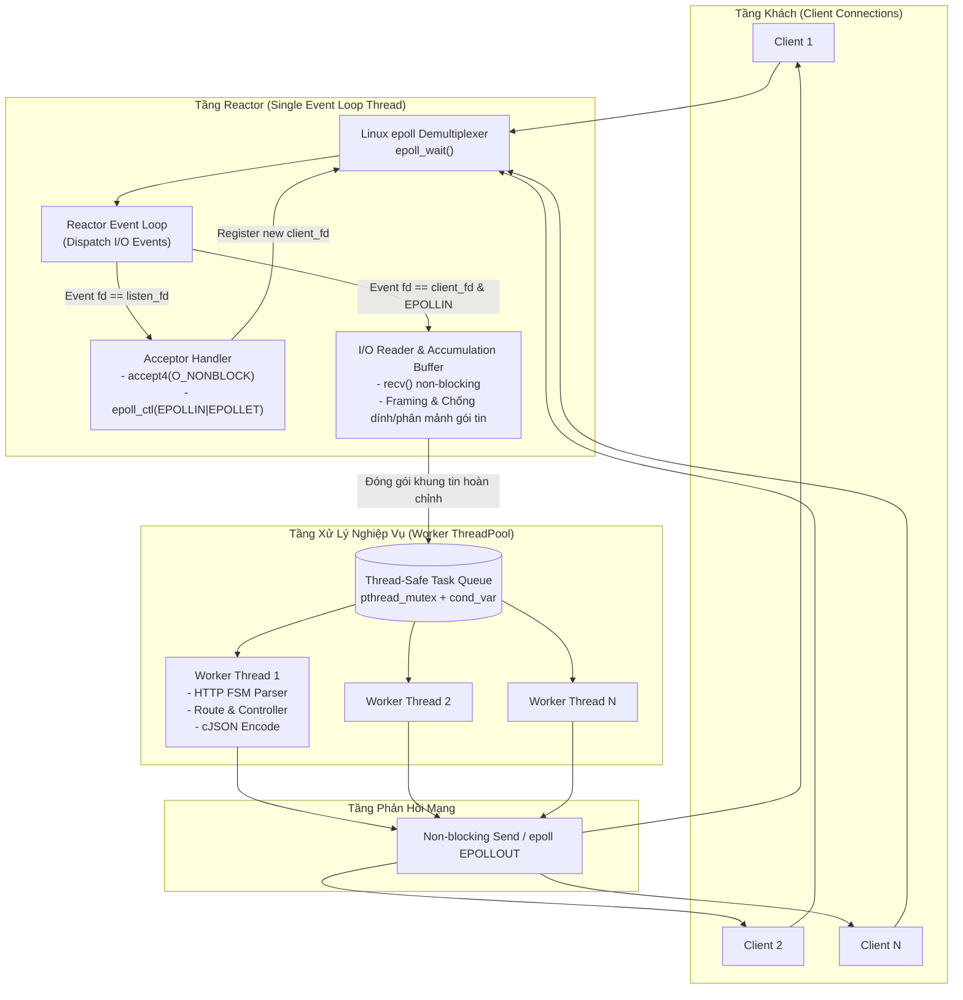

# C HTTP/REST Server & Doug Lea Classic Reactor Pattern

Máy chủ HTTP/1.1 REST API hiệu năng cao được xây dựng hoàn toàn từ đầu bằng ngôn ngữ C (chuẩn C11 / POSIX), tự quản lý từ tầng Socket TCP đến tầng Ứng dụng (Application Layer), tích hợp bộ phân tích HTTP Finite State Machine (FSM), bộ định tuyến URL động (`:id`), xử lý dữ liệu JSON qua thư viện nhúng `cJSON`, kho lưu trữ dữ liệu an toàn đa luồng (`pthread_rwlock_t`), và điều phối kết nối mạng theo mô hình **Doug Lea Classic Reactor Pattern (epoll + Worker ThreadPool)**.

---

## 1. Kiến Trúc Hệ Thống (Architecture)

Mô hình thực thi tuân thủ nguyên lý thiết kế kinh điển *"Scalable IO in Java"* của GS. Doug Lea:



### 3 Nấc Tiến Hóa Xử Lý Đồng Thời:
1. **Sequential (Tuần tự):** Phục vụ từng kết nối một, chứng minh hiện tượng nghẽn đầu hàng (Head-of-Line Blocking).
2. **Worker ThreadPool:** Cấp phát nhóm luồng cố định, mỗi kết nối là một task trong hàng đợi.
3. **Doug Lea Reactor Pattern:** Single-threaded Event Loop điều phối hàng nghìn kết nối non-blocking bằng `epoll`, bóc tách khung tin qua `accumulation_buffer`, và chỉ handoff tác vụ nặng sang Worker Pool.

---

## 2. Chuẩn Bị Môi Trường (Prerequisites)

Dự án yêu cầu môi trường POSIX Linux (khuyến nghị chạy trên **WSL2 Ubuntu 22.04** hoặc bất kỳ bản phân phối Linux nào).

Cài đặt các gói công cụ cần thiết trên Ubuntu / Debian:
```bash
sudo apt update
sudo apt install -y build-essential cmake valgrind python3 python3-requests curl netcat
```

---

## 3. Hướng Dẫn Biên Dịch & Kiểm Thử (Build & Test)

Dự án cung cấp `Makefile` thuận tiện hỗ trợ biên dịch tự động kèm **AddressSanitizer (ASan)** và **UndefinedBehaviorSanitizer (UBSan)** để bắt lỗi bộ nhớ tức thì:

```bash
# Di chuyển vào thư mục server-c
cd server-c

# 1. Biên dịch toàn bộ các binaries (http_server, tcp_echo_server, unit_tests)
make build

# 2. Chạy toàn bộ Unit Tests (Socket, FSM Parser, Router, In-Memory Store)
make test

# 3. Kiểm tra rò rỉ bộ nhớ chuyên sâu với Valgrind (hoặc ASan)
make memcheck

# 4. Dọn dẹp các tệp build
make clean
```

---

## 4. Hướng Dẫn Khởi Chạy Máy Chủ (Running the Server)

Máy chủ hỗ trợ chuyển đổi linh hoạt giữa 3 chế độ đồng thời thông qua các lệnh `make` hoặc tham số dòng lệnh:

### Chế độ 1: Doug Lea Classic Reactor (Mặc định - Khuyến nghị)
Sử dụng `epoll` non-blocking Event Loop kết hợp 16 luồng công nhân:
```bash
make run
# Hoặc chạy trực tiếp binary:
./build/http_server --port 8080 --mode reactor --threads 16
```

### Chế độ 2: Worker ThreadPool
Phân phối mỗi kết nối mới vào hàng đợi của Thread Pool:
```bash
make run-pool
# Hoặc:
./build/http_server --port 8080 --mode threadpool --threads 16
```

### Chế độ 3: Sequential (Tuần tự)
Mỗi thời điểm chỉ phục vụ đúng 1 client (dùng để đo lường baseline và minh họa Head-of-Line blocking):
```bash
make run-seq
# Hoặc:
./build/http_server --port 8080 --mode sequential
```

> [!TIP]
> **Graceful Shutdown (Tắt an toàn):** Nhấn `Ctrl+C` bất cứ lúc nào. Server sẽ bắt tín hiệu `SIGINT`, dừng nhận kết nối, giải phóng toàn bộ Worker Threads, Socket FDs và Heap memory, bảo đảm Valgrind đạt **0 memory leaks**.

---

## 5. Bảng Tra Cứu cURL (cURL Cheat Sheet)

Sau khi server đã chạy trên cổng `8080`, bạn có thể mở một terminal khác và sao chép các lệnh sau để kiểm thử:

### 5.1. Kiểm Tra Tình Trạng Máy Chủ (Health Check)
```bash
curl -i http://localhost:8080/api/v1/health
```

### 5.2. Kiểm Tra CORS Preflight (OPTIONS Request)
```bash
curl -i -X OPTIONS http://localhost:8080/api/v1/exams \
  -H "Origin: http://localhost:5173" \
  -H "Access-Control-Request-Method: POST"
```

### 5.3. Lấy Danh Sách Tất Cả Bài Thi (GET Exams)
```bash
curl -i http://localhost:8080/api/v1/exams
```

### 5.4. Tạo Một Bài Thi Mới (POST Exam)
```bash
curl -i -X POST http://localhost:8080/api/v1/exams \
  -H "Content-Type: application/json" \
  -d '{
    "title": "Kỳ thi Kiến trúc Hệ thống Phân tán",
    "description": "Đánh giá hiểu biết về Reactor Pattern và Socket C",
    "duration_minutes": 60
  }'
```

### 5.5. Xem Chi Tiết Một Bài Thi (GET Exam by ID)
```bash
curl -i http://localhost:8080/api/v1/exams/exam-1
```

### 5.6. Cập Nhật Bài Thi (PUT Exam)
```bash
curl -i -X PUT http://localhost:8080/api/v1/exams/exam-1 \
  -H "Content-Type: application/json" \
  -d '{
    "title": "Kỳ thi Kiến trúc Hệ thống Phân tán (Cập nhật)",
    "description": "Thời gian làm bài kéo dài",
    "duration_minutes": 90
  }'
```

### 5.7. Thêm Câu Hỏi Vào Bài Thi (POST Question)
```bash
curl -i -X POST http://localhost:8080/api/v1/exams/exam-1/questions \
  -H "Content-Type: application/json" \
  -d '{
    "content": "Thành phần nào trong Doug Lea Reactor đóng vai trò Demultiplexer?",
    "options": ["epoll / Selector", "Thread Pool", "Acceptor", "Accumulation Buffer"],
    "correct_option": 0
  }'
```

### 5.8. Lấy Danh Sách Câu Hỏi Của Bài Thi (GET Questions)
```bash
curl -i http://localhost:8080/api/v1/exams/exam-1/questions
```

### 5.9. Xóa Bài Thi (DELETE Exam)
```bash
curl -i -X DELETE http://localhost:8080/api/v1/exams/exam-1
```

---

## 6. Hướng Dẫn Kết Nối Frontend React (`client/`)

Frontend React của `mooc-clone` có thể gọi trực tiếp REST API C mà không gặp lỗi CORS:

1. Trong thư mục `client/`, tạo hoặc chỉnh sửa tệp `.env.local`:
   ```env
   VITE_API_URL=http://localhost:8080
   ```
2. Trong mã nguồn React (ví dụ component danh sách kỳ thi):
   ```typescript
   export async function fetchExams() {
     const res = await fetch("http://localhost:8080/api/v1/exams");
     if (!res.ok) throw new Error("Failed to fetch exams");
     return res.json();
   }
   ```
3. Máy chủ C đã cấu hình sẵn các Header:
   - `Access-Control-Allow-Origin: *`
   - `Access-Control-Allow-Methods: GET, POST, PUT, DELETE, OPTIONS`
   - `Access-Control-Allow-Headers: Content-Type, Authorization`

---

## 7. Kiểm Tra Hiệu Năng Tải & Benchmark (Benchmarking Guide)

Bạn có thể chạy kịch bản kiểm thử tích hợp tự động:
```bash
# Kiểm thử toàn diện 11 endpoint REST API
python3 tests/integration/test_rest_api.py

# Benchmark so sánh thông lượng 3 chế độ đồng thời
bash tests/integration/benchmark.sh
```

Hoặc sử dụng công cụ `wrk` để kiểm tra khả năng phục vụ hàng nghìn kết nối đồng thời:
```bash
# Đo lường chế độ Doug Lea Reactor với 2000 kết nối đồng thời:
wrk -t4 -c2000 -d10s http://localhost:8080/api/v1/health
```

---

## 8. Cẩm Nang Xử Lý Sự Cố (Troubleshooting Guide)

### Sự cố 1: `bind() failed: Address already in use`
- **Nguyên nhân:** Cổng 8080 đang bị một tiến trình khác (hoặc server cũ) chiếm dụng và chưa kịp giải phóng socket.
- **Khắc phục:**
  1. Kiểm tra tiến trình đang giữ cổng: `lsof -i :8080` hoặc `fuser 8080/tcp`.
  2. Tắt tiến trình đó: `fuser -k 8080/tcp` hoặc đổi cổng khi chạy: `./build/http_server --port 8085`.

### Sự cố 2: Không kết nối được từ Windows Host vào server chạy trong WSL2
- **Nguyên nhân:** Windows Firewall hoặc cấu hình IP localhost giữa Windows và WSL2.
- **Khắc phục:**
  - Trong WSL2, máy chủ đã bind vào `0.0.0.0` (toàn bộ các network interfaces).
  - Từ Windows PowerShell hoặc trình duyệt, truy cập trực tiếp `http://localhost:8080`. Nếu không được, lấy địa chỉ IP của WSL bằng `wsl hostname -I` (ví dụ `172.x.x.x`) và gọi `http://172.x.x.x:8080`.

### Sự cố 3: Cảnh báo AddressSanitizer hoặc rò rỉ vùng nhớ
- Dự án được cấu hình cờ `-fsanitize=address,undefined`. Nếu có lỗi truy cập con trỏ ngoài vùng nhớ (`heap-buffer-overflow`, `use-after-free`), ASan sẽ in stack trace chính xác đến từng dòng mã nguồn để khắc phục.
