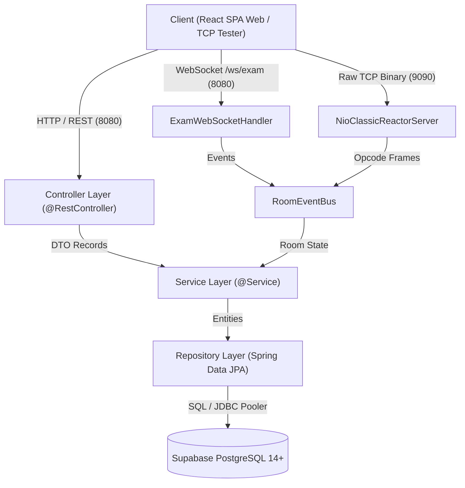

# Phân Hệ Máy Chủ Thi Trắc Nghiệm Trực Tuyến Backend (`server/`)

> **Học phần:** Lập trình Mạng (IT4062) — Hệ sinh thái `mooc-clone`  
> **Kiến trúc:** Pure Layered Architecture (Phân tầng thuần khiết) kết hợp Phân hệ Mạng Song song Kép (NIO Reactor TCP 9090 & WebSocket Gateway 8080)  
> **Công nghệ Nền tảng:** Java 21 LTS, Spring Boot 3.4.3, Spring Data JPA, Spring Security 6, SpringDoc OpenAPI 3, PostgreSQL 14+ (Supabase)

---

## Bảng Điều Hướng Tài Liệu Backend (Backend Documentation Hub)

Hệ thống tài liệu kỹ thuật máy chủ được chuẩn hóa và phân tách thành các cẩm nang chuyên biệt, hỗ trợ tối đa cho việc phát triển tự động của AI Agents và lập trình viên:

| Nhóm Tài Liệu | Tên Tài Liệu & Đường Dẫn | Mô Tả Trọng Tâm |
| :--- | :--- | :--- |
| **AI Guides** | [API_GENERATION_GUIDE.md](docs/ai-guides/API_GENERATION_GUIDE.md) | Cẩm nang tạo CRUD API kế thừa Bộ ba Generic (`BaseController`, `BaseServiceImpl`, DTO Records) |
| **AI Guides** | [CUSTOM_API_GUIDE.md](docs/ai-guides/CUSTOM_API_GUIDE.md) | Cẩm nang tạo Custom API độc lập: Máy trạng thái, Chấm điểm, Đa Repo, Bắn sự kiện thời gian thực |
| **Chuyên Đề** | [database-architecture.md](docs/database-architecture.md) | Kiến trúc CSDL Chuẩn 3NF, Sơ đồ Mermaid ERD 9 bảng cốt lõi và 5 Dynamic Views tính điểm tức thì |
| **Chuyên Đề** | [realtime-network-subsystem.md](docs/realtime-network-subsystem.md) | Phân hệ mạng kép: Non-blocking TCP Reactor 9090 (Khung nhị phân 8-byte, 12+ Opcodes) & WebSocket 8080 |
| **Chuyên Đề** | [security-architecture.md](docs/security-architecture.md) | Cơ chế bảo mật Opaque Session Token SHA-256, Bộ lọc Filter và 4 nguyên tắc chống gian lận bài thi |
| **Chuyên Đề** | [api-specification.md](docs/api-specification.md) | Đặc tả RESTful API, Chuẩn hóa `ApiResponse<T>`, Bảng mã lỗi `ErrorCode` và Hướng dẫn Swagger UI |
| **Quy Chuẩn** | [CONVENTIONS.md](CONVENTIONS.md) | Quy chuẩn Lập trình Socket NIO Java (Thao tác ByteBuffer, Thread-safe writes, SLF4J, Test Socket) |
| **Master Rule**| [AGENTS.md](../AGENTS.md) | Chỉ thị Master AI Directives quản trị toàn bộ dự án `mooc-clone` |

---

## 1. Ngăn Xếp Công Nghệ Chi Tiết (Tech Stack)

| Thành phần | Công nghệ / Thư viện | Phiên bản | Vai trò & Mục đích sử dụng |
| :--- | :--- | :--- | :--- |
| **Ngôn ngữ** | Java (OpenJDK / Temurin) | **21 LTS** | Records, Pattern Matching, Switch Expressions, Sequenced Collections |
| **Framework** | Spring Boot | **3.4.3** | Nền tảng ứng dụng máy chủ, IoC Container, Dependency Injection |
| **Data Persistence** | Spring Data JPA + Hibernate ORM | **6.6.8** | Quản lý vòng đời thực thể, kết nối CSDL PostgreSQL qua HikariCP |
| **Cơ sở Dữ liệu** | PostgreSQL Cloud (Supabase) | **14+ / 17** | Lưu trữ quan hệ chuẩn 3NF, JSONB metadata, Network INET, Session Token Hash |
| **Bảo mật** | Spring Security | **6.4.3** | Pipeline xác thực Session Token SHA-256, Stateless SecurityContext |
| **Mạng TCP** | Java NIO (Channels, Selector, Buffers) | **Java 21 Built-in** | Máy chủ TCP Non-blocking Classic Reactor Pattern (Cổng 9090) |
| **Mạng WebSocket** | Spring WebSocket (TextHandler) | **3.4.3** | Cổng giao tiếp thời gian thực cho React SPA (Cổng 8080, `/ws/exam`) |
| **Validation** | Jakarta Bean Validation (Hibernate Validator) | **3.1.3** | Kiểm tra tính hợp lệ dữ liệu đầu vào DTO (`@NotNull`, `@Size`, v.v.) |
| **Tài liệu API** | SpringDoc OpenAPI Starter WebMVC | **2.8.5** | Tự động sinh Swagger UI và đặc tả OpenAPI 3 tương tác trực tiếp |
| **Build Tool** | Apache Maven Wrapper (`mvnw`) | **3.9.x** | Quản lý vòng đời dự án, biên dịch, kiểm thử tự động |

---

## 2. Yêu Cầu Môi Trường & Quản Trị Biến Môi Trường (.env)

### Yêu Cầu Tiên Quyết (Prerequisites)
- **Java Development Kit (JDK):** Bắt buộc phiên bản **Java 21** trở lên ([Eclipse Temurin 21](https://adoptium.net/)).
  ```bash
  java -version
  # Kết quả hợp lệ: openjdk version "21.x.x" hoặc "24.x.x"
  ```
- **Hệ điều hành:** Windows 10/11, macOS, hoặc Linux.

### Danh Mục Biến Môi Trường
Thông số vận hành được nạp từ [src/main/resources/application.properties](src/main/resources/application.properties) qua biến môi trường. Tệp mẫu cấu hình tại [.env.example](.env.example):

| Tên Biến Môi trường | Giá trị Mặc định | Bắt buộc | Ý nghĩa Kỹ thuật |
| :--- | :--- | :--- | :--- |
| `SERVER_PORT` | `8080` | Không | Cổng dịch vụ HTTP REST API và WebSocket Gateway |
| `TCP_PORT` | `9090` | Không | Cổng lắng nghe Non-blocking TCP Socket Reactor |
| `SUPABASE_DB_URL` | `jdbc:postgresql://...` | **Có** | JDBC URL kết nối tới Transaction Pooler PostgreSQL của Supabase |
| `SUPABASE_DB_USERNAME` | `postgres...` | **Có** | Tên đăng nhập cơ sở dữ liệu Supabase |
| `SUPABASE_DB_PASSWORD` | *(Bảo mật)* | **Có** | Mật khẩu truy cập cơ sở dữ liệu Supabase |
| `APP_CORS_ALLOWED_ORIGINS`| `http://localhost:5173` | Không | Danh sách tên miền Client được phép truy cập CORS |

---

## 3. Hướng Dẫn Khởi Chạy & Các Lệnh Maven Tiêu Chuẩn

Mọi lệnh điều khiển đều được thực hiện từ thư mục `server/` qua Maven Wrapper tích hợp sẵn:

```bash
# Trên Windows (PowerShell / CMD)
.\mvnw.cmd spring-boot:run

# Trên Linux / macOS
./mvnw spring-boot:run
```

Khi máy chủ khởi động thành công:
```text
>>> [NIO Classic Reactor] Server started on port 9090 (Non-blocking)
Tomcat started on port 8080 (http) with context path '/'
Started ServerApplication in X.XXX seconds
```

### Bảng Tra Cứu Lệnh Vận Hành:

| Câu Lệnh | Mục Đích Kỹ Thuật | Tình Huống Sử Dụng |
| :--- | :--- | :--- |
| `.\mvnw.cmd clean compile` | Dọn sạch thư mục `target/` và biên dịch 100% mã nguồn Java | Khi cập nhật DTO, Entity, hoặc cấu hình pom.xml |
| `.\mvnw.cmd test` | Chạy toàn bộ 12/12 bộ kiểm thử tự động | Trước khi commit hoặc tạo Pull Request |
| `.\mvnw.cmd clean package -DskipTests` | Đóng gói ứng dụng thành file JAR độc lập | Chuẩn bị triển khai môi trường Staging/Production |
| `java -jar target/server-0.0.1-SNAPSHOT.jar` | Chạy ứng dụng từ tệp JAR độc lập | Kiểm tra hoạt động môi trường thực tế không qua Maven |

---

## 4. Kiến Trúc Phân Tầng Thuần Khiết (Pure Layered Architecture)

Mã nguồn `server/` tuân thủ nguyên tắc một chiều nghiêm ngặt:



> **Quy Tắc Bất Biến:**
> - Luồng dữ liệu đi một chiều từ trên xuống dưới: `Controller -> Service -> Repository -> Database`.
> - DTO (Java 21 Record) là cấu trúc duy nhất giao tiếp giữa Client và Controller/Service. Thực thể Entity tuyệt đối không được lộ ra ngoài API.
> - Hướng dẫn chi tiết cách triển khai CRUD và Custom API xem tại [API_GENERATION_GUIDE.md](docs/ai-guides/API_GENERATION_GUIDE.md) và [CUSTOM_API_GUIDE.md](docs/ai-guides/CUSTOM_API_GUIDE.md).

---

## 5. Tóm Lược Các Chuyên Đề Kiến Trúc

### 5.1. Cơ Sở Dữ Liệu Chuẩn Hóa 3NF & Dynamic Views
Hệ thống loại bỏ hoàn toàn dữ liệu phái sinh dư thừa, quản lý quan hệ thi cử qua 9 bảng cốt lõi và tính điểm tức thì qua 5 Khung nhìn nghiệp vụ (`v_attempt_results`, `v_room_list`, `v_room_results`, `v_user_statistics`, `v_user_topic_performance`).  
👉 *Xem chi tiết:* [docs/database-architecture.md](docs/database-architecture.md) | [online_exam_schema.sql](online_exam_schema.sql) | [online_exam_seed_data.sql](online_exam_seed_data.sql)

### 5.2. Phân Hệ Mạng Song Song Kép (TCP 9090 & WebSocket 8080)
Hệ thống vận hành đồng thời kênh Non-blocking TCP Socket 9090 với giao thức đóng khung nhị phân 8-byte (Magic, Opcode, Length, Payload, Checksum) và WebSocket 8080 (`/ws/exam`), đồng bộ hóa qua trạm sự kiện luồng an toàn `RoomEventBus`.  
👉 *Xem chi tiết:* [docs/realtime-network-subsystem.md](docs/realtime-network-subsystem.md) | [CONVENTIONS.md](CONVENTIONS.md)

### 5.3. Bảo Mật Session Token SHA-256 & Chống Gian Lận Đề Thi
Bảo mật máy chủ bằng Opaque Session Token (64 hex characters) lưu băm SHA-256 trong CSDL, ẩn cờ đáp án đúng `is_correct` trước khi nộp bài, ràng buộc khóa ngoại kép CSDL và khóa đóng băng bài thi tự động.  
👉 *Xem chi tiết:* [docs/security-architecture.md](docs/security-architecture.md)

### 5.4. Quy Chuẩn RESTful API & Swagger UI
100% API phản hồi qua khung bọc đồng nhất `ApiResponse<T>`, quản lý mã lỗi tập trung `ErrorCode` và tích hợp Swagger UI tương tác trực tiếp.  
- **Giao diện Swagger UI:** [http://localhost:8080/swagger-ui/index.html](http://localhost:8080/swagger-ui/index.html)  
- **OpenAPI 3 JSON Spec:** [http://localhost:8080/v3/api-docs](http://localhost:8080/v3/api-docs)  
👉 *Xem chi tiết:* [docs/api-specification.md](docs/api-specification.md)

---

## 6. Quy Chuẩn Code Java 21 & Bộ Lệnh Kiểm Tra Toàn Vẹn Tự Động

### Cú Pháp Java 21 Hiện Đại (Modern Java 21 Idioms)
- **100% Java Records cho DTO:** Sử dụng `public record XxxDto(...)` đảm bảo tính bất biến (Immutability).
- **Tránh xa Lombok:** Viết getter, setter, constructor bằng Java thuần túy để tránh lỗi compiler bytecode.
- **Pattern Matching & Switch Expressions:** Sử dụng cú pháp mũi tên (`->`) và pattern matching an toàn kiểu.

### Bộ Ba Kiểm Tra Toàn Vẹn Bắt Buộc Trước Khi Commit:
```bash
# 1. Kiểm tra mã nguồn Java và thực thi 12/12 test suites Backend
.\mvnw.cmd test

# 2. Kiểm tra tính toàn vẹn tài liệu Markdown & Link Paths (0 link gãy)
npm --prefix client run verify:docs

# 3. Kiểm tra tuân thủ Static Audit Frontend
npm --prefix client run audit:strict
```

---

*Tài liệu được quản lý tập trung theo Master AI Directives tại [AGENTS.md](../AGENTS.md).*
