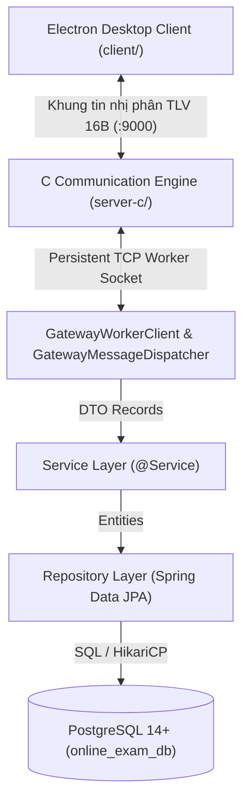

# Phân Hệ Máy Chủ Nghiệp Vụ Headless TCP Worker (`server/`)

> **Học phần:** Lập trình Mạng (IT4062) — Hệ sinh thái `mooc-clone`  
> **Kiến trúc:** Headless Spring Boot TCP Worker (`spring.main.web-application-type=none`) kết nối bền vững tới C Communication Engine ([server-c/](../server-c/README.md) tại cổng `:9000`)  
> **Công nghệ Nền tảng:** Java 21 LTS, Spring Boot 3.4.3, Spring Data JPA, Spring Security Crypto (BCrypt), PostgreSQL 14+ (`online_exam_db`), Giao thức nhị phân 16-byte TLV Framing

---

## Tài khoản mẫu để kiểm thử (Test Accounts)

> [!TIP]
> Hệ thống hỗ trợ đăng nhập linh hoạt bằng cả **Tên đăng nhập (username)** hoặc **Địa chỉ Email** (thông qua trường `usernameOrEmail`). Mật khẩu dùng chung cho toàn bộ tài khoản mẫu là: `password123`.

| Vai trò (Role) | Tên đăng nhập (Username) | Email | Mật khẩu (Password) | Tên hiển thị (Display Name) |
| :--- | :--- | :--- | :--- | :--- |
| **Giáo viên Quản trị (TEACHER)** | `admin` | `admin@mooc.local` | `password123` | Giáo viên Quản trị |
| **Giáo viên (TEACHER)** | `teacher_le` | `teacher.le@mooc.local` | `password123` | Thầy Lê Văn Hướng |
| **Thí sinh 1 (STUDENT)** | `student_alice` | `alice@mooc.local` | `password123` | Nguyễn Thị Alice |
| **Thí sinh 2 (STUDENT)** | `student_bob` | `bob@mooc.local` | `password123` | Trần Văn Bob |

---

## Bảng Điều Hướng Tài Liệu Backend (Backend Documentation Hub)

| Nhóm Tài Liệu   | Tên Tài Liệu & Đường Dẫn                                            | Mô Tả Trọng Tâm                                                                                       |
| :-------------- | :------------------------------------------------------------------ | :---------------------------------------------------------------------------------------------------- |
| **Chuyên Đề**   | [database-architecture.md](docs/database-architecture.md)           | Kiến trúc CSDL Chuẩn 3NF, Sơ đồ Mermaid ERD 9 bảng cốt lõi và 5 Dynamic Views tính điểm tức thì       |
| **Chuyên Đề**   | [realtime-network-subsystem.md](docs/realtime-network-subsystem.md) | Phân hệ mạng C11 `poll()` Multiplexer, Giao thức nhị phân 16B TLV Framing & Server Push Broadcast     |
| **Chuyên Đề**   | [security-architecture.md](docs/security-architecture.md)           | Cơ chế bảo mật Opaque Session Token SHA-256, Phiên TCP theo `clientId` và 4 nguyên tắc chống gian lận |
| **Quy Chuẩn**   | [CONVENTIONS.md](CONVENTIONS.md)                                    | Quy chuẩn Lập trình Backend & Liên kết chuẩn Socket POSIX C11 ([server-c/CONVENTIONS.md](../server-c/CONVENTIONS.md)) |
| **Master Rule** | [AGENTS.md](../AGENTS.md)                                           | Chỉ thị Master AI Directives quản trị toàn bộ dự án `mooc-clone`                                      |

---

## 1. Ngăn Xếp Công Nghệ Chi Tiết (Tech Stack)

| Thành phần           | Công nghệ / Thư viện                          | Phiên bản            | Vai trò & Mục đích sử dụng                                                  |
| :------------------- | :-------------------------------------------- | :------------------- | :-------------------------------------------------------------------------- |
| **Ngôn ngữ**         | Java (OpenJDK / Temurin)                      | **21 LTS**           | Records, Pattern Matching, Switch Expressions, Sequenced Collections        |
| **Framework**        | Spring Boot (Headless Non-Web Mode)           | **3.4.3**            | IoC Container, Dependency Injection, quản lý vòng đời TCP Worker            |
| **Data Persistence** | Spring Data JPA + Hibernate ORM               | **6.6.8**            | Quản lý vòng đời thực thể, kết nối CSDL PostgreSQL qua HikariCP             |
| **Cơ sở Dữ liệu**    | PostgreSQL (`online_exam_db`)                 | **14+ / 18**         | Lưu trữ quan hệ chuẩn 3NF, JSONB metadata, Network INET, Session Token Hash |
| **Mã hóa & Phiên**   | Spring Security Crypto + SHA-256 Session      | **6.4.3**            | Mã hóa mật khẩu `BCryptPasswordEncoder` và quản lý phiên theo `clientId`    |
| **Cổng Mạng TCP**    | C Communication Engine (`server-c/`)          | **C11 / POSIX**      | Cổng Multiplexer `poll()` đơn luồng trên cổng `:9000` ([server-c/](../server-c/README.md)) |
| **Validation**       | Jakarta Bean Validation (Hibernate Validator) | **3.1.3**            | Kiểm tra tính hợp lệ dữ liệu DTO (`@NotNull`, `@Size`, v.v.)                |
| **Build Tool**       | Apache Maven Wrapper (`mvnw`)                 | **3.9.x**            | Quản lý vòng đời dự án, biên dịch, kiểm thử tự động                         |

---

## 2. Quản Trị Cấu Hình & Biến Môi Trường

Thông số vận hành được nạp từ [src/main/resources/application.properties](src/main/resources/application.properties) qua biến môi trường:

| Tên Biến Môi trường | Giá trị Mặc định | Ý nghĩa Kỹ thuật |
| :--- | :--- | :--- |
| `GATEWAY_HOST` | `127.0.0.1` | Địa chỉ IP của C Communication Engine (`c_gateway`) |
| `GATEWAY_PORT` | `9000` | Cổng TCP của C Communication Engine |
| `GATEWAY_ENABLED` | `true` | Bật/tắt kết nối tự động từ Java Worker vào C Gateway (`false` khi chạy test) |
| `DB_URL` | `jdbc:postgresql://127.0.0.1:5433/online_exam_db` | JDBC URL kết nối tới cơ sở dữ liệu PostgreSQL |
| `DB_USERNAME` | `postgres` | Tên người dùng CSDL PostgreSQL |
| `DB_PASSWORD` | `admin` | Mật khẩu truy cập CSDL PostgreSQL |

---

## 3. Hướng Dẫn Khởi Chạy Từng Bước (Step-by-Step Run Guide)

### Bước 1: Khởi Chạy C Communication Engine (`server-c/` — Cổng `:9000`)
Đảm bảo máy chủ C Gateway đã được bật trên cổng `9000` (chi tiết tại [server-c/README.md](../server-c/README.md)):
```bash
cd server-c
make run
```

### Bước 2: Khởi Chạy Java TCP Worker (`server/`)
Mở cửa sổ dòng lệnh và di chuyển vào thư mục `server/`:
```powershell
cd server
.\mvnw.cmd spring-boot:run
```

Khi khởi động thành công ở chế độ **Headless TCP Worker** (`spring.main.web-application-type=none`):
- Ứng dụng **không mở cổng HTTP 8080** (loại bỏ hoàn toàn xung đột cổng Tomcat).
- Tự động xác lập khóa độc quyền Single-Instance (`mooc-gateway-worker-9000.lock`) để ngăn chạy trùng hai tiến trình Worker.
- Tự động kết nối tới `127.0.0.1:9000` và gửi gói tin `OP_SYS_HANDSHAKE (0x00)` định danh `{"role":"WORKER"}`.

```text
[GATEWAY-WORKER] Acquired single-instance lock at ...\mooc-gateway-worker-9000.lock (PID: ...)
[GATEWAY-WORKER] Connecting to C Gateway at 127.0.0.1:9000...
[GATEWAY-WORKER] Connected and registered as WORKER to C Gateway successfully.
```

---

## 4. Kiến Trúc Điều Phối Thuần Khiết (Pure TCP Worker Layered Architecture)



---

## 5. Bộ Ba Kiểm Tra Toàn Vẹn Bắt Buộc Trước Khi Commit

```bash
# 1. Kiểm tra mã nguồn Java và thực thi test suites Backend
.\mvnw.cmd test

# 2. Kiểm tra tính toàn vẹn tài liệu Markdown & Link Paths (0 link gãy)
npm --prefix client run verify:docs

# 3. Kiểm tra tuân thủ Static Audit Frontend
npm --prefix client run audit:strict
```

---

_Tài liệu được quản lý tập trung theo Master AI Directives tại [AGENTS.md](../AGENTS.md)._
