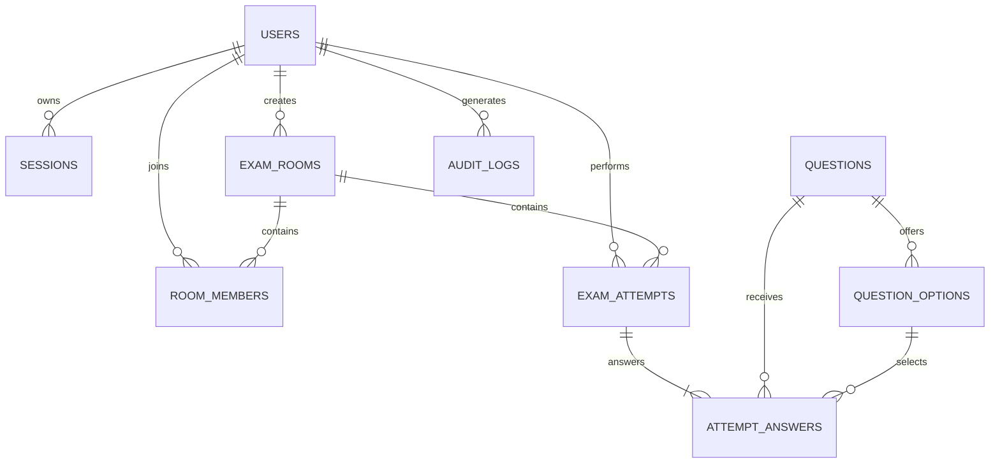
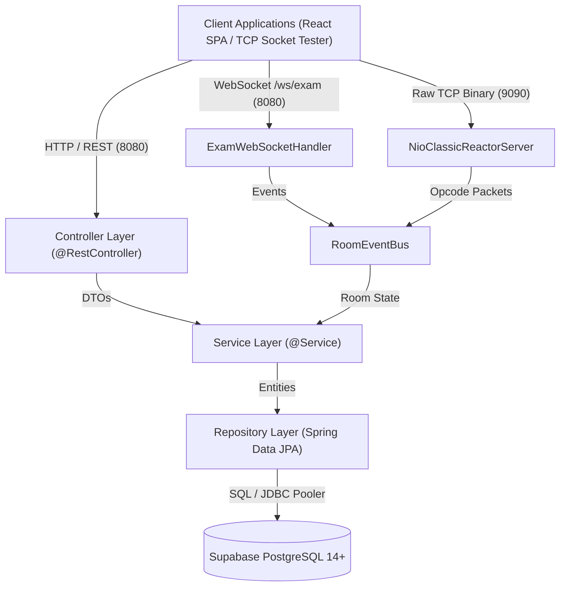
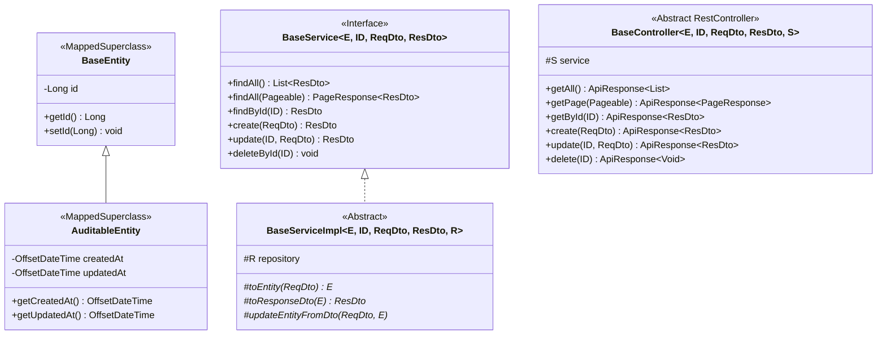

# Hệ Thống Máy Chủ Thi Trắc Nghiệm Trực Tuyến — Phân Hệ Backend (`server/`)

> **Dự án Môn học:** Lập trình Mạng (IT4062) — Hệ sinh thái mooc-clone  
> **Kiến trúc:** Pure Layered Architecture (Phân tầng thuần khiết) kết hợp Phân hệ Mạng Song song Kép (NIO Classic Reactor TCP 9090 & WebSocket Gateway 8080)  
> **Công nghệ Nền tảng:** Java 21 LTS, Spring Boot 3.4.3, Spring Data JPA, Spring Security, SpringDoc OpenAPI 3, PostgreSQL 14+ (Supabase)

---

## Mục Lục Tài Liệu

1. [Chương 1: Giới thiệu & Tổng quan Hệ sinh thái mooc-clone (IT4062)](#chương-1-giới-thiệu--tổng-quan-hệ-sinh-thái-mooc-clone-it4062)
2. [Chương 2: Yêu cầu Môi trường & Quản trị Biến Môi trường](#chương-2-yêu-cầu-môi-trường--quản-trị-biến-môi-trường)
3. [Chương 3: Hướng dẫn Khởi chạy & Các Lệnh Maven Tiêu chuẩn](#chương-3-hướng-dẫn-khởi-chạy--các-lệnh-maven-tiêu-chuẩn)
4. [Chương 4: Cơ sở Dữ liệu Chuẩn hóa 3NF & Dữ liệu Mẫu Seed Data](#chương-4-cơ-sở-dữ-liệu-chuẩn-hóa-3nf--dữ-liệu-mẫu-seed-data)
5. [Chương 5: Kiến trúc Phân tầng Chuẩn (Pure Layered Architecture) & Bộ ba Kế thừa Generic](#chương-5-kiến-trúc-phân-tầng-chuẩn-pure-layered-architecture--bộ-ba-kế-thừa-generic)
6. [Chương 6: Phân hệ Mạng Song song Kép (Dual Realtime Network Subsystem)](#chương-6-phân-hệ-mạng-song-song-kép-dual-realtime-network-subsystem)
7. [Chương 7: Quy chuẩn Thiết kế & Đặc tả RESTful API](#chương-7-quy-chuẩn-thiết-kế--đặc-tả-restful-api)
8. [Chương 8: Cơ chế Xác thực & Bảo mật (Security & Session Token)](#chương-8-cơ-chế-xác-thực--bảo-mật-security--session-token)
9. [Chương 9: Tích hợp Swagger UI & OpenAPI 3](#chương-9-tích-hợp-swagger-ui--openapi-3)
10. [Chương 10: Cẩm nang 9 Bước Tái Cấu Trúc Mã Nguồn (Refactoring Playbook)](#chương-10-cẩm-nang-9-bước-tái-cấu-trúc-mã-nguồn-refactoring-playbook)
11. [Chương 11: Quy chuẩn Code Java 21 & Bộ Kiểm Tra Toàn Vẹn Tự Động](#chương-11-quy-chuẩn-code-java-21--bộ-kiểm-tra-toàn-vẹn-tự-động)

---

## Chương 1: Giới thiệu & Tổng quan Hệ sinh thái mooc-clone (IT4062)

Phân hệ máy chủ `server/` là trái tim xử lý nghiệp vụ, lưu trữ dữ liệu và điều phối mạng thời gian thực cho nền tảng thi trắc nghiệm trực tuyến mooc-clone. Hệ thống được thiết kế đặc thù nhằm giải quyết các bài toán kỹ thuật cốt lõi trong môn học **Lập trình Mạng (IT4062)**:

- **Xử lý đồng thời cao (High Concurrency):** Phục vụ hàng nghìn thí sinh cùng tham gia thi, đồng bộ thời gian thực từng giây và nộp bài đồng loạt không nghẽn mạng.
- **Tính toán kết quả tức thì:** Tự động thu bài khi hết hạn (`deadline_at`), khóa bài thi và chấm điểm trực tiếp qua hệ thống Khung nhìn động (Dynamic Views) chuẩn 3NF.
- **Giao thức kép linh hoạt:** Cung cấp đồng thời giao diện REST API chuẩn cho trình duyệt web, WebSocket cho tương tác tương thích SPA, và Socket TCP nhị phân (Binary Framing) thuần túy chạy trên mô hình NIO Classic Reactor cho các client chuyên dụng hiệu năng cao.

### Ngăn xếp Công nghệ Chi tiết (Tech Stack)

| Thành phần | Công nghệ / Thư viện | Phiên bản | Vai trò & Mục đích sử dụng |
| :--- | :--- | :--- | :--- |
| **Ngôn ngữ** | Java (OpenJDK / Temurin) | **21 LTS** | Sử dụng Records, Pattern Matching, Switch Expressions, Sequenced Collections |
| **Framework** | Spring Boot | **3.4.3** | Nền tảng ứng dụng máy chủ, IoC Container, Dependency Injection |
| **Data Persistence** | Spring Data JPA + Hibernate ORM | **6.6.8** | Quản lý vòng đời thực thể, kết nối CSDL PostgreSQL qua HikariCP |
| **Cơ sở Dữ liệu** | PostgreSQL Cloud (Supabase) | **14+ / 17** | Lưu trữ quan hệ chuẩn 3NF, JSONB metadata, Network INET, Session Token Hash |
| **Bảo mật** | Spring Security | **6.4.3** | Pipeline xác thực Session Token SHA-256, Stateless SecurityContext |
| **Mạng TCP** | Java NIO (Channels, Selector, Buffers) | **Java 21 Built-in** | Máy chủ TCP Non-blocking Reactor Pattern (Cổng 9090) |
| **Mạng WebSocket** | Spring WebSocket (TextHandler) | **3.4.3** | Cổng giao tiếp thời gian thực cho React SPA (Cổng 8080, `/ws/exam`) |
| **Validation** | Jakarta Bean Validation (Hibernate Validator) | **3.1.3** | Kiểm tra tính hợp lệ dữ liệu đầu vào DTO (`@NotNull`, `@Size`, v.v.) |
| **Tài liệu API** | SpringDoc OpenAPI Starter WebMVC | **2.8.5** | Tự động sinh Swagger UI và đặc tả OpenAPI 3 tương tác trực tiếp |
| **Build Tool** | Apache Maven Wrapper (`mvnw`) | **3.9.x** | Quản lý vòng đời dự án, biên dịch, kiểm thử tự động |

---

## Chương 2: Yêu cầu Môi trường & Quản trị Biến Môi trường

### 1. Yêu cầu Tiên quyết (Prerequisites)

- **Java Development Kit (JDK):** Bắt buộc phiên bản **Java 21** trở lên ([Eclipse Temurin 21](https://adoptium.net/) hoặc Oracle OpenJDK 21).
  ```bash
  java -version
  # Kết quả hợp lệ: openjdk version "21.x.x" hoặc "24.x.x"
  ```
- **Hệ điều hành:** Hỗ trợ Windows 10/11, macOS, và Linux.
- **Git:** Đã cấu hình trên máy để quản lý mã nguồn.

### 2. Danh mục Biến Môi trường (.env & application.properties)

Toàn bộ thông số vận hành của máy chủ được nạp từ tệp cấu hình [src/main/resources/application.properties](src/main/resources/application.properties) thông qua các biến môi trường hệ thống. Mẫu biến môi trường được định nghĩa chi tiết tại [.env.example](.env.example).

| Tên Biến Môi trường | Giá trị Mặc định | Bắt buộc | Ý nghĩa Kỹ thuật |
| :--- | :--- | :--- | :--- |
| `SERVER_PORT` | `8080` | Không | Cổng dịch vụ HTTP REST API và WebSocket Gateway |
| `TCP_PORT` | `9090` | Không | Cổng lắng nghe Non-blocking TCP Socket Reactor |
| `SUPABASE_DB_URL` | `jdbc:postgresql://...` | **Có** | JDBC URL kết nối tới Transaction Pooler PostgreSQL của Supabase |
| `SUPABASE_DB_USERNAME` | `postgres...` | **Có** | Tên đăng nhập cơ sở dữ liệu Supabase |
| `SUPABASE_DB_PASSWORD` | *(Bảo mật)* | **Có** | Mật khẩu truy cập cơ sở dữ liệu Supabase |
| `APP_CORS_ALLOWED_ORIGINS`| `http://localhost:5173` | Không | Danh sách tên miền Client được phép truy cập CORS |

> [!CAUTION]
> **Cảnh báo Bảo mật Tuyệt đối:** Không bao giờ commit tệp `.env` chứa mật khẩu thực tế hoặc thông tin bí mật lên Git. Mọi thông tin nhạy cảm phải được truyền qua biến môi trường máy chủ hoặc công cụ quản lý bí mật (Secret Vault).

---

## Chương 3: Hướng dẫn Khởi chạy & Các Lệnh Maven Tiêu chuẩn

Mọi lệnh điều khiển đều được thực hiện từ thư mục gốc phân hệ [server/](.). Dự án tích hợp sẵn Maven Wrapper (`mvnw` trên Linux/macOS, `mvnw.cmd` trên Windows), không yêu cầu cài đặt Maven toàn cục.

### 1. Khởi động Máy chủ ở Chế độ Phát triển

```bash
# Trên Windows (PowerShell / CMD)
.\mvnw.cmd spring-boot:run

# Trên Linux / macOS
./mvnw spring-boot:run
```

Khi máy chủ khởi động thành công, bảng điều khiển sẽ thông báo:
```text
>>> [NIO Classic Reactor] Server started on port 9090 (Non-blocking)
Tomcat started on port 8080 (http) with context path '/'
Started ServerApplication in X.XXX seconds
```

### 2. Bảng Tra cứu Lệnh Maven Tiêu chuẩn

| Câu Lệnh | Mục Đích Kỹ Thuật | Tình Huống Sử Dụng |
| :--- | :--- | :--- |
| `.\mvnw.cmd clean compile` | Dọn sạch thư mục `target/` và biên dịch 100% mã nguồn Java | Khi cập nhật DTO, Entity, hoặc cấu hình pom.xml |
| `.\mvnw.cmd test` | Kích hoạt toàn bộ bộ kiểm thử tự động (Unit & Integration Tests) | Trước khi commit hoặc tạo Pull Request |
| `.\mvnw.cmd clean package -DskipTests` | Đóng gói ứng dụng thành tệp thực thi `target/server-0.0.1-SNAPSHOT.jar` | Chuẩn bị triển khai môi trường Production/Staging |
| `java -jar target/server-0.0.1-SNAPSHOT.jar` | Chạy ứng dụng từ tệp JAR đã đóng gói độc lập | Kiểm tra hoạt động môi trường thực tế không qua Maven |
| `npm --prefix client run verify:docs` | Kiểm tra tính toàn vẹn tài liệu Markdown và đường dẫn liên kết | Chạy từ thư mục gốc dự án theo quy chuẩn `AGENTS.md` |

---

## Chương 4: Cơ sở Dữ liệu Chuẩn hóa 3NF & Dữ liệu Mẫu Seed Data

Hệ thống cơ sở dữ liệu được thiết kế theo đúng nguyên lý **Chuẩn hóa dạng 3 (3NF - Third Normal Form)**, loại bỏ triệt để các phụ thuộc bắc cầu, phụ thuộc vòng tròn (diamond dependencies) và các trường phái sinh dư thừa. Tài liệu phân tích chuyên sâu xem tại [online_exam_database_design.md](online_exam_database_design.md).

### 1. Sơ đồ Quan hệ Thực thể (Mermaid ERD)



### 2. Bảng Danh mục 9 Bảng Cốt lõi (3NF Tables)

| Tên Bảng (Table) | Mục Đích Sử Dụng | Ràng Buộc & Khóa Chính / Ngoại Quan Trọng |
| :--- | :--- | :--- |
| `users` | Tài khoản, vai trò hệ thống (`USER`, `ADMIN`), trạng thái tài khoản | Khóa chính `id` (IDENTITY); duy nhất `lower(username)` và `lower(email)` |
| `sessions` | Phiên đăng nhập máy chủ bảo mật | Khóa ngoại `user_id`; `token_hash` 32-byte duy nhất; `expires_at`, `revoked_at` |
| `questions` | Ngân hàng câu hỏi trắc nghiệm | Khóa chính `id`; `topic`, `difficulty` (`EASY`, `MEDIUM`, `HARD`), `status` (`ACTIVE`, `ARCHIVED`) |
| `question_options`| Các phương án lựa chọn của câu hỏi | Khóa ngoại `question_id`; duy nhất `(question_id, position)`; chỉ mục partial đảm bảo tối đa 1 đáp án đúng |
| `exam_rooms` | Phòng thi trắc nghiệm, cấu hình đề và vòng đời | Khóa chính `id`; `room_code` duy nhất; cấu hình `easy_count`, `medium_count`, `hard_count`; `status` |
| `room_members` | Danh sách thí sinh trong phòng thi / Whitelist | Khóa chính phức hợp `(room_id, user_id)` ngăn ngừa trùng lặp thành viên |
| `exam_attempts` | Lượt thi trắc nghiệm (`EXAM` hoặc `PRACTICE`) | Khóa chính `id`; kiểm tra tính nhất quán giữa chế độ, deadline, submitted_at, graded_at |
| `attempt_answers` | Danh sách câu hỏi và đáp án chọn của thí sinh | Khóa chính phức hợp `(attempt_id, question_id)`; Khóa ngoại `(question_id, selected_option_id)` chống chọn nhầm câu hỏi |
| `audit_logs` | Nhật ký sự kiện bảo mật và kiểm toán hệ thống | Khóa chính `id`; `actor_user_id`; `metadata` định dạng JSONB; dấu thời gian `occurred_at` |

### 3. Danh mục 5 Khung nhìn Nghiệp vụ (Dynamic Views)

Hệ thống không lưu trữ các trường dữ liệu phái sinh nhằm tránh sai lệch trạng thái. Năm khung nhìn tính toán tức thì:
- `v_attempt_results`: Tính tổng số câu, số câu đúng/sai, phần trăm chính xác (`correct_percent`) và điểm thang 10 (`score_10`).
- `v_room_list`: Danh sách phòng thi kèm tổng số câu hỏi và số lượng thí sinh hiện diện.
- `v_room_results`: Bảng xếp hạng điểm số của thí sinh trong các phòng thi đã hoàn thành (`status = 'ENDED'`).
- `v_user_statistics`: Thống kê tổng quan năng lực của từng người dùng qua tất cả các bài thi.
- `v_user_topic_performance`: Báo cáo năng lực chi tiết theo từng chủ đề câu hỏi phục vụ trực quan hóa biểu đồ Radar/Bar chart.

### 4. Kịch bản Khởi tạo & Dữ liệu Mẫu

- Kịch bản tạo Schema: [online_exam_schema.sql](online_exam_schema.sql)
- Kịch bản nạp Seed Data mẫu: [online_exam_seed_data.sql](online_exam_seed_data.sql)

---

## Chương 5: Kiến trúc Phân tầng Chuẩn (Pure Layered Architecture) & Bộ ba Kế thừa Generic

Mã nguồn `server/` tuân thủ nghiêm ngặt mô hình **Pure Layered Architecture** (Kiến trúc phân tầng thuần khiết), giải quyết triệt để vấn đề phân tán logic và lặp mã CRUD giữa các module.

### 1. Luồng Điều khiển Phân tầng (Layer Flow)



> **Quy tắc Bất biến:**
> - Luồng dữ liệu chỉ đi một chiều từ trên xuống dưới: `Controller -> Service -> Repository -> Database`.
> - Tầng Controller không bao giờ thao tác trực tiếp với Repository hay Database.
> - Tầng Service không phụ thuộc vào các lớp thuộc tầng Controller (không nhận `HttpServletRequest`, không trả `ResponseEntity`).
> - DTO là cấu trúc độc quyền cho giao tiếp giữa Client và Controller/Service. Thực thể Entity tuyệt đối không được rò rỉ ra ngoài API.

### 2. Bộ ba Kế thừa Generic (Generic Inheritance Triad)

Để triệt tiêu mã nguồn trùng lặp khi xây dựng các API CRUD (Tạo, Đọc, Cập nhật, Xóa, Phân trang), hệ thống triển khai Bộ ba Generic:



#### Chi tiết Triển khai:
1. **Lớp Thực thể Cơ sở:**
   - [BaseEntity.java](src/main/java/com/example/server/entity/BaseEntity.java): Chứa surrogate key `id` kiểu `Long` cho toàn bộ các thực thể độc lập.
   - [AuditableEntity.java](src/main/java/com/example/server/entity/AuditableEntity.java): Kế thừa `BaseEntity`, bổ sung dấu thời gian kiểm toán (`createdAt`, `updatedAt`) cho các thực thể có vòng đời cập nhật (`UserEntity`, `QuestionEntity`, `ExamRoomEntity`).
2. **Lớp Dịch vụ Cơ sở:**
   - [BaseService.java](src/main/java/com/example/server/service/BaseService.java): Giao diện CRUD chuẩn.
   - [BaseServiceImpl.java](src/main/java/com/example/server/service/impl/BaseServiceImpl.java): Cung cấp cài đặt mặc định cho các thao tác CRUD và quản lý giao tác (`@Transactional`). Ép buộc các Service con hiện thực hóa 3 phương thức trừu tượng Compile-time an toàn kiểu:
     - `toEntity(ReqDto request)`: Chuyển đổi Request DTO sang Entity.
     - `toResponseDto(E entity)`: Chuyển đổi Entity sang Response DTO.
     - `updateEntityFromDto(ReqDto request, E entity)`: Cập nhật dữ liệu từ DTO vào Entity.
3. **Lớp Điều khiển Cơ sở:**
   - [BaseController.java](src/main/java/com/example/server/controller/BaseController.java): Cung cấp sẵn 6 endpoints chuẩn RESTful (`GET /`, `GET /page`, `GET /{id}`, `POST /`, `PUT /{id}`, `DELETE /{id}`) được bọc sẵn trong `ApiResponse<T>`.

### 3. Cấu trúc Package Chuẩn hóa (Directory Layout)

```text
server/src/main/java/com/example/server/
├── config/             # Cấu hình Spring (Security, CORS, JPA Auditing, OpenAPI)
├── controller/         # REST Controllers (BaseController, QuestionController, RoomController...)
├── dto/                # Data Transfer Objects tổ chức theo module nghiệp vụ
│   ├── attempt/        # DTOs cho lượt thi và câu trả lời (Records)
│   ├── auth/           # DTOs cho xác thực, đăng nhập, đăng ký
│   ├── common/         # ApiResponse, PageResponse, FieldErrorDto
│   ├── question/       # DTOs cho ngân hàng câu hỏi và phương án
│   ├── room/           # DTOs cho phòng thi và thành viên
│   └── user/           # DTOs cho người dùng và hồ sơ
├── entity/             # JPA Entities (BaseEntity, AuditableEntity, User, Question...)
│   └── enums/          # Các kiểu liệt kê Enums (AttemptStatus, DifficultyLevel...)
├── exception/          # Xử lý ngoại lệ tập trung (AppException, ErrorCode, GlobalExceptionHandler)
├── repository/         # Spring Data JPA Repositories
├── security/           # Pipeline bảo mật (SessionTokenFilter, CustomUserDetails, EntryPoint)
├── service/            # Interfaces nghiệp vụ (BaseService, QuestionService, RoomService...)
│   └── impl/           # Cài đặt chi tiết nghiệp vụ (BaseServiceImpl, QuestionServiceImpl...)
└── socket/             # Phân hệ mạng TCP Reactor và WebSocket Gateway
    ├── core/           # NioClassicReactorServer, ClientSession
    ├── gateway/        # ExamWebSocketHandler, WebSocketConfig
    └── protocol/       # PacketFrame, FramingDecoder, FramingEncoder, Constants
```

---

## Chương 6: Phân hệ Mạng Song song Kép (Dual Realtime Network Subsystem)

Điểm nhấn kiến trúc của hệ thống là khả năng vận hành song song 2 cổng mạng thời gian thực:
- **Cổng 9090:** Phục vụ kết nối Socket TCP nhị phân (Binary Protocol) xây dựng trên mô hình Java NIO Classic Reactor Pattern.
- **Cổng 8080:** Phục vụ kết nối WebSocket (`/ws/exam`) cho trình duyệt web và Client SPA.

Cả 2 phân hệ đều chia sẻ chung một bus điều phối sự kiện luồng an toàn: [RoomEventBus.java](src/main/java/com/example/server/socket/RoomEventBus.java).

### 1. Kiến trúc Bộ giải mã Gói tin Nhị phân (Binary Packet Framing Protocol)

Mỗi gói tin TCP truyền tải qua cổng 9090 tuân theo định dạng khung nhị phân chuẩn định lượng (Framing Specification):

| Vị trí Byte | Trường Dữ liệu | Kiểu Dữ liệu | Ý Nghĩa Kỹ Thuật |
| :--- | :--- | :--- | :--- |
| **Byte 0** | Magic Byte | `byte` (`0xAA`) | Dấu hiệu nhận dạng gói tin hợp lệ của mooc-clone |
| **Byte 1** | Version | `byte` (`0x01`) | Phiên bản giao thức nhị phân |
| **Byte 2-3** | Opcode | `short` (Big Endian) | Mã định danh thao tác sự kiện (16-bit integer) |
| **Byte 4-7** | Payload Length | `int` (Big Endian) | Độ dài phần thân dữ liệu (giới hạn tối đa 65,536 bytes) |
| **Byte 8...N+7**| Payload Data | `byte[]` (UTF-8 JSON) | Dữ liệu nghiệp vụ chi tiết định dạng JSON string |
| **Byte N+8** | Checksum | `byte` | Giá trị kiểm tra lỗi XOR checksum của toàn bộ phần Payload |

Bộ mã hóa và giải mã được hiện thực hóa độc lập tại [PacketFramingDecoder.java](src/main/java/com/example/server/socket/protocol/PacketFramingDecoder.java) và [PacketFramingEncoder.java](src/main/java/com/example/server/socket/protocol/PacketFramingEncoder.java).

### 2. Bảng Tra cứu Mã Lệnh Giao thức (Protocol Opcodes)

Định nghĩa tại [ProtocolConstants.java](src/main/java/com/example/server/socket/protocol/ProtocolConstants.java):

| Opcode (Hex) | Hướng Truyền | Tên Sự Kiện | Ý Nghĩa Nghiệp Vụ |
| :--- | :--- | :--- | :--- |
| `0x0001` | Inbound | `PING` | Gói tin giữ kết nối (Heartbeat keep-alive) |
| `0x0002` | Outbound | `PONG` | Phản hồi xác nhận kết nối còn sống từ máy chủ |
| `0x0010` | Inbound | `JOIN_ROOM` | Thí sinh yêu cầu tham gia phòng thi (`roomId`, `userId`, `userName`) |
| `0x0011` | Outbound | `USER_JOINED` | Máy chủ phát thanh thông báo thành viên mới vào phòng chờ |
| `0x0012` | Inbound | `LEAVE_ROOM` | Thí sinh chủ động rời khỏi phòng thi |
| `0x0013` | Outbound | `USER_LEFT` | Máy chủ phát thanh thông báo thành viên đã rời phòng |
| `0x0020` | Outbound | `ROOM_STATE` | Đồng bộ danh sách thí sinh và trạng thái hiện tại của phòng |
| `0x0030` | Inbound | `START_EXAM` | Chủ phòng (Owner) phát lệnh bắt đầu làm bài thi |
| `0x0031` | Outbound | `EXAM_STARTED` | Phát thanh hiệu lệnh bắt đầu thi và đồng hồ đếm ngược |
| `0x0040` | Inbound | `SUBMIT_ANSWER`| Thí sinh gửi lựa chọn phương án cho một câu hỏi |
| `0x0041` | Outbound | `ANSWER_ACK` | Máy chủ xác nhận đã ghi nhận đáp án thành công |
| `0x0050` | Outbound | `EXAM_ENDED` | Máy chủ thông báo kết thúc thi hoặc hết giờ làm bài |
| `0x00FF` | Outbound | `ERROR` | Thông báo mã lỗi nghiệp vụ hoặc định dạng sai |

---

## Chương 7: Quy chuẩn Thiết kế & Đặc tả RESTful API

### 1. Chuẩn Hóa Cấu Trúc Phản Hồi (Uniform API Response)

Mọi yêu cầu gửi tới các REST API đều nhận được phản hồi đồng nhất định dạng JSON qua lớp [ApiResponse.java](src/main/java/com/example/server/dto/common/ApiResponse.java):

```json
{
  "code": 1000,
  "message": "Thành công",
  "data": { ... },
  "errors": null,
  "timestamp": "2026-10-26T00:00:00.000Z"
}
```

Khi xảy ra lỗi nghiệp vụ hoặc lỗi kiểm tra dữ liệu đầu vào:
```json
{
  "code": 1002,
  "message": "Dữ liệu yêu cầu không hợp lệ",
  "data": null,
  "errors": [
    {
      "field": "content",
      "message": "Nội dung câu hỏi không được để trống"
    }
  ],
  "timestamp": "2026-10-26T00:00:00.000Z"
}
```

### 2. Danh Mục Các Endpoint RESTful Tiêu Biểu

#### Module Xác thực (`/api/auth`)
- `POST /api/auth/register`: Đăng ký tài khoản người dùng mới.
- `POST /api/auth/login`: Xác thực tài khoản, cấp phát mã phiên làm việc (Session Token).
- `POST /api/auth/logout`: Thu hồi (revoke) phiên đăng nhập hiện tại.
- `GET /api/auth/me`: Lấy thông tin tài khoản đang đăng nhập.

#### Module Ngân hàng Câu hỏi (`/api/questions`) — Thừa kế từ `BaseController`
- `GET /api/questions`: Lấy toàn bộ danh sách câu hỏi.
- `GET /api/questions/page?page=0&size=10`: Phân trang danh sách câu hỏi qua `PageResponse<T>`.
- `GET /api/questions/{id}`: Tra cứu chi tiết một câu hỏi kèm các phương án lựa chọn.
- `POST /api/questions`: Tạo câu hỏi mới kèm tối thiểu 2 phương án và 1 phương án đúng.
- `PUT /api/questions/{id}`: Cập nhật nội dung câu hỏi và các phương án.
- `DELETE /api/questions/{id}`: Xóa mềm câu hỏi (`status = 'ARCHIVED'`).
- `GET /api/questions/topic/{topic}`: Lọc câu hỏi theo chủ đề chuyên biệt.

#### Module Phòng thi (`/api/rooms`) — Thừa kế từ `BaseController`
- `GET /api/rooms`: Danh sách toàn bộ phòng thi.
- `GET /api/rooms/code/{code}`: Tra cứu thông tin tóm tắt phòng thi theo mã `room_code`.
- `POST /api/rooms`: Khởi tạo phòng thi mới kèm cấu hình độ khó.
- `POST /api/rooms/{code}/join`: Tham gia vào phòng chờ thi.
- `POST /api/rooms/{code}/leave`: Rời khỏi phòng thi.
- `POST /api/rooms/{code}/start`: Bắt đầu phòng thi (chỉ chủ phòng).
- `POST /api/rooms/{code}/finish`: Kết thúc và chốt điểm phòng thi.

#### Module Lượt thi & Nộp bài (`/api/attempts`)
- `POST /api/attempts/start`: Khởi tạo lượt thi chính thức hoặc luyện tập.
- `POST /api/attempts/{id}/answers`: Lưu lựa chọn đáp án cho từng câu hỏi trong quá trình thi.
- `POST /api/attempts/{id}/submit`: Nộp bài thi chính thức, chốt điểm và kết quả.
- `GET /api/attempts/{id}/result`: Lấy kết quả bài thi chi tiết, tỷ lệ đúng và điểm số thang 10.

---

## Chương 8: Cơ chế Xác thực & Bảo mật (Security & Session Token)

### 1. Kiến trúc Bảo Mật Phiên Đăng Nhập (Opaque Session Token)

Thay vì sử dụng JWT tự chứa thông tin phía Client (khó thu hồi tức thì), hệ thống áp dụng cơ chế **Mã phiên làm việc ngẫu nhiên (Opaque Token)** kết hợp hàm băm nhị phân mật mã học:
1. Khi đăng nhập thành công, máy chủ sinh chuỗi ngẫu nhiên bảo mật cao (64 ký tự hex).
2. Chuỗi token gốc được trả về cho Client lưu trữ tại Header `Authorization: Bearer <TOKEN>`.
3. Máy chủ băm chuỗi này bằng giải thuật **SHA-256** thành mảng nhị phân 32 bytes (`byte[]`) và chỉ lưu giá trị băm này trong cột `token_hash` của bảng `sessions`.
4. Khi nhận request tiếp theo, [SessionTokenAuthenticationFilter.java](src/main/java/com/example/server/security/SessionTokenAuthenticationFilter.java) tính toán hash của token gửi lên và so khớp nhanh trong CSDL qua chỉ mục duy nhất.
5. Kiểm tra thời hạn `expires_at` và cờ thu hồi `revoked_at`. Nếu hợp lệ, nạp quyền hạn vào `SecurityContextHolder`.

### 2. Nguyên Tắc Bảo Mật Đề Thi & Chống Gian Lận

- **Ẩn cờ đáp án đúng:** Thuộc tính `is_correct` của bảng `question_options` tuyệt đối không được trả về cho Client trước khi bài thi kết thúc. Client chỉ nhận được danh sách phương án gồm `id`, `content`, `position`.
- **Ràng buộc khóa ngoại kép:** Ràng buộc `fk_attempt_answers_option_same_question` trên CSDL bảo đảm thí sinh không thể gửi mã phương án của câu hỏi khác.
- **Khóa bài thi tự động:** Khi trạng thái chuyển sang `SUBMITTED`, `AUTO_SUBMITTED`, hoặc `TERMINATED`, mọi thao tác nộp đáp án tiếp theo đều bị chặn đứng tức thì bởi tầng Service.

---

## Chương 9: Tích hợp Swagger UI & OpenAPI 3

Máy chủ tích hợp thư viện **SpringDoc OpenAPI 3** tự động phân tích các Controller và DTO để tạo tài liệu tương tác trực quan.

### 1. Đường Dẫn Truy Cập Trực Tiếp

Sau khi khởi động ứng dụng trên máy local:
- **Giao diện Swagger UI:** [http://localhost:8080/swagger-ui/index.html](http://localhost:8080/swagger-ui/index.html)
- **Đặc tả OpenAPI 3 định dạng JSON:** [http://localhost:8080/v3/api-docs](http://localhost:8080/v3/api-docs)

### 2. Ủy Quyền Xác Thực (Authorize) Trong Swagger UI

Cấu hình tại [OpenApiConfig.java](src/main/java/com/example/server/config/OpenApiConfig.java) đã kích hoạt sẵn cơ chế `SecurityScheme` dạng `BearerAuth`. Để gọi các API yêu cầu đăng nhập:
1. Gọi API `POST /api/auth/login` để lấy giá trị `token`.
2. Bấm nút **Authorize** màu xanh ở góc trên bên phải giao diện Swagger UI.
3. Dán chuỗi token vào ô `Value` và bấm **Authorize**. Mọi request thử nghiệm tiếp theo sẽ tự động đính kèm Header xác thực.

---

## Chương 10: Cẩm nang 9 Bước Tái Cấu Trúc Mã Nguồn (Refactoring Playbook)

Khi phát triển thêm một tính năng nghiệp vụ mới hoặc thêm một thực thể vào hệ thống, lập trình viên bắt buộc tuân thủ quy trình 9 bước chuẩn mực:

```text
Bước 1: Thiết kế Bảng CSDL 3NF (Bổ sung vào online_exam_schema.sql, migration script)
Bước 2: Tạo Entity kế thừa BaseEntity hoặc AuditableEntity trong package entity/
Bước 3: Tạo Repository kế thừa JpaRepository<Entity, ID> trong package repository/
Bước 4: Tạo Request và Response DTOs dạng Java 21 Records trong package dto/<module>/
Bước 5: Tạo Service Interface kế thừa BaseService trong package service/
Bước 6: Tạo Service Implementation kế thừa BaseServiceImpl trong package service/impl/
Bước 7: Tạo Controller kế thừa BaseController trong package controller/
Bước 8: Viết Unit Test và Integration Test kiểm thử trọn vẹn vòng đời nghiệp vụ
Bước 9: Chạy kiểm tra toàn diện: .\mvnw.cmd test và npm --prefix client run verify:docs
```

---

## Chương 11: Quy chuẩn Code Java 21 & Bộ Kiểm Tra Toàn Vẹn Tự Động

### 1. Quy Chuẩn Code Java Hiện Đại (Modern Java 21 Idioms)

- **Sử dụng Java Records cho DTO:** 100% Request và Response DTOs phải được viết dưới dạng `public record XxxDto(...)` đảm bảo tính bất biến (immutability), tự sinh `equals`, `hashCode`, `toString` mà không cần phụ thuộc vào thư viện bytecode ngoài.
- **Tránh xa Lombok trên JDK 21+:** Toàn bộ Entity viết getter, setter và constructor chuẩn bằng mã nguồn Java thuần túy, tránh xung đột bytecode compiler.
- **Pattern Matching & Switch Expressions:** Tận dụng tối đa cú pháp nâng cao của Java 21 khi kiểm tra kiểu hoặc điều nhánh trạng thái Enums.

### 2. Bộ Lệnh Kiểm Soát Toàn Vẹn Dự Án

Trước khi bàn giao bất kỳ tính năng hoặc tài liệu nào, lập trình viên bắt buộc kích hoạt bộ ba kiểm tra:

```bash
# 1. Kiểm tra toàn bộ mã nguồn Java và thực thi 12/12 test suites
.\mvnw.cmd test

# 2. Kiểm tra tính toàn vẹn tài liệu Markdown & Link Paths (0 link gãy)
npm --prefix client run verify:docs

# 3. Kiểm tra tuân thủ Static Audit Frontend
npm --prefix client run audit:strict
```

---

*Tài liệu được chuẩn hóa và quản lý tập trung theo Master AI Directives tại [AGENTS.md](../AGENTS.md).*
