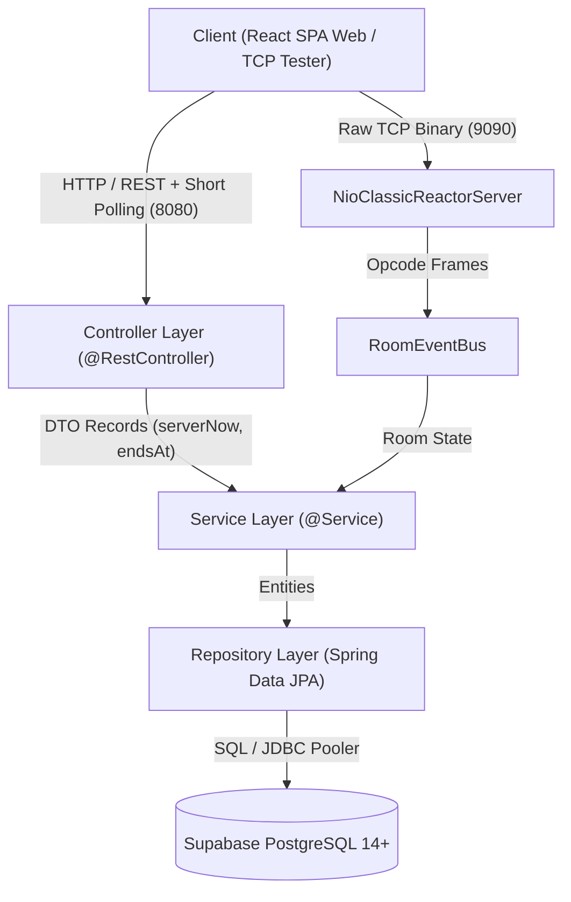

# Phân Hệ Máy Chủ Thi Trắc Nghiệm Trực Tuyến Backend (`server/`)

> **Học phần:** Lập trình Mạng (IT4062) — Hệ sinh thái `mooc-clone`  
> **Kiến trúc:** Pure Layered Architecture (Phân tầng thuần khiết) kết hợp Phân hệ Mạng Kép (NIO Reactor TCP 9090 & Stateless REST Short Polling 8080)  
> **Công nghệ Nền tảng:** Java 21 LTS, Spring Boot 3.4.3, Spring Data JPA, Spring Security 6, SpringDoc OpenAPI 3, PostgreSQL 14+ (Supabase)

---

## Tài khoản mẫu để kiểm thử (Test Accounts)

> [!TIP]
> Hệ thống hỗ trợ đăng nhập linh hoạt bằng cả **Tên đăng nhập (username)** hoặc **Địa chỉ Email** (thông qua trường `usernameOrEmail`). Mật khẩu dùng chung cho toàn bộ tài khoản mẫu là: `password123`.

| Vai trò (Role) | Tên đăng nhập (Username) | Email | Mật khẩu (Password) | Tên hiển thị (Display Name) |
| :--- | :--- | :--- | :--- | :--- |
| **Giáo viên Quản trị (TEACHER)** | `admin` | `admin@mooc.local` | `password123` | Giáo viên Quản trị |
| **Giáo viên (TEACHER)** | `teacher_le` | `teacher.le@mooc.local` | `password123` | Thầy Lê Văn Hướng |
| **Thí sinh 1 (STUDENT)** | `student_alice` | `alice@mooc.local` | `password123` | Nguyễn Thị Alice |
| **Thí sinh 2 (STUDENT)** | `student_bob` | `bob@mooc.local` | `password123` | Trần Văn Bob |

---

## Bảng Điều Hướng Tài Liệu Backend (Backend Documentation Hub)

Hệ thống tài liệu kỹ thuật máy chủ được chuẩn hóa và phân tách thành các cẩm nang chuyên biệt, hỗ trợ tối đa cho việc phát triển tự động của AI Agents và lập trình viên:

| Nhóm Tài Liệu   | Tên Tài Liệu & Đường Dẫn                                            | Mô Tả Trọng Tâm                                                                                       |
| :-------------- | :------------------------------------------------------------------ | :---------------------------------------------------------------------------------------------------- |
| **AI Guides**   | [API_GENERATION_GUIDE.md](docs/ai-guides/API_GENERATION_GUIDE.md)   | Cẩm nang tạo CRUD API kế thừa Bộ ba Generic (`BaseController`, `BaseServiceImpl`, DTO Records)        |
| **AI Guides**   | [CUSTOM_API_GUIDE.md](docs/ai-guides/CUSTOM_API_GUIDE.md)           | Cẩm nang tạo Custom API độc lập: Máy trạng thái, Chấm điểm, Đa Repo, Bắn sự kiện thời gian thực       |
| **Chuyên Đề**   | [database-architecture.md](docs/database-architecture.md)           | Kiến trúc CSDL Chuẩn 3NF, Sơ đồ Mermaid ERD 9 bảng cốt lõi và 5 Dynamic Views tính điểm tức thì       |
| **Chuyên Đề**   | [realtime-network-subsystem.md](docs/realtime-network-subsystem.md) | Phân hệ mạng kép: Non-blocking TCP Reactor 9090 (Khung nhị phân 8-byte, 12+ Opcodes) & REST Polling 8080 |
| **Chuyên Đề**   | [security-architecture.md](docs/security-architecture.md)           | Cơ chế bảo mật Opaque Session Token SHA-256, Bộ lọc Filter và 4 nguyên tắc chống gian lận bài thi     |
| **Chuyên Đề**   | [api-specification.md](docs/api-specification.md)                   | Đặc tả RESTful API, Chuẩn hóa `ApiResponse<T>`, Bảng mã lỗi `ErrorCode` và Hướng dẫn Swagger UI       |
| **Quy Chuẩn**   | [CONVENTIONS.md](CONVENTIONS.md)                                    | Quy chuẩn Lập trình Socket NIO Java (Thao tác ByteBuffer, Thread-safe writes, SLF4J, Test Socket)     |
| **Master Rule** | [AGENTS.md](../AGENTS.md)                                           | Chỉ thị Master AI Directives quản trị toàn bộ dự án `mooc-clone`                                      |

---

## 1. Ngăn Xếp Công Nghệ Chi Tiết (Tech Stack)

| Thành phần           | Công nghệ / Thư viện                          | Phiên bản            | Vai trò & Mục đích sử dụng                                                  |
| :------------------- | :-------------------------------------------- | :------------------- | :-------------------------------------------------------------------------- |
| **Ngôn ngữ**         | Java (OpenJDK / Temurin)                      | **21 LTS**           | Records, Pattern Matching, Switch Expressions, Sequenced Collections        |
| **Framework**        | Spring Boot                                   | **3.4.3**            | Nền tảng ứng dụng máy chủ, IoC Container, Dependency Injection              |
| **Data Persistence** | Spring Data JPA + Hibernate ORM               | **6.6.8**            | Quản lý vòng đời thực thể, kết nối CSDL PostgreSQL qua HikariCP             |
| **Cơ sở Dữ liệu**    | PostgreSQL Cloud (Supabase)                   | **14+ / 17**         | Lưu trữ quan hệ chuẩn 3NF, JSONB metadata, Network INET, Session Token Hash |
| **Bảo mật**          | Spring Security                               | **6.4.3**            | Pipeline xác thực Session Token SHA-256, Stateless SecurityContext          |
| **Mạng TCP**         | Java NIO (Channels, Selector, Buffers)        | **Java 21 Built-in** | Máy chủ TCP Non-blocking Classic Reactor Pattern (Cổng 9090)                |
| **Đồng bộ Phòng thi**| Stateless REST + Server Authoritative Clock   | **3.4.3**            | Đồng bộ trạng thái phòng thi & thời gian chuẩn (`serverNow`, `endsAt`)      |
| **Validation**       | Jakarta Bean Validation (Hibernate Validator) | **3.1.3**            | Kiểm tra tính hợp lệ dữ liệu đầu vào DTO (`@NotNull`, `@Size`, v.v.)        |
| **Tài liệu API**     | SpringDoc OpenAPI Starter WebMVC              | **2.8.5**            | Tự động sinh Swagger UI và đặc tả OpenAPI 3 tương tác trực tiếp             |
| **Build Tool**       | Apache Maven Wrapper (`mvnw`)                 | **3.9.x**            | Quản lý vòng đời dự án, biên dịch, kiểm thử tự động                         |

---

## 2. Yêu Cầu Môi Trường & Quản Trị Biến Môi Trường (.env)

### Yêu Cầu Tiên Quyết (Prerequisites)

- **Java Development Kit (JDK):** Bắt buộc phiên bản **Java 21** trở lên ([Eclipse Temurin 21](https://adoptium.net/)).
  ```bash
  java -version
  # Kết quả hợp lệ: openjdk version "21.x.x" hoặc "24.x.x"
  ```
- **Hệ điều hành:** Windows 10/11, macOS, hoặc Linux.

### Danh Mục Biến Môi Trường

Thông số vận hành được nạp từ [src/main/resources/application.properties](src/main/resources/application.properties) qua biến môi trường. Tệp mẫu cấu hình tại [.env.example](.env.example):

| Tên Biến Môi trường | Giá trị Mặc định | Bắt buộc | Ý nghĩa Kỹ thuật |
| :--- | :--- | :--- | :--- |
| `SERVER_PORT` | `8080` | Không | Cổng dịch vụ HTTP REST API & Short Polling |
| `TCP_PORT` | `9090` | Không | Cổng lắng nghe Non-blocking TCP Socket Reactor |
| `DB_URL` | `jdbc:postgresql://aws-0-ap-south-1.pooler.supabase.com:5432/postgres?sslmode=require` | Không (đã có mặc định) | JDBC URL kết nối tới Transaction Pooler PostgreSQL của Supabase |
| `DB_USERNAME` | `postgres.sijjqpfyxccrswiqthxn` | Không (đã có mặc định) | Tên người dùng CSDL Supabase |
| `DB_PASSWORD` | `Nh8jXnH76qEI5WfC` | Không (đã có mặc định) | Mật khẩu truy cập CSDL Supabase |

---

## 3. Hướng Dẫn Khởi Chạy Từng Bước (Step-by-Step Run Guide)

### Bước 1: Kiểm Tra Tiền Điều Kiện (Prerequisites)

1. **Java Development Kit (JDK 21+):**
   ```bash
   java -version
   # Kết quả yêu cầu: OpenJDK hoặc Temurin 21 trở lên
   ```
2. **Cơ sở dữ liệu PostgreSQL:**
   - Dự án đã tích hợp sẵn kết nối cơ sở dữ liệu Supabase Cloud trong [src/main/resources/application.properties](src/main/resources/application.properties).
   - Nếu cần sử dụng thông tin CSDL riêng, bạn có thể tạo tệp `.env` tại thư mục `server/` dựa trên [.env.example](.env.example).

### Bước 2: Khởi Chạy Máy Chủ Backend

#### Cách 1: Khởi chạy bằng Maven Wrapper (Khuyến nghị cho Dòng lệnh)
Mở cửa sổ dòng lệnh và di chuyển vào thư mục `server/`:
```bash
cd server
```

- **Trên Windows (PowerShell / Command Prompt):**
  ```powershell
  .\mvnw.cmd spring-boot:run
  ```
- **Trên Linux / macOS:**
  ```bash
  chmod +x ./mvnw
  ./mvnw spring-boot:run
  ```

#### Cách 2: Khởi chạy từ IDE (IntelliJ IDEA / VS Code / Eclipse)
1. Mở thư mục `server/` như một dự án Maven độc lập.
2. Thiết lập Project SDK / Language Level là **Java 21**.
3. Mở tệp lớp chính: `src/main/java/com/example/server/ServerApplication.java`.
4. Nhấn **Run** hoặc **Debug** hàm `main()`.

### Bước 3: Xác Minh Khởi Động Thành Công

Khi máy chủ khởi động thành công, cửa sổ console sẽ xuất hiện các dòng log thông báo cả 2 cổng mạng đã sẵn sàng:

```text
>>> [NIO Classic Reactor] Server started on port 9090 (Non-blocking)
Tomcat started on port 8080 (http) with context path '/'
Started ServerApplication in X.XXX seconds
```

- **Cổng 8080 (HTTP / Stateless REST):** Tiếp nhận RESTful API và Adaptive Short Polling với đồng hồ chuẩn `serverNow`.
- **Cổng 9090 (TCP Socket):** Tiếp nhận kết nối mạng nhị phân Reactor.
- **Swagger UI Trực Quan:** Truy cập tại [http://localhost:8080/swagger-ui/index.html](http://localhost:8080/swagger-ui/index.html) để kiểm tra danh mục API.
- **OpenAPI 3 JSON Spec:** [http://localhost:8080/v3/api-docs](http://localhost:8080/v3/api-docs).

### Bước 4: Kiểm Thử Đăng Nhập API Trực Tiếp

Bạn có thể kiểm tra API xác thực tài khoản ngay lập tức bằng cURL hoặc PowerShell:

- **Sử dụng cURL (Linux / macOS / Git Bash):**
  ```bash
  curl -X POST http://localhost:8080/api/auth/login \
    -H "Content-Type: application/json" \
    -d "{\"usernameOrEmail\": \"teacher_le\", \"password\": \"password123\"}"
  ```

- **Sử dụng PowerShell (Windows):**
  ```powershell
  $body = @{
    usernameOrEmail = "teacher_le"
    password        = "password123"
  } | ConvertTo-Json

  Invoke-RestMethod -Uri "http://localhost:8080/api/auth/login" `
    -Method Post `
    -ContentType "application/json" `
    -Body $body
  ```

- **Cấu trúc phản hồi thành công mẫu (`code: 1000`):**
  ```json
  {
    "code": 1000,
    "status": "SUCCESS",
    "message": "Đăng nhập thành công",
    "data": {
      "token": "11223344556677889900aabbccddeeff11223344556677889900aabbccddeeff",
      "userId": 2,
      "username": "teacher_le",
      "displayName": "Thầy Lê Văn Hướng",
      "role": "TEACHER",
      "expiresAt": "2026-11-03T07:15:00Z"
    },
    "errors": null,
    "timestamp": "2026-10-27T07:15:00Z"
  }
  ```

### Bảng Tra Cứu Lệnh Vận Hành Maven:

| Câu Lệnh | Mục Đích Kỹ Thuật | Tình Huống Sử Dụng |
| :--- | :--- | :--- |
| `.\mvnw.cmd clean compile` | Dọn sạch thư mục `target/` và biên dịch 100% mã nguồn Java | Khi cập nhật DTO, Entity, hoặc cấu hình pom.xml |
| `.\mvnw.cmd test` | Chạy toàn bộ bộ kiểm thử tự động Backend | Trước khi commit hoặc tạo Pull Request |
| `.\mvnw.cmd clean package -DskipTests` | Đóng gói ứng dụng thành file JAR độc lập | Chuẩn bị triển khai môi trường Staging/Production |
| `java -jar target/server-0.0.1-SNAPSHOT.jar` | Chạy ứng dụng từ tệp JAR độc lập | Kiểm tra hoạt động môi trường thực tế không qua Maven |

---

## 4. Kiến Trúc Phân Tầng Thuần Khiết (Pure Layered Architecture)

Mã nguồn `server/` tuân thủ nguyên tắc một chiều nghiêm ngặt:



> **Quy Tắc Bất Biến:**
>
> - Luồng dữ liệu đi một chiều từ trên xuống dưới: `Controller -> Service -> Repository -> Database`.
> - DTO (Java 21 Record) là cấu trúc duy nhất giao tiếp giữa Client và Controller/Service. Thực thể Entity tuyệt đối không được lộ ra ngoài API.
> - Hướng dẫn chi tiết cách triển khai CRUD và Custom API xem tại [API_GENERATION_GUIDE.md](docs/ai-guides/API_GENERATION_GUIDE.md) và [CUSTOM_API_GUIDE.md](docs/ai-guides/CUSTOM_API_GUIDE.md).

---

## 5. Tóm Lược Các Chuyên Đề Kiến Trúc

### 5.1. Cơ Sở Dữ Liệu Chuẩn Hóa 3NF & Dynamic Views

Hệ thống loại bỏ hoàn toàn dữ liệu phái sinh dư thừa, quản lý quan hệ thi cử qua 9 bảng cốt lõi và tính điểm tức thì qua 5 Khung nhìn nghiệp vụ (`v_attempt_results`, `v_room_list`, `v_room_results`, `v_user_statistics`, `v_user_topic_performance`).  
👉 _Xem chi tiết:_ [docs/database-architecture.md](docs/database-architecture.md) | [online_exam_schema.sql](online_exam_schema.sql) | [online_exam_seed_data.sql](online_exam_seed_data.sql)

### 5.2. Phân Hệ Mạng Kép (TCP 9090 & Stateless REST Short Polling 8080)

Hệ thống vận hành đồng thời kênh Non-blocking TCP Socket 9090 với giao thức đóng khung nhị phân 8-byte (Magic, Opcode, Length, Payload, Checksum) và kênh HTTP Short Polling + Server Authoritative Timestamp (`serverNow`, `endsAt`, Lazy State Transition) trên cổng 8080.  
👉 _Xem chi tiết:_ [docs/realtime-network-subsystem.md](docs/realtime-network-subsystem.md) | [CONVENTIONS.md](CONVENTIONS.md)

### 5.3. Bảo Mật Session Token SHA-256 & Chống Gian Lận Đề Thi

Bảo mật máy chủ bằng Opaque Session Token (64 hex characters) lưu băm SHA-256 trong CSDL, ẩn cờ đáp án đúng `is_correct` trước khi nộp bài, ràng buộc khóa ngoại kép CSDL và khóa đóng băng bài thi tự động.  
👉 _Xem chi tiết:_ [docs/security-architecture.md](docs/security-architecture.md)

### 5.4. Quy Chuẩn RESTful API & Swagger UI

100% API phản hồi qua khung bọc đồng nhất `ApiResponse<T>`, quản lý mã lỗi tập trung `ErrorCode` và tích hợp Swagger UI tương tác trực tiếp.

- **Giao diện Swagger UI:** [http://localhost:8080/swagger-ui/index.html](http://localhost:8080/swagger-ui/index.html)
- **OpenAPI 3 JSON Spec:** [http://localhost:8080/v3/api-docs](http://localhost:8080/v3/api-docs)  
  👉 _Xem chi tiết:_ [docs/api-specification.md](docs/api-specification.md)

---

## 6. Quy Chuẩn Code Java 21 & Bộ Lệnh Kiểm Tra Toàn Vẹn Tự Động

### Cú Pháp Java 21 Hiện Đại (Modern Java 21 Idioms)

- **100% Java Records cho DTO:** Sử dụng `public record XxxDto(...)` đảm bảo tính bất biến (Immutability).
- **Tránh xa Lombok:** Viết getter, setter, constructor bằng Java thuần túy để tránh lỗi compiler bytecode.
- **Pattern Matching & Switch Expressions:** Sử dụng cú pháp mũi tên (`->`) và pattern matching an toàn kiểu.

### Bộ Ba Kiểm Tra Toàn Vẹn Bắt Buộc Trước Khi Commit:

```bash
# 1. Kiểm tra mã nguồn Java và thực thi test suites Backend
.\mvnw.cmd test

# 2. Kiểm tra tính toàn vẹn tài liệu Markdown & Link Paths (0 link gãy)
npm --prefix client run verify:docs

# 3. Kiểm tra tuân thủ Static Audit Frontend
npm --prefix client run audit:strict
```

---

_Tài liệu được quản lý tập trung theo Master AI Directives tại [AGENTS.md](../AGENTS.md)._
