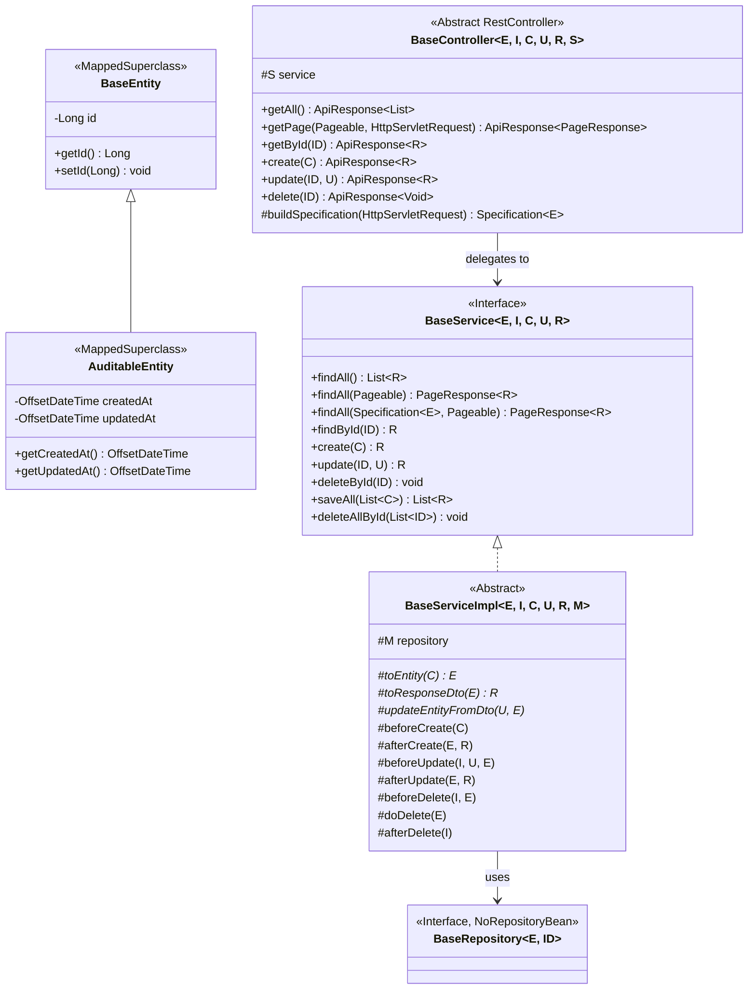

# Cẩm Nang AI & Developer: Thêm Mới CRUD API Kế Thừa Bộ Ba Generic

> **Phân hệ:** Máy chủ Backend (`server/`) — Nền tảng Spring Boot 3.4.3 & Java 21 LTS  
> **Kiến trúc:** Pure Layered Architecture (Phân tầng thuần khiết) kết hợp Bộ ba Kế thừa Generic  
> **Mục tiêu:** Hướng dẫn chi tiết từng bước cho AI Agents và lập trình viên thêm mới một tính năng/module CRUD chuẩn chỉnh, an toàn, không trùng lặp mã nguồn và tuân thủ tuyệt đối quy ước dự án.

---

## 1. Tổng Quan Kiến Trúc & Triết Lý "Zero-Boilerplate" CRUD

Hệ thống Backend của `mooc-clone` áp dụng mô hình **Bộ ba Kế thừa Generic (Generic Inheritance Triad)** nhằm loại bỏ hoàn toàn mã nguồn lặp lại khi xây dựng các thao tác CRUD (Create, Read, Update, Delete, Pagination):



### 1.1. Sáu (06) Endpoints Được Sinh Mặc Định Tự Động
Khi một Controller kế thừa [BaseController.java](../../src/main/java/com/example/server/controller/BaseController.java), hệ thống lập tức mở sẵn 6 RESTful API chuẩn:

| HTTP Method | Đường dẫn Endpoint | Phương thức Service | Định dạng Phản hồi | Mô tả Nghiệp vụ |
| :--- | :--- | :--- | :--- | :--- |
| `GET` | `/api/<resource>` | `findAll()` | `ApiResponse<List<R>>` | Lấy toàn bộ danh sách bản ghi |
| `GET` | `/api/<resource>/page?page=0&size=20` | `findAll(Pageable)` | `ApiResponse<PageResponse<R>>` | Phân trang danh sách qua `PageResponse` |
| `GET` | `/api/<resource>/{id}` | `findById(id)` | `ApiResponse<R>` | Tra cứu chi tiết một bản ghi theo khóa chính |
| `POST` | `/api/<resource>` | `create(request)` | `ApiResponse<R>` (HTTP 201) | Tạo mới một bản ghi kèm Bean Validation |
| `PUT` | `/api/<resource>/{id}` | `update(id, request)` | `ApiResponse<R>` | Cập nhật toàn bộ thông tin bản ghi |
| `DELETE` | `/api/<resource>/{id}` | `deleteById(id)` | `ApiResponse<Void>` | Xóa bản ghi theo ID (hoặc xóa mềm nếu cấu hình) |

### 1.2. Các Nguyên Tắc Bất Biến (Hard Rules)
- ❌ **TUYỆT ĐỐI KHÔNG VIẾT LẠI** các phương thức CRUD cơ sở trong Controller con nếu không có nghiệp vụ phân quyền hoặc kiểm soát đặc thù. Controller thuần túy chỉ cần kế thừa `BaseController` và truyền `super(service)`.
- ❌ **TUYỆT ĐỐI KHÔNG RÒ RỈ ENTITY:** Dữ liệu vào/ra API bắt buộc phải là **Java 21 Records** (`Request DTO` và `Response DTO`). Tuyệt đối không nhận hoặc trả `Entity` ở tầng Controller.
- ❌ **PHÂN TẦNG ĐỘC LẬP:** Controller không bao giờ thao tác trực tiếp với `Repository` hay `EntityManager`. Mọi tương tác dữ liệu phải đi qua tầng `Service`.

---

## 2. Quy Chuẩn Đặt Tên & Cấu Trúc Thư Mục (Naming Conventions)

Giả sử bạn cần tạo mới module CRUD cho thực thể **`Tag`** (hoặc `Category`, `Question`...):

| Thành phần | Vị trí Package | Quy tắc Đặt tên Tệp | Ví dụ Minh họa |
| :--- | :--- | :--- | :--- |
| **Schema DDL** | `server/` | [online_exam_schema.sql](../../online_exam_schema.sql) | `CREATE TABLE tags (...)` |
| **Entity** | `com.example.server.entity` | `{{EntityName}}Entity.java` | `TagEntity.java` |
| **Repository**| `com.example.server.repository` | `{{EntityName}}Repository.java` | `TagRepository.java` |
| **Request DTO**| `com.example.server.dto.{{module}}` | `Create{{EntityName}}Request.java` | `CreateTagRequest.java` |
| **Response DTO**| `com.example.server.dto.{{module}}` | `{{EntityName}}Response.java` | `TagResponse.java` |
| **Service Intf**| `com.example.server.service` | `{{EntityName}}Service.java` | `TagService.java` |
| **Service Impl**| `com.example.server.service.impl` | `{{EntityName}}ServiceImpl.java` | `TagServiceImpl.java` |
| **Controller** | `com.example.server.controller` | `{{EntityName}}Controller.java` | `TagController.java` |
| **Test** | `src/test/java/com/example/server/controller` | `{{EntityName}}ControllerTest.java` | `TagControllerTest.java` |

---

## 3. Khung Mẫu Mã Nguồn Hoàn Chỉnh (Full Code Skeletons Cho 7 Tầng)

Sao chép các khung mã sau và thay thế `{{EntityName}}` (ví dụ: `Tag`), `{{entityName}}` (ví dụ: `tag`), `{{tableName}}` (ví dụ: `tags`).

### Tầng 1: Kịch Bản CSDL PostgreSQL 3NF (Schema DDL)
Bổ sung vào [online_exam_schema.sql](../../online_exam_schema.sql):

```sql
-- Bảng lưu trữ {{EntityName}}
CREATE TABLE IF NOT EXISTS {{tableName}} (
    id BIGINT GENERATED ALWAYS AS IDENTITY PRIMARY KEY,
    name VARCHAR(255) NOT NULL,
    description TEXT,
    status VARCHAR(50) NOT NULL DEFAULT 'ACTIVE',
    created_at TIMESTAMPTZ NOT NULL DEFAULT CURRENT_TIMESTAMP,
    updated_at TIMESTAMPTZ NOT NULL DEFAULT CURRENT_TIMESTAMP
);

CREATE INDEX IF NOT EXISTS idx_{{tableName}}_status ON {{tableName}}(status);
```

### Tầng 2: Thực Thể JPA (`AuditableEntity`)
Đường dẫn: `src/main/java/com/example/server/entity/{{EntityName}}Entity.java`

```java
package com.example.server.entity;

import jakarta.persistence.Column;
import jakarta.persistence.Entity;
import jakarta.persistence.Table;
import java.util.Objects;

@Entity
@Table(name = "{{tableName}}")
public class {{EntityName}}Entity extends AuditableEntity {

    @Column(name = "name", nullable = false)
    private String name;

    @Column(name = "description")
    private String description;

    @Column(name = "status", nullable = false)
    private String status = "ACTIVE";

    public {{EntityName}}Entity() {
    }

    public {{EntityName}}Entity(String name, String description, String status) {
        this.name = name;
        this.description = description;
        this.status = status;
    }

    public String getName() {
        return name;
    }

    public void setName(String name) {
        this.name = name;
    }

    public String getDescription() {
        return description;
    }

    public void setDescription(String description) {
        this.description = description;
    }

    public String getStatus() {
        return status;
    }

    public void setStatus(String status) {
        this.status = status;
    }

    @Override
    public boolean equals(Object o) {
        if (this == o) return true;
        if (!(o instanceof {{EntityName}}Entity that)) return false;
        return getId() != null && Objects.equals(getId(), that.getId());
    }

    @Override
    public int hashCode() {
        return Objects.hash(getId());
    }
}
```

### Tầng 3: Spring Data JPA Repository
Đường dẫn: `src/main/java/com/example/server/repository/{{EntityName}}Repository.java`

```java
package com.example.server.repository;

import com.example.server.entity.{{EntityName}}Entity;
import org.springframework.stereotype.Repository;

import java.util.List;
import java.util.Optional;

@Repository
public interface {{EntityName}}Repository extends BaseRepository<{{EntityName}}Entity, Long> {
    Optional<{{EntityName}}Entity> findByName(String name);
    List<{{EntityName}}Entity> findByStatus(String status);
}
```

### Tầng 4: DTOs Dạng Java 21 Records
Đường dẫn Tạo mới (Create): `src/main/java/com/example/server/dto/{{module}}/Create{{EntityName}}Request.java`

```java
package com.example.server.dto.{{module}};

import jakarta.validation.constraints.NotBlank;
import jakarta.validation.constraints.Size;

public record Create{{EntityName}}Request(
        @NotBlank(message = "Tên không được để trống")
        @Size(max = 255, message = "Tên tối đa 255 ký tự")
        String name,

        @Size(max = 1000, message = "Mô tả tối đa 1000 ký tự")
        String description,

        String status
) {}
```

Đường dẫn Cập nhật (Update): `src/main/java/com/example/server/dto/{{module}}/Update{{EntityName}}Request.java`

```java
package com.example.server.dto.{{module}};

import jakarta.validation.constraints.Size;

public record Update{{EntityName}}Request(
        @Size(max = 255, message = "Tên tối đa 255 ký tự")
        String name,

        @Size(max = 1000, message = "Mô tả tối đa 1000 ký tự")
        String description,

        String status
) {}
```

Đường dẫn Phản hồi (Response): `src/main/java/com/example/server/dto/{{module}}/{{EntityName}}Response.java`

```java
package com.example.server.dto.{{module}};

import java.time.OffsetDateTime;

public record {{EntityName}}Response(
        Long id,
        String name,
        String description,
        String status,
        OffsetDateTime createdAt,
        OffsetDateTime updatedAt
) {}
```

### Tầng 5: Service Interface
Đường dẫn: `src/main/java/com/example/server/service/{{EntityName}}Service.java`

```java
package com.example.server.service;

import com.example.server.dto.{{module}}.Create{{EntityName}}Request;
import com.example.server.dto.{{module}}.Update{{EntityName}}Request;
import com.example.server.dto.{{module}}.{{EntityName}}Response;
import com.example.server.entity.{{EntityName}}Entity;

public interface {{EntityName}}Service extends BaseService<{{EntityName}}Entity, Long, Create{{EntityName}}Request, Update{{EntityName}}Request, {{EntityName}}Response> {
    // Khai báo thêm các phương thức nghiệp vụ đặc thù nếu có
}
```

### Tầng 6: Service Implementation (`BaseServiceImpl`)
Đường dẫn: `src/main/java/com/example/server/service/impl/{{EntityName}}ServiceImpl.java`

```java
package com.example.server.service.impl;

import com.example.server.dto.{{module}}.Create{{EntityName}}Request;
import com.example.server.dto.{{module}}.Update{{EntityName}}Request;
import com.example.server.dto.{{module}}.{{EntityName}}Response;
import com.example.server.entity.{{EntityName}}Entity;
import com.example.server.repository.{{EntityName}}Repository;
import com.example.server.service.{{EntityName}}Service;
import org.springframework.stereotype.Service;
import org.springframework.transaction.annotation.Transactional;

@Service
@Transactional
public class {{EntityName}}ServiceImpl 
        extends BaseServiceImpl<{{EntityName}}Entity, Long, Create{{EntityName}}Request, Update{{EntityName}}Request, {{EntityName}}Response, {{EntityName}}Repository>
        implements {{EntityName}}Service {

    public {{EntityName}}ServiceImpl({{EntityName}}Repository repository) {
        super(repository);
    }

    @Override
    protected void beforeCreate(Create{{EntityName}}Request request) {
        // Validation nghiệp vụ trước khi tạo mới (VD: kiểm tra trùng lặp)
    }

    @Override
    protected {{EntityName}}Entity toEntity(Create{{EntityName}}Request request) {
        {{EntityName}}Entity entity = new {{EntityName}}Entity();
        entity.setName(request.name());
        entity.setDescription(request.description());
        entity.setStatus(request.status() != null ? request.status() : "ACTIVE");
        return entity;
    }

    @Override
    protected {{EntityName}}Response toResponseDto({{EntityName}}Entity entity) {
        return new {{EntityName}}Response(
                entity.getId(),
                entity.getName(),
                entity.getDescription(),
                entity.getStatus(),
                entity.getCreatedAt(),
                entity.getUpdatedAt()
        );
    }

    @Override
    protected void updateEntityFromDto(Update{{EntityName}}Request request, {{EntityName}}Entity entity) {
        if (request.name() != null) entity.setName(request.name());
        if (request.description() != null) entity.setDescription(request.description());
        if (request.status() != null) entity.setStatus(request.status());
    }

    @Override
    protected void doDelete({{EntityName}}Entity entity) {
        // Mặc định là xóa vật lý repository.delete(entity).
        // Nếu muốn Xóa mềm (Soft Delete):
        // entity.setStatus("INACTIVE");
        // repository.save(entity);
        super.doDelete(entity);
    }
}
```

### Tầng 7: Controller (`BaseController`)
Đường dẫn: `src/main/java/com/example/server/controller/{{EntityName}}Controller.java`

```java
package com.example.server.controller;

import com.example.server.dto.common.ApiResponse;
import com.example.server.dto.{{module}}.Create{{EntityName}}Request;
import com.example.server.dto.{{module}}.Update{{EntityName}}Request;
import com.example.server.dto.{{module}}.{{EntityName}}Response;
import com.example.server.entity.{{EntityName}}Entity;
import com.example.server.service.{{EntityName}}Service;
import com.example.server.util.SpecificationBuilder;
import io.swagger.v3.oas.annotations.Operation;
import io.swagger.v3.oas.annotations.tags.Tag;
import jakarta.servlet.http.HttpServletRequest;
import jakarta.validation.Valid;
import org.springframework.data.jpa.domain.Specification;
import org.springframework.http.ResponseEntity;
import org.springframework.security.access.prepost.PreAuthorize;
import org.springframework.web.bind.annotation.PathVariable;
import org.springframework.web.bind.annotation.RequestBody;
import org.springframework.web.bind.annotation.RequestMapping;
import org.springframework.web.bind.annotation.RestController;

import java.util.Set;

@RestController
@RequestMapping("/api/{{endpoint}}")
@Tag(name = "{{EntityName}} Management", description = "Quản lý CRUD cho {{EntityName}} (Kế thừa BaseController)")
public class {{EntityName}}Controller 
        extends BaseController<{{EntityName}}Entity, Long, Create{{EntityName}}Request, Update{{EntityName}}Request, {{EntityName}}Response, {{EntityName}}Service> {

    public {{EntityName}}Controller({{EntityName}}Service service) {
        super(service);
    }

    @Override
    protected Specification<{{EntityName}}Entity> buildSpecification(HttpServletRequest request) {
        // Tự động phân giải query parameters thành Specification type-safe:
        return SpecificationBuilder.fromRequest(
                request,
                Set.of("status"),        // Whitelist các trường so sánh bằng (equal)
                Set.of("name", "description") // Whitelist các trường tìm kiếm chứa (like)
        );
    }

    // Nếu muốn bảo vệ các thao tác ghi dành riêng cho ADMIN:
    @Override
    @PreAuthorize("hasRole('ADMIN')")
    @Operation(summary = "Tạo mới bản ghi (Yêu cầu quyền ADMIN)")
    public ResponseEntity<ApiResponse<{{EntityName}}Response>> create(@Valid @RequestBody Create{{EntityName}}Request request) {
        return super.create(request);
    }

    @Override
    @PreAuthorize("hasRole('ADMIN')")
    @Operation(summary = "Cập nhật bản ghi (Yêu cầu quyền ADMIN)")
    public ResponseEntity<ApiResponse<{{EntityName}}Response>> update(@PathVariable Long id, @Valid @RequestBody Update{{EntityName}}Request request) {
        return super.update(id, request);
    }

    @Override
    @PreAuthorize("hasRole('ADMIN')")
    @Operation(summary = "Xóa bản ghi (Yêu cầu quyền ADMIN)")
    public ResponseEntity<ApiResponse<Void>> delete(@PathVariable Long id) {
        return super.delete(id);
    }
}
```

### Tầng 8: Khung Kiểm Thử Tự Động (MockMvc Unit Test)
Đường dẫn: `src/test/java/com/example/server/controller/{{EntityName}}ControllerTest.java`

```java
package com.example.server.controller;

import com.example.server.dto.{{module}}.Create{{EntityName}}Request;
import com.example.server.dto.{{module}}.{{EntityName}}Response;
import com.example.server.service.{{EntityName}}Service;
import com.fasterxml.jackson.databind.ObjectMapper;
import org.junit.jupiter.api.DisplayName;
import org.junit.jupiter.api.Test;
import org.springframework.beans.factory.annotation.Autowired;
import org.springframework.boot.test.autoconfigure.web.servlet.AutoConfigureMockMvc;
import org.springframework.boot.test.context.SpringBootTest;
import org.springframework.boot.test.mock.mockito.MockBean;
import org.springframework.http.MediaType;
import org.springframework.security.test.context.support.WithMockUser;
import org.springframework.test.web.servlet.MockMvc;

import java.time.OffsetDateTime;

import static org.mockito.ArgumentMatchers.any;
import static org.mockito.Mockito.when;
import static org.springframework.test.web.servlet.request.MockMvcRequestBuilders.post;
import static org.springframework.test.web.servlet.result.MockMvcResultMatchers.jsonPath;
import static org.springframework.test.web.servlet.result.MockMvcResultMatchers.status;

@SpringBootTest
@AutoConfigureMockMvc
class {{EntityName}}ControllerTest {

    @Autowired
    private MockMvc mockMvc;

    @Autowired
    private ObjectMapper objectMapper;

    @MockBean
    private {{EntityName}}Service service;

    @Test
    @WithMockUser(roles = "ADMIN")
    @DisplayName("POST /api/{{endpoint}} - Tạo mới thành công khi có quyền ADMIN")
    void create_WhenAdmin_ShouldReturnCreated() throws Exception {
        Create{{EntityName}}Request request = new Create{{EntityName}}Request("Test Name", "Test Desc", "ACTIVE");
        {{EntityName}}Response response = new {{EntityName}}Response(1L, "Test Name", "Test Desc", "ACTIVE", OffsetDateTime.now(), OffsetDateTime.now());

        when(service.create(any())).thenReturn(response);

        mockMvc.perform(post("/api/{{endpoint}}")
                        .contentType(MediaType.APPLICATION_JSON)
                        .content(objectMapper.writeValueAsString(request)))
                .andExpect(status().isCreated())
                .andExpect(jsonPath("$.code").value(1000))
                .andExpect(jsonPath("$.data.name").value("Test Name"));
    }
}
```

---

## 4. Phân Tích Ca Nghiệp Vụ Sống Trong Mã Nguồn (Canonical Walkthrough)

Dự án hiện có phân hệ **Ngân hàng Câu hỏi** được xây dựng chuẩn mực theo mô hình này:
- **Entity & Relation:** [QuestionEntity.java](../../src/main/java/com/example/server/entity/QuestionEntity.java) kế thừa `AuditableEntity`, chứa quan hệ 1-N với `QuestionOptionEntity`.
- **Repository:** [QuestionRepository.java](../../src/main/java/com/example/server/repository/QuestionRepository.java) kế thừa `BaseRepository<QuestionEntity, Long>`.
- **DTOs:** [CreateQuestionRequest.java](../../src/main/java/com/example/server/dto/question/CreateQuestionRequest.java), [UpdateQuestionRequest.java](../../src/main/java/com/example/server/dto/question/UpdateQuestionRequest.java) và [QuestionResponse.java](../../src/main/java/com/example/server/dto/question/QuestionResponse.java).
- **Service Implementation:** [QuestionServiceImpl.java](../../src/main/java/com/example/server/service/impl/QuestionServiceImpl.java) hiện thực hóa việc ánh xạ các phương án trả lời trong `toEntity()`, `updateEntityFromDto()` và override hook `doDelete()` để thực hiện xóa mềm (Soft Delete sang trạng thái `ARCHIVED`).
- **Controller:** [QuestionController.java](../../src/main/java/com/example/server/controller/QuestionController.java) kế thừa `BaseController`, phân quyền ADMIN cho các thao tác ghi, override `buildSpecification()` để lọc động theo query parameters:
  ```java
  @Override
  protected Specification<QuestionEntity> buildSpecification(HttpServletRequest request) {
      return SpecificationBuilder.fromRequest(
              request,
              Set.of("status", "difficulty", "questionType"),
              Set.of("topic", "content")
      );
  }
  ```

---

## 5. Quy Trình 7 Bước Triển Khai Chuẩn Xác (Action Checklist)

- [ ] **Bước 1 (Schema):** Thêm định nghĩa bảng vào [online_exam_schema.sql](../../online_exam_schema.sql).
- [ ] **Bước 2 (Entity):** Tạo `{{EntityName}}Entity` kế thừa `AuditableEntity` (hoặc `BaseEntity`), khai báo `@Entity` và `@Table`.
- [ ] **Bước 3 (Repo):** Tạo `{{EntityName}}Repository` kế thừa `BaseRepository`.
- [ ] **Bước 4 (DTOs):** Tạo Java 21 Records cho CreateRequest, UpdateRequest và Response trong package `dto/`.
- [ ] **Bước 5 (Service):** Tạo interface kế thừa `BaseService`, class cài đặt kế thừa `BaseServiceImpl` (viết `toEntity`, `toResponseDto`, `updateEntityFromDto`, cùng các hooks `beforeCreate`, `doDelete` nếu cần soft delete).
- [ ] **Bước 6 (Controller):** Tạo controller kế thừa `BaseController`, override `buildSpecification` dùng `SpecificationBuilder` để hỗ trợ lọc động.
- [ ] **Bước 7 (Kiểm tra Toàn vẹn):**
  ```bash
  .\mvnw.cmd test
  npm --prefix client run verify:docs
  ```

---

## 6. Bảng Các Lỗi Thường Gặp & Cách Khắc Phục (Common Mistakes)

| Tình Huống Sai Phạm | Hậu Quả Kỹ Thuật | Cách Khắc Phục Chuẩn Mực |
| :--- | :--- | :--- |
| **Quên `@Valid` ở `@RequestBody`** | Dữ liệu rác hoặc rỗng vẫn lọt vào Service và CSDL | Luôn khai báo `public ResponseEntity<...> create(@Valid @RequestBody ReqDto request)` |
| **Trả trực tiếp Entity về Client** | Lộ cấu trúc bảng DB, mật khẩu, cờ đáp án hoặc lỗi tuần tự hóa Jackson | 100% dữ liệu ra API phải chuyển qua `ResponseDto` |
| **Tự viết lại `GET /` trong Controller** | Mã nguồn bị phân tán, mất tính nhất quán ApiResponse | Tận dụng endpoint sẵn có của `BaseController`, chỉ override khi cần phân quyền |
| **Dùng Lombok trên Java 21 LTS** | Nguy cơ xung đột Annotation Processing trên JDK mới | Viết Getter/Setter/Constructor thuần túy theo quy ước dự án |
| **Quên `@Transactional` ở Service** | Lỗi `LazyInitializationException` khi truy cập quan hệ con | Gắn `@Transactional` ở đầu class `ServiceImpl` |

---

*Tài liệu được quản lý theo tiêu chuẩn phân tầng Backend `mooc-clone`. Xem thêm cẩm nang Custom API tại [CUSTOM_API_GUIDE.md](CUSTOM_API_GUIDE.md).*
