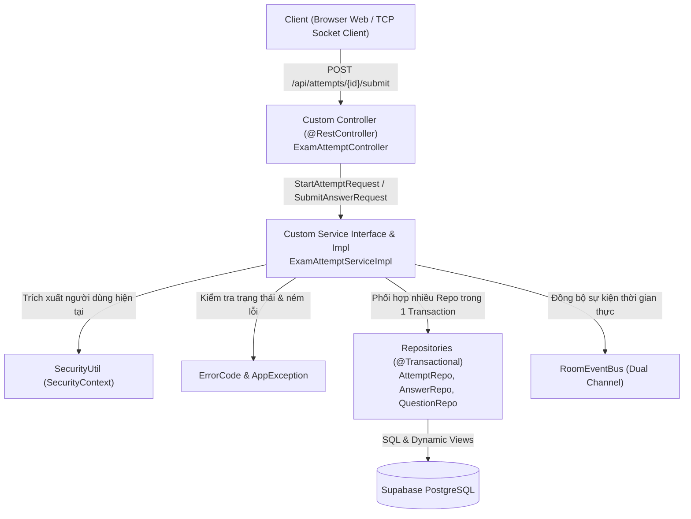

# Cẩm Nang AI & Developer: Xây Dựng Custom API Nghiệp Vụ Chuyên Biệt

> **Phân hệ:** Máy chủ Backend (`server/`) — Nền tảng Spring Boot 3.4.3 & Java 21 LTS  
> **Kiến trúc:** Pure Layered Architecture kết hợp Bộ điều phối Realtime `RoomEventBus`  
> **Mục tiêu:** Hướng dẫn chi tiết cho AI Agents và lập trình viên khi xây dựng các API nghiệp vụ phức hợp, độc lập với `BaseController`, đòi hỏi tính toàn vẹn cao của máy trạng thái, kiểm tra gian lận và đồng bộ mạng thời gian thực.

---

## 1. Khi Nào Phải Xây Dựng Custom API?

Trong khi [API_GENERATION_GUIDE.md](API_GENERATION_GUIDE.md) hướng dẫn xây dựng các API CRUD tài nguyên cơ sở thông qua `BaseController`, bạn **bắt buộc phải sử dụng Custom API** khi tính năng thuộc một trong các kịch bản sau:

1. **Điều khiển Vòng Đời & Máy Trạng Thái (State Machine):** Các hành động thay đổi trạng thái theo quy trình một chiều (ví dụ: Bắt đầu làm bài, Nộp bài thi, Mở phòng thi, Kết thúc phòng thi).
2. **Nghiệp Vụ Đa Thực Thể & Bảo Mật Cao:** Các tác vụ tính điểm thi, kiểm tra đáp án đúng/sai, sinh đề ngẫu nhiên theo tỷ lệ phân bổ độ khó (`easy_count`, `medium_count`, `hard_count`).
3. **Kích Hoạt Sự Kiện Thời Gian Thực:** Khi API cần phát thanh (broadcast) trạng thái tới Client qua [Phân Hệ Mạng Kép](../realtime-network-subsystem.md) (NIO TCP Port 9090 và WebSocket Port 8080).
4. **Truy Vấn Tổng Hợp Phức Tạp:** Khi cần trích xuất báo cáo, thống kê năng lực hoặc bảng xếp hạng từ [5 Dynamic Views](../database-architecture.md).

---

## 2. Cấu Trúc Kiến Trúc Khuyến Nghị (Architecture Topology)

Khác với CRUD API, Custom API sử dụng **Controller và Service độc lập hoàn toàn** với lớp Generic Base để bảo vệ tính đóng gói và an toàn dữ liệu:



> **Nguyên Tắc Thiết Kế:**
> - Controller chỉ đóng vai trò phân giải HTTP Request, kích hoạt validation `@Valid`, gọi Service và bọc dữ liệu vào `ApiResponse.success(...)`. Tuyệt đối không chứa logic nghiệp vụ.
> - Service độc lập chịu trách nhiệm toàn bộ logic: Kiểm tra quyền hạn, kiểm tra máy trạng thái, phối hợp nhiều Repository trong một transaction `@Transactional`, phát tán sự kiện mạng và trả về DTO Record chuyên biệt.

---

## 3. Hướng Dẫn Chi Tiết 5 Kịch Bản Nâng Cao (Advanced Core Patterns)

### Kịch Bản 1: Máy Trạng Thái & Luật Chuyển Trạng Thái (State Transition)

Khi thực thể có vòng đời chuyển dịch trạng thái (ví dụ `ExamAttemptEntity` có `AttemptStatus`: `IN_PROGRESS -> SUBMITTED / AUTO_SUBMITTED / TERMINATED`), mọi thao tác ghi nhận dữ liệu phải chặn đứng nếu trạng thái không hợp lệ:

```java
// Trong ExamAttemptServiceImpl.java:
ExamAttemptEntity attempt = attemptRepository.findById(attemptId)
        .orElseThrow(() -> new AppException(ErrorCode.RESOURCE_NOT_FOUND, "Không tìm thấy bài thi"));

// 1. Kiểm tra trạng thái hiện tại
if (attempt.getStatus() != AttemptStatus.IN_PROGRESS) {
    throw new AppException(ErrorCode.EXAM_ALREADY_SUBMITTED, "Bài thi đã kết thúc hoặc đã nộp, không thể thao tác tiếp");
}

// 2. Kiểm tra thời hạn làm bài (Deadline Enforcement)
if (attempt.getDeadlineAt() != null && OffsetDateTime.now(ZoneOffset.UTC).isAfter(attempt.getDeadlineAt())) {
    attempt.setStatus(AttemptStatus.AUTO_SUBMITTED);
    attempt.setSubmittedAt(attempt.getDeadlineAt());
    attemptRepository.save(attempt);
    throw new AppException(ErrorCode.EXAM_DEADLINE_EXCEEDED, "Đã hết thời gian làm bài thi");
}
```

---

### Kịch Bản 2: Điều Phối Đa Repository & Toàn Vẹn Giao Tác (`@Transactional`)

Các nghiệp vụ phức hợp đòi hỏi cập nhật nhiều bảng dữ liệu đồng thời. Bắt buộc gắn `@Transactional` để đảm bảo tính nguyên tử (Atomicity), tự động rollback khi phát sinh bất kỳ ngoại lệ nào:

```java
@Service
@Transactional(rollbackFor = Exception.class)
public class ExamAttemptServiceImpl implements ExamAttemptService {

    private final ExamAttemptRepository attemptRepository;
    private final AttemptAnswerRepository answerRepository;
    private final QuestionRepository questionRepository;
    private final QuestionOptionRepository optionRepository;
    private final ExamRoomRepository roomRepository;

    public ExamAttemptServiceImpl(
            ExamAttemptRepository attemptRepository,
            AttemptAnswerRepository answerRepository,
            QuestionRepository questionRepository,
            QuestionOptionRepository optionRepository,
            ExamRoomRepository roomRepository) {
        this.attemptRepository = attemptRepository;
        this.answerRepository = answerRepository;
        this.questionRepository = questionRepository;
        this.optionRepository = optionRepository;
        this.roomRepository = roomRepository;
    }

    @Override
    public void submitAnswer(Long attemptId, Long questionId, Long selectedOptionId) {
        // Kiểm tra tồn tại câu hỏi và thuộc đề thi
        // Lưu hoặc cập nhật câu trả lời vào AttemptAnswerEntity
    }
}
```

---

### Kịch Bản 3: Truy Vấn Custom SQL & Ánh Xạ DTO từ Dynamic Views

Khi cần truy vấn số liệu tổng hợp (ví dụ bảng xếp hạng phòng thi hoặc kết quả bài thi từ `v_attempt_results`), không kéo toàn bộ bảng về tính toán trong RAM mà ủy quyền hoàn toàn cho CSDL PostgreSQL:

1. **Định nghĩa Response Record (DTO Projection):**
   ```java
   public record RoomResultResponse(
           Long roomId,
           String roomCode,
           Long userId,
           String username,
           String fullName,
           Integer totalQuestions,
           Integer correctAnswers,
           BigDecimal correctPercent,
           BigDecimal score10
   ) {}
   ```

2. **Viết Native Query hoặc JPQL trong Repository:**
   ```java
   @Repository
   public interface ExamRoomRepository extends JpaRepository<ExamRoomEntity, Long> {

       @Query(value = """
           SELECT r.room_id, r.room_code, r.user_id, r.username, r.full_name,
                  r.total_questions, r.correct_answers, r.correct_percent, r.score_10
           FROM v_room_results r
           WHERE r.room_id = :roomId
           ORDER BY r.score_10 DESC, r.correct_answers DESC
           """, nativeQuery = true)
       List<Object[]> findRoomLeaderboardRaw(@Param("roomId") Long roomId);
   }
   ```

---

### Kịch Bản 4: Bắn Sự Kiện Mạng Thời Gian Thực Qua `RoomEventBus`

Khi API tạo ra sự thay đổi trạng thái mà các thí sinh khác trong phòng thi cần biết ngay lập tức (bắt đầu thi, có người vào/ra phòng, kết thúc thi), hãy inject [RoomEventBus.java](../../src/main/java/com/example/server/socket/RoomEventBus.java):

```java
@Service
@Transactional
public class ExamRoomServiceImpl implements ExamRoomService {

    private final ExamRoomRepository roomRepository;
    private final RoomEventBus roomEventBus; // Trạm điều phối mạng kép

    public ExamRoomServiceImpl(ExamRoomRepository roomRepository, RoomEventBus roomEventBus) {
        this.roomRepository = roomRepository;
        this.roomEventBus = roomEventBus;
    }

    @Override
    public void startRoomExam(String roomCode) {
        ExamRoomEntity room = findByCodeOrThrow(roomCode);
        room.setStatus("IN_PROGRESS");
        roomRepository.save(room);

        // Phát sóng sự kiện thời gian thực tới toàn bộ thí sinh trong phòng (cả TCP & WebSocket)
        roomEventBus.broadcastExamStarted(room.getId().toString(), room.getDurationMinutes() * 60);
    }
}
```

> [!IMPORTANT]
> **Quy Tắc Vàng Khi Gọi Socket Từ REST:** CSDL phải được commit hoặc cập nhật trạng thái hợp lệ TRƯỚC KHI phát thanh sự kiện mạng, đảm bảo khi client nhận được event và gọi API tra cứu thì dữ liệu mới nhất đã sẵn sàng.

---

### Kịch Bản 5: Khai Báo `ErrorCode` Mới & Xử Lý Ngoại Lệ Tập Trung

Mọi lỗi nghiệp vụ đều được quản lý tập trung tại [ErrorCode.java](../../src/main/java/com/example/server/exception/ErrorCode.java), không bao giờ hardcode chuỗi thông báo lỗi rải rác:

1. **Bổ sung hằng số lỗi vào Enum `ErrorCode`:**
   ```java
   // Trong com.example.server.exception.ErrorCode.java:
   EXAM_ROOM_NOT_FOUND(1020, "Không tìm thấy phòng thi yêu cầu", HttpStatus.NOT_FOUND),
   EXAM_ROOM_ALREADY_STARTED(1021, "Phòng thi đã bắt đầu, không thể tham gia", HttpStatus.BAD_REQUEST),
   NOT_ROOM_OWNER(1022, "Bạn không phải chủ phòng thi để thực hiện thao tác này", HttpStatus.FORBIDDEN);
   ```

2. **Ném lỗi trực tiếp từ tầng Service:**
   ```java
   if (!room.getCreatedBy().getId().equals(currentUser.getId())) {
       throw new AppException(ErrorCode.NOT_ROOM_OWNER);
   }
   ```

3. **Tự động chuyển đổi thành HTTP Response:**
   [GlobalExceptionHandler.java](../../src/main/java/com/example/server/exception/GlobalExceptionHandler.java) sẽ tự động bắt `AppException` và trả về client với cấu trúc:
   ```json
   {
     "code": 1022,
     "message": "Bạn không phải chủ phòng thi để thực hiện thao tác này",
     "data": null,
     "errors": null,
     "timestamp": "2026-10-26T03:00:00.000Z"
   }
   ```

---

## 4. Trích Xuất An Toàn Ngữ Cảnh Người Dùng (Anti-IDOR Security)

Lỗi bảo mật nghiêm trọng nhất của các API Custom là tin tưởng `userId` được gửi lên từ Request Body, dẫn đến lỗ hổng IDOR (Insecure Direct Object Reference) cho phép thí sinh nộp bài hoặc xem bài của người khác.

### ✅ Quy Chuẩn Bắt Buộc:
Luôn trích xuất thông tin người dùng từ phiên làm việc đã xác thực qua [SecurityUtil.java](../../src/main/java/com/example/server/security/SecurityUtil.java):

```java
// Lấy thực thể UserEntity của phiên đăng nhập hiện tại
UserEntity currentUser = SecurityUtil.getCurrentUser()
        .orElseThrow(() -> new AppException(ErrorCode.UNAUTHORIZED, "Vui lòng đăng nhập để tiếp tục"));

// Kiểm tra quyền sở hữu bản ghi
if (!attempt.getUser().getId().equals(currentUser.getId()) && !SecurityUtil.isAdmin()) {
    throw new AppException(ErrorCode.FORBIDDEN, "Bạn không có quyền truy cập bài thi của thí sinh khác");
}
```

---

## 5. Phân Tích Ca Nghiệp Vụ Điển Hình (Canonical Walkthrough)

Module [ExamAttemptController.java](../../src/main/java/com/example/server/controller/ExamAttemptController.java) là hình mẫu hoàn hảo của Custom API trong dự án:

1. **Độc Lập Hoàn Toàn Với BaseController:**
   ```java
   @RestController
   @RequestMapping("/api/attempts")
   @Tag(name = "Exam Attempts", description = "Quản lý lượt thi và chấm điểm")
   public class ExamAttemptController {
       private final ExamAttemptService service;

       public ExamAttemptController(ExamAttemptService service) {
           this.service = service;
       }

       @PostMapping("/start")
       public ResponseEntity<ApiResponse<AttemptResultResponse>> startAttempt(@Valid @RequestBody StartAttemptRequest request) {
           return ResponseEntity.status(HttpStatus.CREATED)
                   .body(ApiResponse.success("Bắt đầu lượt thi thành công", service.startAttempt(request)));
       }

       @PostMapping("/{id}/submit")
       public ResponseEntity<ApiResponse<AttemptResultResponse>> submitExam(@PathVariable Long id) {
           return ResponseEntity.ok(ApiResponse.success("Nộp bài thi thành công", service.submitExam(id)));
       }
   }
   ```

2. **Quy Trình Chấm Điểm & Đóng Băng Dữ Liệu Trong `ExamAttemptServiceImpl`:**
   - Kiểm tra `attempt.getStatus() == AttemptStatus.IN_PROGRESS`.
   - Nạp toàn bộ đáp án của thí sinh từ bảng `attempt_answers`.
   - Đối chiếu với các phương án có `is_correct = true` trong CSDL.
   - Tính toán số câu đúng, tỷ lệ % và điểm số thang 10.
   - Cập nhật trạng thái thành `SUBMITTED`, dấu thời gian `submittedAt = now()`.
   - Khóa vĩnh viễn không cho nộp thêm câu trả lời.

---

## 6. Action Checklist: Định Nghĩa Hoàn Thành (Definition of Done)

Khi bạn hoặc AI tạo mới một Custom API, hãy kiểm tra danh sách 7 tiêu chí:

- [ ] **1. DTO Chuyên Biệt:** Các Request và Response DTOs được khai báo dưới dạng Java 21 Records trong đúng package `dto/<module>/`.
- [ ] **2. Không Kế Thừa Base:** Controller và Service không ép kế thừa `BaseController` / `BaseService` nếu phương thức không tuân theo CRUD thuần.
- [ ] **3. Bảo Mật Ngữ Cảnh:** Thông tin `userId` được trích xuất an toàn từ `SecurityUtil`, đã kiểm tra quyền sở hữu bản ghi chống IDOR.
- [ ] **4. Quản Lý Giao Tác:** Đã khai báo `@Transactional` ở tầng Service để tránh sai lệch trạng thái CSDL.
- [ ] **5. Máy Trạng Thái:** Đã kiểm tra điều kiện tiên quyết của trạng thái trước khi thực hiện chuyển đổi nghiệp vụ.
- [ ] **6. Mã Lỗi Chuẩn Hóa:** Đã bổ sung `ErrorCode` có nghĩa vào `ErrorCode.java` và ném qua `AppException`.
- [ ] **7. Kiểm Thử:** Đã viết Integration/Unit Test xác nhận cả 2 luồng: Thành công và Ném ngoại lệ khi vi phạm nghiệp vụ.

---

## 7. Bảng Các Lỗi Thường Gặp (Common Mistakes)

| Lỗi Sai | Nguyên Nhân Kỹ Thuật | Giải Pháp |
| :--- | :--- | :--- |
| **Nhận `userId` từ Request Body** | Gây lỗ hổng bảo mật IDOR nghiêm trọng | Luôn lấy từ `SecurityUtil.getCurrentUser()` |
| **Xử lý tính điểm trong Controller** | Phá vỡ mô hình phân tầng Pure Layered | Chuyển toàn bộ logic tính toán vào Service |
| **Quên kiểm tra Deadline làm bài** | Thí sinh có thể nộp bài trễ giờ quy định | Kiểm tra `OffsetDateTime.now() > deadlineAt` trước khi chấm |
| **Bắn sự kiện Socket trước khi lưu DB** | Thí sinh khác nhận event nhưng DB chưa cập nhật | Lưu CSDL xong mới gọi `RoomEventBus` |
| **Hardcode mã lỗi trong exception** | Lỗi trả về Client không đồng nhất cấu trúc ApiResponse | Sử dụng Enum `ErrorCode` tập trung |

---

*Tài liệu được quản lý theo tiêu chuẩn phân tầng Backend `mooc-clone`. Xem thêm cẩm nang CRUD API tại [API_GENERATION_GUIDE.md](API_GENERATION_GUIDE.md).*
