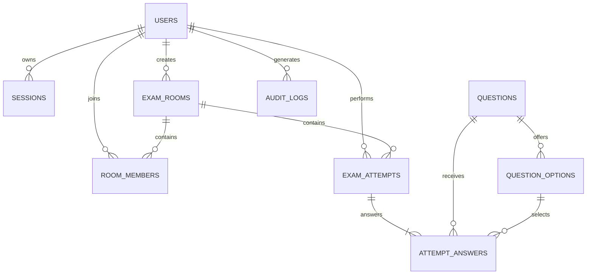

# Kiến Trúc Cơ Sở Dữ Liệu Quan Hệ Chuẩn Hóa 3NF & Khung Nhìn Nghiệp Vụ (Database Architecture)

> **Phân hệ:** Máy chủ Backend (`server/`) — PostgreSQL 14+ (Supabase Cloud Database)  
> **Schema:** Toàn bộ bảng, khung nhìn (views) và chỉ mục được tổ chức trong schema `public`  
> **Kịch bản SQL:** [online_exam_schema.sql](../online_exam_schema.sql) (Khởi tạo Schema DDL) và [online_exam_seed_data.sql](../online_exam_seed_data.sql) (Dữ liệu mẫu kiểm thử)

---

## 1. Triết Lý Thiết Kế & Chuẩn Hóa 3NF (Third Normal Form)

Hệ thống cơ sở dữ liệu của `mooc-clone` được thiết kế theo đúng nguyên lý **Chuẩn hóa dạng 3 (3NF)** nhằm đạt được 3 mục tiêu kỹ thuật then chốt:

1. **Loại Bỏ Hoàn Toàn Dữ Liệu Phái Sinh Dư Thừa:**
   - Không lưu trữ các trường dữ liệu tổng hợp như `correct_count`, `wrong_count`, `unanswered_count`, `correct_percent` hay `score_10` trong các bảng cơ sở.
   - Toàn bộ kết quả chấm thi được tính toán trực tiếp và tức thì thông qua hệ thống **5 Khung nhìn nghiệp vụ (Dynamic Views)**.
2. **Triệt Tiêu Phụ Thuộc Vòng Tròn (Circular / Diamond Dependencies):**
   - Loại bỏ cụm 3 bảng snapshot con cồng kềnh trước đây (`attempt_questions`, `attempt_question_options`, `attempt_answers`), hợp nhất thành **duy nhất bảng `attempt_answers`** theo chuẩn 3NF: `(attempt_id, question_id, position, selected_option_id, answered_at)`.
   - Thuộc tính nội dung câu hỏi và các phương án được tra cứu trực tiếp từ bảng gốc `questions` và `question_options`.
3. **Bảo Toàn Lịch Sử Bằng Cơ Chế Xóa Mềm (Soft Delete):**
   - Không xóa cứng câu hỏi khỏi CSDL khi đã có bài thi tham chiếu. Hệ thống sử dụng cờ `status = 'ARCHIVED'` trên bảng `questions` để bảo đảm tính toàn vẹn tham chiếu vĩnh viễn.

---

## 2. Sơ Đồ Quan Hệ Thực Thể (Mermaid ERD)



---

## 3. Danh Mục Chi Tiết 9 Bảng Cốt Lõi (3NF Tables)

| Tên Bảng (Table) | Mục Đích Kỹ Thuật | Ràng Buộc & Khóa Chính / Ngoại Quan Trọng |
| :--- | :--- | :--- |
| `users` | Quản lý tài khoản, mật khẩu băm BCrypt, vai trò (`USER`, `ADMIN`) | Khóa chính `id` (IDENTITY); duy nhất `lower(username)` và `lower(email)`; ràng buộc `status IN ('ACTIVE', 'BLOCKED')` |
| `sessions` | Quản lý phiên làm việc máy chủ bảo mật | Khóa ngoại `user_id`; cột `token_hash` kiểu `BYTEA` (32 bytes SHA-256) duy nhất; kiểm tra `expires_at` và cờ thu hồi `revoked_at` |
| `questions` | Ngân hàng câu hỏi trắc nghiệm | Khóa chính `id`; `topic` không rỗng; `difficulty IN ('EASY', 'MEDIUM', 'HARD')`; `status IN ('ACTIVE', 'ARCHIVED')` |
| `question_options`| Danh sách phương án lựa chọn cho câu hỏi | Khóa ngoại `question_id`; duy nhất `(question_id, position)`; chỉ mục partial đảm bảo tối đa 1 đáp án đúng (`is_correct = true`); khóa duy nhất phức hợp `(question_id, id)` |
| `exam_rooms` | Phòng thi trắc nghiệm, cấu hình đề và vòng đời | Khóa chính `id`; `room_code` duy nhất; cấu hình `(easy_count + medium_count + hard_count) > 0`; `status IN ('WAITING', 'IN_PROGRESS', 'ENDED')` |
| `room_members` | Danh sách thí sinh trong phòng / Whitelist | Khóa chính phức hợp `(room_id, user_id)` ngăn ngừa trùng lặp thành viên |
| `exam_attempts` | Lượt thi trắc nghiệm (`EXAM` hoặc `PRACTICE`) | Khóa chính `id`; kiểm tra tính nhất quán giữa chế độ, deadline, submitted_at, graded_at; mỗi người dùng chỉ có 1 lượt thi trong 1 phòng thi |
| `attempt_answers` | Danh sách câu hỏi và đáp án chọn của thí sinh | Khóa chính phức hợp `(attempt_id, question_id)`; duy nhất `(attempt_id, position)`; khóa ngoại phức hợp `(question_id, selected_option_id)` chống chọn nhầm câu hỏi |
| `audit_logs` | Nhật ký sự kiện bảo mật và kiểm toán hệ thống | Khóa chính `id`; `actor_user_id`; `metadata` định dạng JSONB; dấu thời gian `occurred_at` |

---

## 4. Hệ Thống 5 Khung Nhìn Nghiệp Vụ Tính Toán Tức Thì (Dynamic Views)

Hệ thống không lưu trữ các trường dữ liệu phái sinh nhằm tránh sai lệch trạng thái. Năm khung nhìn tính toán tức thì:

### 4.1. `v_attempt_results`
- **Mục đích:** Báo cáo chi tiết kết quả lượt thi sau khi nộp bài.
- **Dữ liệu tính toán:** Tổng số câu hỏi, số câu đúng (`correct_count`), số câu sai (`wrong_count`), số câu chưa trả lời (`unanswered_count`), tỷ lệ phần trăm chính xác (`correct_percent`) và điểm số thang 10 (`score_10`).

### 4.2. `v_room_list`
- **Mục đích:** Danh sách tổng quan phòng thi cho trang chủ và sảnh chờ.
- **Dữ liệu tính toán:** Tổng số câu hỏi tổng hợp trực tiếp từ `(easy_count + medium_count + hard_count)`, số lượng thí sinh hiện diện trong phòng từ bảng `room_members`.

### 4.3. `v_room_results`
- **Mục đích:** Bảng xếp hạng vinh danh (Leaderboard) của thí sinh trong các phòng thi đã kết thúc (`status = 'ENDED'`).
- **Dữ liệu tính toán:** Sắp xếp theo thứ tự ưu tiên điểm số thang 10 giảm dần, số câu đúng giảm dần và thời gian hoàn thành bài thi sớm nhất.

### 4.4. `v_user_statistics`
- **Mục đích:** Báo cáo thống kê năng lực tổng thể của người dùng qua toàn bộ lịch sử thi cử.
- **Dữ liệu tính toán:** Tổng số bài thi đã hoàn thành, tổng số câu hỏi đã làm, tỷ lệ phần trăm đúng tổng thể (`overall_correct_percent`) và điểm trung bình tích lũy thang 10 (`overall_score_10`).

### 4.5. `v_user_topic_performance`
- **Mục đích:** Phân tích điểm mạnh, điểm yếu theo từng chủ đề kiến thức (Topic Analysis).
- **Dữ liệu tính toán:** Số câu hỏi đã làm, số câu đúng, tỷ lệ phần trăm chính xác theo từng `topic`, phục vụ trực quan hóa biểu đồ Radar hoặc biểu đồ cột trên giao diện Client.

---

## 5. Các Ràng Buộc Bất Biến Ứng Dụng (Application Invariants)

1. **Khóa Ngoại Kép Chống Chọn Nhầm Phương Án:**
   ```sql
   CONSTRAINT fk_attempt_answers_option_same_question
       FOREIGN KEY (question_id, selected_option_id)
       REFERENCES public.question_options (question_id, id)
       ON DELETE RESTRICT
   ```
   Ràng buộc này bảo đảm phương án `selected_option_id` được chọn **bắt buộc phải thuộc về đúng câu hỏi** `question_id`, ngăn chặn hoàn toàn gian lận payload.
2. **Nguyên Tắc Câu Hỏi Hợp Lệ:** Trước khi một câu hỏi hoạt động (`ACTIVE`) được đưa vào đề thi, câu hỏi bắt buộc phải có tối thiểu 2 phương án lựa chọn và chính xác 1 phương án đúng (`is_correct = true`).
3. **Bảo Mật Cờ Đáp Án:** Cột `is_correct` của bảng `question_options` tuyệt đối không bao giờ được gửi xuống Client trong suốt quá trình làm bài thi.
4. **Bảo Mật Token:** CSDL chỉ lưu trữ giá trị băm nhị phân 32 bytes của token trong cột `sessions.token_hash`.

---

## 6. Hướng Dẫn Khởi Tạo CSDL & Nạp Dữ Liệu Mẫu

1. **Thực thi kịch bản tạo Schema DDL:**
   ```bash
   psql -U postgres -d online_exam_db -f server/online_exam_schema.sql
   ```
2. **Thực thi kịch bản nạp dữ liệu mẫu ban đầu (Seed Data):**
   ```bash
   psql -U postgres -d online_exam_db -f server/online_exam_seed_data.sql
   ```

---

## 7. Liên Kết Đối Chiếu

- Hướng dẫn tạo Entity và Repository ánh xạ tới bảng CSDL: [API_GENERATION_GUIDE.md](ai-guides/API_GENERATION_GUIDE.md).
- Hướng dẫn viết truy vấn custom và khai thác Dynamic Views: [CUSTOM_API_GUIDE.md](ai-guides/CUSTOM_API_GUIDE.md).
- Kiến trúc lưu trữ Session Token bảo mật: [security-architecture.md](security-architecture.md).
