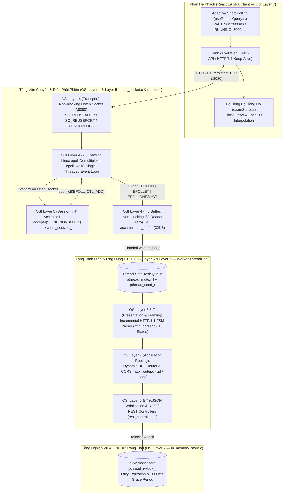
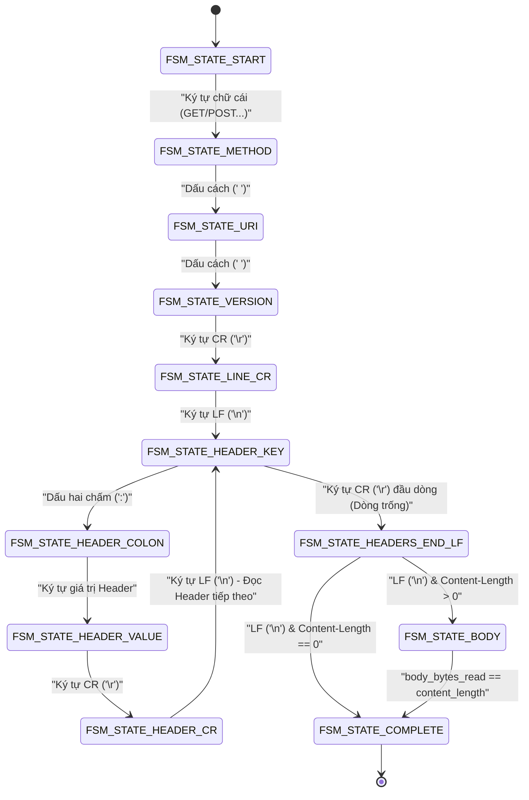
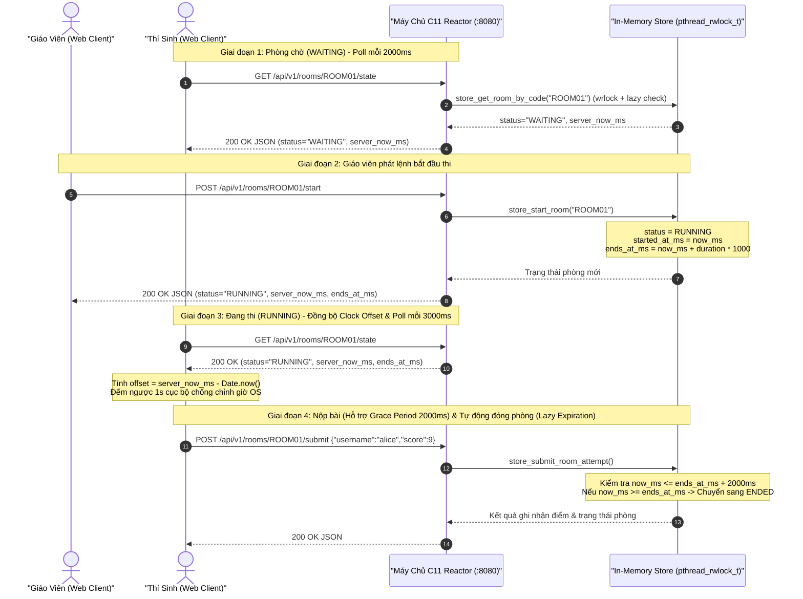

# Phân Hệ Mạng & Kiến Trúc Đồng Bộ Phòng Thi Thời Gian Thực (Realtime Network Subsystem)

> **Phân hệ trọng tâm:** Máy chủ C11 HTTP/REST & Reactor (`server-c/`) — Học phần Lập trình Mạng (IT4062)  
> **Kiến trúc mạng:** POSIX Non-blocking TCP Socket + Linux `epoll` Doug Lea Classic Reactor + Incremental HTTP/1.1 FSM Parser (Cổng 8080)  
> **Cơ chế đồng bộ thời gian thực:** Stateless HTTP/1.1 Keep-Alive + Adaptive Short Polling + Server Authoritative Timestamp  
> **Quy chuẩn lập trình Socket:** Xem tại [server-c/CONVENTIONS.md](../../server-c/CONVENTIONS.md) và [server-c/README.md](../../server-c/README.md)

---

## 1. Tổng Quan Kiến Trúc Mạng Hệ Thống (`server-c/`)

Hệ thống thi trắc nghiệm trực tuyến `mooc-clone` vận hành trên nền tảng máy chủ mạng hiệu năng cao được xây dựng từ tầng Socket POSIX bằng ngôn ngữ C (chuẩn C11) tại [`server-c/`](../../server-c/README.md), kết nối trực tiếp với ứng dụng giao diện React 19 SPA ([`client/`](../../client/FRONTEND_CONVENTIONS.md)) thông qua giao thức HTTP/1.1 Keep-Alive phi trạng thái:



### Phân Tách Trách Nhiệm Giữa Các Tầng Mạng Trong `server-c/` (Đối Chiếu Mô Hình OSI 7 Tầng):

Trong kiến trúc mạng thực tế trên Linux, nhân hệ điều hành (Kernel) đảm nhiệm từ **Tầng 1 đến Tầng 4**, còn tiến trình máy chủ `server-c/` (User-space) giao tiếp trực tiếp từ ranh giới **Tầng 4 (POSIX Socket API)** và tự hiện thực hóa trọn vẹn các chức năng của **Tầng 5 (Session)**, **Tầng 6 (Presentation)** và **Tầng 7 (Application)** theo mô hình tham chiếu **OSI (Open Systems Interconnection)**:

| Tầng Kiến Trúc Trong `server-c/` | Ánh Xạ Mô Hình OSI (7 Tầng) | Tệp Mã Nguồn Cốt Lõi | Trách Nhiệm Kỹ Thuật Cụ Thể |
| :--- | :--- | :--- | :--- |
| **1. Tầng Socket Vận Chuyển** | **OSI Layer 4 — Transport Layer** *(Tầng Giao vận)*<br/>*(Chạm **Layer 3 — Network** khi cấu hình IP)* | [tcp_socket.h](../../server-c/include/tcp_socket.h), [tcp_socket.c](../../server-c/src/tcp_socket.c) | Khởi tạo kênh truyền TCP (`SOCK_STREAM`), gán địa chỉ IPv4 (`inet_pton`/`sockaddr_in` ở Layer 3) và cổng `:8080` (Layer 4), bật `SO_REUSEADDR`/`SO_REUSEPORT`, đặt cờ `O_NONBLOCK`, tiếp nhận kết nối qua `accept4()` và đảm bảo truyền đủ luồng byte đầu-cuối qua `tcp_send_all()` + `poll(POLLOUT)`. |
| **2. Tầng Điều Phối Sự Kiện & Phiên** | **OSI Layer 5 — Session Layer** *(Tầng Phiên)*<br/>*(Cầu nối dồn kênh I/O từ Layer 4 lên Layer 5)* | [reactor.h](../../server-c/include/reactor.h), [reactor.c](../../server-c/src/reactor.c) | Thiết lập, duy trì và hủy phiên làm việc (`client_session_t`) cho từng kết nối Keep-Alive qua danh sách liên kết đôi (`sessions_head`); kiểm soát lượt đối thoại (Dialog Control) không xung đột bằng cờ `EPOLLONESHOT`; gom dữ liệu thô vào `accumulation_buffer` và bàn giao sang Worker Pool. |
| **3. Tầng Đóng Khung & Biểu Diễn Dữ Liệu** | **OSI Layer 6 — Presentation Layer** *(Tầng Trình diễn)*<br/>& **OSI Layer 7 Framing** | [http_parser.h](../../server-c/include/http_parser.h), [http_parser.c](../../server-c/src/http_parser.c), [http_response.c](../../server-c/src/http_response.c) | Chuyển đổi dòng byte thô từ mạng thành cấu trúc dữ liệu C (`http_request_t`) qua máy trạng thái hữu hạn (FSM) 13 bước; giải quyết phân mảnh/dính gói tin dựa trên `\r\n\r\n` và `Content-Length`; tuần tự hóa phản hồi (`http_response_serialize`) và mã hóa/giải mã định dạng JSON (`cJSON`). |
| **4. Tầng Định Tuyến & Giao Thức Ứng Dụng** | **OSI Layer 7 — Application Layer** *(Tầng Ứng dụng — Giao thức HTTP & Định tuyến)* | [http_router.h](../../server-c/include/http_router.h), [http_router.c](../../server-c/src/http_router.c), [rest_controllers.c](../../server-c/src/rest_controllers.c), [thread_pool.c](../../server-c/src/thread_pool.c) | Thực thi giao thức ứng dụng HTTP/1.1 trên nhóm luồng công nhân (`pthread`), phân tích ngữ nghĩa phương thức (`GET`, `POST`, `PUT`, `DELETE`, `OPTIONS`), bóc tách tham số URI động (`:id`, `:code`) bằng `strtok_r`, kiểm soát chính sách CORS Preflight và ánh xạ mã trạng thái HTTP (`200`, `201`, `400`, `404`, `409`). |
| **5. Tầng Nghiệp Vụ & Lưu Trữ Trạng Thái** | **OSI Layer 7 — Application Layer** *(Tầng Ứng dụng — Logic Nghiệp vụ Phòng thi)* | [in_memory_store.h](../../server-c/include/in_memory_store.h), [in_memory_store.c](../../server-c/src/in_memory_store.c) | Thực thi logic nghiệp vụ cốt lõi của ứng dụng thi trực tuyến: quản lý đề thi, câu hỏi, trạng thái phòng thi (`WAITING` -> `RUNNING` -> `ENDED`), cấp mốc giờ chuẩn `get_server_now_ms()`, đánh giá hết hạn lười (Lazy Expiration), ân hạn trễ mạng `2000ms` và đồng bộ đa luồng bằng `pthread_rwlock_t`. |

#### Giải Thích Chi Tiết Sự Phân Công Giữa Nhân Linux (OSI Layer 1–4) Và Mã Nguồn `server-c/` (OSI Layer 4–7):

Để hiểu rõ vì sao mã nguồn `server-c/` được chia thành 5 tầng như bảng trên, hãy theo dõi hành trình của một gói tin từ dây mạng đi lên ứng dụng theo đúng **7 tầng chuẩn OSI**:

1. **Tầng 1 (Physical) & Tầng 2 (Data Link) — Phần cứng NIC & Driver Nhân Linux:**
   - Card mạng thu tín hiệu điện/quang (Layer 1), đóng khung Ethernet Frame và kiểm tra địa chỉ MAC / mã lỗi CRC (Layer 2). Lập trình viên C không cần can thiệp vào hai tầng này.
2. **Tầng 3 (Network Layer — Tầng Mạng) — Ngăn xếp IP trong Nhân Linux & Cấu hình Địa chỉ trong `tcp_socket.c`:**
   - Nhân Linux định tuyến gói tin IP (`IPv4`).
   - Trong [tcp_socket.c](../../server-c/src/tcp_socket.c), mã nguồn tương tác với Tầng 3 tại bước cấu hình `server_address.sin_family = AF_INET` và chuyển đổi chuỗi IP (`0.0.0.0` / `127.0.0.1`) sang dạng nhị phân mạng qua `inet_pton()`, cũng như đọc IP của thí sinh qua `inet_ntop()`.
3. **Tầng 4 (Transport Layer — Tầng Giao vận) — Ranh giới giữa Nhân Linux và [tcp_socket.c](../../server-c/src/tcp_socket.c):**
   - Nhân Linux tự động xử lý bắt tay 3 bước TCP (3-Way Handshake `SYN` / `SYN-ACK` / `ACK`), đánh số thứ tự byte (`Sequence Number`), báo nhận (`ACK`) và truyền lại gói rớt.
   - Tệp [tcp_socket.c](../../server-c/src/tcp_socket.c) điều khiển trực tiếp Tầng 4 thông qua hệ thống lệnh gọi POSIX Socket: gắn cổng dịch vụ `htons(8080)` (`bind`), mở hàng đợi kết nối (`listen`), rút kết nối đã bắt tay xong (`accept4`), đọc dòng byte từ bộ đệm nhận của nhân (`tcp_recv`) và đảm bảo đẩy đủ 100% byte vào bộ đệm gửi của nhân (`tcp_send_all`).
4. **Tầng 5 (Session Layer — Tầng Phiên) — Quản lý Phiên Keep-Alive & Điều phối Dialog trong [reactor.c](../../server-c/src/reactor.c):**
   - Theo lý thuyết OSI, Tầng 5 chịu trách nhiệm **thiết lập, duy trì, đồng bộ hóa và đóng phiên giao tiếp** giữa hai đầu mút, cũng như **kiểm soát lượt truyền (Dialog Control / Token Management)**.
   - Trong `server-c/`, TCP chỉ là luồng byte thô nên [reactor.c](../../server-c/src/reactor.c) đảm nhận trọn vẹn vai trò Tầng 5:
     - **Khởi tạo & Duy trì phiên:** Mỗi kết nối được cấp một thực thể `client_session_t` lưu giữ trạng thái phiên xuyên suốt nhiều yêu cầu HTTP/1.1 Keep-Alive liên tiếp, được quản lý tập trung trong danh sách liên kết đôi `sessions_head`.
     - **Kiểm soát lượt thao tác (Dialog Synchronization):** Sử dụng cờ `EPOLLONESHOT` như một "thẻ bài (token)" đảm bảo tại một thời điểm chỉ có duy nhất luồng I/O hoặc 1 luồng Worker được quyền thao tác trên phiên đó.
     - **Đóng phiên an toàn:** Tự động thu hồi phiên khi Client gửi `Connection: close`, khi đứt kết nối (`EPOLLRDHUP`) hoặc khi tắt máy chủ (`reactor_destroy`).
5. **Tầng 6 (Presentation Layer — Tầng Trình diễn) — Định dạng Cú pháp, Đóng khung & Biểu diễn JSON tại [http_parser.c](../../server-c/src/http_parser.c), [http_response.c](../../server-c/src/http_response.c) & `cJSON`:**
   - Theo lý thuyết OSI, Tầng 6 đóng vai trò **"Thông dịch viên dữ liệu" (Syntax & Data Representation)**: chuyển đổi dữ liệu giữa chuỗi byte truyền trên mạng và cấu trúc dữ liệu mà chương trình hiểu được (Serialization / Deserialization).
   - Trong `server-c/`, chức năng Tầng 6 thể hiện rõ ở 2 bước:
     - **Giải mã & Tuần tự hóa khung HTTP:** `http_parser_execute()` dịch mảng ký tự ASCII thô có dấu phân cách `\r\n\r\n` và `Content-Length` thành struct `http_request_t`; ngược lại, `http_response_serialize()` biến struct `http_response_t` thành chuỗi byte chuẩn để truyền đi.
     - **Biểu diễn cấu trúc JSON (`cJSON`):** Trong [rest_controllers.c](../../server-c/src/rest_controllers.c), thư viện `cJSON_Parse()` và `cJSON_PrintUnformatted()` chuyển đổi qua lại giữa chuỗi văn bản JSON UTF-8 và các kiểu dữ liệu C (`int64_t`, `char[]`, `exam_room_t`).
6. **Tầng 7 (Application Layer — Tầng Ứng dụng) — Định tuyến HTTP & Nghiệp vụ Thi Trắc nghiệm tại [http_router.c](../../server-c/src/http_router.c), [rest_controllers.c](../../server-c/src/rest_controllers.c) & [in_memory_store.c](../../server-c/src/in_memory_store.c):**
   - Là tầng cao nhất phục vụ trực tiếp nhu cầu của người dùng cuối (Giáo viên & Thí sinh trên trình duyệt):
     - **Tầng 4 trong bảng (`http_router.c` & `rest_controllers.c`):** Xử lý ngữ nghĩa giao thức HTTP/1.1 (ánh xạ đường dẫn `/api/v1/rooms/:code/start`, kiểm tra quyền CORS, trả mã lỗi `404 Not Found` / `409 Conflict`).
     - **Tầng 5 trong bảng (`in_memory_store.c`):** Chứa luật lệ nghiệp vụ của hệ thống thi (tính giờ kết thúc `ends_at_ms`, tự động đóng phòng khi hết giờ, kiểm tra ân hạn nộp bài `2000ms` và chấm điểm).

---

## 2. Điều Phối Kết Nối Theo Mô Hình Doug Lea Classic Reactor (`epoll` + Worker ThreadPool)

Phân hệ mạng tại [reactor.c](../../server-c/src/reactor.c) hiện thực hóa mô hình **Doug Lea Classic Reactor Pattern**, tách biệt hoàn toàn tác vụ dồn kênh I/O không chặn (trên 1 luồng Reactor duy nhất) khỏi tác vụ xử lý nghiệp vụ và JSON (trên nhóm luồng Worker ThreadPool).

### 2.1. Dồn Kênh I/O Không Chặn Với `epoll` (`EPOLLET | EPOLLONESHOT`)

1. **Tiếp nhận kết nối mới liên tục (Edge-Triggered Acceptor):**
   - `listen_socket` được chuyển sang chế độ non-blocking và đăng ký vào `epoll_fd` với cờ `EPOLLIN | EPOLLET`.
   - Khi có sự kiện kết nối đến, Reactor gọi vòng lặp `tcp_server_accept_nonblocking()` (sử dụng system call `accept4(..., SOCK_NONBLOCK)`) liên tục cho tới khi nhân Linux trả về `EAGAIN`, đảm bảo rút cạn hàng đợi kết nối (`backlog = 512`) chỉ trong một chu kỳ đánh thức.

2. **Đăng ký phiên kết nối Client với `EPOLLONESHOT`:**
   - Mỗi kết nối mới được cấp phát một cấu trúc `client_session_t` (chứa `accumulation_buffer[32768]`, bộ phân tích `http_parser_t` và `http_request_t` riêng) rồi đăng ký vào `epoll` với tổ hợp cờ:
     ```c
     client_ev.events = EPOLLIN | EPOLLET | EPOLLRDHUP | EPOLLONESHOT;
     client_ev.data.ptr = session;
     ```
   - **Ý nghĩa của `EPOLLONESHOT`:** Đảm bảo tại mọi thời điểm chỉ có duy nhất một luồng (Reactor hoặc 1 Worker Thread) được phép thao tác trên một `client_session_t`. Khi socket đang được Worker xử lý, nhân Linux tạm khóa không phát sinh sự kiện `EPOLLIN` mới cho socket đó, loại bỏ hoàn toàn xung đột dữ liệu (Race Condition) trên bộ đệm phiên mà không cần khóa mutex cho từng lần đọc.

3. **Bàn giao tác vụ không chặn (Non-blocking Worker Handoff):**
   - Trong `handle_client_io()`, luồng Reactor gọi `recv()` đọc dữ liệu vào `session->accumulation_buffer` và chạy `http_parser_execute()`.
   - Ngay khi bóc tách đủ 1 HTTP Request hoàn chỉnh (`parsed > 0`), Reactor đóng gói `worker_job_t` và đẩy vào hàng đợi của [thread_pool.c](../../server-c/src/thread_pool.c) qua `thread_pool_submit()`.
   - Nếu đọc hết bộ đệm nhân (`errno == EAGAIN`) mà gói tin vẫn chưa hoàn chỉnh (`parsed == 0`), Reactor lập tức gọi `epoll_ctl(..., EPOLL_CTL_MOD, ...)` để re-arm `EPOLLONESHOT` và quay lại vòng lặp `epoll_wait()` mà không hề bị chặn.

### 2.2. Đảm Bảo Gửi Đủ Dữ Liệu (`tcp_send_all`) & Quản Lý Vòng Đời Phiên

1. **Chống đứt gãy gói tin khi ghi trên Non-blocking Socket ([tcp_socket.c](../../server-c/src/tcp_socket.c)):**
   - **Hình dung trực quan:** Hãy tưởng tượng bộ đệm gửi của nhân Linux (Kernel Send Buffer) giống như một **phễu chứa nước có dung tích giới hạn**. Khi Server muốn đổ một ca nước lớn (ví dụ: danh sách 50 câu hỏi trắc nghiệm dài `12.000 byte`) vào phễu trên socket không chặn (`O_NONBLOCK`), nếu phễu chỉ còn trống `4.000 byte`, lệnh `send()` sẽ chỉ nhận đúng `4.000 byte` rồi trả về ngay (gọi là **Ghi một phần — Partial Write**), hoặc trả về `-1` kèm mã `EAGAIN` nếu phễu đang đầy tràn.
   - **Cơ chế xử lý tại hàm `tcp_send_all()`:**
     - Sử dụng vòng lặp `while (total_bytes_sent < length)` để theo dõi số byte đã thực sự đẩy vào nhân và dịch con trỏ `data_ptr + total_bytes_sent` cho đến khi gửi đủ 100% độ dài bản tin.
     - Đính kèm cờ `MSG_NOSIGNAL` trong lệnh `send()` để ngăn hệ điều hành bắn tín hiệu `SIGPIPE` làm sập toàn bộ tiến trình máy chủ nếu thí sinh đột ngột đóng trình duyệt giữa chừng.
     - Khi gặp `errno == EAGAIN` hoặc `EWOULDBLOCK` (phễu nhân đang đầy), hàm gọi `poll(&poll_desc, 1, SEND_POLL_TIMEOUT_MS)` chờ sự kiện `POLLOUT` (đợi card mạng rút bớt dữ liệu khỏi phễu) rồi mới tiếp tục vòng lặp ghi phần byte còn lại:
     ```text
     Cần gửi HTTP Response dài 12.000 bytes:
     [==================== 12.000 bytes ====================]

     Lần send() 1: Kernel Buffer còn chỗ cho 5.000 bytes -> Gửi được 5.000 bytes
     total_bytes_sent = 5.000 | Còn lại: 7.000 bytes

     Lần send() 2: Kernel Buffer đầy -> trả về -1 (errno = EAGAIN)
     -> Gọi poll(POLLOUT, timeout = 5000ms) chờ đường truyền mạng vơi bớt...

     Lần send() 3 (sau khi POLLOUT sẵn sàng): Gửi nốt 7.000 bytes từ (data_ptr + 5000)
     total_bytes_sent = 12.000 -> Hoàn tất 100% gói tin!
     ```

2. **Quản lý danh sách phiên chủ động & Graceful Shutdown (Zero Memory Leaks):**
   - `reactor_t` duy trì danh sách liên kết đôi `sessions_head` (được bảo vệ bởi `sessions_lock`) lưu vết mọi `client_session_t` đang giữ kết nối Keep-Alive.
   - Khi nhận tín hiệu `SIGINT` hoặc `SIGTERM` ([main.c](../../server-c/src/main.c)), hàm `reactor_destroy()` tuần tự:
     1. Chờ toàn bộ Worker Threads hoàn tất các request đang xử lý (`thread_pool_destroy()`).
     2. Duyệt danh sách `sessions_head` để gỡ khỏi `epoll`, đóng mọi file descriptor và giải phóng `free(session)` cho toàn bộ kết nối Keep-Alive đang rảnh.
     3. Đóng `epoll_fd` và hủy các đối tượng đồng bộ, đảm bảo kiểm thử Valgrind / AddressSanitizer đạt **0 byte rò rỉ bộ nhớ**.

---

## 3. Đóng Khung Giao Thức HTTP/1.1 & Giải Quyết Bài Toán Truyền Dòng TCP

### 3.1. Bản Chất Bài Toán Truyền Dòng (Vì Sao Server Không Thể Chỉ Gọi `recv()` Một Lần?)

Khác với UDP gửi từng bưu kiện rời rạc, giao thức TCP (`SOCK_STREAM`) hoạt động giống như một **đường ống dẫn nước liên tục**:
- Phía gửi (`Client`) bơm các ký tự vào đầu ống, và phía nhận (`Server`) hứng các ký tự chảy ra ở cuối ống qua lệnh `recv()`.
- Bản thân đường ống TCP **không hề biết một yêu cầu HTTP bắt đầu hay kết thúc ở đâu**. Do ảnh hưởng của card mạng, bộ định tuyến (Router) và lịch trình CPU, dòng byte chảy đến Server luôn xảy ra 2 hiện tượng:
  1. **Phân mảnh gói tin (Packet Fragmentation — "Giao hàng thiếu"):** Client gửi 1 yêu cầu nộp bài dài `200 byte`, nhưng mạng chia nhỏ làm 3 đợt: lần `recv()` thứ nhất chỉ hứng được `40 byte` đầu, lần thứ hai hứng được `80 byte` giữa, và lần thứ ba mới nhận nốt `80 byte` cuối.
  2. **Dính gói tin (Sticky Packets / HTTP Pipelining — "Giao gộp nhiều đơn"):** Client gửi liên tiếp 2 yêu cầu gần nhau, khiến một lần gọi `recv()` duy nhất của Server hứng luôn cả **Yêu cầu 1 + Yêu cầu 2 + một nửa Yêu cầu 3** nằm dính chặt vào nhau trong cùng một mảng nhớ.

Để giải quyết triệt để cả hai hiện tượng trên, mỗi kết nối khách (`client_session_t` tại [reactor.h](../../server-c/include/reactor.h)) được trang bị:
- **Bộ đệm tích lũy riêng (`accumulation_buffer[32768]` — 32KB):** Đóng vai trò là "bồn chứa tạm" gom các mảnh dữ liệu đọc được từ `recv()`.
- **Máy trạng thái hữu hạn 13 bước (`Incremental Stateful FSM` tại [http_parser.c](../../server-c/src/http_parser.c)):** Đóng khung thông điệp ở tầng ứng dụng (Application-level Framing) dựa trên 2 dấu hiệu chuẩn HTTP/1.1:
  - **Ranh giới kết thúc phần Header:** Chuỗi 4 ký tự xuống dòng kép `\r\n\r\n`.
  - **Ranh giới kết thúc phần Body:** Đọc đủ chính xác số byte ghi trong trường `Content-Length`.



### 3.2. Cơ Chế Chống Phân Mảnh Gói Tin (Packet Fragmentation) Với Độ Phức Tạp $O(N)$

- **Nguyên lý dễ hiểu:** Thay vì mỗi lần nhận thêm dữ liệu lại phải đọc lại từ chữ cái đầu tiên, bộ phân tích `http_parser_t` hoạt động giống như một **đầu đọc có thẻ đánh dấu trang sách (`bytes_parsed`)**. Đọc đến đâu, nó ghi nhớ trạng thái (`state`) và vị trí con trỏ đến đó; nếu hết chữ mà câu chưa trọn vẹn, nó tạm dừng và chờ mảnh tiếp theo nối vào đuôi.
- **Minh họa trực quan trong `accumulation_buffer`:**
  Giả sử Client gửi lệnh `POST /join` có `Content-Length: 16` với nội dung JSON `{"user":"alice"}` (tổng cộng `65 bytes`), nhưng bị mạng cắt thành **3 mảnh** rời nhau:

  ```text
  [Đợt 1] recv() nhận được 22 bytes đầu tiên:
  accumulation_buffer (buffer_len = 22):
  +-------------------------------------------------------+
  | P O S T   / j o i n   H T T P / 1 . 1 \r \n C o n t   |
  +-------------------------------------------------------+
                                                          ^
                                            bytes_parsed = 22
                                            state = FSM_STATE_HEADER_KEY (đang đọc dở chữ "Content-Length")
  -> http_parser_execute() trả về 0 (chưa đủ gói) -> Reactor re-arm EPOLLONESHOT chờ tiếp.

  [Đợt 2] recv() nhận thêm 33 bytes tiếp theo và nối (memcpy) vào vị trí 22:
  accumulation_buffer (buffer_len = 55):
  +-------------------------------------------------------+-----------------------------------+
  | (22 bytes đã quét ở Đợt 1 - KHÔNG QUÉT LẠI)           | e n t - L e n g t h : 1 6 \r\n\r\n{"u s e r": |
  +-------------------------------------------------------+-----------------------------------+
                                                          ^                                   ^
                                            Bắt đầu quét tiếp từ i = 22         bytes_parsed = 55
                                                                                state = FSM_STATE_BODY
                                                                                body_bytes_read = 6 / 16
  -> Đã thấy "\r\n\r\n" và biết Body cần 16 bytes, nhưng mới có 6 bytes (`{"user`).
  -> http_parser_execute() trả về 0 -> Reactor tiếp tục chờ.

  [Đợt 3] recv() nhận nốt 10 bytes cuối (`"alice"}`):
  accumulation_buffer (buffer_len = 65):
  +-------------------------------------------------------------------------------------------+---------------+
  | (55 bytes đã xử lý ở Đợt 1 & 2)                                                           | " a l i c e " } |
  +-------------------------------------------------------------------------------------------+---------------+
                                                                                              ^               ^
                                                                                Đọc tiếp từ i = 55   bytes_parsed = 65
                                                                                                     body_bytes_read = 16 / 16
                                                                                                     state = FSM_STATE_COMPLETE
  -> http_parser_execute() trả về 65 (> 0) -> Đóng gói đủ 1 HTTP Request hoàn chỉnh chuyển sang Worker!
  ```

- **Chi tiết thực thi trong [http_parser.c](../../server-c/src/http_parser.c) và [reactor.c](../../server-c/src/reactor.c):**
  - Cấu trúc `http_parser_t` lưu giữ trạng thái hiện tại (`state`), tổng số byte đã quét (`bytes_parsed`), số byte body đã nạp (`body_bytes_read`) và các bộ đệm token tạm (`temp_method`, `temp_uri`, `temp_key`, `temp_val`).
  - Khi dữ liệu trong `accumulation_buffer` chưa đủ để hoàn tất request, `http_parser_execute()` trả về `0`. Tại `handle_client_io()`, khi `recv()` báo `EAGAIN` (đã hút cạn bộ đệm nhân Linux), Reactor gọi `epoll_ctl(..., EPOLL_CTL_MOD, ...)` để bật lại `EPOLLONESHOT` và nhường CPU cho các kết nối khác.
  - Ở lần `EPOLLIN` tiếp theo, vòng lặp phân tích bắt đầu ngay từ `size_t i = parser->bytes_parsed`, đảm bảo mỗi byte chỉ đi qua FSM đúng 1 lần duy nhất (độ phức tạp tuyến tính $O(N)$).

### 3.3. Cơ Chế Chống Dính Gói Tin & HTTP Pipelining (Sticky Packets)

- **Nguyên lý dễ hiểu:** Khi một lần `recv()` hốt vào `accumulation_buffer` nhiều yêu cầu dính liền nhau, Server xử lý theo quy tắc **"Cắt từng khúc — Dồn phần dư lên đầu — Xử lý cạn bồn"**:
  1. Máy trạng thái FSM quét đến đúng vạch kết thúc của **Request 1** thì dừng lại ngay và báo chính xác Request 1 dài bao nhiêu byte (`parsed`).
  2. Server lấy Request 1 ra xử lý, đồng thời dùng lệnh `memmove()` kéo toàn bộ phần byte của **Request 2, Request 3...** dịch lên đầu `accumulation_buffer` (vị trí `0`).
  3. Luồng Worker tiếp tục lặp lại việc cắt và xử lý tuần tự cho tới khi trong `accumulation_buffer` không còn bất kỳ Request hoàn chỉnh nào nữa.

- **Minh họa trực quan quá trình cắt gói và dịch vùng nhớ (`memmove`):**

  ```text
  [Bước 1] Một lần recv() đọc được 110 bytes gồm: Request 1 (40B) + Request 2 (45B) + Nửa đầu Request 3 (25B):
  accumulation_buffer (buffer_len = 110):
  +----------------------------------------+---------------------------------------------+-------------------------+
  | Request 1 (Hoàn chỉnh: 40 bytes)       | Request 2 (Hoàn chỉnh: 45 bytes)            | Nửa đầu Req 3 (25 bytes)|
  +----------------------------------------+---------------------------------------------+-------------------------+
  0                                       40                                            85                       110

  [Bước 2] http_parser_execute() dừng ngay tại byte thứ 40 (FSM_STATE_COMPLETE) và trả về parsed = 40.
  Reactor tách Request 1 giao cho Worker, rồi gọi memmove() dịch 70 bytes còn lại (110 - 40) về đầu mảng:
  accumulation_buffer sau memmove (buffer_len = 70):
  +---------------------------------------------+-------------------------+
  | Request 2 (Hoàn chỉnh: 45 bytes)            | Nửa đầu Req 3 (25 bytes)|
  +---------------------------------------------+-------------------------+
  0                                            45                        70

  [Bước 3] Trên Worker Thread (worker_execute_job), sau khi trả lời xong Request 1,
  thấy buffer_len (70) > 0 nên chạy vòng lặp rút cạn (Sequential Per-Session Drain):
  - Gọi http_parser_execute() -> tách tiếp Request 2 (parsed = 45) -> trả lời Request 2.
  - Gọi memmove() dịch 25 bytes của Nửa đầu Req 3 về đầu mảng:
  accumulation_buffer sau memmove lần 2 (buffer_len = 25):
  +-------------------------+
  | Nửa đầu Req 3 (25 bytes)|
  +-------------------------+
  0                        25

  [Bước 4] Vòng lặp Worker gọi http_parser_execute() trên 25 bytes lẻ của Req 3 -> trả về 0 (chưa đủ gói).
  Worker thoát vòng lặp và re-arm EPOLLONESHOT để chờ phần còn lại của Req 3 từ mạng!
  ```

- **Chi tiết phối hợp giữa `http_parser.c` và `reactor.c`:**
  1. **Tách khung chính xác theo số byte tiêu thụ:** Khi `http_parser_execute()` hoàn tất một Request (`FSM_STATE_COMPLETE`), hàm trả về số byte `parsed` của đúng Request đó. Luồng xử lý dùng `memmove()` dịch phần byte dư về đầu `accumulation_buffer`:
     ```c
     size_t consumed = (size_t)parsed;
     memmove(session->accumulation_buffer,
             session->accumulation_buffer + consumed,
             session->buffer_len - consumed);
     session->buffer_len -= consumed;
     ```
  2. **Rút cạn tuần tự trên Worker (`Sequential Per-Session Drain`):** Vì socket dùng cờ `EPOLLET | EPOLLONESHOT` (chế độ kích hoạt theo sườn xung), nhân Linux sẽ **không phát lại sự kiện `EPOLLIN`** cho phần dữ liệu của Request 2 đã nằm sẵn trong RAM của `accumulation_buffer`. Do đó, tại hàm `worker_execute_job()` ([reactor.c](../../server-c/src/reactor.c)), sau khi phản hồi xong Request 1, Worker bắt buộc chạy vòng lặp `while (session->buffer_len > 0)` để phân tích và phản hồi tuần tự toàn bộ các request hoàn chỉnh còn lại theo đúng thứ tự FIFO trước khi re-arm `EPOLLONESHOT`.

### 3.4. Bảng Tóm Tắt Cơ Chế Xử Lý Truyền Dòng Trên `server-c/`

| Hiện Tượng Mạng TCP | Nguyên Nhân Vật Lý | Giải Pháp Kỹ Thuật Trong `server-c/` | Tệp & Hàm Phụ Trách |
| :--- | :--- | :--- | :--- |
| **Phân mảnh gói tin (Packet Fragmentation)** | 1 HTTP Request lớn bị chia thành nhiều mảnh nhỏ qua nhiều lần `recv()`. | Gom vào `accumulation_buffer` (32KB); FSM lưu vết `bytes_parsed` và `body_bytes_read` để quét tiếp từ chỗ dở dang với chi phí $O(N)$. | [http_parser.c](../../server-c/src/http_parser.c) (`http_parser_execute`) |
| **Dính gói tin (Sticky Packets / Pipelining)** | Nhiều HTTP Request nối đuôi nhau bị đọc gộp trong 1 lần `recv()`. | Tách đúng ranh giới `\r\n\r\n` + `Content-Length`, dùng `memmove()` dồn byte dư về đầu mảng và rút cạn bằng vòng lặp `while (session->buffer_len > 0)`. | [reactor.c](../../server-c/src/reactor.c) (`handle_client_io`, `worker_execute_job`) |
| **Ghi một phần (Partial Write)** | Bộ đệm gửi của nhân Linux đầy khi gửi phản hồi lớn trên socket `O_NONBLOCK`. | Vòng lặp `while (total_bytes_sent < length)` kết hợp cờ `MSG_NOSIGNAL` và gọi `poll(POLLOUT)` đợi bộ đệm nhân vơi trước khi ghi tiếp. | [tcp_socket.c](../../server-c/src/tcp_socket.c) (`tcp_send_all`) |
| **Xung đột đọc/ghi đa luồng trên cùng kết nối** | Nhiều luồng cùng đọc hoặc sửa `accumulation_buffer` của 1 client. | Cờ `EPOLLONESHOT` khóa sự kiện socket trên nhân Linux cho tới khi Worker xử lý xong và chủ động kích hoạt lại (`EPOLL_CTL_MOD`). | [reactor.c](../../server-c/src/reactor.c) (`handle_accept`, `worker_execute_job`) |

---

## 4. Đồng Bộ Phòng Thi Thời Gian Thực: Adaptive Short Polling & Đồng Hồ Chuẩn Máy Chủ

Thay vì duy trì kết nối stateful phức tạp trên trình duyệt, hệ thống đồng bộ phòng thi trực tuyến bằng kiến trúc **100% Stateless REST** kết hợp **Adaptive Short Polling**, **Server Authoritative Timestamp** và **Lazy State Expiration**.



### 4.1. Toán Học Đồng Bộ Thời Gian Chống Gian Lận (`server_now_ms` & `ends_at_ms`)

1. **Nguồn thời gian chuẩn từ Máy chủ ([in_memory_store.c](../../server-c/src/in_memory_store.c) & [rest_controllers.c](../../server-c/src/rest_controllers.c)):**
   - Hàm `get_server_now_ms()` trích xuất thời gian thực từ nhân POSIX qua `clock_gettime(CLOCK_REALTIME, &ts)` với độ phân giải mili-giây.
   - Khi phòng thi bắt đầu (`store_start_room()`), máy chủ ấn định mốc kết thúc tuyệt đối:
     $$\text{ends\_at\_ms} = \text{started\_at\_ms} + \text{duration\_seconds} \times 1000$$
   - Mọi phản hồi JSON từ `room_to_cjson()` luôn đính kèm cặp mốc thời gian `server_now_ms` ($T_{\text{serverNow}}$) và `ends_at_ms` ($T_{\text{endsAt}}$).

2. **Nội suy thời gian chống chỉnh đồng hồ phía Client ([examStore.ts](../../client/src/stores/examStore.ts)):**
   - Ngay khi nhận phản hồi từ Server, trình duyệt tính độ lệch đồng hồ giữa máy chủ và máy khách:
     $$\Delta t = T_{\text{serverNow}} - \text{Date.now()}$$
   - Mỗi giây trên giao diện, số giây còn lại được tính trực tiếp từ mốc chuẩn máy chủ thay vì giảm biến đếm thủ công:
     $$\text{remainingSeconds} = \max\left(0, \left\lfloor \frac{T_{\text{endsAt}} - (\text{Date.now()} + \Delta t)}{1000} \right\rfloor\right)$$
   - **Lợi ích:** Miễn nhiễm hoàn toàn với hành vi thí sinh tự chỉnh lùi giờ hệ điều hành hoặc hiện tượng trình duyệt làm chậm (throttling) `setInterval` khi chuyển tab ngầm.

### 4.2. Adaptive Short Polling Phía Trình Duyệt ([useRoomsQuery.ts](../../client/src/hooks/queries/useRoomsQuery.ts))

Trình duyệt tự động điều chỉnh tần suất gọi API theo trạng thái vòng đời phòng thi để tối ưu băng thông:
- **Trạng thái `WAITING` (`2000ms`):** Lấy mẫu mỗi 2 giây để bắt tức thì khoảnh khắc giáo viên bấm bắt đầu kỳ thi và cập nhật danh sách thí sinh vào phòng.
- **Trạng thái `RUNNING` (`3000ms`):** Giãn chu kỳ lấy mẫu lên 3 giây để đồng bộ trạng thái nộp bài của phòng, trong khi đồng hồ đếm ngược hiển thị mượt mà từng giây nhờ công thức nội suy $\Delta t$.
- **Trạng thái `ENDED` (`false`):** Tự động ngắt hoàn toàn việc gửi request Polling ngay khi phòng thi kết thúc.

### 4.3. Đánh Giá Hết Hạn Lười (Lazy Expiration) & Khoảng Dung Sai Nộp Bài (Grace Period)

Tại [in_memory_store.c](../../server-c/src/in_memory_store.c), máy chủ không cần nuôi bất kỳ luồng Timer chạy ngầm nào cho từng phòng thi:
1. **Lazy State Transition ($O(1)$):**
   - Hàm `lazy_evaluate_room_locked(exam_room_t *room, int64_t now_ms)` được kích hoạt tự động trong mọi thao tác truy vấn hoặc cập nhật phòng thi.
   - Ngay khi phát hiện `room->status == ROOM_STATUS_RUNNING && now_ms >= room->ends_at_ms`, máy chủ lập tức chuyển trạng thái phòng sang `ROOM_STATUS_ENDED`, gán `ended_at_ms = ends_at_ms` và tự động chốt trạng thái `submitted[i] = true` cho toàn bộ thí sinh trong phòng.
2. **Cửa sổ ân hạn trễ mạng (`ROOM_SUBMIT_GRACE_MS = 2000`):**
   - Khi đồng hồ đếm ngược chạm `00:00`, trình duyệt tự động gửi gói tin nộp bài (Auto-submit). Để tránh việc thí sinh bị từ chối bài nộp do độ trễ đường truyền mạng vài trăm mili-giây, `store_submit_room_attempt()` chấp nhận các bản tin đến trong khoảng:
     $$T_{\text{serverNow}} \le T_{\text{endsAt}} + 2000\text{ ms}$$
   - Nếu vượt quá ngưỡng ân hạn 2000ms, máy chủ mới trả về mã lỗi `-2` (`HTTP 409 Conflict` — `ROOM_ALREADY_ENDED`).

### 4.4. Đồng Bộ Hóa Kho Lưu Trữ Đa Luồng Bằng `pthread_rwlock_t`

Để phục vụ đồng thời 16 luồng Worker trong Thread Pool truy cập `in_memory_store_t` mà không gây nghẽn cổ chai:
- **Khóa Đọc (`pthread_rwlock_rdlock`):** Áp dụng cho các truy vấn chỉ đọc (`store_get_all_exams`, `store_get_exam_by_id`, `store_get_questions_by_exam_id`), cho phép toàn bộ các luồng Worker đọc dữ liệu đề thi và câu hỏi song song không chặn nhau.
- **Khóa Ghi (`pthread_rwlock_wrlock`):** Áp dụng cho các thao tác thêm/sửa/xóa hoặc các truy vấn phòng thi có kích hoạt `lazy_evaluate_room_locked()` (`store_get_room_by_code`, `store_start_room`, `store_submit_room_attempt`), đảm bảo tính nguyên tử (Atomicity) tuyệt đối khi chuyển đổi trạng thái phòng.

---

## 5. Danh Mục Điểm Cuối Giao Tiếp Mạng (HTTP/REST Endpoints)

Toàn bộ các tuyến đường mạng được đăng ký tại [rest_controllers.c](../../server-c/src/rest_controllers.c) và điều phối qua bộ định tuyến động [http_router.c](../../server-c/src/http_router.c):

| Phương Thức | Đường Dẫn (Route Pattern) | Hàm Xử Lý (`rest_controllers.c`) | Mô Tả Nghiệp Vụ & Đồng Bộ Mạng |
| :--- | :--- | :--- | :--- |
| `GET` | `/api/v1/health` | `handle_health` | Kiểm tra trạng thái hoạt động của nhân Doug Lea C Reactor |
| `GET` | `/api/v1/exams` | `handle_get_all_exams` | Lấy danh sách toàn bộ đề thi (`rdlock`) |
| `POST` | `/api/v1/exams` | `handle_create_exam` | Tạo đề thi mới (`wrlock`) |
| `GET` | `/api/v1/exams/:id` | `handle_get_exam_by_id` | Truy vấn chi tiết đề thi theo tham số động `:id` |
| `PUT` | `/api/v1/exams/:id` | `handle_update_exam` | Cập nhật tiêu đề, mô tả, thời lượng đề thi |
| `DELETE` | `/api/v1/exams/:id` | `handle_delete_exam` | Xóa đề thi kèm xóa dây chuyền (Cascade Delete) câu hỏi |
| `GET` | `/api/v1/exams/:id/questions` | `handle_get_exam_questions` | Lấy danh sách câu hỏi trắc nghiệm của đề thi |
| `POST` | `/api/v1/exams/:id/questions` | `handle_create_question` | Thêm câu hỏi mới vào đề thi |
| `GET` | `/api/v1/rooms` | `handle_get_all_rooms` | Lấy danh sách phòng thi kèm kiểm tra hết hạn lười (Lazy Expiration) |
| `POST` | `/api/v1/rooms` | `handle_create_room` | Khởi tạo phòng thi mới ở trạng thái `WAITING` |
| `GET` | `/api/v1/rooms/:code/state` | `handle_get_room_state` | Endpoint trọng tâm cho **Short Polling**: trả về trạng thái phòng, `server_now_ms`, `ends_at_ms`, `remaining_seconds` |
| `POST` | `/api/v1/rooms/:code/join` | `handle_join_room` | Ghi nhận thí sinh tham gia vào phòng thi |
| `POST` | `/api/v1/rooms/:code/start` | `handle_start_room` | Chuyển phòng sang `RUNNING`, ấn định `started_at_ms` và `ends_at_ms` |
| `POST` | `/api/v1/rooms/:code/submit` | `handle_submit_room_attempt` | Thí sinh nộp điểm bài thi (kiểm tra hạn giờ + Grace Period `2000ms`) |
| `POST` | `/api/v1/rooms/:code/finish` | `handle_finish_room` | Giáo viên đóng phòng thi thủ công và chốt kết quả toàn phòng |

---

## 6. Liên Kết Đối Chiếu Mã Nguồn

- **Runbook & Hướng dẫn vận hành Máy chủ C11:** [server-c/README.md](../../server-c/README.md)
- **Quy chuẩn lập trình Socket POSIX C11 (IT4062):** [server-c/CONVENTIONS.md](../../server-c/CONVENTIONS.md)
- **Tầng POSIX TCP Socket & Non-blocking I/O:** [tcp_socket.h](../../server-c/include/tcp_socket.h) & [tcp_socket.c](../../server-c/src/tcp_socket.c)
- **Bộ điều phối Doug Lea Classic Reactor (`epoll`):** [reactor.h](../../server-c/include/reactor.h) & [reactor.c](../../server-c/src/reactor.c)
- **Máy trạng thái phân tích HTTP/1.1 FSM:** [http_parser.h](../../server-c/include/http_parser.h), [http_parser.c](../../server-c/src/http_parser.c) & [http_response.c](../../server-c/src/http_response.c)
- **Bộ định tuyến URL động & CORS Middleware:** [http_router.h](../../server-c/include/http_router.h) & [http_router.c](../../server-c/src/http_router.c)
- **Nhóm luồng công nhân POSIX (`pthread`):** [thread_pool.h](../../server-c/include/thread_pool.h) & [thread_pool.c](../../server-c/src/thread_pool.c)
- **Kho lưu trữ Read-Write Lock & Lazy Expiration:** [in_memory_store.h](../../server-c/include/in_memory_store.h), [in_memory_store.c](../../server-c/src/in_memory_store.c) & [rest_controllers.c](../../server-c/src/rest_controllers.c)
- **Đối chiếu tầng REST Phòng thi trên Spring Boot:** [ExamRoomController.java](../src/main/java/com/example/server/controller/ExamRoomController.java) & [RoomServiceImpl.java](../src/main/java/com/example/server/service/impl/RoomServiceImpl.java)
- **Engine Adaptive Short Polling & Clock-Offset phía Client:** [useRoomsQuery.ts](../../client/src/hooks/queries/useRoomsQuery.ts) & [examStore.ts](../../client/src/stores/examStore.ts)
