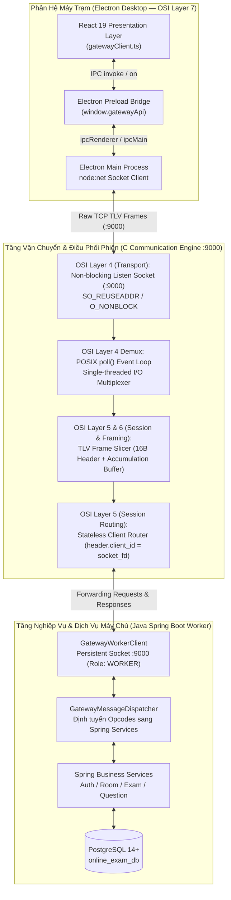

# Phân Hệ Mạng & Kiến Trúc Đồng Bộ Phòng Thi Thời Gian Thực (Realtime Network Subsystem)

> **Phân hệ trọng tâm:** C Communication Engine (`server-c/`) & Java Spring Boot Worker (`server/`) — Học phần Lập trình Mạng (IT4062)  
> **Kiến trúc mạng:** POSIX Non-blocking TCP Socket + Linux `poll()` Event Loop + 16-byte TLV Binary Framing (Cổng 9000)  
> **Cơ chế đồng bộ thời gian thực:** Song công hai chiều Full-Duplex TCP + Server Push Broadcast (`OP_SERVER_BROADCAST 0x80`)  
> **Quy chuẩn lập trình Socket:** Xem tại [server-c/CONVENTIONS.md](../../server-c/CONVENTIONS.md) và [server-c/README.md](../../server-c/README.md)

---

## 1. Tổng Quan Kiến Trúc Mạng Hệ Thống

Hệ thống thi trắc nghiệm trực tuyến `mooc-clone` vận hành trên nền tảng cổng mạng hiệu năng cao được xây dựng từ tầng Socket POSIX bằng ngôn ngữ C (chuẩn C11) tại [`server-c/`](../../server-c/README.md). Cổng mạng này đóng vai trò trung gian phân phối dữ liệu (Message Broker & Multiplexer) giữa ứng dụng máy trạm **Electron Desktop** ([`client/`](../../client/FRONTEND_CONVENTIONS.md)) và máy chủ nghiệp vụ **Java 21 Spring Boot Backend** ([`server/`](../README.md)):



---

## 2. Ánh Xạ Mô Hình OSI 7 Tầng Trong Hệ Thống

Trong kiến trúc mạng thực tế, nhân hệ điều hành (Kernel) đảm nhiệm từ **Tầng 1 đến Tầng 4**, còn các tiến trình ứng dụng tự hiện thực hóa các chức năng từ **Tầng 4 đến Tầng 7**:

| Tầng OSI | Hiện Thực Trong mooc-clone | Tệp Mã Nguồn Cốt Lõi | Trách Nhiệm Kỹ Thuật |
| :--- | :--- | :--- | :--- |
| **Layer 4 — Transport** | TCP Socket POSIX | `server-c/src/tcp_socket.c` | Khởi tạo socket, bind, listen, non-blocking fcntl, đọc/ghi luồng byte qua `recv()` / `send()` |
| **Layer 5 — Session** | POSIX `poll()` Multiplexer | `server-c/src/c_gateway_main.c` | Quản lý bảng kết nối client, ghép nối `client_id = socket_fd`, định danh vai trò Worker qua Handshake |
| **Layer 6 — Presentation** | TLV Framing 16B & JSON | `server-c/src/engine_protocol.c` | Đóng gói/giải mã Header 16B (Big-Endian), bảo vệ chống dính gói và phân mảnh TCP stream |
| **Layer 7 — Application** | Desktop UI & Spring Services | `client/src/services/gatewayClient.ts` & Java Services | Mã lệnh Opcodes (`0x01` - `0x80`), xác thực người dùng, tạo phòng, phát đề thi, chấm điểm tự động |

---

## 3. Đặc Tả Giao Thức TLV 16B & Cơ Chế Chống Dính Gói

TCP là giao thức hướng dòng byte (stream-oriented), không có ranh giới tin nhắn (message boundaries). Do đó, C Communication Engine bắt buộc sử dụng cơ chế **Frame Slicing với Header cố định 16 bytes**:

```text
+-+-+-+-+-+-+-+-+-+-+-+-+-+-+-+-+-+-+-+-+-+-+-+-+-+-+-+-+-+-+-+-+
|          MAGIC (0x4D43)       |    VERSION    |    MSG_TYPE   |
+-+-+-+-+-+-+-+-+-+-+-+-+-+-+-+-+-+-+-+-+-+-+-+-+-+-+-+-+-+-+-+-+
|                         SEQUENCE_ID                           |
+-+-+-+-+-+-+-+-+-+-+-+-+-+-+-+-+-+-+-+-+-+-+-+-+-+-+-+-+-+-+-+-+
|                          CLIENT_ID                            |
+-+-+-+-+-+-+-+-+-+-+-+-+-+-+-+-+-+-+-+-+-+-+-+-+-+-+-+-+-+-+-+-+
|                         PAYLOAD_LEN                           |
+-+-+-+-+-+-+-+-+-+-+-+-+-+-+-+-+-+-+-+-+-+-+-+-+-+-+-+-+-+-+-+-+
|                     PAYLOAD (JSON UTF-8) ...                  |
+-+-+-+-+-+-+-+-+-+-+-+-+-+-+-+-+-+-+-+-+-+-+-+-+-+-+-+-+-+-+-+-+
```

### Thuật Toán Xử Lý Dính Gói (Sticky Packets) & Phân Mảnh (Fragmentation):
```c
// Vòng lặp bóc tách khung tin trong c_gateway_main.c:
while (conn->buffer_len >= ENGINE_HEADER_SIZE) {
    engine_header_t header;
    engine_header_decode(conn->buffer, &header);

    size_t total_frame_len = ENGINE_HEADER_SIZE + header.payload_len;
    if (conn->buffer_len < total_frame_len) {
        // Hiện tượng phân mảnh (fragmentation): Chưa nhận đủ payload, đợi chunk sau
        break;
    }

    // Nhận trọn vẹn 1 khung tin -> Chuyển tiếp ngay lập tức
    forward_frame(conn_idx, conn->buffer, total_frame_len, &header);

    // Xử lý hiện tượng dính gói (sticky packets): Dịch chuyển byte dư thừa lên đầu buffer
    size_t remaining = conn->buffer_len - total_frame_len;
    if (remaining > 0) {
        memmove(conn->buffer, conn->buffer + total_frame_len, remaining);
    }
    conn->buffer_len = remaining;
}
```

---

## 4. Phân Hệ Java Worker & Server Push Broadcast

Phân hệ Java Spring Boot đóng vai trò **TCP Worker Client** kết nối bền vững tới C Gateway:
1. **Khởi Động & Handshake:** Khi ứng dụng Spring Boot chạy, `GatewayWorkerClient` mở socket tới `127.0.0.1:9000` và gửi ngay gói tin `OP_SYS_HANDSHAKE (0x00)` với payload `{"role":"WORKER"}`.
2. **Auto-Reconnect:** Nếu C Gateway khởi động lại, `GatewayWorkerClient` tự động bắt lại kết nối sau mỗi 2 giây mà không làm gián đoạn ứng dụng Java.
3. **Server Push Broadcast (`0x80`):** Khi chủ phòng bắt đầu thi hoặc đồng hồ đếm ngược hết giờ:
   - Java tạo gói tin với `CLIENT_ID = 0xFFFFFFFF` (`BROADCAST_CLIENT_ID`).
   - C Gateway nhận diện cờ Broadcast và phân phối khung tin tới toàn bộ thí sinh trong 1 chu kỳ `poll()`.
