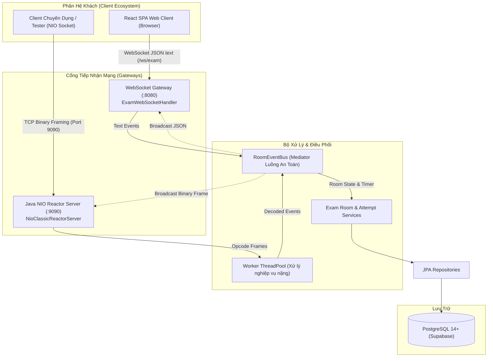

# Phân Hệ Mạng Song Song Kép & Đặc Tả Giao Thức Thời Gian Thực (Dual Realtime Network Subsystem)

> **Phân hệ:** Máy chủ Backend (`server/`) — Học phần Lập trình Mạng (IT4062)  
> **Kiến trúc mạng:** Java NIO Non-blocking Classic Reactor Pattern (Cổng 9090) kết hợp Spring WebSocket Gateway (Cổng 8080)  
> **Bộ điều phối tập trung:** [RoomEventBus.java](../src/main/java/com/example/server/socket/RoomEventBus.java)  
> **Quy chuẩn lập trình chi tiết:** Xem tại [CONVENTIONS.md](../CONVENTIONS.md)

---

## 1. Tổng Quan Kiến Trúc Kênh Mạng Kép (Dual-Channel Architecture)

Điểm nhấn kỹ thuật cốt lõi của hệ thống thi trắc nghiệm trực tuyến `mooc-clone` là khả năng vận hành song song và đồng bộ 2 kênh truyền thông mạng thời gian thực:



### Vai Trò Của Từng Kênh:
1. **Kênh Non-blocking TCP Socket Reactor (Cổng 9090):**
   - Xây dựng hoàn toàn bằng **Java NIO thuần túy** (Channels, Selector, ByteBuffers) theo mô hình kinh điển **Doug Lea Classic Reactor Pattern**.
   - Phục vụ các client máy trạm chuyên dụng hoặc bộ giả lập thi cử tải cao với giao thức nhị phân siêu nhẹ (Binary Framing).
2. **Kênh Spring WebSocket Gateway (Cổng 8080):**
   - Lắng nghe tại endpoint `/ws/exam`, phục vụ trực tiếp trình duyệt Web và ứng dụng React SPA qua giao thức WebSocket văn bản (JSON text frames).
3. **Trạm Điều Phối `RoomEventBus`:**
   - Hoạt động như một **Mediator tập trung**, quản lý đồng thời danh sách kết nối TCP `SocketChannel` và WebSocket `WebSocketSession` của từng phòng thi.
   - Khi có sự kiện (thí sinh vào phòng, bắt đầu thi, tick đếm ngược thời gian, kết thúc bài thi), `RoomEventBus` phát thanh song song (Parallel Broadcast) tới cả 2 kênh mà không gây nghẽn luồng mạng.

---

## 2. Đặc Tả Khung Gói Tin Nhị Phân 8-byte (Binary Packet Framing Protocol)

Mọi gói tin truyền qua cổng TCP 9090 tuân theo định dạng khung nhị phân chuẩn định lượng (Framing Specification):

```text
+---------------+---------------+---------------+---------------+---------------+-----------------------+---------------+
|   Byte 0      |    Byte 1     |   Byte 2-3    |   Byte 4-7    | Byte 8...N+7  |       Byte N+8        |
|  Magic (1B)   |  Version (1B) |  Opcode (2B)  |  Length (4B)  | Payload (JSON)|     Checksum (1B)     |
|     0xAA      |     0x01      |  0x0010 (Hex) |  0x0000002A   |  UTF-8 String |       XOR Byte        |
+---------------+---------------+---------------+---------------+---------------+-----------------------+---------------+
```

### Bảng Chi Tiết Cấu Trúc Byte:

| Trường Dữ Liệu | Độ Lớn | Kiểu Dữ Liệu | Giá Trị Mẫu | Ý Nghĩa Kỹ Thuật |
| :--- | :--- | :--- | :--- | :--- |
| **Magic Byte** | 1 Byte | `byte` | `0xAA` | Định danh gói tin hợp lệ của hệ thống `mooc-clone` |
| **Version** | 1 Byte | `byte` | `0x01` | Phiên bản giao thức nhị phân |
| **Opcode** | 2 Bytes | `short` | `0x0010` | Mã định danh thao tác sự kiện (Big-Endian) |
| **Payload Length** | 4 Bytes | `int` | `0x0000002A` | Kích thước dữ liệu phần thân (tối đa 65,536 bytes) |
| **Payload Data** | N Bytes | `byte[]` | `{"roomId":1}` | Dữ liệu nghiệp vụ chi tiết định dạng chuỗi JSON UTF-8 |
| **Checksum** | 1 Byte | `byte` | `0x5F` | Giá trị kiểm tra lỗi XOR của toàn bộ phần Payload |

Bộ mã hóa và giải mã được hiện thực hóa độc lập tại:
- [PacketFramingDecoder.java](../src/main/java/com/example/server/socket/protocol/PacketFramingDecoder.java)
- [PacketFramingEncoder.java](../src/main/java/com/example/server/socket/protocol/PacketFramingEncoder.java)

---

## 3. Bảng Danh Mục Toàn Bộ Protocol Opcodes (12+ Opcodes)

Định nghĩa tại [ProtocolConstants.java](../src/main/java/com/example/server/socket/protocol/ProtocolConstants.java):

| Opcode (Hex) | Tên Sự Kiện | Hướng | Mô Tả Nghiệp Vụ | Cấu Trúc JSON Payload Mẫu |
| :--- | :--- | :--- | :--- | :--- |
| `0x0001` | `PING` | Inbound | Thí sinh gửi gói tin kiểm tra kết nối sống (Heartbeat) | `{"timestamp": 1714000000}` |
| `0x0002` | `PONG` | Outbound | Máy chủ xác nhận kết nối TCP còn hoạt động bình thường | `{"status": "OK"}` |
| `0x0010` | `JOIN_ROOM` | Inbound | Thí sinh yêu cầu tham gia vào phòng chờ thi | `{"roomId": 101, "userId": 5, "username": "thanh_an"}` |
| `0x0011` | `USER_JOINED` | Outbound | Máy chủ phát thanh có thành viên mới vừa vào phòng | `{"userId": 5, "username": "thanh_an", "totalMembers": 12}` |
| `0x0012` | `LEAVE_ROOM` | Inbound | Thí sinh chủ động rời khỏi phòng thi | `{"roomId": 101, "userId": 5}` |
| `0x0013` | `USER_LEFT` | Outbound | Máy chủ phát thanh có thành viên đã rời phòng | `{"userId": 5, "username": "thanh_an", "totalMembers": 11}` |
| `0x0020` | `ROOM_STATE` | Outbound | Đồng bộ toàn bộ trạng thái phòng thi và danh sách thí sinh | `{"roomId": 101, "status": "WAITING", "members": [...]}` |
| `0x0030` | `START_EXAM` | Inbound | Chủ phòng (Owner) phát lệnh bắt đầu làm bài thi | `{"roomId": 101}` |
| `0x0031` | `EXAM_STARTED` | Outbound | Phát thanh lệnh bắt đầu thi kèm thời gian đếm ngược (giây) | `{"roomId": 101, "durationSeconds": 3600}` |
| `0x0032` | `TIME_TICK` | Outbound | Máy chủ đếm ngược đồng hồ từng giây tới tất cả thí sinh | `{"roomId": 101, "secondsRemaining": 1800}` |
| `0x0040` | `SUBMIT_ANSWER`| Inbound | Thí sinh gửi đáp án đã chọn cho một câu hỏi | `{"attemptId": 55, "questionId": 12, "optionId": 48}` |
| `0x0041` | `ANSWER_ACK` | Outbound | Máy chủ xác nhận đã ghi nhận đáp án thành công | `{"questionId": 12, "saved": true}` |
| `0x0050` | `EXAM_ENDED` | Outbound | Máy chủ thông báo kết thúc thi hoặc hết giờ làm bài | `{"roomId": 101, "reason": "TIME_UP"}` |
| `0x00FF` | `ERROR` | Outbound | Thông báo lỗi giao thức, sai opcode hoặc vi phạm nghiệp vụ | `{"code": 1002, "message": "Sai định dạng gói tin"}` |

---

## 4. Giải Quyết Hai Bài Toán Kinh Điển Của Truyền Dòng TCP

TCP là giao thức hướng dòng (Stream-oriented), không bảo toàn ranh giới gói tin. Hai sự cố thường gặp được giải quyết triệt để trong [PacketFramingDecoder.java](../src/main/java/com/example/server/socket/protocol/PacketFramingDecoder.java):

### 4.1. Chống Phân Mảnh Gói Tin (Packet Fragmentation)
- **Hiện tượng:** Một gói tin bị chia nhỏ thành nhiều lần đọc mạng (ví dụ lần 1 chỉ nhận được 4 bytes của Header, lần 2 nhận nốt 4 bytes còn lại và nửa phần Payload).
- **Giải pháp:** Sử dụng cơ chế `mark()` và `reset()` trên `accumulationBuffer`. Nếu `buffer.remaining() < HEADER_SIZE` hoặc `buffer.remaining() < payloadLength`, gọi `buffer.reset()` giữ nguyên vị trí con trỏ và chờ lần đọc mạng tiếp theo từ kênh socket.

### 4.2. Chống Dính Gói Tin (Sticky Packets)
- **Hiện tượng:** Client gửi liên tiếp nhiều gói tin với tốc độ cao, khiến nhiều gói tin nằm chung trong một lần đọc `channel.read()`.
- **Giải pháp:** Sử dụng vòng lặp `while (accumulationBuffer.remaining() >= HEADER_SIZE)` để bóc tách liên tục toàn bộ các gói tin hoàn chỉnh có trong buffer trước khi thoát ra. Dữ liệu dở dang còn sót lại ở cuối được đưa về đầu mảng thông qua phương thức `accumulationBuffer.compact()`.

---

## 5. Quy Chuẩn Đa Luồng & An Toàn Kênh Truyền (Concurrency Safety)

1. **Ranh Giới Luồng Rõ Ràng:**
   - **Luồng Reactor Duy Nhất (`nio-reactor-thread`):** Chỉ làm nhiệm vụ `select()` các sự kiện non-blocking (`OP_ACCEPT`, `OP_READ`) và nạp byte vào buffer. Tuyệt đối không thực hiện tính toán chấm thi, truy vấn CSDL hay xử lý blocking tại luồng này.
   - **Nhóm Luồng Công Nhân (`nio-worker-*`):** Nhận gói tin đã giải mã từ Reactor để parse JSON, gọi tầng Service và tương tác DB.
2. **Đồng Bộ Hóa Khi Ghi Socket (Thread-Safe Socket Writes):**
   - Thao tác ghi mạng từ nhiều worker thread tới cùng một `SocketChannel` hoặc `WebSocketSession` phải được bọc trong khối `synchronized(channel)` để ngăn ngừa hiện tượng xen kẽ byte (Interleaved frames).
3. **Cấu Trúc Dữ Liệu An Toàn Luồng:**
   - Toàn bộ danh sách kênh phòng thi trong `RoomEventBus` sử dụng `ConcurrentHashMap<String, Set<SocketChannel>>` và `ConcurrentHashMap.newKeySet()`.

---

## 6. Liên Kết Đối Chiếu

- Hướng dẫn chi tiết về thao tác con trỏ `ByteBuffer` (`flip`, `compact`, `mark`, `reset`), chuẩn ghi log SLF4J và viết kiểm thử đơn vị Socket xem tại: [CONVENTIONS.md](../CONVENTIONS.md).
- Quy chuẩn gọi sự kiện thời gian thực từ các REST API nghiệp vụ xem tại: [CUSTOM_API_GUIDE.md](ai-guides/CUSTOM_API_GUIDE.md).
