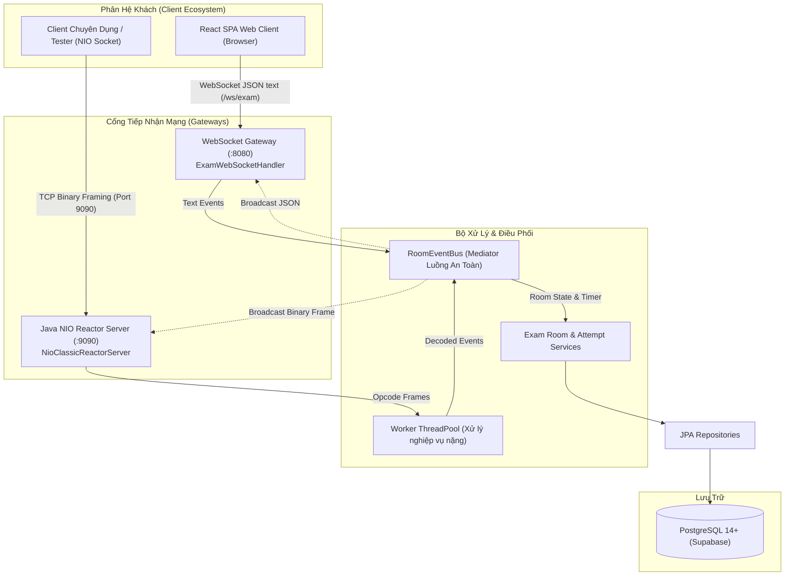
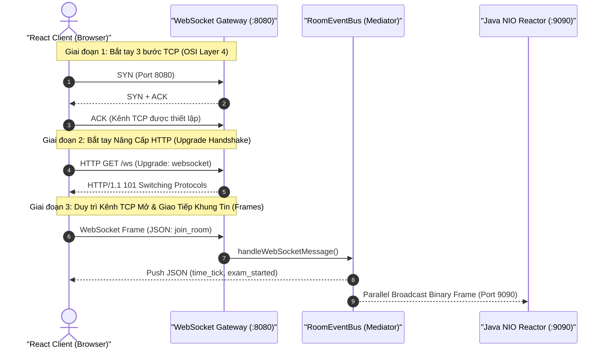
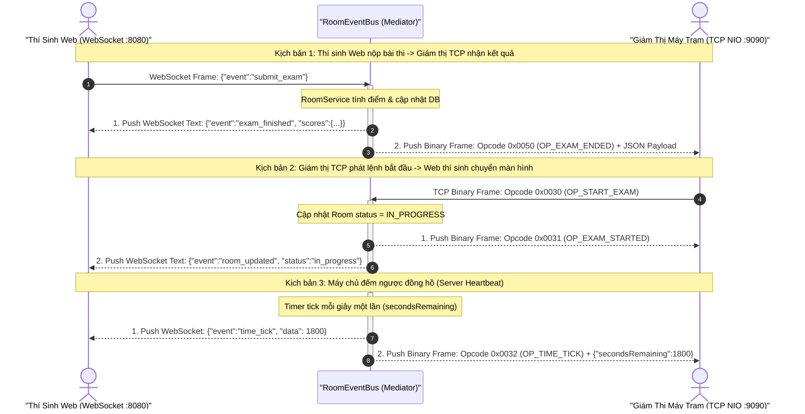

# Phân Hệ Mạng Song Song Kép & Đặc Tả Giao Thức Thời Gian Thực (Dual Realtime Network Subsystem)

> **Phân hệ:** Máy chủ Backend (`server/`) — Học phần Lập trình Mạng (IT4062)  
> **Kiến trúc mạng:** Java NIO Non-blocking Classic Reactor Pattern (Cổng 9090) kết hợp Spring WebSocket Gateway (Cổng 8080)  
> **Bộ điều phối tập trung:** [RoomEventBus.java](../src/main/java/com/example/server/socket/RoomEventBus.java)  
> **Quy chuẩn lập trình chi tiết:** Xem tại [CONVENTIONS.md](../CONVENTIONS.md)

---

## 1. Tổng Quan Kiến Trúc Kênh Mạng Kép (Dual-Channel Architecture)

Điểm nhấn kỹ thuật cốt lõi của hệ thống thi trắc nghiệm trực tuyến `mooc-clone` là khả năng vận hành song song và đồng bộ 2 kênh truyền thông mạng thời gian thực:



### 1.1. Vai Trò Của Từng Kênh Trong Hệ Thống:
1. **Kênh Non-blocking TCP Socket Reactor (Cổng 9090):**
   - Xây dựng hoàn toàn bằng **Java NIO thuần túy** (`Channels`, `Selector`, `ByteBuffers`) cài đặt theo mô hình kinh điển **Doug Lea Classic Reactor Pattern** tại [NioClassicReactorServer.java](../src/main/java/com/example/server/socket/core/NioClassicReactorServer.java).
   - Phục vụ các client máy trạm chuyên dụng hoặc bộ giả lập thi cử tải cao với giao thức nhị phân siêu nhẹ (Binary Framing 8-byte).
2. **Kênh Spring WebSocket Gateway (Cổng 8080):**
   - Đăng ký tại [WebSocketConfig.java](../src/main/java/com/example/server/socket/gateway/WebSocketConfig.java) và xử lý tại [ExamWebSocketHandler.java](../src/main/java/com/example/server/socket/gateway/ExamWebSocketHandler.java).
   - Lắng nghe tại endpoint `/ws`, phục vụ trực tiếp người dùng cuối trên trình duyệt Web (ứng dụng React 19 SPA) qua giao thức WebSocket văn bản (JSON text frames).
3. **Trạm Điều Phối Tập Trung `RoomEventBus` (Design Pattern: Mediator):**
   - Quản lý đồng thời danh sách kết nối TCP `SocketChannel` (`roomChannels`) và WebSocket `WebSocketSession` (`roomWebSessions`) của từng phòng thi.
   - Khi có sự kiện (thí sinh vào phòng, bắt đầu thi, tick đếm ngược thời gian, kết thúc bài thi), `RoomEventBus` phát thanh song song (Parallel Broadcast) tới cả 2 kênh mà không gây nghẽn luồng mạng.

---

### 1.2. Tại Sao Hệ Thống Bắt Buộc Cần Kênh WebSocket?

Hệ thống thi trắc nghiệm trực tuyến bắt buộc phải triển khai kênh WebSocket song song với kênh TCP Socket vì 3 lý do kỹ thuật cốt lõi:

#### A. Rào cản Sandbox của Trình duyệt Web (Browser Sandbox Constraints)
* **Bối cảnh:** Phân hệ khách dành cho thí sinh là ứng dụng Web Single Page Application (React 19) chạy trực tiếp trên các trình duyệt hiện đại (Chrome, Edge, Firefox, Safari).
* **Giới hạn W3C Sandbox:** Vì lý do an ninh, môi trường thực thi JavaScript trong trình duyệt **tuyệt đối không được phép mở kết nối Raw TCP Socket** (không có API tầng 4 tương đương `SocketChannel` của Java hay `net.Socket` của C/C++).
* **Hệ quả:** Kênh Java NIO TCP (cổng 9090) sử dụng chuẩn đóng gói 8-byte Binary Frame chỉ có thể phục vụ ứng dụng máy trạm độc lập hoặc bộ kiểm thử giả lập. Trình duyệt Web hoàn toàn không thể kết nối trực tiếp vào cổng 9090.
* **Giải pháp:** WebSocket (`ws://` hoặc `wss://`) là giao thức chuẩn hóa duy nhất trên nền tảng Web cho phép trình duyệt thiết lập một kết nối 2 chiều liên tục (Full-Duplex) với máy chủ sau quá trình bắt tay nâng cấp HTTP Upgrade.

#### B. Bản chất phòng thi trực tuyến đòi hỏi Server-Push tức thì
Một phòng thi vận hành dựa trên cơ chế **Server-initiated Events** (Máy chủ chủ động đẩy dữ liệu xuống client):
1. **Đồng bộ thời gian (`TIME_TICK`):** Máy chủ đếm ngược từng giây và phát thanh xuống mọi thí sinh. Client không được tự đếm giờ nội bộ để chống gian lận (thí sinh cố tình chỉnh lùi giờ hệ điều hành).
2. **Đồng loạt bắt đầu & thu bài (`START_EXAM`, `EXAM_ENDED`):** Khi giáo viên bấm nút bắt đầu hoặc khi hết giờ làm bài, toàn bộ thí sinh phải lập tức nhận lệnh chuyển trạng thái hoặc bị khóa bài cùng một thời điểm.
3. **Giám sát phòng thi (`USER_JOINED`, `USER_LEFT`):** Cập nhật trạng thái trực tuyến / rớt mạng của thí sinh cho giám thị theo thời gian thực.

#### C. Đối sánh 3 Giải Pháp Truyền Thông Mạng Trên Web

| Tiêu Chí So Sánh | HTTP Short/Long Polling | Server-Sent Events (SSE) | WebSocket (Hệ thống mooc-clone) |
| :--- | :--- | :--- | :--- |
| **Hướng truyền thông** | Bán song công (Request - Response) | 1 chiều (Server $\rightarrow$ Client) | **Song công toàn phần (Full-Duplex)** |
| **Overhead mỗi gói tin** | Cực lớn: 500B – 1KB HTTP Header / request | Trung bình: Dòng text `data: ...\n\n` | **Siêu nhẹ: 2 đến 6 bytes frame header** |
| **Độ trễ (Latency)** | Cao: 500ms – 2000ms tùy chu kỳ poll | Thấp: Vài mili-giây | **Cực thấp: Gần như tức thì (< 5ms)** |
| **Tải tài nguyên máy chủ** | Rất cao: Phải parse HTTP Header liên tục | Trung bình: Giữ connection HTTP mở | **Thấp: 1 Persistent TCP Socket duy nhất** |
| **Gửi thao tác từ Client** | Bằng HTTP Request thông thường | Phải tạo thêm HTTP POST riêng lẻ | **Gửi trực tiếp trên cùng kết nối WebSocket** |
| **Phát hiện rớt mạng** | Kém: Phải chờ timeout phiên | Khá: Qua cơ chế keep-alive | **Tức thì: Kích hoạt `afterConnectionClosed`** |

---

### 1.3. Cơ Chế Thiết Lập Kết Nối 2 Chiều Của WebSocket (RFC 6455)

WebSocket thực chất là một kết nối TCP Socket chuẩn được nâng cấp thông qua giao thức HTTP (HTTP Upgrade Handshake), diễn ra theo trình tự 3 giai đoạn:



1. **Giai đoạn 1 — Thiết lập kết nối TCP Socket tầng 4:**
   - Trình duyệt thực hiện bắt tay 3 bước TCP (`SYN` $\rightarrow$ `SYN-ACK` $\rightarrow$ `ACK`) tới địa chỉ IP máy chủ và cổng `8080`.
2. **Giai đoạn 2 — Bắt tay nâng cấp giao thức (HTTP Upgrade Handshake):**
   - Trình duyệt gửi bản tin HTTP GET kèm các Header:
     ```http
     GET /ws HTTP/1.1
     Host: localhost:8080
     Upgrade: websocket
     Connection: Upgrade
     Sec-WebSocket-Key: dGhlIHNhbXBsZSBub25jZQ==
     Sec-WebSocket-Version: 13
     ```
   - Máy chủ Spring Boot kiểm tra, băm `Sec-WebSocket-Key` với GUID chuẩn `258EAFA5-E914-47DA-95CA-C5AB0DC85B11` qua SHA-1, Base64 rồi phản hồi mã trạng thái đặc biệt:
     ```http
     HTTP/1.1 101 Switching Protocols
     Upgrade: websocket
     Connection: Upgrade
     Sec-WebSocket-Accept: s3pPLMBiTxaQ9kYGzzhZRbK+xOo=
     ```
3. **Giai đoạn 3 — Bàn giao quyền điều khiển và truyền dữ liệu liên tục:**
   - Sau mã `101`, kết nối TCP bên dưới được giữ mở liên tục (Persistent TCP Connection). Hai bên chuyển sang trao đổi các khung tin WebSocket Frame (chỉ tốn 2 đến 6 bytes overhead).
   - Khi có sự kiện thi cử, `RoomEventBus` vừa đẩy JSON xuống WebSocket Session (cổng 8080), vừa mã hóa khung nhị phân đẩy ra TCP Channel (cổng 9090).

---

### 1.4. Cơ Chế Hội Tụ & Đồng Bộ Chéo Giữa WebSocket và TCP Socket (Cross-Channel Convergence)

Một trong những câu hỏi cốt lõi khi bảo vệ đồ án là: *"WebSocket và TCP Socket kết nối hoặc kết hợp với nhau cụ thể như thế nào trong mã nguồn?"*

#### A. Bản Chất Kiến Trúc: Không Có Kết Nối Mạng Trực Tiếp Giữa Hai Cổng
* **Sự thật kỹ thuật:** Kênh WebSocket (cổng 8080) và Kênh TCP Socket (cổng 9090) **hoàn toàn không kết nối mạng trực tiếp với nhau**. Không có socket proxy trung gian, không có tiến trình forwarder giữa hai cổng mạng này.
* Hai cổng vận hành như **hai Cổng Tiếp Nhận (Gateways) độc lập**:
  - Cổng 8080 do Servlet Container / Spring WebSocket quản lý để nhận frame văn bản JSON từ Web Browser.
  - Cổng 9090 do [NioClassicReactorServer.java](../src/main/java/com/example/server/socket/core/NioClassicReactorServer.java) quản lý bằng vòng lặp NIO Selector thuần để nhận khung nhị phân 8-byte từ Desktop Client / Tester.

#### B. Trạm Điều Phối `RoomEventBus`: Trái Tim Của Mô Hình Hội Tụ (Mediator Pattern)
Hai kênh mạng giao tiếp và đồng bộ trạng thái xuyên suốt thông qua [RoomEventBus.java](../src/main/java/com/example/server/socket/RoomEventBus.java). `RoomEventBus` duy trì 2 danh bạ kết nối luồng an toàn (Thread-safe Concurrent Maps):

```java
// 1. Quản lý danh sách TCP SocketChannel của từng phòng thi
private final Map<String, Set<SocketChannel>> roomTcpChannels = new ConcurrentHashMap<>();

// 2. Quản lý danh sách WebSocketSession của từng phòng thi
private final Map<String, Set<WebSocketSession>> roomWebSessions = new ConcurrentHashMap<>();
```

Khi một phòng thi có định danh `roomId = "ROOM_101"`, phòng thi này có thể chứa đồng thời:
* 40 thí sinh kết nối qua `WebSocketSession` (thi bằng React Web trên trình duyệt).
* 2 giám thị hoặc bộ chấm máy kết nối qua `SocketChannel` (sử dụng ứng dụng Java/C++ TCP Socket).

#### C. Sơ Đồ Cơ Chế Chuyển Đổi Giao Thức & Phát Thanh Song Song (Cross-Channel Broadcast)



#### D. Luồng Dữ Liệu Đồng Bộ Chéo Chi Tiết (Cross-Channel Data Flows)

1. **Từ Web Client sang TCP Client (Protocol Adaptation: JSON $\rightarrow$ Binary):**
   - Thí sinh trên Web nộp bài trắc nghiệm. Tin nhắn JSON được [ExamWebSocketHandler.java](../src/main/java/com/example/server/socket/gateway/ExamWebSocketHandler.java) tiếp nhận và chuyển cho `RoomEventBus.handleWebSocketMessage()`.
   - `RoomEventBus` gọi `roomService.finishRoom(roomId)` để chấm bài và ghi nhận điểm số trong cơ sở dữ liệu PostgreSQL.
   - Để báo cho các giám thị đang theo dõi bằng máy trạm TCP, phương thức `broadcastExamFinished()` gọi [PacketFramingEncoder.java](../src/main/java/com/example/server/socket/protocol/PacketFramingEncoder.java) bọc dữ liệu điểm số vào khung nhị phân Opcode `0x0050` (`OP_EXAM_ENDED`) và gửi trực tiếp vào các `SocketChannel` đã đăng ký của phòng thi.

2. **Từ TCP Client sang Web Client (Protocol Adaptation: Binary $\rightarrow$ JSON):**
   - Giám thị bấm "Bắt đầu thi" từ máy trạm TCP. Gói tin nhị phân Opcode `0x0030` (`OP_START_EXAM`) đi qua luồng Selector của [NioClassicReactorServer.java](../src/main/java/com/example/server/socket/core/NioClassicReactorServer.java), được giải mã bởi [PacketFramingDecoder.java](../src/main/java/com/example/server/socket/protocol/PacketFramingDecoder.java) và chuyển cho Worker Thread.
   - Worker gọi `RoomEventBus.handleTcpFrame()`. Sau khi chuyển trạng thái phòng, `RoomEventBus.broadcastRoomUpdated()` chuyển đổi thông tin trạng thái thành đối tượng JSON và gửi qua từng `WebSocketSession` đang mở của thí sinh.
   - Ứng dụng React 19 phía client lắng nghe sự kiện `room_updated` qua [socket.service.ts](../../client/src/services/socket.service.ts) và tự động kích hoạt điều hướng vào màn hình làm bài mà không cần thí sinh phải tải lại trang.

3. **Từ Server Phát Thanh Tự Động (Dual-Push Timer Tick):**
   - Luồng Timer định kỳ kích hoạt `RoomEventBus.broadcastTimeTick(roomId, secondsRemaining)` mỗi giây 1 lần:
     ```java
     // 1. Gửi qua WebSocket (cho Web Browser)
     broadcastToWebSocket(roomId, "time_tick", secondsRemaining);

     // 2. Gửi qua TCP NIO (cho Desktop Client / Tester)
     String payload = "{\"secondsRemaining\":" + secondsRemaining + "}";
     ByteBuffer buffer = PacketFramingEncoder.encode(ProtocolConstants.OP_TIME_TICK, payload);
     broadcastToTcp(roomId, buffer);
     ```

#### E. Lợi Ích Cốt Lõi Của Kiến Trúc Hội Tụ Qua Mediator
* **Phân tách hoàn toàn (Complete Decoupling):** Kênh TCP và kênh WebSocket không hề biết về sự tồn tại của nhau. Nếu một kênh gặp sự cố mạng hoặc bị restart, kênh còn lại vẫn vận hành độc lập 100%.
* **Thống nhất nghiệp vụ (Single Source of Truth):** Toàn bộ nghiệp vụ phòng thi (tham gia phòng, thoát phòng, tính điểm, kiểm tra thời gian) đều nằm tập trung tại `RoomService` và CSDL PostgreSQL, loại bỏ hoàn toàn nguy cơ sai lệch logic giữa 2 phân hệ mạng.
* **Tối ưu hóa đặc thù cho từng loại Client:** Thí sinh thi trên Web sử dụng JSON Text trực quan, dễ tích hợp với hệ sinh thái React/TypeScript; các hệ thống máy trạm chấm thi hoặc bộ kiểm thử tải nặng (Load Testing) sử dụng Binary Framing 8-byte để đạt thông lượng I/O cao nhất và độ trễ thấp nhất.

---

## 2. Đặc Tả Khung Gói Tin Nhị Phân 8-byte (Binary Packet Framing Protocol)

Mọi gói tin truyền qua cổng TCP 9090 tuân theo định dạng khung nhị phân chuẩn định lượng (Framing Specification):

```text
+---------------+---------------+---------------+---------------+---------------+-----------------------+---------------+
|   Byte 0      |    Byte 1     |   Byte 2-3    |   Byte 4-7    | Byte 8...N+7  |       Byte N+8        |
|  Magic (1B)   |  Version (1B) |  Opcode (2B)  |  Length (4B)  | Payload (JSON)|     Checksum (1B)     |
|     0xAA      |     0x01      |  0x0010 (Hex) |  0x0000002A   |  UTF-8 String |       XOR Byte        |
+---------------+---------------+---------------+---------------+---------------+-----------------------+---------------+
```

### Bảng Chi Tiết Cấu Trúc Byte:

| Trường Dữ Liệu | Độ Lớn | Kiểu Dữ Liệu | Giá Trị Mẫu | Ý Nghĩa Kỹ Thuật |
| :--- | :--- | :--- | :--- | :--- |
| **Magic Byte** | 1 Byte | `byte` | `0xAA` | Định danh gói tin hợp lệ của hệ thống `mooc-clone` |
| **Version** | 1 Byte | `byte` | `0x01` | Phiên bản giao thức nhị phân |
| **Opcode** | 2 Bytes | `short` | `0x0010` | Mã định danh thao tác sự kiện (Big-Endian) |
| **Payload Length** | 4 Bytes | `int` | `0x0000002A` | Kích thước dữ liệu phần thân (tối đa 65,536 bytes) |
| **Payload Data** | N Bytes | `byte[]` | `{"roomId":1}` | Dữ liệu nghiệp vụ chi tiết định dạng chuỗi JSON UTF-8 |
| **Checksum** | 1 Byte | `byte` | `0x5F` | Giá trị kiểm tra lỗi XOR của toàn bộ phần Payload |

Bộ mã hóa và giải mã được hiện thực hóa độc lập tại:
- [PacketFramingDecoder.java](../src/main/java/com/example/server/socket/protocol/PacketFramingDecoder.java)
- [PacketFramingEncoder.java](../src/main/java/com/example/server/socket/protocol/PacketFramingEncoder.java)

---

## 3. Bảng Danh Mục Toàn Bộ Protocol Opcodes (12+ Opcodes)

Định nghĩa tại [ProtocolConstants.java](../src/main/java/com/example/server/socket/protocol/ProtocolConstants.java):

| Opcode (Hex) | Tên Sự Kiện | Hướng | Mô Tả Nghiệp Vụ | Cấu Trúc JSON Payload Mẫu |
| :--- | :--- | :--- | :--- | :--- |
| `0x0001` | `PING` | Inbound | Thí sinh gửi gói tin kiểm tra kết nối sống (Heartbeat) | `{"timestamp": 1714000000}` |
| `0x0002` | `PONG` | Outbound | Máy chủ xác nhận kết nối TCP còn hoạt động bình thường | `{"status": "OK"}` |
| `0x0010` | `JOIN_ROOM` | Inbound | Thí sinh yêu cầu tham gia vào phòng chờ thi | `{"roomId": 101, "userId": 5, "username": "thanh_an"}` |
| `0x0011` | `USER_JOINED` | Outbound | Máy chủ phát thanh có thành viên mới vừa vào phòng | `{"userId": 5, "username": "thanh_an", "totalMembers": 12}` |
| `0x0012` | `LEAVE_ROOM` | Inbound | Thí sinh chủ động rời khỏi phòng thi | `{"roomId": 101, "userId": 5}` |
| `0x0013` | `USER_LEFT` | Outbound | Máy chủ phát thanh có thành viên đã rời phòng | `{"userId": 5, "username": "thanh_an", "totalMembers": 11}` |
| `0x0020` | `ROOM_STATE` | Outbound | Đồng bộ toàn bộ trạng thái phòng thi và danh sách thí sinh | `{"roomId": 101, "status": "WAITING", "members": [...]}` |
| `0x0030` | `START_EXAM` | Inbound | Chủ phòng (Owner) phát lệnh bắt đầu làm bài thi | `{"roomId": 101}` |
| `0x0031` | `EXAM_STARTED` | Outbound | Phát thanh lệnh bắt đầu thi kèm thời gian đếm ngược (giây) | `{"roomId": 101, "durationSeconds": 3600}` |
| `0x0032` | `TIME_TICK` | Outbound | Máy chủ đếm ngược đồng hồ từng giây tới tất cả thí sinh | `{"roomId": 101, "secondsRemaining": 1800}` |
| `0x0040` | `SUBMIT_ANSWER`| Inbound | Thí sinh gửi đáp án đã chọn cho một câu hỏi | `{"attemptId": 55, "questionId": 12, "optionId": 48}` |
| `0x0041` | `ANSWER_ACK` | Outbound | Máy chủ xác nhận đã ghi nhận đáp án thành công | `{"questionId": 12, "saved": true}` |
| `0x0050` | `EXAM_ENDED` | Outbound | Máy chủ thông báo kết thúc thi hoặc hết giờ làm bài | `{"roomId": 101, "reason": "TIME_UP"}` |
| `0x00FF` | `ERROR` | Outbound | Thông báo lỗi giao thức, sai opcode hoặc vi phạm nghiệp vụ | `{"code": 1002, "message": "Sai định dạng gói tin"}` |

---

## 4. Giải Quyết Hai Bài Toán Kinh Điển Của Truyền Dòng TCP

TCP là giao thức hướng dòng (Stream-oriented), truyền tải dữ liệu dưới dạng chuỗi byte liên tục và không bảo toàn ranh giới gói tin. Hai sự cố kinh điển được giải quyết triệt để trong [PacketFramingDecoder.java](../src/main/java/com/example/server/socket/protocol/PacketFramingDecoder.java):

### 4.1. Chống Phân Mảnh Gói Tin (Packet Fragmentation)
- **Hiện tượng:** Một gói tin bị chia nhỏ thành nhiều lần đọc mạng do giới hạn MTU hoặc phân mảnh đường truyền (ví dụ lần 1 chỉ nhận được 4 bytes của Header, lần 2 nhận nốt 4 bytes còn lại và một phần Payload).
- **Giải pháp:** Sử dụng cơ chế `mark()` và `reset()` trên `accumulationBuffer`. Nếu `buffer.remaining() < HEADER_SIZE` hoặc `buffer.remaining() < payloadLength`, gọi `buffer.reset()` giữ nguyên vị trí con trỏ và chờ lần đọc mạng tiếp theo từ kênh socket.

### 4.2. Chống Dính Gói Tin (Sticky Packets)
- **Hiện tượng:** Client gửi liên tiếp nhiều gói tin với tốc độ cao hoặc thuật toán Nagle gộp các gói nhỏ, khiến nhiều gói tin nằm chung trong một lần đọc `channel.read()`.
- **Giải pháp:** Sử dụng vòng lặp `while (accumulationBuffer.remaining() >= HEADER_SIZE)` để bóc tách liên tục toàn bộ các gói tin hoàn chỉnh có trong buffer trước khi thoát ra. Dữ liệu dở dang còn sót lại ở cuối được đưa về đầu mảng thông qua phương thức `accumulationBuffer.compact()`.

---

## 5. Quy Chuẩn Đa Luồng & An Toàn Kênh Truyền (Concurrency Safety)

### 5.1. Phân Tách Luồng: Doug Lea Classic Reactor vs Worker ThreadPool
Trong [NioClassicReactorServer.java](../src/main/java/com/example/server/socket/core/NioClassicReactorServer.java), kiến trúc đa luồng tuân thủ nghiêm ngặt mô hình Doug Lea Classic Reactor Pattern:

```text
[Mạng Socket] ---> (OP_ACCEPT, OP_READ)
                         │
                         ▼
        ┌───────────────────────────────────┐
        │   1 Luồng Duy Nhất: Reactor       │
        │   ("nio-reactor-thread")          │
        │   - selector.select(500)          │
        │   - sc.read(buffer)               │
        │   - decoder.decode() (Framing thô)│
        └─────────────────┬─────────────────┘
                          │ workerPool.submit(...) (Non-blocking handoff)
                          ▼
        ┌───────────────────────────────────┐
        │   Worker ThreadPool (N = 2 * CPU) │
        │   ("nio-worker-xxxx")             │
        │   - Parse JSON Payload            │
        │   - Nghiệp vụ RoomService         │
        │   - Truy vấn JPA / PostgreSQL DB  │
        │   - Tính điểm & Chấm thi          │
        └───────────────────────────────────┘
```

#### Ba Hiểm Họa Nghiêm Trọng Nếu Xử Lý DB/Nghiệp Vụ Trên Luồng Reactor:
1. **Đóng Băng Vòng Lặp Sự Kiện (Event Loop Starvation):**
   - Luồng Reactor là đơn luồng (`Single-Threaded Event Loop`). Nếu luồng này bị chặn (Block) dù chỉ 50ms để chờ truy vấn CSDL PostgreSQL hoặc chấm bài thi, toàn bộ vòng lặp sự kiện sẽ bị tê liệt.
   - Máy chủ không thể tiếp nhận kết nối mới (`handleAccept`), các gói tin `PING`, `SUBMIT_ANSWER` từ hàng trăm thí sinh khác đều bị kẹt cứng trong bộ đệm tầng Kernel.
2. **Vi Phạm Nguyên Lý Tách Biệt I/O-Bound và CPU/DB-Bound:**
   - Luồng Reactor chuyên biệt cho thao tác non-blocking I/O siêu nhanh để dồn kênh (I/O Multiplexing).
   - Worker ThreadPool chuyên biệt cho các tác vụ tính toán nặng và I/O chặn (Blocking DB), được định cấu hình số luồng bằng `Math.max(4, Runtime.getRuntime().availableProcessors() * 2)`.
3. **Mất Khả Năng Cô Lập Lỗi (Fault Isolation):**
   - Nếu xảy ra lỗi nghiêm trọng (ví dụ `SQLException`, dữ liệu JSON lỗi) trong quá trình xử lý nộp bài của một thí sinh, ngoại lệ đó chỉ ảnh hưởng đến 1 luồng công nhân cụ thể. Luồng Reactor vẫn hoạt động bình thường, bảo vệ an toàn cho cả phòng thi.

### 5.2. Đồng Bộ Hóa Khi Ghi Socket & Bài Toán Khách Chậm (Slow Consumer)
1. **Ngăn Ngừa Xen Kẽ Khung Dữ Liệu (Interleaved Frames):**
   - Khi nhiều luồng Worker cùng muốn gửi dữ liệu tới một kết nối (ví dụ: Luồng 1 gửi `broadcastTimeTick`, Luồng 2 gửi `broadcastRoomUpdated`), nếu không đồng bộ, các byte của hai gói tin sẽ bị xáo trộn đan xen vào nhau trên đường truyền TCP.
   - Do đó, thao tác ghi mạng bắt buộc phải được bọc trong khối khóa:
     ```java
     synchronized (channel) {
         while (buffer.hasRemaining()) {
             channel.write(buffer);
         }
     }
     ```
     và tương tự `synchronized (session)` cho WebSocket.
2. **Kỹ Thuật Phân Mảnh Bộ Đệm Không Sao Chép (`buffer.slice()`):**
   - Khi phát thanh tới $N$ client TCP trong phòng, `RoomEventBus` không nhân bản mảng byte trong bộ nhớ mà dùng phương thức `buffer.slice()`.
   - `slice()` tạo ra một đối tượng `ByteBuffer` mới với con trỏ `position` và `limit` riêng biệt nhưng trỏ chung vào cùng một vùng nhớ gốc (Zero-copy). Điều này ngăn ngừa lỗi nghiêm trọng: Client đầu tiên đọc hết byte khiến các client tiếp theo nhận buffer rỗng (`hasRemaining() == false`).
3. **Cách Ly Trực Tiếp Kết Nối Chậm (Slow Consumer Isolation):**
   - Khi một client bị ngắt cáp hoặc mạng chập chờn dẫn đến socket buffer bị đầy hoặc phát sinh `IOException`, khối `try-catch` tại `sendToTcpChannel` và `sendToWebSocketSession` sẽ lập tức đóng kết nối hỏng và giải phóng tài nguyên mà không làm nghẽn vòng lặp phát thanh tới các thí sinh bình thường khác.

### 5.3. Phân Tích Cấu Trúc Dữ Liệu: Tại Sao Dùng `ConcurrentHashMap.newKeySet()` Mà Không Dùng `List`?
Tại [RoomEventBus.java](../src/main/java/com/example/server/socket/RoomEventBus.java#L41-L44), danh sách kết nối được khai báo:
```java
private final Map<String, Set<SocketChannel>> roomTcpChannels = new ConcurrentHashMap<>();
private final Map<String, Set<WebSocketSession>> roomWebSessions = new ConcurrentHashMap<>();
```
Ba lý do kỹ thuật bắt buộc phải chọn `ConcurrentHashMap.newKeySet()` thay vì `List<SocketChannel>` hoặc `Collections.synchronizedList()`:
1. **Độ Phức Tạp Thao Tác $O(1)$ So Với $O(N)$:**
   - Khi thí sinh rời phòng thi (`leave_room`) hoặc ngắt kết nối (`disconnect`), thao tác `Set.remove(channel)` đạt độ phức tạp thời gian $O(1)$ nhờ cơ chế băm. Nếu dùng `List`, thao tác xóa phải duyệt mảng tuần tự tốn $O(N)$, gây nghẽn luồng khi phòng thi có hàng trăm/nghìn thí sinh.
2. **Tính Đơn Nhất Tự Nhiên (Idempotent Registration):**
   - `Set` đảm bảo mỗi `SocketChannel` hoặc `WebSocketSession` chỉ tồn tại duy nhất một lần trong phòng thi. Nếu client gửi lại lệnh `JOIN_ROOM` nhiều lần do lỗi mạng, thí sinh đó cũng không bao giờ bị nhận 2 gói tin broadcast trùng lặp.
3. **Duyệt Đồng Thời An Toàn Tuyệt Đối (Weakly-Consistent Iterator):**
   - Với `ArrayList` thông thường, nếu Luồng A đang chạy vòng lặp `for (SocketChannel ch : channels)` để broadcast đếm giờ mà Luồng B thực hiện `channels.add(newCh)` (thí sinh mới vào phòng), hệ thống sẽ lập tức ném ra ngoại lệ `ConcurrentModificationException` và làm sập tiến trình phát thanh.
   - `ConcurrentHashMap.newKeySet()` cung cấp Iterator có tính nhất quán yếu (Weakly-consistent), cho phép đọc và ghi diễn ra đồng thời mà không bao giờ ném ngoại lệ hay yêu cầu khóa chặn toàn bộ danh sách (Zero Lock Contention).

### 5.4. Xử Lý Xung Đột Phiên Kết Nối Đa Kênh (Multi-Channel Session Conflicts)
Khi thí sinh cố tình mở đồng thời cả giao diện Web (cổng 8080) và công cụ TCP độc lập (cổng 9090) bằng cùng một tài khoản (`userId`):
1. **Bản Đồ Định Danh Hai Chiều:**
   - `RoomEventBus` duy trì `wsUserMap` (`WebSocketSession` $\rightarrow$ `userId`) và `wsRoomMap` (`WebSocketSession` $\rightarrow$ `roomId`), song song với `ClientSession.getUserId()` ở kênh TCP.
2. **Kiểm Soát Trạng Thái Thí Sinh Tập Trung:**
   - Tầng nghiệp vụ [RoomService.java](../src/main/java/com/example/server/service/RoomService.java) lưu giữ trạng thái phòng thi trong CSDL PostgreSQL. Khi có yêu cầu `joinRoom`, `RoomService` kiểm tra trạng thái và lịch sử nộp bài của thí sinh.
3. **Chính Sách Chống Thi Hộ & Can Thiệp Kép (Single Active Session Policy):**
   - Nếu phát hiện cùng một `userId` đã kết nối từ một kênh trước đó, hệ thống ghi log cảnh báo và có thể chủ động ngắt phiên kết nối cũ (`disconnect`) trước khi chấp nhận phiên kết nối mới, ngăn chặn hành vi một người làm bài trên Web trong khi một script tự động gửi đáp án qua cổng TCP.

---

## 6. Liên Kết Đối Chiếu

- Mã nguồn Bộ điều phối trung tâm: [RoomEventBus.java](../src/main/java/com/example/server/socket/RoomEventBus.java)
- Máy chủ Classic Reactor NIO: [NioClassicReactorServer.java](../src/main/java/com/example/server/socket/core/NioClassicReactorServer.java)
- Cổng tiếp nhận WebSocket: [ExamWebSocketHandler.java](../src/main/java/com/example/server/socket/gateway/ExamWebSocketHandler.java) & [WebSocketConfig.java](../src/main/java/com/example/server/socket/gateway/WebSocketConfig.java)
- Bộ giải mã và mã hóa nhị phân: [PacketFramingDecoder.java](../src/main/java/com/example/server/socket/protocol/PacketFramingDecoder.java) & [PacketFramingEncoder.java](../src/main/java/com/example/server/socket/protocol/PacketFramingEncoder.java)
- Danh mục Opcode giao thức: [ProtocolConstants.java](../src/main/java/com/example/server/socket/protocol/ProtocolConstants.java)
- Dịch vụ WebSocket phía Client (React 19): [socket.service.ts](../../client/src/services/socket.service.ts)
- Quy chuẩn lập trình chi tiết: [CONVENTIONS.md](../CONVENTIONS.md)
- Cẩm nang xây dựng Custom API kết nối thời gian thực: [CUSTOM_API_GUIDE.md](ai-guides/CUSTOM_API_GUIDE.md)
