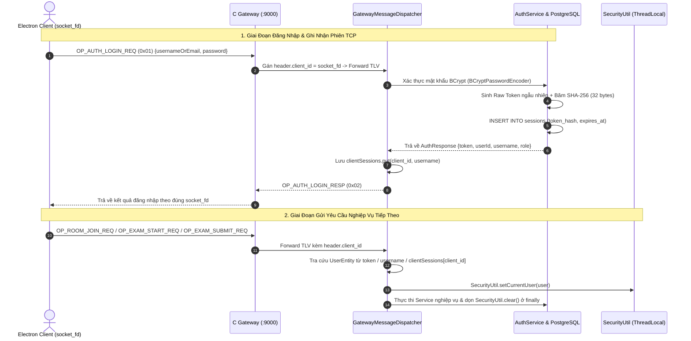

# Kiến Trúc Bảo Mật, Quản Lý Phiên Làm Việc (Session Token) & Chống Gian Lận Đề Thi

> **Phân hệ:** Máy chủ Backend (`server/`) — Nền tảng Headless Spring Boot TCP Worker & Java 21 LTS  
> **Cơ chế xác thực:** Mã phiên ngẫu nhiên bảo mật cao (Opaque Session Token) kết hợp Băm nhị phân SHA-256 & Ánh xạ phiên TCP `clientId`  
> **Bộ điều phối trung tâm:** [GatewayMessageDispatcher.java](../src/main/java/com/example/server/gateway/GatewayMessageDispatcher.java)  
> **Tiện ích ngữ cảnh:** [SecurityUtil.java](../src/main/java/com/example/server/security/SecurityUtil.java)

---

## 1. Tổng Quan Kiến Trúc Xác Thực (Opaque Token & Phiên Kênh TCP)

Hệ thống `mooc-clone` vận hành hoàn toàn qua kênh truyền nhị phân **16-byte TLV Framing** thông qua **C Communication Engine (`server-c/` tại cổng `:9000`)**. Để bảo đảm thu hồi phiên tức thì (Instant Revocation) và định danh chính xác từng máy trạm **Electron Desktop**, hệ thống kết hợp **Opaque Session Token băm SHA-256** trong CSDL với cơ chế gắn phiên trực tiếp theo `client_id` (`socket_fd`) tại [`GatewayMessageDispatcher`](../src/main/java/com/example/server/gateway/GatewayMessageDispatcher.java):



---

## 2. Quy Trình Kỹ Thuật Chi Tiết Của Session Token SHA-256

### 2.1. Sinh Token & Lưu Giá Trị Băm
1. Khi thí sinh đăng nhập thành công qua `OP_AUTH_LOGIN_REQ (0x01)`, [`AuthServiceImpl`](../src/main/java/com/example/server/service/impl/AuthServiceImpl.java) sử dụng `java.security.SecureRandom` để tạo chuỗi ngẫu nhiên 32 bytes.
2. Máy chủ **tuyệt đối không lưu token nguyên bản** vào CSDL. Thay vào đó:
   - Chuỗi token được băm bằng giải thuật **SHA-256** tạo thành mảng nhị phân 32 bytes (`byte[]`).
   - Mảng 32 bytes này được lưu trữ trong cột `token_hash` kiểu `BYTEA` của bảng `sessions` (có `UNIQUE INDEX`).

### 2.2. Gắn Ngữ Cảnh Người Dùng Tại `GatewayMessageDispatcher`
Tại mỗi khung tin TLV gửi từ C Gateway sang Java Worker:
1. `GatewayMessageDispatcher` kiểm tra `token` (tra cứu SHA-256 trong bảng `sessions` còn hạn và chưa thu hồi) hoặc `username` kết hợp bảng phiên `clientSessions` theo `header.getClientId()`.
2. Nạp thực thể `UserEntity` vào [`SecurityUtil`](../src/main/java/com/example/server/security/SecurityUtil.java) (`ThreadLocal<UserEntity>`) cho luồng thực thi hiện tại và luôn giải phóng qua `SecurityUtil.clear()` trong khối `finally`.

---

## 3. Bốn (04) Nguyên Tắc Chống Gian Lận Đề Thi Cốt Lõi

### 3.1. Nguyên Tắc 1: Ràng Buộc Khóa Ngoại Kép Chống Chọn Nhầm Phương Án
CSDL thiết lập ràng buộc khóa ngoại kép tại bảng `attempt_answers`:
```sql
CONSTRAINT fk_attempt_answers_option_same_question 
    FOREIGN KEY (question_id, selected_option_id) 
    REFERENCES question_options(question_id, id)
```
Ràng buộc này bảo đảm ở mức CSDL rằng phương án `selected_option_id` được chọn **bắt buộc phải thuộc về** câu hỏi `question_id` đó.

### 3.2. Nguyên Tắc 2: Khóa Đóng Băng Bài Thi Tự Động (Exam Freezing) & Grace Period 2000ms
Khi thời gian làm bài vượt quá `deadline_at` (cộng dung sai trễ mạng 2 giây) hoặc bài thi đã chuyển sang trạng thái `SUBMITTED` / `TIMED_OUT`, [`ExamAttemptServiceImpl`](../src/main/java/com/example/server/service/impl/ExamAttemptServiceImpl.java) tự động đóng băng lượt thi và từ chối mọi yêu cầu sửa đáp án.

### 3.3. Nguyên Tắc 3: Phòng Chống Truy Cập Trái Phép Giữa Các Thí Sinh (Anti-IDOR)
Mọi thao tác lưu đáp án (`submitAnswer`), nộp bài (`submitExam`) và xem kết quả (`getResult`) đều đối chiếu chủ sở hữu lượt thi (`attempt.getUser().getId()`) với người dùng trong ngữ cảnh phiên hiện tại.

### 3.4. Nguyên Tắc 4: Mã Hóa Mật Khẩu BCrypt Thuần Khiết
100% mật khẩu người dùng được băm qua `BCryptPasswordEncoder` (`spring-security-crypto`) cấu hình tại [`SecurityConfig`](../src/main/java/com/example/server/config/SecurityConfig.java).

---

## 4. Liên Kết Đối Chiếu

- Đặc tả giao thức nhị phân TLV 16B và danh mục Opcodes: [realtime-network-subsystem.md](realtime-network-subsystem.md) & [../../server-c/README.md](../../server-c/README.md).
- Kiến trúc CSDL 3NF và bảng `sessions`: [database-architecture.md](database-architecture.md).
