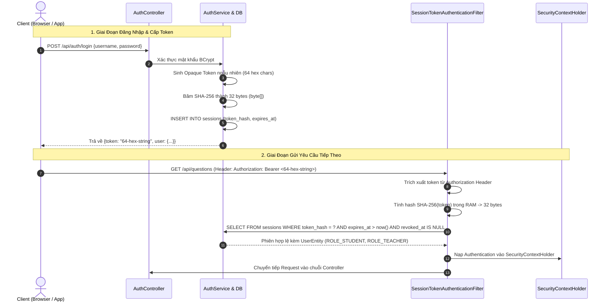

# Kiến Trúc Bảo Mật, Quản Lý Phiên Làm Việc (Session Token) & Chống Gian Lận Đề Thi

> **Phân hệ:** Máy chủ Backend (`server/`) — Nền tảng Spring Security 6.4.3 & Java 21 LTS  
> **Cơ chế xác thực:** Mã phiên ngẫu nhiên bảo mật cao (Opaque Session Token) kết hợp Băm nhị phân SHA-256  
> **Bộ lọc trung tâm:** [SessionTokenAuthenticationFilter.java](../src/main/java/com/example/server/security/SessionTokenAuthenticationFilter.java)  
> **Tiện ích ngữ cảnh:** [SecurityUtil.java](../src/main/java/com/example/server/security/SecurityUtil.java)

---

## 1. Tổng Quan Kiến Trúc Xác Thực (Opaque Token vs Stateless JWT)

Trong các hệ thống thi trắc nghiệm trực tuyến đòi hỏi tính bảo mật và kiểm soát nghiêm ngặt, việc sử dụng JWT (JSON Web Token) tự chứa thông tin phía Client bộc lộ các nhược điểm chí mạng:
- **Khó thu hồi tức thì (Instant Revocation):** Khi thí sinh đăng nhập trên thiết bị thứ 2 hoặc bị giám thị đình chỉ thi, JWT không thể bị hủy ngay lập tức mà phải đợi đến khi hết hạn hoặc phải duy trì một danh sách đen (Blacklist) phức tạp trong bộ nhớ cache.
- **Rò rỉ thông tin (Payload Exposure):** Dù mã hóa hay không, payload của JWT có thể bị giải mã Base64 dễ dàng ở phía Client.

Vì vậy, `mooc-clone` lựa chọn cơ chế **Mã phiên làm việc ngẫu nhiên (Opaque Session Token)** kết hợp với hàm băm nhị phân mật mã học **SHA-256**:



---

## 2. Quy Trình Kỹ Thuật Chi Tiết Của Session Token SHA-256

### 2.1. Sinh Token & Lưu Giá Trị Băm
1. Khi thí sinh đăng nhập thành công qua `POST /api/auth/login`, máy chủ sử dụng bộ sinh số ngẫu nhiên an toàn mã hóa (`java.security.SecureRandom`) để tạo chuỗi ngẫu nhiên 32 bytes (biểu diễn dưới dạng 64 ký tự Hexadecimal).
2. Chuỗi ký tự Hex này là **Token nguyên bản (Raw Token)**, chỉ được trả về duy nhất một lần cho Client lưu trong Header `Authorization: Bearer <TOKEN>`.
3. Máy chủ **tuyệt đối không lưu token nguyên bản** vào CSDL (phòng ngừa trường hợp lộ lọt cơ sở dữ liệu). Thay vào đó:
   - Máy chủ băm chuỗi này bằng giải thuật **SHA-256** tạo thành mảng nhị phân chính xác 32 bytes (`byte[]`).
   - Mảng 32 bytes này được lưu trữ trong cột `token_hash` kiểu `BYTEA` của bảng `sessions`.
   - Cột `token_hash` được đánh chỉ mục `UNIQUE INDEX`, cho phép tra cứu với độ phức tạp $O(1)$.

### 2.2. Kiểm Tra Phiên Làm Việc Tại `SessionTokenAuthenticationFilter`
Tại mỗi Request gửi tới API:
1. Bộ lọc kiểm tra Header `Authorization`. Nếu không có tiền tố `Bearer `, request được chuyển tiếp cho các endpoint công khai (Public Endpoints).
2. Nếu có token, bộ lọc tính toán hash SHA-256 ngay trong bộ nhớ và truy vấn CSDL:
   ```sql
   SELECT s.*, u.* FROM sessions s
   JOIN users u ON s.user_id = u.id
   WHERE s.token_hash = :tokenHash
     AND s.expires_at > CURRENT_TIMESTAMP
     AND s.revoked_at IS NULL
     AND u.status = 'ACTIVE';
   ```
3. Nếu tìm thấy bản ghi hợp lệ:
   - Khởi tạo đối tượng `CustomUserDetails` chứa `userId`, `username`, `role`.
   - Đặt `UsernamePasswordAuthenticationToken` vào `SecurityContextHolder.getContext()`.
4. Nếu token hết hạn hoặc đã bị thu hồi (`revoked_at IS NOT NULL`):
   - Xóa bỏ ngữ cảnh bảo mật, trả về mã lỗi HTTP 401 Unauthorized thông qua [CustomAuthenticationEntryPoint.java](../src/main/java/com/example/server/security/CustomAuthenticationEntryPoint.java).

---

## 3. Bốn (04) Nguyên Tắc Chống Gian Lận Đề Thi Cốt Lõi

Để bảo đảm tính công bằng tuyệt đối cho các kỳ thi trực tuyến, hệ thống thiết lập 4 tầng phòng thủ độc lập:

### 3.1. Nguyên Tắc 1: Ẩn Hoàn Toàn Cờ Đáp Án Đúng Phía Client
- Trong bảng `question_options`, cột `is_correct` lưu trữ đáp án đúng (`true`/`false`).
- Khi thí sinh bắt đầu thi hoặc lấy danh sách câu hỏi trong phòng thi, DTO gửi về Client ([QuestionOptionResponse](../src/main/java/com/example/server/dto/question/QuestionOptionResponse.java)) chỉ chứa `id`, `content`, `position`.
- Thuộc tính `is_correct` bị loại bỏ hoàn toàn khỏi JSON serialize, ngăn chặn triệt để hành vi bật DevTools (F12) để xem trước đáp án.
- Cờ `is_correct` chỉ được giải mã và gửi kèm sau khi bài thi đã chính thức chuyển sang trạng thái kết thúc (`SUBMITTED`).

### 3.2. Nguyên Tắc 2: Ràng Buộc Khóa Ngoại Kép Chống Chọn Nhầm Phương Án
- **Nguy cơ:** Kẻ tấn công có thể sửa request gửi ID của phương án đúng thuộc câu hỏi khác vào câu hỏi hiện tại.
- **Giải pháp:** CSDL thiết lập ràng buộc khóa ngoại kép tại bảng `attempt_answers`:
  ```sql
  CONSTRAINT fk_attempt_answers_option_same_question 
      FOREIGN KEY (question_id, selected_option_id) 
      REFERENCES question_options(question_id, id)
  ```
  Ràng buộc này bảo đảm ở mức CSDL rằng phương án `selected_option_id` được chọn **bắt buộc phải là con trực tiếp** của câu hỏi `question_id` đó, ngăn chặn mọi cuộc tấn công gian lận payload.

### 3.3. Nguyên Tắc 3: Khóa Đóng Băng Bài Thi Tự Động (Exam Freezing)
- Khi thời gian làm bài vượt quá `deadline_at`, hoặc bài thi chuyển sang một trong các trạng thái: `SUBMITTED`, `AUTO_SUBMITTED`, `TERMINATED`:
- Tầng Service ([ExamAttemptServiceImpl.java](../src/main/java/com/example/server/service/impl/ExamAttemptServiceImpl.java)) sẽ từ chối ngay lập tức mọi yêu cầu nộp hoặc sửa đáp án tiếp theo bằng `AppException(ErrorCode.EXAM_ALREADY_SUBMITTED)`.

### 3.4. Nguyên Tắc 4: Phòng Chống Tấn Công Truy Cập Trái Phép (Anti-IDOR)
- Mọi API truy vấn bài thi (`GET /api/attempts/{id}/result`) hoặc nộp bài (`POST /api/attempts/{id}/submit`) đều kiểm tra:
  ```java
  if (!attempt.getUser().getId().equals(currentUser.getId()) && !SecurityUtil.isAdmin()) {
      throw new AppException(ErrorCode.FORBIDDEN, "Bạn không có quyền can thiệp bài thi này");
  }
  ```
- Thí sinh tuyệt đối không thể thao tác trên bài thi của thí sinh khác dù biết trước ID của bài thi.

---

## 4. Quản Lý Mật Khẩu & Phân Quyền Hệ Thống

1. **Mã Hóa Mật Khẩu (BCrypt):**
   - 100% mật khẩu người dùng được băm qua `BCryptPasswordEncoder` với độ phức tạp (Strength) là 10. Mật khẩu dạng plain-text không bao giờ xuất hiện trong log hoặc CSDL.
2. **Phân Quyền Vai Trò (System Roles):**
   - `ROLE_STUDENT`: Thí sinh thông thường, tham gia phòng thi, làm bài thi, xem kết quả cá nhân.
   - `ROLE_TEACHER`: Giáo viên, quản lý ngân hàng câu hỏi, tạo phòng thi, xem bảng xếp hạng tổng quan và quản lý người dùng.
   - Các API nhạy cảm được bảo vệ bằng annotation `@PreAuthorize("hasRole('TEACHER')")` ở tầng Controller.

---

## 5. Liên Kết Đối Chiếu

- Đặc tả danh mục endpoint xác thực (`/api/auth/login`, `/api/auth/register`, `/api/auth/me`): [api-specification.md](api-specification.md).
- Cẩm nang kiểm tra ngữ cảnh người dùng trong các API nghiệp vụ: [CUSTOM_API_GUIDE.md](ai-guides/CUSTOM_API_GUIDE.md).
