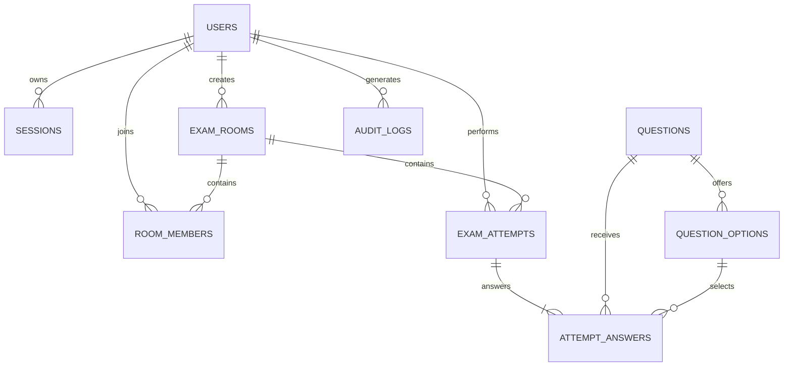

# Hệ thống Thi Trắc nghiệm Trực tuyến — Thiết kế Cơ sở Dữ liệu (Chuẩn 3NF & Tinh gọn)

**Cơ sở dữ liệu:** PostgreSQL 14+  
**Schema:** Toàn bộ các bảng (tables), khung nhìn (views), hàm (functions), và trigger được tạo trong schema `public`.  
**Kịch bản SQL:** [online_exam_schema.sql](online_exam_schema.sql) (Khởi tạo CSDL) và [online_exam_seed_data.sql](online_exam_seed_data.sql) (Dữ liệu mẫu kiểm thử)

---

## 1. Các Quyết định Thiết kế (Design Decisions)

- **Tinh gọn và tuân thủ nghiêm ngặt 3NF (Third Normal Form):**
  - Loại bỏ các bảng lookup/cấu hình dư thừa (`topics`, `difficulty_levels`, `room_difficulty_configs`, `room_topics`).
  - Thuộc tính `topic` (VARCHAR) và `difficulty` (`EASY`, `MEDIUM`, `HARD`) được chuẩn hóa trực tiếp vào bảng `questions`.
  - Cấu hình số lượng câu hỏi theo độ khó (`easy_count`, `medium_count`, `hard_count`) và chủ đề phòng thi (`topic`, `NULL` = tất cả chủ đề) được tích hợp trực tiếp vào bảng `exam_rooms`.
  - Tổng số lượng câu hỏi của phòng thi được tính toán trực tiếp từ `(easy_count + medium_count + hard_count)`.
- **Triệt tiêu phụ thuộc vòng tròn (Circular / Diamond Dependencies) & Loại bỏ Snapshot trùng lặp:**
  - Thay thế cụm 3 bảng snapshot con trước đây (`attempt_questions`, `attempt_question_options`, `attempt_answers`) bằng **duy nhất bảng `attempt_answers`** theo chuẩn 3NF: `(attempt_id, question_id, position, selected_option_id, answered_at)`.
  - Khóa ngoại phức hợp `(question_id, selected_option_id)` tham chiếu tới `question_options (question_id, id)` đảm bảo thí sinh không thể chọn nhầm phương án của câu hỏi khác.
  - Bảo toàn lịch sử câu hỏi bằng cơ chế Soft-delete (`status = 'ARCHIVED'`) trên ngân hàng câu hỏi.
- **Không lưu trữ trường phái sinh dư thừa:**
  - Không lưu trữ các trường dữ liệu tổng hợp như `correct_count`, `wrong_count`, `unanswered_count`, `correct_percent` hay `score_10` trong bảng cơ sở.
  - Khung nhìn `v_attempt_results` sẽ tính toán trực tiếp và tức thì các giá trị này từ `attempt_answers` và cờ `is_correct` của `question_options`.
- **Quản lý phân quyền và phiên làm việc bảo mật:**
  - Quản lý phiên làm việc máy chủ độc lập (`sessions`) với chuỗi băm token 32-byte (SHA-256 binary hash).
  - Bảng `room_members` đóng vai trò danh sách thí sinh trong phòng chờ và cơ chế Danh sách trắng (Whitelist) cho các phòng thi riêng tư (`PRIVATE`).

---

## 2. Danh mục Bảng (Tables - 9 Bảng Cốt lõi)

| Tên bảng (Table) | Mục đích sử dụng (Purpose) | Ràng buộc quan trọng (Important constraints) |
|---|---|---|
| `users` | Tài khoản người dùng, vai trò (`role`) và trạng thái tài khoản | Tên người dùng (`username`) duy nhất không phân biệt hoa thường; email duy nhất không phân biệt hoa thường (tùy chọn); kiểm tra hợp lệ role/status |
| `sessions` | Phiên đăng nhập phía máy chủ (Server-side login sessions) | Giá trị băm token (`token hash`) 32-byte duy nhất; trường thời hạn hết hạn (`expiry`) và thu hồi (`revocation`) |
| `questions` | Ngân hàng câu hỏi trắc nghiệm | `topic` không rỗng; `difficulty` trong `('EASY', 'MEDIUM', 'HARD')`; `question_type` hiện tại là `SINGLE_CHOICE`; trạng thái `ACTIVE`/`ARCHIVED` |
| `question_options` | Các phương án lựa chọn cho câu hỏi | Thứ tự vị trí lựa chọn duy nhất (`position`); chỉ mục duy nhất một phần đảm bảo mỗi câu hỏi có tối đa một phương án đúng; khóa duy nhất phức hợp `(question_id, id)` |
| `exam_rooms` | Phòng thi trắc nghiệm, cấu hình đề thi, vòng đời và thời gian | Mã phòng duy nhất; `(easy_count + medium_count + hard_count) > 0`; kiểm tra tính hợp lệ của status, visibility, duration, giới hạn người tham gia và mốc thời gian |
| `room_members` | Thí sinh tham gia phòng thi / Whitelist phòng riêng tư | Khóa chính phức hợp `(room_id, user_id)` ngăn chặn trùng lặp thành viên |
| `exam_attempts` | Một lượt thi chính thức (`EXAM`) hoặc luyện tập (`PRACTICE`) | Kiểm tra tính nhất quán giữa chế độ/phòng thi; kiểm tra deadline, thời điểm nộp bài và chấm điểm; mỗi người dùng chỉ có một lượt thi cho một phòng thi |
| `attempt_answers` | Danh sách câu hỏi và câu trả lời của thí sinh (Chuẩn 3NF) | Khóa chính phức hợp `(attempt_id, question_id)`; vị trí duy nhất trong lượt thi `(attempt_id, position)`; khóa ngoại phức hợp bảo đảm option thuộc về đúng câu hỏi |
| `audit_logs` | Ghi nhận nhật ký sự kiện bảo mật và hoạt động nghiệp vụ | Khóa ngoại người thực hiện tùy chọn; chỉ mục dấu thời gian; trường siêu dữ liệu dạng đối tượng JSONB |

---

## 3. Khung nhìn (Views)

| Tên Khung nhìn (View) | Mục đích sử dụng (Purpose) |
|---|---|
| `v_attempt_results` | Tính toán số lượng tổng số câu, câu đúng, câu sai, câu chưa trả lời, tỷ lệ % đúng (`correct_percent`) và quy đổi thang điểm 10 (`score_10`) cho các lượt thi đã hoàn thành |
| `v_room_list` | Danh sách phòng thi bao gồm tổng số câu hỏi được tổng hợp trực tiếp từ `(easy_count + medium_count + hard_count)` và số lượng thành viên tham gia |
| `v_room_results` | Kết quả thi của các thí sinh trong các phòng thi có trạng thái `ENDED`, bao gồm số câu đúng, tỷ lệ % và `score_10` phục vụ bảng xếp hạng |
| `v_user_statistics` | Tổng hợp kết quả các lượt thi đã hoàn thành theo từng người dùng, tỷ lệ phần trăm đúng tổng thể (`overall_correct_percent`) và điểm thang 10 (`overall_score_10`) |
| `v_user_topic_performance` | Thống kê số câu đúng, tỷ lệ % đúng và điểm số theo từng chủ đề câu hỏi trực tiếp từ `q.topic`, phục vụ vẽ biểu đồ phân tích năng lực (radar/bar chart) |

---

## 4. Sơ đồ Quan hệ Thực thể (Mermaid ERD)



---

## 5. Nguyên lý Chuẩn hóa 3NF & Loại bỏ Phụ thuộc Vòng tròn

1. **Khắc phục lỗi vi phạm 3NF của mô hình Snapshot cũ:**
   - Trong mô hình cũ, bảng `attempt_questions` vừa lưu `source_question_id` (trỏ tới `questions`), vừa lưu text, topic, difficulty. Điều này tạo ra phụ thuộc bắc cầu $PK \to source\_question\_id \to (text, topic, difficulty)$, vi phạm định nghĩa 3NF.
   - Bảng `attempt_question_options` vừa trỏ tới `attempt_questions` vừa trỏ tới `question_options`, tạo ra phụ thuộc vòng tròn dạng kim cương (diamond dependency).
   - Mô hình 3NF mới hợp nhất toàn bộ vào bảng `attempt_answers`. Mọi thuộc tính câu hỏi và phương án được tra cứu trực tiếp từ bảng gốc `questions` và `question_options`.
2. **Cơ chế đảm bảo toàn vẹn dữ liệu của `attempt_answers`:**
   - Khóa chính `(attempt_id, question_id)`: Một lượt thi chỉ có tối đa một bản ghi cho mỗi câu hỏi được phân phối.
   - Khóa duy nhất `(attempt_id, position)`: Đảm bảo thứ tự xuất hiện các câu hỏi trong đề thi là duy nhất và tuần tự.
   - Khóa ngoại phức hợp:
     ```sql
     CONSTRAINT fk_attempt_answers_option_same_question
         FOREIGN KEY (question_id, selected_option_id)
         REFERENCES public.question_options (question_id, id)
         ON DELETE RESTRICT
     ```
     Ràng buộc này triệt tiêu hoàn toàn khả năng người dùng hoặc lỗi phần mềm chọn một phương án `selected_option_id` không thuộc về `question_id` tương ứng.

---

## 6. Các Bất biến Ứng dụng Bắt buộc Thực thi bằng Giao tác (Application Invariants)

1. **Điều kiện câu hỏi khả dụng:** Trước khi đưa một câu hỏi hoạt động (`ACTIVE`) vào sử dụng, bắt buộc câu hỏi phải có tối thiểu 2 phương án lựa chọn và chính xác 1 phương án đúng.
2. **Cấu hình phòng thi hợp lệ:** `(easy_count + medium_count + hard_count) > 0`. Nếu có chỉ định `topic`, chỉ những câu hỏi thuộc chủ đề đó mới được chọn; nếu `topic` là `NULL`, câu hỏi từ mọi chủ đề đang hoạt động đều hợp lệ.
3. **Phòng thi riêng tư (Private Room):** Kiểm soát truy cập bằng cơ chế Whitelist. Chủ phòng thêm danh sách thí sinh hợp lệ vào `room_members` trước khi phòng thi bắt đầu.
4. **Bắt đầu phòng thi & Phân bổ đề thi:**
   - Khi chủ phòng bắt đầu thi, hệ thống chọn ngẫu nhiên danh sách câu hỏi theo cấu hình độ khó và chủ đề.
   - Với mỗi thành viên trong `room_members`, khởi tạo một bản ghi `exam_attempts` và chèn đồng loạt danh sách câu hỏi vào `attempt_answers` với `selected_option_id = NULL` và `position` từ $1 \dots N$.
   - Toàn bộ thao tác diễn ra trong một giao tác (transaction) duy nhất để đảm bảo tính nhất quán.
5. **Cập nhật đáp án linh hoạt:** Trong suốt thời gian làm bài, khi thí sinh chọn hoặc thay đổi phương án, ứng dụng thực hiện câu lệnh `UPDATE attempt_answers SET selected_option_id = ?, answered_at = CURRENT_TIMESTAMP WHERE attempt_id = ? AND question_id = ?`.
6. **Thu bài & Chấm điểm tự động:**
   - Khi thí sinh nộp bài hoặc bộ lập lịch (scheduler) quét thấy đã hết giờ làm bài (`CURRENT_TIMESTAMP >= deadline_at`), hệ thống chuyển trạng thái `exam_attempts` sang `SUBMITTED` hoặc `AUTO_SUBMITTED`, đồng thời cập nhật `submitted_at` và `graded_at`.
   - Sau khi bài thi đã chốt, mọi yêu cầu `UPDATE attempt_answers` tiếp theo đều bị từ chối.
7. **Bảo mật đáp án:** Cột `is_correct` của bảng `question_options` tuyệt đối không bao giờ được gửi xuống client trước khi bài thi kết thúc.
8. **Bảo mật phiên làm việc:** Chỉ lưu trữ chuỗi băm 32-byte của token phiên đăng nhập. Không ghi nhận thông tin đăng nhập, token hay mật khẩu vào trường `audit_logs.metadata`.

---

## 7. Hướng dẫn Triển khai (How to Apply)

1. Thực thi kịch bản `online_exam_schema.sql` vào cơ sở dữ liệu PostgreSQL bằng công cụ dòng lệnh `psql` hoặc pgAdmin (kịch bản có sẵn khối `DROP IF EXISTS ... CASCADE` tự động dọn sạch các bảng hiện tại và bảng cũ trước khi tạo mới):
   ```bash
   psql -U postgres -d online_exam_db -f server/online_exam_schema.sql
   ```
2. (Tùy chọn) Thực thi kịch bản `online_exam_seed_data.sql` để nạp bộ dữ liệu mẫu kiểm thử đầy đủ:
   ```bash
   psql -U postgres -d online_exam_db -f server/online_exam_seed_data.sql
   ```
