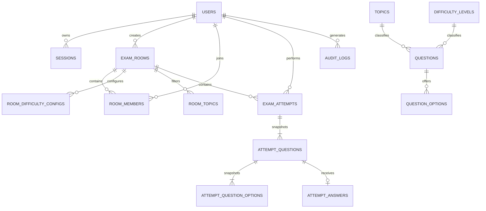

# Hệ thống Thi Trắc nghiệm Trực tuyến — Thiết kế Cơ sở Dữ liệu

**Cơ sở dữ liệu:** PostgreSQL 14+  
**Schema:** Toàn bộ các bảng (tables), khung nhìn (views), hàm (functions), và trigger được tạo trong schema `public`.  
**Kịch bản SQL:** `online_exam_schema.sql`

---

## 1. Các Quyết định Thiết kế (Design Decisions)

- Sử dụng các bảng cơ sở chuẩn hóa (normalized base tables) cho người dùng (`users`), phiên đăng nhập (`sessions`), chủ đề (`topics`), mức độ khó (`difficulty_levels`), câu hỏi (`questions`), phương án lựa chọn (`options`), phòng thi (`rooms`), thành viên phòng thi (`room_members`), lượt thi (`attempts`), câu trả lời (`answers`), và nhật ký hoạt động (`audit_logs`).
- Tổng số lượng câu hỏi được cấu hình cho một phòng thi được tính toán động từ `SUM(room_difficulty_configs.question_count)`, thay vì lưu trữ trùng lặp trên bảng `exam_rooms`.
- Lưu trữ bản sao chụp (snapshots) của câu hỏi và các phương án lựa chọn trong từng lượt thi (attempt), đảm bảo việc chỉnh sửa ngân hàng câu hỏi gốc không làm thay đổi nội dung các bài thi đã diễn ra trong lịch sử.
- Không lưu trữ các trường dữ liệu trùng lặp như `correct_count`, `wrong_count`, `unanswered_count` hay tỷ lệ phần trăm (percentage) trong bảng cơ sở. Khung nhìn `v_attempt_results` sẽ tính toán trực tiếp các giá trị này từ snapshots và các câu trả lời đã chốt của lượt thi.
- Các luồng nghiệp vụ cốt lõi (bắt đầu phòng thi, xử lý thời hạn chót deadline, cập nhật câu trả lời, nộp bài, chấm điểm) được duy trì tại tầng dịch vụ ứng dụng backend (application services) và bắt buộc phải thực thi trong các giao tác (transactions). Các ràng buộc cơ sở dữ liệu đóng vai trò là ranh giới bảo toàn tính toàn vẹn bổ trợ.
- Không sử dụng stored procedure để tránh ràng buộc nghiệp vụ chặt chẽ vào riêng hệ quản trị PostgreSQL. Hàm trigger duy nhất được sử dụng nhằm mục đích tự động cập nhật các cột dấu thời gian `updated_at`.

---

## 2. Danh mục Bảng (Tables)

| Tên bảng (Table) | Mục đích sử dụng (Purpose) | Ràng buộc quan trọng (Important constraints) |
|---|---|---|
| `users` | Tài khoản người dùng, vai trò (role) và trạng thái tài khoản | Tên người dùng (`username`) duy nhất không phân biệt hoa thường; email duy nhất không phân biệt hoa thường (tùy chọn); kiểm tra hợp lệ role/status |
| `sessions` | Phiên đăng nhập phía máy chủ (Server-side login sessions) | Giá trị băm token (`token hash`) 32-byte duy nhất; trường thời hạn hết hạn (`expiry`) và thu hồi (`revocation`) |
| `topics` | Chủ đề câu hỏi | Tên chủ đề duy nhất không phân biệt hoa thường; trạng thái hoạt động (`active`) hoặc lưu trữ (`archived`) |
| `difficulty_levels` | Dữ liệu tra cứu mức độ khó | Mã định danh (`code`) và thứ tự sắp xếp duy nhất; khởi tạo sẵn các giá trị `EASY`, `MEDIUM` và `HARD` |
| `questions` | Ngân hàng câu hỏi hiện tại | Khóa ngoại (FK) liên kết tới topic/difficulty; hiện tại hỗ trợ `SINGLE_CHOICE`; trạng thái `active`/`archived` |
| `question_options` | Các phương án lựa chọn cho câu hỏi gốc | Thứ tự vị trí lựa chọn duy nhất (`position`); chỉ mục duy nhất một phần (partial unique index) đảm bảo mỗi câu hỏi có tối đa một phương án đúng |
| `exam_rooms` | Chủ sở hữu phòng, cấu hình truy cập, vòng đời và thời gian thi | Kiểm tra tính hợp lệ của status, visibility, duration, giới hạn người tham gia và thời gian thi; mã phòng (`room code`) duy nhất không phân biệt hoa thường |
| `room_difficulty_configs` | Số lượng câu hỏi được cấu hình theo từng mức độ khó cho phòng thi | Khóa chính phức hợp (Composite PK) `(room_id, difficulty_id)`; số lượng câu hỏi phải là số dương |
| `room_topics` | Danh sách trắng (allowlist) chủ đề tùy chọn cho phòng thi | Khóa chính phức hợp `(room_id, topic_id)`; nếu không có dòng nào thì mặc định tất cả chủ đề đang hoạt động đều hợp lệ |
| `room_members` | Thí sinh được chấp thuận tham gia phòng thi | Khóa chính phức hợp `(room_id, user_id)` ngăn chặn trùng lặp thành viên |
| `exam_attempts` | Một lượt thi chính thức hoặc luyện tập của thí sinh | Kiểm tra tính nhất quán giữa chế độ/phòng thi, kiểm tra vòng đời, deadline, thời điểm nộp bài và chấm điểm; mỗi người dùng chỉ có một lượt thi cho một phòng thi |
| `attempt_questions` | Bản sao chụp (snapshot) nội dung câu hỏi và phân loại theo từng lượt thi | Thứ tự vị trí câu hỏi duy nhất; ngăn chặn trùng lặp câu hỏi gốc trong cùng một lượt thi |
| `attempt_question_options` | Snapshot nội dung/thứ tự phương án lựa chọn và cờ đáp án đúng cho câu hỏi trong lượt thi | Thứ tự vị trí phương án duy nhất; tối đa một phương án snapshot được đánh dấu là đáp án đúng |
| `attempt_answers` | Câu trả lời hiện tại cho từng câu hỏi trong lượt thi | Khóa chính là `attempt_question_id`; khóa ngoại phức hợp (composite FK) đảm bảo phương án được chọn phải thuộc về chính câu hỏi đó |
| `audit_logs` | Ghi nhận nhật ký sự kiện bảo mật và hoạt động nghiệp vụ | Khóa ngoại người thực hiện (actor FK) tùy chọn, chỉ mục dấu thời gian (timestamp indexes), trường siêu dữ liệu dạng đối tượng JSONB |

---

## 3. Khung nhìn (Views)

| Tên Khung nhìn (View) | Mục đích sử dụng (Purpose) |
|---|---|
| `v_attempt_results` | Tính toán số lượng tổng số câu, câu đúng, câu sai, câu chưa trả lời, tỷ lệ % đúng (`correct_percent`) và quy đổi thang điểm 10 (`score_10`) cho các lượt thi đã hoàn thành |
| `v_room_list` | Danh sách phòng thi bao gồm tổng số câu hỏi được tổng hợp từ cấu hình độ khó và số lượng thành viên tham gia |
| `v_room_results` | Kết quả thi của các thí sinh trong các phòng thi có trạng thái `ENDED`, bao gồm số câu đúng, tỷ lệ % và `score_10`; việc phân quyền truy cập kết quả vẫn bắt buộc phải được kiểm tra bởi backend |
| `v_user_statistics` | Tổng hợp kết quả các lượt thi đã hoàn thành theo từng người dùng, tỷ lệ phần trăm đúng tổng thể (`overall_correct_percent`) và điểm thang 10 (`overall_score_10`) nhằm hiển thị trên Dashboard |
| `v_user_topic_performance` | Thống kê số câu đúng, tỷ lệ % đúng và điểm số quy đổi theo từng chủ đề câu hỏi cho từng người dùng, phục vụ vẽ biểu đồ phân tích năng lực (radar/bar chart) |

Các khung nhìn trên là các khung nhìn thông thường (normal views), không phải khung nhìn cụ thể hóa (materialized views). Với quy mô dự án dự kiến, backend có thể truy vấn trực tiếp; việc sử dụng materialized view và lập lịch làm mới dữ liệu là chưa cần thiết ở giai đoạn ban đầu.

---

## 4. Sơ đồ Quan hệ Thực thể (Relationships)

---

## 5. Lưu ý về Chuẩn hóa và Snapshot (Normalization and Snapshot Notes)

- Mỗi phương án lựa chọn thuộc về một câu hỏi gốc; mỗi câu hỏi tham chiếu đến một chủ đề và một dòng tra cứu độ khó.
- Mỗi cấu hình độ khó của phòng thi được định danh bằng cặp `(room_id, difficulty_id)`.
- Câu trả lời hiện tại của từng người dùng được đại diện bởi một dòng `attempt_answers` tương ứng với mỗi dòng `attempt_questions`; nếu không có dòng nào nghĩa là câu hỏi chưa được trả lời.
- Lượt thi lưu trữ bản sao lịch sử (historical copies) của văn bản câu hỏi và các phương án lựa chọn. Sự nhân bản này là snapshot lịch sử có chủ đích, không phải bản sao sống (live copy) dùng để chỉnh sửa ngân hàng câu hỏi. Do đó, bất kỳ chỉnh sửa nào đối với câu hỏi gốc trong ngân hàng sẽ không làm thay đổi các lượt thi đã diễn ra.
- Các chỉ số tổng hợp kết quả được tính toán trực tiếp trong view nhằm tránh việc lưu trữ các giá trị tổng dư thừa có nguy cơ bị sai lệch (drift) so với câu trả lời thực tế.

---

## 6. Các Bất biến Ứng dụng Bắt buộc Thực thi bằng Giao tác (Application Invariants)

1. Trước khi đưa một câu hỏi hoạt động (`active`) vào sử dụng, bắt buộc câu hỏi phải có tối thiểu 2 phương án lựa chọn và chính xác 1 phương án đúng.
2. Mỗi phòng thi bắt buộc phải có ít nhất một dòng cấu hình trong `room_difficulty_configs`; tổng số lượng câu hỏi đã cấu hình chính là tổng số câu hỏi của cả phòng thi.
3. Phòng thi riêng tư (private room) được kiểm soát truy cập bằng cơ chế Whitelist (chủ phòng thêm danh sách thí sinh hợp lệ vào `room_members` trước khi phòng thi diễn ra); toàn bộ yêu cầu tham gia phòng ngoài danh sách hoặc sau khi phòng thi đã bắt đầu đều bị từ chối.
4. Khi bắt đầu phòng thi, thực hiện chọn tập câu hỏi một lần duy nhất và tạo các snapshot tương đương cho toàn bộ thí sinh đủ điều kiện, đảm bảo tất cả thí sinh đều nhận được đề thi đồng nhất. Việc lưu trữ snapshot và khởi tạo các attempt phải diễn ra trong cùng một transaction.
5. Một lượt thi luyện tập (practice attempt) sẽ tự tạo các snapshot riêng và không có `room_id`.
6. Việc cập nhật câu trả lời và hành động nộp bài phải được tuần tự hóa (serialize) bằng kỹ thuật khóa dòng (row locking) hoặc kiểm soát đồng thời lạc quan (optimistic concurrency). Sau khi đã chốt bài thi (finalized), toàn bộ câu trả lời trở thành dữ liệu bất biến (immutable).
7. Khi hết thời gian làm bài, bộ lập lịch (scheduler) đọc mốc thời gian deadline từ cơ sở dữ liệu và tự động chốt các attempt vẫn còn mở trong một transaction. Không được dựa vào bộ đếm thời gian trong bộ nhớ (in-memory timers) làm nguồn chân lý duy nhất.
8. Chỉ có backend mới được quyền truy vấn và kiểm tra cờ `is_correct_snapshot`; tuyệt đối không bao giờ được đưa thông tin này vào gói dữ liệu (payload) gửi xuống client trong khi thi.
9. Thực thi kiểm soát quyền truy cập (access control) tại tầng dịch vụ ứng dụng cho lịch sử thi, kết quả cá nhân và kết quả phòng thi. Một view bản thân nó không đóng vai trò như một ranh giới phân quyền độc lập.
10. Chỉ lưu trữ chuỗi băm (hash) của token phiên đăng nhập. Không ghi nhận thông tin đăng nhập, token hay bí mật bảo mật vào trường `audit_logs.metadata`.

---

## 7. Phạm vi Giao tác Khuyến nghị (Suggested Transaction Boundaries)

### Tạo phòng thi (Create room)
1. Thêm bản ghi vào `exam_rooms` với trạng thái `WAITING`.
2. Thêm các bản ghi vào `room_difficulty_configs` và các `room_topics` đã chọn trong cùng một transaction.
3. Tùy chọn thêm chủ phòng vào `room_members` nếu chủ phòng tham gia làm bài thi.
4. Kiểm tra hợp lệ (validate) rằng ngân hàng câu hỏi có đủ số lượng câu hỏi đang hoạt động cho từng kết hợp độ khó/chủ đề được yêu cầu.
5. Commit giao tác.

### Bắt đầu phòng thi (Start room)
1. Khóa dòng bản ghi phòng thi (lock room row) và xác thực trạng thái `WAITING` cùng quyền của chủ phòng.
2. Lựa chọn tập câu hỏi hợp lệ thỏa mãn cấu hình độ khó và danh sách chủ đề cho phép.
3. Cập nhật các trường `started_at`, `ends_at`, và trạng thái sang `RUNNING`.
4. Với mỗi thành viên hợp lệ, tạo một bản ghi `exam_attempts` cùng các snapshot câu hỏi/phương án bất biến sử dụng cùng đề thi và thứ tự đã chọn.
5. Commit giao tác, sau đó phát các sự kiện socket tới các client đang kết nối.

### Nộp bài hoặc Tự động nộp bài (Submit or auto-submit attempt)
1. Khóa dòng bản ghi lượt thi (lock attempt row) hoặc sử dụng kỹ thuật compare-and-swap qua phiên bản.
2. Nếu bài thi đã được chốt (finalized), trả về kết quả hiện có.
3. Kiểm tra tính hợp lệ về thời điểm nộp bài và trạng thái hiện tại.
4. Thiết lập trạng thái kết thúc (terminal status) và các dấu thời gian; từ chối mọi yêu cầu cập nhật câu trả lời gửi đến sau đó.
5. Commit giao tác. Khung nhìn kết quả sẽ tự động tính toán điểm số từ các snapshot và câu trả lời bất biến.

---

## 8. Hướng dẫn Triển khai (How to Apply)

Thực thi kịch bản `online_exam_schema.sql` vào một cơ sở dữ liệu PostgreSQL trống mới tạo bằng `psql`, pgAdmin, hoặc công cụ di chuyển dữ liệu (migration tool). Toàn bộ kịch bản được đóng gói trong một transaction duy nhất. 

Phía backend nên sử dụng câu lệnh chuẩn bị sẵn (prepared statements), quản lý transaction cho các quy trình làm việc trên nhiều bảng, và áp dụng công cụ quản lý migration cho các thay đổi schema trong tương lai.
